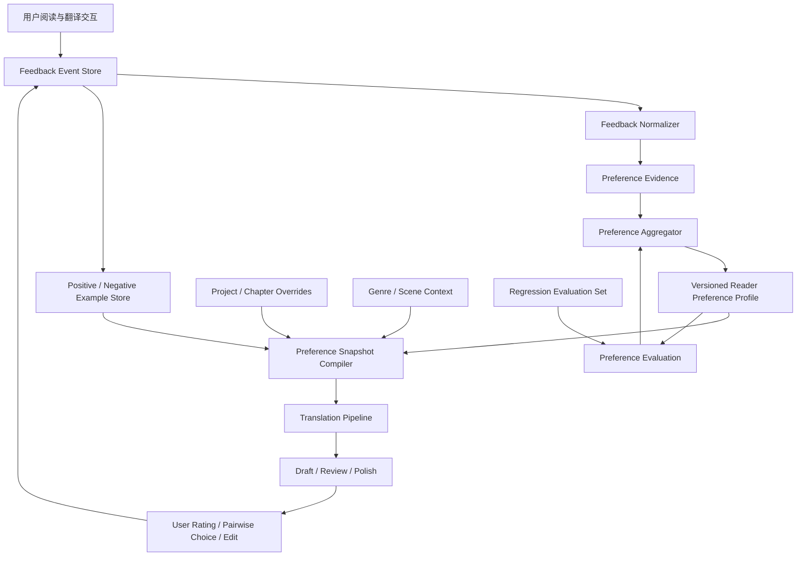
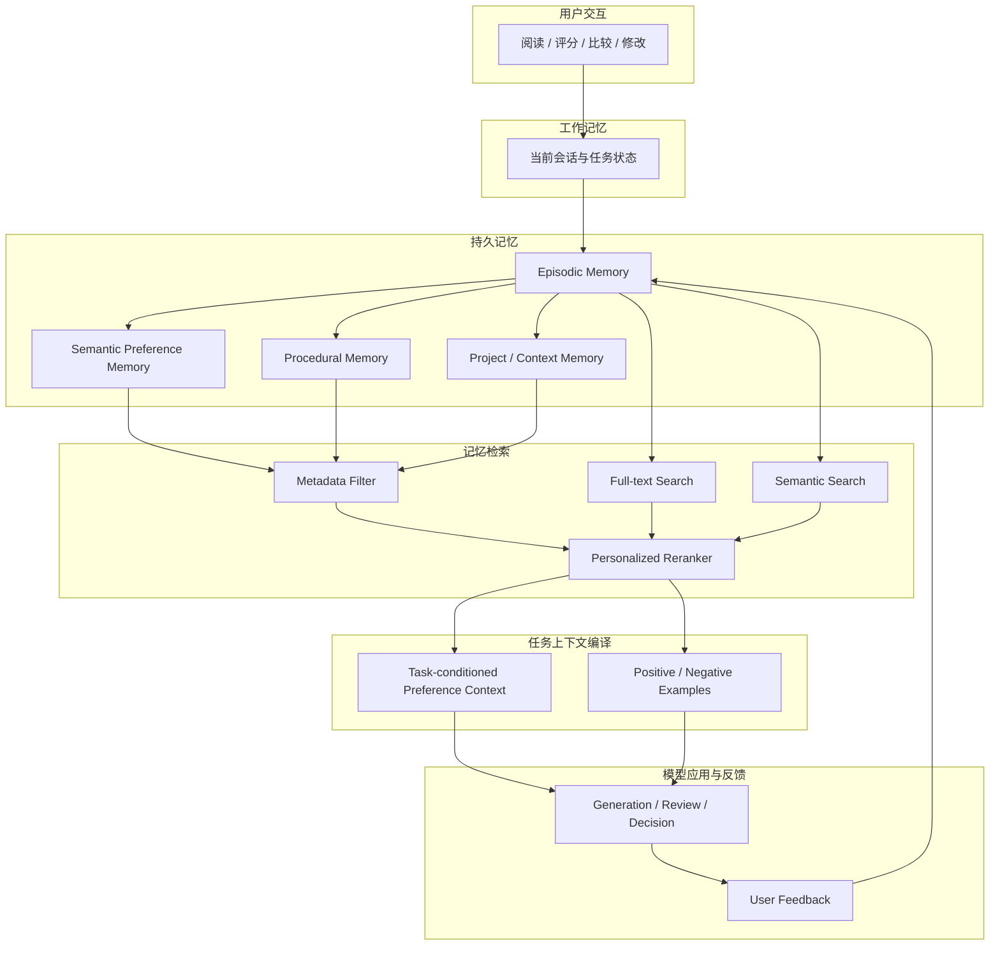

# 从阅读偏好到个性化文学翻译：如何让 LLM 在长期翻译与校对中学习一个人的审美

> 调研日期：2026-10-31  
> 适用场景：英文、日文等小说翻译；同一作品多种译风；读者逐段评分、比较、批注；跨章节、跨作品积累长期偏好。

## 摘要

个人文学阅读偏好不应被实现为一段不断膨胀的 system prompt，也不应简单等同于“喜欢某位作家的风格”。**记住用户做过什么，不等于理解用户喜欢什么；理解用户喜欢什么，也不等于知道当前任务应该调用哪些偏好。** 本文的目标是把个人偏好建模成一个有时间维度、有上下文条件、有证据链、可以持续修正的 **User Model**。更合适的实现是一个可版本化的 **Reader Preference Model（RPM，读者偏好模型）**：它从明确声明、译文评分、候选比较、局部修改、接受/拒绝建议和阅读行为中提取证据，形成多维、带置信度、带适用范围、可追溯和可撤销的偏好知识；翻译时再根据作品、语言方向、文体、叙事角色和当前任务检索出一份小型的 Preference Snapshot，贯穿初译、审校、风格润色和最终验收。

核心结论：

1. **记录反馈时保留原始事件，不要只保留模型总结出的偏好。** 用户的一次 8 分、一次改词和一句“不喜欢这个感觉”都是不同类型的证据。
2. **评分与比较结合。** 单独打分容易受段落难度、绝对标准漂移影响；对同一原文的 A/B 比较更容易表达“我更喜欢哪一个”，并可用 Bradley–Terry 等方法估计维度偏好。
3. **偏好必须多维、分场景。** 句子长短、词汇密度、叙述距离、对话口语度、意象保留、解释倾向、幽默、节奏等不能压成一个“文风分数”。
4. **区分读者偏好、作品风格、翻译约束和事实正确性。** 读者喜欢不等于忠实；风格可以调节，但人物关系、情节、视角、时态、专名和原文歧义不能被偏好覆盖。
5. **先用外部记忆与检索，不急于微调。** 结构化偏好、实例记忆、检索和提示词组合通常足以启动；积累高质量、稳定、覆盖多场景的反馈后，再考虑 LoRA / preference tuning。
6. **建立持续评估集。** 每次偏好模型升级，都用固定的原文片段、用户历史选择和反例回归，检查是否真的更符合读者，而不是只让模型自评更高。

---

## 核心论点：记忆、偏好理解与偏好调用是三个不同的问题

本文要解决的不是简单的“让模型记住用户”，而是三个彼此独立、又必须连接起来的问题：

> **记住用户做过什么，不等于理解用户喜欢什么；理解用户喜欢什么，也不等于知道当前任务应该调用哪些偏好。**

> **个人偏好应建模为一个有时间维度、有上下文条件、有证据链、可以持续修正的 User Model。**

第一句话描述的是系统能力边界。第二句话给出了目标架构。它们共同意味着：不能把原始聊天记录、偏好摘要、向量检索结果和最终 Prompt 混成一个“Memory”概念。

### 一、记住用户做过什么，不等于理解用户喜欢什么

用户做过的事情只是观察（observation），偏好是需要从观察中推断的潜在状态（latent preference）。例如，用户在一段英文心理描写中选择了译文 B，可能是因为它保留了人物迟疑，也可能只是因为 A 有一个词翻错了；一次 6 分可能反映段落本身难译，而不是用户不喜欢这种风格；用户修改一个词，也不等于认同整段译文的其余风格。

所以第一层必须保存**发生过什么、当时的任务是什么、用户做了什么、用户给出的理由是什么**。这些是证据，不是结论。第二层才从多条、不同来源的证据中提出偏好假设，并标记其范围和不确定性。

### 二、理解用户喜欢什么，也不等于知道当前任务应该调用哪些偏好

即使系统已经推断出用户通常偏好简洁、克制、不解释潜台词，也不能在每一个任务中无条件应用它。用户在人物独白中偏好含蓄，不代表景物描写也应该压低修辞；用户平时偏好短句，不代表当前作品中的意识流长句应该被拆碎；用户正在尝试一种新译风，也不代表长期偏好已经改变。

因此，每次执行任务都需要一个独立的 **Preference Applicability / Resolution** 阶段：读取当前请求和作品上下文，识别任务需要哪些偏好维度，判断哪些历史偏好在当前场景中有效，并允许“本次明确要求”覆盖推断出来的长期默认值。

### 三、把 User Model 看成带证据的、随时间变化的假设集合

User Model 不是一段永久正确的用户简介，而是一组可被支持、质疑、限定、替代和撤销的偏好主张（preference claims）。每条主张都应回答：用户偏好什么、在哪些上下文中成立、系统何时观察到证据、偏好从什么时候起被认为有效、结论来自明确声明还是间接推断、有哪些正反证据，以及新证据到来时应当如何修正。

这会把个性化从“把旧信息塞回 Prompt”提升为一个有数据模型、有推断策略、有运行时决策、有评估闭环的 User Modeling 问题。

## 1. 问题定义：要学习的不是“翻译风格”，而是读者的条件偏好

假设同一段英文小说可以有三个都基本正确的译法：

- A：句式贴近原文，保留从句结构，语义对应清楚，但中文略显翻译腔。
- B：调整语序，表达自然，节奏较快，但弱化了原文的迟疑感。
- C：更有文学修辞，词汇更有质感，但增加了原文没有明确表达的情绪。

用户可能在一般叙述中偏好 B，在人物意识流段落中偏好 A，在景物描写中偏好 C。因而“用户喜欢 B”不是可复用的知识；需要学习的是：

> 在什么文本条件、什么维度、什么权衡下，用户更偏好哪种表达，以及这种判断有多确定。

可以把偏好表示为条件函数：

[
P(y_i succ y_j mid x, c, d, u)
]

其中：

- (x)：源文及其上下文；
- (y_i,y_j)：两个候选译文；
- (c)：作品与场景上下文（叙述、对话、内心独白、动作、景物等）；
- (d)：评价维度（忠实、自然、节奏、语气、意象、词汇等）；
- (u)：用户；
- 输出：用户在当前条件下更偏好哪个候选及其置信度。

因此，系统应同时保存“用户总体偏好”和“当前项目/当前作品的局部偏好”，并允许它们不同。

## 2. 业界研究给出的重要启示

### 2.1 个性化偏好不能从长对话中自动可靠地保留下来

Zhao 等人在 ICLR 2025 的 **Do LLMs Recognize Your Preferences? (PrefEval)** 中构建了 3,000 条、覆盖 20 个主题的偏好评测数据。论文指出，模型在多轮对话中推断、记忆并遵循用户偏好仍有明显困难；在其零样本设置中，约 10 轮（约 3k tokens）后，多数模型的偏好遵循准确率已低于 10%。仅仅把历史对话塞进长上下文，并不能保证偏好被正确使用。

工程含义：不能依赖“模型应该记得用户以前说过什么”。必须把偏好提取、存储、检索和应用做成显式流程，并对每次使用的偏好快照留痕。

论文：[PrefEval — ICLR 2025](https://arxiv.org/abs/2502.09597) · [ICLR 页面](https://proceedings.iclr.cc/paper_files/paper/2025/hash/28a46044775d97a4efcbcf14e7f13209-Abstract-Conference.html)

### 2.2 长期偏好需要区分情景记忆与语义记忆

EMNLP 2025 的 **PRIME: Large Language Model Personalization with Cognitive Dual-Memory and Personalized Thought Process** 将个性化记忆区分为：

- Episodic memory：具体历史互动，例如用户对某句译文打 9 分、拒绝某个词、选择 A 而不是 B。
- Semantic memory：从多次互动归纳出的稳定倾向，例如用户通常偏好简洁叙述、不喜欢解释性增译。

这一区分特别适合翻译系统。不能只保存总结后的“喜欢自然中文”，因为未来无法追溯这一结论来自哪些文本、哪些修改和多少次反馈；也不能每次把全部历史事件塞进 Prompt，因为上下文成本和噪声会持续增加。

建议保留不可变的反馈事件作为情景记忆，再由异步归纳过程生成带证据引用的语义偏好。语义偏好发生变化时，保留版本和生效时间，不覆盖历史。

论文：[PRIME — EMNLP 2025](https://aclanthology.org/2025.emnlp-main.1711/)

### 2.3 读者的个体偏好差异足以改变模型排名

ACL 2026 Findings 的 **Personalized Benchmarking: Evaluating LLMs by Individual Preferences** 研究了 115 位活跃用户的个性化模型偏好排名。研究显示，个体排名与总体排名可能显著不同，Bradley–Terry 排名相关性平均仅约 0.04。总体上表现最好的模型，不一定是某位具体用户最喜欢的模型。

工程含义：不要把“多数读者认为好”当作“这个用户喜欢”。通用翻译质量评估与个人审美评估必须分开。

论文：[Personalized Benchmarking — ACL 2026](https://aclanthology.org/2026.findings-acl.31/)

### 2.4 文学翻译尤其不能只依赖自动评分或 LLM-as-a-judge

NAACL 2025 的 **How Good Are LLMs for Literary Translation, Really?** 提出 LITEVAL-CORPUS，包含段落级平行语料、人工译文和多个机器翻译系统输出。研究发现，文学翻译评价方案越复杂，普通评价者越容易产生误判；BWS（Best-Worst Scaling）这类相对简单的比较方法，在识别人工译文方面优于复杂 MQM 方案。自动指标和 LLM 评价在该实验中表现较差。论文强调，文学翻译仍有大量字面、风格单一的问题。

工程含义：不要让用户面对几十个抽象的质量维度表格。优先提供两个候选译文的并排比较、局部高亮和简短理由输入。模型评分可以辅助定位问题，但不能替代读者判断。

论文：[LITEVAL-CORPUS — NAACL 2025](https://aclanthology.org/2025.naacl-long.548/)

### 2.5 2026 年 LAIT 读者研究：整段沉浸阅读与局部比较都重要

2026 年 EMNLP Findings 的 **AI translation of literary texts is ‘fine’, but readers still prefer human translations**（LAIT）让 15 位读者比较 15 部法语、波兰语和日语小说的人工译文与 agentic LLM 翻译。实验同时采用约 8,000 词的沉浸式阅读和约 300 词的局部对照：读者在 772 次片段级比较中有 522 次显著偏好人工译文。研究还发现，机器翻译在同一本书内部的质量波动更大；自动指标（包括 LLM-as-a-judge）未能恢复读者偏好，且倾向于偏爱机器译文。

LAIT 的评价界面值得借鉴：

- 先完整阅读一段，而不是只看孤立句子；
- 对整段评价流畅度、清晰度、沉浸感和是否愿意继续读；
- 再进行局部并排比较；
- 高亮特别好的/差的词句；
- 记录选择、理由和选择难度。

工程含义：个人偏好学习也要同时收集段落级与片段级反馈。单句被喜欢，不代表放回整章后仍然自然。

论文：[ACL Anthology — EMNLP Findings 2026](https://aclanthology.org/2026.findings-emnlp.2138/) · [LAIT 项目与评价界面](https://lait.cs.sfu.ca/)

### 2.6 翻译个性化已有专门研究，不只是通用 LLM personalization

2026 EACL 的 **Steering Large Language Models for Machine Translation Personalization** 专门研究文学翻译中的个性化。论文比较了显式 Prompt 与从少量风格样例中学习偏好的方法，并探索通过 Sparse Autoencoder（SAE）特征进行 contrastive steering。研究指出，用户偏好经常隐含在少量示例里，而不是能被用户完整描述成一组规则；对比式 steering 可以更稳健地控制风格。

工程含义：用户喜欢/不喜欢的实际译文片段，是比“请翻译得优雅一点”更有价值的训练信号。系统应保存经过用户确认的正反例，并在相似场景中检索。

论文：[Steering LLMs for MT Personalization — EACL 2026](https://aclanthology.org/2026.eacl-long.217/) · [arXiv](https://arxiv.org/abs/2505.16612)

### 2.7 比较式反馈适合学习多维、隐式偏好

ACL 2025 的 **Comparison-based Active Preference Learning for Multi-dimensional Personalization (AMPLe)** 研究通过交互式比较收集隐式偏好，并用 Bayesian inference 更新多维偏好估计；主动选择策略会优先询问最有信息量的问题，以减少用户反馈成本。

工程含义：不要让用户给每个段落填写一张长评分表。系统可以先用已有偏好生成两个风格有差异的候选，只在模型不确定或某个偏好维度尚未识别时，询问用户做一次有针对性的比较。

论文：[AMPLe — ACL 2025](https://aclanthology.org/2025.acl-long.1590/)

### 2.8 翻译反馈训练需要防止 Reward Hacking

NAACL 2024 的 **Improving Machine Translation with Human Feedback: An Exploration of Quality Estimation as a Reward Model** 研究把质量估计模型作为翻译反馈训练的奖励模型，并发现过度优化问题：奖励分数提高，实际翻译质量却可能下降。质量模型可能给错误译文高分，导致错误传播。

工程含义：即使未来训练个人 Reward Model，也不能只追求它自己的分数。必须用独立的人工回归集检查忠实度、遗漏、增译和风格变化；个人偏好不能覆盖语义正确性。

论文：[Improving MT with Human Feedback — NAACL 2024](https://aclanthology.org/2024.naacl-long.451.pdf)

### 2.9 更早的个性化机器翻译研究已经指出：翻译偏好属于接收者

Mirkin 与 Meunier 的 **Personalized Machine Translation: Predicting Translational Preferences**（2015）指出，同样正确的译文可能因句长、正式程度、标点、词汇处理等个人偏好而被不同用户评价不同；个性化机器翻译应该考虑译文接收者的偏好，而不只是作者或领域。

论文：[Personalized Machine Translation — ACL 2015](https://aclanthology.org/D15-1238.pdf)

---

## 3. 推荐的偏好知识模型

不要只存一个 profile JSON。建议分成五类数据。

### 3.1 Preference Profile：稳定偏好

这是每次翻译时最常用的紧凑偏好画像。每条偏好都要有维度、方向、强度、置信度、适用范围、证据数量和状态。

示例：

```json
{
  "profileId": "reader-default",
  "version": 12,
  "preferences": [
    {
      "dimension": "narration.sentence_rhythm",
      "direction": "prefer_varied_natural_rhythm",
      "strength": 0.78,
      "confidence": 0.84,
      "scope": ["zh-CN", "literary-fiction", "narration"],
      "evidenceCount": 17,
      "status": "active",
      "evidenceRefs": ["pref-event-102", "pref-event-118"]
    },
    {
      "dimension": "translation.explicit_explanation",
      "direction": "avoid_unnecessary_explanation",
      "strength": 0.91,
      "confidence": 0.93,
      "scope": ["all-literary-translation"],
      "evidenceCount": 23,
      "status": "active",
      "evidenceRefs": ["pref-event-087", "pref-event-132"]
    },
    {
      "dimension": "dialogue.colloquiality",
      "direction": "moderate_conversational",
      "strength": 0.55,
      "confidence": 0.61,
      "scope": ["zh-CN", "dialogue"],
      "evidenceCount": 6,
      "status": "provisional",
      "evidenceRefs": ["pref-event-141"]
    }
  ]
}
```

推荐维度树：

| 一级维度 | 二级维度示例 | 反馈中可以观察什么 |
|---|---|---|
| 语义忠实 | 漏译、增译、歧义保留、隐含信息 | 是否擅自解释、是否改变人物意图 |
| 句法节奏 | 句长、断句、从句、长短句变化 | 是否过碎、是否拖沓、是否保留迟疑 |
| 词汇选择 | 具体/抽象、常用/生僻、书面/口语 | 是否用力过猛、是否词不达意 |
| 叙述声音 | 叙述距离、冷静/抒情、主观性 | 是否擅自增加情绪、是否改变叙述者声音 |
| 人物对话 | 口语度、人物差异、时代感、潜台词 | 是否所有人物说话都像同一个人 |
| 文学效果 | 意象、隐喻、幽默、含蓄、留白 | 是否解释掉意象、是否添加修辞 |
| 中文可读性 | 自然度、流畅度、歧义、阅读负担 | 是否有翻译腔、是否过度润色 |
| 规范偏好 | 标点、引号、数字、专名 | 是否符合个人长期习惯 |

维度不能一开始就设计得过细。建议先建立 8 个一级维度和约 20 个常用二级维度，允许用户反馈后再扩展。

### 3.2 Preference Events：原始反馈事件

这是最重要的数据。只要用户作出反馈，就记录一个事件，保持原文、候选译文、用户动作和上下文的关联。

建议事件类型：

| 类型 | 例子 | 主要用途 |
|---|---|---|
| Explicit rule | “不要把人物的沉默翻译成心理解释” | 直接建立明确约束 |
| Rating | 这段 8/10 | 绝对质量趋势 |
| Pairwise choice | A 比 B 好 | 相对偏好学习 |
| Span annotation | 高亮“他的眼神变得阴冷”，标记不喜欢 | 精确定位语言特征 |
| Edit acceptance | 用户接受模型建议 | 弱正向信号 |
| Edit rejection | 用户撤销模型修改 | 弱负向信号 |
| Rewrite | 用户自己改写一整句 | 高价值正例 |
| Comparative comment | “B 自然，但把原文的犹豫感弄没了” | 学习维度权衡 |
| Project override | “这本书的对话要比平时更克制” | 作品级局部偏好 |

事件示例：

```json
{
  "eventId": "pref-event-20261031-001",
  "type": "pairwise_choice",
  "timestamp": "2026-10-31T10:30:00+08:00",
  "projectId": "novel-001",
  "chapterId": "chapter-03",
  "sourceLanguage": "en",
  "targetLanguage": "zh-CN",
  "genre": "literary-fiction",
  "segment": {
    "source": "He seemed about to say something, then thought better of it.",
    "contextBefore": "She waited.",
    "contextAfter": "The train pulled away."
  },
  "candidates": [
    {"id": "A", "text": "他似乎想说什么，最终还是作罢。"},
    {"id": "B", "text": "他像是要说些什么，却又打消了念头。"}
  ],
  "chosen": "B",
  "choiceStrength": "clear",
  "reason": "B 保留了动作中的迟疑，A 的“作罢”太像总结性叙述。",
  "dimensionTags": ["narration.subtlety", "sentence_rhythm"],
  "scope": "project",
  "source": "user_explicit_feedback"
}
```

原始事件不要被 LLM 重写覆盖。模型可以生成归纳标签，但必须保留用户原话和证据引用。

### 3.3 Preference Examples：正反例库

保存具体片段，而不是只保存规则。

每个样例至少包含：

- 源文及必要上下文；
- 用户认可的译文；
- 用户拒绝的译文；
- 用户的理由；
- 适用文体和维度；
- 来源作品与章节；
- 是否允许跨作品复用；
- 脱敏和版权使用状态。

检索时优先找同一类文本：对话找对话，心理描写找心理描写，不能因为用户喜欢某个景物段落，就把它当作所有文本的风格模板。

### 3.4 Project Overrides：作品级偏好覆盖

用户可能总体偏好简洁，但某部小说需要保留冗长、意识流、重复和不稳定叙述。作品级覆盖应优先于全局偏好，但不能覆盖语义正确性。

建议优先级：

1. 源文事实、语义、人物关系和明确翻译约束；
2. 当前作品的明确要求；
3. 当前章节/人物/叙述视角的局部约束；
4. 用户稳定的全局阅读偏好；
5. 当前译风 preset；
6. 模型默认习惯。

如果同一层级出现冲突，不要静默选择，应标记冲突并在必要时询问。

### 3.5 Preference Provenance：偏好来源与可信度

偏好不能只有一个 confidence 数字。需要知道它来自哪里：

- 用户明确声明：高可信；
- 多次选择同一方向：中高可信；
- 用户亲自改写：高价值，但需要判断是否只是局部修正；
- 接受模型建议：弱正向证据；
- 未修改：不能直接视为喜欢；
- 模型从评分推断：需要用户确认；
- 单次评分：低到中等可信。

还要记录时间和版本。长期偏好会变化，系统应允许“过去喜欢、现在不喜欢”，而不是把所有事件平均成一个永不改变的结论。

---

## 4. 如何把评分转化为可学习信号

### 4.1 不要只给一个总分

总分适合快速反馈，但解释能力弱。建议采用“总分 + 可选维度 + 一句话理由”。

例如：

| 项目 | 评分 |
|---|---:|
| 整体阅读体验 | 8/10 |
| 忠实于原文 | 9/10 |
| 中文自然度 | 7/10 |
| 叙述声音 | 8/10 |
| 节奏 | 6/10 |
| 人物对话 | 不适用 |

维度评分可以只在用户愿意时填写。不要每段都要求完整填写。

### 4.2 Pairwise preference 比单独评分更有价值

同一段原文生成 A/B 两个候选，让用户回答：

- 更喜欢 A；
- 更喜欢 B；
- 两者差不多；
- 两者都不好。

并允许补充“为什么”。

两个候选应该有明确、可解释的风格差异。例如 A 更忠实保留句法，B 更自然地调整中文语序；不要生成两个差异很小、无法判断的版本。

比较数据可以用于 Bradley–Terry 模型：

[
P(A succ B) =
rac{exp(s_A)}{exp(s_A)+exp(s_B)}
]

其中候选分数可以由多个偏好维度构成：

[
s(y,x)=sum_k w_k(u,c),f_k(y,x)
]

- (f_k)：候选在某个维度上的特征或评价；
- (w_k)：用户在当前上下文下对该维度的权重；
- (u)：用户；
- (c)：作品、文体和文本场景。

实际系统不必一开始就训练 Bradley–Terry 模型。可以先保存比较事件，再通过统计或 Bayesian 更新逐步估计偏好权重。

### 4.3 区分“绝对质量”与“相对喜欢”

用户给 6 分，可能是因为两个候选都不好；给 8 分，可能是两个候选都很好。不能直接把分数当成某个风格维度的权重。

建议：

- 绝对评分用于追踪整体质量；
- A/B 比较用于学习偏好方向；
- 局部批注用于定位具体语言现象；
- 用户改写用于构造高质量正例；
- 明确规则用于建立硬约束。

### 4.4 主动询问，不要频繁打扰

当系统在某个维度上不确定时，选择最有信息量的片段发起比较。

例如，系统已经知道用户不喜欢过度解释，但不确定用户是否偏好保留长句。可以选一个没有情节风险、但长短句处理差异明显的片段，提供两版比较。

以下情况值得询问：

- 两个候选在用户尚不确定的维度上差异明显；
- 当前项目偏好与全局偏好冲突；
- 用户连续否定同一种模型倾向；
- 一条新反馈可能改变已有高置信度规则；
- 风格修改可能影响人物声音或叙述视角。

不要在每个段落都要求打分。主动学习的目标是用更少反馈消除更大的不确定性。

---

## 5. 如何贯穿完整翻译生命周期

### 5.1 翻译开始：建立 Preference Snapshot

每本书开始时，系统读取：

- 用户全局偏好；
- 目标语言方向偏好；
- 文学类型偏好；
- 作品级覆盖；
- 当前译风 preset；
- 最相关的正反例；
- 当前偏好模型版本。

然后生成一份冻结的 Preference Snapshot，记录 snapshotId、profileVersion、projectOverrideVersion 和检索到的 example IDs。

快照的作用是保证同一章初译、审校、风格润色使用相同的偏好基线，避免翻译到一半偏好悄悄变化。用户新反馈可以生成下一版本快照，是否应用到当前章由工作流决定。

### 5.2 初译：偏好用于选择表达，不用于改写事实

初译 Prompt 应将规则分层：

- 不可违反：语义、事实、人物关系、视角、时态、专名和明确的上下文约束；
- 强偏好：用户稳定的语言习惯；
- 软偏好：当前作品和译风的审美倾向；
- 示例：少量相关正例和反例。

偏好应是可权衡的风格指导，而不是要求模型逐字模仿历史样例。

### 5.3 一致性审校：把个人偏好变成可检查项

审校不应只检查术语和事实，也应检查长期偏好：

- 是否无必要地解释原文没有说出的心理活动；
- 是否把不同人物的对话统一成同一种口吻；
- 是否频繁使用用户不喜欢的抽象词或套话；
- 是否把原文有意保留的含糊改成明确结论；
- 是否为了“流畅”破坏人物的迟疑、重复或停顿；
- 是否把所有句子都改成相同的中文节奏。

审校输出要区分“明确违反偏好”“可能不符合偏好”“只是另一种可接受的译法”。不能把审美差异全部报成错误。

### 5.4 风格润色：按场景选择偏好

同一作品内至少要区分：

- 叙述文字；
- 人物对话；
- 内心独白；
- 书信、日记、文件；
- 动作与场景；
- 意识流或非可靠叙述。

Preference Snapshot 可以按场景裁剪，避免将所有偏好无差别注入每个段落。

### 5.5 最终校对：检查整体阅读体验

局部句子都很漂亮，不代表整章好读。最终审校应增加章节级检查：

- 句长与节奏是否持续单调；
- 人物声音是否稳定且彼此可区分；
- 同一叙述者的语言是否发生无意漂移；
- 词汇和修辞是否重复过度；
- 情绪强度是否被持续抬高；
- 章节是否具有连贯的阅读沉浸感。

这一层需要同时看较大上下文，而不是只把每个 segment 单独打分。

### 5.6 反馈回流：写入事件，再异步更新偏好

建议流程：

1. 用户评分、比较、批注或修改；
2. 立即保存不可变的 Preference Event；
3. LLM 将自然语言理由映射到候选偏好维度，保留原始理由；
4. 偏好更新器检查是否与已有偏好一致、冲突或属于局部覆盖；
5. 低置信度结论先作为 provisional；
6. 达到证据阈值后更新 Preference Profile；
7. 生成新版本并记录证据引用；
8. 下次任务检索新版本，必要时通过 A/B 回归验证。

不要让负责翻译的 Agent 在生成译文的同一个步骤里直接修改长期偏好。翻译执行与偏好学习应分离，避免一次偶然的生成结果污染用户画像。

---

## 6. 推荐系统架构

建议采用“事件存储 + 语义偏好 + 示例检索 + 快照编译”的结构，而不是把所有反馈塞进向量数据库。



### 6.1 存储职责

| 数据 | 推荐存储 | 是否需要向量化 |
|---|---|---|
| 原始评分、选择、批注、编辑事件 | SQLite / PostgreSQL 关系表或 JSONL 事件日志 | 不需要 |
| 当前偏好 Profile | JSON 文档或关系表 | 不需要 |
| 偏好版本与证据引用 | 关系表 / JSON | 不需要 |
| 正反例片段 | 文本存储 + 元数据 | 可选 |
| 正反例语义检索 | Embedding index | 有足够样例后再考虑 |
| 当前项目覆盖规则 | 项目数据库 | 不需要 |
| Preference Snapshot | JSON，随翻译任务固化 | 不需要 |
| 回归测试样本 | 版本化文件或数据库 | 不需要 |

**向量检索不是偏好系统的前提。** 早期几十到几百条样例，可以用标签、语言、场景、维度和全文检索。只有样例积累较多、需要按语义找相似语言现象时，再引入向量检索。向量相似度不能替代范围过滤和偏好权重。

### 6.2 核心数据表建议

| 表 | 关键字段 |
|---|---|
| preference_events | event_id, user_id, project_id, event_type, source_text, context, payload, created_at |
| preference_evidence | evidence_id, event_id, dimension, polarity, strength, confidence, scope |
| preference_profiles | profile_id, user_id, version, status, created_at |
| preference_rules | profile_version, dimension, direction, strength, confidence, scope, evidence_count |
| preference_examples | example_id, event_id, source_text, context, preferred_text, rejected_text, tags |
| project_overrides | project_id, dimension, direction, strength, reason, version |
| preference_snapshots | snapshot_id, project_id, profile_version, override_version, examples, compiled_prompt, created_at |
| preference_eval_cases | case_id, source_text, context, candidates, expected_preference, dimensions |

事件表必须能还原当时用户看到的候选译文和上下文。仅保存分数和一句摘要，未来无法可靠重放或重新分析。

---

## 7. 风格 Preset 与个人偏好如何组合

两者不是同一层概念。

- **Style Preset**：当前任务主动选择的风格方向，例如“克制的现代中文叙述”“偏口语的对白”“保留原文句法”。
- **Reader Preference**：读者长期形成的审美倾向。
- **Project Override**：当前作品有意偏离个人常规偏好的局部要求。

建议不要把“王小波风格”“金庸风格”等作家标签直接当作完整偏好模型。它们只能作为初始参考或风格入口；真正生效的应该是可解释的语言特征，例如句子节奏、幽默强度、词汇密度、叙述距离和对话口语度。还要避免把风格标签转化成特定作品的固定短语或可识别表达。

组合时采用明确的层次：

```text
Translation Constraints
    > Project Override
    > Scene / Character Constraints
    > Reader Preference
    > Style Preset
    > Model Defaults
```

其中语义正确性和用户明确的硬约束始终优先。Style Preset 与 Reader Preference 冲突时，系统应显示冲突，例如：“当前 preset 倾向保留长句，但你的长期偏好倾向自然拆句；本项目是否有意保留原文长句？”

### 7.1 同一读者可以拥有多个偏好模式

不要强制只有一个 global profile。可以有：

- Default literary reading；
- Literary fiction；
- Historical fiction；
- Japanese light novel；
- Dialogue-heavy；
- Experimental / stream of consciousness。

它们不是多个互不相干的人格，而是同一读者在不同文本任务中的条件偏好。系统可以从用户的实际选择中推断场景差异，但推断应带置信度。

---

## 8. 从简单规则到模型训练：采用渐进式方案

### 阶段一：结构化记忆 + Prompt 编译（建议先做）

所需能力：

- 记录用户反馈事件；
- 维护偏好 Profile；
- 保存正反例；
- 按作品、语言、文体和场景检索；
- 为每次翻译生成 Preference Snapshot；
- 记录实际使用的偏好版本。

优点是可解释、可调试、数据量要求低，不需要训练模型。对个人翻译场景，通常应先把这一阶段做好。

### 阶段二：偏好统计与主动学习

当用户已经积累一定数量的评分和比较后：

- 用 pairwise 数据估计维度权重；
- 用 Bayesian 更新置信度；
- 识别全局与项目偏好的冲突；
- 选择最有信息量的 A/B 比较；
- 形成个人偏好回归集。

这一步解决的是“哪些偏好确实稳定”，而不只是让模型写出更漂亮的 Profile 摘要。

### 阶段三：个性化 Reranker / Reward Model

数据充足后，可以训练或适配一个个人偏好排序器：

输入：原文 + 上下文 + 候选译文 + 场景标签。  
输出：候选在忠实度、自然度、节奏、叙述声音、文学效果等维度上的个人偏好分数。

必须把语义正确性作为独立约束或独立评估信号，避免 Reward Model 为了讨好读者而奖励增译、漏译或错误解释。

### 阶段四：PEFT / LoRA / Preference Tuning

只有在以下条件满足时才值得考虑：

- 反馈样本数量和质量足够；
- 偏好跨作品有稳定性；
- 正反例覆盖多个文本场景；
- 已有可靠的个人回归测试集；
- Prompt + Retrieval + Reranking 已经遇到明确瓶颈。

训练方式可以考虑 DPO/IPO 一类偏好优化，或者小型 LoRA 适配。训练数据应使用同一源文下的 chosen/rejected 候选，并携带必要的上下文和场景标签。不要直接把用户所有修改拼成无条件 SFT 数据：修改可能只是修正事实、术语或某一处上下文，不代表全局风格偏好。

---

## 9. 关键工程风险与控制

| 风险 | 典型表现 | 控制方法 |
|---|---|---|
| 过度泛化 | 喜欢某段优美表达，模型以后处处堆砌修辞 | 偏好带场景范围；样例按文本类型检索 |
| 反馈误读 | 用户改词是为了修正事实，却被归纳为风格偏好 | 区分修改意图；不确定时不更新全局偏好 |
| 评分噪声 | 同样质量的段落评分不同 | 评分与 pairwise 结合；保留段落难度和上下文 |
| 偏好漂移 | 早期喜欢的风格后来不喜欢 | 时间衰减、版本化、允许撤销和显式更新 |
| 项目污染 | 某本小说的特殊要求影响其他作品 | Project Override 与全局 Profile 分离 |
| 模型自我强化 | 模型生成某种译法，再由模型自己判定它符合用户偏好 | 用户反馈作为主要证据；LLM judge 只能辅助 |
| 语义牺牲 | 为了符合偏好而擅自增删原文信息 | 忠实度独立门禁；硬约束优先 |
| 样例版权 | 将出版译文或用户上传作品用于训练 | 记录来源、授权和用途；默认只用于当前用户个人检索 |
| 上下文膨胀 | 所有历史偏好和样例都塞进 Prompt | Snapshot 编译、场景检索、预算控制 |
| 评价投机 | Reward 分数上涨，真实阅读体验下降 | 独立读者回归集、整段沉浸式评估 |

### 9.1 负面反馈要比正面反馈更精确

“不喜欢”不等于“永远禁止”。例如用户不喜欢某处“他感到一种难以言喻的悲伤”，可能是因为它解释了原文留白，而不是反对所有心理描写。

因此负面反馈至少要分成：

- 禁止：明确的长期规则；
- 不偏好：通常避免，但上下文允许；
- 本段不适合：只对当前片段成立；
- 事实错误：不是审美偏好；
- 质量问题：不一定能归纳为个人风格。

### 9.2 接受模型建议不等于用户喜欢

用户可能只是快速接受一个修改，之后并未仔细阅读。未修改也不意味着满意。接受/拒绝只能作为弱信号；明确打分、比较理由和用户亲自改写才是更强证据。

### 9.3 不要让“风格一致”变成“语言单调”

个人偏好不是要求每段都写成同一种声音。优秀的翻译需要服从原作的多样性：叙述者、人物、场景和情绪都可能要求不同表达。偏好模型应学习用户如何欣赏这些差异，而不是消除差异。

---

## 10. 推荐的产品交互

不需要一个复杂的偏好配置后台。最有价值的是把反馈自然嵌入阅读和校对过程。

### 10.1 译文旁边的轻量反馈

每个段落可以有：

- 评分：1–10；
- 更喜欢：A / B / 差不多 / 都不好；
- 标记：喜欢这句 / 不喜欢这句；
- 一句话原因；
- “这是本书的特殊要求”开关。

默认只显示最轻量的操作。用户愿意深入时再展开维度。

### 10.2 对模型建议记录“接受原因”

用户接受一个修改时，允许选择或输入：

- 更自然；
- 更忠实；
- 节奏更好；
- 人物声音更准确；
- 更含蓄；
- 更简洁；
- 其他。

这些标签只是辅助分类，不应取代用户自己的表达。

### 10.3 提供偏好记忆的可见性

用户应能查看：

- 当前模型认为我偏好什么；
- 每条偏好来自哪些反馈；
- 适用范围；
- 置信度；
- 最近一次更新时间；
- 哪些规则是我明确说的，哪些是系统推断的；
- 暂停、修正或删除某条偏好。

这比一个不可见的“AI 已经学会你的风格”更可信。

### 10.4 定期做偏好校准

例如完成一本书后，系统汇总：

- 本书最常被认可的语言特征；
- 最常被否定的表达方式；
- 与全局偏好不同的地方；
- 仍然不确定的偏好；
- 建议加入全局 Profile 的规则。

用户确认后才升级全局偏好。不要自动把单本书的局部审美提升为永久偏好。

---

## 11. 具体实施路线

建议按下面顺序实施，不要一开始就做个人模型训练。

| 优先级 | 能力 | 交付结果 | 价值 |
|---|---|---|---|
| P0 | Feedback Event Schema | 评分、比较、批注、编辑统一事件结构 | 建立可用数据基础 |
| P0 | Versioned Preference Profile | 多维偏好、置信度、范围、证据 | 防止偏好退化为长 Prompt |
| P0 | Preference Snapshot | 每章翻译固定偏好版本 | 保证初译和校对一致 |
| P0 | Positive / Negative Examples | 保存用户认可和拒绝的具体片段 | 将隐式偏好转为可检索实例 |
| P1 | Scene-aware Retrieval | 按叙述/对话/心理活动检索偏好 | 减少错误泛化 |
| P1 | Pairwise Feedback UI | A/B 比较和理由 | 高效收集偏好信号 |
| P1 | Feedback Normalizer | 把用户理由映射为维度标签 | 降低人工整理成本 |
| P1 | Preference Regression Set | 固定样例回归 | 验证是否真的改善 |
| P2 | Bayesian / Bradley–Terry Estimation | 估计多维偏好权重 | 从主观事件中提炼稳定趋势 |
| P2 | Active Preference Query | 选择最值得询问的片段 | 降低用户反馈负担 |
| P3 | Personalized Reranker | 对候选译文做个人排序 | 提高候选选择质量 |
| P4 | LoRA / Preference Tuning | 模型参数层面的个性化 | 仅在数据和评估成熟后考虑 |

### 建议的 MVP

第一版只需要四个组件：

1. **Feedback Event Store**：记录用户评分、A/B 选择、局部标注、接受/拒绝和人工修改。
2. **Preference Profile Builder**：从明确规则和多次反馈中生成结构化画像，所有结论关联证据。
3. **Snapshot Compiler**：在每次章节翻译前生成固定偏好快照，并检索少量相关样例。
4. **Preference Regression**：固定 20–50 个有代表性的原文片段，检查新旧偏好版本下的候选选择是否符合用户历史判断。

第一版不需要向量数据库，不需要训练模型，也不需要复杂的多 Agent。数据模型和流程正确，比一开始引入更复杂的模型更重要。

---

## 12. 一个端到端例子

原文：

> He seemed about to say something, then thought better of it.

模型生成：

- A：他似乎想说什么，最终还是作罢。
- B：他像是要说些什么，却又打消了念头。
- C：他张了张嘴，话到嘴边，终究还是咽了回去。

用户选择 B，理由是：“B 保留了迟疑，但 C 加了动作，原文并没有明确写张嘴。”

系统应该学到：

- 用户偏好 B，而不是单纯偏好更文学化的 C；
- 用户不喜欢为了增强画面感而补充原文未明确给出的动作；
- 用户接受适度调整中文语序；
- 用户偏好保留原文含蓄程度；
- 这条证据可能适用于叙述段落，但不应直接推导为所有场景都禁止动作增译。

后续当模型处理：

> She almost smiled, but stopped herself.

它可以检索到“不要无依据增加动作”的偏好示例，但仍然必须根据本句的语义和上下文判断，不能机械套用。

这就是偏好记忆真正的价值：不是让模型记住一句“用户喜欢自然、含蓄的翻译”，而是让它理解用户在具体语言选择中如何权衡。

---

## 13. 结论

个人阅读偏好应当被看作一种长期演进的用户知识，而不是一个固定 Prompt。它的学习闭环是：

- 用户通过评分、比较、批注和修改表达偏好；
- 系统把这些交互保存为原始事件；
- 偏好归纳器形成带证据、置信度和范围的多维画像；
- 翻译任务根据作品和场景检索偏好与正反例；
- Snapshot 将偏好稳定地贯穿初译、审校和润色；
- 回归集验证个性化是否真正改善阅读体验；
- 用户确认后再更新长期画像。

对个人文学翻译，**最先值得投入的不是微调模型，而是把反馈变成结构化、可追溯、可比较、可回放的知识。** 只要这套数据资产建立起来，未来无论更换底层模型、增加 reranker，还是做 LoRA，都不会丢失已经积累的个人审美。

---

## 参考研究与资源

1. Zhao et al. (2025), [Do LLMs Recognize Your Preferences? Evaluating Personalized Preference Following in LLMs](https://arxiv.org/abs/2502.09597), ICLR 2025.
2. Zhang et al. (2025), [PRIME: Large Language Model Personalization with Cognitive Dual-Memory and Personalized Thought Process](https://aclanthology.org/2025.emnlp-main.1711/), EMNLP 2025.
3. Garbacea et al. (2026), [Personalized Benchmarking: Evaluating LLMs by Individual Preferences](https://aclanthology.org/2026.findings-acl.31/), ACL Findings 2026.
4. Zhang et al. (2025), [How Good Are LLMs for Literary Translation, Really?](https://aclanthology.org/2025.naacl-long.548/), NAACL 2025.
5. Ferstler et al. (2026), [AI translation of literary texts is ‘fine’, but readers still prefer human translations](https://aclanthology.org/2026.findings-emnlp.2138/), EMNLP Findings 2026; [LAIT project](https://lait.cs.sfu.ca/).
6. Scalena et al. (2026), [Steering Large Language Models for Machine Translation Personalization](https://aclanthology.org/2026.eacl-long.217/), EACL 2026.
7. Oh et al. (2025), [Comparison-based Active Preference Learning for Multi-dimensional Personalization](https://aclanthology.org/2025.acl-long.1590/), ACL 2025.
8. He et al. (2024), [Improving Machine Translation with Human Feedback: An Exploration of Quality Estimation as a Reward Model](https://aclanthology.org/2024.naacl-long.451.pdf), NAACL 2024.
9. Mirkin & Meunier (2015), [Personalized Machine Translation: Predicting Translational Preferences](https://aclanthology.org/D15-1238.pdf), ACL 2015.
10. Jiang et al. (2024), [A Survey on Human Preference Learning for Large Language Models](https://arxiv.org/abs/2406.11191), survey of feedback sources, preference modeling, utilization and evaluation.


---

# 补充研究：长期记忆、短期记忆、RAG 与 Semantic Search 在个人偏好学习中的作用

> 本补充将问题放回通用的 LLM 个性化、用户建模和记忆架构中讨论，不依赖任何具体翻译产品。

## 14. 先区分四种不同的问题

“让模型记住我喜欢什么”至少包含四个独立问题：

1. **记忆形成（Memory Formation）**：一次评分、比较、修改，是否值得保存？保存原始行为还是抽象结论？
2. **记忆组织（Memory Organization）**：信息属于当前任务状态、一次历史事件、长期稳定偏好，还是可复用的示例？
3. **记忆检索（Memory Retrieval）**：当前任务需要调用哪些历史证据？按什么线索找？
4. **记忆应用（Memory Utilization）**：取回的信息如何影响当前生成？是否适用？是否应该忽略？

长期记忆、短期记忆解决的是时间和持久性；RAG 解决的是外部知识按需进入上下文；Semantic Search 解决的是语义层面的候选发现。它们不是同一层技术，也不能互相替代。

## 15. 短期记忆与长期记忆：建议采用多时间尺度模型

### 15.1 短期记忆（Working / Session Memory）

短期记忆保存当前任务和当前会话正在发生的事情，例如：

- 正在阅读哪一本书、哪一章、哪一段；
- 当前正在比较的 A/B 译文；
- 本轮已经确认的局部风格要求；
- 当前讨论中尚未解决的歧义；
- 用户刚刚表达、尚未判断是否长期有效的偏好；
- 当前选定的风格组合及其临时调整。

它的特点是高时效性、强上下文依赖、生命周期短。任务结束后，大部分内容不应自动升级为长期记忆。

短期记忆的价值不是“把更多历史塞进 Prompt”，而是保持当前任务的连续性。当前章节的局部决定必须能被后续段落使用，但不能因此污染其他作品。

### 15.2 长期记忆（Long-term User Memory）

长期记忆保存跨会话、跨任务仍有价值的信息：

- 用户明确声明的长期阅读偏好；
- 多次反馈反复出现的偏好模式；
- 已确认的正例、反例；
- 偏好形成和变化的历史；
- 用户明确要求长期遵守的规则；
- 不同文体和语言方向下的条件偏好。

长期记忆不是一段永远不变的 Profile。它应该包含可更新的语义画像，也要保留支撑画像的原始事件。

### 15.3 情景记忆与语义记忆（Episodic / Semantic Memory）

这一区分比简单的短期/长期二分更重要。

**情景记忆**记录发生过什么：

- 2026 年 10 月，用户比较了两个译文；
- 用户选择 B；
- 用户指出 A 的“作罢”过于总结性；
- 对应的原文、上下文、两个候选译文和时间戳。

**语义记忆**记录从多个事件中归纳出的知识：

- 用户在文学叙述中倾向保留人物的迟疑和含蓄；
- 用户不喜欢没有原文依据的动作补写；
- 用户通常接受中文语序调整，但不喜欢改变叙述距离。

情景记忆回答“过去发生了什么”；语义记忆回答“从这些经历中，目前可以认为用户有什么倾向”。

建议将它们分开存储和更新。语义记忆必须能够回溯到情景证据；如果用户改变偏好，可以重新解释历史事件，而不必丢弃原始记录。

### 15.4 还需要程序性记忆（Procedural Memory）

除了情景和语义记忆，还应考虑程序性记忆，即“如何完成任务”的经验。

例如：

- 用户希望先看忠实译文，再看风格润色版；
- 用户喜欢比较完整段落，而不是孤立句子；
- 用户对不确定的文化典故希望保留注释；
- 用户希望先指出问题，再给出修改版本。

这些并非文学审美本身，而是用户偏好的工作流程。它们可能影响交互和生成，但应与语言审美画像分开。

### 15.5 推荐的记忆分层

| 记忆类型 | 典型内容 | 生命周期 | 更新方式 |
|---|---|---|---|
| Working memory | 当前段落、当前比较、待解决问题 | 当前推理/操作 | 连续覆盖和追加 |
| Session memory | 当前会话形成的临时决定 | 会话或任务周期 | 会话结束时总结 |
| Episodic memory | 评分、选择、修改、批注等历史事件 | 长期保存 | 追加，不覆盖 |
| Semantic preference memory | 多次证据归纳出的偏好 | 长期、可演化 | 证据驱动更新 |
| Procedural memory | 用户喜欢的工作流程和交互方式 | 长期、可演化 | 重复行为和明确声明更新 |
| Project memory | 某本书、某个作者或某项任务的局部约束 | 项目生命周期 | 项目内更新 |

短期/长期与情景/语义并不是完全相同的分类轴。例如，一条刚发生的反馈最初是 Session 中的情景记录，经过确认后仍然作为长期 Episodic Memory 保存；多条历史事件再归纳为 Semantic Preference Memory。

## 16. RAG 对个人偏好到底有什么帮助？

有帮助，但需要明确：这里不是传统意义上“从文档知识库检索答案”的 RAG，而是 **Preference-aware Memory RAG**，即从用户自己的历史反馈和偏好知识中检索与当前任务有关的证据。

传统 RAG 通常回答：

> 哪些文档包含与当前问题相关的信息？

偏好 RAG 需要回答：

> 用户过去在什么相似情境下表达过什么偏好？这些偏好是否适用于当前任务？有哪些正反例能帮助模型作出符合用户审美的选择？

### 16.1 RAG 可以检索三类内容

**第一类：明确规则。**

例如用户曾多次明确要求，不要擅自解释原文没有说明的心理活动。这类内容可以直接检索，通常不需要向量化。

**第二类：偏好证据。**

例如用户在五个类似段落中都选择了保留迟疑感的译文。这些证据可以帮助模型理解抽象规则从何而来，也能在规则不明确时重新判断。

**第三类：正反例。**

例如用户喜欢的日文对话翻译、拒绝的英文心理描写，以及用户自己修改过的句子。这类材料适合按文本类型和语义场景检索。

### 16.2 不应该把所有偏好历史直接放进 Prompt

这会产生几个问题：

- 历史越多，噪声越多；
- 同一偏好的多个历史表达可能互相重复；
- 不同作品的特殊偏好可能被误认为全局规则；
- 当前任务不相关的偏好占用上下文；
- 模型容易过度关注历史样例，机械模仿。

更合理的策略是先维护一个紧凑的语义 Profile，再按当前任务检索少量相关事件和样例。

### 16.3 Preference RAG 的检索流程

1. 解析当前任务：语言方向、文体、文本类型、人物/叙述者、当前目标。
2. 从 Profile 获取稳定偏好作为检索先验。
3. 通过结构化条件过滤：适用范围、维度、语言、文体、时间、置信度。
4. 通过全文检索和 Semantic Search 找相似反馈事件及正反例。
5. 对候选记忆做重排序，考虑偏好强度、证据可信度、时间和适用范围。
6. 去重、冲突检查和预算裁剪。
7. 编译成当前任务专用的 Preference Context。
8. 记录本次实际使用的记忆 ID，供事后分析。

这意味着 RAG 不只是“找相似文本”，还需要用户模型参与检索和排序。

## 17. Semantic Search 是否有必要？

有价值，但它解决的是“语义相似”，不是“偏好正确”。

例如，当前原文是一段人物迟疑的描写。用户历史中可能有：

- 一段英文人物犹豫的叙述；
- 一段日文对话中的停顿；
- 一段心理描写中没有说出口的话。

这三段的表面词汇可能完全不同，但它们都涉及“保留含蓄和迟疑”。Semantic Search 有机会发现这些跨语言、跨表达形式的相关例子。

相反，纯关键词搜索可能只找到同样出现“犹豫”“迟疑”的句子，却遗漏表达方式完全不同但审美问题相同的样例。

### 17.1 为什么不能只用向量相似度？

Embedding 相似度通常衡量语义接近程度，而不是用户是否喜欢。

以下两个片段可能语义非常接近，但用户对它们的评价完全相反：

- 一个保留原文的含蓄表达；
- 一个把含蓄表达解释成明确心理活动。

如果只按向量相似度检索，很可能把负面例子当成正面指导。

因此，每个样例必须携带明确的偏好标签和上下文：

- preferred / rejected；
- preference dimension；
- feedback strength；
- scope；
- source language；
- text type；
- evidence confidence；
- project / global；
- original source and context。

检索后还需要根据这些元数据进行过滤和排序。

### 17.2 推荐 Hybrid Retrieval，而不是 Vector-only

| 检索方式 | 优点 | 局限 | 适合内容 |
|---|---|---|---|
| Exact / Keyword | 精确、可解释 | 无法识别同义表达 | 专名、明确规则、原始批注 |
| Metadata filtering | 能严格控制范围 | 依赖标签质量 | 文体、语言、项目、维度 |
| Semantic Search | 找到跨表达形式的相似案例 | 可能语义相似但偏好相反 | 正反例、隐含审美现象 |
| Full-text search | 适合用户自然语言理由 | 语义泛化有限 | 反馈理由、用户原话 |
| Reranking | 综合多种证据重新排序 | 增加推理成本 | 最终候选选择 |

建议采用：

```
Candidate Retrieval
    = Metadata Filter
    + Keyword / Full-text Search
    + Semantic Search

Final Ranking
    = Semantic Relevance
    + Preference Relevance
    + Scope Match
    + Evidence Confidence
    + Temporal Validity
    + Feedback Strength
```

这里尤其要区分 Semantic Relevance 和 Preference Relevance。一个历史片段可能与当前句子语义高度相似，却表达了用户不喜欢的翻译方式；另一个片段语义不完全相同，却能说明用户在相同审美维度上的选择。

### 17.3 何时需要向量数据库？

不要一开始就引入。

如果用户只有几十条到几百条反馈，可以先使用：

- SQLite / PostgreSQL；
- 结构化标签；
- 全文搜索；
- 简单的元数据过滤；
- 小规模 LLM reranking。

当正反例库增长到需要跨语言、跨文体发现隐含审美相似性时，再考虑 Embedding Index。

向量索引应当是样例检索的辅助索引，不应成为 Preference Profile 的唯一存储。原始反馈、评分、选择、规则和置信度必须可以通过结构化查询直接访问。

## 18. 一个更完整的个人记忆架构

综合以上研究，建议把个人偏好学习系统划分为六个逻辑层：



注意，这不是要求必须部署六个独立服务。它们是逻辑职责，可以由一个数据库、一组服务函数和一个检索组件实现。

### 18.1 关键组件之间的边界

| 组件 | 职责 | 不应该做什么 |
|---|---|---|
| Working Memory | 当前任务连续性 | 不应自动成为长期用户偏好 |
| Episodic Store | 保存历史行为和证据 | 不应自行把事件改写成确定规则 |
| Preference Model | 归纳稳定、条件化的偏好 | 不应丢失原始证据 |
| Retrieval | 选择当前相关记忆 | 不应只看向量相似度 |
| Context Compiler | 把记忆转成当前任务可用的上下文 | 不应将全部记忆原样拼接 |
| Feedback Learner | 根据新证据更新偏好 | 不应由生成模型单方面确认自己的判断 |

## 19. 动态偏好：短期变化不应立即覆盖长期偏好

一个人可能今天想读忠实、克制的译文，明天想尝试更有文学修辞的版本。这不一定意味着长期审美发生变化。

建议同时维护：

- Long-term preference：跨任务稳定趋势；
- Short-term preference：当前会话或当前任务的临时倾向；
- Explicit override：用户明确要求本次任务偏离长期偏好；
- Historical preference：历史版本，支持时间回溯。

可以参考 EMA（指数移动平均）和滑动窗口，但不能简单对所有反馈做统一平均。

例如：

[
P_t = alpha P_{recent} + (1-alpha)P_{long}
]

这只能作为数值估计的简化形式。实际系统应按偏好维度和适用范围分别更新，并考虑反馈类型、证据强度和用户是否明确声明。

一次明确的“以后不要这样翻译”应比一次普通 7 分评分有更高权重。一次针对某本书的特殊要求，则只应该更新项目级状态。

还应区分：

- **Preference change**：用户的长期偏好确实改变；
- **Context change**：当前作品要求不同；
- **Exploration**：用户正在尝试一种新风格；
- **Feedback noise**：一次偶然评分或误操作。

### 19.1 记忆更新比记忆检索更难

2026 年 ACL Findings 的 PAMU 研究指出，现有记忆系统已经投入大量精力优化向量检索和知识组织，但动态更新偏好表示仍然是重要问题。该研究通过滑动窗口和 EMA 融合短期与长期倾向。

这对个人审美特别重要：系统不能只会“找到过去的偏好”，还必须判断新反馈是临时变化、长期趋势，还是与已有偏好矛盾的新证据。

参考：[Preference-Aware Memory Update for Long-Term LLM Agents — ACL 2026](https://aclanthology.org/2026.findings-acl.38/)

## 20. 不能忽略过度个性化（Over-personalization）

记忆并非越多越好，也不是每次生成都应该调用所有已知偏好。

EMNLP 2026 的 OP-Bench 研究指出，引入用户记忆后，模型可能出现三类过度个性化：

1. **Irrelevance**：把无关的历史偏好用于当前任务；
2. **Repetition**：反复提及或使用用户历史信息；
3. **Sycophancy**：过度迎合用户，甚至牺牲判断质量。

这对文学翻译有直接影响。例如，用户喜欢简洁表达，并不意味着所有人物都应该说短句；用户喜欢某位作家的幽默，也不意味着悲剧段落应该被强行幽默化。

因此，检索系统应该有一个重要决策：

> 当前任务是否真的需要使用某条个人偏好？

没有相关证据时，默认使用作品本身的语言特征和通用翻译原则，而不是强行个性化。

参考：[OP-Bench: Benchmarking Over-Personalization — EMNLP 2026](https://aclanthology.org/2026.emnlp-main.1168/)

## 21. 新研究：从相似度检索走向用户条件化检索

近期研究已经开始指出，普通 RAG 的查询相似度不等于用户需要的记忆。

### 21.1 VARS：长期与短期偏好向量

2026 年的 **User Preference Modeling for Conversational LLM Agents: Weak Rewards from Retrieval-Augmented Interaction** 提出 VARS，将用户表示为共享偏好空间中的长期与短期向量，通过用户反馈中的弱标量奖励在线更新，并用这些向量调整结构化偏好记忆的检索分数。

对个人偏好系统的启发是：可以把长期审美倾向与当前阅读状态分开建模，让当前任务影响检索排序，但不立即改写长期画像。

论文：[VARS — arXiv 2603.20939](https://arxiv.org/abs/2603.20939)

### 21.2 PPRO：让用户画像参与记忆检索排序

2026 年的 **Learning User-Aware Recall: Personalized Retrieval in Long-Term Conversational Memory** 提出 PPRO，先构建情景和语义记忆，再通过累积记忆建立用户 Profile，并将 Profile 作为个性化先验参与检索排序。

这比“只拿当前文本做 embedding search”更接近真正的个人偏好检索：系统不仅要判断两个文本是否相似，还要判断这条历史证据对当前用户是否有意义。

论文：[PPRO — arXiv 2607.00017](https://arxiv.org/abs/2607.00017)

### 21.3 Prospection-Guided Retrieval：根据任务目标主动寻找记忆

2026 年的 **Thinking Ahead: Prospection-Guided Retrieval of Memory with Language Models** 指出，某些有价值的历史记忆与当前查询的 embedding 相似度很低。研究提出先推演当前任务可能需要的后续步骤，再把这些步骤作为额外检索线索。

在阅读偏好场景中，当前请求可能只是“润色这段对话”，但真正有用的记忆可能是用户以前对人物身份差异、对话口语度和叙述距离的要求。直接搜索“润色”未必能找到这些偏好。

论文：[Prospection-Guided Retrieval — EMNLP 2026](https://aclanthology.org/2026.emnlp-main.2054/)

### 21.4 AlignXada：通用偏好画像需要按任务裁剪

2026 年的 **Learning Preference Adaptation for Large Language Model Personalization via Verbal Reinforcement Learning** 研究任务条件化偏好适配。它指出，完整的通用偏好摘要往往包含与当前任务无关的信息，直接注入会浪费上下文并产生干扰。

论文提出 AlignXada，根据下游任务把通用画像压缩成任务专用表示。在其 13 个任务、3 个模型的实验中，平均保留约 22.8% 的原 Profile token，同时报告了相对 RAG 的性能收益。

对个人阅读的启发是：不是每次都把完整的阅读偏好交给模型，而是根据“当前是人物对白、景物描写还是心理活动”编译一份相关的偏好子集。

论文：[AlignXada — arXiv 2608.09507](https://arxiv.org/abs/2608.09507)

## 22. 记忆系统的评估：不能只测试能否找回历史

建议建立四层评估：

| 评估层 | 测试问题 | 指标或方法 |
|---|---|---|
| Memory Write | 是否保存了真正重要的反馈？是否误存临时信息？ | Precision / Recall、用户审查 |
| Memory Retrieval | 是否找到了正确证据？是否带回错误项目偏好？ | Recall@K、MRR、NDCG、scope accuracy |
| Preference Application | 是否正确应用了偏好？是否过度应用？ | Pairwise win rate、维度一致性、过度个性化率 |
| Preference Evolution | 新反馈是否合理改变画像？旧偏好是否被错误覆盖？ | Temporal consistency、change detection、profile audit |

测试集应包含：

- 同一偏好在不同措辞下的表达；
- 同一语义场景下的正例和反例；
- 全局偏好与项目偏好冲突；
- 旧偏好被明确修正；
- 用户临时尝试新风格；
- 当前任务与某条历史偏好无关；
- 需要多条历史反馈才能推断的隐含偏好。

可以参考以下长期记忆评测：

- [LoCoMo](https://snap-research.github.io/locomo/)：长时间、多会话、单跳、多跳和时间推理。
- [LongMemEval](https://github.com/xiaowu0162/LongMemEval)：长期对话记忆和个性化信息检索。
- [PrefEval](https://arxiv.org/abs/2502.09597)：显式与隐式偏好遵循。
- [OP-Bench](https://aclanthology.org/2026.emnlp-main.1168/)：记忆使用是否过度。
- [LoCoMo-Plus](https://arxiv.org/abs/2602.10715)：超越表层事实回忆，评估隐含约束的保留和应用。

这些基准可以借鉴任务设计，但不能直接替代文学偏好评估。最终仍需要以真实读者的选择、修改和整段阅读体验作为核心评价依据。

## 23. 综合判断：这些技术分别值得投入多少？

| 技术 | 对个人阅读偏好学习的价值 | 建议 |
|---|---|---|
| Working / Short-term Memory | 很高：保持当前阅读和任务状态 | 必须有 |
| Episodic Long-term Memory | 极高：保存评分、比较、修改等证据 | 必须有 |
| Semantic Preference Memory | 极高：把历史反馈归纳成可复用的偏好 | 必须有 |
| Procedural Memory | 中高：记住用户喜欢的交互和工作方式 | 建议有 |
| RAG | 高：按任务动态取回历史偏好和例子 | 必须有检索能力，但不必一开始部署复杂 RAG |
| Semantic Search | 中高：发现跨语言、跨文体的隐含审美相似性 | 样例增多后引入 |
| Metadata / Full-text Search | 极高：控制范围和精确查找 | 应先于或同时于向量检索 |
| Personalized Reranking | 高：区分“文本相似”与“用户真正偏好” | 第二阶段 |
| Knowledge Graph | 中等：表达人物、作品、文体、偏好维度之间的关系 | 有复杂关联需求再引入 |
| Fine-tuning / LoRA / DPO | 后期价值较高，但数据和评估要求高 | 不作为起点 |
| Long-term Preference Vectors | 研究价值高，工程上可后置 | 大量反馈后探索 |

## 24. 阶段性结论：个人偏好系统不是一个 Vector Database，而是一个持续演化的 User Model

这项需求真正需要的不是“把所有阅读历史向量化”，而是建立一套完整的个人认知资产：

- 短期记忆负责当前任务；
- 情景记忆保存用户实际做过的选择；
- 语义记忆归纳长期审美；
- 程序性记忆保存用户的工作习惯；
- 项目记忆保存局部约束；
- RAG 负责根据当前任务取回相关证据；
- Semantic Search 帮助发现跨表达形式的相似案例；
- Personalized Reranking 判断哪些证据真正符合当前用户；
- Preference Learning 决定如何从新反馈更新画像；
- Evaluation 判断个性化是否真的改善了用户体验。

最值得强调的设计原则是：

**记忆存储、记忆检索、偏好推断、偏好应用和偏好更新应该是五个可独立验证的过程。**

向量化只是检索索引的一种实现；RAG 只是把外部记忆引入当前推理的一种方式；真正决定系统是否越来越懂用户的，是它能否从有噪声、有上下文、有时间变化的真实反馈中，持续形成正确且可追溯的用户模型。

---


## 25. 截至 2026 年 10 月，研究已经走到哪一步？

2025—2026 年的研究趋势很明确：长期个性化研究正在从“记忆能否存下来、能否召回”转向“记忆如何形成、如何更新、如何判断当前有效、如何防止历史偏好干扰当前意图”。下面按本文的三个问题整理有代表性的工作。论文状态也一并标注，避免把预印本与正式发表结果混为一谈。

| 研究 | 主要解决的问题 | 与 User Model 的关系 | 证据与边界 |
|---|---|---|---|
| RMM，ACL 2025 | 通过前瞻和回顾式反思，按话语、轮次、会话等不同粒度形成记忆，并根据模型引用的证据迭代改进检索 | 说明记忆形成不能固定为每 N 轮摘要；检索也要根据实际使用结果反思 | 在 LongMemEval 上，相对无记忆管理基线报告超过 10% 的准确率提升。它主要优化长期对话记忆管理，不等于完整的条件偏好模型。[论文](https://aclanthology.org/2025.acl-long.413/) |
| TSM，ACL Findings 2026 | 将对话时间线改为语义时间线，区分单点事件与持续状态，并按查询中的时间意图检索 | 支持“偏好有持续区间，不是按聊天发生顺序排列的静态事实” | 在 LongMemEval 和 LoCoMo 上报告最高 12.2 个百分点的准确率提升。[论文](https://aclanthology.org/2026.findings-acl.1496/) |
| PAMU，ACL Findings 2026 | 用滑动窗口与指数移动平均融合短期波动和长期偏好 | 直接触及“新反馈如何修正旧偏好” | 在 LoCoMo 的五个任务场景、五种基线中报告质量改善。它提供的是更新策略，不会自动判断反馈属于全局还是项目级偏好。[论文](https://aclanthology.org/2026.findings-acl.38/) |
| QUMem，arXiv 预印本，2026-08 | 按语义连续性切分 episode，将内容拆为事实、偏好和可迁移经验；查询时分阶段推断当前用户状态 | 非常接近本文提出的“当前任务条件化 User State Inference” | 其核心观点是单次 top-k 检索不能联合解决时间有效性、偏好演变和上下文适用性；报告在 PersonaMem、KnowU-Bench 上取得较强结果。属于预印本，结果需独立复现。[论文](https://arxiv.org/abs/2608.16168) |
| CORE，Findings of EMNLP 2026 | 把当前轮的临时证据与持久 Persona 更新分开，采用不确定性感知的信念修正 | 解决“偶然反馈、模糊反馈不应轻易改写长期偏好” | 研究长期 Persona 漂移、歧义和冲突，支持先判断是否发生真正变化，再决定是否更新。[论文](https://aclanthology.org/2026.findings-emnlp.666/) |
| Pivot，Findings of EMNLP 2026 | 研究 personalization inertia：历史偏好已经过时，却在推理中继续影响当前回答 | 直接回答第二句话：检索到的偏好不一定应该应用 | 提出基于当前证据一致性的检测与局部回退机制。工程启发是运行时要有“拒绝应用 / 撤销个性化影响”的能力。[论文](https://aclanthology.org/2026.findings-emnlp.1744/) |
| AdaMem，EMNLP 2026 Industry Track | 以自然语言 Memory Policy 决定特定上下文中哪些内容值得写入长期记忆 | 说明“记住什么”本身也应是条件化决策，而不是统一抽取所有信息 | AdaMem-Bench 为不同交互 Persona 设置不同记忆偏好，覆盖多个长期故事。可借鉴为按应用场景配置记忆写入策略。[论文](https://aclanthology.org/2026.emnlp-industry.189/) |
| RealPref，Findings of EMNLP 2026 | 评估长周期交互中的自然偏好遵循，包含显式到隐式的多种表达方式 | 说明用户偏好理解远不止抽取显式指令 | 数据集包含 100 个合成用户画像、1,300 条偏好和四种表达类型；实验发现上下文变长、表达越隐含，模型表现越差，未见场景的泛化也有困难。[论文](https://aclanthology.org/2026.findings-emnlp.2378/) |
| TrustMem，Findings of EMNLP 2026 | 检查记忆更新是否遗漏、破坏原有信息或写入无证据内容 | 为 User Model 的证据链和版本更新提供可信度控制 | 引入 Memory Transition Verifier，从 coverage、preservation、faithfulness 检查记忆状态迁移；强调更新过程本身需要验证。[论文](https://aclanthology.org/2026.findings-emnlp.2419/) |
| AgenticLOCI，REALM 2026 | 将会话检索与长期个性化状态分开，累积有版本的决策状态 | 支持短期召回和长期偏好演化采用不同机制 | 在合成移动出行轨迹上，稳定偏好字段保持率为 97.6%，应更新字段的更新精度为 58.3%。这也提醒我们：保护稳定偏好和正确识别变化之间存在真实权衡。[论文](https://aclanthology.org/2026.realm-1.42/) |
| PPRO，arXiv 预印本，2026 | 使用用户 Profile 作为个性化先验，对历史记忆检索进行排序优化 | 说明 User Model 不只是检索后的附加 Prompt，还应参与检索计划和排序 | 将用户画像用于 retrieval ranking，并优化查询改写。可作为个性化检索路线的研究参考。[论文](https://arxiv.org/abs/2607.00017) |

### 25.1 研究结果的共同结论

这些研究的技术路线不同，但可以归纳成六个相对稳定的结论。

**第一，原始对话不应该是唯一的记忆单元。** 需要保留完整事件，同时允许从连续事件中形成不同粒度的 episode、持续状态和偏好主张。固定轮数摘要会混合无关事件，也可能拆散一个决策的前因、选择和结果。RMM、TSM、QUMem 都在不同层面处理了这个问题。

**第二，事实、偏好和可迁移经验不是同一种记忆。** “用户正在读某本书”是事实；“用户在心理描写中偏好保留含蓄”是偏好；“面对同一段原文，先比较两个不同风格的候选再润色”是可迁移的程序性经验。把它们压成一条 embedding 会失去类型信息。

**第三，偏好更新需要独立研究和独立验证。** 新反馈可能意味着偏好变化，也可能只是当前作品的临时要求、探索性选择或一次偶然结果。PAMU 的平滑方法有参考价值，但 CORE 的不确定性更新和 TrustMem 的迁移验证更接近生产系统所需的安全边界。

**第四，任务相关性必须在检索之后继续判断。** 找到一条相似历史，不等于应该采用它。Pivot 所研究的 personalization inertia 说明，过时记忆即使成功召回，也可能降低当前任务的正确性。

**第五，偏好记忆的写入策略也应该依上下文而变。** 用户可能只希望系统记住稳定审美，不希望记住一次临时购物选择或某次试验性译风。AdaMem 把这种差异提升为 preference-conditioned write control。

**第六，研究基准仍不等于真实文学阅读验证。** 上述工作主要在长对话、Persona、记忆问答或合成用户轨迹上评估。它们能证明 User Model 的技术方向，却不能直接证明某个模型已经理解了某位读者的文学审美。文学翻译仍需要真实用户的 A/B 选择、局部修改、整段阅读体验和跨章节一致性测试。

因此，研究的答案不是“已经有一个模型可以准确理解个人偏好”。更准确的结论是：**研究已经分别证明了多粒度记忆、时间建模、偏好更新、查询条件化用户状态推断和过时偏好抑制的重要性；把这些能力组合成一个可审计的端到端 User Model，仍然是应用系统需要完成的工程工作。**

## 26. User Model 应该如何建模：事件、证据、主张和快照分开

建议不要只存一个 profile JSON，而是至少保留四种不同实体。

| 实体 | 含义 | 是否可以被覆盖 |
|---|---|---|
| Interaction Event | 用户在某个时间、任务、作品和上下文中实际做了什么 | 原始事件只追加，不原地改写 |
| Preference Evidence | 从事件中识别出来的偏好证据，例如支持某个维度的选择、反例或修改 | 可以补充标签，但需保留原始来源 |
| Preference Claim | 系统当前认为成立的偏好主张，包括取值、适用范围、置信度和时间有效性 | 通过新版本修正，不覆盖历史版本 |
| Preference Snapshot | 为一个具体任务解析出的、冻结的可执行偏好集合 | 每次任务重新生成；任务运行期间保持一致 |

### 26.1 一个偏好主张的数据结构

~~~json
{
  "claim_id": "pref-000184",
  "user_id": "reader-001",
  "dimension": "narration.subtlety",
  "preference": "preserve_implicit_emotion",
  "polarity": "prefer",
  "strength": 0.82,
  "confidence": 0.78,
  "scope": {
    "level": "genre_and_text_type",
    "genre": ["literary-fiction"],
    "text_types": ["interior_monologue", "psychological_narration"],
    "source_languages": ["en", "ja"],
    "target_language": "zh-CN",
    "project_ids": []
  },
  "valid_time": {
    "from": "2026-04-01T00:00:00Z",
    "to": null
  },
  "recorded_at": "2026-10-31T09:00:00Z",
  "status": "active",
  "evidence": {
    "supporting_event_ids": ["event-101", "event-126", "event-155"],
    "refuting_event_ids": ["event-144"],
    "source_types": ["pairwise_choice", "rewrite", "explicit_feedback"]
  },
  "revision": 4,
  "supersedes": "pref-000133"
}
~~~

这只是示意结构，不要求一开始把所有字段都做成独立数据库列。关键是必须能表达偏好维度、适用范围、正反证据、时间有效性、状态和版本。

### 26.2 至少记录两种时间

不要只存一个 created_at。

- **occurred_at / observed_at**：用户实际反馈或系统观察到反馈的时间。
- **valid_from / valid_to**：系统认为这条偏好在用户行为中有效的时间区间。

例如，用户在 10 月 31 日明确说“从 9 月开始，我越来越不喜欢过度解释心理活动的译法”。系统在 10 月 31 日才知道，但偏好变化可能从 9 月开始。两种时间不同。对审计和“当时系统知道什么”而言，这一区分很重要。

### 26.3 偏好必须有正面证据，也允许反面证据

不要只保存“用户喜欢简洁”。还应保存证据数量、证据是否来自不同作品和场景、用户明确认可的正例、用户明确拒绝的反例、证据之间是否冲突，以及系统最近一次何时重新评估该主张。

一个用户在不同场景里表现出相反偏好，未必表示系统学习失败。它也可能说明原来的偏好主张范围太宽，应拆成两个更具体的条件偏好。

### 26.4 置信度不能等同于反馈次数

连续十次对同一个段落做细微修改，不一定相当于十个独立证据。置信度至少要考虑反馈类型、独立场景数量、用户是否给出明确理由、正反证据是否一致，以及当前上下文是否与历史样本相同。

| 反馈 | 推荐处理 |
|---|---|
| “以后所有文学翻译都不要擅自解释心理活动” | 明确、广范围、高优先级的偏好约束 |
| 在相似段落中多次选择保留含蓄的译文 | 累积为有置信度的条件偏好 |
| 用户重写一句话，并解释原因 | 强证据，但先判断是局部纠错还是可泛化偏好 |
| 给整段打 7 分 | 质量证据，不直接推断某个具体风格维度 |
| 接受模型给出的修改 | 弱正向信号，需要结合上下文 |
| 没有修改模型输出 | 不构成可靠的喜欢证据 |
| 本次明确要求“这一章可以更华丽” | 当前项目或章节的临时覆盖，不立即修改全局偏好 |

## 27. 如何判断某条偏好是否应该用于当前任务？

这是整个系统中最容易被忽略、但最重要的运行时步骤。不能直接把 top-k 检索结果拼接到 Prompt。建议设计一个独立的 **Preference Resolver**。

### 27.1 先解析任务条件，再寻找偏好

当前任务应至少被解析为：

~~~json
{
  "task": "translation_review",
  "source_language": "ja",
  "target_language": "zh-CN",
  "domain": "literary-fiction",
  "genre": "historical-fiction",
  "text_type": "dialogue",
  "narrative_role": "character_speech",
  "project_id": "novel-001",
  "requested_style": "restrained",
  "explicit_overrides": ["preserve_honorific_distance"],
  "quality_constraints": ["semantic_fidelity", "character_consistency"]
}
~~~

这些字段不是为了建立复杂标签体系，而是为了避免把用户在心理描写、景物描写或现代对话中的偏好错误迁移到当前文本。

### 27.2 采用分层范围，而不是单一全局偏好

可以建立以下适用范围，从宽到窄：用户全局偏好、任务类型或领域偏好、语言方向/文体/文本类型偏好、作品/作者/章节/人物/叙述视角的局部偏好，以及当前请求中明确说明的临时偏好。

越具体的规则通常越能解释当前任务，但不能机械地采用“最具体者永远覆盖”。还要检查它是否仍然有效、证据是否充分，以及是否和当前明确要求冲突。当前请求中的明确指令应优先于系统推断的长期默认值。

### 27.3 检索与应用分成两个阶段

第一阶段是 Candidate Retrieval，尽可能找出潜在相关证据：先按 user、权限、项目、时间、语言方向、文体和偏好维度做结构化过滤；再用全文检索或关键词查找明确规则和用户原话；用 Semantic Search 查找跨语言、跨措辞的相似审美案例；最后对候选证据去重，并保留正例和反例。

第二阶段是 Applicability Resolution，判断哪些候选真正适用于当前任务：

- **Scope match**：历史反馈的范围是否覆盖当前文本？
- **Temporal validity**：偏好是否仍然有效，是否已有更新版本？
- **Evidence strength**：来自明确声明，还是少数间接行为？
- **Preference polarity**：检索到的是用户喜欢的例子，还是用户拒绝的反例？
- **Context compatibility**：当前任务是否与历史场景具有相同的审美目标？
- **Conflict**：是否存在同级别但方向相反的偏好？
- **Current intent**：用户是否明确要求本次偏离通常偏好？

只有通过这一阶段的偏好才应该进入最终的 Preference Snapshot。无法判断时应降低强度或不应用，而不是强行个性化。

### 27.4 为每个任务编译一份 Preference Snapshot

建议返回一份小型、可审计的上下文，而不是完整的用户历史：

~~~json
{
  "snapshot_id": "snapshot-20261031-001",
  "user_model_version": 42,
  "task_context_hash": "sha256:...",
  "applicable_preferences": [
    {
      "dimension": "dialogue.colloquiality",
      "instruction": "保持人物语言自然，但不要将所有角色统一改成现代口语",
      "confidence": 0.84,
      "claim_id": "pref-000184",
      "evidence_ids": ["event-101", "event-126"]
    }
  ],
  "excluded_preferences": [
    {
      "claim_id": "pref-000091",
      "reason": "适用于心理描写，不适用于当前人物对白"
    }
  ],
  "positive_examples": ["example-001"],
  "negative_examples": ["example-017"],
  "hard_constraints": ["semantic_fidelity", "preserve_character_voice"],
  "explicit_overrides": ["preserve_honorific_distance"]
}
~~~

excluded_preferences 很重要：它让系统能够说明哪些记忆被找到了、但为什么没有使用。这样可以区分“没有检索到偏好”和“检索到了但判断不适用”这两种完全不同的问题。

对于多阶段翻译，初译、风格审校和最终校对应使用同一个冻结快照，除非用户在任务中明确改变要求。否则阶段之间可能因为重新检索而使用不同版本的偏好，导致译文风格漂移。

## 28. 现有框架能解决什么？LangChain、LangGraph、Claude Code 的边界

结论先说：**如果要开发一个有长期用户画像、复杂工作流和明确更新策略的应用，LangGraph + LangMem 是较合适的起点；但 User Model 的领域逻辑仍然必须自己设计。Claude Code 更适合做一个消费 User Model 的客户端，不适合充当 User Model 的中心数据库。**

| 框架 | 已提供的能力 | 对本文需求的匹配度 | 还需要自行实现的部分 |
|---|---|---|---|
| LangChain | 模型、工具、检索器和集成等通用应用抽象 | 适合组装模型和检索组件，但不是完整的长期用户建模系统 | 用户画像、时间有效性、偏好推断、适用性判定和证据治理 |
| LangGraph | Checkpointer 保存 thread 级短期状态；Store 保存跨 thread 的长期数据；支持 namespace 和 semantic search | 很适合作为任务编排与状态持久化层 | 偏好 Claim 的数据模型、时间和版本策略、写入门控、任务条件化检索与应用判断 |
| LangMem | 记忆管理器、用户 Profile / Collection、情景/语义/程序性记忆模板、热路径记忆工具、后台记忆整理、Prompt 优化；可接入 LangGraph Store | 最接近本文需要的记忆生命周期工具箱 | 领域本体、证据引用、正反证据、范围继承、冲突检测、偏好迁移与业务评估 |
| Claude Code | CLAUDE.md、用户级规则、项目级规则、Auto Memory、Hooks、Skills、MCP | 适合作为开发者个人偏好的一个消费端，也能通过 Hooks 调用外部服务 | 跨应用共享、结构化偏好状态、精细时间有效性、证据版本、面向任意业务任务的条件化解析 |
| Mem0 | 记忆 API、自动记忆抽取、用户/会话 scope、元数据过滤和检索 | 适合快速接入基础记忆，减少从零编写抽取和召回管线的工作 | 不应把默认抽取结果当成最终偏好模型；需要自己的 Claim、Scope、Temporal 和 Applicability 层 |
| Graphiti / Zep | 时间知识图谱、Episode 来源、事实有效时间、混合检索和关系查询 | 当用户、作品、人物、项目之间存在复杂且不断变化的关系时有价值 | 图谱事实并不会自动变成审美偏好；需要自行定义偏好实体和推断规则 |
| Letta | 有状态 Agent、持久记忆块、外部记忆和由 Agent 管理的记忆更新 | 适合希望由一个长期运行的 Agent 自主管理其状态的产品 | 仍需定义可验证的偏好模型和业务更新政策；引入它往往意味着采用其 Agent Runtime |

### 28.1 LangGraph：很适合做工作流和状态骨架

LangGraph 当前将记忆区分为两类：

- Checkpointer：保存 thread 级运行状态，适合当前会话、任务中断恢复、人机协作和短期状态；
- Store：保存跨 thread 的长期数据，适合用户偏好、长期事实和共享知识。

官方文档还支持对 Store 配置语义索引，并通过 namespace 将数据按用户或应用隔离。这些正好能提供 User Model 的存储和工作流基础。[LangGraph Memory 文档](https://docs.langchain.com/oss/python/langgraph/add-memory) · [Persistence 文档](https://docs.langchain.com/oss/python/langgraph/persistence)

但要注意：Store 的一条记录可以是一个偏好，也可以只是一段任意文本。框架并不知道一条“喜欢简洁”的记忆到底适用于所有写作、技术说明还是某一本小说。**Store 解决的是数据持久化和查找，不替你决定偏好语义。**

### 28.2 LangMem：最值得优先评估的记忆组件

LangMem 的价值不只是抽取对话摘要。它提供 Semantic Memory（事实和知识，包括用户 Profile 与可检索 Collection）、Episodic Memory（过去的具体经验、事件和样例）、Procedural Memory（系统行为规则和通过反馈优化 Prompt）、Memory Manager（根据新对话与当前记忆做抽取、合并、更新和整理）、Memory Tools（允许 Agent 在执行过程中主动管理和搜索记忆），以及 Background Manager（在交互结束后异步分析和整理记忆）。

LangMem 的官方设计明确指出，记忆是否形成、由谁形成、存在哪里和如何召回，通常是应用特定的问题。它也支持热路径和后台两种形成方式：前者能及时响应明确记忆请求，后者适合跨多次交互发现模式。[LangMem Core Concepts](https://langchain-ai.github.io/langmem/concepts/conceptual_guide/) · [LangMem GitHub](https://github.com/langchain-ai/langmem)

对 User Model 的建议是：把 LangMem 当作抽取与整理的可复用组件，而不是把其输出直接视为权威偏好。每次更新应经过自己的验证函数，确认新主张有证据、范围合理、没有把项目级要求提升为全局偏好。

### 28.3 Claude Code：它有记忆，但它不是通用 User Model 服务

Claude Code 当前有两种跨会话记忆机制：CLAUDE.md / AGENTS.md 是由用户或团队维护的持久指令；Auto Memory 是 Claude 根据用户的修正和偏好自动记录的经验。

官方文档说明，Auto Memory 保存在 ~/.claude/projects/<project>/memory/，按仓库隔离；主 MEMORY.md 索引在启动时只加载前 200 行或 25KB，其他主题文件按需读取。它是机器本地的 Markdown 文件，不会自动成为不同机器、云环境和业务应用共享的用户记忆服务。[Claude Code Memory 文档](https://code.claude.com/docs/en/memory)

Claude Code Hooks 提供 SessionStart、UserPromptSubmit、PreToolUse、PostToolUse、Stop 等生命周期事件，因此可以在用户提交请求时从外部 User Model 获取任务相关偏好，在会话或任务结束时把经过筛选的反馈写回外部服务。[Hooks 文档](https://code.claude.com/docs/en/hooks)

因此，Claude Code 的合理定位是：用 CLAUDE.md 保存少量稳定、经用户确认的工作习惯；用 Auto Memory 保存仓库内的开发经验；用 Hook / MCP 访问外部 User Model；不把本地 Auto Memory 当成跨应用统一数据源。这也适用于其他编码 Agent：Agent 自带的记忆通常服务于自身运行时，而不是企业级或个人级的统一用户画像。

### 28.4 Mem0、Graphiti 和 Letta 应该如何选择？

**Mem0：快速增加记忆 CRUD 和召回能力。** 它的产品化接口易于接入，能够按 user_id 和元数据隔离、抽取信息并进行检索。但它的记忆写入策略和更新语义需要按具体 SDK / 平台版本核实。当前 OSS v3 的自动抽取路径采用 ADD-only，不能假设它会自动、正确地完成所有偏好冲突的 UPDATE / DELETE；需要应用层明确管理修正和失效。[Mem0 How It Works](https://github.com/mem0ai/mem0/blob/main/docs/core-concepts/how-it-works.mdx) · [OSS v2→v3 Migration](https://github.com/mem0ai/mem0/blob/main/docs/migration/oss-v2-to-v3.mdx)

**Graphiti：当时间关系和证据来源本身很复杂时使用。** 它通过 Episode 保留事实来源，并对关系设置有效时间，结合语义、BM25 和图遍历进行混合查询。比如“用户何时开始偏好某类叙述”“某个偏好来自哪几本作品”“人物称谓规则在哪个版本改变”，都可以从时间图谱中获益。但偏好是一个需要学习的用户状态，Graphiti 只提供图结构、时间事实和查询能力，不会替代偏好推断。[Graphiti GitHub](https://github.com/getzep/graphiti)

**Letta：当 Agent 本身需要成为长期存在的主体时使用。** Letta 的 Statefulness 和持久记忆块可以让同一个 Agent 跨会话维护身份和状态，也允许 Agent 自己维护记忆。它适合 Agent Runtime 本身就是产品中心的场景；如果应用已有自己的会话、任务和服务架构，只是需要一个可共享的用户偏好库，引入完整 Agent Runtime 未必必要。[Letta Stateful Agents](https://docs.letta.com/concepts/stateful-agents) · [Memory & Dreaming](https://docs.letta.com/configuration/memory)

### 28.5 推荐组合

| 层 | 建议组件 | 原因 |
|---|---|---|
| Agent / Workflow Runtime | LangGraph | 编排多阶段任务、任务状态和恢复 |
| Memory extraction / consolidation | LangMem | 使用现成的记忆提取、整理和 Prompt 优化能力 |
| System of Record | PostgreSQL | 结构化 Claim、事件、证据、版本和审计记录由应用掌控 |
| Initial retrieval | PostgreSQL FTS + metadata filter | 不需要一开始就引入独立向量基础设施 |
| Semantic retrieval | pgvector 或独立向量索引 | 样例量增加、跨语言和跨表达方式检索确实产生收益后再加 |
| Temporal graph（可选） | Graphiti | 只有出现复杂实体关系和历史时间查询需求时引入 |
| Developer assistant client | Claude Code Hooks / MCP | 读取外部 User Model，按当前代码任务注入少量相关偏好 |

这不是要求必须把这些产品全部部署起来。起步时只需要 LangGraph、LangMem 和 PostgreSQL；其他组件应由具体的检索、状态或运行时需求驱动。

## 29. 推荐的端到端实现：把 User Model 作为独立服务能力

建议将 User Model 从某个聊天 Agent 的私有记忆中抽离，变成可被翻译服务、研究助手、编码 Agent、内容创作工具共同调用的服务能力。

~~~mermaid
flowchart TB
    A["User Interactions<br/>ratings / choices / edits / explicit rules"] --> B["Immutable Interaction Event Store"]
    B --> C["Evidence Extraction and Classification"]
    C --> D["Evidence Validation"]
    D --> E["Preference Claim Store<br/>versioned / scoped / temporal"]
    E --> F["User Model Snapshot Builder"]
    G["Current Task Context"] --> H["Task and Preference Requirement Parser"]
    H --> I["Preference Resolver"]
    F --> I
    E --> J["Hybrid Evidence Retrieval"]
    J --> I
    I --> K["Applicability Gate<br/>scope / time / confidence / conflicts"]
    K --> L["Task-specific Preference Snapshot"]
    L --> M["Agent Workflow<br/>generation / review / decision"]
    M --> N["Outcome and User Feedback"]
    N --> B
    K --> O["Decision Trace<br/>applied / excluded / reason"]
~~~

### 29.1 写入链路：先保存事件，再形成偏好主张

写入时不要让一个 LLM 同时完成“识别反馈、总结偏好、修改画像、删除旧偏好”四个动作。建议拆成：

1. **Event Capture**：保存用户原始反馈、候选内容、当前任务上下文和时间信息。
2. **Evidence Classification**：识别这是明确指令、评分、比较、批注、重写、接受还是拒绝。
3. **Scope Inference**：判断证据可能作用于全局、任务类别、文体、项目还是当前会话。
4. **Claim Proposal**：提出新增、细化、缩小范围、冲突或失效的候选偏好。
5. **Transition Validation**：检查支持证据、反证、旧版本保留、范围变化和更新理由。
6. **Commit**：生成新的偏好版本；原始事件和旧版本保持可追溯。

对明确的用户指令，可以快速建立高优先级的显式 Claim；对间接推断，则放到后台进行多事件归纳，必要时保持 provisional，不要立即写成全局规则。

### 29.2 偏好推断：建立分层先验，而不是简单平均所有反馈

建议把偏好看成有层级的条件模型：用户全局偏好提供默认先验；领域和任务偏好对全局先验进行细化；文体、语言方向和文本类型进一步限定；作品、人物和章节偏好提供局部修正；当前请求提供一次性的明确覆盖。

在统计上，可以从加权计数、Beta-Binomial 或 Bradley–Terry 等简单方法开始。对于 A/B 选择，用 Bradley–Terry 学习相对偏好；对于评分，使用有序评分模型而不是把 1—10 分直接当成风格权重；对于用户重写，要先识别修改原因和作用范围。

EMA / 滑动窗口可以用来平滑近期变化，但不能取代范围判断。若用户连续几次在某一本小说中要求更华丽的表达，系统应该优先把它解释为这本书或这一类文本的局部偏好，而不是立即调整全局审美。

### 29.3 读取链路：先判断任务需要什么，再决定检索什么

一次任务不应该无条件检索全部用户偏好。推荐的读取链路：

1. 将当前请求解析为结构化 Task Context。
2. 推导任务可能需要的偏好维度，例如人物对白、句法节奏或叙述距离。
3. 加载适用范围内的长期 Claim 和当前项目覆盖项。
4. 从事件库中检索少量正例与反例，提供证据而不是只提供规则。
5. 对候选结果做时间和冲突解析。
6. 判断是否应用；不符合范围或证据不足时允许 abstain。
7. 编译一个小型 Preference Snapshot，并记录所有引用的 Claim / Event ID。
8. 将 Snapshot 注入模型任务，并在任务结束时记录实际结果和用户反馈。

### 29.4 不要让用户画像取代当前请求

| 层级 | 内容 | 处理原则 |
|---|---|---|
| 语义与事实约束 | 原文含义、人物关系、情节、事实、必要的忠实性 | 不被审美偏好覆盖 |
| 当前明确要求 | 本次任务指定的文风、用途和受众 | 优先于推断出的长期默认偏好 |
| 项目 / 作品规则 | 作品基调、专名、人物声音、章节要求 | 在项目范围内有效 |
| 条件化长期偏好 | 与当前任务匹配、证据充分的 User Model Claim | 作为默认行为指导 |
| 通用默认 | 当前没有相关证据时的稳健做法 | 不强行个性化 |

这里的重点不是“优先级越高越强硬”，而是明确哪些信息是硬约束，哪些是软偏好。模型不应为了符合用户审美而改变原文事实，也不应为了遵循一个历史偏好而违背用户当前意图。

## 30. 如何验证系统真的越来越懂用户？

不要只检查“能否找回用户曾经说过的话”。建议分五层做评估。

| 评估层 | 核心问题 | 测试指标 / 方法 |
|---|---|---|
| Event Capture | 是否完整记录原始选择、修改、评分和上下文？ | 事件完整率、字段准确率、原文可追溯率 |
| Preference Inference | 是否把事件推断成了正确范围的偏好？ | Claim precision、scope accuracy、confidence calibration、反证覆盖率 |
| Retrieval | 是否找到当前任务需要的证据，而非表面相似的错误样例？ | Recall@K、MRR、NDCG、正反例召回率 |
| Applicability | 是否正确决定应用或忽略历史偏好？ | 适用判断准确率、错误个性化率、过度个性化率 |
| Evolution and Outcome | 新反馈是否合理改变模型？最终结果是否更符合读者？ | 版本修正准确率、稳定偏好保留率、A/B win rate、整段阅读评价 |

### 30.1 必须包含的对抗性测试

- 同一个全局偏好，在不同文本类型下需要不同处理；
- 当前明确要求与历史偏好相反；
- 历史有高度相似但用户明确拒绝的反例；
- 用户在一个项目中尝试新风格，但不希望改变全局偏好；
- 用户的偏好确实发生长期变化；
- 用户的反馈相互矛盾，且系统没有足够证据做决定；
- 一条记忆在历史上有效，但在当前时间已经过期；
- 当前任务根本不需要调用任何个人偏好。

### 30.2 一条关键指标：错误应用率

现有记忆系统常关注 Recall、准确率和回答质量，但本场景还应单独追踪：

\[
\text{False Personalization Rate}
=
\frac{\text{不适用却被应用的偏好数}}
{\text{所有被应用的偏好数}}
\]

这个指标越低越好。一个系统即使检索召回率很高，如果经常把错误场景的偏好用于当前任务，也不能算真正理解了用户。

### 30.3 文学阅读场景还需要专门基准

把 LoCoMo、LongMemEval、PersonaMem 等通用记忆基准作为系统级测试；另建一套真实读者基准，保存跨作品、跨章节、跨文体的 A/B 选择、修改和理由。评估时应同时包含局部语言质量、整段阅读体验、人物声音和叙述视角的一致性、正反例是否被正确迁移，以及当前任务是否被错误的长期偏好影响。

通用 Benchmark 只能证明记忆和个性化能力的某个子集，不应直接宣称系统已经掌握了个人文学审美。

## 31. 实施路线：先做 User Model，不要先做复杂 Memory Stack

建议分四个阶段推进。

**阶段一：建立事实基础。** 用 PostgreSQL 保存不可变的 Interaction Event、Preference Evidence、Preference Claim 和版本记录。实现用户、项目、任务和时间范围过滤。暂时使用全文检索，不急于部署向量数据库。

**阶段二：建立偏好推断与版本更新。** 引入 LangMem 做候选记忆提取和后台整理；所有 Claim 通过应用层验证。实现显式偏好与隐式偏好的不同权重、正反证据、scope 推断、临时状态和版本替代。

**阶段三：建立 Preference Resolver。** 用 LangGraph 编排任务解析、候选召回、时间解析、适用性判断和上下文编译。先以 metadata + FTS + 少量正反例完成端到端，再用实际失败案例决定是否引入 pgvector、reranker 或 Graphiti。

**阶段四：建立闭环评估。** 记录每次任务实际应用和排除的偏好，保存 Preference Snapshot 版本，收集用户反馈并建立回归集。只有当高质量反馈数据足够丰富时，再考虑个性化 reranker 或 preference tuning。

最小可用系统不需要多 Agent，也不需要复杂向量库。优先把以下五个接口做正确：

- record_event()：保存发生了什么；
- propose_preference_claims()：根据证据提出偏好主张；
- validate_claim_transition()：检查更新是否合理；
- resolve_preferences(task_context)：判断当前任务适用哪些偏好；
- compile_preference_snapshot()：形成可追溯的任务上下文。

**最终目标不是让模型拥有更多记忆，而是让系统对每次个性化决策都能回答：我为什么认为用户喜欢这种表达？这个判断在什么范围和时间内成立？为什么本次任务应该使用它？又有哪些历史证据说明本次不应该使用它？**

当这些问题都能被数据和决策记录回答时，才可以说系统开始具备一个可验证、可持续修正的 User Model。


## 32. 2026 年最新研究：从“记忆系统”转向“用户状态推断与偏好选择性”

本轮补充检索重点放在 2026 年研究，尤其是 ACL / EMNLP 论文、ICML 论文和 SIGIR 研究。与前一轮的 RMM、TSM、PAMU、QUMem 等工作相比，这批研究更直接地验证本文两句话中的难点：偏好状态会变化；用户画像线索不等于任务偏好；检索到的偏好也未必应该应用。

### 32.1 用户偏好不是一个静态 Profile，而是需要在线更新的状态

| 研究 | 方法与主要结果 | 对 User Model 的启示 |
|---|---|---|
| **HorizonBench: Long-Horizon Personalization with Evolving Preferences**（arXiv，2026-04） | 构建 360 个模拟用户、4,245 个测试项、六个月对话轨迹，平均约 4,300 轮、163K tokens，并为偏好变化保留完整 provenance。评测 25 个前沿模型，最高分为 52.8%，多数模型在 20% 的机会水平附近或以下；模型在偏好变化题目上犯错时，超过三分之一会继续选择用户最初表达的旧偏好。 | 这是“持续修正”必要性的直接证据。长上下文并不能自然解决状态更新；系统需要明确表示偏好何时改变、由什么事件触发，以及旧值何时失效。[论文](https://arxiv.org/abs/2604.17283) |
| **AlpsBench: An LLM Personalization Benchmark for Real-Dialogue Memorization and Preference Alignment**（SIGIR 2026） | 从 WildChat 真实人机对话中整理 2,500 条长期交互序列，并配有人类验证的结构化记忆。分别评估偏好信息抽取、更新、检索和使用。研究发现，模型难以稳定抽取潜在用户特征；记忆更新能力存在明显瓶颈；干扰项增多时检索准确率下降；显式记忆虽然改善召回，却不能保证最终回答符合用户偏好或情感期待。 | 比完全合成 Persona 更贴近真实交互。最重要的结果是：记忆召回提高，并不等于个性化结果改善。评估必须覆盖从事件到偏好，再到输出应用的完整链路。[论文](https://arxiv.org/abs/2603.26680) |
| **MATE: Adaptive Long- and Short-Term User Memory for LLM-Based Recommendation**（arXiv，2026-10） | 对每次新行为同时检查历史重复支持和近期行为一致性，分别更新长期与短期记忆；推荐时再由近期上下文动态决定两类记忆的权重。在 MovieLens-10M、Amazon Luxury Beauty 和 KuaiRec 上，NDCG@10 相对最强外部基线提高 7.0%—13.2%。 | 长期偏好应保守更新，短期兴趣应快速变化，而且两者对当前任务的贡献权重应动态变化。该结果来自推荐任务，不能直接等同于对话偏好学习，但时间分层与动态加权值得借鉴。[论文](https://arxiv.org/abs/2610.06050) |
| **HyperTrace: Hypothesis-Based Preference Tracing for Online LLM Personalization**（Findings of EMNLP 2026） | 不把用户压缩成一个不可解释的向量，而是维护自然语言形式的短期意图与长期偏好假设，再用基于 Sequential Monte Carlo 的重加权过程，根据后续交互持续调整假设权重；无需更新模型参数。 | 用户偏好可以表示为一组相互竞争、置信度不同的假设，而不必过早合并成单一结论。面对证据不足或冲突时，保留多个候选状态比强行决定一个“用户画像”更稳健。[论文](https://aclanthology.org/2026.findings-emnlp.1038/) |
| **Learning Personalized Agents from Human Feedback（PAHF）**（Meta Research / arXiv，2026-02） | 提出持续个性化闭环：行动前通过澄清问题解决意图歧义；行动时从记忆中取回偏好；行动后利用结果反馈更新记忆。研究在具身操作和在线购物场景中评估从零学习偏好以及适应 Persona Shift。 | 偏好学习不是单向的“观察—总结—存储”。系统在不确定时要敢于问，行动后还要观察用户是否接受结果，并把结果反馈到用户状态更新中。[Meta Research](https://ai.meta.com/research/publications/learning-personalized-agents-from-human-feedback/) · [arXiv](https://arxiv.org/abs/2602.16173) |

### 32.2 用户画像（Profile）不等于当前任务的偏好（Preference）

这是本轮调研里最值得强调的一组研究。很多系统把“知道用户是谁”误当成“知道用户在当前任务中会选择什么”。

| 研究 | 研究问题与发现 | 设计含义 |
|---|---|---|
| **VIBE-Bench: Evaluating Personalized LLMs When Profiles Don’t Mean Preferences**（Findings of EMNLP 2026） | 研究 Profile 与任务偏好之间的概念错位（profile-preference conceptual misalignment）。数据集包含 3,504 个 Persona、12,239 条对话和人工核验测试集。用户画像中可观察到的特征，与当前问题真正需要的偏好可能处在不同概念空间，表面语义相似的检索并不可靠。 | “用户喜欢历史小说”不能直接推断“用户喜欢历史小说中使用古雅措辞”；“用户是资深工程师”也不能直接推断“每次回答都要深入技术细节”。必须推断任务相关偏好，而不是把 Profile 标签当成偏好规则。[论文](https://aclanthology.org/2026.findings-emnlp.1676/) |
| **Persona2Web: Benchmarking Personalized Web Agents for Contextual Reasoning with User History**（ICML 2026） | 在真实开放 Web 上评估个性化 Agent。用户历史中隐含表达了长期偏好，当前查询则有意保留歧义；Agent 需要依据历史解决歧义，而非要求用户重复全部背景。论文把这一原则称为 clarify-to-personalize。 | 当前请求缺少信息时，User Model 可以帮助系统判断用户意图；但只有在历史证据不足以消歧时，才应进一步询问。不能把所有不确定性都交给记忆检索。[论文](https://proceedings.mlr.press/v306/kim26ap.html) |
| **APeB: Benchmarking Personalization Ability of Large Language Model Agents**（Findings of EMNLP 2026） | 关注原始、未精炼的产品搜索请求，结合真实操作日志和多样用户历史，考察 Agent 如何从含噪声历史中推断潜在意图并在候选商品中作选择。 | 偏好模型不能只在用户明确说出“我喜欢 X”时有效；它还要理解浏览、比较、查看、跳过等行为，但必须区分“看过”与“喜欢”。[论文](https://aclanthology.org/2026.findings-emnlp.315/) |
| **BenchPreS: A Benchmark for Context-Aware Personalized Preference Selectivity of Persistent-Memory LLMs**（2026） | 评测长期记忆中的偏好在不同社会和沟通场景中是否应该被应用或抑制，以 Misapplication Rate（错误应用率）和 Appropriate Application Rate（适当应用率）衡量。即使是较强模型，也会把某些仅适用于私人语境的偏好带到第三方或制度化沟通场景中；更强的偏好遵循还可能伴随更多过度应用。 | 偏好不是无条件执行的全局指令。系统必须拥有独立的适用性判定和 abstain 能力，不能因为某条偏好被检索到就自动注入 Prompt。[论文](https://aclanthology.org/2026.emnlp-main.1040/) |

### 32.3 用户模型与证据之间的关系，正在从“摘要”转向“可追溯结构”

| 研究 | 研究结果 | 对数据模型的启示 |
|---|---|---|
| **PGMem: Tightly Coupled Persona–Memory Graph for Lifelong Personalized Agents**（EMNLP 2026） | 指出很多系统把 Persona 摘要与历史事件分开存储，造成用户画像缺乏有效证据的问题。PGMem 使用异构图，将事件节点和 Persona 节点通过带类型的 provenance/evidence 边连接；检索时从查询相关节点出发，根据证据有效性对用户信号排序。论文报告在三个基准上优于摘要式、Persona-aware、图结构和 Agentic Memory 基线。 | 偏好主张必须能回到支持它、修正它或反驳它的事件。Evidence Link 不能只是附加日志，而应成为 User Model 的一等数据关系。[论文](https://aclanthology.org/2026.emnlp-main.1891/) · [代码](https://github.com/wonjunchoi23/pgmem/) |
| **From Recall to Forgetting: Benchmarking Long-Term Memory for Personalized Agents（Memora）**（Findings of ACL 2026） | 评估 Remembering、Reasoning、Recommending 三种任务，提出 Forgetting-Aware Memory Accuracy（FAMA），在正确记忆之外，对使用已经过期或被失效记忆的行为进行惩罚。对四个 LLM 和六种 Memory Agent 的评估发现，旧记忆被错误复用、更新后未能消解矛盾的现象仍然常见。 | “忘记”或“停止使用”是记忆生命周期的一部分。旧偏好不应简单物理删除，而应有失效状态和历史版本；当前状态查询必须排除失效记录。[论文](https://aclanthology.org/2026.findings-acl.1337/) |
| **MemoryCD: Benchmarking Long-Context User Memory of LLM Agents for Lifelong Cross-Domain Personalization**（Findings of EMNLP 2026） | 使用跨多年、跨 12 个领域的真实 Amazon Review 行为数据，对 14 个基础模型、6 种记忆方法和 4 类个性化任务进行评估，覆盖单领域与跨领域个性化。 | 用户模型需要处理跨领域的稳定偏好，也要防止把某个领域的局部兴趣错误迁移到其他领域。单一全局 Profile 不足以表达这些范围差异。[论文](https://aclanthology.org/2026.findings-emnlp.1804/) |
| **Beyond Retrieval: Learning Compact User Representations for Scalable LLM Personalization（TAP-PER）**（Findings of EMNLP 2026） | 将用户偏好编码为轻量、带时间信息的用户状态 Prefix，并让当前 Query 决定偏好状态如何参与任务，而不是每次都把大量历史序列化进 Prompt。在六个 LaMP 任务上优于 Prompt-based 和 Model-based 基线；在 1,000 用户规模下，单用户参数量比 OPPU 少 130 倍。 | 当用户数量巨大、每次 RAG 成本明显时，可以探索紧凑用户状态表示。但它是压缩表示，不天然具备可读、可审计的证据链，所以不能取代事件和 Claim 的权威存储。[论文](https://aclanthology.org/2026.findings-emnlp.2100/) |

### 32.4 研究综述开始把 User Profile 当成独立的建模对象

2026 年有两类综述值得纳入技术路线。

**Toward Personalized LLM-Powered Agents: Foundations, Evaluation, and Future Directions**（2026-02，预印本）把个性化 Agent 分为 Profile Modeling、Memory、Planning 和 Action Execution 四个相互作用的组成部分。它的关键价值在于：个性化不是生成答案时拼接几条偏好，而是贯穿任务理解、计划形成和行动选择。[论文](https://arxiv.org/abs/2602.22680)

**A Survey on Natural Language User Profiles for Recommendation: Methods, Datasets, and Metrics**（EMNLP 2026）系统讨论了自然语言用户画像的生成和基于画像的推荐，强调它相较不透明 embedding 的优势是可读、可控和便于引用；同时指出可解释性与任务优化效率之间存在张力。[论文](https://aclanthology.org/2026.emnlp-main.2207/)

这两类研究共同支持一个架构判断：**User Model 不应该只有向量，也不应该只有自然语言摘要。** 应保留结构化状态、可读主张、原始证据和面向任务的压缩表示，让不同下游系统在各自需要的抽象层上消费它们。

### 32.5 本轮研究最重要的结论

从这些研究可以提炼出六项工程原则：

1. **状态更新比历史召回更难。** HorizonBench 和 AlpsBench 表明，系统可能记得旧偏好，却不能正确追踪偏好已经发生的变化。
2. **Profile 到 Preference 之间需要推理。** 用户身份、兴趣或历史行为只是线索，不能直接作为当前任务的选择规则。
3. **检索和应用必须分离。** BenchPreS 与 OP-Bench 说明，过度应用偏好本身就是独立的失败模式。
4. **证据关系应该成为模型结构的一部分。** PGMem 展示了把 Persona Claim 和支持/反对事件直接连接起来的做法。
5. **遗忘和失效也需要建模。** Memora 的 FAMA 将“使用过期信息”纳入记忆评价，说明仅测 Recall 会掩盖重要问题。
6. **紧凑向量状态是可选优化，不是权威知识源。** TAP-PER 解决的是大规模个性化表示成本，不会自动提供用户可审计的理由和历史证据。

## 33. 真实产品与生产系统：业界已经如何实现用户记忆和偏好个性化？

论文说明为什么需要 User Model；生产系统则展示团队为了规模、延迟、正确性和用户信任，实际把哪些组件拆开。以下区分消费级 AI 产品、企业 AI 助手，以及大规模推荐/客户服务系统。厂商公开的指标应视为厂商或云服务商披露的数据，不等同于独立第三方因果评估。

### 33.1 消费级 AI 助手：正在从“手动保存几条记忆”走向后台持续整理

| 产品 | 公开能力 | 与本文两句话的关系 | 仍然存在的边界 |
|---|---|---|---|
| **ChatGPT Memory / Dreaming** | OpenAI 在 2026 年 6 月披露 Dreaming V3，将后台记忆合成用于改善 freshness、continuity 和 relevance，并明确把记忆质量拆成延续有用上下文、遵循偏好/约束、随时间保持最新三个目标。用户可以查看 Memory Summary、补充或修正信息。 | 不只是把聊天内容存起来，而是后台整理长期上下文，并对“过时”单独处理；产品也把用户可查看、可修改作为一部分。 | OpenAI 没有公开全部内部数据结构和偏好适用性算法；公开产品目标不等于每个任务都能正确判断偏好是否适用。[官方说明](https://openai.com/index/chatgpt-memory-dreaming/) · [Memory 文档](https://help.openai.com/en/articles/8590148-memory-in-chatgpt) |
| **Gemini Personal Intelligence / Memories** | Gemini 可结合过去聊天、用户连接的 Gmail、Photos、YouTube、Search 等信息生成个性化回答。用户可以纠正结论，例如说明自己并不喜欢某项活动，而只是陪家人参与；也可以让模型解释其使用了哪些来源。2026 年还加入从其他 AI 应用导入记忆和聊天历史的功能。 | 它展示了跨数据源的用户上下文如何帮助推断隐含偏好，也公开承认错误关联和 over-personalization 是产品需要持续改善的问题。 | 连接数据、记忆和推断都需要权限边界；产品当前仍然存在资格、地区和账户类型限制。导入的摘要也不等于具备原始证据完整性的 User Model。[Personal Intelligence](https://blog.google/innovation-and-ai/products/gemini-app/personal-intelligence/) · [记忆导入](https://blog.google/innovation-and-ai/products/gemini-app/switch-to-gemini-app/) · [个性化帮助](https://support.google.com/gemini/answer/16598623?hl=en) |
| **Claude Memory / Projects / Cowork** | Claude 的记忆涵盖用户角色、项目、沟通偏好和技术习惯；项目可维护项目级记忆，并能根据设置与账户级记忆共享或隔离。聊天与 Cowork 之间可以复用相关记忆。 | 体现了用户级和项目级记忆需要不同的 scope，而且不同执行入口应该能够共享适用的用户上下文。 | 产品公开的记忆并没有提供通用、可任意调用的结构化偏好 Claim API；它仍是 Claude 产品自己的记忆系统。[Claude Memory](https://support.claude.com/en/articles/11817273-use-claude-s-chat-search-and-memory-to-build-on-previous-context) |
| **Microsoft Copilot Memory** | Microsoft 365 Copilot 文档披露 Saved Memories、从聊天历史推断的动态细节以及 Custom Instructions；记忆与聊天历史有不同更新和删除行为，并存储在用户 Exchange mailbox 的隐藏文件夹中。文档目前将相关个性化与记忆标为 Preview。 | 展示了企业身份、邮箱存储、安全与合规控制如何进入长期记忆架构，而不只是采用外部向量库。 | Preview 能力和策略仍可能变化；管理员策略、个人控制、保留策略和删除语义必须逐项验证，不能仅把它当作通用记忆服务。[Microsoft Learn](https://learn.microsoft.com/en-us/microsoft-365/copilot/copilot-personalization-memory) |

一个重要趋势是：ChatGPT、Gemini 和 Claude 都在把用户偏好、历史上下文和项目上下文纳入产品体验；但它们是各自生态中的记忆功能，而不是天然可移植的统一 User Model。Gemini 和 Glean 开始提供记忆导入或跨工具连接，说明用户记忆的可移植性正在变成产品需求。

### 33.2 Glean：很接近企业级“跨 Agent 个人记忆层”的产品形态

Glean 的 Memory and Personalization 文档将记忆分成两种：

- **Saved memories**：用户明确告诉系统要记住的信息；
- **Learned memories**：系统从聊天和更广泛的工作活动中归纳出的角色、工作风格、项目、目标、协作者和近期上下文。

Glean 的文档进一步披露：Learned Memory 通过日常整理形成长期记录，并作为随用户活动更新的 living records 维护；旧的、关联性下降的信息会逐渐淡出。用户可以查看、编辑、删除记忆，并在某次对话中控制是否使用记忆。系统还显示某个回答是否使用了记忆及其依据。

更值得关注的是，Glean Memory 可通过 MCP 被 ChatGPT、Claude、Cursor、VS Code、Copilot 等连接工具读取或更新。它把用户记忆从某一个模型或 Agent 的私有能力，向跨工具的共享上下文层推进。

**对 User Model 的启发：** 企业可能需要一个统一的用户记忆服务，而不是让每个 Agent 各自保存一份互不一致的偏好。Glean 已经展示出跨 Agent 读写、用户级隔离和用户可管理的产品模式。

**边界：** Glean 的公开产品文档主要说明记忆类别、管理和使用机制，并未公开所有偏好推断算法和可审计 Claim 模型；文档也提示不同云部署的功能可用性存在差异。[Glean Memory and Personalization](https://docs.glean.com/user-guide/assistant/memory-personalization) · [Glean Memory Configuration](https://docs.glean.com/administration/assistant/configuration/memory-personalization)

### 33.3 DoorDash：最值得研究的生产级 User Memory 架构

DoorDash 在 2026 年 6 月公开介绍了 Unified Consumer Memory。它的价值不仅是用历史行为推荐商品，而是把用户行为转成可解释的语义偏好，供传统 ML 排序系统和生成式 AI 共同使用。

它明确指出：Embedding 能捕获消费者经常购买有机食品，却无法直接表达为什么购买，也难以区分饮食限制和随意偏好，更不能自然地把这些理解交给 LLM。因此，DoorDash 从行为数据中生成语言化、结构化的消费者记忆。

它的架构有三个不同的时间层：

1. **Long-term memory**：从订单、搜索、浏览和客服数据中归纳耐久倾向，如饮食选择、价格敏感度、品牌忠诚度。
2. **In-session context**：当前购物车、正在搜索的类别、已查看/拒绝的商品等即时意图；近期上下文可以覆盖或补充长期倾向。
3. **Explicit context**：用户明确说出的偏好和限制，与行为推断得到的倾向分开保存。明确约束通常需要显式修改，而行为推断可以逐步调整。

DoorDash 还披露了多个值得直接借鉴的工程实现：

- 将记忆拆成按领域组织的 Memory Blocks，例如饮食偏好、餐饮模式、品牌倾向、商品分类偏好、门店偏好和跨渠道模式；
- 每个 Block 再拆成拥有严格 Pydantic Schema 的组件，组件可以独立版本化；
- 记录模型 ID、生成时间、Prompt Hash、Response Hash 等 lineage；
- 使用 Manifest 组合指定版本的组件，可以对部分用户灰度发布不同 Manifest，并在质量下降时回滚；
- 能够重建某个消费者在过去某个时间点使用的记忆状态；
- 在会话中反复出现的短期行为，可以经过校验、去重和合并后晋升为长期记忆；一次性行为自然衰减。

这几项设计与本文的 User Model 高度一致：**不同时间尺度的信号分开存储；显式声明与行为推断分离；偏好组件独立版本化；每个结论保留来源；下游模型使用同一份语义用户状态。**

DoorDash 的架构尤其说明：向量、图特征和自然语言 Profile 并不互斥。结构化语义记忆可以同时转换成 Embedding、Graph Features 和 LLM-readable Context，供不同下游系统使用。向量是消费端表示之一，不是用户模型的全部。

[DoorDash Engineering：Building a unified consumer memory for personalization at scale](https://careersatdoordash.com/blog/doordash-unified-consumer-memory-for-personalization-at-scale/)

### 33.4 AT&T：跨渠道记忆和当前意图联合使用

Google Cloud 的客户案例介绍，AT&T 使用 BigQuery 和 Gemini Enterprise for Customer Experience 构建客户服务 Agent，能够调用最多 60 天的客户历史。客户可能先在线浏览设备、之后到实体门店，再过几周打电话；Agent 可以继续已有上下文，而不是让客户重复描述需求。

Google Cloud 披露的案例结果包括：全自动解决的客户咨询增加 20%，每年约 1.5 亿美元节省。需要注意，这些是 Google Cloud 客户案例披露的整体项目结果，不应把全部收益归因于“60 天记忆”单一功能。

**对 User Model 的启发：** 当前任务应同时查询客户历史、当前渠道和即时意图；历史记忆不是聊天摘要，而是跨触点保持连续性的状态。

[Google Cloud：AT&T elevates customer experience with Gemini Enterprise for CX and BigQuery](https://cloud.google.com/customers/att-gemini-enterprise-cx)

### 33.5 Salesforce Agentforce Memory：把记忆放到 Agent Reasoner 的执行链中

Salesforce Engineering 在 2026 年 10 月公开介绍了 Agentforce Memory 从 PoC 到 Pilot 的工程演进：

- 初期先把对话历史和用户 Profile 注入 Agent Context；
- 之后发现最近对话不一定是当前任务最相关的信息，因此转向语义检索；
- 评估过把全部记忆注入上下文、由 LLM 自行调用记忆、逐步提供上下文，以及推理前检索等模式；
- 为控制延迟和上下文规模，当前描述的方案在推理前执行关键词检索，仅在匹配时注入记忆；
- 后续将记忆能力从显式 Agent Actions 集成到 Reasoner 的 context.memory 配置中，由平台自动完成整理、检索和注入；
- 用户可全局或按 Agent 启用/禁用记忆，并通过 Memory Management Console 查看、编辑和管理记忆。

这段工程经验特别有价值：最近消息并不总是最相关的记忆；把记忆作为工具让 Agent 自己调用会增加每个 Sub-agent 的配置复杂度；把记忆纳入 Reasoner 的统一执行流程，可以减少应用方的重复配置。

**对 User Model 的启发：** 记忆检索应当成为 Agent 运行时的标准上下文准备步骤，而不是由每个业务 Agent 各自拼装一套 Memory Tool。但 Salesforce 公开文章描述的是向 Pilot 推进的过程，不应将其误读成所有客户已默认 GA 的能力。

[Salesforce Engineering：AI Agents Need Memory: Building Persistent Memory for Agentforce](https://engineering.salesforce.com/ai-agents-need-memory-building-persistent-memory-for-agentforce/)

### 33.6 Shop Global：把用户画像、会话意图和实时信号合并用于 AI Personal Shopper

Google Cloud 的 Shop Global 客户案例展示了另一类真实应用：AI Personal Shopper 从用户历史购买、浏览行为、愿望清单和会员等级中获取长期背景，同时结合当前浏览和筛选行为、实时趋势以及外部环境（例如当地天气），为超过 1,000 个品牌的商品发现提供个性化推荐，并支持 LINE 内完成购物流程。

这类场景需要区分“长期喜欢什么”和“当前正在找什么”。例如长期偏好高端户外服装，不代表用户每次都在购买户外商品；当前搜索婴儿礼物，也不应该改写其长期个人消费画像。

[Google Cloud：Shop Global case study](https://cloud.google.com/customers/shop-global)

### 33.7 产品应用可以归纳出什么？

| 生产模式 | 代表产品/系统 | 可以复用的设计 |
|---|---|---|
| 后台记忆合成 | ChatGPT Dreaming | 从多次交互形成当前记忆状态，并持续纠正陈旧信息 |
| 多源上下文个性化 | Gemini Personal Intelligence | 跨应用取证，提供来源说明，允许用户纠正推断 |
| 跨 Agent 个人记忆 | Glean | 用户级共享记忆、MCP 接口、显式/学习型记忆、用户可管理 |
| 规模化语义用户画像 | DoorDash Unified Consumer Memory | 长期/即时/明确三层，结构化 Block，版本和 lineage，灰度与回滚 |
| 跨渠道客户连续性 | AT&T Gemini Enterprise for CX | 客户历史与当下渠道意图联合使用 |
| 平台内置 Agent Memory | Salesforce Agentforce | 统一 Reasoner 预检索、受控注入、低延迟与用户控制 |
| 对话式商品发现 | Shop Global AI Personal Shopper | 画像、会话行为和实时环境联合影响推荐 |

## 34. 结合研究和实际产品，User Model 的目标架构需要进一步明确

研究与产品实践共同表明，User Model 不应该被定义为“某个向量库里存的一份用户摘要”。更准确的定义是：

**一个由原始证据支撑、对用户状态进行版本化维护、能够按任务解析适用偏好，并将决策结果反馈回自身的用户状态系统。**

### 34.1 五类信息要明确区分

| 信息类型 | 例子 | 生命周期 | 典型写入方式 |
|---|---|---|---|
| Explicit Preference | “任何小说翻译都不要擅自解释潜台词” | 通常较稳定，用户明确修改才改变 | 用户明确声明 |
| Inferred Preference | 多次选择保留原文的含蓄感 | 需要持续验证，允许置信度变化 | 从事件和样例推断 |
| Long-term State | 常见阅读兴趣、长期项目、常用输出习惯 | 慢速更新 | 多次证据归纳 |
| Short-term Intent | 本次想尝试华丽译风、当前章节临时要求 | 短期有效，通常任务结束后衰减 | 当前会话或任务信号 |
| Task/Project Constraint | 当前小说的人物声音、历史术语和叙述规则 | 项目范围内有效 | 项目配置、用户明确说明 |

需要特别指出：Explicit Preference 不一定永远正确，Inferred Preference 也不一定很弱。关键是记录来源类型和置信度，而不是简单规定“显式就是永久、隐式就是临时”。

### 34.2 偏好状态至少需要四个时间字段

DoorDash 的版本化组件、HorizonBench 的偏好演变和 Memora 的过期记忆评价都指向同一个设计要求。建议每个 Preference Claim 至少有：

- observed_at：系统观察到支持该偏好的行为或反馈的时间；
- valid_from / valid_to：系统认为偏好在用户行为中实际有效的区间；
- last_confirmed_at：最近一次得到明确或高质量证据确认的时间；
- superseded_at：该版本何时被新 Claim 替代。

其中 observed_at 和 valid_from 是两种不同的时间。例如用户今天才告诉系统“我从上个月开始不再喜欢这种译风”，系统今天才获知，但偏好变更的有效时间可能早于观察时间。

### 34.3 把证据链作为一等关系，不要只在 Profile 文本后面附几个 ID

借鉴 PGMem 和 DoorDash，建议数据库关系至少能回答：

- 哪些 Interaction Event 支持某个 Claim？
- 哪些 Event 与 Claim 冲突？
- 哪些事件导致它从 provisional 变成 active？
- 哪次用户纠正使其缩小范围或失效？
- 当前 Snapshot 使用了哪个 Claim 版本？
- 当时生成 Claim 的模型、Prompt 和规则版本是什么？

如果使用 PostgreSQL，可以先用关系表表达 Claim 与 Event 的多对多关系；不必因为 PGMem 使用图结构就立即引入图数据库。只有需要复杂多跳关系查询时，再增加 Graphiti 或其他图索引。

### 34.4 增加独立的 Preference Applicability Policy

建议把每个偏好 Claim 表达成如下逻辑结构：

~~~json
{
  "claim_id": "pref-000184",
  "dimension": "narration.subtlety",
  "value": "preserve_implicit_emotion",
  "scope": {
    "tasks": ["literary_translation", "translation_review"],
    "genres": ["literary-fiction"],
    "text_types": ["interior_monologue", "psychological_narration"],
    "languages": ["en", "ja", "zh-CN"],
    "project_ids": []
  },
  "source_kind": "inferred",
  "confidence": 0.78,
  "strength": 0.82,
  "observed_at": "2026-10-31T09:00:00Z",
  "valid_from": "2026-04-01T00:00:00Z",
  "valid_to": null,
  "supporting_evidence": ["event-101", "event-126"],
  "refuting_evidence": ["event-144"],
  "status": "active",
  "revision": 4
}
~~~

Resolver 的判断不能只返回一个分数，还应该返回一个带理由的决策：

~~~json
{
  "claim_id": "pref-000184",
  "decision": "apply",
  "applicability": 0.91,
  "reason_codes": [
    "TASK_MATCH",
    "TEXT_TYPE_MATCH",
    "TEMPORALLY_VALID",
    "EVIDENCE_SUFFICIENT"
  ],
  "snapshot_id": "snapshot-20261031-001"
}
~~~

被拒绝的偏好也应该有记录，例如 SCOPE_MISMATCH、STALE_CLAIM、LOW_CONFIDENCE、CONFLICTING_EXPLICIT_OVERRIDE 或 NO_PERSONALIZATION_NEEDED。这让错误应用率和过度个性化可以被真实测量。

### 34.5 把用户反馈闭环设计成“行动前—行动中—行动后”

结合 PAHF、Persona2Web 和 Agentforce 的实践，一次完整的个性化交互应包含：

1. **Before Action**：从当前任务识别缺少的信息，检索相关偏好；必要时提出一个高信息量、低打扰的澄清问题。
2. **During Action**：把冻结的 Preference Snapshot 注入工作流；不同 Agent 阶段使用同一版本；保存实际采用和排除的偏好。
3. **After Action**：把用户评分、比较、修改、拒绝和结果纳入 Event Store；提出 Claim 更新；验证后再发布新版本。

这也说明，Preference Resolver 应成为 Agent 工作流的一部分，而不只是一个独立的检索 API。生成、规划、工具选择、推荐和任务执行都可能需要使用用户偏好。

### 34.6 参考 DoorDash，把生成和消费解耦

用户模型的生成与应用不必同步发生。可以把原始事件和偏好更新放在写入/后台整理流程中；任务执行侧读取稳定、已经验证的 Claim 和 Snapshot。这样可以避免每次回答都重新跑一遍偏好抽取，也可以控制延迟。

推荐分层：

- **System of Record**：PostgreSQL 保存 Event、Evidence、Claim、Claim Revision、Snapshot 和决策日志；
- **Consolidation Pipeline**：LangMem 或自定义 LLM 工作流提出候选 Claim 更新；
- **Validation Gate**：规则和/或独立模型检查证据、scope、冲突和版本变化；
- **Runtime Resolver**：LangGraph 编排任务解析、记忆召回、适用性决策和 Snapshot 编译；
- **Retrieval Indexes**：FTS、pgvector、图索引是可重建的派生索引，不是权威事实；
- **Agent Clients**：翻译工具、Claude Code、企业助手等通过统一 API / MCP 读取 Snapshot 并回传反馈。


## 35. 谁来判断用户偏好？规则、Classic ML、Transformer 与 LLM 的职责边界

前面提出的 Preference Resolver 需要真正的判断能力。问题不是简单地在规则引擎、机器学习模型、Transformer 和 Jev/LLM 之间选择一个，而是要拆开判断任务：不同阶段面对的是不同类型的问题，应该采用不同方法。

**推荐原则：规则负责约束，Classic ML 负责从反馈中估计偏好，Jev/LLM 负责理解语义和上下文，Preference Resolver 负责最终决策，用户反馈负责校正。**

### 35.1 先区分四类判断

| 判断任务 | 示例 | 最适合的技术 |
|---|---|---|
| 明确约束判断 | 用户明确说“所有小说翻译都不要擅自解释潜台词”；当前项目要求保留人称和敬语 | 规则 / Policy Engine |
| 偏好强度估计 | 用户在相同场景下更偏好自然语序还是保留原文句法？ | Classic ML / Bayesian Preference Model |
| 语义和上下文理解 | “这个翻译太聪明了，失去了原文的笨拙感”究竟在批评什么？当前段落属于什么叙事场景？ | Jev / 通用 LLM |
| 当前任务适用性决策 | 用户通常喜欢简洁，但当前任务是意识流长句；某项偏好是否应该使用？ | Resolver：规则 + 统计估计 + LLM 解释性判断 |

这四类任务不能混成一个模型调用。尤其要区分“偏好是什么”和“当前任务是否应该采用它”：前者是长期建模问题，后者是带当前上下文的运行时决策。

### 35.2 规则引擎：必须存在，但只负责可以明确表达的边界

规则适合判断明确、可验证、不可含糊的条件：用户明确声明的硬约束；项目级规则和当前请求的临时覆盖；语言方向、作品、章节、人物、文体等 scope；valid_from / valid_to 时间有效性；权限、隐私和数据使用限制；语义正确性、专名一致性等不能被审美偏好覆盖的约束。

例如：

~~~json
{
  "rule_id": "rule-translation-012",
  "condition": {
    "task": "literary_translation",
    "project_id": "novel-001"
  },
  "effect": {
    "dimension": "translation.explanation",
    "policy": "do_not_add_unstated_psychological_explanation"
  },
  "source": "explicit_user_instruction",
  "priority": "project_override",
  "valid_from": "2026-10-31T00:00:00Z",
  "valid_to": null
}
~~~

规则的优点是可解释、可测试、确定性高。缺点也很明显：人类通常不会把自己的审美完整描述成几百条规则。用户可能只说“这个翻译太聪明了”，系统需要理解背后的原因。规则引擎不能自己完成这件事。

因此不要用“规则越多越懂用户”作为目标。规则应该保存明确的结论和边界，隐含偏好应该保留为带证据和置信度的假设。

### 35.3 Classic ML：真正学习个人偏好强度的首选

对于个人偏好，最值得优先实现的是层次化的统计偏好模型，而不是单独训练一个用户 Transformer。

假设同一段原文有两个译文，系统能够提取以下特征：

| 特征维度 | 译文 A | 译文 B |
|---|---:|---:|
| 原文结构保留程度 | 0.95 | 0.65 |
| 中文自然度 | 0.60 | 0.90 |
| 句子节奏 | 0.55 | 0.85 |
| 情绪解释程度 | 0.20 | 0.30 |
| 修辞强度 | 0.35 | 0.40 |
| 人物声音保留 | 0.90 | 0.85 |

这些分值只是特征估计，不是客观文学质量。特征可以由 LLM、专门评估器或人工标注产生，必须通过样本校准，不能让生成模型自行给出的分值冒充真值。

令两个候选的特征差为：

\[
\Delta \phi = \phi(y_A,x)-\phi(y_B,x)
\]

可以使用 Bradley–Terry / Logistic Preference Model：

\[
P_u(A \succ B \mid x,c)
=
\sigma\left(w_{u,c}^{T}\Delta\phi\right)
\]

其中，x 是原文及其局部上下文；c 是当前任务条件，如文体、文本类型、语言方向、作品和人物；候选特征表示译文相对于原文的表达特征；w 是用户在当前上下文下对各维度的偏好权重；输出是在当前条件下用户更可能选择哪个候选。

单一用户数据通常比较稀疏，所以不建议为每个用户独立训练一套权重。更稳妥的做法是采用层次模型：

\[
w_{u,c}
=
w_{\mathrm{population}}
+
\delta_u
+
Bz_c
+
\eta_{u,c}
\]

其中，群体基础偏好提供先验，用户修正项表示个人差异，上下文表示提供场景相关的系统性调整，最后一项表示特定用户在特定场景下的额外偏差。

对用户和上下文修正项使用正则化或 Bayesian Prior，使数据较少时自动向群体先验收缩；用户反馈逐渐增加、场景覆盖更充分后，个性化程度再逐渐提高。这解决了个人偏好学习的冷启动和过拟合问题。

#### 为什么优先考虑 Bradley–Terry / Bayesian，而不是训练大模型？

1. A/B 比较本身就是偏好学习的自然数据形式，不需要把用户每次反馈都转换成复杂的训练标签。
2. 模型参数对应具体偏好维度，能分析用户究竟偏向自然度、忠实度、节奏还是修辞。
3. Bayesian 模型可以输出不确定性，而不只是一个固定分数。
4. 新反馈可以在线更新，不必重新训练语言模型。
5. 可以先使用跨用户或公开数据建立群体先验，再用少量个人反馈做适配。
6. 可以显式加入语言方向、文体和文本类型，而不是让一个全局向量隐式承担全部差异。

NeurIPS 2025 的 **Capturing Individual Human Preferences with Reward Features** 是这条路线的重要研究。它提出先学习通用 Reward Features，再让不同用户通过这些特征的不同组合形成个人奖励函数；论文也从理论上讨论了反馈样本数量、评价者数量和用户偏好异质性对个性化学习的影响。[NeurIPS 2025 论文](https://proceedings.neurips.cc/paper_files/paper/2025/hash/761bc7f095f927e5a5de31ed4154bb45-Abstract-Conference.html)

ICML 2026 的 **What Does Preference Learning Recover from Pairwise Comparison Data?** 专门分析 Bradley–Terry 模型何时能从成对比较中恢复真实偏好，以及样本效率与偏好差距（margin）和比较图连通性（connectivity）的关系。它提醒我们：不是收集了一批 A/B 选择就能可靠推断全部偏好；如果样本只覆盖少数相似风格，模型无法知道用户对未比较维度的真实取舍。[ICML 2026 论文](https://proceedings.mlr.press/v306/pukdee26a.html)

#### 推荐的训练方式

先使用通用文本评估能力抽取候选特征，再只训练轻量的用户偏好层：冻结语言模型或特征提取器；使用结构化特征计算候选差异；使用 Bayesian Logistic Regression、层次 Logistic Regression 或 Bradley–Terry 学习权重；按用户和上下文维护后验分布；对高置信、低置信、冲突样本分别处理；只在证明简单模型存在稳定误差模式后，再增加非线性模型。

不要把用户的一次 8 分、一次 6 分直接作为某个风格权重。绝对评分、成对选择、局部批注和用户重写是不同类型的数据，应采用不同的观测模型。

### 35.4 Jev / LLM：语义理解器与分析员，不是用户偏好的权威裁判

假设用户反馈：“这个翻译太聪明了，反而没有原文那种笨拙、迟疑的感觉。”

LLM 可以把它分析成多个候选解释：

~~~json
{
  "feedback_type": "negative",
  "candidate_evidence": [
    {
      "dimension": "style.polish",
      "effect": "too_much",
      "confidence": 0.93
    },
    {
      "dimension": "narration.voice",
      "effect": "source_voice_not_preserved",
      "confidence": 0.89
    },
    {
      "dimension": "narration.subtlety",
      "effect": "lost_deliberate_awkwardness",
      "confidence": 0.96
    }
  ],
  "scope_candidate": "current_text_type",
  "requires_confirmation": false
}
~~~

这些是待验证的 Preference Evidence，不是让模型立即修改长期 Profile 的命令。

Jev / LLM 最适合承担反馈语义解析、当前任务和文本上下文识别、候选特征提取、复杂冲突分析、证据解释，以及在无法可靠推断时生成低打扰的澄清问题。

但 LLM 的推断不能自动变成事实。它输出的维度标签、scope 和置信度都应经过验证；尤其不能让同一个模型既生成译文、又给自己的译文打分、再据此修改长期用户偏好。

#### LLM-as-a-Personalized-Judge 的风险

EMNLP 2024 的 **Can LLM be a Personalized Judge?** 专门研究模型根据 Persona 预测真实用户的二选一偏好。论文报告，普通 LLM 个性化判断与真实用户选择的一致性并不理想，二元选择的总体准确率约 70%，部分任务低于 60%；引入 verbalized uncertainty 后，高置信度样本的一致率可以超过 80%。

这意味着 LLM 可以作为高效的偏好判断代理，但不应该被当作真实用户的替代品。尤其是当 Persona 只有几条概括性偏好时，模型可能把人口特征、兴趣标签或一般审美常识过度解释为具体选择。[EMNLP 2024 论文](https://aclanthology.org/2024.findings-emnlp.592/)

推荐 LLM 输出以下决策契约：

~~~json
{
  "decision": "apply",
  "confidence": 0.87,
  "reason": "当前是心理描写，与偏好适用范围一致",
  "supporting_evidence": ["pref-001", "pref-017"],
  "counter_evidence": ["pref-026"],
  "requires_user_feedback": false
}
~~~

不确定时必须允许：

~~~json
{
  "decision": "abstain",
  "reason": "insufficient_evidence",
  "next_action": "ask_pairwise_preference"
}
~~~

这里的 confidence 不能直接视为校准概率。需要在真实用户数据上评估其可靠性，例如检查置信度 0.8 的判断是否确实大约有 80% 的用户选择一致率。

### 35.5 Transformer / Fine-tuning：等轻量模型证明不足后再考虑

Transformer 适合处理复杂文本表征和跨样例的语义泛化，但应区分两个目标：反馈理解，即理解用户自然语言中的隐含评价；偏好预测，即给定当前文本条件和两个候选，预测用户更可能选择哪个。第一个任务适合通用 LLM；第二个任务未必需要 Transformer，结构化特征 + 统计偏好模型可能更稳定、更便宜、更可解释。

只有在积累大量高质量、经过用户确认的偏好样例，覆盖足够多的作品、语言、文体和偏好冲突，建立稳定的 Event / Evidence / Claim / Snapshot 数据模型，并证明轻量偏好模型在独立测试集上存在持续瓶颈之后，才考虑个性化 Transformer / Adapter / LoRA。

即使进入这一阶段，也优先考虑冻结基础语言模型，只训练 Preference Head、Adapter 或 LoRA，而不是从零训练一个只属于单个用户的 Transformer。

压缩用户向量、User Prefix 或 Personal Adapter 可以作为运行时优化，但它们不能取代可读的偏好主张和原始证据。

## 36. 主动偏好学习：不要等待用户自然产生足够多的数据

对个人用户来说，反馈数据天然稀疏。用户不会愿意每段翻译都填一张评分表。因此，系统需要决定什么时候值得问用户一个问题。

这就是 Active Preference Learning：不是尽可能多地收集反馈，而是选择最能减少模型不确定性、同时对当前任务最有帮助的反馈。

### 36.1 什么情况下值得主动询问？

建议只有同时满足以下条件时才发起偏好询问：两个候选的个人偏好预测非常接近；当前偏好维度对输出结果有明显影响；当前任务与历史样本存在新的上下文差异；这次选择能够帮助区分多个竞争的偏好假设；用户回答的成本足够低。

例如：

> 对这段人物独白，你更倾向于保留原文的长句和迟疑，还是调整为更自然的中文短句？

不要在任务已经非常明确、用户已经给出强约束或这条偏好对结果几乎没有影响时反复询问。

### 36.2 用 Expected Information Gain 选择问题

可以定义一个简化的提问价值：

\[
Utility(q)
=
\frac{
ExpectedInformationGain(q)
\times TaskImpact(q)
}{
UserEffort(q)+InteractionCost(q)
}
\]

ExpectedInformationGain 表示回答后能减少多少偏好模型不确定性；TaskImpact 表示这项偏好会影响多少实际任务结果；UserEffort 和 InteractionCost 分别表示回答难度与打断任务的成本。

实际系统不必一开始就计算精确的信息增益。可以用 Bayesian Active Learning、模型不确定性、当前任务影响和用户打扰成本做近似排序。

### 36.3 相关研究

**MAPLE（AAAI 2025）** 是 LLM-guided Bayesian Active Preference Learning 框架。它把自然语言反馈和成对排序结合起来，学习偏好函数的分布，并主动挑选信息量较高、用户容易回答的问题，减少人工反馈负担。[论文](https://ojs.aaai.org/index.php/AAAI/article/view/34964)

**T-POP（ICML 2026）** 研究 Test-Time Personalization with Online Preference Feedback。它在不更新基础 LLM 参数的情况下，在线学习个人 reward function，并通过 Dueling Bandits 平衡探索新偏好和利用现有偏好，逐步调整生成过程。[论文](https://proceedings.mlr.press/v306/qu26i.html)

**Online LLM Personalization from Pairwise Preferences Across Users（2026 年 10 月预印本）** 将新用户的会话内偏好学习建模为 contextual dueling bandit，并通过多个用户之间的经验共享建立先验。论文在模拟学生偏好数据上报告，相较随机配对，能消除 44%—48% 的额外遗憾；但其核心偏好标签来自 LLM 模拟学生，不应被当成真实用户生产实验。[预印本](https://arxiv.org/abs/2610.17203)

### 36.4 对文学翻译的具体交互

不要让用户填写二十个偏好维度。系统可以根据当前不确定性生成两个有明确差异的版本：A 保留原文的句法、重复和停顿；B 调整为更自然的中文表达，但尽量保留人物迟疑。用户只需选择 A、B、两者都不好或两者差不多，并可选填一句理由。

系统接收反馈后，保存原始 Pairwise Event；Jev 分析差异和可能涉及的偏好维度；统计偏好模型更新对应的用户权重；如果证据支持范围变化，提出新的 Preference Claim；Validation Gate 决定是否更新长期模型；最后记录该反馈对后续任务的预测收益。

这样，用户的每次选择既是一次真实任务反馈，也是一次有针对性的偏好学习样本。

## 37. 组合判断架构：Jev 理解，Classic ML 学习，规则约束，Resolver 决策

最终建议采用如下分工，而不是让一个 Agent 一条条读取所有历史规则后自行决定。

~~~mermaid
flowchart TB
    A["用户反馈<br/>评分 / A-B 选择 / 修改 / 自然语言理由"] --> B["Jev / LLM<br/>语义解析和证据分类"]
    B --> C["Preference Evidence<br/>保留原始事件和来源"]
    C --> D["Classic ML<br/>Bayesian / Bradley-Terry"]
    D --> E["Versioned User Model<br/>长期与上下文偏好"]

    F["当前任务"] --> G["Jev / LLM<br/>任务与文本上下文解析"]
    G --> H["Task Context"]
    E --> I["候选偏好检索"]
    H --> I
    I --> J["规则 / Policy Engine<br/>scope / 时间 / 显式约束"]
    J --> K["Jev / LLM<br/>复杂冲突和语义适用性"]
    D --> K
    K --> L["Preference Resolver"]
    L --> M{"适用性 / 置信度"}
    M -->|"充分"| N["应用 Preference Snapshot"]
    M -->|"不足"| O["不应用 / Active Query"]
    N --> P["生成 / 校对 / 任务执行"]
    O --> Q["用户澄清或继续使用通用默认"]
    P --> R["结果反馈"]
    Q --> R
    R --> C
~~~

### 37.1 每个组件的责任边界

| 组件 | 应该做什么 | 不应该做什么 |
|---|---|---|
| Jev / LLM | 理解反馈、识别任务、提取维度、分析冲突 | 直接修改权威偏好状态；对所有样本都强行给出确定结论 |
| Classic ML | 学习相对偏好、估计概率、计算不确定性 | 自行理解未经结构化的复杂自然语言 |
| Rule Engine | 验证明确指令、scope、时间、优先级和硬约束 | 通过大量手工规则模拟人的完整审美 |
| Preference Store | 保存事件、证据、Claim、版本和快照 | 将所有历史压成一个不可解释的 Profile |
| Preference Resolver | 汇总证据、应用策略、决定使用或弃权 | 仅按向量相似度或单一置信度决定 |
| Active Learning | 在有价值的不确定场景向用户提问 | 频繁打断用户或重复询问已经明确的偏好 |
| Evaluation | 用真实选择和历史回归数据检验判断质量 | 只用同一个 LLM 自评自己的结果 |

### 37.2 Preference Resolver 应返回决策，而不是只返回检索结果

例如：

~~~json
{
  "task_id": "translation-task-042",
  "user_model_version": 42,
  "snapshot_id": "snapshot-20261031-042",
  "applied": [
    {
      "claim_id": "pref-001",
      "dimension": "narration.subtlety",
      "decision": "apply",
      "reason_codes": [
        "TASK_MATCH",
        "TEXT_TYPE_MATCH",
        "TEMPORALLY_VALID",
        "EVIDENCE_SUFFICIENT"
      ],
      "estimated_preference_probability": 0.87
    }
  ],
  "excluded": [
    {
      "claim_id": "pref-017",
      "decision": "exclude",
      "reason_codes": [
        "SCOPE_MISMATCH",
        "CURRENT_TEXT_IS_FORMAL_DIALOGUE"
      ]
    }
  ],
  "uncertain": [
    {
      "dimension": "sentence.rhythm",
      "decision": "abstain",
      "reason": "INSUFFICIENT_COMPARATIVE_EVIDENCE",
      "next_action": "ASK_PAIRWISE_PREFERENCE"
    }
  ]
}
~~~

这里必须区分三个不同的量：estimated_preference_probability 是统计模型预测用户更可能选择某种表达的概率；applicability 是该偏好对当前任务是否适用；confidence 是系统对上述判断本身有多确定。它们不能合并成一个分数。一个偏好可能非常稳定，但当前任务不适用；也可能适用范围正确，但证据不足。

### 37.3 一个简化的判断流程

~~~python
def resolve_preferences(task, user_model, evidence_index, preference_model, policy):
    # Parse task context before retrieving user preferences.
    task_context = parse_task_context(task)

    # Retrieve candidate claims and positive/negative evidence.
    candidates = retrieve_candidates(
        task_context=task_context,
        claims=user_model.active_claims,
        evidence_index=evidence_index,
    )

    applied, excluded, uncertain = [], [], []

    for claim in candidates:
        # Deterministic checks: scope, validity, explicit overrides, hard constraints.
        rule_result = policy.check(claim, task_context)
        if rule_result.decision == "exclude":
            excluded.append({"claim_id": claim.id, "reason": rule_result.reason})
            continue

        # Estimate preference strength under this task context.
        preference_estimate = preference_model.predict(
            claim=claim,
            context=task_context,
        )

        # Use an LLM for semantic ambiguity, not for every easy decision.
        semantic_result = None
        if rule_result.is_ambiguous or preference_estimate.is_uncertain:
            semantic_result = llm_resolve_applicability(
                claim=claim,
                task_context=task_context,
                supporting_evidence=claim.supporting_evidence,
                refuting_evidence=claim.refuting_evidence,
            )

        # Combine signals through explicit policy, never an arbitrary score average.
        decision = combine_signals(
            rule_result=rule_result,
            preference_estimate=preference_estimate,
            semantic_result=semantic_result,
        )

        if decision == "apply":
            applied.append(build_snapshot_item(claim, decision))
        elif decision == "abstain":
            uncertain.append(build_uncertainty_item(claim, decision))
        else:
            excluded.append(build_exclusion_item(claim, decision))

    return compile_snapshot(
        task_context=task_context,
        applied=applied,
        excluded=excluded,
        uncertain=uncertain,
        user_model_version=user_model.version,
    )
~~~

combine_signals 应使用显式策略，而不是随意把规则、LLM 和 ML 分数做平均。硬规则可以直接否决；统计模型负责估计偏好；LLM 负责解释语义冲突；最终决策应记录来源、理由和版本。

## 38. 实际实施：先统计模型，再考虑个人 Transformer

本章对应的可运行分阶段实现已放在仓库 [temp/personal-preference-model](../temp/personal-preference-model/README.md)，包含 SQLite 证据存储、Jev/LLM 结构化反馈适配器、Bradley–Terry 偏好学习、Resolver 和主动询问示例。代码以标准库为核心，便于逐阶段运行和替换模型提供方。

建议采用渐进式路线：

| 阶段 | 实现 | 验收目标 |
|---|---|---|
| 1. 结构化证据 | Event Store、Evidence、Preference Claim、scope 和版本 | 能追溯每条偏好来自哪些反馈 |
| 2. 语义解析 | Jev 提取反馈维度、上下文、正反证据和候选范围 | 用户自然语言反馈能够稳定转换为结构化证据 |
| 3. 规则 Resolver | 明确约束、项目覆盖、有效时间、冲突和弃权 | 不会把项目级或过时偏好无条件用于所有任务 |
| 4. Classic ML | 层次 Bayesian Logistic / Bradley–Terry | 在固定测试集上预测 A/B 选择，并提供不确定性 |
| 5. Active Learning | 基于不确定性和任务影响选择提问 | 减少用户反馈成本，提高个人偏好估计质量 |
| 6. 非线性模型 | Preference Head、Adapter 或 LoRA | 证明线性/层次模型存在系统性误差后才引入 |
| 7. 个性化 Transformer | 在大规模、高质量、场景多样的数据上训练 | 相较统计模型和 LLM 基线，在跨作品/跨场景测试中有显著收益 |

### 38.1 必须建立的基线

任何更复杂的模型都必须与以下基线比较：

1. Generic LLM：不使用用户历史。
2. Rule-only：只使用用户明确规则和项目约束。
3. LLM + Profile：把用户偏好摘要加入 Prompt。
4. LLM + Retrieved Examples：加入相关正反例。
5. Classic ML：结构化特征 + 用户偏好权重。
6. Hybrid：规则 + Classic ML + LLM Resolver。
7. Fine-tuned Model：只有具备足够数据时才加入。

如果 Hybrid 并没有比 LLM + Profile 稳定提升，就没有理由引入更多模型和服务。

### 38.2 评估的不只是预测准确率

需要分别测量 Pairwise Preference Accuracy、Calibration、Applicability Accuracy、False Personalization Rate、Abstention Quality、Preference Update Quality、Cross-Project Generalization，以及达到同样偏好质量所需的用户反馈次数和交互负担。

### 38.3 最终技术选择

针对个人阅读和文学翻译偏好，当前最合理的技术路径不是先训练一个只属于自己的 Transformer，而是：

- Jev / LLM 理解用户反馈、任务语义和复杂上下文；
- Classic ML 学习不同偏好维度的权重、条件差异和不确定性；
- 规则引擎保护明确约束、范围、时间和优先级；
- Preference Resolver 决定当前任务应用、排除还是弃权；
- Active Preference Learning 在真正需要时向用户提出 A/B 问题；
- 用户实际选择和修改持续校正 User Model。

**训练 Transformer 是优化选项，不是 User Model 成立的前提。** 如果统计模型已经能稳定预测用户在不同场景下的选择，就没有必要为了“使用 AI”而增加一个更难解释、更难维护的模型。

最终应追求的是：系统能对每一次偏好判断说明依据，并且在它不确定时知道自己不确定。


## 39. PrefEval 之后：2026 年研究把“偏好遵循”拆成了哪些新问题？

**Do LLMs Recognize Your Preferences?（PrefEval，ICLR 2025）仍然是重要基线，但截至 2026 年 10 月，没有找到一个官方发布、直接把它升级为 PrefEval v2 的版本。** 更准确的描述是：2026 年的研究沿着 PrefEval 暴露的问题，分别建立了更长周期、更隐式、更强调上下文选择和更关注负面副作用的评测。

PrefEval 原始版本包含 3,000 个经过人工整理的偏好与查询组合，覆盖 20 个主题，既有显式偏好，也有隐式偏好；评估任务包括生成和分类。论文测试了最长 100K token 的多会话上下文，并发现多数被测模型在零样本情形下，约 10 轮、3K token 后的偏好遵循准确率就会降到 10% 以下。这个数字是论文特定数据集与实验配置中的结果，不应泛化为所有模型、所有产品的固定能力值。[PrefEval / ICLR 2025](https://proceedings.iclr.cc/paper_files/paper/2025/hash/28a46044775d97a4efcbcf14e7f13209-Abstract-Conference.html)

### 39.1 2026 年的新评测分别补足了什么？

| 研究 | 新增评测重点 | 主要发现 | 相比 PrefEval 的推进 |
|---|---|---|---|
| **RealPref**（Findings of EMNLP 2026） | 长期交互中自然表达的偏好，包括显式声明、间接表达和隐式偏好 | 100 个合成用户画像、1,300 条个性化偏好、四类表达方式；上下文越长、偏好越隐含，模型表现越差；对未见场景的迁移也困难 | 从“记住一条偏好”扩展到长期交互中理解不同表达形式的偏好。[论文](https://aclanthology.org/2026.findings-emnlp.2378/) |
| **VIBE-Bench**（Findings of EMNLP 2026） | Profile 与当前 query 的 Preference 可能不在同一个概念空间 | 3,504 个 Persona、12,239 段对话，并有人类核验测试集；当前个性化模型常依赖表面语义相似，跨概念推断能力不足 | 明确测试“用户画像线索是否足以推出当前任务偏好”。[论文](https://aclanthology.org/2026.findings-emnlp.1676/) |
| **BenchPreS**（EMNLP 2026） | 判断历史偏好应该应用还是抑制 | 使用 Misapplication Rate 与 Appropriate Application Rate 评价；模型即使更愿意遵循偏好，也可能更容易把它用错场景 | 把“偏好选择性”从偏好记忆和检索中独立出来。[论文](https://aclanthology.org/2026.emnlp-main.1040/) |
| **Evaluating the Hidden Costs of Personalization**（EMNLP 2026） | 个性化引入的副作用 | 识别无关个性化、偏好收窄和迎合偏差；过度依赖个人上下文可能降低信息多样性和独立判断 | 不再只问“模型有没有满足用户”，还要问个性化是否损害了信息质量和用户探索空间。[论文](https://aclanthology.org/2026.emnlp-main.679/) |
| **Do LLMs Recognize Your Latent Preferences?**（2025 预印本） | 通过对话发现没有直接说出的用户属性与偏好 | 研究覆盖 20 Questions、个性化问答和个性化摘要；不同任务和上下文下成功率从 32% 到 98% 不等 | 说明隐含偏好可通过交互推断，但效果高度依赖任务和问题设计。[论文](https://arxiv.org/abs/2510.17132) |

这些研究把 PrefEval 的问题拆成了几个独立能力：偏好能否被保留、能否从间接行为中推断、能否跨概念泛化、能否判断适用范围，以及是否会因为过度个性化引入副作用。它们不是单纯的模型规模竞赛，也不是 PrefEval 的统一新版本。

### 39.2 2026 年研究给出的重要转变：用户画像不能直接变成任务偏好

VIBE-Bench 揭示了一个容易被忽略的问题：用户画像与偏好之间可能存在概念错位。比如，系统知道某人喜欢历史小说，并不能直接推断他喜欢古雅措辞；知道某人经常阅读技术资料，也不能推出他在所有解释任务中都希望看到很高的技术细节。

这意味着 Preference Resolver 不能只做语义相似检索，然后把 Profile 中的描述拼进 Prompt。它还需要推断当前任务究竟涉及哪个偏好维度，并检查历史证据能否支持这种跨概念迁移。对无法确认的情况，应保持未知或询问，而不是把个人属性当作偏好。

BenchPreS 又补上了第二道门：即使一条偏好本身没有推断错误，也可能因为当前场景不同而不应该使用。因此，偏好遵循准确率、偏好推断准确率和适用性准确率应分别测量。

### 39.3 评估体系应从 PrefEval 扩展为五个维度

建议保留 PrefEval 的 preference following 测试，同时增加：

| 维度 | 测试问题 | 代表研究 |
|---|---|---|
| Preference Retention | 长对话后能否保留明确偏好？ | PrefEval |
| Latent Preference Inference | 能否从间接表达和行为示例推断偏好？ | RealPref、Latent Preferences |
| Cross-Concept Generalization | 能否从用户画像线索推断当前任务偏好？ | VIBE-Bench |
| Preference Selectivity | 是否知道某个偏好在当前场景不适用？ | BenchPreS |
| Personalization Side Effects | 是否造成偏好收窄、无关个性化或过度迎合？ | Hidden Costs of Personalization |

对于文学翻译，还要单独增加跨作品、跨文本类型的测试。通用对话 Benchmark 不能代替读者审美判断。

## 40. “偏好隐含在少量示例里”是不是 LLM 特有的反馈模式？

不是。**从行为和选择中推断用户偏好，是推荐系统、行为科学、逆向强化学习和偏好学习长期研究的问题；LLM 只是让这种反馈更容易以自然语言、编辑示例和跨任务对话的形式出现。**

这个区别很重要。不能因为今天使用 LLM 就把“通过示例学习偏好”描述成一种新发明。

### 40.1 传统推荐系统早就在使用隐式反馈

在传统推荐系统里，用户并不一定会说“我喜欢某个类别”。系统会从行为中收集信号，例如反复播放、收藏、加入书架、购买、重复访问；点开某个内容后停留较长时间；搜索某类内容但最终没有点击；明确跳过、不感兴趣、取消订阅或排除某项内容；以及在多个候选中选择一个而不是另一个。

这些行为构成 implicit feedback。它们通常比用户显式评分更丰富，但也更含糊：点击可能只是好奇，购买可能是替别人购买，播放可能来自自动播放，跳过也可能是当时没有时间。

因此，成熟推荐系统通常不会把单次行为直接解释为稳定偏好，而是结合重复性、行为类型、上下文、时间和其他证据进行加权建模。

### 40.2 LLM 带来的变化是：示例可以是语义丰富的自然语言证据

传统行为模型通常更容易处理结构化事件，例如点击、购买、播放和评分。文学翻译中的反馈则可能是：用户选择了 B 而没有选择 A；用户将某句重写成另一种表达；用户接受了一个改写却拒绝了另一个改写；用户说“这个译文太聪明，原文的笨拙感消失了”；用户在几个不同作品中反复选择保留留白、迟疑和叙述距离的表达。

这些信号不仅涉及“喜欢哪个对象”，还涉及用户为何喜欢、讨厌的是哪个语言特征，以及这个判断是否能迁移到另一种文本场景。

LLM 的价值在于把自然语言理由和文本差异解释成候选偏好维度，并能够从有限示例中提出可供检验的概括。它并没有消除歧义，也不能保证少量示例足以识别真正偏好。

### 40.3 少量示例为什么可能有效，又为什么容易产生错误？

示例的价值在于它能绕过抽象描述的困难。用户可能说不清“叙述距离”是什么，却很容易指出 A 比 B 好；可能无法定义“翻译腔”，却能改写一句话，让差异变得可见。

但一两个例子通常无法唯一确定偏好。用户选择 B，可能是因为自然度更好，也可能是因为 B 没有误译专名。没有对照和理由，模型可能把偶然的文本质量差异错误归纳为稳定审美。

因此，建议把反馈信号按强弱区分：

| 反馈信号 | 可推断的内容 | 主要风险 |
|---|---|---|
| 用户明确声明规则 | 明确表达的偏好或约束 | 范围可能不清楚，未来可能变化 |
| 同一上下文中的 A/B 选择 | 对候选差异的相对偏好 | 两个候选可能同时存在其他质量差异 |
| 用户自己重写 | 对具体语言形式的偏好证据 | 修改可能只是纠错，不一定能泛化 |
| 带理由的批注 | 更容易识别偏好维度和权衡 | 理由可能只针对当前段落 |
| 多次跨场景重复选择 | 可能形成稳定的条件偏好 | 不同场景不一定同质 |
| 点击、浏览、停留或未修改 | 弱行为信号 | 可能由无关因素造成，不能直接解释为喜欢 |

正确做法不是仅记录“偏好 = B”，而是保存原文、候选差异、上下文、用户选择、理由、是否纠错，以及这个证据适用于什么范围。

### 40.4 近期研究已经把“从示例推断偏好”作为独立研究问题

**Eliciting Human Preferences with Language Models（ICLR 2025）** 提出 Generative Active Task Elicitation（GATE）。研究指出，用户可能无法准确写出 Prompt 或挑选示例来描述模糊偏好；模型可以通过开放式语言交互，帮助用户逐渐澄清任务目标。研究覆盖内容推荐、道德推理和邮件验证，并发现交互式 elicitation 可以得到比用户自行编写的 Prompt 或示例更有信息量的偏好规格。[论文](https://mlanthology.org/iclr/2025/li2025iclr-eliciting/)

**Beyond Expert Users: Agents Should Help Users Construct Preferences, Not Just Elicit Them（2026 预印本）** 进一步指出，用户有时并没有完整形成自己的偏好，不是“不愿意说”，而是缺乏足够的领域知识。Agent 应通过对比、示例和解释帮助用户形成偏好，而不是不断要求用户回答“你喜欢什么”。其 CoShop 实验中，即使评估五种前沿模型，五轮交互后的准确率也没有超过 56%，说明帮助用户形成偏好本身仍然很难。[论文](https://arxiv.org/abs/2606.30863)

**Inferring the Unspoken: Aligning Embodied Agents with Implicit Preferences（EMNLP 2026）** 研究智能体如何从少量未标注行为示范中推断用户没有说出的约束。论文在 290 项偏好上评估动作参数、放置策略和时间顺序；当偏好规则已经明确提供时，强模型在分类任务上几乎没有错误，但要求模型自行从示范中推断时，性能明显下降；没有示范时准确率进一步下降超过三分之一。这是具身 Agent 研究，不是文学翻译实验，但它证明了“用户通过行为示范表达偏好”并非 LLM 专属现象。[论文](https://aclanthology.org/2026.emnlp-main.206/)

### 40.5 对 LLM 产品的实际意义

可以把用户反馈理解为三种不同的数据：

1. **Preference Statement**：用户主动说出的偏好规则。
2. **Preference Demonstration**：用户通过选择、修改或行为展示出来的偏好。
3. **Preference Construction Interaction**：用户和模型通过对比、解释、澄清共同形成的新偏好。

这三种数据都应该进入 User Model，但不能以相同权重处理。明确声明通常可以快速形成候选约束；A/B 选择和重写需要结合上下文归因；探索性尝试则应暂存在会话或项目层，不应直接改写全局稳定偏好。

对于个人文学翻译，建议优先积累“同一段原文的 A/B 选择 + 一句理由 + 用户最终修改”的组合，而不是强迫用户先写一套完整的风格规则。

## 41. Preference Profile：稳定偏好是不是一个通用概念？有没有大规模实际应用？

有，而且它远早于 LLM。**稳定用户偏好画像（Preference Profile / Taste Profile / User Interest Profile）是推荐系统和数字产品个性化的成熟建模模式。** 不同公司未必使用统一的 PreferenceProfile 数据结构或同一个名称，但核心思想相似：从长期行为和明确反馈中形成用户兴趣、习惯和偏好状态，再用它影响排序、推荐或内容选择。

需要区分两种 Profile：

- **内部预测型 Profile**：通常是特征、Embedding、兴趣类别和权重的组合，主要服务排序模型，用户未必能看懂或修改。
- **可解释、可治理的 Profile**：以自然语言或结构化标签呈现，用户能够检查、纠正、删除或临时覆盖。

两者可以共存。可解释 Profile 不必替代高维用户 Embedding；它可以成为用户可理解的权威偏好层，再由系统生成适合不同下游模型的派生表示。

### 41.1 推荐系统中的稳定偏好是成熟实践，不是 LLM 新概念

大规模推荐系统通常同时需要长期兴趣和短期意图。长期兴趣帮助系统了解用户持续喜欢什么；短期会话信号帮助系统判断用户现在正在寻找什么。用户可能长期喜欢历史小说，但当前正在寻找一份烹饪食谱。不能让当前搜索改写长期兴趣，也不能让长期画像压制当前意图。

传统系统常把这两种信息分别编码为长期用户表示和 session representation；LLM 时代则进一步尝试把它们转成可读的自然语言 Profile，使模型、用户和不同应用能够更直接地理解它们。

Spotify 是一个公开、直接的产品例子。它的 Taste Profile 根据用户的搜索、播放、跳过、收藏等行为形成对个人音乐和内容口味的解释，并影响推荐。产品截至 2026 年 10 月仍标为 Beta，官方支持文档列出的范围是移动端 Premium 用户且年满 18 岁；Taste Profile 只影响 Home 推荐，不替用户执行 Follow，也不支持将自然语言要求当作“始终展示/永不展示”的硬规则。Spotify 还允许用户把单曲或 Playlist 从 Taste Profile 中排除，避免孩子的音乐、助眠音频或一次性播放污染长期推荐。2026 年，Spotify 将 Taste Profile Beta 扩展为用户可查看和修改的画像：用户可以通过自然语言告诉系统想探索的新风格、当前生活状态、希望减少或增加的内容。[Spotify：Understanding Recommendations](https://www.spotify.com/us/safetyandprivacy/understanding-recommendations) · [Exclude from Taste Profile](https://newsroom.spotify.com/2025-10-01/exclude-tracks-taste-profile/) · [Taste Profile Beta](https://newsroom.spotify.com/2026-09-23/taste-profile-shape-home-feed/)

这个例子非常接近本文所说的 Preference Profile：长期行为形成基础口味；用户可以直接修正系统推断；一次性行为可以排除；当前探索目标可以影响近期推荐；系统允许兴趣变化，而不是把 Profile 固定成永久标签。

Spotify 的公开材料没有披露其完整内部 Profile Schema 或所有排序算法，因此可以确认产品行为和用户控制能力，但不能据此推断其内部实现与本文的 Claim/Evidence/Temporal 模型完全相同。

### 41.2 规模化推荐系统正在把长期行为变成可更新的自然语言画像

**LUPE: Long-History User Profile Evolution for LLM-based Recommendation（Findings of EMNLP 2026）** 直接研究长历史推荐中的 Profile 演化。传统做法常把全部历史一次性摘要成一个 Profile，可能过度压缩早期偏好，也可能过度强调最近行为。LUPE 按时间顺序分块处理交互，持续维护并更新文本 Profile，并通过下游推荐模型的反馈优化 Profile Evolution Policy。实验覆盖 Yelp、Amazon CDs and Vinyl、Amazon Books，在评分预测和排序任务上优于论文中的强基线；长期且行为异质的用户尤其受益。[论文](https://aclanthology.org/2026.findings-emnlp.338/)

**TRACE: A Long-Term Conversational Recommendation Dataset with Evolving User Personas（EMNLP 2026）** 则把长期行为画像与对话画像结合。其核心结论是，行为 Persona 和对话 Persona 能提供不同信息，且持续更新 Persona 对长期偏好演化有帮助。[论文](https://aclanthology.org/2026.emnlp-main.1804/)

这两项工作说明，Profile 不是一次性总结。它应保留长期积累的偏好，同时吸收新行为、识别兴趣迁移，并允许不同来源的用户画像相互补充，而不是把所有历史压成一段不断覆盖的摘要。

### 41.3 2026 年的研究正在把 Profile 从平台内部向用户可控、可携带的偏好资产推进

**A Survey on Natural Language User Profiles for Recommendation（EMNLP 2026）** 系统梳理了自然语言用户画像的生成、基于画像的推荐、数据集和评估方法。研究指出，自然语言 Profile 相比不透明 Embedding 的优势是更容易理解和控制；但也存在可解释性与任务优化之间的张力。[论文](https://aclanthology.org/2026.emnlp-main.2207/)

Amazon Science 的 **Enabling User Agency in Scalable Content Recommendations with Large Language Models（AAMAS 2026）** 提出由用户侧个人 Agent 构造可解释、可编辑的自然语言偏好画像；每条偏好带有可学习的权重，画像可在用户控制下形成，并用于不同内容提供商的推荐。系统在 MIND 和 Goodreads 数据集上评估，论文报告优于其强基线。这是研究原型和实验结果，不等同于 Amazon 已经在全部商业推荐产品中部署该架构。[Amazon Science](https://www.amazon.science/publications/enabling-user-agency-in-scalable-content-recommendations-with-large-language-models)

Microsoft Research 的 **From Hidden Profiles to Governable Personalization（2026）** 进一步讨论了推荐系统如何从平台控制的隐式用户模型，走向用户可检查、可修订、可携带并且可问责的 Profile。它属于研究观点和设计议程，不是已经全面落地的标准或产品能力。[论文](https://www.microsoft.com/en-us/research/publication/from-hidden-profiles-to-governable-personalization-recommender-systems-in-the-age-of-llm-agents/)

### 41.4 稳定价值画像也正在用于主观决策，而不只是内容推荐

**Personalized Alignment of Language Models with Human Value Profiles（EMNLP 2026）** 研究如何把稳定的人类价值优先级用于主观决策任务。论文采用 Schwartz Value Profiles，在 152 个用户价值画像和 1,501 个价值冲突情景上评估；关键步骤不是把全部个人价值一次性塞进 Prompt，而是先判断当前问题与哪些价值相关，再进行 targeted prompting、activation steering 或 LoRA-DPO。研究发现，针对相关价值维度的个性化比仅暴露完整画像更有效，而且用户之间的效果并不相同。[论文](https://aclanthology.org/2026.emnlp-main.1600/)

这个方向与文学阅读偏好有相似之处：用户可以长期偏好克制、诚实、含蓄和不迎合，但当前任务只需要其中一部分。稳定 Profile 提供先验，当前任务决定哪些维度应该被调用。

### 41.5 企业和生产系统中的 Profile 实践

| 产品或系统 | Profile / Memory 的公开形式 | 能说明什么 | 证据边界 |
|---|---|---|---|
| **Spotify Taste Profile** | 从长期听歌和互动行为形成可查看、可调整的口味画像；允许排除一次性播放 | 消费级产品已经把长期偏好、用户纠正和短期行为隔离做成实际功能 | Spotify 未公开完整内部画像结构和排序模型 |
| **DoorDash Unified Consumer Memory** | 长期消费倾向、当前 Session Context、用户明确提供的 Explicit Context 分开维护；Memory Block 可版本化并记录 lineage | 大规模推荐业务需要分离长期偏好、即时意图和明确约束，并使不同下游模型共享语义用户状态 | 这是工程团队公开的架构实践，不是通用行业标准 |
| **Netflix GenRec** | 在推荐排序中将用户历史与上下文 verbalize，输入 LLM-backed ranker | 自然语言用户历史和上下文可以参与大规模推荐排序，不只是用于聊天记忆 | 研究披露了生产 A/B 测试和模型设计，但不代表 Netflix 已经用可编辑的自然语言 Profile 替代全部传统推荐系统 |
| **Glean Memory** | Saved Memory 与 Learned Memory；用户级记忆供多个 Agent 通过 MCP 访问 | 企业可以把个人上下文从单一助手中抽离，形成跨工具共享记忆 | Glean 没有公开完整的用户偏好推断算法或可审计 Claim Schema |

Netflix 的 **GenRec: An LLM-Backed Recommendation Ranker at Netflix（2026 预印本）** 介绍了如何把 verbalized user histories 和上下文用于 LLM 推荐排序，并报告与现有生产排序模型对比的大规模 A/B 结果。它展示了 LLM 参与生产推荐的可能性，但不是一个用户可见、可编辑的 Preference Profile 产品。[论文](https://arxiv.org/abs/2608.10257)

### 41.6 Preference Profile 不是一套固定 Schema，而是一种建模模式

目前没有一个跨行业统一的 Preference Profile 标准。不同系统会选择不同表达：推荐平台可能存储用户长期兴趣、品类权重、价格敏感度和内容偏好；流媒体产品可能存储流派、情绪、收听习惯以及用户主动排除项；企业助手可能存储工作角色、沟通风格、项目背景、协作关系；文学翻译工具可能存储语言方向、文本类型、叙述距离、句法节奏和正反例；主观决策助手可能存储稳定价值优先级，而不是单纯的内容兴趣。

这些模型的共同点是：都试图把历史信号压缩为一组在某类任务中可复用的用户状态。差异在于画像能否解释、是否保留证据、是否区分时间、是否允许用户纠正，以及是否会根据当前任务筛选使用范围。

所以，本文的 Preference Profile 应视为可审计 User Model 的一个重要视图，而不是一个需要强行对齐到其他厂商的统一 JSON Schema。


## 42. 2026 年 10 月的新研究：个性化已经开始形成“分层用户状态 + 统计先验 + 持续更新”的路线

2026 年 10 月的 Findings of EMNLP 又出现了几项与本文架构高度相关的工作。它们不是简单地提出更多 Memory 类型，而是开始回答：怎样将零散行为组织成稳定倾向、怎样在反馈稀疏时学习偏好，以及怎样让轻量统计先验和远程 LLM 协同。

### 42.1 COPE：稀疏用户反馈下的持续个性化

**COPE: Continual Personalization of LLMs under Sparse User Feedback via User Embeddings and Self-Evaluation**（Findings of EMNLP 2026）为每个用户维护可学习的个性化 Embedding，把偏好捕获、自我评价校准和个性化响应优化放在同一个更新过程中。它还使用模型自评产生 Proxy Reward，使系统在没有每次都收到明确用户反馈时仍能尝试持续更新。论文报告，在其稀疏反馈实验中，COPE 优于所比较的 training-free 和 training-based baselines，并可与 Retrieval-Augmented Prompting 互补。[论文](https://aclanthology.org/2026.findings-emnlp.247/)

它说明，当用户偏好样本非常稀疏时，参数化的个人状态也可能提供价值。但应注意两个边界：第一，自评产生的 Proxy Reward 不是用户真实反馈，必须防止模型把自身偏好误当成用户偏好；第二，可学习 Embedding 本身不具备天然可读的证据链。对本文建议的系统而言，COPE 更适合作为后期的个人状态表示或偏好预测优化，而不是取代 Event、Evidence 和 Claim 的权威存储。

### 42.2 PHF：把行为、长期倾向与群体规律分层

**Beyond Isolated Behaviors: Hierarchical User Modeling for LLM Personalization**（Findings of EMNLP 2026）借鉴 Bourdieu 的实践理论，提出 Practice–Habitus–Field（PHF）：

- Practice：用户在具体场景中的行为；
- Habitus：行为在时间中累积后形成的相对稳定倾向；
- Field：相似用户或相似社会情境中反复出现的共享规律。

论文提供了冻结 LLM 的 PHF Compass 实现，并在 LaMP 个性化基准上报告不同任务的改进。[论文](https://aclanthology.org/2026.findings-emnlp.259/)

这与本文的 User Model 有一个重要对应关系：不能直接把单次行为当成稳定偏好。单次选择是 Practice，多次跨场景证据才可能支持 Habitus，而相似用户的群体规律只能作为先验（Field），不能覆盖个人的明确选择。

对工程实现不必照搬社会学术语或强行引入三个独立数据库。更简单的映射是：Interaction Event → Preference Claim → Population Prior。重点是保留层次关系和从行为形成稳定倾向的证据链。

### 42.3 Statistical Priors for Implicit Preferences：统计学习和语义解析可以解耦

**Statistical Priors for Implicit Preferences: Decoupling Skill Selection as a Local Harness in Personal Agents**（Findings of EMNLP 2026）研究个人 Agent 如何从隐式用户偏好中学习 Skill 选择。它明确把统计偏好学习与语义意图解析分开：本地统计模块根据历史选择形成先验，再用该统计结果调节远程 LLM 的 Skill 选择。论文报告，在它评估的场景中，这种解耦设计的 cumulative regret 更低、测试准确率更高，并开源了实现。[论文](https://aclanthology.org/2026.findings-emnlp.258/) · [代码](https://github.com/ZyGan1999/Personalized-Skill-Selection)

这项研究与本文推荐的架构非常接近：

- LLM 负责识别当前任务语义和可能的用户意图；
- 统计模型负责学习哪些选择在这个用户和这个上下文中更可能被接受；
- Harness / Resolver 把统计先验作为输入，而不是让 LLM 单凭自然语言印象做决定。

它还表明，用户偏好可以作用于工具或 Skill 的选择，并不局限于文本生成风格。相同的 User Model 可以服务翻译、代码 Agent、研究 Agent 和企业助手。

### 42.4 The Reward Model Selection Crisis：偏好排名准确不等于生成行为正确

**The Reward Model Selection Crisis in Personalized Alignment**（Findings of EMNLP 2026）对“训练一个个人 Reward Model 就能让输出符合用户偏好”提出了直接警告。论文发现，Reward Model 的偏好排序准确率与它在推理时真正引导模型生成符合用户偏好内容的 Policy Accuracy 之间相关性很弱，Kendall's \(\tau\) 约为 0.08–0.31。它还提出 Pref-LaMP，用用户真实完成内容评估个性化输出行为，而不是只测排序分数；在其测试中，简单的 In-Context Learning 对参数规模不低于 3B 的模型表现强于所比较的 reward-guided 方法。[论文](https://aclanthology.org/2026.findings-emnlp.123/)

对本文的意义是：不能因为某个个人模型能准确预测 A/B，就宣称它已经能稳定生成用户喜欢的译文。偏好预测、偏好引导和最终生成质量是三个不同层面的指标。训练个人 Reward Model 或 Adapter 之前，必须证明它改善了真实输出，而不只是离线 preference accuracy。

### 42.5 生产流媒体推荐中的 profile 比较：LLM 画像不是所有用户的默认最优方案

**When LLM-Based User Profiling Adds Value in Production Streaming Recommendation**（2026-09 预印本）在真实流媒体平台抽样数据上比较四种 Profile 方案：历史 Item Embedding 的聚合表示、按时间拆分后的聚合表示、LLM 生成的单一自然语言 Profile，以及 LLM 生成的短期/长期两个 Profile。

论文样本包含 10,000 个用户、约 240,000 个电影、电视和体育内容项目，并按用户时间顺序拆分训练、验证和测试数据。结果并不是“LLM Profile 全面优于传统画像”：

- 对长期行为稳定的 Habitual / Non-Explorer 用户，Embedding Aggregate 方法整体表现更稳；
- 对未来消费明显偏离历史的 Explorer 用户，LLM Narrative Profile 能带来准确率提升；
- 在全体用户上，LLM 画像的表现可能显著低于聚合表示；
- LLM Profile 虽然让个别推荐列表略微更丰富，却可能降低总体 Catalog Coverage 和 Novelty，让全站推荐集中到更少、更热门的内容；
- LLM Profile 的生成与刷新成本更高，因此只有在特定用户群能带来可测收益时才值得使用。

论文因此建议：聚合方法仍然是稳健默认，LLM 画像应按用户行为类型选择性启用。[论文](https://arxiv.org/abs/2609.27183)

这个结果对个人 User Model 很有启发：自然语言 Profile 不是因为更可读就一定更准确；它的价值取决于用户行为的异质性、当前任务和维护成本。稳定用户可能只需要结构化偏好权重，正在探索新领域的用户则更需要语义归纳和澄清交互。对于文学翻译，也应区分稳定审美和探索性试验，不能所有反馈都采用同一种模型更新策略。

### 42.6 Cross-domain Profile：稳定偏好可以跨内容域迁移，但需要抽象到正确层次

**From reviews to preference profiles: LLM-based transfer for cross-domain recommendation**（Egyptian Informatics Journal，2026）提出 LIPA（Language-Induced Profile Abstraction）：从用户跨领域评论中生成中性的自然语言 Profile，再把用户 Profile 与 Item Profile 编码到共享语义空间进行匹配，不需要在目标领域重新训练。论文关注电影与图书等领域之间的冷启动迁移。[论文](https://doi.org/10.1016/j.eij.2026.100981)

它对 User Model 的启发是：有些偏好确实可以跨任务迁移，例如用户喜欢克制叙述、复杂人物关系或含蓄表达；但领域标签和内容兴趣本身不应直接迁移。例如“喜欢历史电影”不能推出“喜欢历史小说使用古雅语言”。跨领域迁移需要抽象为更底层的审美或选择维度，并保留证据和适用范围。

### 42.7 这些新研究对原有技术路线的修正

| 新研究 | 增加的认识 | 对实施路线的影响 |
|---|---|---|
| COPE | 稀疏反馈下可以学习个性化 Embedding，并尝试自评辅助更新 | 后期可以加个人 Embedding；Proxy Reward 必须校验，不能替代真实反馈 |
| PHF | 行为、长期倾向和群体规律有不同层次 | User Model 应区分 Event、Personal Claim 和 Population Prior |
| Statistical Priors for Implicit Preferences | 本地统计偏好学习可以独立于远程 LLM 语义解析 | 支持 Hybrid / Harness 架构，统计模型不必部署成另一个大模型 |
| Reward Model Selection Crisis | 排序准确率不等于实际生成对齐 | 增加下游行为评估，不能只看 Pairwise Accuracy 或 Reward Accuracy |
| Production Streaming Profile Study | LLM Profile 价值依用户行为类型而不同，并有多样性与成本副作用 | LLM Profile 只对探索型、高异质用户按需启用；聚合模型作为低成本基线 |
| LIPA | 自然语言画像可抽象稳定偏好并在跨域迁移 | 允许迁移高层偏好，但必须检查概念与场景是否真的匹配 |


## 补充参考文献

1. Sun et al. (2026), [Preference-Aware Memory Update for Long-Term LLM Agents](https://aclanthology.org/2026.findings-acl.38/), ACL Findings 2026.
2. Zhang et al. (2025), [PRIME: Large Language Model Personalization with Cognitive Dual-Memory and Personalized Thought Process](https://aclanthology.org/2025.emnlp-main.1711/), EMNLP 2025.
3. Zhang et al. (2025), [A Survey on Personalized Alignment—The Missing Piece for LLMs in Real-World Applications](https://aclanthology.org/2025.findings-acl.277/), ACL Findings 2025.
4. Zhang et al. (2025), [A Survey on the Memory Mechanism of Large Language Model-based Agents](https://doi.org/10.1145/3748302), ACM TOIS 2025.
5. Hao et al. (2026), [User Preference Modeling for Conversational LLM Agents: Weak Rewards from Retrieval-Augmented Interaction](https://arxiv.org/abs/2603.20939), VARS.
6. Jiang et al. (2026), [Learning User-Aware Recall: Personalized Retrieval in Long-Term Conversational Memory](https://arxiv.org/abs/2607.00017), PPRO.
7. Chopra et al. (2026), [Thinking Ahead: Prospection-Guided Retrieval of Memory with Language Models](https://aclanthology.org/2026.emnlp-main.2054/), EMNLP 2026.
8. Liu et al. (2026), [Learning Preference Adaptation for LLM Personalization via Verbal Reinforcement Learning](https://arxiv.org/abs/2608.09507), AlignXada.
9. Liu et al. (2026), [OP-Bench: Benchmarking Over-Personalization for Memory-Augmented Personalized Conversational Agents](https://aclanthology.org/2026.emnlp-main.1168/), EMNLP 2026.
10. Terranova et al. (2025), [Evaluating Long-Term Memory for Long-Context Question Answering](https://arxiv.org/abs/2510.23730).
11. Tan et al. (2025), [In Prospect and Retrospect: Reflective Memory Management for Long-term Personalized Dialogue Agents](https://aclanthology.org/2025.acl-long.413/), ACL 2025.
12. Nam et al. (2026), [Learning to Summarize User Information for Personalized Reinforcement Learning from Human Feedback](https://www.microsoft.com/en-us/research/publication/learning-to-summarize-user-information-for-personalized-reinforcement-learning-from-human-feedback/), ICLR 2026.
13. Zhang et al. (2025), [Personalization of Large Language Models: A Survey](https://mlanthology.org/tmlr/2025/zhang2025tmlr-personalization/), TMLR 2025.
14. Tan et al. (2025), [In Prospect and Retrospect: Reflective Memory Management for Long-term Personalized Dialogue Agents](https://aclanthology.org/2025.acl-long.413/), ACL 2025.
15. Su et al. (2026), [Beyond Dialogue Time: Temporal Semantic Memory for Personalized LLM Agents](https://aclanthology.org/2026.findings-acl.1496/), Findings of ACL 2026.
16. Sun et al. (2026), [Preference-Aware Memory Update for Long-Term LLM Agents](https://aclanthology.org/2026.findings-acl.38/), Findings of ACL 2026.
17. Wang et al. (2026), [QUMem: Personalized Memory for Query-Conditioned User-State Inference in LLM Agents](https://arxiv.org/abs/2608.16168), arXiv preprint.
18. Zhang et al. (2026), [Toward Robust Personalized Alignment for LLMs: Mitigating Persona Drift in Multi-Turn Dialogue](https://aclanthology.org/2026.findings-emnlp.666/), Findings of EMNLP 2026.
19. Yuan et al. (2026), [Leaving the Past Behind: Breaking Personalization Inertia in Long-Term LLM Agents](https://aclanthology.org/2026.findings-emnlp.1744/), Findings of EMNLP 2026.
20. Chen et al. (2026), [AdaMem: Learning What to Remember with Adaptive Memory Policies for Personalized Agents](https://aclanthology.org/2026.emnlp-industry.189/), EMNLP 2026 Industry Track.
21. Guo et al. (2026), [Towards Natural Personalization: Evaluating Long-Horizon Preference Following in Personalized User-LLM Interactions](https://aclanthology.org/2026.findings-emnlp.2378/), Findings of EMNLP 2026.
22. Yang et al. (2026), [TrustMem: Learning Trustworthy Memory Consolidation for LLM Agents with Long-Term Memory](https://aclanthology.org/2026.findings-emnlp.2419/), Findings of EMNLP 2026.
23. Schewior et al. (2026), [AgenticLOCI: A Multi-Agent Memory Framework for Conversational AI with Longitudinal Personalization](https://aclanthology.org/2026.realm-1.42/), REALM 2026.
24. Jiang et al. (2026), [Learning User-Aware Recall: Personalized Retrieval in Long-Term Conversational Memory](https://arxiv.org/abs/2607.00017), arXiv preprint.
25. LangChain, [LangGraph Memory](https://docs.langchain.com/oss/python/langgraph/add-memory), official documentation.
26. LangChain, [LangGraph Persistence](https://docs.langchain.com/oss/python/langgraph/persistence), official documentation.
27. LangChain, [LangMem Core Concepts](https://langchain-ai.github.io/langmem/concepts/conceptual_guide/), official documentation.
28. Anthropic, [How Claude Code remembers your project](https://code.claude.com/docs/en/memory), official documentation.
29. Anthropic, [Claude Code Hooks](https://code.claude.com/docs/en/hooks), official documentation.
30. Mem0, [How Mem0 Works](https://github.com/mem0ai/mem0/blob/main/docs/core-concepts/how-it-works.mdx), official documentation.
31. Mem0, [OSS v2 to v3 Migration](https://github.com/mem0ai/mem0/blob/main/docs/migration/oss-v2-to-v3.mdx), official documentation.
32. Zep, [Graphiti: Temporal Context Graphs for AI Agents](https://github.com/getzep/graphiti), official repository and documentation.
33. Letta, [Stateful Agents](https://docs.letta.com/concepts/stateful-agents), official documentation.

34. Liang et al. (2026), [Learning Personalized Agents from Human Feedback](https://arxiv.org/abs/2602.16173), Meta Research / arXiv.
35. Li et al. (2026), [HorizonBench: Long-Horizon Personalization with Evolving Preferences](https://arxiv.org/abs/2604.17283), arXiv.
36. Xiao et al. (2026), [AlpsBench: An LLM Personalization Benchmark for Real-Dialogue Memorization and Preference Alignment](https://arxiv.org/abs/2603.26680), SIGIR 2026, DOI: 10.1145/3805712.3808634.
37. Uddin et al. (2026), [From Recall to Forgetting: Benchmarking Long-Term Memory for Personalized Agents](https://aclanthology.org/2026.findings-acl.1337/), Findings of ACL 2026.
38. Zhang et al. (2026), [MemoryCD: Benchmarking Long-Context User Memory of LLM Agents for Lifelong Cross-Domain Personalization](https://aclanthology.org/2026.findings-emnlp.1804/), Findings of EMNLP 2026.
39. Shen et al. (2026), [HyperTrace: Hypothesis-Based Preference Tracing for Online LLM Personalization](https://aclanthology.org/2026.findings-emnlp.1038/), Findings of EMNLP 2026.
40. Choi et al. (2026), [PGMem: Tightly Coupled Persona–Memory Graph for Lifelong Personalized Agents](https://aclanthology.org/2026.emnlp-main.1891/), EMNLP 2026.
41. Yoon et al. (2026), [BenchPreS: A Benchmark for Context-Aware Personalized Preference Selectivity of Persistent-Memory LLMs](https://aclanthology.org/2026.emnlp-main.1040/), 2026.
42. Jiang et al. (2026), [VIBE-Bench: Evaluating Personalized Large Language Models When Profiles Don’t Mean Preferences](https://aclanthology.org/2026.findings-emnlp.1676/), Findings of EMNLP 2026.
43. Kim et al. (2026), [Persona2Web: Benchmarking Personalized Web Agents for Contextual Reasoning with User History](https://proceedings.mlr.press/v306/kim26ap.html), ICML 2026.
44. Yang et al. (2026), [APeB: Benchmarking Personalization Ability of Large Language Model Agents](https://aclanthology.org/2026.findings-emnlp.315/), Findings of EMNLP 2026.
45. Cao et al. (2026), [Beyond Retrieval: Learning Compact User Representations for Scalable LLM Personalization](https://aclanthology.org/2026.findings-emnlp.2100/), Findings of EMNLP 2026.
46. Hou (2026), [MATE: Adaptive Long- and Short-Term User Memory for LLM-Based Recommendation](https://arxiv.org/abs/2610.06050), arXiv.
47. Arustashvili and Balog (2026), [A Survey on Natural Language User Profiles for Recommendation: Methods, Datasets, and Metrics](https://aclanthology.org/2026.emnlp-main.2207/), EMNLP 2026.
48. Xu et al. (2026), [Toward Personalized LLM-Powered Agents: Foundations, Evaluation, and Future Directions](https://arxiv.org/abs/2602.22680), arXiv survey.
49. OpenAI (2026), [Dreaming: Better memory for a more helpful ChatGPT](https://openai.com/index/chatgpt-memory-dreaming/), product and research update, June 4, 2026.
50. Google (2026), [Personal Intelligence: Connecting Gemini to Google apps](https://blog.google/innovation-and-ai/products/gemini-app/personal-intelligence/), product announcement, January 14, 2026.
51. Google (2026), [Make the switch: Bring your AI memories and chat history to Gemini](https://blog.google/innovation-and-ai/products/gemini-app/switch-to-gemini-app/), product announcement, March 26, 2026.
52. Anthropic, [Use Claude’s chat search and memory to build on previous context](https://support.claude.com/en/articles/11817273-use-claude-s-chat-search-and-memory-to-build-on-previous-context), official product documentation.
53. Microsoft, [Manage Copilot personalization and memory](https://learn.microsoft.com/en-us/microsoft-365/copilot/copilot-personalization-memory), official documentation; preview status as documented.
54. Glean, [Memory and personalization](https://docs.glean.com/user-guide/assistant/memory-personalization), official product documentation, updated October 12, 2026.
55. Glean, [Configure memory settings](https://docs.glean.com/administration/assistant/configuration/memory-personalization), official administrator documentation.
56. DoorDash Engineering, [Building a unified consumer memory for personalization at scale](https://careersatdoordash.com/blog/doordash-unified-consumer-memory-for-personalization-at-scale/), June 8, 2026.
57. Google Cloud, [AT&T elevates customer experience with Gemini Enterprise for CX and BigQuery](https://cloud.google.com/customers/att-gemini-enterprise-cx), customer case study.
58. Salesforce Engineering, [AI Agents Need Memory: Building Persistent Memory for Agentforce](https://engineering.salesforce.com/ai-agents-need-memory-building-persistent-memory-for-agentforce/), October 2026.
59. Google Cloud, [Shop Global case study](https://cloud.google.com/customers/shop-global), AI Personal Shopper customer case study.

60. Barreto et al. (2025), [Capturing Individual Human Preferences with Reward Features](https://proceedings.neurips.cc/paper_files/paper/2025/hash/761bc7f095f927e5a5de31ed4154bb45-Abstract-Conference.html), NeurIPS 2025.
61. Pukdee, Balcan and Ravikumar (2026), [What Does Preference Learning Recover from Pairwise Comparison Data?](https://proceedings.mlr.press/v306/pukdee26a.html), ICML 2026 / PMLR 306.
62. Dong, Hu and Collier (2024), [Can LLM be a Personalized Judge?](https://aclanthology.org/2024.findings-emnlp.592/), Findings of EMNLP 2024.
63. Mahmud, Nakamura and Zilberstein (2025), [MAPLE: A Framework for Active Preference Learning Guided by Large Language Models](https://ojs.aaai.org/index.php/AAAI/article/view/34964), AAAI 2025.
64. Qu et al. (2026), [T-POP: Test-Time Personalization with Online Preference Feedback](https://proceedings.mlr.press/v306/qu26i.html), ICML 2026 / PMLR 306.
65. Puech, Salakhutdinov and Bertsimas (2026), [Online LLM Personalization from Pairwise Preferences Across Users](https://arxiv.org/abs/2610.17203), arXiv preprint, October 2026.

66. Guo et al. (2026), [Towards Natural Personalization: Evaluating Long-Horizon Preference Following in Personalized User-LLM Interactions](https://aclanthology.org/2026.findings-emnlp.2378/), Findings of EMNLP 2026.
67. Jiang et al. (2026), [VIBE-Bench: Evaluating Personalized Large Language Models When Profiles Don’t Mean Preferences](https://aclanthology.org/2026.findings-emnlp.1676/), Findings of EMNLP 2026.
68. Yoon et al. (2026), [BenchPreS: A Benchmark for Context-Aware Personalized Preference Selectivity of Persistent-Memory LLMs](https://aclanthology.org/2026.emnlp-main.1040/), EMNLP 2026.
69. Wang et al. (2026), [Evaluating the Hidden Costs of Personalization in Large Language Models](https://aclanthology.org/2026.emnlp-main.679/), EMNLP 2026.
70. Tsaknakis et al. (2025), [Do LLMs Recognize Your Latent Preferences? A Benchmark for Latent Information Discovery in Personalized Interaction](https://arxiv.org/abs/2510.17132), arXiv preprint.
71. Li et al. (2025), [Eliciting Human Preferences with Language Models](https://mlanthology.org/iclr/2025/li2025iclr-eliciting/), ICLR 2025.
72. Saracay, Schmidt and Guestrin (2026), [Beyond Expert Users: Agents Should Help Users Construct Preferences, Not Just Elicit Them](https://arxiv.org/abs/2606.30863), arXiv preprint.
73. Xu et al. (2026), [Inferring the Unspoken: Aligning Embodied Agents with Implicit Preferences](https://aclanthology.org/2026.emnlp-main.206/), EMNLP 2026.
74. Sun et al. (2026), [LUPE: Long-History User Profile Evolution for LLM-based Recommendation](https://aclanthology.org/2026.findings-emnlp.338/), Findings of EMNLP 2026.
75. Ahn et al. (2026), [TRACE: A Long-Term Conversational Recommendation Dataset with Evolving User Personas](https://aclanthology.org/2026.emnlp-main.1804/), EMNLP 2026.
76. Arustashvili and Balog (2026), [A Survey on Natural Language User Profiles for Recommendation: Methods, Datasets, and Metrics](https://aclanthology.org/2026.emnlp-main.2207/), EMNLP 2026.
77. Poole and Jahanbakhsh (2026), [Personalized Alignment of Language Models with Human Value Profiles](https://aclanthology.org/2026.emnlp-main.1600/), EMNLP 2026.
78. Li et al. (2026), [Enabling User Agency in Scalable Content Recommendations with Large Language Models](https://www.amazon.science/publications/enabling-user-agency-in-scalable-content-recommendations-with-large-language-models), AAMAS 2026.
79. Liu et al. (2026), [From Hidden Profiles to Governable Personalization: Recommender Systems in the Age of LLM Agents](https://www.microsoft.com/en-us/research/publication/from-hidden-profiles-to-governable-personalization-recommender-systems-in-the-age-of-llm-agents/), arXiv preprint.
80. Li et al. (2026), [GenRec: An LLM-Backed Recommendation Ranker at Netflix](https://arxiv.org/abs/2608.10257), arXiv preprint / Netflix Research.
81. Spotify, [Understanding Recommendations](https://www.spotify.com/us/safetyandprivacy/understanding-recommendations), official product explanation.
82. Spotify, [Exclude Tracks from Your Taste Profile](https://newsroom.spotify.com/2025-10-01/exclude-tracks-taste-profile/), product feature announcement, October 1, 2025.
83. Spotify, [Taste Profile: Shape Your Home Feed](https://newsroom.spotify.com/2026-09-23/taste-profile-shape-home-feed/), product announcement, September 23, 2026.

84. Sabouri et al. (2026), [When LLM-Based User Profiling Adds Value in Production Streaming Recommendation](https://arxiv.org/abs/2609.27183), arXiv preprint, September 23, 2026.
85. Cao et al. (2026), [COPE: Continual Personalization of LLMs under Sparse User Feedback via User Embeddings and Self-Evaluation](https://aclanthology.org/2026.findings-emnlp.247/), Findings of EMNLP 2026.
86. Gan, Tang and Liu (2026), [Statistical Priors for Implicit Preferences: Decoupling Skill Selection as a Local Harness in Personal Agents](https://aclanthology.org/2026.findings-emnlp.258/), Findings of EMNLP 2026.
87. Wang et al. (2026), [Beyond Isolated Behaviors: Hierarchical User Modeling for LLM Personalization](https://aclanthology.org/2026.findings-emnlp.259/), Findings of EMNLP 2026.
88. Rezk et al. (2026), [The Reward Model Selection Crisis in Personalized Alignment](https://aclanthology.org/2026.findings-emnlp.123/), Findings of EMNLP 2026.
89. [From reviews to preference profiles: LLM-based transfer for cross-domain recommendation](https://doi.org/10.1016/j.eij.2026.100981), Egyptian Informatics Journal, 2026.
