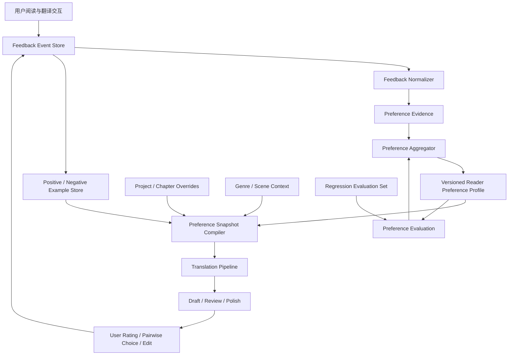
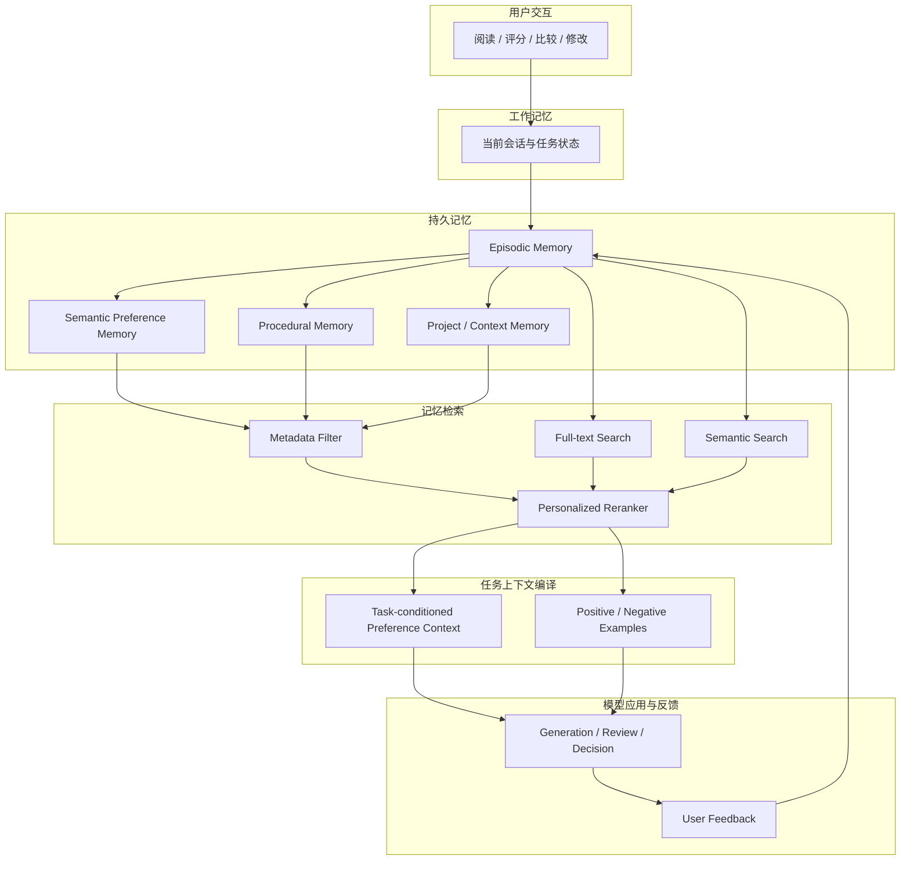

# 从阅读偏好到个性化文学翻译：如何让 LLM 在长期翻译与校对中学习一个人的审美

> 调研日期：2026-10-31  
> 适用场景：英文、日文等小说翻译；同一作品多种译风；读者逐段评分、比较、批注；跨章节、跨作品积累长期偏好。

## 摘要

个人文学阅读偏好不应被实现为一段不断膨胀的 system prompt，也不应简单等同于“喜欢某位作家的风格”。**记住用户做过什么，不等于理解用户喜欢什么；理解用户喜欢什么，也不等于知道当前任务应该调用哪些偏好。** 本文的目标是把个人偏好建模成一个有时间维度、有上下文条件、有证据链、可以持续修正的 **User Model**。更合适的实现是一个可版本化的 **Reader Preference Model（RPM，读者偏好模型）**：它从明确声明、译文评分、候选比较、局部修改、接受/拒绝建议和阅读行为中提取证据，形成多维、带置信度、带适用范围、可追溯和可撤销的偏好知识；翻译时再根据作品、语言方向、文体、叙事角色和当前任务检索出一份小型的 Preference Snapshot，贯穿初译、审校、风格润色和最终验收。

核心结论：

1. **记录反馈时保留原始事件，不要只保留模型总结出的偏好。** 用户的一次 8 分、一次改词和一句“不喜欢这个感觉”都是不同类型的证据。
2. **评分与比较结合。** 单独打分容易受段落难度、绝对标准漂移影响；对同一原文的 A/B 比较更容易表达“我更喜欢哪一个”，并可用 Bradley–Terry 等方法估计维度偏好。
3. **偏好必须多维、分场景。** 句子长短、词汇密度、叙述距离、对话口语度、意象保留、解释倾向、幽默、节奏等不能压成一个“文风分数”。
4. **区分读者偏好、作品风格、翻译约束和事实正确性。** 读者喜欢不等于忠实；风格可以调节，但人物关系、情节、视角、时态、专名和原文歧义不能被偏好覆盖。
5. **先用外部记忆与检索，不急于微调。** 结构化偏好、实例记忆、检索和提示词组合通常足以启动；积累高质量、稳定、覆盖多场景的反馈后，再考虑 LoRA / preference tuning。
6. **建立持续评估集。** 每次偏好模型升级，都用固定的原文片段、用户历史选择和反例回归，检查是否真的更符合读者，而不是只让模型自评更高。

---

## 核心论点：记忆、偏好理解与偏好调用是三个不同的问题

本文要解决的不是简单的“让模型记住用户”，而是三个彼此独立、又必须连接起来的问题：

> **记住用户做过什么，不等于理解用户喜欢什么；理解用户喜欢什么，也不等于知道当前任务应该调用哪些偏好。**

> **个人偏好应建模为一个有时间维度、有上下文条件、有证据链、可以持续修正的 User Model。**

第一句话描述的是系统能力边界。第二句话给出了目标架构。它们共同意味着：不能把原始聊天记录、偏好摘要、向量检索结果和最终 Prompt 混成一个“Memory”概念。

### 一、记住用户做过什么，不等于理解用户喜欢什么

用户做过的事情只是观察（observation），偏好是需要从观察中推断的潜在状态（latent preference）。例如，用户在一段英文心理描写中选择了译文 B，可能是因为它保留了人物迟疑，也可能只是因为 A 有一个词翻错了；一次 6 分可能反映段落本身难译，而不是用户不喜欢这种风格；用户修改一个词，也不等于认同整段译文的其余风格。

所以第一层必须保存**发生过什么、当时的任务是什么、用户做了什么、用户给出的理由是什么**。这些是证据，不是结论。第二层才从多条、不同来源的证据中提出偏好假设，并标记其范围和不确定性。

### 二、理解用户喜欢什么，也不等于知道当前任务应该调用哪些偏好

即使系统已经推断出用户通常偏好简洁、克制、不解释潜台词，也不能在每一个任务中无条件应用它。用户在人物独白中偏好含蓄，不代表景物描写也应该压低修辞；用户平时偏好短句，不代表当前作品中的意识流长句应该被拆碎；用户正在尝试一种新译风，也不代表长期偏好已经改变。

因此，每次执行任务都需要一个独立的 **Preference Applicability / Resolution** 阶段：读取当前请求和作品上下文，识别任务需要哪些偏好维度，判断哪些历史偏好在当前场景中有效，并允许“本次明确要求”覆盖推断出来的长期默认值。

### 三、把 User Model 看成带证据的、随时间变化的假设集合

User Model 不是一段永久正确的用户简介，而是一组可被支持、质疑、限定、替代和撤销的偏好主张（preference claims）。每条主张都应回答：用户偏好什么、在哪些上下文中成立、系统何时观察到证据、偏好从什么时候起被认为有效、结论来自明确声明还是间接推断、有哪些正反证据，以及新证据到来时应当如何修正。

这会把个性化从“把旧信息塞回 Prompt”提升为一个有数据模型、有推断策略、有运行时决策、有评估闭环的 User Modeling 问题。

## 1. 问题定义：要学习的不是“翻译风格”，而是读者的条件偏好

假设同一段英文小说可以有三个都基本正确的译法：

- A：句式贴近原文，保留从句结构，语义对应清楚，但中文略显翻译腔。
- B：调整语序，表达自然，节奏较快，但弱化了原文的迟疑感。
- C：更有文学修辞，词汇更有质感，但增加了原文没有明确表达的情绪。

用户可能在一般叙述中偏好 B，在人物意识流段落中偏好 A，在景物描写中偏好 C。因而“用户喜欢 B”不是可复用的知识；需要学习的是：

> 在什么文本条件、什么维度、什么权衡下，用户更偏好哪种表达，以及这种判断有多确定。

可以把偏好表示为条件函数：

[
P(y_i succ y_j mid x, c, d, u)
]

其中：

- (x)：源文及其上下文；
- (y_i,y_j)：两个候选译文；
- (c)：作品与场景上下文（叙述、对话、内心独白、动作、景物等）；
- (d)：评价维度（忠实、自然、节奏、语气、意象、词汇等）；
- (u)：用户；
- 输出：用户在当前条件下更偏好哪个候选及其置信度。

因此，系统应同时保存“用户总体偏好”和“当前项目/当前作品的局部偏好”，并允许它们不同。

## 2. 业界研究给出的重要启示

### 2.1 个性化偏好不能从长对话中自动可靠地保留下来

Zhao 等人在 ICLR 2025 的 **Do LLMs Recognize Your Preferences? (PrefEval)** 中构建了 3,000 条、覆盖 20 个主题的偏好评测数据。论文指出，模型在多轮对话中推断、记忆并遵循用户偏好仍有明显困难；在其零样本设置中，约 10 轮（约 3k tokens）后，多数模型的偏好遵循准确率已低于 10%。仅仅把历史对话塞进长上下文，并不能保证偏好被正确使用。

工程含义：不能依赖“模型应该记得用户以前说过什么”。必须把偏好提取、存储、检索和应用做成显式流程，并对每次使用的偏好快照留痕。

论文：[PrefEval — ICLR 2025](https://arxiv.org/abs/2502.09597) · [ICLR 页面](https://proceedings.iclr.cc/paper_files/paper/2025/hash/28a46044775d97a4efcbcf14e7f13209-Abstract-Conference.html)

### 2.2 长期偏好需要区分情景记忆与语义记忆

EMNLP 2025 的 **PRIME: Large Language Model Personalization with Cognitive Dual-Memory and Personalized Thought Process** 将个性化记忆区分为：

- Episodic memory：具体历史互动，例如用户对某句译文打 9 分、拒绝某个词、选择 A 而不是 B。
- Semantic memory：从多次互动归纳出的稳定倾向，例如用户通常偏好简洁叙述、不喜欢解释性增译。

这一区分特别适合翻译系统。不能只保存总结后的“喜欢自然中文”，因为未来无法追溯这一结论来自哪些文本、哪些修改和多少次反馈；也不能每次把全部历史事件塞进 Prompt，因为上下文成本和噪声会持续增加。

建议保留不可变的反馈事件作为情景记忆，再由异步归纳过程生成带证据引用的语义偏好。语义偏好发生变化时，保留版本和生效时间，不覆盖历史。

论文：[PRIME — EMNLP 2025](https://aclanthology.org/2025.emnlp-main.1711/)

### 2.3 读者的个体偏好差异足以改变模型排名

ACL 2026 Findings 的 **Personalized Benchmarking: Evaluating LLMs by Individual Preferences** 研究了 115 位活跃用户的个性化模型偏好排名。研究显示，个体排名与总体排名可能显著不同，Bradley–Terry 排名相关性平均仅约 0.04。总体上表现最好的模型，不一定是某位具体用户最喜欢的模型。

工程含义：不要把“多数读者认为好”当作“这个用户喜欢”。通用翻译质量评估与个人审美评估必须分开。

论文：[Personalized Benchmarking — ACL 2026](https://aclanthology.org/2026.findings-acl.31/)

### 2.4 文学翻译尤其不能只依赖自动评分或 LLM-as-a-judge

NAACL 2025 的 **How Good Are LLMs for Literary Translation, Really?** 提出 LITEVAL-CORPUS，包含段落级平行语料、人工译文和多个机器翻译系统输出。研究发现，文学翻译评价方案越复杂，普通评价者越容易产生误判；BWS（Best-Worst Scaling）这类相对简单的比较方法，在识别人工译文方面优于复杂 MQM 方案。自动指标和 LLM 评价在该实验中表现较差。论文强调，文学翻译仍有大量字面、风格单一的问题。

工程含义：不要让用户面对几十个抽象的质量维度表格。优先提供两个候选译文的并排比较、局部高亮和简短理由输入。模型评分可以辅助定位问题，但不能替代读者判断。

论文：[LITEVAL-CORPUS — NAACL 2025](https://aclanthology.org/2025.naacl-long.548/)

### 2.5 2026 年 LAIT 读者研究：整段沉浸阅读与局部比较都重要

2026 年 EMNLP Findings 的 **AI translation of literary texts is ‘fine’, but readers still prefer human translations**（LAIT）让 15 位读者比较 15 部法语、波兰语和日语小说的人工译文与 agentic LLM 翻译。实验同时采用约 8,000 词的沉浸式阅读和约 300 词的局部对照：读者在 772 次片段级比较中有 522 次显著偏好人工译文。研究还发现，机器翻译在同一本书内部的质量波动更大；自动指标（包括 LLM-as-a-judge）未能恢复读者偏好，且倾向于偏爱机器译文。

LAIT 的评价界面值得借鉴：

- 先完整阅读一段，而不是只看孤立句子；
- 对整段评价流畅度、清晰度、沉浸感和是否愿意继续读；
- 再进行局部并排比较；
- 高亮特别好的/差的词句；
- 记录选择、理由和选择难度。

工程含义：个人偏好学习也要同时收集段落级与片段级反馈。单句被喜欢，不代表放回整章后仍然自然。

论文：[ACL Anthology — EMNLP Findings 2026](https://aclanthology.org/2026.findings-emnlp.2138/) · [LAIT 项目与评价界面](https://lait.cs.sfu.ca/)

### 2.6 翻译个性化已有专门研究，不只是通用 LLM personalization

2026 EACL 的 **Steering Large Language Models for Machine Translation Personalization** 专门研究文学翻译中的个性化。论文比较了显式 Prompt 与从少量风格样例中学习偏好的方法，并探索通过 Sparse Autoencoder（SAE）特征进行 contrastive steering。研究指出，用户偏好经常隐含在少量示例里，而不是能被用户完整描述成一组规则；对比式 steering 可以更稳健地控制风格。

工程含义：用户喜欢/不喜欢的实际译文片段，是比“请翻译得优雅一点”更有价值的训练信号。系统应保存经过用户确认的正反例，并在相似场景中检索。

论文：[Steering LLMs for MT Personalization — EACL 2026](https://aclanthology.org/2026.eacl-long.217/) · [arXiv](https://arxiv.org/abs/2505.16612)

### 2.7 比较式反馈适合学习多维、隐式偏好

ACL 2025 的 **Comparison-based Active Preference Learning for Multi-dimensional Personalization (AMPLe)** 研究通过交互式比较收集隐式偏好，并用 Bayesian inference 更新多维偏好估计；主动选择策略会优先询问最有信息量的问题，以减少用户反馈成本。

工程含义：不要让用户给每个段落填写一张长评分表。系统可以先用已有偏好生成两个风格有差异的候选，只在模型不确定或某个偏好维度尚未识别时，询问用户做一次有针对性的比较。

论文：[AMPLe — ACL 2025](https://aclanthology.org/2025.acl-long.1590/)

### 2.8 翻译反馈训练需要防止 Reward Hacking

NAACL 2024 的 **Improving Machine Translation with Human Feedback: An Exploration of Quality Estimation as a Reward Model** 研究把质量估计模型作为翻译反馈训练的奖励模型，并发现过度优化问题：奖励分数提高，实际翻译质量却可能下降。质量模型可能给错误译文高分，导致错误传播。

工程含义：即使未来训练个人 Reward Model，也不能只追求它自己的分数。必须用独立的人工回归集检查忠实度、遗漏、增译和风格变化；个人偏好不能覆盖语义正确性。

论文：[Improving MT with Human Feedback — NAACL 2024](https://aclanthology.org/2024.naacl-long.451.pdf)

### 2.9 更早的个性化机器翻译研究已经指出：翻译偏好属于接收者

Mirkin 与 Meunier 的 **Personalized Machine Translation: Predicting Translational Preferences**（2015）指出，同样正确的译文可能因句长、正式程度、标点、词汇处理等个人偏好而被不同用户评价不同；个性化机器翻译应该考虑译文接收者的偏好，而不只是作者或领域。

论文：[Personalized Machine Translation — ACL 2015](https://aclanthology.org/D15-1238.pdf)

---

## 3. 推荐的偏好知识模型

不要只存一个 profile JSON。建议分成五类数据。

### 3.1 Preference Profile：稳定偏好

这是每次翻译时最常用的紧凑偏好画像。每条偏好都要有维度、方向、强度、置信度、适用范围、证据数量和状态。

示例：

```json
{
  "profileId": "reader-default",
  "version": 12,
  "preferences": [
    {
      "dimension": "narration.sentence_rhythm",
      "direction": "prefer_varied_natural_rhythm",
      "strength": 0.78,
      "confidence": 0.84,
      "scope": ["zh-CN", "literary-fiction", "narration"],
      "evidenceCount": 17,
      "status": "active",
      "evidenceRefs": ["pref-event-102", "pref-event-118"]
    },
    {
      "dimension": "translation.explicit_explanation",
      "direction": "avoid_unnecessary_explanation",
      "strength": 0.91,
      "confidence": 0.93,
      "scope": ["all-literary-translation"],
      "evidenceCount": 23,
      "status": "active",
      "evidenceRefs": ["pref-event-087", "pref-event-132"]
    },
    {
      "dimension": "dialogue.colloquiality",
      "direction": "moderate_conversational",
      "strength": 0.55,
      "confidence": 0.61,
      "scope": ["zh-CN", "dialogue"],
      "evidenceCount": 6,
      "status": "provisional",
      "evidenceRefs": ["pref-event-141"]
    }
  ]
}
```

推荐维度树：

| 一级维度 | 二级维度示例 | 反馈中可以观察什么 |
|---|---|---|
| 语义忠实 | 漏译、增译、歧义保留、隐含信息 | 是否擅自解释、是否改变人物意图 |
| 句法节奏 | 句长、断句、从句、长短句变化 | 是否过碎、是否拖沓、是否保留迟疑 |
| 词汇选择 | 具体/抽象、常用/生僻、书面/口语 | 是否用力过猛、是否词不达意 |
| 叙述声音 | 叙述距离、冷静/抒情、主观性 | 是否擅自增加情绪、是否改变叙述者声音 |
| 人物对话 | 口语度、人物差异、时代感、潜台词 | 是否所有人物说话都像同一个人 |
| 文学效果 | 意象、隐喻、幽默、含蓄、留白 | 是否解释掉意象、是否添加修辞 |
| 中文可读性 | 自然度、流畅度、歧义、阅读负担 | 是否有翻译腔、是否过度润色 |
| 规范偏好 | 标点、引号、数字、专名 | 是否符合个人长期习惯 |

维度不能一开始就设计得过细。建议先建立 8 个一级维度和约 20 个常用二级维度，允许用户反馈后再扩展。

### 3.2 Preference Events：原始反馈事件

这是最重要的数据。只要用户作出反馈，就记录一个事件，保持原文、候选译文、用户动作和上下文的关联。

建议事件类型：

| 类型 | 例子 | 主要用途 |
|---|---|---|
| Explicit rule | “不要把人物的沉默翻译成心理解释” | 直接建立明确约束 |
| Rating | 这段 8/10 | 绝对质量趋势 |
| Pairwise choice | A 比 B 好 | 相对偏好学习 |
| Span annotation | 高亮“他的眼神变得阴冷”，标记不喜欢 | 精确定位语言特征 |
| Edit acceptance | 用户接受模型建议 | 弱正向信号 |
| Edit rejection | 用户撤销模型修改 | 弱负向信号 |
| Rewrite | 用户自己改写一整句 | 高价值正例 |
| Comparative comment | “B 自然，但把原文的犹豫感弄没了” | 学习维度权衡 |
| Project override | “这本书的对话要比平时更克制” | 作品级局部偏好 |

事件示例：

```json
{
  "eventId": "pref-event-20261031-001",
  "type": "pairwise_choice",
  "timestamp": "2026-10-31T10:30:00+08:00",
  "projectId": "novel-001",
  "chapterId": "chapter-03",
  "sourceLanguage": "en",
  "targetLanguage": "zh-CN",
  "genre": "literary-fiction",
  "segment": {
    "source": "He seemed about to say something, then thought better of it.",
    "contextBefore": "She waited.",
    "contextAfter": "The train pulled away."
  },
  "candidates": [
    {"id": "A", "text": "他似乎想说什么，最终还是作罢。"},
    {"id": "B", "text": "他像是要说些什么，却又打消了念头。"}
  ],
  "chosen": "B",
  "choiceStrength": "clear",
  "reason": "B 保留了动作中的迟疑，A 的“作罢”太像总结性叙述。",
  "dimensionTags": ["narration.subtlety", "sentence_rhythm"],
  "scope": "project",
  "source": "user_explicit_feedback"
}
```

原始事件不要被 LLM 重写覆盖。模型可以生成归纳标签，但必须保留用户原话和证据引用。

### 3.3 Preference Examples：正反例库

保存具体片段，而不是只保存规则。

每个样例至少包含：

- 源文及必要上下文；
- 用户认可的译文；
- 用户拒绝的译文；
- 用户的理由；
- 适用文体和维度；
- 来源作品与章节；
- 是否允许跨作品复用；
- 脱敏和版权使用状态。

检索时优先找同一类文本：对话找对话，心理描写找心理描写，不能因为用户喜欢某个景物段落，就把它当作所有文本的风格模板。

### 3.4 Project Overrides：作品级偏好覆盖

用户可能总体偏好简洁，但某部小说需要保留冗长、意识流、重复和不稳定叙述。作品级覆盖应优先于全局偏好，但不能覆盖语义正确性。

建议优先级：

1. 源文事实、语义、人物关系和明确翻译约束；
2. 当前作品的明确要求；
3. 当前章节/人物/叙述视角的局部约束；
4. 用户稳定的全局阅读偏好；
5. 当前译风 preset；
6. 模型默认习惯。

如果同一层级出现冲突，不要静默选择，应标记冲突并在必要时询问。

### 3.5 Preference Provenance：偏好来源与可信度

偏好不能只有一个 confidence 数字。需要知道它来自哪里：

- 用户明确声明：高可信；
- 多次选择同一方向：中高可信；
- 用户亲自改写：高价值，但需要判断是否只是局部修正；
- 接受模型建议：弱正向证据；
- 未修改：不能直接视为喜欢；
- 模型从评分推断：需要用户确认；
- 单次评分：低到中等可信。

还要记录时间和版本。长期偏好会变化，系统应允许“过去喜欢、现在不喜欢”，而不是把所有事件平均成一个永不改变的结论。

---

## 4. 如何把评分转化为可学习信号

### 4.1 不要只给一个总分

总分适合快速反馈，但解释能力弱。建议采用“总分 + 可选维度 + 一句话理由”。

例如：

| 项目 | 评分 |
|---|---:|
| 整体阅读体验 | 8/10 |
| 忠实于原文 | 9/10 |
| 中文自然度 | 7/10 |
| 叙述声音 | 8/10 |
| 节奏 | 6/10 |
| 人物对话 | 不适用 |

维度评分可以只在用户愿意时填写。不要每段都要求完整填写。

### 4.2 Pairwise preference 比单独评分更有价值

同一段原文生成 A/B 两个候选，让用户回答：

- 更喜欢 A；
- 更喜欢 B；
- 两者差不多；
- 两者都不好。

并允许补充“为什么”。

两个候选应该有明确、可解释的风格差异。例如 A 更忠实保留句法，B 更自然地调整中文语序；不要生成两个差异很小、无法判断的版本。

比较数据可以用于 Bradley–Terry 模型：

[
P(A succ B) =
rac{exp(s_A)}{exp(s_A)+exp(s_B)}
]

其中候选分数可以由多个偏好维度构成：

[
s(y,x)=sum_k w_k(u,c),f_k(y,x)
]

- (f_k)：候选在某个维度上的特征或评价；
- (w_k)：用户在当前上下文下对该维度的权重；
- (u)：用户；
- (c)：作品、文体和文本场景。

实际系统不必一开始就训练 Bradley–Terry 模型。可以先保存比较事件，再通过统计或 Bayesian 更新逐步估计偏好权重。

### 4.3 区分“绝对质量”与“相对喜欢”

用户给 6 分，可能是因为两个候选都不好；给 8 分，可能是两个候选都很好。不能直接把分数当成某个风格维度的权重。

建议：

- 绝对评分用于追踪整体质量；
- A/B 比较用于学习偏好方向；
- 局部批注用于定位具体语言现象；
- 用户改写用于构造高质量正例；
- 明确规则用于建立硬约束。

### 4.4 主动询问，不要频繁打扰

当系统在某个维度上不确定时，选择最有信息量的片段发起比较。

例如，系统已经知道用户不喜欢过度解释，但不确定用户是否偏好保留长句。可以选一个没有情节风险、但长短句处理差异明显的片段，提供两版比较。

以下情况值得询问：

- 两个候选在用户尚不确定的维度上差异明显；
- 当前项目偏好与全局偏好冲突；
- 用户连续否定同一种模型倾向；
- 一条新反馈可能改变已有高置信度规则；
- 风格修改可能影响人物声音或叙述视角。

不要在每个段落都要求打分。主动学习的目标是用更少反馈消除更大的不确定性。

---

## 5. 如何贯穿完整翻译生命周期

### 5.1 翻译开始：建立 Preference Snapshot

每本书开始时，系统读取：

- 用户全局偏好；
- 目标语言方向偏好；
- 文学类型偏好；
- 作品级覆盖；
- 当前译风 preset；
- 最相关的正反例；
- 当前偏好模型版本。

然后生成一份冻结的 Preference Snapshot，记录 snapshotId、profileVersion、projectOverrideVersion 和检索到的 example IDs。

快照的作用是保证同一章初译、审校、风格润色使用相同的偏好基线，避免翻译到一半偏好悄悄变化。用户新反馈可以生成下一版本快照，是否应用到当前章由工作流决定。

### 5.2 初译：偏好用于选择表达，不用于改写事实

初译 Prompt 应将规则分层：

- 不可违反：语义、事实、人物关系、视角、时态、专名和明确的上下文约束；
- 强偏好：用户稳定的语言习惯；
- 软偏好：当前作品和译风的审美倾向；
- 示例：少量相关正例和反例。

偏好应是可权衡的风格指导，而不是要求模型逐字模仿历史样例。

### 5.3 一致性审校：把个人偏好变成可检查项

审校不应只检查术语和事实，也应检查长期偏好：

- 是否无必要地解释原文没有说出的心理活动；
- 是否把不同人物的对话统一成同一种口吻；
- 是否频繁使用用户不喜欢的抽象词或套话；
- 是否把原文有意保留的含糊改成明确结论；
- 是否为了“流畅”破坏人物的迟疑、重复或停顿；
- 是否把所有句子都改成相同的中文节奏。

审校输出要区分“明确违反偏好”“可能不符合偏好”“只是另一种可接受的译法”。不能把审美差异全部报成错误。

### 5.4 风格润色：按场景选择偏好

同一作品内至少要区分：

- 叙述文字；
- 人物对话；
- 内心独白；
- 书信、日记、文件；
- 动作与场景；
- 意识流或非可靠叙述。

Preference Snapshot 可以按场景裁剪，避免将所有偏好无差别注入每个段落。

### 5.5 最终校对：检查整体阅读体验

局部句子都很漂亮，不代表整章好读。最终审校应增加章节级检查：

- 句长与节奏是否持续单调；
- 人物声音是否稳定且彼此可区分；
- 同一叙述者的语言是否发生无意漂移；
- 词汇和修辞是否重复过度；
- 情绪强度是否被持续抬高；
- 章节是否具有连贯的阅读沉浸感。

这一层需要同时看较大上下文，而不是只把每个 segment 单独打分。

### 5.6 反馈回流：写入事件，再异步更新偏好

建议流程：

1. 用户评分、比较、批注或修改；
2. 立即保存不可变的 Preference Event；
3. LLM 将自然语言理由映射到候选偏好维度，保留原始理由；
4. 偏好更新器检查是否与已有偏好一致、冲突或属于局部覆盖；
5. 低置信度结论先作为 provisional；
6. 达到证据阈值后更新 Preference Profile；
7. 生成新版本并记录证据引用；
8. 下次任务检索新版本，必要时通过 A/B 回归验证。

不要让负责翻译的 Agent 在生成译文的同一个步骤里直接修改长期偏好。翻译执行与偏好学习应分离，避免一次偶然的生成结果污染用户画像。

---

## 6. 推荐系统架构

建议采用“事件存储 + 语义偏好 + 示例检索 + 快照编译”的结构，而不是把所有反馈塞进向量数据库。



### 6.1 存储职责

| 数据 | 推荐存储 | 是否需要向量化 |
|---|---|---|
| 原始评分、选择、批注、编辑事件 | SQLite / PostgreSQL 关系表或 JSONL 事件日志 | 不需要 |
| 当前偏好 Profile | JSON 文档或关系表 | 不需要 |
| 偏好版本与证据引用 | 关系表 / JSON | 不需要 |
| 正反例片段 | 文本存储 + 元数据 | 可选 |
| 正反例语义检索 | Embedding index | 有足够样例后再考虑 |
| 当前项目覆盖规则 | 项目数据库 | 不需要 |
| Preference Snapshot | JSON，随翻译任务固化 | 不需要 |
| 回归测试样本 | 版本化文件或数据库 | 不需要 |

**向量检索不是偏好系统的前提。** 早期几十到几百条样例，可以用标签、语言、场景、维度和全文检索。只有样例积累较多、需要按语义找相似语言现象时，再引入向量检索。向量相似度不能替代范围过滤和偏好权重。

### 6.2 核心数据表建议

| 表 | 关键字段 |
|---|---|
| preference_events | event_id, user_id, project_id, event_type, source_text, context, payload, created_at |
| preference_evidence | evidence_id, event_id, dimension, polarity, strength, confidence, scope |
| preference_profiles | profile_id, user_id, version, status, created_at |
| preference_rules | profile_version, dimension, direction, strength, confidence, scope, evidence_count |
| preference_examples | example_id, event_id, source_text, context, preferred_text, rejected_text, tags |
| project_overrides | project_id, dimension, direction, strength, reason, version |
| preference_snapshots | snapshot_id, project_id, profile_version, override_version, examples, compiled_prompt, created_at |
| preference_eval_cases | case_id, source_text, context, candidates, expected_preference, dimensions |

事件表必须能还原当时用户看到的候选译文和上下文。仅保存分数和一句摘要，未来无法可靠重放或重新分析。

---

## 7. 风格 Preset 与个人偏好如何组合

两者不是同一层概念。

- **Style Preset**：当前任务主动选择的风格方向，例如“克制的现代中文叙述”“偏口语的对白”“保留原文句法”。
- **Reader Preference**：读者长期形成的审美倾向。
- **Project Override**：当前作品有意偏离个人常规偏好的局部要求。

建议不要把“王小波风格”“金庸风格”等作家标签直接当作完整偏好模型。它们只能作为初始参考或风格入口；真正生效的应该是可解释的语言特征，例如句子节奏、幽默强度、词汇密度、叙述距离和对话口语度。还要避免把风格标签转化成特定作品的固定短语或可识别表达。

组合时采用明确的层次：

```text
Translation Constraints
    > Project Override
    > Scene / Character Constraints
    > Reader Preference
    > Style Preset
    > Model Defaults
```

其中语义正确性和用户明确的硬约束始终优先。Style Preset 与 Reader Preference 冲突时，系统应显示冲突，例如：“当前 preset 倾向保留长句，但你的长期偏好倾向自然拆句；本项目是否有意保留原文长句？”

### 7.1 同一读者可以拥有多个偏好模式

不要强制只有一个 global profile。可以有：

- Default literary reading；
- Literary fiction；
- Historical fiction；
- Japanese light novel；
- Dialogue-heavy；
- Experimental / stream of consciousness。

它们不是多个互不相干的人格，而是同一读者在不同文本任务中的条件偏好。系统可以从用户的实际选择中推断场景差异，但推断应带置信度。

---

## 8. 从简单规则到模型训练：采用渐进式方案

### 阶段一：结构化记忆 + Prompt 编译（建议先做）

所需能力：

- 记录用户反馈事件；
- 维护偏好 Profile；
- 保存正反例；
- 按作品、语言、文体和场景检索；
- 为每次翻译生成 Preference Snapshot；
- 记录实际使用的偏好版本。

优点是可解释、可调试、数据量要求低，不需要训练模型。对个人翻译场景，通常应先把这一阶段做好。

### 阶段二：偏好统计与主动学习

当用户已经积累一定数量的评分和比较后：

- 用 pairwise 数据估计维度权重；
- 用 Bayesian 更新置信度；
- 识别全局与项目偏好的冲突；
- 选择最有信息量的 A/B 比较；
- 形成个人偏好回归集。

这一步解决的是“哪些偏好确实稳定”，而不只是让模型写出更漂亮的 Profile 摘要。

### 阶段三：个性化 Reranker / Reward Model

数据充足后，可以训练或适配一个个人偏好排序器：

输入：原文 + 上下文 + 候选译文 + 场景标签。  
输出：候选在忠实度、自然度、节奏、叙述声音、文学效果等维度上的个人偏好分数。

必须把语义正确性作为独立约束或独立评估信号，避免 Reward Model 为了讨好读者而奖励增译、漏译或错误解释。

### 阶段四：PEFT / LoRA / Preference Tuning

只有在以下条件满足时才值得考虑：

- 反馈样本数量和质量足够；
- 偏好跨作品有稳定性；
- 正反例覆盖多个文本场景；
- 已有可靠的个人回归测试集；
- Prompt + Retrieval + Reranking 已经遇到明确瓶颈。

训练方式可以考虑 DPO/IPO 一类偏好优化，或者小型 LoRA 适配。训练数据应使用同一源文下的 chosen/rejected 候选，并携带必要的上下文和场景标签。不要直接把用户所有修改拼成无条件 SFT 数据：修改可能只是修正事实、术语或某一处上下文，不代表全局风格偏好。

---

## 9. 关键工程风险与控制

| 风险 | 典型表现 | 控制方法 |
|---|---|---|
| 过度泛化 | 喜欢某段优美表达，模型以后处处堆砌修辞 | 偏好带场景范围；样例按文本类型检索 |
| 反馈误读 | 用户改词是为了修正事实，却被归纳为风格偏好 | 区分修改意图；不确定时不更新全局偏好 |
| 评分噪声 | 同样质量的段落评分不同 | 评分与 pairwise 结合；保留段落难度和上下文 |
| 偏好漂移 | 早期喜欢的风格后来不喜欢 | 时间衰减、版本化、允许撤销和显式更新 |
| 项目污染 | 某本小说的特殊要求影响其他作品 | Project Override 与全局 Profile 分离 |
| 模型自我强化 | 模型生成某种译法，再由模型自己判定它符合用户偏好 | 用户反馈作为主要证据；LLM judge 只能辅助 |
| 语义牺牲 | 为了符合偏好而擅自增删原文信息 | 忠实度独立门禁；硬约束优先 |
| 样例版权 | 将出版译文或用户上传作品用于训练 | 记录来源、授权和用途；默认只用于当前用户个人检索 |
| 上下文膨胀 | 所有历史偏好和样例都塞进 Prompt | Snapshot 编译、场景检索、预算控制 |
| 评价投机 | Reward 分数上涨，真实阅读体验下降 | 独立读者回归集、整段沉浸式评估 |

### 9.1 负面反馈要比正面反馈更精确

“不喜欢”不等于“永远禁止”。例如用户不喜欢某处“他感到一种难以言喻的悲伤”，可能是因为它解释了原文留白，而不是反对所有心理描写。

因此负面反馈至少要分成：

- 禁止：明确的长期规则；
- 不偏好：通常避免，但上下文允许；
- 本段不适合：只对当前片段成立；
- 事实错误：不是审美偏好；
- 质量问题：不一定能归纳为个人风格。

### 9.2 接受模型建议不等于用户喜欢

用户可能只是快速接受一个修改，之后并未仔细阅读。未修改也不意味着满意。接受/拒绝只能作为弱信号；明确打分、比较理由和用户亲自改写才是更强证据。

### 9.3 不要让“风格一致”变成“语言单调”

个人偏好不是要求每段都写成同一种声音。优秀的翻译需要服从原作的多样性：叙述者、人物、场景和情绪都可能要求不同表达。偏好模型应学习用户如何欣赏这些差异，而不是消除差异。

---

## 10. 推荐的产品交互

不需要一个复杂的偏好配置后台。最有价值的是把反馈自然嵌入阅读和校对过程。

### 10.1 译文旁边的轻量反馈

每个段落可以有：

- 评分：1–10；
- 更喜欢：A / B / 差不多 / 都不好；
- 标记：喜欢这句 / 不喜欢这句；
- 一句话原因；
- “这是本书的特殊要求”开关。

默认只显示最轻量的操作。用户愿意深入时再展开维度。

### 10.2 对模型建议记录“接受原因”

用户接受一个修改时，允许选择或输入：

- 更自然；
- 更忠实；
- 节奏更好；
- 人物声音更准确；
- 更含蓄；
- 更简洁；
- 其他。

这些标签只是辅助分类，不应取代用户自己的表达。

### 10.3 提供偏好记忆的可见性

用户应能查看：

- 当前模型认为我偏好什么；
- 每条偏好来自哪些反馈；
- 适用范围；
- 置信度；
- 最近一次更新时间；
- 哪些规则是我明确说的，哪些是系统推断的；
- 暂停、修正或删除某条偏好。

这比一个不可见的“AI 已经学会你的风格”更可信。

### 10.4 定期做偏好校准

例如完成一本书后，系统汇总：

- 本书最常被认可的语言特征；
- 最常被否定的表达方式；
- 与全局偏好不同的地方；
- 仍然不确定的偏好；
- 建议加入全局 Profile 的规则。

用户确认后才升级全局偏好。不要自动把单本书的局部审美提升为永久偏好。

---

## 11. 具体实施路线

建议按下面顺序实施，不要一开始就做个人模型训练。

| 优先级 | 能力 | 交付结果 | 价值 |
|---|---|---|---|
| P0 | Feedback Event Schema | 评分、比较、批注、编辑统一事件结构 | 建立可用数据基础 |
| P0 | Versioned Preference Profile | 多维偏好、置信度、范围、证据 | 防止偏好退化为长 Prompt |
| P0 | Preference Snapshot | 每章翻译固定偏好版本 | 保证初译和校对一致 |
| P0 | Positive / Negative Examples | 保存用户认可和拒绝的具体片段 | 将隐式偏好转为可检索实例 |
| P1 | Scene-aware Retrieval | 按叙述/对话/心理活动检索偏好 | 减少错误泛化 |
| P1 | Pairwise Feedback UI | A/B 比较和理由 | 高效收集偏好信号 |
| P1 | Feedback Normalizer | 把用户理由映射为维度标签 | 降低人工整理成本 |
| P1 | Preference Regression Set | 固定样例回归 | 验证是否真的改善 |
| P2 | Bayesian / Bradley–Terry Estimation | 估计多维偏好权重 | 从主观事件中提炼稳定趋势 |
| P2 | Active Preference Query | 选择最值得询问的片段 | 降低用户反馈负担 |
| P3 | Personalized Reranker | 对候选译文做个人排序 | 提高候选选择质量 |
| P4 | LoRA / Preference Tuning | 模型参数层面的个性化 | 仅在数据和评估成熟后考虑 |

### 建议的 MVP

第一版只需要四个组件：

1. **Feedback Event Store**：记录用户评分、A/B 选择、局部标注、接受/拒绝和人工修改。
2. **Preference Profile Builder**：从明确规则和多次反馈中生成结构化画像，所有结论关联证据。
3. **Snapshot Compiler**：在每次章节翻译前生成固定偏好快照，并检索少量相关样例。
4. **Preference Regression**：固定 20–50 个有代表性的原文片段，检查新旧偏好版本下的候选选择是否符合用户历史判断。

第一版不需要向量数据库，不需要训练模型，也不需要复杂的多 Agent。数据模型和流程正确，比一开始引入更复杂的模型更重要。

---

## 12. 一个端到端例子

原文：

> He seemed about to say something, then thought better of it.

模型生成：

- A：他似乎想说什么，最终还是作罢。
- B：他像是要说些什么，却又打消了念头。
- C：他张了张嘴，话到嘴边，终究还是咽了回去。

用户选择 B，理由是：“B 保留了迟疑，但 C 加了动作，原文并没有明确写张嘴。”

系统应该学到：

- 用户偏好 B，而不是单纯偏好更文学化的 C；
- 用户不喜欢为了增强画面感而补充原文未明确给出的动作；
- 用户接受适度调整中文语序；
- 用户偏好保留原文含蓄程度；
- 这条证据可能适用于叙述段落，但不应直接推导为所有场景都禁止动作增译。

后续当模型处理：

> She almost smiled, but stopped herself.

它可以检索到“不要无依据增加动作”的偏好示例，但仍然必须根据本句的语义和上下文判断，不能机械套用。

这就是偏好记忆真正的价值：不是让模型记住一句“用户喜欢自然、含蓄的翻译”，而是让它理解用户在具体语言选择中如何权衡。

---

## 13. 结论

个人阅读偏好应当被看作一种长期演进的用户知识，而不是一个固定 Prompt。它的学习闭环是：

- 用户通过评分、比较、批注和修改表达偏好；
- 系统把这些交互保存为原始事件；
- 偏好归纳器形成带证据、置信度和范围的多维画像；
- 翻译任务根据作品和场景检索偏好与正反例；
- Snapshot 将偏好稳定地贯穿初译、审校和润色；
- 回归集验证个性化是否真正改善阅读体验；
- 用户确认后再更新长期画像。

对个人文学翻译，**最先值得投入的不是微调模型，而是把反馈变成结构化、可追溯、可比较、可回放的知识。** 只要这套数据资产建立起来，未来无论更换底层模型、增加 reranker，还是做 LoRA，都不会丢失已经积累的个人审美。

---

## 参考研究与资源

1. Zhao et al. (2025), [Do LLMs Recognize Your Preferences? Evaluating Personalized Preference Following in LLMs](https://arxiv.org/abs/2502.09597), ICLR 2025.
2. Zhang et al. (2025), [PRIME: Large Language Model Personalization with Cognitive Dual-Memory and Personalized Thought Process](https://aclanthology.org/2025.emnlp-main.1711/), EMNLP 2025.
3. Garbacea et al. (2026), [Personalized Benchmarking: Evaluating LLMs by Individual Preferences](https://aclanthology.org/2026.findings-acl.31/), ACL Findings 2026.
4. Zhang et al. (2025), [How Good Are LLMs for Literary Translation, Really?](https://aclanthology.org/2025.naacl-long.548/), NAACL 2025.
5. Ferstler et al. (2026), [AI translation of literary texts is ‘fine’, but readers still prefer human translations](https://aclanthology.org/2026.findings-emnlp.2138/), EMNLP Findings 2026; [LAIT project](https://lait.cs.sfu.ca/).
6. Scalena et al. (2026), [Steering Large Language Models for Machine Translation Personalization](https://aclanthology.org/2026.eacl-long.217/), EACL 2026.
7. Oh et al. (2025), [Comparison-based Active Preference Learning for Multi-dimensional Personalization](https://aclanthology.org/2025.acl-long.1590/), ACL 2025.
8. He et al. (2024), [Improving Machine Translation with Human Feedback: An Exploration of Quality Estimation as a Reward Model](https://aclanthology.org/2024.naacl-long.451.pdf), NAACL 2024.
9. Mirkin & Meunier (2015), [Personalized Machine Translation: Predicting Translational Preferences](https://aclanthology.org/D15-1238.pdf), ACL 2015.
10. Jiang et al. (2024), [A Survey on Human Preference Learning for Large Language Models](https://arxiv.org/abs/2406.11191), survey of feedback sources, preference modeling, utilization and evaluation.


---

# 补充研究：长期记忆、短期记忆、RAG 与 Semantic Search 在个人偏好学习中的作用

> 本补充将问题放回通用的 LLM 个性化、用户建模和记忆架构中讨论，不依赖任何具体翻译产品。

## 14. 先区分四种不同的问题

“让模型记住我喜欢什么”至少包含四个独立问题：

1. **记忆形成（Memory Formation）**：一次评分、比较、修改，是否值得保存？保存原始行为还是抽象结论？
2. **记忆组织（Memory Organization）**：信息属于当前任务状态、一次历史事件、长期稳定偏好，还是可复用的示例？
3. **记忆检索（Memory Retrieval）**：当前任务需要调用哪些历史证据？按什么线索找？
4. **记忆应用（Memory Utilization）**：取回的信息如何影响当前生成？是否适用？是否应该忽略？

长期记忆、短期记忆解决的是时间和持久性；RAG 解决的是外部知识按需进入上下文；Semantic Search 解决的是语义层面的候选发现。它们不是同一层技术，也不能互相替代。

## 15. 短期记忆与长期记忆：建议采用多时间尺度模型

### 15.1 短期记忆（Working / Session Memory）

短期记忆保存当前任务和当前会话正在发生的事情，例如：

- 正在阅读哪一本书、哪一章、哪一段；
- 当前正在比较的 A/B 译文；
- 本轮已经确认的局部风格要求；
- 当前讨论中尚未解决的歧义；
- 用户刚刚表达、尚未判断是否长期有效的偏好；
- 当前选定的风格组合及其临时调整。

它的特点是高时效性、强上下文依赖、生命周期短。任务结束后，大部分内容不应自动升级为长期记忆。

短期记忆的价值不是“把更多历史塞进 Prompt”，而是保持当前任务的连续性。当前章节的局部决定必须能被后续段落使用，但不能因此污染其他作品。

### 15.2 长期记忆（Long-term User Memory）

长期记忆保存跨会话、跨任务仍有价值的信息：

- 用户明确声明的长期阅读偏好；
- 多次反馈反复出现的偏好模式；
- 已确认的正例、反例；
- 偏好形成和变化的历史；
- 用户明确要求长期遵守的规则；
- 不同文体和语言方向下的条件偏好。

长期记忆不是一段永远不变的 Profile。它应该包含可更新的语义画像，也要保留支撑画像的原始事件。

### 15.3 情景记忆与语义记忆（Episodic / Semantic Memory）

这一区分比简单的短期/长期二分更重要。

**情景记忆**记录发生过什么：

- 2026 年 10 月，用户比较了两个译文；
- 用户选择 B；
- 用户指出 A 的“作罢”过于总结性；
- 对应的原文、上下文、两个候选译文和时间戳。

**语义记忆**记录从多个事件中归纳出的知识：

- 用户在文学叙述中倾向保留人物的迟疑和含蓄；
- 用户不喜欢没有原文依据的动作补写；
- 用户通常接受中文语序调整，但不喜欢改变叙述距离。

情景记忆回答“过去发生了什么”；语义记忆回答“从这些经历中，目前可以认为用户有什么倾向”。

建议将它们分开存储和更新。语义记忆必须能够回溯到情景证据；如果用户改变偏好，可以重新解释历史事件，而不必丢弃原始记录。

### 15.4 还需要程序性记忆（Procedural Memory）

除了情景和语义记忆，还应考虑程序性记忆，即“如何完成任务”的经验。

例如：

- 用户希望先看忠实译文，再看风格润色版；
- 用户喜欢比较完整段落，而不是孤立句子；
- 用户对不确定的文化典故希望保留注释；
- 用户希望先指出问题，再给出修改版本。

这些并非文学审美本身，而是用户偏好的工作流程。它们可能影响交互和生成，但应与语言审美画像分开。

### 15.5 推荐的记忆分层

| 记忆类型 | 典型内容 | 生命周期 | 更新方式 |
|---|---|---|---|
| Working memory | 当前段落、当前比较、待解决问题 | 当前推理/操作 | 连续覆盖和追加 |
| Session memory | 当前会话形成的临时决定 | 会话或任务周期 | 会话结束时总结 |
| Episodic memory | 评分、选择、修改、批注等历史事件 | 长期保存 | 追加，不覆盖 |
| Semantic preference memory | 多次证据归纳出的偏好 | 长期、可演化 | 证据驱动更新 |
| Procedural memory | 用户喜欢的工作流程和交互方式 | 长期、可演化 | 重复行为和明确声明更新 |
| Project memory | 某本书、某个作者或某项任务的局部约束 | 项目生命周期 | 项目内更新 |

短期/长期与情景/语义并不是完全相同的分类轴。例如，一条刚发生的反馈最初是 Session 中的情景记录，经过确认后仍然作为长期 Episodic Memory 保存；多条历史事件再归纳为 Semantic Preference Memory。

## 16. RAG 对个人偏好到底有什么帮助？

有帮助，但需要明确：这里不是传统意义上“从文档知识库检索答案”的 RAG，而是 **Preference-aware Memory RAG**，即从用户自己的历史反馈和偏好知识中检索与当前任务有关的证据。

传统 RAG 通常回答：

> 哪些文档包含与当前问题相关的信息？

偏好 RAG 需要回答：

> 用户过去在什么相似情境下表达过什么偏好？这些偏好是否适用于当前任务？有哪些正反例能帮助模型作出符合用户审美的选择？

### 16.1 RAG 可以检索三类内容

**第一类：明确规则。**

例如用户曾多次明确要求，不要擅自解释原文没有说明的心理活动。这类内容可以直接检索，通常不需要向量化。

**第二类：偏好证据。**

例如用户在五个类似段落中都选择了保留迟疑感的译文。这些证据可以帮助模型理解抽象规则从何而来，也能在规则不明确时重新判断。

**第三类：正反例。**

例如用户喜欢的日文对话翻译、拒绝的英文心理描写，以及用户自己修改过的句子。这类材料适合按文本类型和语义场景检索。

### 16.2 不应该把所有偏好历史直接放进 Prompt

这会产生几个问题：

- 历史越多，噪声越多；
- 同一偏好的多个历史表达可能互相重复；
- 不同作品的特殊偏好可能被误认为全局规则；
- 当前任务不相关的偏好占用上下文；
- 模型容易过度关注历史样例，机械模仿。

更合理的策略是先维护一个紧凑的语义 Profile，再按当前任务检索少量相关事件和样例。

### 16.3 Preference RAG 的检索流程

1. 解析当前任务：语言方向、文体、文本类型、人物/叙述者、当前目标。
2. 从 Profile 获取稳定偏好作为检索先验。
3. 通过结构化条件过滤：适用范围、维度、语言、文体、时间、置信度。
4. 通过全文检索和 Semantic Search 找相似反馈事件及正反例。
5. 对候选记忆做重排序，考虑偏好强度、证据可信度、时间和适用范围。
6. 去重、冲突检查和预算裁剪。
7. 编译成当前任务专用的 Preference Context。
8. 记录本次实际使用的记忆 ID，供事后分析。

这意味着 RAG 不只是“找相似文本”，还需要用户模型参与检索和排序。

## 17. Semantic Search 是否有必要？

有价值，但它解决的是“语义相似”，不是“偏好正确”。

例如，当前原文是一段人物迟疑的描写。用户历史中可能有：

- 一段英文人物犹豫的叙述；
- 一段日文对话中的停顿；
- 一段心理描写中没有说出口的话。

这三段的表面词汇可能完全不同，但它们都涉及“保留含蓄和迟疑”。Semantic Search 有机会发现这些跨语言、跨表达形式的相关例子。

相反，纯关键词搜索可能只找到同样出现“犹豫”“迟疑”的句子，却遗漏表达方式完全不同但审美问题相同的样例。

### 17.1 为什么不能只用向量相似度？

Embedding 相似度通常衡量语义接近程度，而不是用户是否喜欢。

以下两个片段可能语义非常接近，但用户对它们的评价完全相反：

- 一个保留原文的含蓄表达；
- 一个把含蓄表达解释成明确心理活动。

如果只按向量相似度检索，很可能把负面例子当成正面指导。

因此，每个样例必须携带明确的偏好标签和上下文：

- preferred / rejected；
- preference dimension；
- feedback strength；
- scope；
- source language；
- text type；
- evidence confidence；
- project / global；
- original source and context。

检索后还需要根据这些元数据进行过滤和排序。

### 17.2 推荐 Hybrid Retrieval，而不是 Vector-only

| 检索方式 | 优点 | 局限 | 适合内容 |
|---|---|---|---|
| Exact / Keyword | 精确、可解释 | 无法识别同义表达 | 专名、明确规则、原始批注 |
| Metadata filtering | 能严格控制范围 | 依赖标签质量 | 文体、语言、项目、维度 |
| Semantic Search | 找到跨表达形式的相似案例 | 可能语义相似但偏好相反 | 正反例、隐含审美现象 |
| Full-text search | 适合用户自然语言理由 | 语义泛化有限 | 反馈理由、用户原话 |
| Reranking | 综合多种证据重新排序 | 增加推理成本 | 最终候选选择 |

建议采用：

```
Candidate Retrieval
    = Metadata Filter
    + Keyword / Full-text Search
    + Semantic Search

Final Ranking
    = Semantic Relevance
    + Preference Relevance
    + Scope Match
    + Evidence Confidence
    + Temporal Validity
    + Feedback Strength
```

这里尤其要区分 Semantic Relevance 和 Preference Relevance。一个历史片段可能与当前句子语义高度相似，却表达了用户不喜欢的翻译方式；另一个片段语义不完全相同，却能说明用户在相同审美维度上的选择。

### 17.3 何时需要向量数据库？

不要一开始就引入。

如果用户只有几十条到几百条反馈，可以先使用：

- SQLite / PostgreSQL；
- 结构化标签；
- 全文搜索；
- 简单的元数据过滤；
- 小规模 LLM reranking。

当正反例库增长到需要跨语言、跨文体发现隐含审美相似性时，再考虑 Embedding Index。

向量索引应当是样例检索的辅助索引，不应成为 Preference Profile 的唯一存储。原始反馈、评分、选择、规则和置信度必须可以通过结构化查询直接访问。

## 18. 一个更完整的个人记忆架构

综合以上研究，建议把个人偏好学习系统划分为六个逻辑层：



注意，这不是要求必须部署六个独立服务。它们是逻辑职责，可以由一个数据库、一组服务函数和一个检索组件实现。

### 18.1 关键组件之间的边界

| 组件 | 职责 | 不应该做什么 |
|---|---|---|
| Working Memory | 当前任务连续性 | 不应自动成为长期用户偏好 |
| Episodic Store | 保存历史行为和证据 | 不应自行把事件改写成确定规则 |
| Preference Model | 归纳稳定、条件化的偏好 | 不应丢失原始证据 |
| Retrieval | 选择当前相关记忆 | 不应只看向量相似度 |
| Context Compiler | 把记忆转成当前任务可用的上下文 | 不应将全部记忆原样拼接 |
| Feedback Learner | 根据新证据更新偏好 | 不应由生成模型单方面确认自己的判断 |

## 19. 动态偏好：短期变化不应立即覆盖长期偏好

一个人可能今天想读忠实、克制的译文，明天想尝试更有文学修辞的版本。这不一定意味着长期审美发生变化。

建议同时维护：

- Long-term preference：跨任务稳定趋势；
- Short-term preference：当前会话或当前任务的临时倾向；
- Explicit override：用户明确要求本次任务偏离长期偏好；
- Historical preference：历史版本，支持时间回溯。

可以参考 EMA（指数移动平均）和滑动窗口，但不能简单对所有反馈做统一平均。

例如：

[
P_t = alpha P_{recent} + (1-alpha)P_{long}
]

这只能作为数值估计的简化形式。实际系统应按偏好维度和适用范围分别更新，并考虑反馈类型、证据强度和用户是否明确声明。

一次明确的“以后不要这样翻译”应比一次普通 7 分评分有更高权重。一次针对某本书的特殊要求，则只应该更新项目级状态。

还应区分：

- **Preference change**：用户的长期偏好确实改变；
- **Context change**：当前作品要求不同；
- **Exploration**：用户正在尝试一种新风格；
- **Feedback noise**：一次偶然评分或误操作。

### 19.1 记忆更新比记忆检索更难

2026 年 ACL Findings 的 PAMU 研究指出，现有记忆系统已经投入大量精力优化向量检索和知识组织，但动态更新偏好表示仍然是重要问题。该研究通过滑动窗口和 EMA 融合短期与长期倾向。

这对个人审美特别重要：系统不能只会“找到过去的偏好”，还必须判断新反馈是临时变化、长期趋势，还是与已有偏好矛盾的新证据。

参考：[Preference-Aware Memory Update for Long-Term LLM Agents — ACL 2026](https://aclanthology.org/2026.findings-acl.38/)

## 20. 不能忽略过度个性化（Over-personalization）

记忆并非越多越好，也不是每次生成都应该调用所有已知偏好。

EMNLP 2026 的 OP-Bench 研究指出，引入用户记忆后，模型可能出现三类过度个性化：

1. **Irrelevance**：把无关的历史偏好用于当前任务；
2. **Repetition**：反复提及或使用用户历史信息；
3. **Sycophancy**：过度迎合用户，甚至牺牲判断质量。

这对文学翻译有直接影响。例如，用户喜欢简洁表达，并不意味着所有人物都应该说短句；用户喜欢某位作家的幽默，也不意味着悲剧段落应该被强行幽默化。

因此，检索系统应该有一个重要决策：

> 当前任务是否真的需要使用某条个人偏好？

没有相关证据时，默认使用作品本身的语言特征和通用翻译原则，而不是强行个性化。

参考：[OP-Bench: Benchmarking Over-Personalization — EMNLP 2026](https://aclanthology.org/2026.emnlp-main.1168/)

## 21. 新研究：从相似度检索走向用户条件化检索

近期研究已经开始指出，普通 RAG 的查询相似度不等于用户需要的记忆。

### 21.1 VARS：长期与短期偏好向量

2026 年的 **User Preference Modeling for Conversational LLM Agents: Weak Rewards from Retrieval-Augmented Interaction** 提出 VARS，将用户表示为共享偏好空间中的长期与短期向量，通过用户反馈中的弱标量奖励在线更新，并用这些向量调整结构化偏好记忆的检索分数。

对个人偏好系统的启发是：可以把长期审美倾向与当前阅读状态分开建模，让当前任务影响检索排序，但不立即改写长期画像。

论文：[VARS — arXiv 2603.20939](https://arxiv.org/abs/2603.20939)

### 21.2 PPRO：让用户画像参与记忆检索排序

2026 年的 **Learning User-Aware Recall: Personalized Retrieval in Long-Term Conversational Memory** 提出 PPRO，先构建情景和语义记忆，再通过累积记忆建立用户 Profile，并将 Profile 作为个性化先验参与检索排序。

这比“只拿当前文本做 embedding search”更接近真正的个人偏好检索：系统不仅要判断两个文本是否相似，还要判断这条历史证据对当前用户是否有意义。

论文：[PPRO — arXiv 2607.00017](https://arxiv.org/abs/2607.00017)

### 21.3 Prospection-Guided Retrieval：根据任务目标主动寻找记忆

2026 年的 **Thinking Ahead: Prospection-Guided Retrieval of Memory with Language Models** 指出，某些有价值的历史记忆与当前查询的 embedding 相似度很低。研究提出先推演当前任务可能需要的后续步骤，再把这些步骤作为额外检索线索。

在阅读偏好场景中，当前请求可能只是“润色这段对话”，但真正有用的记忆可能是用户以前对人物身份差异、对话口语度和叙述距离的要求。直接搜索“润色”未必能找到这些偏好。

论文：[Prospection-Guided Retrieval — EMNLP 2026](https://aclanthology.org/2026.emnlp-main.2054/)

### 21.4 AlignXada：通用偏好画像需要按任务裁剪

2026 年的 **Learning Preference Adaptation for Large Language Model Personalization via Verbal Reinforcement Learning** 研究任务条件化偏好适配。它指出，完整的通用偏好摘要往往包含与当前任务无关的信息，直接注入会浪费上下文并产生干扰。

论文提出 AlignXada，根据下游任务把通用画像压缩成任务专用表示。在其 13 个任务、3 个模型的实验中，平均保留约 22.8% 的原 Profile token，同时报告了相对 RAG 的性能收益。

对个人阅读的启发是：不是每次都把完整的阅读偏好交给模型，而是根据“当前是人物对白、景物描写还是心理活动”编译一份相关的偏好子集。

论文：[AlignXada — arXiv 2608.09507](https://arxiv.org/abs/2608.09507)

## 22. 记忆系统的评估：不能只测试能否找回历史

建议建立四层评估：

| 评估层 | 测试问题 | 指标或方法 |
|---|---|---|
| Memory Write | 是否保存了真正重要的反馈？是否误存临时信息？ | Precision / Recall、用户审查 |
| Memory Retrieval | 是否找到了正确证据？是否带回错误项目偏好？ | Recall@K、MRR、NDCG、scope accuracy |
| Preference Application | 是否正确应用了偏好？是否过度应用？ | Pairwise win rate、维度一致性、过度个性化率 |
| Preference Evolution | 新反馈是否合理改变画像？旧偏好是否被错误覆盖？ | Temporal consistency、change detection、profile audit |

测试集应包含：

- 同一偏好在不同措辞下的表达；
- 同一语义场景下的正例和反例；
- 全局偏好与项目偏好冲突；
- 旧偏好被明确修正；
- 用户临时尝试新风格；
- 当前任务与某条历史偏好无关；
- 需要多条历史反馈才能推断的隐含偏好。

可以参考以下长期记忆评测：

- [LoCoMo](https://snap-research.github.io/locomo/)：长时间、多会话、单跳、多跳和时间推理。
- [LongMemEval](https://github.com/xiaowu0162/LongMemEval)：长期对话记忆和个性化信息检索。
- [PrefEval](https://arxiv.org/abs/2502.09597)：显式与隐式偏好遵循。
- [OP-Bench](https://aclanthology.org/2026.emnlp-main.1168/)：记忆使用是否过度。
- [LoCoMo-Plus](https://arxiv.org/abs/2602.10715)：超越表层事实回忆，评估隐含约束的保留和应用。

这些基准可以借鉴任务设计，但不能直接替代文学偏好评估。最终仍需要以真实读者的选择、修改和整段阅读体验作为核心评价依据。

## 23. 综合判断：这些技术分别值得投入多少？

| 技术 | 对个人阅读偏好学习的价值 | 建议 |
|---|---|---|
| Working / Short-term Memory | 很高：保持当前阅读和任务状态 | 必须有 |
| Episodic Long-term Memory | 极高：保存评分、比较、修改等证据 | 必须有 |
| Semantic Preference Memory | 极高：把历史反馈归纳成可复用的偏好 | 必须有 |
| Procedural Memory | 中高：记住用户喜欢的交互和工作方式 | 建议有 |
| RAG | 高：按任务动态取回历史偏好和例子 | 必须有检索能力，但不必一开始部署复杂 RAG |
| Semantic Search | 中高：发现跨语言、跨文体的隐含审美相似性 | 样例增多后引入 |
| Metadata / Full-text Search | 极高：控制范围和精确查找 | 应先于或同时于向量检索 |
| Personalized Reranking | 高：区分“文本相似”与“用户真正偏好” | 第二阶段 |
| Knowledge Graph | 中等：表达人物、作品、文体、偏好维度之间的关系 | 有复杂关联需求再引入 |
| Fine-tuning / LoRA / DPO | 后期价值较高，但数据和评估要求高 | 不作为起点 |
| Long-term Preference Vectors | 研究价值高，工程上可后置 | 大量反馈后探索 |

## 24. 阶段性结论：个人偏好系统不是一个 Vector Database，而是一个持续演化的 User Model

这项需求真正需要的不是“把所有阅读历史向量化”，而是建立一套完整的个人认知资产：

- 短期记忆负责当前任务；
- 情景记忆保存用户实际做过的选择；
- 语义记忆归纳长期审美；
- 程序性记忆保存用户的工作习惯；
- 项目记忆保存局部约束；
- RAG 负责根据当前任务取回相关证据；
- Semantic Search 帮助发现跨表达形式的相似案例；
- Personalized Reranking 判断哪些证据真正符合当前用户；
- Preference Learning 决定如何从新反馈更新画像；
- Evaluation 判断个性化是否真的改善了用户体验。

最值得强调的设计原则是：

**记忆存储、记忆检索、偏好推断、偏好应用和偏好更新应该是五个可独立验证的过程。**

向量化只是检索索引的一种实现；RAG 只是把外部记忆引入当前推理的一种方式；真正决定系统是否越来越懂用户的，是它能否从有噪声、有上下文、有时间变化的真实反馈中，持续形成正确且可追溯的用户模型。

---


## 25. 截至 2026 年 10 月，研究已经走到哪一步？

2025—2026 年的研究趋势很明确：长期个性化研究正在从“记忆能否存下来、能否召回”转向“记忆如何形成、如何更新、如何判断当前有效、如何防止历史偏好干扰当前意图”。下面按本文的三个问题整理有代表性的工作。论文状态也一并标注，避免把预印本与正式发表结果混为一谈。

| 研究 | 主要解决的问题 | 与 User Model 的关系 | 证据与边界 |
|---|---|---|---|
| RMM，ACL 2025 | 通过前瞻和回顾式反思，按话语、轮次、会话等不同粒度形成记忆，并根据模型引用的证据迭代改进检索 | 说明记忆形成不能固定为每 N 轮摘要；检索也要根据实际使用结果反思 | 在 LongMemEval 上，相对无记忆管理基线报告超过 10% 的准确率提升。它主要优化长期对话记忆管理，不等于完整的条件偏好模型。[论文](https://aclanthology.org/2025.acl-long.413/) |
| TSM，ACL Findings 2026 | 将对话时间线改为语义时间线，区分单点事件与持续状态，并按查询中的时间意图检索 | 支持“偏好有持续区间，不是按聊天发生顺序排列的静态事实” | 在 LongMemEval 和 LoCoMo 上报告最高 12.2 个百分点的准确率提升。[论文](https://aclanthology.org/2026.findings-acl.1496/) |
| PAMU，ACL Findings 2026 | 用滑动窗口与指数移动平均融合短期波动和长期偏好 | 直接触及“新反馈如何修正旧偏好” | 在 LoCoMo 的五个任务场景、五种基线中报告质量改善。它提供的是更新策略，不会自动判断反馈属于全局还是项目级偏好。[论文](https://aclanthology.org/2026.findings-acl.38/) |
| QUMem，arXiv 预印本，2026-08 | 按语义连续性切分 episode，将内容拆为事实、偏好和可迁移经验；查询时分阶段推断当前用户状态 | 非常接近本文提出的“当前任务条件化 User State Inference” | 其核心观点是单次 top-k 检索不能联合解决时间有效性、偏好演变和上下文适用性；报告在 PersonaMem、KnowU-Bench 上取得较强结果。属于预印本，结果需独立复现。[论文](https://arxiv.org/abs/2608.16168) |
| CORE，Findings of EMNLP 2026 | 把当前轮的临时证据与持久 Persona 更新分开，采用不确定性感知的信念修正 | 解决“偶然反馈、模糊反馈不应轻易改写长期偏好” | 研究长期 Persona 漂移、歧义和冲突，支持先判断是否发生真正变化，再决定是否更新。[论文](https://aclanthology.org/2026.findings-emnlp.666/) |
| Pivot，Findings of EMNLP 2026 | 研究 personalization inertia：历史偏好已经过时，却在推理中继续影响当前回答 | 直接回答第二句话：检索到的偏好不一定应该应用 | 提出基于当前证据一致性的检测与局部回退机制。工程启发是运行时要有“拒绝应用 / 撤销个性化影响”的能力。[论文](https://aclanthology.org/2026.findings-emnlp.1744/) |
| AdaMem，EMNLP 2026 Industry Track | 以自然语言 Memory Policy 决定特定上下文中哪些内容值得写入长期记忆 | 说明“记住什么”本身也应是条件化决策，而不是统一抽取所有信息 | AdaMem-Bench 为不同交互 Persona 设置不同记忆偏好，覆盖多个长期故事。可借鉴为按应用场景配置记忆写入策略。[论文](https://aclanthology.org/2026.emnlp-industry.189/) |
| RealPref，Findings of EMNLP 2026 | 评估长周期交互中的自然偏好遵循，包含显式到隐式的多种表达方式 | 说明用户偏好理解远不止抽取显式指令 | 数据集包含 100 个合成用户画像、1,300 条偏好和四种表达类型；实验发现上下文变长、表达越隐含，模型表现越差，未见场景的泛化也有困难。[论文](https://aclanthology.org/2026.findings-emnlp.2378/) |
| TrustMem，Findings of EMNLP 2026 | 检查记忆更新是否遗漏、破坏原有信息或写入无证据内容 | 为 User Model 的证据链和版本更新提供可信度控制 | 引入 Memory Transition Verifier，从 coverage、preservation、faithfulness 检查记忆状态迁移；强调更新过程本身需要验证。[论文](https://aclanthology.org/2026.findings-emnlp.2419/) |
| AgenticLOCI，REALM 2026 | 将会话检索与长期个性化状态分开，累积有版本的决策状态 | 支持短期召回和长期偏好演化采用不同机制 | 在合成移动出行轨迹上，稳定偏好字段保持率为 97.6%，应更新字段的更新精度为 58.3%。这也提醒我们：保护稳定偏好和正确识别变化之间存在真实权衡。[论文](https://aclanthology.org/2026.realm-1.42/) |
| PPRO，arXiv 预印本，2026 | 使用用户 Profile 作为个性化先验，对历史记忆检索进行排序优化 | 说明 User Model 不只是检索后的附加 Prompt，还应参与检索计划和排序 | 将用户画像用于 retrieval ranking，并优化查询改写。可作为个性化检索路线的研究参考。[论文](https://arxiv.org/abs/2607.00017) |

### 25.1 研究结果的共同结论

这些研究的技术路线不同，但可以归纳成六个相对稳定的结论。

**第一，原始对话不应该是唯一的记忆单元。** 需要保留完整事件，同时允许从连续事件中形成不同粒度的 episode、持续状态和偏好主张。固定轮数摘要会混合无关事件，也可能拆散一个决策的前因、选择和结果。RMM、TSM、QUMem 都在不同层面处理了这个问题。

**第二，事实、偏好和可迁移经验不是同一种记忆。** “用户正在读某本书”是事实；“用户在心理描写中偏好保留含蓄”是偏好；“面对同一段原文，先比较两个不同风格的候选再润色”是可迁移的程序性经验。把它们压成一条 embedding 会失去类型信息。

**第三，偏好更新需要独立研究和独立验证。** 新反馈可能意味着偏好变化，也可能只是当前作品的临时要求、探索性选择或一次偶然结果。PAMU 的平滑方法有参考价值，但 CORE 的不确定性更新和 TrustMem 的迁移验证更接近生产系统所需的安全边界。

**第四，任务相关性必须在检索之后继续判断。** 找到一条相似历史，不等于应该采用它。Pivot 所研究的 personalization inertia 说明，过时记忆即使成功召回，也可能降低当前任务的正确性。

**第五，偏好记忆的写入策略也应该依上下文而变。** 用户可能只希望系统记住稳定审美，不希望记住一次临时购物选择或某次试验性译风。AdaMem 把这种差异提升为 preference-conditioned write control。

**第六，研究基准仍不等于真实文学阅读验证。** 上述工作主要在长对话、Persona、记忆问答或合成用户轨迹上评估。它们能证明 User Model 的技术方向，却不能直接证明某个模型已经理解了某位读者的文学审美。文学翻译仍需要真实用户的 A/B 选择、局部修改、整段阅读体验和跨章节一致性测试。

因此，研究的答案不是“已经有一个模型可以准确理解个人偏好”。更准确的结论是：**研究已经分别证明了多粒度记忆、时间建模、偏好更新、查询条件化用户状态推断和过时偏好抑制的重要性；把这些能力组合成一个可审计的端到端 User Model，仍然是应用系统需要完成的工程工作。**

## 26. User Model 应该如何建模：事件、证据、主张和快照分开

建议不要只存一个 profile JSON，而是至少保留四种不同实体。

| 实体 | 含义 | 是否可以被覆盖 |
|---|---|---|
| Interaction Event | 用户在某个时间、任务、作品和上下文中实际做了什么 | 原始事件只追加，不原地改写 |
| Preference Evidence | 从事件中识别出来的偏好证据，例如支持某个维度的选择、反例或修改 | 可以补充标签，但需保留原始来源 |
| Preference Claim | 系统当前认为成立的偏好主张，包括取值、适用范围、置信度和时间有效性 | 通过新版本修正，不覆盖历史版本 |
| Preference Snapshot | 为一个具体任务解析出的、冻结的可执行偏好集合 | 每次任务重新生成；任务运行期间保持一致 |

### 26.1 一个偏好主张的数据结构

~~~json
{
  "claim_id": "pref-000184",
  "user_id": "reader-001",
  "dimension": "narration.subtlety",
  "preference": "preserve_implicit_emotion",
  "polarity": "prefer",
  "strength": 0.82,
  "confidence": 0.78,
  "scope": {
    "level": "genre_and_text_type",
    "genre": ["literary-fiction"],
    "text_types": ["interior_monologue", "psychological_narration"],
    "source_languages": ["en", "ja"],
    "target_language": "zh-CN",
    "project_ids": []
  },
  "valid_time": {
    "from": "2026-04-01T00:00:00Z",
    "to": null
  },
  "recorded_at": "2026-10-31T09:00:00Z",
  "status": "active",
  "evidence": {
    "supporting_event_ids": ["event-101", "event-126", "event-155"],
    "refuting_event_ids": ["event-144"],
    "source_types": ["pairwise_choice", "rewrite", "explicit_feedback"]
  },
  "revision": 4,
  "supersedes": "pref-000133"
}
~~~

这只是示意结构，不要求一开始把所有字段都做成独立数据库列。关键是必须能表达偏好维度、适用范围、正反证据、时间有效性、状态和版本。

### 26.2 至少记录两种时间

不要只存一个 created_at。

- **occurred_at / observed_at**：用户实际反馈或系统观察到反馈的时间。
- **valid_from / valid_to**：系统认为这条偏好在用户行为中有效的时间区间。

例如，用户在 10 月 31 日明确说“从 9 月开始，我越来越不喜欢过度解释心理活动的译法”。系统在 10 月 31 日才知道，但偏好变化可能从 9 月开始。两种时间不同。对审计和“当时系统知道什么”而言，这一区分很重要。

### 26.3 偏好必须有正面证据，也允许反面证据

不要只保存“用户喜欢简洁”。还应保存证据数量、证据是否来自不同作品和场景、用户明确认可的正例、用户明确拒绝的反例、证据之间是否冲突，以及系统最近一次何时重新评估该主张。

一个用户在不同场景里表现出相反偏好，未必表示系统学习失败。它也可能说明原来的偏好主张范围太宽，应拆成两个更具体的条件偏好。

### 26.4 置信度不能等同于反馈次数

连续十次对同一个段落做细微修改，不一定相当于十个独立证据。置信度至少要考虑反馈类型、独立场景数量、用户是否给出明确理由、正反证据是否一致，以及当前上下文是否与历史样本相同。

| 反馈 | 推荐处理 |
|---|---|
| “以后所有文学翻译都不要擅自解释心理活动” | 明确、广范围、高优先级的偏好约束 |
| 在相似段落中多次选择保留含蓄的译文 | 累积为有置信度的条件偏好 |
| 用户重写一句话，并解释原因 | 强证据，但先判断是局部纠错还是可泛化偏好 |
| 给整段打 7 分 | 质量证据，不直接推断某个具体风格维度 |
| 接受模型给出的修改 | 弱正向信号，需要结合上下文 |
| 没有修改模型输出 | 不构成可靠的喜欢证据 |
| 本次明确要求“这一章可以更华丽” | 当前项目或章节的临时覆盖，不立即修改全局偏好 |

## 27. 如何判断某条偏好是否应该用于当前任务？

这是整个系统中最容易被忽略、但最重要的运行时步骤。不能直接把 top-k 检索结果拼接到 Prompt。建议设计一个独立的 **Preference Resolver**。

### 27.1 先解析任务条件，再寻找偏好

当前任务应至少被解析为：

~~~json
{
  "task": "translation_review",
  "source_language": "ja",
  "target_language": "zh-CN",
  "domain": "literary-fiction",
  "genre": "historical-fiction",
  "text_type": "dialogue",
  "narrative_role": "character_speech",
  "project_id": "novel-001",
  "requested_style": "restrained",
  "explicit_overrides": ["preserve_honorific_distance"],
  "quality_constraints": ["semantic_fidelity", "character_consistency"]
}
~~~

这些字段不是为了建立复杂标签体系，而是为了避免把用户在心理描写、景物描写或现代对话中的偏好错误迁移到当前文本。

### 27.2 采用分层范围，而不是单一全局偏好

可以建立以下适用范围，从宽到窄：用户全局偏好、任务类型或领域偏好、语言方向/文体/文本类型偏好、作品/作者/章节/人物/叙述视角的局部偏好，以及当前请求中明确说明的临时偏好。

越具体的规则通常越能解释当前任务，但不能机械地采用“最具体者永远覆盖”。还要检查它是否仍然有效、证据是否充分，以及是否和当前明确要求冲突。当前请求中的明确指令应优先于系统推断的长期默认值。

### 27.3 检索与应用分成两个阶段

第一阶段是 Candidate Retrieval，尽可能找出潜在相关证据：先按 user、权限、项目、时间、语言方向、文体和偏好维度做结构化过滤；再用全文检索或关键词查找明确规则和用户原话；用 Semantic Search 查找跨语言、跨措辞的相似审美案例；最后对候选证据去重，并保留正例和反例。

第二阶段是 Applicability Resolution，判断哪些候选真正适用于当前任务：

- **Scope match**：历史反馈的范围是否覆盖当前文本？
- **Temporal validity**：偏好是否仍然有效，是否已有更新版本？
- **Evidence strength**：来自明确声明，还是少数间接行为？
- **Preference polarity**：检索到的是用户喜欢的例子，还是用户拒绝的反例？
- **Context compatibility**：当前任务是否与历史场景具有相同的审美目标？
- **Conflict**：是否存在同级别但方向相反的偏好？
- **Current intent**：用户是否明确要求本次偏离通常偏好？

只有通过这一阶段的偏好才应该进入最终的 Preference Snapshot。无法判断时应降低强度或不应用，而不是强行个性化。

### 27.4 为每个任务编译一份 Preference Snapshot

建议返回一份小型、可审计的上下文，而不是完整的用户历史：

~~~json
{
  "snapshot_id": "snapshot-20261031-001",
  "user_model_version": 42,
  "task_context_hash": "sha256:...",
  "applicable_preferences": [
    {
      "dimension": "dialogue.colloquiality",
      "instruction": "保持人物语言自然，但不要将所有角色统一改成现代口语",
      "confidence": 0.84,
      "claim_id": "pref-000184",
      "evidence_ids": ["event-101", "event-126"]
    }
  ],
  "excluded_preferences": [
    {
      "claim_id": "pref-000091",
      "reason": "适用于心理描写，不适用于当前人物对白"
    }
  ],
  "positive_examples": ["example-001"],
  "negative_examples": ["example-017"],
  "hard_constraints": ["semantic_fidelity", "preserve_character_voice"],
  "explicit_overrides": ["preserve_honorific_distance"]
}
~~~

excluded_preferences 很重要：它让系统能够说明哪些记忆被找到了、但为什么没有使用。这样可以区分“没有检索到偏好”和“检索到了但判断不适用”这两种完全不同的问题。

对于多阶段翻译，初译、风格审校和最终校对应使用同一个冻结快照，除非用户在任务中明确改变要求。否则阶段之间可能因为重新检索而使用不同版本的偏好，导致译文风格漂移。

## 28. 现有框架能解决什么？LangChain、LangGraph、Claude Code 的边界

结论先说：**如果要开发一个有长期用户画像、复杂工作流和明确更新策略的应用，LangGraph + LangMem 是较合适的起点；但 User Model 的领域逻辑仍然必须自己设计。Claude Code 更适合做一个消费 User Model 的客户端，不适合充当 User Model 的中心数据库。**

| 框架 | 已提供的能力 | 对本文需求的匹配度 | 还需要自行实现的部分 |
|---|---|---|---|
| LangChain | 模型、工具、检索器和集成等通用应用抽象 | 适合组装模型和检索组件，但不是完整的长期用户建模系统 | 用户画像、时间有效性、偏好推断、适用性判定和证据治理 |
| LangGraph | Checkpointer 保存 thread 级短期状态；Store 保存跨 thread 的长期数据；支持 namespace 和 semantic search | 很适合作为任务编排与状态持久化层 | 偏好 Claim 的数据模型、时间和版本策略、写入门控、任务条件化检索与应用判断 |
| LangMem | 记忆管理器、用户 Profile / Collection、情景/语义/程序性记忆模板、热路径记忆工具、后台记忆整理、Prompt 优化；可接入 LangGraph Store | 最接近本文需要的记忆生命周期工具箱 | 领域本体、证据引用、正反证据、范围继承、冲突检测、偏好迁移与业务评估 |
| Claude Code | CLAUDE.md、用户级规则、项目级规则、Auto Memory、Hooks、Skills、MCP | 适合作为开发者个人偏好的一个消费端，也能通过 Hooks 调用外部服务 | 跨应用共享、结构化偏好状态、精细时间有效性、证据版本、面向任意业务任务的条件化解析 |
| Mem0 | 记忆 API、自动记忆抽取、用户/会话 scope、元数据过滤和检索 | 适合快速接入基础记忆，减少从零编写抽取和召回管线的工作 | 不应把默认抽取结果当成最终偏好模型；需要自己的 Claim、Scope、Temporal 和 Applicability 层 |
| Graphiti / Zep | 时间知识图谱、Episode 来源、事实有效时间、混合检索和关系查询 | 当用户、作品、人物、项目之间存在复杂且不断变化的关系时有价值 | 图谱事实并不会自动变成审美偏好；需要自行定义偏好实体和推断规则 |
| Letta | 有状态 Agent、持久记忆块、外部记忆和由 Agent 管理的记忆更新 | 适合希望由一个长期运行的 Agent 自主管理其状态的产品 | 仍需定义可验证的偏好模型和业务更新政策；引入它往往意味着采用其 Agent Runtime |

### 28.1 LangGraph：很适合做工作流和状态骨架

LangGraph 当前将记忆区分为两类：

- Checkpointer：保存 thread 级运行状态，适合当前会话、任务中断恢复、人机协作和短期状态；
- Store：保存跨 thread 的长期数据，适合用户偏好、长期事实和共享知识。

官方文档还支持对 Store 配置语义索引，并通过 namespace 将数据按用户或应用隔离。这些正好能提供 User Model 的存储和工作流基础。[LangGraph Memory 文档](https://docs.langchain.com/oss/python/langgraph/add-memory) · [Persistence 文档](https://docs.langchain.com/oss/python/langgraph/persistence)

但要注意：Store 的一条记录可以是一个偏好，也可以只是一段任意文本。框架并不知道一条“喜欢简洁”的记忆到底适用于所有写作、技术说明还是某一本小说。**Store 解决的是数据持久化和查找，不替你决定偏好语义。**

### 28.2 LangMem：最值得优先评估的记忆组件

LangMem 的价值不只是抽取对话摘要。它提供 Semantic Memory（事实和知识，包括用户 Profile 与可检索 Collection）、Episodic Memory（过去的具体经验、事件和样例）、Procedural Memory（系统行为规则和通过反馈优化 Prompt）、Memory Manager（根据新对话与当前记忆做抽取、合并、更新和整理）、Memory Tools（允许 Agent 在执行过程中主动管理和搜索记忆），以及 Background Manager（在交互结束后异步分析和整理记忆）。

LangMem 的官方设计明确指出，记忆是否形成、由谁形成、存在哪里和如何召回，通常是应用特定的问题。它也支持热路径和后台两种形成方式：前者能及时响应明确记忆请求，后者适合跨多次交互发现模式。[LangMem Core Concepts](https://langchain-ai.github.io/langmem/concepts/conceptual_guide/) · [LangMem GitHub](https://github.com/langchain-ai/langmem)

对 User Model 的建议是：把 LangMem 当作抽取与整理的可复用组件，而不是把其输出直接视为权威偏好。每次更新应经过自己的验证函数，确认新主张有证据、范围合理、没有把项目级要求提升为全局偏好。

### 28.3 Claude Code：它有记忆，但它不是通用 User Model 服务

Claude Code 当前有两种跨会话记忆机制：CLAUDE.md / AGENTS.md 是由用户或团队维护的持久指令；Auto Memory 是 Claude 根据用户的修正和偏好自动记录的经验。

官方文档说明，Auto Memory 保存在 ~/.claude/projects/<project>/memory/，按仓库隔离；主 MEMORY.md 索引在启动时只加载前 200 行或 25KB，其他主题文件按需读取。它是机器本地的 Markdown 文件，不会自动成为不同机器、云环境和业务应用共享的用户记忆服务。[Claude Code Memory 文档](https://code.claude.com/docs/en/memory)

Claude Code Hooks 提供 SessionStart、UserPromptSubmit、PreToolUse、PostToolUse、Stop 等生命周期事件，因此可以在用户提交请求时从外部 User Model 获取任务相关偏好，在会话或任务结束时把经过筛选的反馈写回外部服务。[Hooks 文档](https://code.claude.com/docs/en/hooks)

因此，Claude Code 的合理定位是：用 CLAUDE.md 保存少量稳定、经用户确认的工作习惯；用 Auto Memory 保存仓库内的开发经验；用 Hook / MCP 访问外部 User Model；不把本地 Auto Memory 当成跨应用统一数据源。这也适用于其他编码 Agent：Agent 自带的记忆通常服务于自身运行时，而不是企业级或个人级的统一用户画像。

### 28.4 Mem0、Graphiti 和 Letta 应该如何选择？

**Mem0：快速增加记忆 CRUD 和召回能力。** 它的产品化接口易于接入，能够按 user_id 和元数据隔离、抽取信息并进行检索。但它的记忆写入策略和更新语义需要按具体 SDK / 平台版本核实。当前 OSS v3 的自动抽取路径采用 ADD-only，不能假设它会自动、正确地完成所有偏好冲突的 UPDATE / DELETE；需要应用层明确管理修正和失效。[Mem0 How It Works](https://github.com/mem0ai/mem0/blob/main/docs/core-concepts/how-it-works.mdx) · [OSS v2→v3 Migration](https://github.com/mem0ai/mem0/blob/main/docs/migration/oss-v2-to-v3.mdx)

**Graphiti：当时间关系和证据来源本身很复杂时使用。** 它通过 Episode 保留事实来源，并对关系设置有效时间，结合语义、BM25 和图遍历进行混合查询。比如“用户何时开始偏好某类叙述”“某个偏好来自哪几本作品”“人物称谓规则在哪个版本改变”，都可以从时间图谱中获益。但偏好是一个需要学习的用户状态，Graphiti 只提供图结构、时间事实和查询能力，不会替代偏好推断。[Graphiti GitHub](https://github.com/getzep/graphiti)

**Letta：当 Agent 本身需要成为长期存在的主体时使用。** Letta 的 Statefulness 和持久记忆块可以让同一个 Agent 跨会话维护身份和状态，也允许 Agent 自己维护记忆。它适合 Agent Runtime 本身就是产品中心的场景；如果应用已有自己的会话、任务和服务架构，只是需要一个可共享的用户偏好库，引入完整 Agent Runtime 未必必要。[Letta Stateful Agents](https://docs.letta.com/concepts/stateful-agents) · [Memory & Dreaming](https://docs.letta.com/configuration/memory)

### 28.5 推荐组合

| 层 | 建议组件 | 原因 |
|---|---|---|
| Agent / Workflow Runtime | LangGraph | 编排多阶段任务、任务状态和恢复 |
| Memory extraction / consolidation | LangMem | 使用现成的记忆提取、整理和 Prompt 优化能力 |
| System of Record | PostgreSQL | 结构化 Claim、事件、证据、版本和审计记录由应用掌控 |
| Initial retrieval | PostgreSQL FTS + metadata filter | 不需要一开始就引入独立向量基础设施 |
| Semantic retrieval | pgvector 或独立向量索引 | 样例量增加、跨语言和跨表达方式检索确实产生收益后再加 |
| Temporal graph（可选） | Graphiti | 只有出现复杂实体关系和历史时间查询需求时引入 |
| Developer assistant client | Claude Code Hooks / MCP | 读取外部 User Model，按当前代码任务注入少量相关偏好 |

这不是要求必须把这些产品全部部署起来。起步时只需要 LangGraph、LangMem 和 PostgreSQL；其他组件应由具体的检索、状态或运行时需求驱动。

## 29. 推荐的端到端实现：把 User Model 作为独立服务能力

建议将 User Model 从某个聊天 Agent 的私有记忆中抽离，变成可被翻译服务、研究助手、编码 Agent、内容创作工具共同调用的服务能力。

~~~mermaid
flowchart TB
    A["User Interactions<br/>ratings / choices / edits / explicit rules"] --> B["Immutable Interaction Event Store"]
    B --> C["Evidence Extraction and Classification"]
    C --> D["Evidence Validation"]
    D --> E["Preference Claim Store<br/>versioned / scoped / temporal"]
    E --> F["User Model Snapshot Builder"]
    G["Current Task Context"] --> H["Task and Preference Requirement Parser"]
    H --> I["Preference Resolver"]
    F --> I
    E --> J["Hybrid Evidence Retrieval"]
    J --> I
    I --> K["Applicability Gate<br/>scope / time / confidence / conflicts"]
    K --> L["Task-specific Preference Snapshot"]
    L --> M["Agent Workflow<br/>generation / review / decision"]
    M --> N["Outcome and User Feedback"]
    N --> B
    K --> O["Decision Trace<br/>applied / excluded / reason"]
~~~

### 29.1 写入链路：先保存事件，再形成偏好主张

写入时不要让一个 LLM 同时完成“识别反馈、总结偏好、修改画像、删除旧偏好”四个动作。建议拆成：

1. **Event Capture**：保存用户原始反馈、候选内容、当前任务上下文和时间信息。
2. **Evidence Classification**：识别这是明确指令、评分、比较、批注、重写、接受还是拒绝。
3. **Scope Inference**：判断证据可能作用于全局、任务类别、文体、项目还是当前会话。
4. **Claim Proposal**：提出新增、细化、缩小范围、冲突或失效的候选偏好。
5. **Transition Validation**：检查支持证据、反证、旧版本保留、范围变化和更新理由。
6. **Commit**：生成新的偏好版本；原始事件和旧版本保持可追溯。

对明确的用户指令，可以快速建立高优先级的显式 Claim；对间接推断，则放到后台进行多事件归纳，必要时保持 provisional，不要立即写成全局规则。

### 29.2 偏好推断：建立分层先验，而不是简单平均所有反馈

建议把偏好看成有层级的条件模型：用户全局偏好提供默认先验；领域和任务偏好对全局先验进行细化；文体、语言方向和文本类型进一步限定；作品、人物和章节偏好提供局部修正；当前请求提供一次性的明确覆盖。

在统计上，可以从加权计数、Beta-Binomial 或 Bradley–Terry 等简单方法开始。对于 A/B 选择，用 Bradley–Terry 学习相对偏好；对于评分，使用有序评分模型而不是把 1—10 分直接当成风格权重；对于用户重写，要先识别修改原因和作用范围。

EMA / 滑动窗口可以用来平滑近期变化，但不能取代范围判断。若用户连续几次在某一本小说中要求更华丽的表达，系统应该优先把它解释为这本书或这一类文本的局部偏好，而不是立即调整全局审美。

### 29.3 读取链路：先判断任务需要什么，再决定检索什么

一次任务不应该无条件检索全部用户偏好。推荐的读取链路：

1. 将当前请求解析为结构化 Task Context。
2. 推导任务可能需要的偏好维度，例如人物对白、句法节奏或叙述距离。
3. 加载适用范围内的长期 Claim 和当前项目覆盖项。
4. 从事件库中检索少量正例与反例，提供证据而不是只提供规则。
5. 对候选结果做时间和冲突解析。
6. 判断是否应用；不符合范围或证据不足时允许 abstain。
7. 编译一个小型 Preference Snapshot，并记录所有引用的 Claim / Event ID。
8. 将 Snapshot 注入模型任务，并在任务结束时记录实际结果和用户反馈。

### 29.4 不要让用户画像取代当前请求

| 层级 | 内容 | 处理原则 |
|---|---|---|
| 语义与事实约束 | 原文含义、人物关系、情节、事实、必要的忠实性 | 不被审美偏好覆盖 |
| 当前明确要求 | 本次任务指定的文风、用途和受众 | 优先于推断出的长期默认偏好 |
| 项目 / 作品规则 | 作品基调、专名、人物声音、章节要求 | 在项目范围内有效 |
| 条件化长期偏好 | 与当前任务匹配、证据充分的 User Model Claim | 作为默认行为指导 |
| 通用默认 | 当前没有相关证据时的稳健做法 | 不强行个性化 |

这里的重点不是“优先级越高越强硬”，而是明确哪些信息是硬约束，哪些是软偏好。模型不应为了符合用户审美而改变原文事实，也不应为了遵循一个历史偏好而违背用户当前意图。

## 30. 如何验证系统真的越来越懂用户？

不要只检查“能否找回用户曾经说过的话”。建议分五层做评估。

| 评估层 | 核心问题 | 测试指标 / 方法 |
|---|---|---|
| Event Capture | 是否完整记录原始选择、修改、评分和上下文？ | 事件完整率、字段准确率、原文可追溯率 |
| Preference Inference | 是否把事件推断成了正确范围的偏好？ | Claim precision、scope accuracy、confidence calibration、反证覆盖率 |
| Retrieval | 是否找到当前任务需要的证据，而非表面相似的错误样例？ | Recall@K、MRR、NDCG、正反例召回率 |
| Applicability | 是否正确决定应用或忽略历史偏好？ | 适用判断准确率、错误个性化率、过度个性化率 |
| Evolution and Outcome | 新反馈是否合理改变模型？最终结果是否更符合读者？ | 版本修正准确率、稳定偏好保留率、A/B win rate、整段阅读评价 |

### 30.1 必须包含的对抗性测试

- 同一个全局偏好，在不同文本类型下需要不同处理；
- 当前明确要求与历史偏好相反；
- 历史有高度相似但用户明确拒绝的反例；
- 用户在一个项目中尝试新风格，但不希望改变全局偏好；
- 用户的偏好确实发生长期变化；
- 用户的反馈相互矛盾，且系统没有足够证据做决定；
- 一条记忆在历史上有效，但在当前时间已经过期；
- 当前任务根本不需要调用任何个人偏好。

### 30.2 一条关键指标：错误应用率

现有记忆系统常关注 Recall、准确率和回答质量，但本场景还应单独追踪：

\[
\text{False Personalization Rate}
=
\frac{\text{不适用却被应用的偏好数}}
{\text{所有被应用的偏好数}}
\]

这个指标越低越好。一个系统即使检索召回率很高，如果经常把错误场景的偏好用于当前任务，也不能算真正理解了用户。

### 30.3 文学阅读场景还需要专门基准

把 LoCoMo、LongMemEval、PersonaMem 等通用记忆基准作为系统级测试；另建一套真实读者基准，保存跨作品、跨章节、跨文体的 A/B 选择、修改和理由。评估时应同时包含局部语言质量、整段阅读体验、人物声音和叙述视角的一致性、正反例是否被正确迁移，以及当前任务是否被错误的长期偏好影响。

通用 Benchmark 只能证明记忆和个性化能力的某个子集，不应直接宣称系统已经掌握了个人文学审美。

## 31. 实施路线：先做 User Model，不要先做复杂 Memory Stack

建议分四个阶段推进。

**阶段一：建立事实基础。** 用 PostgreSQL 保存不可变的 Interaction Event、Preference Evidence、Preference Claim 和版本记录。实现用户、项目、任务和时间范围过滤。暂时使用全文检索，不急于部署向量数据库。

**阶段二：建立偏好推断与版本更新。** 引入 LangMem 做候选记忆提取和后台整理；所有 Claim 通过应用层验证。实现显式偏好与隐式偏好的不同权重、正反证据、scope 推断、临时状态和版本替代。

**阶段三：建立 Preference Resolver。** 用 LangGraph 编排任务解析、候选召回、时间解析、适用性判断和上下文编译。先以 metadata + FTS + 少量正反例完成端到端，再用实际失败案例决定是否引入 pgvector、reranker 或 Graphiti。

**阶段四：建立闭环评估。** 记录每次任务实际应用和排除的偏好，保存 Preference Snapshot 版本，收集用户反馈并建立回归集。只有当高质量反馈数据足够丰富时，再考虑个性化 reranker 或 preference tuning。

最小可用系统不需要多 Agent，也不需要复杂向量库。优先把以下五个接口做正确：

- record_event()：保存发生了什么；
- propose_preference_claims()：根据证据提出偏好主张；
- validate_claim_transition()：检查更新是否合理；
- resolve_preferences(task_context)：判断当前任务适用哪些偏好；
- compile_preference_snapshot()：形成可追溯的任务上下文。

**最终目标不是让模型拥有更多记忆，而是让系统对每次个性化决策都能回答：我为什么认为用户喜欢这种表达？这个判断在什么范围和时间内成立？为什么本次任务应该使用它？又有哪些历史证据说明本次不应该使用它？**

当这些问题都能被数据和决策记录回答时，才可以说系统开始具备一个可验证、可持续修正的 User Model。


## 补充参考文献

1. Sun et al. (2026), [Preference-Aware Memory Update for Long-Term LLM Agents](https://aclanthology.org/2026.findings-acl.38/), ACL Findings 2026.
2. Zhang et al. (2025), [PRIME: Large Language Model Personalization with Cognitive Dual-Memory and Personalized Thought Process](https://aclanthology.org/2025.emnlp-main.1711/), EMNLP 2025.
3. Zhang et al. (2025), [A Survey on Personalized Alignment—The Missing Piece for LLMs in Real-World Applications](https://aclanthology.org/2025.findings-acl.277/), ACL Findings 2025.
4. Zhang et al. (2025), [A Survey on the Memory Mechanism of Large Language Model-based Agents](https://doi.org/10.1145/3748302), ACM TOIS 2025.
5. Hao et al. (2026), [User Preference Modeling for Conversational LLM Agents: Weak Rewards from Retrieval-Augmented Interaction](https://arxiv.org/abs/2603.20939), VARS.
6. Jiang et al. (2026), [Learning User-Aware Recall: Personalized Retrieval in Long-Term Conversational Memory](https://arxiv.org/abs/2607.00017), PPRO.
7. Chopra et al. (2026), [Thinking Ahead: Prospection-Guided Retrieval of Memory with Language Models](https://aclanthology.org/2026.emnlp-main.2054/), EMNLP 2026.
8. Liu et al. (2026), [Learning Preference Adaptation for LLM Personalization via Verbal Reinforcement Learning](https://arxiv.org/abs/2608.09507), AlignXada.
9. Liu et al. (2026), [OP-Bench: Benchmarking Over-Personalization for Memory-Augmented Personalized Conversational Agents](https://aclanthology.org/2026.emnlp-main.1168/), EMNLP 2026.
10. Terranova et al. (2025), [Evaluating Long-Term Memory for Long-Context Question Answering](https://arxiv.org/abs/2510.23730).
11. Tan et al. (2025), [In Prospect and Retrospect: Reflective Memory Management for Long-term Personalized Dialogue Agents](https://aclanthology.org/2025.acl-long.413/), ACL 2025.
12. Nam et al. (2026), [Learning to Summarize User Information for Personalized Reinforcement Learning from Human Feedback](https://www.microsoft.com/en-us/research/publication/learning-to-summarize-user-information-for-personalized-reinforcement-learning-from-human-feedback/), ICLR 2026.
13. Zhang et al. (2025), [Personalization of Large Language Models: A Survey](https://mlanthology.org/tmlr/2025/zhang2025tmlr-personalization/), TMLR 2025.
14. Tan et al. (2025), [In Prospect and Retrospect: Reflective Memory Management for Long-term Personalized Dialogue Agents](https://aclanthology.org/2025.acl-long.413/), ACL 2025.
15. Su et al. (2026), [Beyond Dialogue Time: Temporal Semantic Memory for Personalized LLM Agents](https://aclanthology.org/2026.findings-acl.1496/), Findings of ACL 2026.
16. Sun et al. (2026), [Preference-Aware Memory Update for Long-Term LLM Agents](https://aclanthology.org/2026.findings-acl.38/), Findings of ACL 2026.
17. Wang et al. (2026), [QUMem: Personalized Memory for Query-Conditioned User-State Inference in LLM Agents](https://arxiv.org/abs/2608.16168), arXiv preprint.
18. Zhang et al. (2026), [Toward Robust Personalized Alignment for LLMs: Mitigating Persona Drift in Multi-Turn Dialogue](https://aclanthology.org/2026.findings-emnlp.666/), Findings of EMNLP 2026.
19. Yuan et al. (2026), [Leaving the Past Behind: Breaking Personalization Inertia in Long-Term LLM Agents](https://aclanthology.org/2026.findings-emnlp.1744/), Findings of EMNLP 2026.
20. Chen et al. (2026), [AdaMem: Learning What to Remember with Adaptive Memory Policies for Personalized Agents](https://aclanthology.org/2026.emnlp-industry.189/), EMNLP 2026 Industry Track.
21. Guo et al. (2026), [Towards Natural Personalization: Evaluating Long-Horizon Preference Following in Personalized User-LLM Interactions](https://aclanthology.org/2026.findings-emnlp.2378/), Findings of EMNLP 2026.
22. Yang et al. (2026), [TrustMem: Learning Trustworthy Memory Consolidation for LLM Agents with Long-Term Memory](https://aclanthology.org/2026.findings-emnlp.2419/), Findings of EMNLP 2026.
23. Schewior et al. (2026), [AgenticLOCI: A Multi-Agent Memory Framework for Conversational AI with Longitudinal Personalization](https://aclanthology.org/2026.realm-1.42/), REALM 2026.
24. Jiang et al. (2026), [Learning User-Aware Recall: Personalized Retrieval in Long-Term Conversational Memory](https://arxiv.org/abs/2607.00017), arXiv preprint.
25. LangChain, [LangGraph Memory](https://docs.langchain.com/oss/python/langgraph/add-memory), official documentation.
26. LangChain, [LangGraph Persistence](https://docs.langchain.com/oss/python/langgraph/persistence), official documentation.
27. LangChain, [LangMem Core Concepts](https://langchain-ai.github.io/langmem/concepts/conceptual_guide/), official documentation.
28. Anthropic, [How Claude Code remembers your project](https://code.claude.com/docs/en/memory), official documentation.
29. Anthropic, [Claude Code Hooks](https://code.claude.com/docs/en/hooks), official documentation.
30. Mem0, [How Mem0 Works](https://github.com/mem0ai/mem0/blob/main/docs/core-concepts/how-it-works.mdx), official documentation.
31. Mem0, [OSS v2 to v3 Migration](https://github.com/mem0ai/mem0/blob/main/docs/migration/oss-v2-to-v3.mdx), official documentation.
32. Zep, [Graphiti: Temporal Context Graphs for AI Agents](https://github.com/getzep/graphiti), official repository and documentation.
33. Letta, [Stateful Agents](https://docs.letta.com/concepts/stateful-agents), official documentation.
