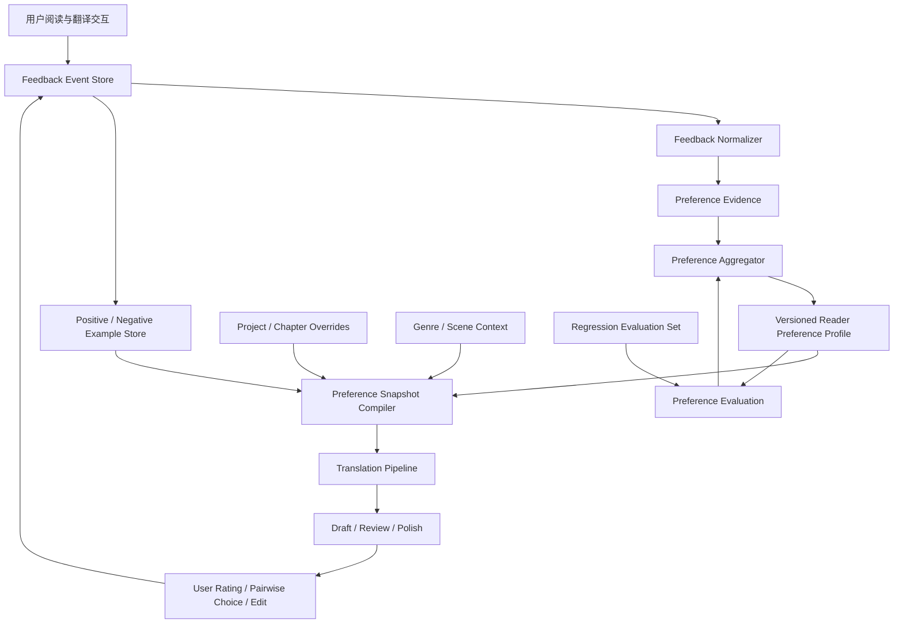

# 从阅读偏好到个性化文学翻译：如何让 LLM 在长期翻译与校对中学习一个人的审美

> 调研日期：2026-10-31  
> 适用场景：英文、日文等小说翻译；同一作品多种译风；读者逐段评分、比较、批注；跨章节、跨作品积累长期偏好。

## 摘要

个人文学阅读偏好不应被实现为一段不断膨胀的 system prompt，也不应简单等同于“喜欢某位作家的风格”。更合适的实现是一个可版本化的 **Reader Preference Model（RPM，读者偏好模型）**：它从明确声明、译文评分、候选比较、局部修改、接受/拒绝建议和阅读行为中提取证据，形成多维、带置信度、带适用范围、可追溯和可撤销的偏好知识；翻译时再根据作品、语言方向、文体、叙事角色和当前任务检索出一份小型的 Preference Snapshot，贯穿初译、审校、风格润色和最终验收。

核心结论：

1. **记录反馈时保留原始事件，不要只保留模型总结出的偏好。** 用户的一次 8 分、一次改词和一句“不喜欢这个感觉”都是不同类型的证据。
2. **评分与比较结合。** 单独打分容易受段落难度、绝对标准漂移影响；对同一原文的 A/B 比较更容易表达“我更喜欢哪一个”，并可用 Bradley–Terry 等方法估计维度偏好。
3. **偏好必须多维、分场景。** 句子长短、词汇密度、叙述距离、对话口语度、意象保留、解释倾向、幽默、节奏等不能压成一个“文风分数”。
4. **区分读者偏好、作品风格、翻译约束和事实正确性。** 读者喜欢不等于忠实；风格可以调节，但人物关系、情节、视角、时态、专名和原文歧义不能被偏好覆盖。
5. **先用外部记忆与检索，不急于微调。** 结构化偏好、实例记忆、检索和提示词组合通常足以启动；积累高质量、稳定、覆盖多场景的反馈后，再考虑 LoRA / preference tuning。
6. **建立持续评估集。** 每次偏好模型升级，都用固定的原文片段、用户历史选择和反例回归，检查是否真的更符合读者，而不是只让模型自评更高。

---

## 1. 问题定义：要学习的不是“翻译风格”，而是读者的条件偏好

假设同一段英文小说可以有三个都基本正确的译法：

- A：句式贴近原文，保留从句结构，语义对应清楚，但中文略显翻译腔。
- B：调整语序，表达自然，节奏较快，但弱化了原文的迟疑感。
- C：更有文学修辞，词汇更有质感，但增加了原文没有明确表达的情绪。

用户可能在一般叙述中偏好 B，在人物意识流段落中偏好 A，在景物描写中偏好 C。因而“用户喜欢 B”不是可复用的知识；需要学习的是：

> 在什么文本条件、什么维度、什么权衡下，用户更偏好哪种表达，以及这种判断有多确定。

可以把偏好表示为条件函数：

[
P(y_i succ y_j mid x, c, d, u)
]

其中：

- (x)：源文及其上下文；
- (y_i,y_j)：两个候选译文；
- (c)：作品与场景上下文（叙述、对话、内心独白、动作、景物等）；
- (d)：评价维度（忠实、自然、节奏、语气、意象、词汇等）；
- (u)：用户；
- 输出：用户在当前条件下更偏好哪个候选及其置信度。

因此，系统应同时保存“用户总体偏好”和“当前项目/当前作品的局部偏好”，并允许它们不同。

## 2. 业界研究给出的重要启示

### 2.1 个性化偏好不能从长对话中自动可靠地保留下来

Zhao 等人在 ICLR 2025 的 **Do LLMs Recognize Your Preferences? (PrefEval)** 中构建了 3,000 条、覆盖 20 个主题的偏好评测数据。论文指出，模型在多轮对话中推断、记忆并遵循用户偏好仍有明显困难；在其零样本设置中，约 10 轮（约 3k tokens）后，多数模型的偏好遵循准确率已低于 10%。仅仅把历史对话塞进长上下文，并不能保证偏好被正确使用。

工程含义：不能依赖“模型应该记得用户以前说过什么”。必须把偏好提取、存储、检索和应用做成显式流程，并对每次使用的偏好快照留痕。

论文：[PrefEval — ICLR 2025](https://arxiv.org/abs/2502.09597) · [ICLR 页面](https://proceedings.iclr.cc/paper_files/paper/2025/hash/28a46044775d97a4efcbcf14e7f13209-Abstract-Conference.html)

### 2.2 长期偏好需要区分情景记忆与语义记忆

EMNLP 2025 的 **PRIME: Large Language Model Personalization with Cognitive Dual-Memory and Personalized Thought Process** 将个性化记忆区分为：

- Episodic memory：具体历史互动，例如用户对某句译文打 9 分、拒绝某个词、选择 A 而不是 B。
- Semantic memory：从多次互动归纳出的稳定倾向，例如用户通常偏好简洁叙述、不喜欢解释性增译。

这一区分特别适合翻译系统。不能只保存总结后的“喜欢自然中文”，因为未来无法追溯这一结论来自哪些文本、哪些修改和多少次反馈；也不能每次把全部历史事件塞进 Prompt，因为上下文成本和噪声会持续增加。

建议保留不可变的反馈事件作为情景记忆，再由异步归纳过程生成带证据引用的语义偏好。语义偏好发生变化时，保留版本和生效时间，不覆盖历史。

论文：[PRIME — EMNLP 2025](https://aclanthology.org/2025.emnlp-main.1711/)

### 2.3 读者的个体偏好差异足以改变模型排名

ACL 2026 Findings 的 **Personalized Benchmarking: Evaluating LLMs by Individual Preferences** 研究了 115 位活跃用户的个性化模型偏好排名。研究显示，个体排名与总体排名可能显著不同，Bradley–Terry 排名相关性平均仅约 0.04。总体上表现最好的模型，不一定是某位具体用户最喜欢的模型。

工程含义：不要把“多数读者认为好”当作“这个用户喜欢”。通用翻译质量评估与个人审美评估必须分开。

论文：[Personalized Benchmarking — ACL 2026](https://aclanthology.org/2026.findings-acl.31/)

### 2.4 文学翻译尤其不能只依赖自动评分或 LLM-as-a-judge

NAACL 2025 的 **How Good Are LLMs for Literary Translation, Really?** 提出 LITEVAL-CORPUS，包含段落级平行语料、人工译文和多个机器翻译系统输出。研究发现，文学翻译评价方案越复杂，普通评价者越容易产生误判；BWS（Best-Worst Scaling）这类相对简单的比较方法，在识别人工译文方面优于复杂 MQM 方案。自动指标和 LLM 评价在该实验中表现较差。论文强调，文学翻译仍有大量字面、风格单一的问题。

工程含义：不要让用户面对几十个抽象的质量维度表格。优先提供两个候选译文的并排比较、局部高亮和简短理由输入。模型评分可以辅助定位问题，但不能替代读者判断。

论文：[LITEVAL-CORPUS — NAACL 2025](https://aclanthology.org/2025.naacl-long.548/)

### 2.5 2026 年 LAIT 读者研究：整段沉浸阅读与局部比较都重要

2026 年 EMNLP Findings 的 **AI translation of literary texts is ‘fine’, but readers still prefer human translations**（LAIT）让 15 位读者比较 15 部法语、波兰语和日语小说的人工译文与 agentic LLM 翻译。实验同时采用约 8,000 词的沉浸式阅读和约 300 词的局部对照：读者在 772 次片段级比较中有 522 次显著偏好人工译文。研究还发现，机器翻译在同一本书内部的质量波动更大；自动指标（包括 LLM-as-a-judge）未能恢复读者偏好，且倾向于偏爱机器译文。

LAIT 的评价界面值得借鉴：

- 先完整阅读一段，而不是只看孤立句子；
- 对整段评价流畅度、清晰度、沉浸感和是否愿意继续读；
- 再进行局部并排比较；
- 高亮特别好的/差的词句；
- 记录选择、理由和选择难度。

工程含义：个人偏好学习也要同时收集段落级与片段级反馈。单句被喜欢，不代表放回整章后仍然自然。

论文：[ACL Anthology — EMNLP Findings 2026](https://aclanthology.org/2026.findings-emnlp.2138/) · [LAIT 项目与评价界面](https://lait.cs.sfu.ca/)

### 2.6 翻译个性化已有专门研究，不只是通用 LLM personalization

2026 EACL 的 **Steering Large Language Models for Machine Translation Personalization** 专门研究文学翻译中的个性化。论文比较了显式 Prompt 与从少量风格样例中学习偏好的方法，并探索通过 Sparse Autoencoder（SAE）特征进行 contrastive steering。研究指出，用户偏好经常隐含在少量示例里，而不是能被用户完整描述成一组规则；对比式 steering 可以更稳健地控制风格。

工程含义：用户喜欢/不喜欢的实际译文片段，是比“请翻译得优雅一点”更有价值的训练信号。系统应保存经过用户确认的正反例，并在相似场景中检索。

论文：[Steering LLMs for MT Personalization — EACL 2026](https://aclanthology.org/2026.eacl-long.217/) · [arXiv](https://arxiv.org/abs/2505.16612)

### 2.7 比较式反馈适合学习多维、隐式偏好

ACL 2025 的 **Comparison-based Active Preference Learning for Multi-dimensional Personalization (AMPLe)** 研究通过交互式比较收集隐式偏好，并用 Bayesian inference 更新多维偏好估计；主动选择策略会优先询问最有信息量的问题，以减少用户反馈成本。

工程含义：不要让用户给每个段落填写一张长评分表。系统可以先用已有偏好生成两个风格有差异的候选，只在模型不确定或某个偏好维度尚未识别时，询问用户做一次有针对性的比较。

论文：[AMPLe — ACL 2025](https://aclanthology.org/2025.acl-long.1590/)

### 2.8 翻译反馈训练需要防止 Reward Hacking

NAACL 2024 的 **Improving Machine Translation with Human Feedback: An Exploration of Quality Estimation as a Reward Model** 研究把质量估计模型作为翻译反馈训练的奖励模型，并发现过度优化问题：奖励分数提高，实际翻译质量却可能下降。质量模型可能给错误译文高分，导致错误传播。

工程含义：即使未来训练个人 Reward Model，也不能只追求它自己的分数。必须用独立的人工回归集检查忠实度、遗漏、增译和风格变化；个人偏好不能覆盖语义正确性。

论文：[Improving MT with Human Feedback — NAACL 2024](https://aclanthology.org/2024.naacl-long.451.pdf)

### 2.9 更早的个性化机器翻译研究已经指出：翻译偏好属于接收者

Mirkin 与 Meunier 的 **Personalized Machine Translation: Predicting Translational Preferences**（2015）指出，同样正确的译文可能因句长、正式程度、标点、词汇处理等个人偏好而被不同用户评价不同；个性化机器翻译应该考虑译文接收者的偏好，而不只是作者或领域。

论文：[Personalized Machine Translation — ACL 2015](https://aclanthology.org/D15-1238.pdf)

---

## 3. 推荐的偏好知识模型

不要只存一个 profile JSON。建议分成五类数据。

### 3.1 Preference Profile：稳定偏好

这是每次翻译时最常用的紧凑偏好画像。每条偏好都要有维度、方向、强度、置信度、适用范围、证据数量和状态。

示例：

```json
{
  "profileId": "reader-default",
  "version": 12,
  "preferences": [
    {
      "dimension": "narration.sentence_rhythm",
      "direction": "prefer_varied_natural_rhythm",
      "strength": 0.78,
      "confidence": 0.84,
      "scope": ["zh-CN", "literary-fiction", "narration"],
      "evidenceCount": 17,
      "status": "active",
      "evidenceRefs": ["pref-event-102", "pref-event-118"]
    },
    {
      "dimension": "translation.explicit_explanation",
      "direction": "avoid_unnecessary_explanation",
      "strength": 0.91,
      "confidence": 0.93,
      "scope": ["all-literary-translation"],
      "evidenceCount": 23,
      "status": "active",
      "evidenceRefs": ["pref-event-087", "pref-event-132"]
    },
    {
      "dimension": "dialogue.colloquiality",
      "direction": "moderate_conversational",
      "strength": 0.55,
      "confidence": 0.61,
      "scope": ["zh-CN", "dialogue"],
      "evidenceCount": 6,
      "status": "provisional",
      "evidenceRefs": ["pref-event-141"]
    }
  ]
}
```

推荐维度树：

| 一级维度 | 二级维度示例 | 反馈中可以观察什么 |
|---|---|---|
| 语义忠实 | 漏译、增译、歧义保留、隐含信息 | 是否擅自解释、是否改变人物意图 |
| 句法节奏 | 句长、断句、从句、长短句变化 | 是否过碎、是否拖沓、是否保留迟疑 |
| 词汇选择 | 具体/抽象、常用/生僻、书面/口语 | 是否用力过猛、是否词不达意 |
| 叙述声音 | 叙述距离、冷静/抒情、主观性 | 是否擅自增加情绪、是否改变叙述者声音 |
| 人物对话 | 口语度、人物差异、时代感、潜台词 | 是否所有人物说话都像同一个人 |
| 文学效果 | 意象、隐喻、幽默、含蓄、留白 | 是否解释掉意象、是否添加修辞 |
| 中文可读性 | 自然度、流畅度、歧义、阅读负担 | 是否有翻译腔、是否过度润色 |
| 规范偏好 | 标点、引号、数字、专名 | 是否符合个人长期习惯 |

维度不能一开始就设计得过细。建议先建立 8 个一级维度和约 20 个常用二级维度，允许用户反馈后再扩展。

### 3.2 Preference Events：原始反馈事件

这是最重要的数据。只要用户作出反馈，就记录一个事件，保持原文、候选译文、用户动作和上下文的关联。

建议事件类型：

| 类型 | 例子 | 主要用途 |
|---|---|---|
| Explicit rule | “不要把人物的沉默翻译成心理解释” | 直接建立明确约束 |
| Rating | 这段 8/10 | 绝对质量趋势 |
| Pairwise choice | A 比 B 好 | 相对偏好学习 |
| Span annotation | 高亮“他的眼神变得阴冷”，标记不喜欢 | 精确定位语言特征 |
| Edit acceptance | 用户接受模型建议 | 弱正向信号 |
| Edit rejection | 用户撤销模型修改 | 弱负向信号 |
| Rewrite | 用户自己改写一整句 | 高价值正例 |
| Comparative comment | “B 自然，但把原文的犹豫感弄没了” | 学习维度权衡 |
| Project override | “这本书的对话要比平时更克制” | 作品级局部偏好 |

事件示例：

```json
{
  "eventId": "pref-event-20261031-001",
  "type": "pairwise_choice",
  "timestamp": "2026-10-31T10:30:00+08:00",
  "projectId": "novel-001",
  "chapterId": "chapter-03",
  "sourceLanguage": "en",
  "targetLanguage": "zh-CN",
  "genre": "literary-fiction",
  "segment": {
    "source": "He seemed about to say something, then thought better of it.",
    "contextBefore": "She waited.",
    "contextAfter": "The train pulled away."
  },
  "candidates": [
    {"id": "A", "text": "他似乎想说什么，最终还是作罢。"},
    {"id": "B", "text": "他像是要说些什么，却又打消了念头。"}
  ],
  "chosen": "B",
  "choiceStrength": "clear",
  "reason": "B 保留了动作中的迟疑，A 的“作罢”太像总结性叙述。",
  "dimensionTags": ["narration.subtlety", "sentence_rhythm"],
  "scope": "project",
  "source": "user_explicit_feedback"
}
```

原始事件不要被 LLM 重写覆盖。模型可以生成归纳标签，但必须保留用户原话和证据引用。

### 3.3 Preference Examples：正反例库

保存具体片段，而不是只保存规则。

每个样例至少包含：

- 源文及必要上下文；
- 用户认可的译文；
- 用户拒绝的译文；
- 用户的理由；
- 适用文体和维度；
- 来源作品与章节；
- 是否允许跨作品复用；
- 脱敏和版权使用状态。

检索时优先找同一类文本：对话找对话，心理描写找心理描写，不能因为用户喜欢某个景物段落，就把它当作所有文本的风格模板。

### 3.4 Project Overrides：作品级偏好覆盖

用户可能总体偏好简洁，但某部小说需要保留冗长、意识流、重复和不稳定叙述。作品级覆盖应优先于全局偏好，但不能覆盖语义正确性。

建议优先级：

1. 源文事实、语义、人物关系和明确翻译约束；
2. 当前作品的明确要求；
3. 当前章节/人物/叙述视角的局部约束；
4. 用户稳定的全局阅读偏好；
5. 当前译风 preset；
6. 模型默认习惯。

如果同一层级出现冲突，不要静默选择，应标记冲突并在必要时询问。

### 3.5 Preference Provenance：偏好来源与可信度

偏好不能只有一个 confidence 数字。需要知道它来自哪里：

- 用户明确声明：高可信；
- 多次选择同一方向：中高可信；
- 用户亲自改写：高价值，但需要判断是否只是局部修正；
- 接受模型建议：弱正向证据；
- 未修改：不能直接视为喜欢；
- 模型从评分推断：需要用户确认；
- 单次评分：低到中等可信。

还要记录时间和版本。长期偏好会变化，系统应允许“过去喜欢、现在不喜欢”，而不是把所有事件平均成一个永不改变的结论。

---

## 4. 如何把评分转化为可学习信号

### 4.1 不要只给一个总分

总分适合快速反馈，但解释能力弱。建议采用“总分 + 可选维度 + 一句话理由”。

例如：

| 项目 | 评分 |
|---|---:|
| 整体阅读体验 | 8/10 |
| 忠实于原文 | 9/10 |
| 中文自然度 | 7/10 |
| 叙述声音 | 8/10 |
| 节奏 | 6/10 |
| 人物对话 | 不适用 |

维度评分可以只在用户愿意时填写。不要每段都要求完整填写。

### 4.2 Pairwise preference 比单独评分更有价值

同一段原文生成 A/B 两个候选，让用户回答：

- 更喜欢 A；
- 更喜欢 B；
- 两者差不多；
- 两者都不好。

并允许补充“为什么”。

两个候选应该有明确、可解释的风格差异。例如 A 更忠实保留句法，B 更自然地调整中文语序；不要生成两个差异很小、无法判断的版本。

比较数据可以用于 Bradley–Terry 模型：

[
P(A succ B) =
rac{exp(s_A)}{exp(s_A)+exp(s_B)}
]

其中候选分数可以由多个偏好维度构成：

[
s(y,x)=sum_k w_k(u,c),f_k(y,x)
]

- (f_k)：候选在某个维度上的特征或评价；
- (w_k)：用户在当前上下文下对该维度的权重；
- (u)：用户；
- (c)：作品、文体和文本场景。

实际系统不必一开始就训练 Bradley–Terry 模型。可以先保存比较事件，再通过统计或 Bayesian 更新逐步估计偏好权重。

### 4.3 区分“绝对质量”与“相对喜欢”

用户给 6 分，可能是因为两个候选都不好；给 8 分，可能是两个候选都很好。不能直接把分数当成某个风格维度的权重。

建议：

- 绝对评分用于追踪整体质量；
- A/B 比较用于学习偏好方向；
- 局部批注用于定位具体语言现象；
- 用户改写用于构造高质量正例；
- 明确规则用于建立硬约束。

### 4.4 主动询问，不要频繁打扰

当系统在某个维度上不确定时，选择最有信息量的片段发起比较。

例如，系统已经知道用户不喜欢过度解释，但不确定用户是否偏好保留长句。可以选一个没有情节风险、但长短句处理差异明显的片段，提供两版比较。

以下情况值得询问：

- 两个候选在用户尚不确定的维度上差异明显；
- 当前项目偏好与全局偏好冲突；
- 用户连续否定同一种模型倾向；
- 一条新反馈可能改变已有高置信度规则；
- 风格修改可能影响人物声音或叙述视角。

不要在每个段落都要求打分。主动学习的目标是用更少反馈消除更大的不确定性。

---

## 5. 如何贯穿完整翻译生命周期

### 5.1 翻译开始：建立 Preference Snapshot

每本书开始时，系统读取：

- 用户全局偏好；
- 目标语言方向偏好；
- 文学类型偏好；
- 作品级覆盖；
- 当前译风 preset；
- 最相关的正反例；
- 当前偏好模型版本。

然后生成一份冻结的 Preference Snapshot，记录 snapshotId、profileVersion、projectOverrideVersion 和检索到的 example IDs。

快照的作用是保证同一章初译、审校、风格润色使用相同的偏好基线，避免翻译到一半偏好悄悄变化。用户新反馈可以生成下一版本快照，是否应用到当前章由工作流决定。

### 5.2 初译：偏好用于选择表达，不用于改写事实

初译 Prompt 应将规则分层：

- 不可违反：语义、事实、人物关系、视角、时态、专名和明确的上下文约束；
- 强偏好：用户稳定的语言习惯；
- 软偏好：当前作品和译风的审美倾向；
- 示例：少量相关正例和反例。

偏好应是可权衡的风格指导，而不是要求模型逐字模仿历史样例。

### 5.3 一致性审校：把个人偏好变成可检查项

审校不应只检查术语和事实，也应检查长期偏好：

- 是否无必要地解释原文没有说出的心理活动；
- 是否把不同人物的对话统一成同一种口吻；
- 是否频繁使用用户不喜欢的抽象词或套话；
- 是否把原文有意保留的含糊改成明确结论；
- 是否为了“流畅”破坏人物的迟疑、重复或停顿；
- 是否把所有句子都改成相同的中文节奏。

审校输出要区分“明确违反偏好”“可能不符合偏好”“只是另一种可接受的译法”。不能把审美差异全部报成错误。

### 5.4 风格润色：按场景选择偏好

同一作品内至少要区分：

- 叙述文字；
- 人物对话；
- 内心独白；
- 书信、日记、文件；
- 动作与场景；
- 意识流或非可靠叙述。

Preference Snapshot 可以按场景裁剪，避免将所有偏好无差别注入每个段落。

### 5.5 最终校对：检查整体阅读体验

局部句子都很漂亮，不代表整章好读。最终审校应增加章节级检查：

- 句长与节奏是否持续单调；
- 人物声音是否稳定且彼此可区分；
- 同一叙述者的语言是否发生无意漂移；
- 词汇和修辞是否重复过度；
- 情绪强度是否被持续抬高；
- 章节是否具有连贯的阅读沉浸感。

这一层需要同时看较大上下文，而不是只把每个 segment 单独打分。

### 5.6 反馈回流：写入事件，再异步更新偏好

建议流程：

1. 用户评分、比较、批注或修改；
2. 立即保存不可变的 Preference Event；
3. LLM 将自然语言理由映射到候选偏好维度，保留原始理由；
4. 偏好更新器检查是否与已有偏好一致、冲突或属于局部覆盖；
5. 低置信度结论先作为 provisional；
6. 达到证据阈值后更新 Preference Profile；
7. 生成新版本并记录证据引用；
8. 下次任务检索新版本，必要时通过 A/B 回归验证。

不要让负责翻译的 Agent 在生成译文的同一个步骤里直接修改长期偏好。翻译执行与偏好学习应分离，避免一次偶然的生成结果污染用户画像。

---

## 6. 推荐系统架构

建议采用“事件存储 + 语义偏好 + 示例检索 + 快照编译”的结构，而不是把所有反馈塞进向量数据库。



### 6.1 存储职责

| 数据 | 推荐存储 | 是否需要向量化 |
|---|---|---|
| 原始评分、选择、批注、编辑事件 | SQLite / PostgreSQL 关系表或 JSONL 事件日志 | 不需要 |
| 当前偏好 Profile | JSON 文档或关系表 | 不需要 |
| 偏好版本与证据引用 | 关系表 / JSON | 不需要 |
| 正反例片段 | 文本存储 + 元数据 | 可选 |
| 正反例语义检索 | Embedding index | 有足够样例后再考虑 |
| 当前项目覆盖规则 | 项目数据库 | 不需要 |
| Preference Snapshot | JSON，随翻译任务固化 | 不需要 |
| 回归测试样本 | 版本化文件或数据库 | 不需要 |

**向量检索不是偏好系统的前提。** 早期几十到几百条样例，可以用标签、语言、场景、维度和全文检索。只有样例积累较多、需要按语义找相似语言现象时，再引入向量检索。向量相似度不能替代范围过滤和偏好权重。

### 6.2 核心数据表建议

| 表 | 关键字段 |
|---|---|
| preference_events | event_id, user_id, project_id, event_type, source_text, context, payload, created_at |
| preference_evidence | evidence_id, event_id, dimension, polarity, strength, confidence, scope |
| preference_profiles | profile_id, user_id, version, status, created_at |
| preference_rules | profile_version, dimension, direction, strength, confidence, scope, evidence_count |
| preference_examples | example_id, event_id, source_text, context, preferred_text, rejected_text, tags |
| project_overrides | project_id, dimension, direction, strength, reason, version |
| preference_snapshots | snapshot_id, project_id, profile_version, override_version, examples, compiled_prompt, created_at |
| preference_eval_cases | case_id, source_text, context, candidates, expected_preference, dimensions |

事件表必须能还原当时用户看到的候选译文和上下文。仅保存分数和一句摘要，未来无法可靠重放或重新分析。

---

## 7. 风格 Preset 与个人偏好如何组合

两者不是同一层概念。

- **Style Preset**：当前任务主动选择的风格方向，例如“克制的现代中文叙述”“偏口语的对白”“保留原文句法”。
- **Reader Preference**：读者长期形成的审美倾向。
- **Project Override**：当前作品有意偏离个人常规偏好的局部要求。

建议不要把“王小波风格”“金庸风格”等作家标签直接当作完整偏好模型。它们只能作为初始参考或风格入口；真正生效的应该是可解释的语言特征，例如句子节奏、幽默强度、词汇密度、叙述距离和对话口语度。还要避免把风格标签转化成特定作品的固定短语或可识别表达。

组合时采用明确的层次：

```text
Translation Constraints
    > Project Override
    > Scene / Character Constraints
    > Reader Preference
    > Style Preset
    > Model Defaults
```

其中语义正确性和用户明确的硬约束始终优先。Style Preset 与 Reader Preference 冲突时，系统应显示冲突，例如：“当前 preset 倾向保留长句，但你的长期偏好倾向自然拆句；本项目是否有意保留原文长句？”

### 7.1 同一读者可以拥有多个偏好模式

不要强制只有一个 global profile。可以有：

- Default literary reading；
- Literary fiction；
- Historical fiction；
- Japanese light novel；
- Dialogue-heavy；
- Experimental / stream of consciousness。

它们不是多个互不相干的人格，而是同一读者在不同文本任务中的条件偏好。系统可以从用户的实际选择中推断场景差异，但推断应带置信度。

---

## 8. 从简单规则到模型训练：采用渐进式方案

### 阶段一：结构化记忆 + Prompt 编译（建议先做）

所需能力：

- 记录用户反馈事件；
- 维护偏好 Profile；
- 保存正反例；
- 按作品、语言、文体和场景检索；
- 为每次翻译生成 Preference Snapshot；
- 记录实际使用的偏好版本。

优点是可解释、可调试、数据量要求低，不需要训练模型。对个人翻译场景，通常应先把这一阶段做好。

### 阶段二：偏好统计与主动学习

当用户已经积累一定数量的评分和比较后：

- 用 pairwise 数据估计维度权重；
- 用 Bayesian 更新置信度；
- 识别全局与项目偏好的冲突；
- 选择最有信息量的 A/B 比较；
- 形成个人偏好回归集。

这一步解决的是“哪些偏好确实稳定”，而不只是让模型写出更漂亮的 Profile 摘要。

### 阶段三：个性化 Reranker / Reward Model

数据充足后，可以训练或适配一个个人偏好排序器：

输入：原文 + 上下文 + 候选译文 + 场景标签。  
输出：候选在忠实度、自然度、节奏、叙述声音、文学效果等维度上的个人偏好分数。

必须把语义正确性作为独立约束或独立评估信号，避免 Reward Model 为了讨好读者而奖励增译、漏译或错误解释。

### 阶段四：PEFT / LoRA / Preference Tuning

只有在以下条件满足时才值得考虑：

- 反馈样本数量和质量足够；
- 偏好跨作品有稳定性；
- 正反例覆盖多个文本场景；
- 已有可靠的个人回归测试集；
- Prompt + Retrieval + Reranking 已经遇到明确瓶颈。

训练方式可以考虑 DPO/IPO 一类偏好优化，或者小型 LoRA 适配。训练数据应使用同一源文下的 chosen/rejected 候选，并携带必要的上下文和场景标签。不要直接把用户所有修改拼成无条件 SFT 数据：修改可能只是修正事实、术语或某一处上下文，不代表全局风格偏好。

---

## 9. 关键工程风险与控制

| 风险 | 典型表现 | 控制方法 |
|---|---|---|
| 过度泛化 | 喜欢某段优美表达，模型以后处处堆砌修辞 | 偏好带场景范围；样例按文本类型检索 |
| 反馈误读 | 用户改词是为了修正事实，却被归纳为风格偏好 | 区分修改意图；不确定时不更新全局偏好 |
| 评分噪声 | 同样质量的段落评分不同 | 评分与 pairwise 结合；保留段落难度和上下文 |
| 偏好漂移 | 早期喜欢的风格后来不喜欢 | 时间衰减、版本化、允许撤销和显式更新 |
| 项目污染 | 某本小说的特殊要求影响其他作品 | Project Override 与全局 Profile 分离 |
| 模型自我强化 | 模型生成某种译法，再由模型自己判定它符合用户偏好 | 用户反馈作为主要证据；LLM judge 只能辅助 |
| 语义牺牲 | 为了符合偏好而擅自增删原文信息 | 忠实度独立门禁；硬约束优先 |
| 样例版权 | 将出版译文或用户上传作品用于训练 | 记录来源、授权和用途；默认只用于当前用户个人检索 |
| 上下文膨胀 | 所有历史偏好和样例都塞进 Prompt | Snapshot 编译、场景检索、预算控制 |
| 评价投机 | Reward 分数上涨，真实阅读体验下降 | 独立读者回归集、整段沉浸式评估 |

### 9.1 负面反馈要比正面反馈更精确

“不喜欢”不等于“永远禁止”。例如用户不喜欢某处“他感到一种难以言喻的悲伤”，可能是因为它解释了原文留白，而不是反对所有心理描写。

因此负面反馈至少要分成：

- 禁止：明确的长期规则；
- 不偏好：通常避免，但上下文允许；
- 本段不适合：只对当前片段成立；
- 事实错误：不是审美偏好；
- 质量问题：不一定能归纳为个人风格。

### 9.2 接受模型建议不等于用户喜欢

用户可能只是快速接受一个修改，之后并未仔细阅读。未修改也不意味着满意。接受/拒绝只能作为弱信号；明确打分、比较理由和用户亲自改写才是更强证据。

### 9.3 不要让“风格一致”变成“语言单调”

个人偏好不是要求每段都写成同一种声音。优秀的翻译需要服从原作的多样性：叙述者、人物、场景和情绪都可能要求不同表达。偏好模型应学习用户如何欣赏这些差异，而不是消除差异。

---

## 10. 推荐的产品交互

不需要一个复杂的偏好配置后台。最有价值的是把反馈自然嵌入阅读和校对过程。

### 10.1 译文旁边的轻量反馈

每个段落可以有：

- 评分：1–10；
- 更喜欢：A / B / 差不多 / 都不好；
- 标记：喜欢这句 / 不喜欢这句；
- 一句话原因；
- “这是本书的特殊要求”开关。

默认只显示最轻量的操作。用户愿意深入时再展开维度。

### 10.2 对模型建议记录“接受原因”

用户接受一个修改时，允许选择或输入：

- 更自然；
- 更忠实；
- 节奏更好；
- 人物声音更准确；
- 更含蓄；
- 更简洁；
- 其他。

这些标签只是辅助分类，不应取代用户自己的表达。

### 10.3 提供偏好记忆的可见性

用户应能查看：

- 当前模型认为我偏好什么；
- 每条偏好来自哪些反馈；
- 适用范围；
- 置信度；
- 最近一次更新时间；
- 哪些规则是我明确说的，哪些是系统推断的；
- 暂停、修正或删除某条偏好。

这比一个不可见的“AI 已经学会你的风格”更可信。

### 10.4 定期做偏好校准

例如完成一本书后，系统汇总：

- 本书最常被认可的语言特征；
- 最常被否定的表达方式；
- 与全局偏好不同的地方；
- 仍然不确定的偏好；
- 建议加入全局 Profile 的规则。

用户确认后才升级全局偏好。不要自动把单本书的局部审美提升为永久偏好。

---

## 11. 具体实施路线

建议按下面顺序实施，不要一开始就做个人模型训练。

| 优先级 | 能力 | 交付结果 | 价值 |
|---|---|---|---|
| P0 | Feedback Event Schema | 评分、比较、批注、编辑统一事件结构 | 建立可用数据基础 |
| P0 | Versioned Preference Profile | 多维偏好、置信度、范围、证据 | 防止偏好退化为长 Prompt |
| P0 | Preference Snapshot | 每章翻译固定偏好版本 | 保证初译和校对一致 |
| P0 | Positive / Negative Examples | 保存用户认可和拒绝的具体片段 | 将隐式偏好转为可检索实例 |
| P1 | Scene-aware Retrieval | 按叙述/对话/心理活动检索偏好 | 减少错误泛化 |
| P1 | Pairwise Feedback UI | A/B 比较和理由 | 高效收集偏好信号 |
| P1 | Feedback Normalizer | 把用户理由映射为维度标签 | 降低人工整理成本 |
| P1 | Preference Regression Set | 固定样例回归 | 验证是否真的改善 |
| P2 | Bayesian / Bradley–Terry Estimation | 估计多维偏好权重 | 从主观事件中提炼稳定趋势 |
| P2 | Active Preference Query | 选择最值得询问的片段 | 降低用户反馈负担 |
| P3 | Personalized Reranker | 对候选译文做个人排序 | 提高候选选择质量 |
| P4 | LoRA / Preference Tuning | 模型参数层面的个性化 | 仅在数据和评估成熟后考虑 |

### 建议的 MVP

第一版只需要四个组件：

1. **Feedback Event Store**：记录用户评分、A/B 选择、局部标注、接受/拒绝和人工修改。
2. **Preference Profile Builder**：从明确规则和多次反馈中生成结构化画像，所有结论关联证据。
3. **Snapshot Compiler**：在每次章节翻译前生成固定偏好快照，并检索少量相关样例。
4. **Preference Regression**：固定 20–50 个有代表性的原文片段，检查新旧偏好版本下的候选选择是否符合用户历史判断。

第一版不需要向量数据库，不需要训练模型，也不需要复杂的多 Agent。数据模型和流程正确，比一开始引入更复杂的模型更重要。

---

## 12. 一个端到端例子

原文：

> He seemed about to say something, then thought better of it.

模型生成：

- A：他似乎想说什么，最终还是作罢。
- B：他像是要说些什么，却又打消了念头。
- C：他张了张嘴，话到嘴边，终究还是咽了回去。

用户选择 B，理由是：“B 保留了迟疑，但 C 加了动作，原文并没有明确写张嘴。”

系统应该学到：

- 用户偏好 B，而不是单纯偏好更文学化的 C；
- 用户不喜欢为了增强画面感而补充原文未明确给出的动作；
- 用户接受适度调整中文语序；
- 用户偏好保留原文含蓄程度；
- 这条证据可能适用于叙述段落，但不应直接推导为所有场景都禁止动作增译。

后续当模型处理：

> She almost smiled, but stopped herself.

它可以检索到“不要无依据增加动作”的偏好示例，但仍然必须根据本句的语义和上下文判断，不能机械套用。

这就是偏好记忆真正的价值：不是让模型记住一句“用户喜欢自然、含蓄的翻译”，而是让它理解用户在具体语言选择中如何权衡。

---

## 13. 结论

个人阅读偏好应当被看作一种长期演进的用户知识，而不是一个固定 Prompt。它的学习闭环是：

- 用户通过评分、比较、批注和修改表达偏好；
- 系统把这些交互保存为原始事件；
- 偏好归纳器形成带证据、置信度和范围的多维画像；
- 翻译任务根据作品和场景检索偏好与正反例；
- Snapshot 将偏好稳定地贯穿初译、审校和润色；
- 回归集验证个性化是否真正改善阅读体验；
- 用户确认后再更新长期画像。

对个人文学翻译，**最先值得投入的不是微调模型，而是把反馈变成结构化、可追溯、可比较、可回放的知识。** 只要这套数据资产建立起来，未来无论更换底层模型、增加 reranker，还是做 LoRA，都不会丢失已经积累的个人审美。

---

## 参考研究与资源

1. Zhao et al. (2025), [Do LLMs Recognize Your Preferences? Evaluating Personalized Preference Following in LLMs](https://arxiv.org/abs/2502.09597), ICLR 2025.
2. Zhang et al. (2025), [PRIME: Large Language Model Personalization with Cognitive Dual-Memory and Personalized Thought Process](https://aclanthology.org/2025.emnlp-main.1711/), EMNLP 2025.
3. Garbacea et al. (2026), [Personalized Benchmarking: Evaluating LLMs by Individual Preferences](https://aclanthology.org/2026.findings-acl.31/), ACL Findings 2026.
4. Zhang et al. (2025), [How Good Are LLMs for Literary Translation, Really?](https://aclanthology.org/2025.naacl-long.548/), NAACL 2025.
5. Ferstler et al. (2026), [AI translation of literary texts is ‘fine’, but readers still prefer human translations](https://aclanthology.org/2026.findings-emnlp.2138/), EMNLP Findings 2026; [LAIT project](https://lait.cs.sfu.ca/).
6. Scalena et al. (2026), [Steering Large Language Models for Machine Translation Personalization](https://aclanthology.org/2026.eacl-long.217/), EACL 2026.
7. Oh et al. (2025), [Comparison-based Active Preference Learning for Multi-dimensional Personalization](https://aclanthology.org/2025.acl-long.1590/), ACL 2025.
8. He et al. (2024), [Improving Machine Translation with Human Feedback: An Exploration of Quality Estimation as a Reward Model](https://aclanthology.org/2024.naacl-long.451.pdf), NAACL 2024.
9. Mirkin & Meunier (2015), [Personalized Machine Translation: Predicting Translational Preferences](https://aclanthology.org/D15-1238.pdf), ACL 2015.
10. Jiang et al. (2024), [A Survey on Human Preference Learning for Large Language Models](https://arxiv.org/abs/2406.11191), survey of feedback sources, preference modeling, utilization and evaluation.
