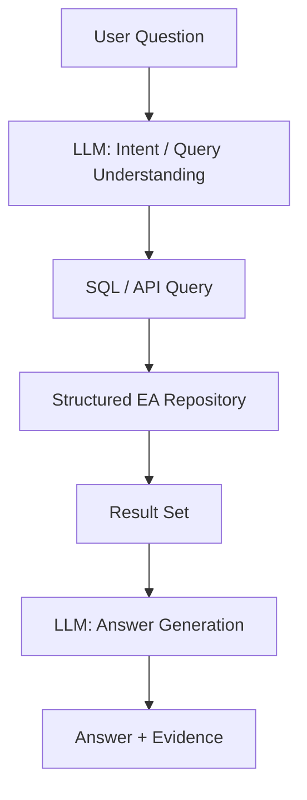
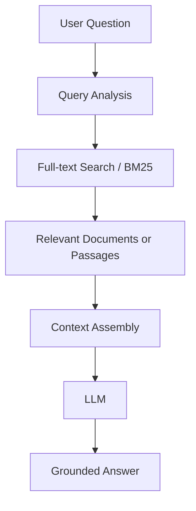
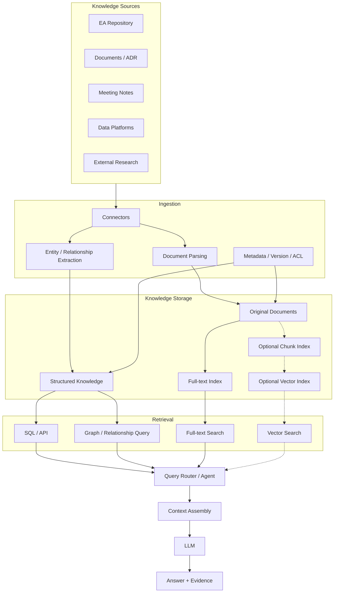
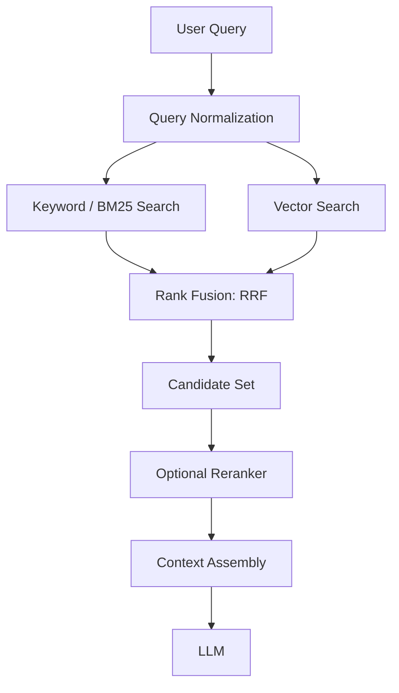
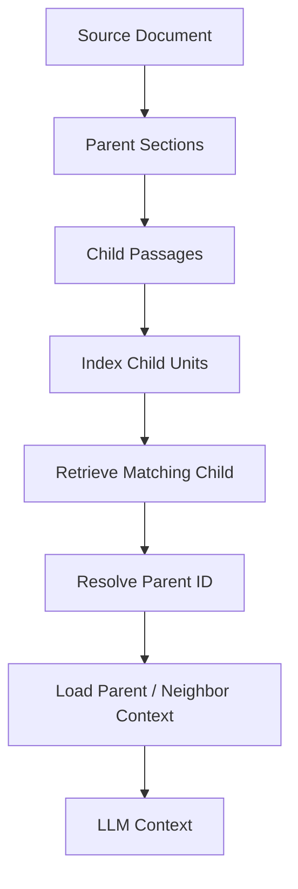
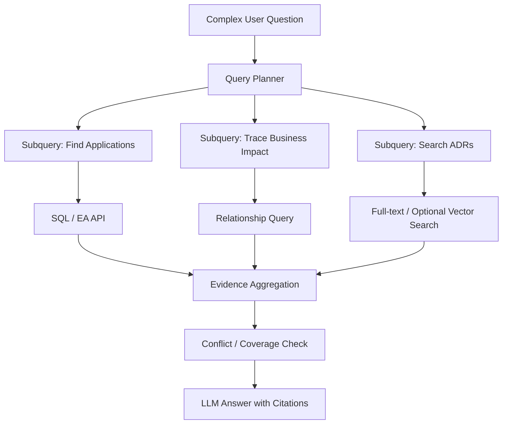

# RAG 一定需要 Chunk 和 Vector 吗？从检索原理到架构选型

## 1. 一个常见的误解

谈到 Retrieval-Augmented Generation（RAG，检索增强生成），很多技术文章会直接给出一条熟悉的 Pipeline：

1. 加载 PDF、Word、网页等文档。
2. 将文档切分成 Chunk。
3. 使用 Embedding Model 把每个 Chunk 转换成向量。
4. 把向量和 Chunk 内容存入 Vector Database。
5. 用户提问时，将问题也转换成向量。
6. 通过向量相似度搜索找到 Top-K Chunk。
7. 把检索结果放进 Prompt，让 LLM 生成答案。

这套流程没有问题，也是非常常见的 RAG 实现。但它容易让人产生一个错误印象：只要做 RAG，就必须先 Chunk，再 Embedding，最后使用 Vector Database。

实际上，这只是 RAG 的一种实现方式——以向量相似度为核心的检索增强生成。RAG 的定义并没有规定必须使用向量数据库，也没有规定所有知识都必须切成固定大小的文本块。

RAG 解决的是一个更一般的问题：**如何在生成答案之前，从模型参数之外的数据源中找到相关信息，并把这些信息作为生成依据提供给模型。**

只要系统能够完成检索、上下文增强和生成，就可以构成 RAG。检索可以来自 SQL、传统全文搜索、搜索引擎、知识图谱、API、向量搜索，也可以组合多种方式。

GitHub 对 RAG 的介绍也明确指出，RAG 并不要求 Embedding 或 Vector Database；检索结果可以来自传统数据库或搜索引擎，再作为上下文交给模型。[GitHub：What is retrieval-augmented generation?](https://github.blog/ai-and-ml/generative-ai/what-is-retrieval-augmented-generation-and-what-does-it-do-for-generative-ai/)

## 2. 先把三个容易混淆的概念拆开

### 2.1 Chunking：分块，解决检索粒度问题

Chunking 是把较大的内容拆成更小的内容单元。它回答的是：

> 当用户提出一个问题时，我应该以什么粒度找到和返回知识？

假设有一份 100 页的架构设计文档，里面包含系统背景、架构图、数据流、接口定义、部署方案和安全要求。

如果检索系统只能返回整份文档，那么即使文档与问题相关，也可能把大量无关内容一起交给模型。将文档按章节、段落或主题拆分后，系统就可以只返回相关部分。

例如：

原始文档：

- 第 1 章：业务背景
- 第 2 章：系统上下文
- 第 3 章：数据流
- 第 4 章：接口设计
- 第 5 章：安全要求

可以形成五个逻辑内容单元，也可以进一步按段落拆分。

但要注意，Chunk 并不一定是固定的 500 个 Token，也不一定必须有重叠（Overlap）。Chunk 可以是：

- 一整篇短文档；
- 一个章节；
- 一个自然段；
- 一个表格；
- 一个 API 定义；
- 一条 FAQ；
- 一个代码函数；
- 一条数据库记录；
- 一个知识图谱中的实体描述。

Chunk 的本质是检索单元（Retrieval Unit），而不是某种固定的数据格式。

分块粒度取决于内容结构、查询类型和检索方式。分得太大，检索结果容易包含无关内容；分得太小，定义、条件、例外和上下文可能被拆散。MongoDB 的 RAG 文档也将固定长度、递归、语言感知和语义分块列为不同策略，而不是认为存在一个适合所有文档的固定尺寸。[MongoDB：Chunking Strategies](https://www.mongodb.com/docs/vector-search/tutorials/rag/)

### 2.2 Vectorization：向量化，解决语义匹配问题

Vectorization 通常指使用 Embedding Model，将文本转换成一个数值向量。

例如：

- "The application is no longer supported."
- "This system has reached end of life."
- "该应用已经停止厂商支持。"

三句话使用的词汇不同，但表达的意思接近。Embedding Model 的目标是将语义相近的文本映射到向量空间中相对接近的位置。

简化表示：

```text
Text
  |
  v
Embedding Model
  |
  v
[0.12, -0.31, 0.87, ...]
```

当用户提出一个问题时，系统也可以将问题转换成向量，再比较问题向量与知识向量之间的距离或相似度。

常见的相似度计算包括：

- Cosine Similarity（余弦相似度）
- Dot Product（点积）
- Euclidean Distance（欧氏距离）

向量化解决的是一种特定的检索问题：**用户使用的表达与知识库中的原始表达不完全一致，但两者在语义上可能相关。**

它并不负责理解企业实体之间的真实关系，也不保证检索结果一定正确。

例如，用户问：

> 哪些系统已经不再获得厂商支持？

文档中可能使用 "End of Life"、"End of Support"、"EOS" 或 "Vendor Support Discontinued"。向量检索有机会找到这些语义相关的表达。

但如果用户问：

> Application ID = APP-1024 的系统使用了哪个 Oracle Database 版本？

这是一个明确的实体属性查询。SQL、API 或精确字段查询通常更直接、更可靠，没有必要为了这个问题先把数据转换成向量。

### 2.3 RAG：检索增强生成，解决外部知识如何进入模型的问题

RAG 的关键是 Retrieval、Augmentation 和 Generation：

- Retrieval：从外部数据源找到相关知识。
- Augmentation：将检索到的知识加入模型上下文。
- Generation：由 LLM 根据问题和上下文生成答案。

这里的 Retrieval 并没有限定具体实现。

例如，系统可以先执行 SQL：

```sql
SELECT application_name, technology_name, version
FROM application_technology
WHERE application_id = 'APP-1024';
```

然后把查询结果交给 LLM：

> 根据以下应用技术清单，解释该应用使用的数据库版本及其技术风险，并指出需要进一步核实的信息。

这同样符合 RAG 的基本思想：先从外部知识源检索，再将结果作为生成依据。

因此，三个概念的关系应该这样理解：

| 概念 | 解决的问题 | 是否为 RAG 必需 |
|---|---|---|
| Chunking | 知识以什么粒度被检索 | 不必然需要 |
| Vectorization | 如何进行语义相似度匹配 | 不需要 |
| Retrieval | 如何找到相关外部知识 | 需要 |
| Augmentation | 如何将检索结果提供给模型 | 需要 |
| Generation | 如何根据问题和检索结果生成答案 | 需要 |

这里有一个容易忽略的细节：如果采用基于向量的检索，通常需要为被检索内容建立向量表示，也需要将查询转换到兼容的向量空间。但这并不意味着必须使用独立的 Vector Database。向量可以存储在支持向量索引的关系数据库或搜索引擎中。

## 3. 为什么经典 RAG 教程总是 Chunk + Embedding + Vector Database？

原因主要有三个。

### 3.1 LLM 的上下文窗口不是知识库

即使模型支持很长的 Context Window，也不代表把整个企业知识库都放进 Prompt 是合理的。

假设知识库有 10 万份文档。即使模型能够处理数十万 Token，也不可能每次提问都把所有文档发送给模型。

系统需要先找到相关内容，再把有限的上下文预算分配给最有价值的信息。

Chunking 是一种常用的内容组织方式，可以让系统在较大语料中定位局部内容。

### 3.2 Embedding 让语义检索变得实用

传统关键词检索主要依赖词项匹配。例如，用户搜索 "database retirement"，可能找不到只写了 "database decommissioning" 的文档。

Embedding 可以在一定程度上弥补词汇差异，让系统根据语义而不只是字面形式找到相关内容。

这对于自然语言表达多样、术语不统一、问题比较开放的文档库尤其有用。

### 3.3 向量索引适合大规模近邻搜索

当文档和 Chunk 数量很大时，逐条计算查询向量与所有文档向量的相似度会很昂贵。

向量索引和近似最近邻（Approximate Nearest Neighbor，ANN）算法可以降低搜索成本。

因此，Chunk + Embedding + Vector Index 形成了一套非常自然的工程组合：

- Chunking 决定检索单元；
- Embedding 提供语义表示；
- Vector Index 加速相似度检索。

它们经常一起出现，是因为这套组合解决了大量非结构化文档检索问题，而不是因为 RAG 在定义上要求它们必须绑定。

## 4. 不使用 Vector，也可以实现 RAG

理解这一点最简单的方法，是看不同的检索方式。

### 4.1 SQL / Structured Query RAG

适用于结构化数据，例如应用资产、技术组件、业务能力、数据产品和系统依赖关系。

用户问题：

> 哪些应用使用了已经进入 EOL 阶段的技术？

处理流程：

1. LLM 将自然语言问题转换成结构化查询意图。
2. 应用通过 SQL 查询 EA Repository。
3. 返回符合条件的应用和技术清单。
4. LLM 根据查询结果生成解释和风险摘要。



这种方式不需要 Chunk，也不需要 Vectorization。

需要注意，不能让 LLM 不受约束地执行任意 SQL。生产系统应通过语义模型、查询模板、只读权限、字段白名单和访问控制限制查询范围。

### 4.2 Full-text Search RAG

适用于文档、技术标准、ADR、政策、操作手册等内容。

例如，用户问：

> 哪些架构决策讨论过 API Gateway 的替代方案？

可以使用 BM25 或其他全文检索算法，根据关键词及其统计特征查找相关文档。

BM25 是经典的词项检索排序算法。它会综合考虑查询词在文档中的出现情况、文档长度等因素。

一个简单流程：



这里可以按章节或段落组织检索内容，但不需要向量化。

对于包含大量产品名称、错误码、系统编号、技术版本和精确术语的知识库，全文检索往往非常重要。向量相似度不能代替精确匹配。

### 4.3 API / Tool-based Retrieval RAG

如果知识已经存在于企业系统中，直接调用系统 API 可能比把数据复制到向量数据库更合理。

例如：

- LeanIX API：查询 Application、Capability、Interface。
- ServiceNow API：查询 CMDB 和 IT Asset。
- Snowflake SQL：查询 Data Product 和数据资产。
- Confluence API：查询架构决策文档。
- GitHub API：查询代码、配置和架构文档。

Agent 根据问题选择合适的 API 或工具，将返回结果作为上下文交给 LLM。

这类架构经常被称为 Tool-based Retrieval 或 Agentic Retrieval。它可以与 RAG 结合，但检索过程不一定是一次固定的 Vector Search。

## 5. 什么时候真的需要 Chunking？

Chunking 是否有必要，取决于你要检索什么，以及希望返回什么。

| 场景 | 是否建议 Chunk | 原因 |
|---|---|---|
| 短 FAQ，每条问答独立 | 通常不需要额外切分 | 每条记录已经是合适的检索单元 |
| 一篇较短的技术文档 | 不一定 | 整篇文档可能就是合适的检索单元 |
| 几百页的架构设计文档 | 通常需要 | 避免整份文档作为一个检索结果 |
| 很长的会议记录 | 通常需要 | 方便定位某次讨论或某个决策 |
| API 文档 | 按 API / Endpoint 组织 | 需要保留接口定义、参数和返回值的完整性 |
| 源代码 | 按函数、类、模块组织 | 不能随意按固定 Token 数切断语法结构 |
| 数据库记录 | 通常不需要文本 Chunk | 直接按记录、字段和关系查询 |
| 知识图谱 | 不一定 | 可以直接检索实体和关系 |
| 长篇合同 | 通常需要结构化分段 | 条款、例外、定义和引用关系需要保留 |

Chunking 的真正目标不是把文本变短，而是建立合理的检索边界。

尤其需要注意三个问题：

**第一，Chunk 不应该破坏知识的完整性。**

例如，合同中的一个条款可能引用前面的定义。如果只截取条款正文，而没有保留相关定义，模型就可能误解条款含义。

**第二，Chunk 不应该丢失文档层级。**

一个段落可能只有在知道所属章节、文档标题和版本的情况下才有意义。因此 Chunk 应该保留必要的父级元数据。

**第三，Chunk 不应该成为唯一的知识记录。**

原始文档、版本、来源、权限和完整上下文仍然需要保留。Chunk 是检索视图，不应该成为唯一的 System of Record。

## 6. 什么时候真的需要 Vectorization？

向量化适合解决语义相似性问题，但不是所有搜索都需要语义相似性。

以下情况通常值得考虑：

1. 用户的问题和文档内容使用不同表达，但语义接近。
2. 用户不知道准确的关键词或专业术语。
3. 文档规模较大，关键词搜索的召回率不足。
4. 需要发现主题相近、表达不同的历史材料。
5. 需要进行自然语言问题与非结构化文档之间的语义匹配。

以下情况通常不需要优先引入向量检索：

1. 查询明确的 ID、名称、版本和状态。
2. 查询数值、日期、范围和精确条件。
3. 查询已有明确关系的数据。
4. 搜索错误码、API 名称、代码符号和专有术语。
5. 查询要求完整、可审计的业务记录。

还有一个重要限制：Embedding 不是事实关系引擎。

例如：

- "Application A uses Oracle Database."
- "Application B uses Oracle Database."

两段文本的向量可能非常接近，但这不能证明 Application A 和 Application B 存在依赖关系。

同样，两个架构决策在语义上相似，也不代表它们具有相同的审批状态、适用范围或有效时间。

向量相似度只能提供相关性信号，不能替代业务规则和关系约束。

## 7. Chunking 和 Vectorization 可以组合，但不应该被绑定

实际系统至少有下面几种组合方式：

| 内容组织方式 | 检索方式 | 典型场景 |
|---|---|---|
| 整篇文档 | 全文检索 | 短文档、FAQ |
| Chunk | 全文检索 | 长文档、ADR |
| 整篇文档 | Vector Search | 短文本、独立知识条目 |
| Chunk | Vector Search | 长文档语义检索 |
| 结构化记录 | SQL / API | 企业资产、业务数据 |
| 实体和关系 | Graph Query | 依赖分析、影响分析 |
| Chunk + Metadata | Hybrid Search | 企业文档综合检索 |

Hybrid Search（混合检索）通常将关键词检索与向量检索组合起来。

例如，用户搜索：

> Snowflake 中关于 Dynamic Table 刷新延迟的架构决策。

系统可以并行执行：

- BM25：精确匹配 Snowflake、Dynamic Table、刷新延迟。
- Vector Search：寻找讨论自动刷新、数据新鲜度、调度和延迟问题的相关段落。
- Metadata Filter：限定文档类型为 ADR，并限制适用时间和访问权限。

最后融合排序结果，再交给 LLM。

混合检索的价值在于两种检索方式互补，而不是 Vector Search 一定比全文检索好。Microsoft 对 Hybrid Search 的说明也采用了关键词检索与向量检索并行、再融合排序的思路。[Microsoft：Common RAG Techniques](https://www.microsoft.com/en-us/microsoft-cloud/blog/2025/02/04/common-retrieval-augmented-generation-rag-techniques-explained/)

## 8. 一个企业架构知识库的实际例子

以 Enterprise Architecture Knowledge Base 为例。

假设企业的知识来源包括：

- LeanIX：Application、Business Capability、Technology。
- Confluence：架构标准、设计文档。
- ADR Repository：架构决策记录。
- Snowflake：Data Product、Data Domain、数据资产。
- Meeting Notes：架构评审和业务讨论记录。

如果一开始就把所有内容统一转换成 Chunk + Vector，可能会产生很多不必要的复杂度。

更合理的方式是按照知识类型选择检索方式。

### 8.1 查询应用及其技术依赖

问题：

> 哪些应用依赖 Oracle 19c？

这是结构化查询。

使用 Application、Technology 和 Application-Technology Relationship 进行查询即可。

不需要 Chunk，也不需要 Vector。

### 8.2 查询架构决策

问题：

> 过去两年，为什么我们决定从传统 ESB 转向 API Gateway？

需要搜索 ADR、会议纪要和架构评估材料。

可以先使用全文检索定位 ESB、API Gateway、替代方案等关键词，再根据需要使用向量检索查找表达不同但主题相关的讨论。

这里 Chunk 有价值，Vector 也可能有价值。

### 8.3 查询业务影响

问题：

> 如果我们淘汰某个数据库平台，会影响哪些业务能力？

这是关系查询和影响分析。

可以沿着以下关系查找：

Application → Technology → Business Capability

必要时再检索 ADR 和架构评估文档，补充淘汰决策的背景和风险。

不能只依靠向量检索来推断影响范围。

### 8.4 查询技术标准

问题：

> 企业是否允许新系统使用某个开源消息中间件？

可以先查询 Technology Standards 的状态、适用范围和例外规则，再检索相关架构标准文档。

结构化数据负责回答是否允许、是否例外；文档检索负责解释为什么以及有哪些限制。

这才是企业知识库真正需要的多种检索能力协作。

## 9. 推荐的架构：先有知识模型，再决定检索方式

一个比较合理的架构可以这样组织：



这里有几个重要设计原则：

**1. 原始知识和检索索引分离。**

原始文档和结构化实体是知识来源。Chunk、全文索引和向量索引都是检索用途的派生数据。索引可以重建，不应该反过来成为唯一事实来源。

**2. 不同知识类型使用不同的检索策略。**

应用资产查询走 SQL/API；关系查询走关系模型；架构文档走全文检索；语义发现才考虑向量检索。

**3. 检索策略由问题决定。**

Query Router 或 Agent 根据问题选择检索工具。一个复杂问题可以组合多种检索方式，而不是固定执行同一条 RAG Pipeline。

**4. 检索结果必须保留证据。**

结果应该包含来源、文档 ID、章节、版本、更新时间和访问权限。LLM 的答案需要能够回溯到原始知识，而不是只引用一个无法解释来源的向量结果。

## 10. 还有一种容易忽略的情况：长上下文模型会不会让 Chunking 失去价值？

随着模型 Context Window 不断扩大，一个自然的问题是：

> 如果模型已经能一次读取几十万甚至上百万 Token，是否还需要 Chunk？

答案是：长上下文降低了某些场景对细粒度分块的依赖，但并没有让检索问题消失。

原因包括：

- 大量上下文仍然需要读取、传输和处理，存在成本与延迟。
- 用户的问题可能只涉及文档中的一个局部。
- 很长的上下文中，相关信息可能被无关内容淹没。
- 不同文档可能存在版本冲突和事实冲突。
- 需要准确定位证据并生成可追溯引用。

因此，长上下文模型可以让系统采用不同的策略，例如直接把几份短文档作为上下文，而不必进一步切分；对于大量文档，仍然需要某种检索或筛选机制。

Chunking 不是为了适应某一个固定的模型 Token 限制而存在。它更重要的价值是控制检索粒度、上下文范围和证据定位。

## 11. 实际项目应该如何决定？

建议按照以下顺序做技术决策。

**第一步：先判断数据是否结构化。**

如果数据已经存在于关系数据库、资产管理系统或业务 API 中，优先使用 SQL、API 和关系查询，不要为了 RAG 把它们全部转换成文本向量。

**第二步：判断文档是否需要拆分。**

如果文档本身就是一个独立、短小、完整的知识条目，可以直接检索整篇内容。如果文档很长，而且用户经常只问其中某个局部，再引入 Chunking。

**第三步：判断关键词检索是否足够。**

如果用户经常使用明确的术语、系统名称、编号和技术版本，全文检索可能已经能够满足要求。

如果用户的问题表达非常灵活，且经常与文档中的词汇不一致，再考虑向量检索。

**第四步：通过实际查询评估，而不是凭感觉引入 Vector Database。**

至少建立一组真实问题，分别测试：

- SQL / API 检索；
- Full-text Search；
- Vector Search；
- Hybrid Search。

比较 Recall@K、Precision@K、MRR、NDCG、答案正确性、证据完整性、响应延迟和总成本。

如果向量检索没有显著改善实际结果，就没有必要为了采用 RAG 而引入它。

### 一个简单的决策表

| 问题 | 优先选择 |
|---|---|
| 查询明确的属性和数值 | SQL / API |
| 查询实体之间的关系 | SQL / Graph |
| 查询精确术语和关键词 | Full-text Search |
| 查询语义相近但措辞不同的内容 | Vector Search |
| 同时需要精确匹配和语义召回 | Hybrid Search |
| 文档很长，需要局部证据 | Chunking |
| 文档短小且独立 | 整篇文档检索 |
| 问题需要跨多个知识源推理 | Agentic Retrieval / 多路检索 |

## 12. 从业界生产实践看，RAG 已经发展出哪些架构 Pattern？

前面讨论的是概念边界。再看主流云厂商和模型公司的工程实践，会发现它们并没有把生产级 RAG 定义为单一的 Vector Search Pipeline。更准确地说，业界正在形成一组可组合的检索模式（Retrieval Patterns）。每种模式解决不同的检索质量、上下文、复杂查询和运营问题。

需要区分两件事：云厂商文档展示的是各自平台支持的参考架构和产品能力；下面归纳的 Pattern 是从这些实践中抽象出来的通用设计，不代表每个项目都必须全部采用。

### 12.1 Hybrid Retrieval：关键词检索与语义检索互补

这是企业文档检索中非常实用的模式。

关键词检索擅长精确匹配，例如系统名称、产品型号、错误码、技术版本、API 名称和法规条款；向量检索擅长处理措辞不同但语义接近的表达。两者组合可以提高召回覆盖面。

常见实现是并行执行 BM25 / Full-text Search 和 Vector Search，再使用 Reciprocal Rank Fusion（RRF）融合两个结果列表。RRF 根据结果在不同排序列表中的排名进行融合，不要求两个检索引擎的原始分数处于同一尺度。



Microsoft Azure Architecture Center 的检索设计明确覆盖全文、向量、混合和多路搜索，并给出先扩大候选集、再用 RRF 合并、随后 Rerank、最后截取 Top-N 的实践。它也提醒，Reranker 会增加延迟，必须通过实际查询集评估准确率与成本，而不是默认开启。[Microsoft：Information Retrieval Phase](https://learn.microsoft.com/en-us/azure/architecture/ai-ml/guide/rag/rag-information-retrieval)

**它说明了什么？** Vector Search 不是唯一检索方式。即使已经部署向量索引，关键词检索仍然有独立价值；如果知识库里有大量精确标识符，甚至应该让关键词检索承担主要工作。

### 12.2 Contextual Retrieval：给局部内容补上文档上下文

Chunking 有一个天然问题：切分后，片段可能失去原文中的背景。

例如，一个 Chunk 只有一句：

> 它在迁移完成后停止维护。

如果不知道“它”指哪个系统、迁移到哪里、讨论的是哪个项目，这段文字很难被准确检索和使用。

Anthropic 提出的 Contextual Retrieval 做法，是在建立索引前，让模型为每个 Chunk 生成一段简短的上下文说明，再把这段说明与原始 Chunk 一起用于检索。它还把 Contextual Embeddings 与 Contextual BM25 结合起来。其工程文章报告了在自有测试集上的实验收益，同时强调应根据语料和成本进行验证。[Anthropic：Contextual Retrieval](https://www.anthropic.com/engineering/contextual-retrieval)

```text
Document
  |
  +-- Original Chunk
  |
  +-- Document Context
          |
          v
   Contextualized Chunk
          |
          +--> BM25 Index
          |
          +--> Embedding Index (optional)
```

这是一种重要的区分：**上下文补充与向量化是两件事。** 可以把标题、章节路径、文档摘要、实体名称和适用范围附加到 Chunk，然后只建立全文索引；只有确实需要语义召回时，才进一步生成 Embedding。

对于企业架构文档，一个有效的上下文前缀可能包含：

- 文档标题、文档类型和章节路径；
- 相关 Application、Business Capability、Technology 的规范名称和 ID；
- 适用组织、系统边界和业务范围；
- 文档版本、生效时间、审批状态。

注意，自动生成的上下文只能作为检索辅助信息，不能覆盖原文，也不能被误当成已审批的业务事实。

### 12.3 Parent-Child Retrieval：小单元检索，大单元提供上下文

有些内容适合用较小的片段定位，却不适合只把这个小片段交给模型。

例如，用户问一个架构标准中的例外条件。检索可能只需要命中一段文字，但理解例外条件还需要它所在的完整条款、章节或父级文档。

Parent-Child Retrieval 将索引单元和最终上下文单元分开：

- Child：较小的检索单元，用于提高定位精度。
- Parent：较大的上下文单元，例如完整章节、条款或文档。

检索命中 Child 后，通过 parent ID 找回 Parent，再决定向模型提供 Parent 全文、相邻段落或一个受控窗口。



这个模式说明 Chunk 不一定是最终交给 LLM 的内容单元。索引粒度可以小，生成上下文粒度可以大。

适用场景包括长篇政策、合同、技术标准、ADR、会议记录和有复杂章节层级的设计文档。实现时需要控制 Parent 的最大长度，并保留精确的页码、章节和段落定位，避免一个小片段命中后把整本手册都塞进上下文。

### 12.4 Metadata Filtering：先限定范围，再做相关性排序

生产检索不能只问“内容像不像”，还必须问“这条内容是否属于当前查询允许访问、且在业务上适用的范围”。

典型过滤字段包括：

- tenant / business unit；
- 用户和角色可访问的 ACL；
- 文档类型、系统 ID、业务域；
- 状态（Draft、Approved、Deprecated、Superseded）；
- 生效日期、失效日期和版本；
- 来源系统和数据分类。

例如，用户询问某项当前有效的技术标准，系统不应该把已废止的旧版本仅仅因为语义相似而排在前面。

```text
Query
  |
  v
Authorization + Metadata Filter
  |
  v
Keyword / Vector / Hybrid Retrieval
  |
  v
Reranking
  |
  v
Evidence with Source + Version + ACL
```

过滤必须在数据访问边界内执行，而不能只依靠 Prompt 告诉模型“不要泄露”。如果使用向量检索，ACL 和租户过滤应由检索服务或数据层强制执行；不能先把不该访问的结果取出来，再指望模型自行忽略。

对于企业知识库，权限过滤、版本有效性和来源追溯通常比再换一个 Embedding Model 更基础。

### 12.5 Query Routing / Query Decomposition：不是每个问题都走同一个索引

固定式 RAG 通常是收到问题后，对一个索引执行一次搜索，再把结果交给模型。它适合简单、单一来源的问题。

但企业问题经常跨越多个知识源。例如：

> 如果淘汰 Oracle 19c，会影响哪些应用和业务能力？过去有哪些 ADR 讨论过迁移风险？

这个问题至少包含三类工作：

1. 查询结构化资产，找出使用 Oracle 19c 的应用。
2. 沿 Application 到 Business Capability 的关系进行影响分析。
3. 搜索 ADR 和会议记录，补充迁移决策和风险背景。

这时可以先把问题拆成子问题，再并行调用 SQL、关系查询和文档搜索，最后汇总证据。



Microsoft Foundry 将 Agentic Retrieval 描述为一种动态检索方式：模型可以根据问题拆分多个聚焦查询、并行执行，并返回带引用和执行元数据的结构化 grounding data。Microsoft 的 Azure 架构指南也区分了固定步骤的 Standard RAG 与把检索作为工具、按需决定检索路径的 Agentic RAG。[Microsoft Foundry：RAG and indexes](https://learn.microsoft.com/en-us/azure/foundry/concepts/retrieval-augmented-generation)；[Azure Architecture Center：Design and develop a RAG solution](https://learn.microsoft.com/en-us/azure/architecture/ai-ml/guide/rag/rag-solution-design-and-evaluation-guide)

Agentic Retrieval 并不意味着所有简单问题都需要 Agent。它引入了额外的模型调用、执行时间、成本和不可预测性。对单一索引、单轮查询，固定流程通常更容易控制；对跨数据源、多步骤问题，动态规划才更有价值。

### 12.6 GraphRAG：当问题依赖实体关系和全局主题时

Vector Search 擅长找语义相近的内容，但它不擅长保证多跳关系完整，也不天然理解组织、应用、技术和业务能力之间的真实依赖。

GraphRAG 将知识图谱或图数据库查询与文本检索结合起来。它通常先识别实体和关系，再通过图遍历找到相关实体、关系或社区摘要，必要时再回到原始文档获取证据。

例如：

> 某个支付平台的关键供应商出现风险，会影响哪些业务能力、应用和数据产品？相关架构决策是什么？

这类问题不是单纯找几段“语义相似”的文本，而是需要沿着供应商、技术组件、应用、接口、数据产品和业务能力之间的关系进行推导。

Google Cloud 已提供将 Vector Search 与 Spanner Graph 结合的 GraphRAG 参考架构，同时也提供基于 AlloyDB for PostgreSQL 的向量检索架构，以及专用 Vector Search 架构。这些是不同工作负载的选项，不是要求所有 RAG 系统都部署图数据库。[Google Cloud：RAG reference architectures](https://docs.cloud.google.com/architecture/rag-reference-architectures)；[Google Cloud：GraphRAG with Spanner Graph](https://docs.cloud.google.com/architecture/gen-ai-graphrag-spanner)

GraphRAG 也有成本：实体抽取、关系消歧、图更新和查询规划都需要工程投入。只有当关系查询、多跳推理或跨文档全局分析确实是主要需求时，才值得引入。关系规模和查询复杂度有限时，关系数据库的 JOIN、递归查询可能已经足够。

### 12.7 Long-context Retrieval：不把所有内容都切成小块

长上下文模型带来了另一种选择：对于数量有限、长度可控的文档，可以直接读取整篇文档或较大的章节，再让模型定位相关内容。

这并不等于“长上下文替代所有检索”。更实际的模式是分层处理：

- 文档数量少、内容短：直接读取原文。
- 文档数量中等：先按标题、目录、元数据或全文索引缩小范围，再读取完整章节。
- 文档数量很大：使用搜索索引定位候选内容，必要时再加载父级上下文。
- 需要跨大量结构化资产：使用 SQL、API 或图查询，不要把所有记录塞进 Prompt。

Microsoft Azure 的检索指南还指出，对于某些多模态模型可以直接将图片放入 Prompt，而不是强制把图片切成文本 Chunk；也可以在预处理阶段生成图像描述。是否分块需要根据模型能力、效果和成本实测。[Microsoft：Information Retrieval Phase](https://learn.microsoft.com/en-us/azure/architecture/ai-ml/guide/rag/rag-information-retrieval)

### 12.8 生产级 RAG 的共同模式：索引之外还有数据治理和运营

AWS 的生产级 RAG 实践清单把文档处理、Chunk 元数据、Metadata Filter、Hybrid Search、Reranking、拒答、引用、文档级授权、敏感信息保护、监控、重试、超时、幂等处理、死信队列和评估数据集都列为需要考虑的工程问题。[AWS Builder Center：Building a Production-Ready RAG Application](https://builder.aws.com/content/3Jx9qmFj3eduzjyJsdk7w6Agy8n/building-a-production-ready-rag-application-on-aws-10-practical-lessons)

这些实践可以归纳为几个独立于 Vector Database 的生产能力：

| 能力 | 要解决的问题 | 典型设计 |
|---|---|---|
| Ingestion Reliability | 文档更新是否可靠进入知识库 | 增量同步、幂等、重试、死信队列 |
| Index Lifecycle | 删除、更新、版本变更如何反映到索引 | 文档版本、索引版本、重建与回滚 |
| Authorization | 用户能否看到检索结果 | 文档级 ACL、租户隔离、检索前过滤 |
| Provenance | 答案来自哪里 | Source ID、版本、章节、页码、时间戳 |
| Observability | 检索为何失败 | 查询、过滤条件、候选结果、排序分数、耗时 |
| Evaluation | 改动是否真的提升质量 | 固定测试集、相关性标注、回归测试 |
| Reliability | 依赖服务故障如何处理 | 超时、重试、熔断、降级、限流 |

尤其要区分 Retrieval Evaluation 和 Answer Evaluation。检索阶段可以测 Recall@K、Precision@K、MRR、nDCG；生成阶段则要检查答案是否忠实于证据、是否完整、是否正确引用来源。只看最终答案，很难判断问题究竟来自检索还是生成。

Microsoft 的 RAG 设计指南强调先准备有代表性的文档和查询集，再分别评估 Chunking、Enrichment、Embedding、Search 和最终回答。这个思路比一开始就争论 Chunk Size 或选择 Vector Database 更有工程价值。[Microsoft：RAG solution design and evaluation](https://learn.microsoft.com/en-us/azure/architecture/ai-ml/guide/rag/rag-solution-design-and-evaluation-guide)

## 13. 将这些 Pattern 组合成一套可落地的检索架构

实际系统通常不是在这些 Pattern 中只能选一个，而是按问题复杂度逐步组合。一个比较稳妥的默认架构是：

1. 先执行身份验证和权限范围确定。
2. 根据问题识别实体、时间、状态和查询意图。
3. 结构化问题优先走 SQL / API / 关系查询。
4. 文档问题优先走全文检索；语义召回不足时增加 Vector Search。
5. 需要多种检索时使用 Hybrid Search 和 RRF。
6. 候选结果较多或排序质量不足时再增加 Reranker。
7. 命中细粒度片段后，按需加载 Parent 或相邻上下文。
8. 多数据源、多步骤问题才启用 Query Decomposition / Agentic Retrieval。
9. 组装上下文时保留来源、版本、权限和证据位置。
10. 生成答案后检查证据覆盖和引用，并记录检索轨迹用于评估。

这套架构的关键是按需增加能力，而不是把所有组件一开始就部署齐全。

## 14. 业界产品架构也在说明：Vector Store 只是可选的一种基础设施

看主流云平台的参考架构，可以发现它们提供的是多种存储与检索组合：

| 平台参考实践 | 主要模式 | 对架构选型的启示 |
|---|---|---|
| Microsoft Azure AI Search / Foundry | Keyword、Vector、Hybrid、Semantic Ranking、Agentic Retrieval | 一个检索服务可以提供多种检索模式；Agent 可以动态调用检索 |
| Google Cloud Vector Search | 专用向量检索基础设施 | 大规模近邻搜索是明确的独立工作负载 |
| Google Cloud AlloyDB for PostgreSQL | 业务关系数据与 Embedding 可共存 | 不一定需要独立部署专用 Vector Database |
| Google Cloud Spanner Graph + Vector Search | GraphRAG | 关系遍历与语义检索可以组合 |
| AWS Production RAG | 检索、权限、编排、监控、可靠性和评估 | 生产 RAG 是完整的软件系统，不是一个向量索引 |

这些平台示例并不能证明某一种架构普遍最好。它们说明的是：存储和检索技术应由数据形态、查询负载、规模、权限、延迟和运营能力决定。

对企业知识库而言，先使用已有的 PostgreSQL、搜索平台、EA Repository 和文档系统，往往比一开始增加一个独立向量平台更简单。只有当语义检索的实测收益足以抵消 Embedding 生成、索引维护、权限同步、监控和额外基础设施成本时，才值得引入向量索引。

## 15. 如何判断某个 Pattern 值得引入？

不要用“业界都在用”作为技术选型理由。建议准备一组真实查询，按问题类型标注正确证据，再逐项比较检索方案。

| 测试问题类型 | 基线方案 | 候选增强 Pattern | 重点观察 |
|---|---|---|---|
| 精确 ID、版本、错误码 | SQL / BM25 | Metadata Filter | 精确率、漏检率 |
| 自然语言改写、同义表达 | BM25 | Vector / Hybrid | Recall@K、MRR |
| 片段依赖章节背景 | 普通 Chunk | Contextual / Parent-Child | 证据完整性 |
| 候选内容多且相似 | Hybrid Top-K | Reranking | nDCG、答案相关性、延迟 |
| 一个问题涉及多个系统 | 单次检索 | Query Decomposition | 子问题覆盖率、证据遗漏 |
| 多跳依赖和影响分析 | 文本检索 | SQL / Graph Query | 关系正确性、路径完整性 |
| 受权限约束的知识查询 | 无过滤检索 | ACL / Metadata Filtering | 越权结果数必须为零 |
| 经常变化的知识 | 静态索引 | 增量同步与版本治理 | 更新延迟、过期结果率 |

至少记录以下指标：

- Retrieval：Recall@K、Precision@K、MRR、nDCG。
- Generation：Faithfulness / Groundedness、Answer Relevance、Citation Correctness。
- Operations：P50 / P95 Latency、Token Cost、Indexing Cost、Failure Rate。
- Governance：ACL Violation Count、Stale Result Rate、Source Coverage。

其中权限越界不能作为普通准确率指标处理，必须是零容忍的安全约束。对于其他指标，也应结合业务风险设定验收门槛。

建议采用逐步实验：先建立 SQL / API 和全文检索基线，再测试 Vector、Hybrid、Reranking 或 Agentic Retrieval。每次只增加一个主要变量，保留测试集和实验配置。这样才能知道收益究竟来自哪里，也能避免把复杂度增加误判为质量提升。

## 16. 总结：不要把 RAG 做成 Chunk + Vector 的同义词

回到最初的问题：RAG 是否必须 Chunk 和 Vectorize？

答案很明确：**都不是 RAG 的定义性要求。**

Chunking 是内容组织和检索粒度的选择；Vectorization 是语义检索的一种技术；RAG 则是将外部检索结果用于增强模型生成的整体模式。

它们可以组合，也可以独立使用。

在工程实践中，真正应该先回答的不是：

- 用什么 Embedding Model？
- Chunk Size 应该设置为 500 还是 1000？
- Vector Database 应该选 Pinecone、Milvus 还是 pgvector？

而是：

- 我们要检索什么知识？
- 知识当前存在哪里？
- 数据是否结构化？
- 用户会怎样提问？
- 什么样的检索结果才算准确？
- 是否需要精确匹配、语义召回或关系遍历？
- 如何保证来源、版本、权限和证据可追溯？

先解决这些问题，再决定是否需要 Chunking、Embedding 和 Vector Database。

**RAG 的核心是 Retrieval，不是 Vector。检索方式应该由知识和问题决定，而不是由某个 RAG Framework 的默认 Pipeline 决定。**

---

## 参考资料

1. [GitHub Blog — What is retrieval-augmented generation, and what does it do for generative AI?](https://github.blog/ai-and-ml/generative-ai/what-is-retrieval-augmented-generation-and-what-does-it-do-for-generative-ai/)：明确讨论 RAG 不要求 Embedding 或 Vector Database。
2. [AWS Prescriptive Guidance — Understanding Retrieval Augmented Generation](https://docs.aws.amazon.com/prescriptive-guidance/latest/retrieval-augmented-generation-options/what-is-rag.html)：RAG 的基本过程、数据准备和向量检索架构。
3. [Microsoft Learn — Retrieval-augmented generation (RAG) with indexes in Microsoft Foundry](https://learn.microsoft.com/en-us/azure/foundry/concepts/retrieval-augmented-generation)：区分 Keyword、Semantic、Vector 和 Hybrid Search，并说明检索、上下文增强和生成。
4. [Microsoft Cloud Blog — Common retrieval-augmented generation (RAG) techniques explained](https://www.microsoft.com/en-us/microsoft-cloud/blog/2025/02/04/common-retrieval-augmented-generation-rag-techniques-explained/)：Chunking、Hybrid Search、Query Rewriting 和 Re-ranking。
5. [Microsoft Azure Architecture Center — Design and develop a RAG solution](https://learn.microsoft.com/en-us/azure/architecture/ai-ml/guide/rag/rag-solution-design-and-evaluation-guide)：RAG 设计、检索策略和评估方法。
6. [MongoDB — Retrieval-Augmented Generation with MongoDB Vector Search](https://www.mongodb.com/docs/vector-search/tutorials/rag/)：不同 Chunking 策略及适用场景。
7. [Anthropic Engineering — Contextual Retrieval](https://www.anthropic.com/engineering/contextual-retrieval)：Contextual Embeddings、Contextual BM25 与 Reranking 的组合实践及实验结果。
8. [Google Cloud Architecture Center — RAG reference architectures](https://docs.cloud.google.com/architecture/rag-reference-architectures)：Vector Search、AlloyDB、GraphRAG 等不同参考架构。
9. [Google Cloud Architecture Center — GraphRAG with Spanner Graph](https://docs.cloud.google.com/architecture/gen-ai-graphrag-spanner)：图查询与向量检索组合的参考架构。
10. [AWS Builder Center — Building a Production-Ready RAG Application on AWS](https://builder.aws.com/content/3Jx9qmFj3eduzjyJsdk7w6Agy8n/building-a-production-ready-rag-application-on-aws-10-practical-lessons)：生产系统中的授权、引用、监控、可靠性和评估清单。
11. [Microsoft Learn — RAG and indexes in Microsoft Foundry](https://learn.microsoft.com/en-us/azure/foundry/concepts/retrieval-augmented-generation)：Agentic Retrieval、查询分解、并行检索和索引模式。
12. [Microsoft Azure Architecture Center — Information Retrieval Phase](https://learn.microsoft.com/en-us/azure/architecture/ai-ml/guide/rag/rag-information-retrieval)：混合检索、RRF、查询分解、过滤与重排序的详细设计。
