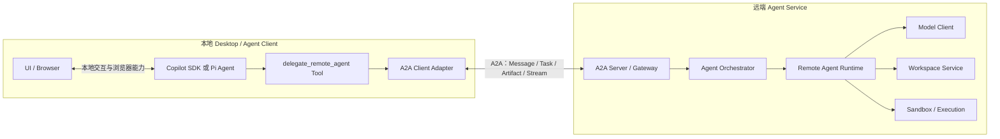

# Agent Runtime 安全防护与治理：威胁模型、执行隔离和运行时控制

Agent 一旦能读写文件、运行命令、操作浏览器或调用 MCP，模型输出就可能产生真实副作用。安全设计要回答的不是“模型会不会听话”，而是它做错事或被恶意内容诱导后，最多能影响哪些资源。

这需要分清三件事：Tool Permission 决定 Agent 能调用什么；Resource Permission 决定操作哪些文件和业务对象；Sandbox 限制进程实际能访问的系统资源。三者不能互相替代。

下文重点讨论这些边界在 TypeScript / Node.js Runtime、本机桌面、Kubernetes 和远端 Agent Service 中如何落地。

## 1. 威胁模型：Agent Runtime 的攻击面已经超出模型输入

传统 Web 应用的威胁模型主要关注请求入口、身份认证、授权、数据访问和服务端执行。Agent Runtime 还增加了一个重要特征：系统会把来自不同信任等级的内容放进同一个推理循环，再由模型决定下一步调用哪个工具。

用户指令、系统策略、邮件正文、网页、PDF、终端输出、MCP Tool Result、Agent Memory、子 Agent 消息，不能被视为同一种可信输入。攻击者不一定需要直接访问 Runtime；只要能影响 Agent 会读取的网页、邮件、仓库文件、工单或工具返回值，就可能改变 Agent 的后续动作。

至少需要考虑以下攻击者和风险来源：

| 风险来源 | 可能的攻击能力 | 典型目标 |
| --- | --- | --- |
| 恶意用户或租户 | 构造任务、上传文件、提交代码、诱导资源消耗 | 越权访问、跨租户读取、资源耗尽 |
| 间接提示注入者 | 控制网页、邮件、文档、代码注释、图片或工具返回内容 | 劫持目标、诱导调用工具、数据外传 |
| 恶意或被攻陷的 MCP / Plugin | 返回恶意工具描述、参数、结果，或在本地执行代码 | 读取凭证、扩大工具权限、横向移动 |
| 恶意依赖与构建产物 | 包安装脚本、插件、浏览器扩展、容器镜像或更新包被替换 | RCE、供应链持久化、窃取构建凭证 |
| 被攻陷的 Agent / 子 Agent | 借助委托关系、共享 Memory 或过宽 Token 访问其他系统 | 身份冒用、跨 Agent 权限提升 |
| 恶意或失陷的外部服务 | 返回伪造结果、重定向请求、滥用回调和 Webhook | SSRF、凭证泄露、数据污染 |
| 同机或同集群其他工作负载 | 利用共享内核、共享存储、网络和节点权限 | 容器逃逸、跨租户访问、侧信道 |
| 内部人员或错误配置 | 过度授权、关闭审计、共享管理员凭证、错误恢复快照 | 隐蔽访问、长期权限残留 |

需要保护的资产不只是文件和 Token。还包括用户身份、Agent 身份、OAuth 授权、云 Workload Identity、浏览器 Cookie、SSH Agent、桌面会话、剪贴板、截图、屏幕录制、持久化 Memory、任务快照、工具清单、策略版本、模型上下文、审计记录以及控制面本身。

一个实用的威胁分析方法，是沿着 Agent 生命周期逐段问问题：

1. **输入与上下文构建**：哪些内容由用户提供，哪些来自外部数据源？有没有把网页或文件中的指令误当成授权？
2. **规划与决策**：Agent 能否改变原始任务目标？能否在任务执行中自行扩大权限或引入新工具？
3. **工具选择与参数生成**：参数值来自用户请求、可信工具结果，还是模型猜测？收件人、账户、URL、文件路径和金额是否有可验证来源？
4. **执行与副作用**：工具实际以什么身份运行？子进程、MCP Server、浏览器和 GUI 自动化是否继承了更大的宿主机权限？
5. **结果与数据流**：敏感信息会进入模型上下文、日志、截图、外部 API 或共享存储吗？
6. **状态与委托**：Session、Memory、快照和子 Agent 是否跨用户、跨租户或跨任务复用？权限能否及时撤销？
7. **监控与恢复**：谁能识别异常行为、终止整个进程树、断开网络、撤销 Token 并保留取证证据？

安全目标不是保证模型永远不犯错，而是确保模型犯错、被注入、工具被攻陷或某个执行组件失陷时，影响范围仍然受控。

## 2. 工具授权、资源授权与进程隔离

### Tool Permission：模型可以调用什么

Tool Registry 和 Permission Policy 决定某个 Agent 是否能调用 read_file、write_file、bash、browser 或某个业务 API。它解决的是工具入口授权。

例如，一个文档分析 Agent 可以读取文件，但不应该获得发送邮件、修改 CRM 或执行任意 Shell 的能力。即使某个 Tool 已注册，也不代表所有 Agent 都可以使用它。

这一层通常由 Runtime 自己实现：工具注册、角色和任务策略、参数 Schema、审批流程、调用审计。它很重要，但不是安全边界。只要另一个工具能访问相同资源，或者某个 MCP Server 拥有更大的宿主机权限，Tool Allowlist 就可能被绕开。

### Resource Permission：工具可以操作哪些资源

资源授权进一步限制路径、对象、记录和操作类型。比如工作区可以读写、参考资料只读、.env 和 SSH Key 拒绝访问；某个业务 API 只允许读取当前项目的记录，不允许跨客户查询。

这里不能只用一个笼统的 Read/Write 标志。创建、覆盖、移动、删除、执行文件应视为不同能力。写入工作区也不等于可以执行工作区中的任意脚本。

这一层可以由 File Access Service、Connector Gateway 或 MCP Server 实现，但必须确保授权检查绑定到实际资源，而不是只对模型传来的字符串做判断。路径穿越、符号链接、硬链接、挂载点和检查后替换文件的 TOCTOU 问题，都可能让表面上的目录 Allowlist 失效。

### Runtime Sandbox：进程实际能触及什么

Sandbox 是最后一道执行边界。它限制进程及其子进程能够访问的文件系统、网络、系统调用、IPC、设备和宿主机资源。

这层不能依赖模型遵守规则，也不能只依赖 Tool Registry。假设 Agent 获准运行 Python，那么 Python 脚本、它启动的子进程以及被加载的原生模块都必须处于同一个受控边界内。否则，允许执行 Python 实际上可能意味着允许任意访问宿主机。


[查看架构图（HTML）](/diagrams/agent-runtime-security-layers.html)

三层之间的关系可以概括为：Tool Permission 决定入口，Resource Permission 决定目标，Sandbox 限制执行能力。它们应该纵深叠加，而不是互相替代。

## 3. Agent Runtime 安全防护架构与治理控制面

对于本地桌面 Agent，我倾向于把策略和执行机制分开：Runtime 自己掌握 Tool Registry、Policy Engine、审批和审计；底层通过成熟的 OS Sandbox 执行真实进程，不自己重写操作系统隔离机制。


[查看端到端执行架构图（HTML）](/diagrams/agent-runtime-end-to-end.html)

建议的执行路径：

1. Agent 提出工具调用，Runtime 校验 Tool 是否对当前 Agent、Task 和用户开放。
2. Policy Engine 检查主体、动作、资源、数据分类、目的地和任务上下文，返回允许、拒绝或要求审批。
3. 对文件操作，优先走 Capability Filesystem Service。它只暴露已授权的目录句柄或资源 ID，不让模型任意拼接宿主机路径。
4. 对 Shell 任务，先判断是否真的需要真实 Shell。有限命令和数据处理优先使用 just-bash；需要调用本机工具链时，才启动 OS Sandbox。
5. Sandbox 根据执行 Profile 限制文件读写、网络、IPC 和子进程。环境变量采用显式 Allowlist，不能把整个宿主机环境复制给 Agent。
6. 执行结果返回 Runtime 后，记录策略版本、执行身份、命令摘要、资源范围、网络目的地、退出码和产物引用。敏感文件内容不应直接写入普通审计日志。

一个概念性的 Execution Profile 可以这样表达：

~~~yaml
profile: document-analysis
filesystem:
  read:
    - ./workspace
    - ./reference
  write:
    - ./workspace/output
  deny:
    - "**/.env"
    - "~/.ssh"
    - "~/.aws"
network:
  mode: deny
process:
  mode: virtual-shell
  commands:
    - cat
    - grep
    - jq
    - python
limits:
  timeoutSeconds: 60
  maxOutputBytes: 1048576
  maxFiles: 500
~~~

这只是 Runtime 自己的策略模型示例，不是 Anthropic SRT 或 just-bash 的原生配置格式。策略编译器需要把它转换成不同执行后端能够理解的约束，并明确哪些约束由应用层实施、哪些由 OS 强制实施。不能支持某项策略的后端，应拒绝启动该 Profile，不能静默忽略。

### 3.1 通用架构：把身份、策略、执行、数据和观测分开

一个可运营的 Agent Runtime 至少需要五个逻辑平面。它们可以部署在同一个应用中，但不应共享不受约束的权限。

| 平面 | 主要组件 | 必须回答的问题 |
| --- | --- | --- |
| Identity Plane | User Identity、Agent Identity、Workload Identity、Credential Broker | 谁在行动？代表谁？凭证能访问什么、何时失效？ |
| Control Plane | Agent Orchestrator、Policy Engine、Approval、Tool Registry、Session Manager | 任务允许做什么？策略由谁批准？权限如何撤销？ |
| Execution Plane | Tool Worker、Browser Worker、Script Sandbox、Container / VM | 进程实际能访问哪些文件、网络、设备和系统接口？ |
| Data Plane | Workspace、Object Storage、Memory、RAG、Artifact Store、Secrets | 数据属于谁？可信等级如何标记？数据能流向哪里？ |
| Observability Plane | Audit、Trace、Runtime Detection、Incident Response | 谁执行了什么？是否越权？能否追溯、终止和恢复？ |

这五个平面之间要有明确的信任边界。Agent Orchestrator 不应该因为能调度任务，就自动拥有执行任务所需的全部凭证；Sandbox 不应该因为需要读取某个文件，就拿到整个用户 Home；Agent 不应该因为要调用一个 API，就直接获得长期用户 Token。

建议建立以下不可破坏的安全不变量：

- **权限由可信控制面授予，不由模型授予自己。** 模型可以提出工具调用和所需能力，但不能修改 Policy、扩大 Resource Scope 或选择更宽松的 Sandbox Backend。
- **外部内容默认不可信。** 网页、邮件、文档、图片 OCR、终端输出和 Tool Result 中出现的命令或授权语句，不能自动变成用户授权。
- **身份与凭证分离。** Agent 有自己的可审计身份；代表用户执行时使用显式、可撤销、范围受限的委托授权，而不是复制用户的长期凭证。
- **策略与执行双重检查。** Tool 层判断动作是否获准，执行后端确保进程不能越过已批准的资源边界。
- **默认拒绝，能力不足时失败关闭。** 某个后端无法执行必要的文件、网络或 UI 限制时，不允许自动退化为宿主机直接执行。
- **所有高风险副作用可归因、可中止、可恢复。** 审批、执行、网络访问、身份和产物之间必须有可关联的记录。

### 3.2 通用安全控制：不能只做 Prompt Filter

#### 任务边界和自主程度

不要给 Agent 一个无限期、无限目标的“自主工作”权限。每个 Task 应有明确的目标、可访问资源、允许动作、时间窗口、预算、最大步骤数、最大工具调用数和终止条件。任务完成、取消、超时或审批撤销后，临时能力应立即失效。

可以将操作分成四个风险等级：

| 等级 | 操作类型 | 典型动作 | 建议策略 |
| --- | --- | --- | --- |
| R0 | 观察和本地计算 | 读取已授权文件、搜索、计算、生成草稿 | 默认允许已授权范围，完整审计 |
| R1 | 可恢复的本地变更 | 写入任务输出目录、创建草稿、修改可回滚文件 | 受限授权，必要时 Diff Preview |
| R2 | 代码执行和外部通信 | Bash、Python、安装依赖、访问外部网站、调用 SaaS API | 独立 Sandbox、目的地策略、按任务审批 |
| R3 | 高影响或不可逆动作 | 删除、付款、发送外部邮件、发布、生产变更、权限变更 | 明确的人类确认，绑定具体参数和结果，必要时双人审批 |

风险等级不是简单按 Tool 名称决定。read_file 读取一个公开 README 和读取客户合同，风险不同；browser 打开公开网站和向外部发送客户数据，风险也不同。Policy Engine 应结合主体、动作、资源分类、数据来源、目标地址、任务目标和执行环境计算风险。

#### 身份、授权和凭证

Agent Identity 应成为一等安全主体，而不是把所有动作都记录为“某用户调用了模型”。至少区分：

- User Principal：真实登录用户及其组织、租户和设备上下文。
- Agent Principal：某个 Agent 实例、角色和版本。
- Task Principal：当前任务的短期执行身份和权限集合。
- Workload Identity：实际运行在进程、Pod、容器或 VM 中的工作负载身份。
- Delegated Identity：代表用户访问外部业务系统时获得的受限委托身份。

每次授权应尽可能包含 subject、action、resource、purpose、audience、expiry 和 constraints。子 Agent 只能获得父任务明确委托的能力，不能继承父 Agent 的全部 Token。MCP Server 也应有独立身份，不能因为它由某个 Agent 启动就自动获得 Agent 的所有权限。

凭证应由 Credential Broker 或受控代理提供。优先使用短期 Token、OAuth On-Behalf-Of、Workload Identity、SPIFFE / SPIRE 或云厂商的短期身份凭证。对脚本和浏览器进程，避免把长期 API Key 放在环境变量、命令行参数、工作目录或可读取文件中。需要出站认证时，可以由 Egress Gateway 在请求路径上注入短期凭证，避免把 Token 直接交给不可信执行环境。

#### Prompt Injection、数据来源和参数溯源

Prompt Injection 不是单纯的输入清洗问题。攻击内容可能藏在 HTML、邮件引用、Markdown、PDF、代码注释、图片 OCR、终端输出、工具描述和 Agent Memory 中。即使输入过滤器漏掉了攻击，执行边界也应该阻止它完成未授权动作。

建议把内容来源和信任等级作为结构化元数据保存，而不是只把所有文本拼进一个 Prompt：

- trusted_instruction：系统策略、经过认证的用户指令和应用控制面下发的约束。
- user_data：用户提供但不构成授权的文件、文本和附件。
- external_untrusted：网页、邮件、第三方 API、MCP 结果、外部仓库内容。
- tool_observation：工具返回的事实数据，保留工具身份、时间和来源。
- model_generated：模型生成的计划、参数和解释。

对于敏感参数，应记录来源 Provenance。例如邮件收件人、支付账户、文件路径、外部 URL、数据库目标和数据导出目的地，必须能够追溯到用户请求或用户明确指定的数据源。模型自行推测出来的值，不应自动成为高风险动作的授权依据。

参数来源要能追溯。邮件收件人、支付账户、文件路径、外部 URL、数据库目标和数据导出目的地，不能仅凭模型推测就成为高风险动作的授权依据。

#### Tool、MCP、Plugin 和模型供应链

工具 Schema、MCP Server、Agent Skill、Prompt Template、模型、Embedding Model、浏览器扩展、容器镜像和依赖包都属于运行时供应链。不要允许生产 Agent 在任务执行时随意从公共 Registry 下载并加载新工具。

建议维护批准的工具目录，记录发布者、版本、哈希、签名、权限声明、网络目的地、依赖和升级记录。对 MCP Server 使用独立进程、最小权限和独立 Sandbox。工具发现和工具安装必须分开：Agent 可以搜索可用能力，但安装、启用和授予新权限应由可信控制面或管理员完成。

容器镜像和 VM 基础镜像应固定版本或 Digest，扫描漏洞，生成 SBOM，验证签名和来源。模型版本、System Prompt、Tool Schema 和 Policy Bundle 也应进入变更管理；模型升级不能绕过回归安全测试。

#### 数据保护、信息流和网络出口

文件系统隔离只回答“进程能读什么”，不能回答“读到的数据能发到哪里”。因此要把数据分类、用途、接收方和出口策略结合起来。

至少要区分：
- 数据读取授权：Agent 能否看到该数据。
- 数据处理授权：允许用什么模型、区域和服务处理。
- 数据输出授权：允许写到哪个文件、对象存储或业务系统。
- 数据传输授权：允许发送给哪个域名、租户、API 或人员。
- 数据保留授权：日志、Memory、向量库、快照和模型上下文保留多久。

网络策略应默认拒绝，并分别控制 Egress、Ingress 和 Host Loopback。域名 Allowlist 不应只在 Agent 代码里做字符串比较；要防止 DNS Rebinding、CNAME、重定向、私有 IP、云元数据地址、IPv6 表示差异和代理绕过。HTTP 代理只对遵守代理设置的客户端有效，不能假设任意 TCP、UDP、SSH 或自定义协议都会经过它。

对云端 Agent，尤其需要阻断访问云实例元数据服务、Kubernetes API、节点管理端口、内部控制面和其他租户服务。对桌面 Agent，则需要避免把本地浏览器、VPN、企业内网和用户已经登录的业务系统全部暴露给任意脚本。

#### Memory、快照和多 Agent 委托

长期 Memory 是一个持久化攻击面。被污染的文档或工具结果可能进入 Summary、Embedding、用户偏好、Agent Profile 和任务快照，影响后续 Session。Memory 写入需要来源、身份、时间、任务和可信等级；敏感记忆应支持访问控制、版本、撤销和删除传播。

不要跨用户或跨租户复用未经隔离的 Memory、Workspace、Browser Profile、Cookie Jar、文件缓存和 Sandbox Snapshot。快照恢复时要检查镜像来源、策略版本、凭证是否仍有效、网络身份是否重新绑定，以及快照中是否残留上一个任务的数据。

多 Agent 架构要使用显式消息协议和授权委托。消息中应携带发送者身份、任务 ID、能力范围、有效期、数据来源和完整性保护。接收 Agent 不能把另一个 Agent 的自然语言消息视为授权；跨 Agent Tool Call 仍需重新执行 Policy Check。子 Agent 的权限通常应小于或等于父任务当前委托的权限。

#### Human-in-the-loop、审计和应急停止

Human Approval 应由 Orchestrator 强制执行，而不是寄希望于模型在 Prompt 中“记得询问用户”。审批界面必须展示实际目标、资源、接收方、内容摘要、数据分类、权限范围和执行后果。用户批准后，如果参数、脚本摘要、文件内容、收件人、URL 或 Sandbox Profile 发生变化，必须重新审批。

审计至少记录：User / Agent / Task Identity、Session、Tool Name、规范化参数摘要、策略版本、决策结果、审批人、Sandbox Backend、镜像 / 代码版本、资源范围、网络目的地、开始结束时间、退出码、产物引用和异常事件。日志不应直接复制全部 Prompt、文件内容、Token、Cookie 或截图；需要保留证据时应使用独立加密存储、访问控制和保留策略。

必须有独立于 Agent 自身的 Emergency Stop。停止按钮不能只发送一个取消消息给模型；它应该能取消任务、终止完整进程树、停止 Sandbox、撤销短期凭证、断开出站网络、冻结相关队列，并保留审计证据。云端还应支持按 Tenant、Agent、Task、Worker Pool 和工具供应商分别熔断。


### 3.3 安全治理：把策略变成可执行、可审计的运行机制

安全治理不是在架构图里增加一个 Policy Engine 就算完成。策略需要有明确的制定者、适用范围、执行位置、变更流程和例外处理机制，并且能够证明 Runtime 在每次执行时确实应用了正确版本。

建议把治理过程覆盖到任务生命周期：

| 阶段 | 治理要求 | Runtime 应提供的能力 |
| --- | --- | --- |
| 设计与注册 | 定义 Agent 的用途、数据分类、允许工具、执行环境和风险等级 | Agent / Tool Registry、权限声明、风险评审记录 |
| 授权与启动 | 将用户身份、任务目标和资源范围转换成短期权限 | Policy Evaluation、Capability Grant、Credential Broker |
| 执行中 | 对每次工具调用和资源访问重新检查策略；检测偏离任务目标的行为 | Enforcement Point、Runtime Detection、Egress Control、Approval |
| 变更与例外 | 策略、模型、工具、镜像或权限变化必须经过审查；临时例外需要负责人和到期时间 | Policy Versioning、签名发布、例外登记、自动过期 |
| 结束与撤销 | 回收任务权限、凭证、网络连接和临时资源 | Revocation、Sandbox Teardown、Workspace 清理 |
| 复盘与改进 | 将越权尝试、误拦截、数据外传和业务副作用转化为回归用例 | Audit、Incident Record、Security Regression Suite |

策略本身应作为受控资产管理，而不是散落在 Prompt、Tool Handler 和各个平台 Sandbox 配置中。一个策略版本至少要关联适用的 Agent / Task 类型、主体、动作、资源范围、数据分类、网络目的地、审批要求、有效期和执行后端能力。发布时先验证策略能否被目标后端完整实施，再进行灰度；后端不支持关键约束时必须拒绝启动，不能为了兼容而静默放宽。

责任也要与控制点对应。平台或 Runtime 团队负责身份、策略执行、隔离后端、审计和应急停止；业务或 Agent Owner 负责用途、数据范围、工具需求和业务风险接受；安全团队负责威胁模型、基线、例外审查和攻击测试；系统或数据 Owner 负责资源授权及外部副作用边界。高风险动作的审批人不能同时成为唯一的策略维护者和审计记录管理员。

治理效果不能只用“拦截了多少次”衡量。至少要持续观察越权尝试及成功率、Prompt Injection 测试通过率、策略误拦截率、审批覆盖率、凭证撤销耗时、跨租户隔离测试结果、异常出站流量、任务清理完整率和审计关联完整率。每次模型、工具、MCP Server、Sandbox Backend 或策略升级，都应触发对应的安全回归测试。生产事件应能定位到具体 User、Agent、Task、Policy Version、Tool Version、Execution Backend 和外部副作用。

这套治理机制的关键不是增加审批步骤，而是让安全要求在执行前可验证、执行中可强制、执行后可追溯，并且在策略或组件发生变化时仍然成立。

## 4. Read、Write、Bash 应该是三个独立的 Tool 边界

前面讨论的是 Tool Permission、Resource Permission 和 Runtime Sandbox 三个安全层次。落到 Agent 的实际工具设计，还需要再做一次拆分：不要把文件读取、文件写入和脚本执行包装成一个通用的 `filesystem` 或 `terminal` 能力。

这三种操作的权限语义不同。Read 是信息披露风险，Write 是数据完整性风险，Bash 则是通用代码执行风险。一个 Agent 获得读取权限，不应该因此获得写入权限；获得写入权限，也不应该自动获得执行刚写入脚本的权限。

### 4.1 Read Tool：把读取做成只读、可审计的资源访问

Read Tool 只负责读取已经授权的资源，不应提供任何执行或修改能力。建议把它拆成几个语义明确的操作：`list_directory`、`stat_file`、`read_file`、`search_files`。如果需要读取大文件，使用 offset、limit 或分页，不要一次把整个目录或文件树塞进上下文。

权限判断至少包含主体、资源、操作和数据分类。比如某个 Agent 可以读取项目文档，却不能读取 `.env`、SSH Key、浏览器 Profile、云凭证或其他客户目录。目录列表本身也可能泄露文件名和项目结构，因此 `list` 不是天然无风险的操作。

不要仅靠字符串前缀判断路径是否在工作区内。路径规范化后仍要处理符号链接、硬链接、挂载点和路径替换竞态。Linux 上可以研究 `openat2` 的 `RESOLVE_BENEATH`、`RESOLVE_NO_MAGICLINKS` 等约束；跨平台实现则应采用经过审查的目录句柄 / capability 文件访问层，或让文件服务本身运行在 OS Sandbox 内。Node.js 的普通 `realpath()` 后再 `readFile()` 并不能单独消除 TOCTOU 风险。

另一个值得研究的方向是 [AgentFense](https://github.com/AjaxZhan/AgentFense)。它使用 FUSE 把真实文件系统投影成 Agent 可访问的视图，并区分 `none`、`view`、`read` 和 `write`：例如可以允许 Agent 看到目录结构，却不能读取文件内容；也可以让它读取代码，但不能修改。这个模型比简单的目录 Allowlist 更细，尤其适合需要把真实代码库暴露给 Agent、同时隐藏密钥和敏感目录的场景。项目目前规模较小，应把它视为值得验证的设计参考，而不是未经测试就直接采用的安全基座。它的文档还记录了 macOS + Docker Desktop 下 `view` 权限可能受 VirtioFS 限制而失效的情况；如果采用这类 FUSE / 虚拟文件系统方案，必须把目标 OS、文件系统驱动和容器组合纳入测试矩阵。

### 4.2 Write / Edit Tool：写入不是执行，修改应该可回滚

Write Tool 不应和 Bash 共用执行权限。它只允许对授权工作区执行明确的文件操作。建议至少区分：

| 操作 | 建议语义 |
| --- | --- |
| `create_file` | 仅创建不存在的文件，默认不覆盖 |
| `replace_file` | 替换已存在文件，要求版本 / ETag 匹配 |
| `apply_patch` | 应用明确的 Diff，返回实际变更 |
| `delete_file` | 单独授权，通常需要确认 |
| `move_file` | 源和目标分别检查权限，不允许借移动绕过目录边界 |

尤其要避免一个常见设计：提供 `write_file(path, content)`，然后把覆盖、创建、删除、目录创建等全部隐含在一个接口里。工具调用越通用，Policy Engine 越难判断实际影响。

对于重要文件，推荐先写入任务级 staging area，再通过 Diff / Preview 展示变更。提交时检查目标路径权限和原文件版本，使用临时文件加原子替换，保留可恢复版本。审批应绑定目标路径、操作类型、内容摘要、任务 ID 和有效期；如果模型在审批后改变了内容或目标，必须重新审批。

还要明确区分“写入脚本文件”和“执行脚本文件”。`write_file("cleanup.sh", ...)` 只产生一个文件，不应触发 Shell。脚本执行必须经过独立的 `execute_script` Tool 和独立的 Sandbox Policy。这样，文档 Agent 即使能够生成自动化脚本，也不会因此获得运行脚本的能力。

### 4.3 Bash / Script Tool：把它当作不可信代码执行服务

Bash 的能力远超普通 Tool。即使只允许一个 `bash` Tool，模型也可能通过 Shell、解释器、管道、重定向、子进程和系统命令访问大量宿主资源。因此，不能把命令黑名单或正则表达式当作主要安全机制。

推荐把执行入口设计成一个独立的 Execution Service：

- 输入是脚本内容、工作目录的资源标识、参数和明确的 Execution Profile，而不是任意宿主机路径。
- 执行时创建独立进程或 Sandbox Session，不能在 Agent Runtime 主进程中执行任意脚本。
- Sandbox 显式配置只读目录、可写目录、临时目录、网络策略、环境变量和进程限制。
- 所有子进程继承相同或更严格的隔离策略。
- 进程超时后终止整个进程组 / Job Object，而不是只结束最外层 Shell。
- 限制 CPU、内存、PID 数、文件大小、输出字节数、并发数和执行时长。
- 默认不注入宿主机环境变量、长期 Token、SSH Agent Socket、浏览器 Profile 和 Docker Socket。
- 执行结果返回 stdout、stderr、exitCode 和产物引用；不要无限制地把所有输出写回模型上下文。

对于桌面 Runtime，macOS 可以评估 Seatbelt，Linux 可以评估 Bubblewrap、Landlock 和 seccomp；需要跨平台统一管理时，可以研究 Anthropic Sandbox Runtime。需要完整 Linux 环境或运行不可信依赖时，再考虑 Docker、gVisor 或 microVM。

如果脚本由模型生成，审批不应只显示“允许执行 Bash”。应展示脚本内容或 Diff、工作目录、读写范围、网络权限和执行限制。审批绑定脚本内容摘要及 Execution Profile；脚本内容、参数或权限发生变化时，之前的批准失效。

### 4.4 有哪些项目值得对照

| 项目 | 对 Read / Write 的设计 | 对 Bash / Script 的设计 | 适合借鉴的部分 |
| --- | --- | --- | --- |
| [AgentFense](https://github.com/AjaxZhan/AgentFense) | FUSE 文件视图，none / view / read / write | 通过受限文件系统配合普通 Shell 工作流 | 文件级能力授权、隐藏敏感资源 |
| [easy-agent](https://github.com/ConardLi/easy-agent) | Read、Write、Edit、MultiEdit 等独立工具 | Bash / PowerShell 配合 allow / ask / deny 和 OS Sandbox | Tool 拆分、审批策略和执行隔离的组合 |
| [Deep Agents](https://github.com/langchain-ai/deepagents) | Virtual Filesystem、声明式 read / write path permissions | 可插拔 Sandbox Backend 的 execute Tool | 文件权限和执行后端的职责分离 |
| [Anthropic Sandbox Runtime](https://github.com/anthropics/sandbox-runtime) | 不负责 Agent 级文件 Tool 语义 | 对任意进程实施 OS 级文件和网络限制 | 作为真实 Shell / MCP 进程的隔离层 |
| [just-bash](https://github.com/vercel-labs/just-bash) | 虚拟文件系统上的受控读写 | TypeScript 实现的 Shell 语义，不启动真实宿主 Shell | 低风险任务的受限命令环境 |

这里有两个容易误读的地方。第一，Deep Agents 的文件权限规则并不自动约束 Sandbox Backend 中的任意代码执行；其文档明确要求 Sandbox Backend 自己承担执行侧策略。另外，它的路径规则按声明顺序 first-match-wins，且没有匹配规则时默认允许，因此生产策略应明确写出最后的 catch-all deny，避免遗漏路径变成默认放行。第二，AgentFense 的 FUSE 文件视图能把文件访问权限落实到文件系统层，但它不能替代网络隔离、进程限制和凭证保护。工具权限和执行权限仍需分别配置。

[easy-agent](https://github.com/ConardLi/easy-agent) 是一个更完整的 Agent Harness 参考：它把 Read / Write / Edit / Bash 做成不同工具，并组合权限规则、OS Sandbox、MCP 和子 Agent。它适合研究工具注册、授权和执行路径如何在一个 TypeScript Agent 中协作，但仍需按目标平台审查其 Sandbox 覆盖范围；项目文档列出的 Windows Shell Sandbox 能力与 macOS / Linux 并不相同。

### 4.5 推荐的 Tool Contract

可以把 Agent 暴露的接口收敛成以下几类。这里是 Runtime 的逻辑接口，不代表某个项目的现成 API：

```typescript
type ResourceRef = {
  workspaceId: string;
  resourceId: string; // Runtime 解析，不接受任意宿主机绝对路径
};

interface ReadTools {
  listDirectory(ref: ResourceRef): Promise<DirectoryEntry[]>;
  readFile(ref: ResourceRef, range?: { offset: number; limit: number }): Promise<FileContent>;
  searchFiles(query: SearchQuery): Promise<SearchResult[]>;
}

interface WriteTools {
  createFile(ref: ResourceRef, content: string): Promise<ChangeSet>;
  applyPatch(ref: ResourceRef, patch: string, expectedVersion: string): Promise<ChangeSet>;
  deleteFile(ref: ResourceRef, expectedVersion: string): Promise<ChangeSet>;
  commitChangeSet(changeSetId: string, approval?: ApprovalRef): Promise<CommitResult>;
}

interface ExecutionTools {
  executeScript(input: {
    script: string;
    workingDirectory: ResourceRef;
    profile: "read-only" | "workspace-write" | "network-enabled";
    timeoutSeconds?: number;
  }): Promise<ExecutionResult>;
}
```

这套接口刻意不提供 `execute(path)`，也不允许模型传入任意宿主机绝对路径。脚本执行可以使用临时脚本文件，也可以通过标准输入传给固定的 Shell 入口；无论哪种方式，执行目录、挂载范围和权限都由 Runtime 决定。

权限策略应该在 Tool 层和执行后端各检查一次：Tool 层判断这个 Agent 是否能对这个资源发起这个动作；执行后端判断实际进程是否能访问该文件、网络或系统资源。不能把前一层的授权结果当成后一层的隔离保证。


[查看 Read / Write / Bash 架构图（HTML）](/diagrams/agent-runtime-tool-boundaries.html)

## 5. 开源实现的能力边界

### 5.1 Anthropic Sandbox Runtime：最接近通用 Agent 执行隔离层

项目：[anthropic-experimental/sandbox-runtime](https://github.com/anthropic-experimental/sandbox-runtime)  
npm：[@anthropic-ai/sandbox-runtime](https://www.npmjs.com/package/@anthropic-ai/sandbox-runtime)

Anthropic 将 Claude Code 使用的 Sandbox Runtime 独立开源。它不是 Agent Framework，也不是一个新的 Shell，而是把任意命令或进程放进操作系统提供的限制环境中。项目 README 明确列出 Agent、Bash 命令和本地 MCP Server 等使用场景。

它的实现思路是复用各操作系统的原生安全机制：

| 平台 | 主要实现 |
| --- | --- |
| macOS | sandbox-exec 与动态生成的 Seatbelt Profile |
| Linux | Bubblewrap、namespace 隔离及受控网络代理 |
| Windows | 独立本地沙箱用户、受限 Token、NTFS ACL 和 Windows Filtering Platform 出站规则 |

文件系统和网络限制需要一起考虑。文件系统采用读写分离策略：写入默认拒绝，只显式开放工作目录和临时目录；读取则可以通过拒绝敏感区域、再开放必要路径的方式配置。网络默认拒绝，通过 HTTP / SOCKS 代理限制允许访问的域名。Unix Socket 等本地 IPC 也有独立限制能力。

一个很实用的设计是：它可以包裹整个 MCP Server，而不是只限制某个 MCP Tool。例如，原本直接启动的 Filesystem MCP Server，可以改成由 srt 启动。这样，Server 内部即使存在未预期的文件访问路径，也仍然受到进程级文件系统和网络策略约束。

示意配置如下，具体字段应以所使用版本的 Schema 为准：

~~~json
{
  "filesystem": {
    "denyRead": ["~/.ssh", "~/.aws", "~/.config"],
    "allowWrite": ["./workspace", "/tmp"],
    "denyWrite": ["./workspace/.env"]
  },
  "network": {
    "allowedDomains": [
      "api.openai.com",
      "api.anthropic.com"
    ],
    "deniedDomains": []
  }
}
~~~

Node.js Runtime 可以把它作为进程启动边界使用，也可以通过 Library API 集成。它的价值在于：Runtime 不必自己实现 Seatbelt、Bubblewrap 或 Windows Filtering Platform 的底层规则，而是把策略交给一个专门的 Sandbox Runtime。

需要注意的是，项目仍标注为 Beta Research Preview，API 和配置格式可能变化。它也不是万能的 VM：不同平台的隔离原语和已知限制不同，网络代理、系统服务代发流量、凭证暴露以及宿主机本身的安全仍需单独审查。引入时应针对目标 OS、Node 版本和实际工具链做逃逸测试，而不是因为命令成功启动就认为隔离已生效。

### 5.2 OpenAI Codex Sandbox：值得借鉴的权限模型和平台实现

项目：[openai/codex](https://github.com/openai/codex)  
工程文章：[Inside the Codex sandbox](https://openai.com/index/inside-the-codex-sandbox/)

Codex Sandbox 的特点是：不把所有命令搬进容器，而是尽可能利用当前操作系统的隔离机制，让 Agent 在用户现有的开发环境中工作。对于依赖本机 SDK、原生工具链或桌面模拟器的开发任务，这种方式比 Docker 更容易保留宿主机开发环境。

Codex 将 Sandbox 权限组织成 Permission Profile。以 Workspace 权限为例，工作区内可以写入，但 .git、.codex 等敏感目录保持只读；网络默认关闭，需要时再单独开放。这里有一个重要的取舍：为了兼容本机编译器和开发工具，文件读取范围可能比工作区更广。因此，限制写入和关闭网络能减少风险，却不能自动解决敏感文件读取问题。

OpenAI 的工程文章还披露了一个很值得重视的细节：子进程继承父进程的 Sandbox 约束，约束覆盖由该命令启动的整个进程树。这是执行边界必须满足的基本要求。只包裹最外层 Shell，而让 Python、Node 或 MCP 子进程逃到沙箱之外，是不合格的实现。

Codex 的价值主要有两方面：Permission Profile 是 Runtime 的权限配置模型，可以把只读、工作区写入和网络访问等能力组合成可理解的执行模式；OS Sandbox 则通过统一接口屏蔽 macOS、Linux 和 Windows 的平台差异，让调用方提交命令、工作目录、环境变量和权限配置，而不直接操作底层系统调用。

需要区分：Codex 的实现是 Codex 项目的一部分，不应把它误认为一个已经独立发布、可直接 npm install 的通用 Sandbox SDK。对自建 Runtime 来说，更适合先研究其 Permission Profile、子进程继承和 fail-closed 思路，再决定复用哪一层代码或原生机制。

### 5.3 just-bash：TypeScript 里的虚拟 Shell，而不是真正的 OS Sandbox

项目：[vercel-labs/just-bash](https://github.com/vercel-labs/just-bash)

如果 Runtime 本身是 Node.js / TypeScript，just-bash 很值得研究。它用 TypeScript 实现 Shell 语法和一组常用 Unix 命令，提供虚拟文件系统。Agent 可以执行 ls、cat、grep、sed、jq、管道和重定向，而不必直接启动宿主机 Bash。

~~~typescript
import { Bash } from "just-bash";

const bash = new Bash({
  files: {
    "/workspace/report.md": "# Draft\n",
    "/workspace/data.json": '{"count": 12}'
  }
});

const result = await bash.exec(
  "cat /workspace/data.json | jq '.count'"
);

console.log(result.stdout);
~~~

它适合文档处理、结构化数据检查、轻量脚本和受控文件操作。默认内存文件系统不直接访问磁盘；网络默认关闭；Python 和 JavaScript 执行能力也默认关闭。需要真实文件时，可以考虑它提供的其他文件系统实现，但安全边界随之改变。

关键区别在于：just-bash 不提供 VM 隔离。它是在宿主 Node.js 进程内运行的虚拟 Shell。项目自己的 Security Model 也明确说明这一点：自定义命令回调是宿主侧扩展点，可信命令运行在嵌入进程中；JavaScript 不能强制终止任意宿主代码；需要对外部副作用提供硬隔离时，应放到可终止的 Worker 或独立进程中；对任意二进制执行，则应使用真正的 VM 或 OS Sandbox。

因此，不应该把 just-bash 当成 Anthropic Sandbox Runtime 的替代品。它解决的是“不要给 Agent 一个真实 Shell”的问题，后者解决的是“真实进程不能越过 OS 限制”的问题。

### 5.4 OpenHands Runtime：完整的 Docker 执行环境

项目：[OpenHands](https://github.com/OpenHands/OpenHands)  
架构说明：[OpenHands Runtime](https://docs.openhands.dev/openhands/usage/architecture/runtime)

OpenHands 的 Runtime 采用 Client-Server 结构。Backend 将 Action 发送给 Runtime 容器中的执行服务，容器内运行 Bash、文件操作、Python、浏览器和插件，再把执行结果作为 Observation 返回给 Backend。

这类方案适合需要完整开发环境的 Agent：有依赖安装、编译、测试、浏览器和多种执行工具，且希望每个任务或项目拥有独立环境。Docker 镜像和 Volume 机制也便于定义基础环境、持久化工作目录和只读挂载。

它的代价是容器生命周期、镜像管理、资源配额、Volume 和网络策略都需要运营。更重要的是，容器并不等于独立内核：默认仍共享宿主机 Kernel。对抗高风险不可信代码时，必须谨慎配置 capabilities、seccomp、用户权限、设备、挂载和网络；更高隔离要求可以进一步使用 VM 或微型 VM。

对于桌面 Agent，如果只是需要受控地读取和修改用户选定的文件夹，直接引入一整套 Docker Runtime 可能过重。若任务需要任意依赖安装、编译、浏览器和长时间运行的进程，容器化执行环境才更有价值。

### 5.5 MCP Filesystem Server：目录授权有用，但不是进程沙箱

项目：[modelcontextprotocol/servers — filesystem](https://github.com/modelcontextprotocol/servers/tree/main/src/filesystem)

Filesystem MCP Server 在启动时通过命令行参数指定允许访问的目录，也支持只读模式和单独指定只读目录：

~~~bash
mcp-server-filesystem \
  --read-only-dir ./reference \
  ./workspace
~~~

它适合把文件操作以标准 MCP Tool 的形式交给 Agent。目录范围由 Server 自己检查，--read-only 会直接不注册写工具，而不是仅仅依赖模型不要调用写操作。

但 MCP Server 仍然是一个普通进程。目录 Allowlist 只限制这个 Server 的文件操作，不会自动限制 Agent Runtime 中的 Bash、Python、其他 MCP Server 或插件。一个拥有宿主机高权限的进程，不能因为它只暴露了几个 MCP Tool，就被视为安全沙箱。

Filesystem Server 的安全实现也需要持续审查。路径解析、符号链接、目录移动和协议 Roots 的行为都会影响真实授权范围。建议将命令行目录作为管理员或宿主侧确定的上限；客户端提供的工作区只能缩小范围，不能扩大范围。即使使用只读目录，也应在 OS 文件权限或容器只读挂载层再加一道保护。

## 6. 不同部署环境的安全边界

通用策略可以复用，但执行隔离不能只靠一套抽象接口。桌面端依赖操作系统权限模型，云端需要处理租户和凭证隔离，Kubernetes 还要约束 Pod 与节点，而 GUI VM 必须把显示、输入和 Host Integration 纳入威胁模型。


[查看部署环境架构图（HTML）](/diagrams/agent-runtime-deployment-boundaries.html)

### 6.1 桌面端：Windows / macOS 本机 Agent

桌面端的最大特点是 Agent 与真实用户环境距离很近。它可能继承用户的文件权限、浏览器登录态、SSH Agent、VPN、开发工具链、剪贴板和桌面会话。即使 Agent 只在本地运行，风险也不等于低。

**进程与用户权限。** 桌面主应用负责 UI、身份、审批和策略；模型生成的代码、Shell、第三方 MCP Server 和浏览器 Worker 应尽可能在独立进程或 Sandbox 中运行。不要以管理员 / root 启动整个 Agent。需要安装驱动、配置系统服务或申请更高权限时，应把这类操作与普通任务分开，并通过操作系统授权流程完成。

**macOS。** Apple App Sandbox 通过 Entitlements 限制应用访问文件、网络、硬件和用户数据；TCC 则对 Accessibility、Screen Recording、Input Monitoring、Apple Events、Camera、Microphone 等敏感能力进行用户授权。桌面自动化需要的权限可能非常强：Accessibility 可以让应用观察和驱动其他应用，Screen Recording 会暴露屏幕内容，Input Monitoring 和合成事件能力会扩大键鼠控制范围。不要为了让 Agent “方便工作”而一次性申请所有权限；应按功能逐项解释用途，并将 GUI Automation Broker 与 Shell Sandbox 分开。被授权的主应用也不意味着所有子进程都应自动获得相同能力，必须测试签名身份、TCC 授权归属和进程继承行为。

参考：[Apple App Sandbox](https://developer.apple.com/documentation/security/app_sandbox)、[Resetting access to protected resources in macOS](https://developer.apple.com/documentation/xcode/resetting-access-to-protected-resources-in-macos)。

**Windows。** 使用普通用户 Token 运行 Agent。AppContainer、低完整性进程、Windows Sandbox、Restricted Token、ACL 和 Job Object 解决的问题不同，不能混为一个“Windows Sandbox”概念。Job Object 主要负责进程树和资源管理，不单独构成文件与网络安全边界。UI Automation 还涉及 UIPI 和 Integrity Level：UIAccess 是面向辅助技术的特殊能力，需要签名和受保护安装位置，不应作为普通 Agent 获得更高权限窗口控制的通用开关。Agent 不应试图绕过 UAC Secure Desktop，也不应通过模拟点击来批准管理员授权。

参考：[Windows application isolation](https://learn.microsoft.com/en-us/windows/security/book/application-security-application-isolation)、[Security Considerations for Assistive Technologies](https://learn.microsoft.com/en-us/windows/win32/winauto/uiauto-securityoverview)。

**文件与凭证。** 默认只允许用户显式选择的 Workspace。不要默认开放整个 Home、Documents、Downloads、浏览器 Profile、SSH、云 CLI 配置和密码管理器目录。系统 Keychain / Credential Manager 应由 Host Credential Broker 使用，不能把密钥导出到脚本环境。对于企业桌面，还应考虑设备合规、磁盘加密、端点检测、应用签名、自动更新和撤销机制。

**GUI 自动化。** 屏幕截图、OCR、Accessibility Tree 和浏览器 DOM 都是输入数据，不是可信指令。网页可能通过隐藏文本、覆盖层、弹窗、伪造系统对话框或图片内容诱导 Agent 点击。建议优先使用有明确 API 和权限模型的集成；必须使用屏幕控制时，把截图采集、窗口选择、键鼠注入和敏感动作确认放进独立的 GUI Broker。限制可控制的应用和窗口；对发送邮件、付款、发布、删除、授权、安装软件等动作，显示结构化预览并由用户确认。不要把系统密码、MFA Code、恢复码和密码管理器主密码交给模型处理。

桌面端尤其需要区分两类 Sandbox：Script Sandbox 限制 Shell 和进程；GUI Session Sandbox 限制 Agent 可见和可操作的桌面环境。前者不能自动约束后者。如果 GUI Agent 运行在真实用户桌面，它看到的可能是用户的邮件、内部系统、个人浏览器和管理员窗口。高风险自动化应使用独立低权限 OS 账户或独立 VM，而不是直接操作用户的日常桌面。

### 6.2 云端 Agent Runtime：多租户、凭证和控制面隔离

云端运行环境面临的主要风险不是本地用户目录，而是多租户、云身份、网络横向移动、共享 Worker、持久化存储和控制面暴露。

**控制面与执行面分离。** Orchestrator、Policy Engine、Session API、Credential Broker 和审计服务属于可信控制面；Shell、Browser、MCP、Python 和用户代码属于不可信执行面。执行 Worker 不应直接持有管理集群、调度系统或数据库的高权限凭证。控制面向 Worker 发放短期任务凭证和窄范围资源引用，Worker 不能反向修改租户策略。

**租户隔离。** 至少按 Tenant / User / Task 隔离 Workspace、对象存储 Prefix、缓存、向量库、浏览器 Profile、临时文件和日志访问。对于高风险或高价值租户，使用独立 Worker、节点池、账号或云项目；不能只依赖应用层在 SQL 查询中追加 Tenant ID。对共享 Worker Pool，要明确每次任务前后的清理、进程终止、临时凭证撤销和文件系统重置。

**云身份与凭证。** 每个 Worker / Task 使用独立 Workload Identity，默认不挂载管理级 Service Account。需要访问云资源时，通过 IAM 绑定和短期令牌授予最小权限。外部 SaaS 凭证由 Credential Broker 或 Egress Gateway 注入；不要把云服务账号 JSON、长效 API Key、SSH 私钥和数据库密码写入镜像、环境变量或快照。

**网络出口。** Worker 默认不应直接访问互联网、云元数据、集群 API、控制面、内部管理服务或其他租户网段。通过 Egress Gateway / Proxy 做域名、IP、端口、协议和身份检查；对于上传、下载和 Webhook，记录目标、数据分类和字节数。DNS、重定向、私网地址、IPv6 和代理旁路都要纳入负向测试。

**弹性和资源控制。** 每个 Task 要有 CPU、Memory、磁盘、PID、GPU、带宽、执行时间、并发和成本预算。设置租户级配额、队列长度和速率限制，防止 Agent 无限循环、递归调用、并发爆炸或恶意构造超大输出。执行 Worker 应可回收、可重建，控制面必须能在 Worker 卡死或失联时撤销身份和清理资源。

**日志与数据驻留。** 对模型供应商、推理区域、日志、Trace、截图、附件和 Memory 明确数据处理区域和保留周期。调试日志不应成为第二个数据湖；对敏感内容进行脱敏或引用化存储，限制安全团队以外的访问，并支持按 Tenant / User / Task 进行审计和删除。

### 6.3 Kubernetes：从 Pod Security 到真正的 Sandbox Runtime

Kubernetes 提供调度、资源和网络策略，但普通 Pod 并不等于强安全沙箱。默认容器通常仍共享 Node Kernel；同一集群中的 Namespace 也不自动构成完整的多租户安全边界。

**基础 Pod Hardening。** 生产 Agent Worker 应采用非 root 用户，runAsNonRoot: true，allowPrivilegeEscalation: false，readOnlyRootFilesystem: true，删除不需要的 Linux Capabilities，配置 Seccomp，并按节点能力使用 AppArmor 或 SELinux。避免 privileged: true、hostPID、hostIPC、hostNetwork、不受控 hostPath、Docker Socket 和宿主机设备挂载。Namespace 应强制适当的 Pod Security Standards，不能只靠开发者自觉填写 SecurityContext。

**Service Account 与 RBAC。** 不要使用默认 ServiceAccount；没有访问 Kubernetes API 需求的 Worker 设置 automountServiceAccountToken: false。需要 API 权限时，为具体 Agent Workload 建立独立 ServiceAccount 和最小 RBAC，禁止普通执行 Pod 创建或修改 Role、ClusterRole、Webhook、Node、Namespace 和高权限 Workload。用 Admission Policy / Gatekeeper / Kyverno 等阻止危险 PodSpec。

**网络。** Namespace 或 Pod 默认拒绝 Ingress / Egress，再明确开放 DNS、模型 Endpoint、Artifact Store 和业务 API。NetworkPolicy 通常主要约束 L3/L4；域名级策略需要 CNI 或专门 Egress Gateway 的支持。必须测试 Pod 能否访问 Node IP、云元数据、Kubernetes API、其他 Namespace、内部 Load Balancer 和私有服务。不要假设配置了 NetworkPolicy 就一定有实际 enforcement，先验证集群 CNI 是否支持并启用。

**存储和 Secret。** Workspace 使用任务级 PVC、临时卷或独立对象存储 Prefix。只读基础镜像与只读数据集分开挂载，输出写入专用目录。Secret 优先通过外部 Secret Store / CSI 或短期身份注入，避免把凭证放入 ConfigMap、镜像层或可被其他 Pod 读取的共享卷。etcd Secret 加密、API Audit Log 和 Secret 访问审计都应纳入集群基线。

**Sandbox Runtime。** 对执行不可信代码的 Agent，评估 RuntimeClass：
- [gVisor](https://gvisor.dev/docs/architecture_guide/security/) 使用用户态 Kernel 拦截和实现系统接口，减少应用直接触达宿主机 Kernel 的范围，通常启动更快、资源开销较低，但存在系统调用兼容性和硬件支持取舍。
- [Kata Containers](https://katacontainers.io/) 通过轻量 VM 和独立 Guest Kernel 提供更强的 Kernel 隔离，适合需要更强租户隔离、又希望保留 Kubernetes 工作流的场景。
- [Firecracker](https://github.com/firecracker-microvm/firecracker) 提供 microVM 边界，设计目标是把不可信 Guest 代码限制在多层信任区中。它不是一个完整桌面产品，也不等于开箱即用的 Kubernetes Runtime；还需要管理 VMM、jailer、seccomp、cgroups、网络、磁盘、快照和 Host API Socket。
- 普通 runc / containerd Pod 适合可信服务和较低风险工作负载，不应不加区分地承载来自不同租户的任意恶意代码。

**节点和集群隔离。** 高敏感租户、执行不可信代码的 Worker、控制面服务和基础设施组件应按风险分配独立 Node Pool / Cluster。使用 taints、tolerations、node affinity 和 admission policy 强制隔离，而不是仅靠调度偏好。限制节点上运行的 DaemonSet、容器运行时 Socket、CSI Driver 和宿主机管理接口。

Google 在 2026 年的 [GKE AI Agent Workloads 架构文档](https://docs.cloud.google.com/kubernetes-engine/docs/concepts/machine-learning/agent-workloads) 已经把 Agent Sandbox 作为专门的工作负载类型讨论，并区分两种模式：Agent Substrate 以 actor 为调度单元，多个 Agent Session 可复用 Worker Pool；Agent Sandbox 则为 Agent 分配专属 Pod。文档还比较 Cloud Hypervisor microVM 与 gVisor：microVM 有独立 Guest Kernel、隔离更强但启动和资源开销更高；gVisor 启动更快、兼容性和 GPU / TPU 支持更好，但 syscall 覆盖不同。

这个实践有几个值得注意的细节：Agent Substrate 使用每个 Actor 的 SPIFFE X.509 Certificate 和 JWT，并通过 Egress Gateway 在请求路径注入凭证；Agent Sandbox 使用 Pod ServiceAccount / Workload Identity，Warm Pool 中的 Pod 可能共享身份，因此不同 Agent 或租户需要按身份拆分 Pool 或按需创建 Sandbox。Agent Sandbox 的 Secret 管理则需要 Kubernetes Secret / CSI 或自行部署代理，不能假设两种模式拥有同样的凭证隔离能力。它说明了一个重要原则：**隔离计算环境之外，还必须单独设计身份隔离、凭证交付和网络出口。**

参考：[Kubernetes Application Security Checklist](https://kubernetes.io/docs/concepts/security/application-security-checklist/)、[Kubernetes Pod Security Standards](https://kubernetes.io/docs/concepts/security/pod-security-standards/)、[Kubernetes Linux Kernel Security Constraints](https://kubernetes.io/docs/concepts/security/linux-kernel-security-constraints/)、[GKE Agent Workloads](https://docs.cloud.google.com/kubernetes-engine/docs/concepts/machine-learning/agent-workloads)、[NIST SP 800-190](https://csrc.nist.gov/pubs/sp/800/190/final)。

### 6.4 带桌面显示和操作能力的 VM：不要把显示通道当成安全边界

有些 Agent 需要操作完整桌面应用，而不只是调用 API 或执行 Shell。此时通常会为每个任务或用户提供一台 Windows / Linux VM，通过 RDP、VNC、WebRTC 或自定义 Desktop Streaming 将画面传给 Agent，再把鼠标和键盘事件发送回 Guest。

这类 VM 的优势是有独立 Guest OS、独立用户、浏览器和桌面会话；但如果 Host 与 Guest 之间开放了共享目录、剪贴板、USB、拖放、打印机、音频、浏览器 Cookie 或本机 Agent Socket，VM 隔离就会被这些集成通道削弱。

**Guest 本身。** 使用经过加固和签名的 Golden Image，定期重建而不是长期手工维护。每个租户 / 任务使用独立 VM 或独立 Guest User；Agent 不使用 Guest Administrator / root。关闭不需要的服务、自动登录、远程管理入口和持久化凭证。浏览器使用独立、临时 Profile，不复用宿主机浏览器 Cookie、密码库或用户的企业 SSO 会话。

**Host / Guest 集成。** 默认关闭共享剪贴板、共享文件夹、拖放、USB Passthrough、打印机、智能卡、宿主机凭证代理、共享浏览器 Profile 和不必要的 Guest Agent RPC。若业务必须传入文件，应通过 Host 控制的 Artifact Gateway，先做类型检查、恶意文件扫描和只读挂载；输出文件通过独立出口收集，不开放 Guest 对 Host 任意路径的写入。

**显示和输入通道。** Display Gateway 只传输经过授权的画面，不应把整个 Host Desktop 暴露给 Guest。Input Gateway 只接受受控的键鼠事件，不应把 Host 的全局键盘、剪贴板或管理员桌面输入直接转发。RDP / VNC / WebRTC 通道需要身份认证、加密、会话绑定、短期访问票据和操作审计。会话结束后关闭通道、销毁临时凭证并清理 Guest 状态。

**屏幕内容也是数据出口。** 截图可能包含客户数据、MFA Code、内部 URL、密码提示、聊天内容和后台管理信息。如果截图要发送到云端模型，就意味着这些信息离开 VM，不能因为它来自“屏幕”就绕过 DLP 和数据驻留策略。建议只采集指定窗口或虚拟桌面，按需截取，敏感区域遮蔽，限制截图保留时间，并记录截图被发送给哪个模型 Endpoint。

**GUI Injection 与外部指令。** Agent 看到的弹窗、网页、PDF、聊天窗口和系统通知都可能包含攻击指令。GUI Agent 不应把屏幕上的“点击允许”“输入密码”“将文件上传到此处”等内容视为授权。对于登录、MFA、付款、发送、删除、安装、下载执行文件和权限变更等动作，应由独立的 Approval UI 确认，而不是让 Agent 自己点击确认。

**VM 快照和恢复。** Snapshot 可能保留 Cookie、Token、浏览器历史、剪贴板、内存中的凭证、已打开文件和任务上下文。快照必须有租户和任务标签、加密、访问控制、保留期和销毁策略。恢复前检查快照来源和策略版本；不要把一个用户的 VM Snapshot 作为另一个用户的干净模板。通用 Golden Image 应在不含用户状态和密钥的条件下制作。

还要区分 microVM 和桌面 VM。Firecracker 适合隔离 Linux 进程和服务，但它的设备模型是为轻量虚拟机设计的，不提供完整 Windows Desktop / GPU 桌面体验。需要真实 GUI 的任务，通常要选择支持图形栈和远程桌面的完整 VM / VDI 技术；不要因为“microVM 隔离更强”就把它当成桌面虚拟化方案。

## 7. Remote-first Agent Runtime：本地与远端双 Agent 的职责边界

前面讨论的桌面、云端和容器 Sandbox，通常默认 Agent Runtime 与工具执行环境部署在同一侧。另一种常见形态是：桌面应用只保留模型交互、用户界面和少量必须访问本机的能力；文件、目录、Shell、代码执行、MCP 和业务系统工具全部放到远端。用户看到的仍然是桌面 Agent，但真正拥有工作区和执行权限的是远端服务。

这里有一个容易混淆的地方：**本地和远端都可能运行 Agent Loop，也都可能是模型服务的客户端。** 本地 Agent Client 连接本地模型，同时通过 HTTPS / WebSocket / MCP 连接远端 Agent Service；远端 Agent Service 接收任务后，又以自己的身份连接另一个模型 Provider，并调用远端工具。它不是一个简单的文件 API，也不只是 MCP Proxy。


[查看双 Agent 架构图（HTML）](/diagrams/agent-runtime-remote-first.html)

### 7.1 两个 Agent Loop，三类职责

建议先把参与者分清楚：

| 组件 | 身份 | 负责的事情 | 不应该负责的事情 |
| --- | --- | --- | --- |
| Local Agent Client | 本地 Agent Runtime，同时是远端服务的客户端 | 本地模型调用、UI、会话交互、工具路由、本地浏览器和屏幕能力 | 直接访问远端工作区底层存储；绕过远端策略执行文件和 Shell 操作 |
| Remote Agent Service | 远端 Agent Runtime，同时是模型 Provider 的客户端 | 远端模型调用、工作区管理、文件工具、Shell、MCP、Sandbox、任务状态和审计 | 访问桌面用户的本地文件、浏览器 Cookie 或桌面凭证 |
| Remote Workspace / Execution | 远端资源与执行平面 | 提供虚拟文件系统、持久化存储、临时执行环境和资源隔离 | 自己决定用户身份、授权范围或任务目标 |

本地 Agent Client 有自己的 Model Client 和 Agent Loop。远端 Agent Service 也有自己的 Model Client 和 Agent Loop。两者之间不是简单的“本地 SDK 调用远端 SDK”，而是两个独立运行时之间的委托关系。

远端 Agent Service 至少需要区分三种身份：登录用户身份、当前 Agent Session 身份、当前 Task / Execution 身份。不能只用一个 userId 或 sessionId 代替所有授权上下文。一个用户可以有多个工作区，一个会话可以产生多个任务，一个任务也可能创建多个短生命周期的 Sandbox。

### 7.2 先决定谁负责规划：两种调用模式不要混在一起

**模式 A：本地 Agent 规划，远端只执行工具。**

本地模型看到远端文件和业务工具的 Schema，生成工具调用；Local Agent Client 将请求转发给远端服务，远端完成授权、执行并返回结果。本地 Agent Loop 再把结果交给本地模型。

这适合本地模型需要掌握整个对话、频繁决定下一步操作，而且远端工具主要是确定性 API 的场景。代价是工具结果会经过本地进程，通常还会被发送给本地模型 Provider。即使文件原件没有离开远端，文件内容仍然可能离开远端。

**模式 B：本地 Agent 委托任务，远端 Agent 自己规划和执行。**

本地模型只看到一个高层工具，例如 `delegate_remote_task`。本地 Agent 将目标、允许访问的 Workspace 和任务约束交给 Remote Agent Service。远端模型读取文件、调用工具、运行代码并完成任务，最后把摘要、状态和 Artifact 引用返回给本地 Agent。

这更适合大型文件分析、代码仓库操作、长时间运行的研究任务，以及数据不能经过本地模型链路的场景。原始文件内容留在远端，只有摘要、必要的引用和用户批准的片段返回本地。需要注意，远端模型仍然是一个独立的数据出口：远端模型 Provider 能看到它所处理的内容，必须纳入数据驻留、DLP 和模型供应商审查。

实际产品可以同时支持两种模式，但必须显式选择。不要让一个看似普通的远端工具在内部悄悄启动第二个 Agent Loop，否则调用深度、成本、权限、取消和审计都会变得不可预测。

| 比较项 | 模式 A：Remote Tools | 模式 B：Remote Agent |
| --- | --- | --- |
| 规划者 | 本地模型 | 本地模型负责委托，远端模型负责子任务规划 |
| 本地可见工具 | 多个远端工具 Schema | 少量任务级工具 |
| 文件内容流向 | 可能返回本地并进入本地模型上下文 | 原则上留在远端，只返回摘要和 Artifact |
| 模型成本 | 主要是本地模型 | 本地与远端模型均有调用 |
| 适用场景 | 低延迟、细粒度交互、轻量工具 | 长任务、大文件、复杂工作流和数据驻留 |
| 主要风险 | 内容经过本地模型链路，远端工具授权容易被误当成完整安全 | 双 Agent 权限叠加、委托边界和远端模型数据出口 |

建议默认采用模式 B 作为远端工作区的主要入口；只有确实需要本地模型逐步控制的轻量操作，才开放少量模式 A 工具。高层委托工具的输入只包含任务目标、Workspace 引用和输出约束；Tenant、User、Session、权限和模型凭证必须由服务端根据已验证的身份上下文注入，不能让模型通过参数指定。

### 7.3 远端文件夹应该是 Workspace，不是本地目录的网络映射

用户界面可以显示一个熟悉的目录树，但这不意味着需要把远端文件系统挂载成本机磁盘。更稳妥的做法是提供一个逻辑 Workspace：

- UI 中的 `/workspace` 是远端虚拟路径，不是本机的绝对路径，也不应该直接映射为服务器宿主机路径。
- 文件工具通过远端 Workspace API 操作 `list`、`read`、`search`、`write`、`patch`、`delete` 等资源。API 接收 Workspace 内的相对路径或不透明的 Resource ID。
- Shell / Sandbox 需要真实文件时，由远端 Execution Service 将当前任务获批的 Workspace Snapshot 或受控读写卷挂载进 Sandbox。不要把整个共享存储或宿主机根目录挂进去。
- 会话历史、Agent Memory、临时文件、用户项目文件和最终 Artifact 应该是不同的存储命名空间。Deep Agents 的 CompositeBackend 就体现了按路径把线程状态、长期 Memory 和真实文件系统分流的思路。
- 文件更新使用版本号、ETag 或 ChangeSet。并发编辑时检测冲突，而不是依赖“最后一次写入获胜”。对目录扫描、搜索和大文件读取采用分页、流式传输及结果大小限制。

推荐的远端目录语义：

| 虚拟路径 | 存储与生命周期 | 访问规则 |
| --- | --- | --- |
| `/workspace` | 用户或项目的持久 Workspace | 按用户、项目和任务授权；Sandbox 仅挂载获批范围 |
| `/session` | 当前 Agent Session 状态 | 会话隔离；不与其他用户共享 |
| `/memories` | 跨 Session 的长期记忆 | 单独的 Memory Policy 和租户 Namespace |
| `/tmp` | 当前执行的临时目录 | 默认任务结束清理 |
| `/artifacts` | 任务输出和交付物 | 由 Artifact Service 管理版本、下载权限和保留期 |

这里不要把“路径前缀检查”当成文件系统授权的全部。服务端必须做规范化路径解析、符号链接约束、根目录边界校验，并在实际打开文件时防止检查与使用之间的竞态。Workspace 的身份边界应是 `tenant + user + workspace`，执行时再叠加 `session + task`，不能由模型自行传入一个 workspaceId 就获得访问权。

如果某个任务需要运行 Shell，远端 Sandbox 应使用任务专属的执行身份和挂载范围。Workspace 持久数据与执行容器生命周期分离：容器可以随时销毁，工作区的提交和 Artifact 则按策略保留。不要让多个租户的任务共享同一个可写工作目录。

### 7.4 本地 Agent Client 与远端 Agent Service 的通信协议

跨机器通信不应只有一个“万能 API”。按职责拆分即可：

| 通道 | 建议方式 | 负责什么 |
| --- | --- | --- |
| 本地客户端 → Agent Gateway | HTTPS / OIDC | 登录、创建 Session、提交任务、审批、取消和获取结果 |
| Agent ↔ Agent | A2A | 远端 Agent 发现、任务委托、状态更新、取消和 Artifact 交付 |
| Agent → Tool Server | MCP Streamable HTTP 或内部 RPC | 远端工具发现与调用 |
| 客户端 ← 服务端事件 | SSE 或 WebSocket | UI 展示任务进度、审批请求和结果就绪事件 |
| Agent Service → Workspace / Sandbox | 内部 API / Runtime Adapter | 文件访问和受隔离的命令执行 |
| Agent Service → Model Provider | Provider API | 远端 Agent 的模型调用 |

如果只是调用一个确定的远端工具，使用 MCP 或普通 API 即可；如果远端拥有自己的 Agent Loop，需要异步委托，优先使用 A2A。不要把长任务伪装成一个长时间不返回的 MCP Tool 调用。

A2A 负责 Agent 间的任务通信，不负责 Workspace、Sandbox、租户授权和凭证管理。客户端仍需要 A2A Adapter；远端则需要 A2A Server / Gateway，把协议请求转换为内部任务。任务状态、审批、幂等、断线恢复和清理可以保留在内部 Task Domain Model 中，再映射到 A2A。

对于长任务，至少要保证：请求有幂等标识；事件可以断线恢复；取消能传递到 Agent Loop、Tool 和子进程；外部写操作可查询或幂等；审批绑定具体动作和参数。网络超时不代表远端没有执行成功，不能无条件重试。

本地 UI 只展示远端任务状态，不应成为任务状态的事实来源。远端服务负责持久化任务状态和事件 Cursor，并提供查询与恢复能力。

### 7.5 身份与凭证：本地用户身份、远端服务身份和模型凭证分开

这个架构最容易出现的安全问题是把用户登录 Token 当成所有下游服务的通用 Token。正确的做法是分层：

- **用户到远端服务**：本地客户端使用 OIDC / OAuth 登录，拿到 audience 指向 Agent Service 的短期 Access Token。远端 Gateway 校验签名、Issuer、Audience、过期时间、租户和 Scope。
- **远端服务到 Workspace / Tool**：远端服务根据已验证的用户身份和 Task Policy 生成内部授权上下文，使用独立的服务身份或短期委托凭证访问资源。
- **远端服务到第三方 API**：需要用户授权时，使用 Token Exchange / On-Behalf-Of 或专用 Credential Broker 获取面向目标资源的 Token。不要把客户端发给 Agent Service 的 Token 原样转发给下游 API。
- **远端服务到模型 Provider**：由服务端自己的 Model Client 管理 Provider Key、BYOK 凭证和用量配额。用户对 Agent Service 的授权不等于用户授权 Agent 使用任意模型或任意工具。
- **远端服务到本地浏览器**：默认不开放远端到桌面的入站访问。确实需要时，由本地客户端主动建立出站的长连接，远端只能通过短时 Capability Lease 请求有限的浏览器操作；本地 Browser Broker 对每个动作检查当前用户、目标 Tab、域名和动作类型，必要时要求确认。不导出 Cookie、浏览器 Profile 或通用调试端口。

[MCP 2026-07-28 Authorization 规范](https://modelcontextprotocol.io/specification/2026-07-28/basic/authorization)要求客户端使用 Resource Indicators 将 Token 绑定到目标 MCP Server，服务端验证 Token 的 Audience，并明确禁止 Token Passthrough；[MCP Security Best Practices](https://modelcontextprotocol.io/docs/tutorials/security/security_best_practices)还专门讨论 Confused Deputy、Token Passthrough 和 SSRF。远端 Agent Service 收到的 Token 应用于识别调用者和授权本服务；访问其他资源时必须取得面向该资源的凭证。这一点尤其重要，因为 Agent Service 同时是 MCP Server、工具客户端和模型客户端，天然容易变成一个权限过大的 Confused Deputy。

### 7.6 文件内容到底会经过哪一个模型：必须画清楚数据流

双 Agent 并不意味着数据自动留在远端。真正决定数据出口的是模型调用发生在哪里。

**本地模型直接调用远端 Read Tool：**

`Remote Workspace → Remote Tool → Local Agent Client → Local Model Provider`

文件内容会经过本地客户端，并可能发送到本地模型 Provider。远端文件没有下载到用户磁盘，不代表数据没有离开远端信任域。

**本地模型委托远端 Agent：**

`Remote Workspace → Remote Agent → Remote Model Provider → Summary / Artifact Reference → Local Agent`

原始文件内容留在远端，但会进入远端模型 Provider 的处理范围。最终返回的摘要、代码片段和 Artifact 仍需按数据分类控制。

因此，建议在任务创建时根据数据分类决定路由：

- 公开或低敏数据，可以允许 Remote Tools 将必要内容返回本地模型。
- 内部或受限数据，优先由远端 Agent 完成读取、分析和摘要，本地只接收经过策略批准的输出。
- 高敏数据，远端模型 Provider 也必须位于批准的处理边界内；否则只能使用获批的私有模型端点，或在远端执行不需要外部模型的确定性处理。
- 浏览器截图、页面 DOM、剪贴板和用户输入也属于数据。浏览器操作留在本地，并不意味着截图可以无条件发送到远端模型。

这要求 Data Classification 与 Model Routing 成为同一个策略决策，而不是分别由文件工具和模型配置各自处理。

### 7.7 Remote Tool、Remote Execution 与 Remote Agent 不是同一种能力

在比较框架之前，需要先把三个经常被混用的概念拆开。一个框架支持远程 MCP，不代表它支持远程 Agent；能够把 Shell 放进远端 Sandbox，也不代表它提供了远端任务委托和生命周期管理。

| 层次 | 调用对象 | 常见接口 / 协议 | 调用方拿到什么 | 典型用途 |
| --- | --- | --- | --- | --- |
| Remote Tool | 单个工具或业务操作 | MCP、HTTP API、RPC | Tool Result | 查询数据库、访问 SaaS、执行一个受控动作 |
| Remote Execution | 文件系统、Shell、浏览器或代码执行环境 | Workspace API、Sandbox API、执行 Worker | 文件、进程输出、执行状态、Artifact | 在远端目录中读写文件、运行脚本和测试 |
| Remote Agent | 一个有独立 Agent Loop、模型调用和 Session 的 Agent | A2A、Agent Protocol、框架自有 Task API | Task ID、状态、消息、Artifact | 将完整任务交给另一套 Agent Runtime |

三者可以组合，但不能互相替代。Remote Tool 通常由调用方负责规划每一步；Remote Execution 负责把动作放到指定环境执行；Remote Agent 则接收目标和约束，由远端 Agent 自己决定调用哪些工具、如何组织步骤以及何时返回结果。

**MCP 与 A2A / Agent Protocol 的定位也不同。** MCP 标准化的是应用向模型或 Agent 暴露工具和上下文的方式；A2A 和 Agent Protocol 面向的是 Agent 与 Agent 之间的任务协作。Agent Protocol 更贴近 LangGraph / Deep Agents 的运行和任务模型；A2A 则强调跨框架、跨组织的 Agent 互操作。它们都不能自动提供 Workspace 隔离、租户授权、凭证委托或 Sandbox。

一个实用的选择原则是：调用一个确定动作，用 Remote Tool；需要在远端执行命令或处理文件，用 Remote Execution；希望远端自己规划并完成一段工作，用 Remote Agent。不要把一个长时间运行的 Agent 伪装成普通 MCP Tool，再把任务状态、取消和恢复全部塞进一次工具调用。

### 7.8 框架如何实现远程工具、执行和 Agent 委托

| 框架 / 平台 | Remote Tool | Remote Execution / Workspace | Remote Agent / Task 委托 | 关键边界 |
| --- | --- | --- | --- | --- |
| Pi | MCP Streamable HTTP、自定义 Tool | 由外部执行服务提供 | 需要应用层或独立 Agent 服务实现 | Pi RPC 是本地子进程 JSONL 协议，不是远程 Agent 协议 |
| GitHub Copilot SDK | MCP Server | Headless CLI Runtime、SessionFS；完整隔离仍需外部 Workspace / Sandbox | 需要应用层编排 | SDK Client 与 Headless CLI 之间没有内置认证；Shell 不经过 SessionFS |
| LangChain Deep Agents | MCP、普通 Tool | BackendProtocol、CompositeBackend、Sandbox Backend | AsyncSubAgent，通过 Agent Protocol 运行远端异步任务 | 目前这组方案中，远端 Agent 生命周期和远端 Workspace / Sandbox 抽象结合得最直接 |
| OpenAI Agents SDK | HostedMCPTool、远程 MCP Client | SandboxAgent + 可替换 Sandbox Client，包括托管执行后端 | Agent-as-tool / Handoff 可用于 Agent 委托；远程部署和持久任务仍需结合服务端能力设计 | HostedMCPTool 的调用链运行在 OpenAI Responses API 一侧，不等于本地 Runtime 直接访问远端工具 |
| Claude Managed Agents | Agent 内连接远程 MCP Server | Anthropic 托管 Sandbox，或通过 Environment Worker 使用自托管 Sandbox | Managed Agent Session 本身就是独立托管 Agent Runtime | 自托管模式下，Anthropic 仍运行 Agent Loop；用户基础设施中的 Worker 执行 Bash 和文件操作 |
| Google ADK | Function Tool / MCP 等 | 由 Agent 部署环境或外部服务提供 | RemoteA2aAgent + A2A Server | A2A 用于跨服务 Agent 协作，不是文件系统或 Shell Sandbox |

#### 7.8.1 LangChain Deep Agents：AsyncSubAgent 已经覆盖远端异步委托

Deep Agents 不只是提供 Backend 和 Sandbox。它还提供了专门的 Async Subagents 能力：Supervisor 可以把任务交给部署在独立 Agent Server 或其他 Agent Protocol Server 上的 Agent，远端任务立即返回 Task ID，Supervisor 可以继续与用户交互，不必阻塞等待。

远端任务拥有自己的 Thread 和状态。Supervisor 可以检查任务状态、发送后续指令或取消任务。部署在 Agent Server 上时，远端任务还可以在完成、失败或需要输入时主动通知 Supervisor；对没有通知能力的 Agent Protocol Server，Supervisor 可以主动轮询状态。

JavaScript / TypeScript 侧可以直接声明远端 Agent：

```typescript
import { createDeepAgent, type AsyncSubAgent } from "deepagents";

const remoteAgents: AsyncSubAgent[] = [
  {
    name: "researcher",
    description: "Research and synthesize information",
    graphId: "researcher",
    url: "https://research-agent.example.com",
    headers: {
      Authorization: `Bearer ${process.env.REMOTE_AGENT_TOKEN}`,
    },
  },
];

const agent = createDeepAgent({
  model: "openai:gpt-5",
  subagents: remoteAgents,
});
```

具体字段和认证方式应以当前 Deep Agents SDK 版本为准。省略 `url` 时，可以使用同一 Agent Server 部署内的传输；指定 `url` 则连接远端 Agent Protocol Server。它既可以是 LangSmith Agent Server，也可以是自建的 Agent Protocol 服务。

Async SubAgent 不是把远端函数包装成一个同步 Tool。其生命周期包括启动、检查、更新和取消；远端 Agent 在自己的服务端运行模型调用和工具循环。这使它更适合研究、代码分析、文档生成等长任务。

对本文的 Remote-first 架构，Deep Agents 的组合方式可以是：

- AsyncSubAgent 负责跨 Agent 的任务委托和生命周期。
- 自定义 Backend / CompositeBackend 负责远端 Workspace 的虚拟路径与持久化路由。
- Sandbox Backend 负责 Shell 和代码执行。
- Agent Server / LangGraph Checkpoint 负责任务状态、Thread 和恢复。

需要注意，AsyncSubAgent 解决的是远程 Agent 通信和任务协作，不会自动解决远端服务的租户授权、Workspace 访问控制、凭证隔离和 Sandbox 安全。Agent Protocol Server 仍然必须验证调用者身份，并根据可信身份上下文创建 Session 和 Task。

参考：[Async Subagents（JavaScript）](https://docs.langchain.com/oss/javascript/deepagents/async-subagents)、[Async Subagents（Python）](https://docs.langchain.com/oss/python/deepagents/async-subagents)、[Deep Agents Backends](https://docs.langchain.com/oss/python/deepagents/backends)、[Deep Agents Sandboxes](https://docs.langchain.com/oss/python/deepagents/sandboxes)。

#### 7.8.2 OpenAI Agents SDK：Hosted MCP 与 Sandbox 是两条不同的远程路径

OpenAI Agents SDK 支持两种远程 MCP 接入方式：

- 使用 `MCPServerStreamableHttp`，由应用自己的 Agent Runtime 连接本地或远端 MCP Server，工具调用仍经过应用进程。
- 使用 `HostedMCPTool`，将远端 MCP Server 的连接和工具调用交给 OpenAI Responses API。此时远端 Tool Round-trip 在 OpenAI 基础设施中完成，不需要应用进程逐次转发工具调用。

这两种方式的信任边界不同。Hosted MCP 不只是换了一种传输方式：工具请求、工具结果和相关上下文会经过模型服务侧的远程调用链。数据分类、用户授权和 Provider 数据处理边界必须纳入设计。

Agents SDK 的 Sandbox Agent 则把 Agent 与执行环境分开。Sandbox Client 可以连接不同的执行后端，包括托管 Sandbox Provider。应用仍然可以控制 Agent 定义和运行逻辑，但文件、命令和工作区边界由 Sandbox Client / Provider 决定。

因此，OpenAI 方案可以覆盖 Remote Tool 和 Remote Execution；Agent-as-tool 或 Handoff 可以构成 Agent 委托，但不要仅凭这些接口就认为已经获得了完整的远端异步任务服务。持久任务、断线恢复、跨实例调度和审批等待仍需检查具体部署形态，并由应用或服务端 Runtime 提供相应机制。

参考：[Agents SDK MCP](https://openai.github.io/openai-agents-python/mcp/)、[Sandbox Clients](https://openai.github.io/openai-agents-python/sandbox/clients/)、[Agents SDK Tools](https://openai.github.io/openai-agents-python/tools/)。

#### 7.8.3 Claude Managed Agents：托管 Agent Loop 与自托管执行 Worker 分离

Claude Managed Agents 提供的是完整的托管 Agent Runtime，而不是单独的 MCP Client。Agent 定义模型、指令、工具、MCP Server 和 Skills；Session 在配置的 Environment 中运行。Environment 可以由 Anthropic 托管，也可以使用部署在用户基础设施上的 Self-hosted Sandbox。

自托管模式尤其值得关注：Anthropic 继续运行 Agent Loop 和模型调用；用户基础设施运行 Environment Worker，负责实际执行 Agent 发出的 Bash 和文件操作，再将结果返回 Agent Runtime。文件和进程可以留在用户自己的网络中，而模型调用仍由 Anthropic 承担。

这种模式与本文讨论的 Remote-first 双 Agent 不完全相同。它更接近“云端 Agent Orchestrator + 用户侧远程执行 Worker”，而不是“本地 Agent + 远端独立 Agent”。如果使用 MCP Tunnel，远端 MCP Server 的连接也由 Anthropic 侧建立，网络访问和凭证配置需要单独评估。

因此，选择 Claude Managed Agents 时，应明确区分 Agent 控制面由谁托管、模型请求发往哪里、Bash / 文件操作在哪执行，以及 MCP Server 从哪个网络边界被访问。Self-hosted Sandbox 不代表模型推理也在企业网络内完成。

参考：[Claude Managed Agents Overview](https://platform.claude.com/docs/en/managed-agents/overview)、[Self-hosted Sandboxes](https://platform.claude.com/docs/en/managed-agents/self-hosted-sandboxes)、[MCP Connector](https://platform.claude.com/docs/en/managed-agents/mcp-connector)。

#### 7.8.4 Google ADK 与 A2A：面向跨框架的远程 Agent 协作

Google ADK 提供 `RemoteA2aAgent`，可以把一个远端 A2A Server 当作 Agent 组件接入本地 Agent。远端 Agent 通过 A2A Server 暴露 Agent Card 和能力信息，调用方通过 RemoteA2aAgent 发现并调用它。ADK 也提供将现有 Agent 暴露为 A2A 服务的方式。

A2A 的价值在于远端 Agent 不必使用相同的框架或语言。一个 Python ADK Agent 可以调用由其他框架实现的 A2A Agent。协议支持长时间运行的任务状态和 Artifact 交换，因此比把 Agent 包装成普通 HTTP 函数更适合跨团队、跨服务的任务协作。

但 A2A 仍然是 Agent 间的通信协议，不是 Workspace、Shell 或 Sandbox 标准。远端 Agent 的执行环境和资源访问策略由服务提供方负责。调用方必须校验 Agent Card 的来源、认证要求和目标服务身份；服务端必须按调用者身份执行授权，而不是把 Agent Card 中声明的能力当成安全许可。

参考：[ADK – Introduction to A2A](https://google.github.io/adk-docs/a2a/intro/)、[Exposing an Agent via A2A](https://google.github.io/adk-docs/a2a/quickstart-exposing/)。

#### 7.8.5 Pi 与 Copilot SDK：远程能力主要由 Runtime 组合完成

**Pi：适合做本地 Agent Client 和远端工具适配层。** Pi SDK 可以在本地进程内创建 Agent Session，通过自定义 Tool 将请求转发到远端服务；也可以连接支持 Streamable HTTP 的 MCP Server。若远端需要运行自己的 Pi Agent，应该由远端服务创建独立 Session 和 SessionManager，不能把本地的 `cwd`、Session 文件或 Extension Runtime 当作远端 Workspace。Pi RPC 模式适合把 Pi 隔离为本机子进程，不能直接替代客户端到远端服务的认证、传输和多租户协议。

参考：[Pi SDK](https://docs.pi.dev/latest/sdk)、[Pi RPC](https://docs.pi.dev/latest/rpc)、[Pi MCP](https://docs.pi.dev/latest/mcp)。

**Copilot SDK：已有比较直接的服务端部署模式。** 官方 Backend Services 文档支持将 Copilot CLI 作为 Headless Server 独立运行，SDK 通过 TCP 连接；多用户场景使用 `mode: "empty"`，按 Session 注入用户凭证并显式指定可用工具。Multi-tenancy 文档还提供 `sessionFs`，用于将 Session 级文件 I/O 路由到应用自己的存储提供者。这里有两个不能忽略的边界：Shell Tool 不经过 SessionFS；如果 Shell 或其他任意代码能访问 Provider 的底层存储，宿主必须另外保护这些文件。SessionFS 中的持久化授权记录也会按 Provider Namespace 共享，要求 Session 隔离时必须使用不同 Namespace。官方文档明确指出 SDK 与 Headless CLI 之间没有内置认证；不要把它直接暴露到不可信网络，应放在受控网络内，并在外层 API Gateway 完成身份验证和授权。CLI Session 状态文件也必须持久化，并在多实例部署时使用共享存储或明确的 Session 路由策略。

参考：[Backend Services](https://docs.github.com/en/copilot/how-tos/copilot-sdk/setup/backend-services)、[Multi-tenancy and Server Deployments](https://docs.github.com/en/copilot/how-tos/copilot-sdk/setup/multi-tenancy)、[Scaling](https://docs.github.com/en/copilot/how-tos/copilot-sdk/setup/scaling)。


#### 7.8.6 用 A2A 实现远端异步 Subagent：Copilot SDK 与 Pi 作为本地 Adapter

如果远端服务运行的是一个独立 Agent，而不是单纯提供几个远程工具，那么跨机器委托应优先采用 **A2A（Agent2Agent）**，而不是再设计一套与框架无关的 Remote Task HTTP API。A2A 已经定义了 Agent 能力发现、任务提交、异步任务状态、流式更新、任务取消和 Artifact 交付。内部仍然可以保留自己的 Task Domain Model，但对外协议不必重复实现这些基础能力。

这里需要把几个协议的职责分开：

| 协议 | 主要通信双方 | 解决的问题 | 不负责的事情 |
| --- | --- | --- | --- |
| A2A | Agent ↔ Agent | Agent 能力发现、任务委托、异步执行、状态与 Artifact 交换 | Workspace、Sandbox、租户授权、凭证管理 |
| MCP | Agent ↔ Tool Server | 工具发现、工具调用和资源访问 | Agent 任务生命周期、跨 Agent 委托语义 |
| ACP（Agent Client Protocol） | Desktop / IDE Client ↔ Coding Agent | Agent Session、Prompt、流式事件、权限请求和取消 | 通用的 Agent-to-Agent 委托与远端 Workspace 安全 |
 
ACP 这个缩写还需要注意语境。本文所说的 ACP 是 Zed 等项目推动的 **Agent Client Protocol**，用于编辑器或桌面 Host 接入 Coding Agent。IBM 曾推动的 Agent Communication Protocol（也简称 ACP）已经并入 A2A 生态，不应把它与仍在使用的 Agent Client Protocol 混为一谈。新建跨 Agent 委托接口时，采用 A2A；桌面应用需要接入兼容 ACP 的 Coding Agent 时，再考虑增加 ACP Adapter。

**推荐的调用结构**是：本地 Copilot 或 Pi 仍然通过自己的 Tool / Extension 接收模型决策；Tool Handler 调用 A2A Client；远端 A2A Server 将请求交给 Agent Orchestrator，再由独立的 Remote Agent Runtime 执行任务。远端 Runtime 拥有自己的 Model Client、Agent Loop、Workspace、Tool Registry 和 Sandbox。这样本地 Agent 不需要知道远端实际使用 Copilot、Pi、Deep Agents 还是自定义 Runtime。



A2A 不是让 Copilot 或 Pi 的模型自动获得远端 Agent 能力。两个 SDK 仍需要各自的本地 Adapter，把模型发起的委托请求转换成 A2A Client 调用。

**A2A 能覆盖原自定义 Task API 的哪些能力？**

| 原自定义接口或能力 | A2A 对应机制 |
| --- | --- |
| 创建远端任务 | `message/send`，或需要流式响应时使用 `message/stream` |
| 任务 ID 与状态 | A2A Task 对象及其状态 |
| 查询任务 | `tasks/get` |
| 订阅进度、断线后继续接收 | `message/stream`、`tasks/resubscribe`；也可按部署需要配置 Push Notification |
| 取消任务 | `tasks/cancel` |
| 追加上下文或继续交互 | 向既有 Task 发送后续 Message，按任务状态和 Agent 能力处理 |
| 结果文件与交付物 | Artifact 及其 Parts |
| Agent 能力发现 | Agent Card |
| 等待用户输入或授权 | Task 状态与相应的交互流程，例如 `input-required`、`auth-required` |

A2A 的 Task 状态表达的是协议层任务进展，不应直接取代产品内部更细的业务状态。例如内部仍可区分审批等待、执行取消中、清理中、部分完成或补偿失败。A2A 的 `auth-required` 也只表示任务需要额外授权，不代表授权已经完成，更不意味着可以把 Token 交给远端 Agent。

**Copilot SDK Adapter。**本地 Copilot Session 注册一个 `delegate_remote_agent` 自定义 Tool。Tool Handler 负责校验目标 Agent、任务输入和可传递的上下文，再调用 A2A Client。对于长任务，优先采用异步 Task；Tool 可以先返回 Task ID 和状态查询方式，UI 或应用服务继续接收流式事件。任务完成后，把摘要和经过授权的 Artifact 引用交给本地 Agent，而不是把远端 Workspace 的全部文件内容自动带回本地模型。

远端 Agent 如果也使用 Copilot SDK，可以由服务端启动独立的 Headless Copilot Runtime 和 Session。SDK Client 到 Headless CLI 的 RuntimeConnection 是 Runtime 连接机制，不是跨组织的 Agent 委托协议，也不应直接暴露为公网任务接口。外层 A2A Gateway 仍需负责身份验证、授权、租户隔离、限流和审计；Headless Runtime 留在受控网络内。Session 持久化和多实例路由由服务端负责。

**Pi Adapter。**Pi 可以通过 Extension 注册 `delegate_remote_agent` 工具。Extension 调用 A2A Client，把远端 Task ID 和必要的关联信息写入 Pi Session Entry，并把流式事件映射为 Extension 状态或 UI 更新。任务完成时，再按需向当前 Session 注入摘要和 Artifact 引用。不要把每条进度事件都转换成一次模型调用，也不要假设 Tool 返回后 Pi Agent Loop 会自动等待远端任务。

远端 Agent 可以运行独立 Pi Session，由服务端管理 Session 生命周期和工作目录；也可以通过 Pi RPC 管理本机子进程。但 Pi RPC 是本地进程控制协议，不替代跨机器的认证、传输、任务恢复和多租户隔离。跨机器委托仍通过 A2A 完成。

**内部 Task Domain Model 仍然有必要。**A2A 统一的是 Agent 间的通信协议，不是应用内部所有任务管理逻辑。建议保留内部模型，承载业务级状态、租户和用户关联、审批记录、执行 Profile、幂等键、Checkpoint、取消传播和清理结果，再由 A2A Adapter 将其映射为协议对象。

建议的内部模块边界：

- `A2AClientAdapter`：封装 Agent Card 获取、认证、任务提交、查询、流式接收、恢复订阅和取消。
- `A2AServerAdapter`：将入站 A2A Message 转换为内部 Task Command，并将内部状态和结果映射为 A2A Task / Artifact。
- `RemoteTaskManager`：维护业务任务状态、幂等、Checkpoint、取消传播及本地 Session 关联。
- `RemoteAgentToolAdapter`：分别包装 Copilot 自定义 Tool 与 Pi Extension Tool。
- `RemoteEventBridge`：把 A2A 流式事件和内部任务事件映射为 UI 状态或 SDK Session 可消费的通知。
- `RemoteArtifactResolver`：解析 Artifact 元数据，执行受控下载，并处理 Workspace 引用和访问期限。

**A2A 不会替代 Runtime 的安全边界。**以下能力仍然必须由远端服务实现：

- Workspace 的虚拟路径、文件版本、快照、目录授权和并发写入控制。
- Sandbox 的文件系统、进程、网络出口和资源限制。
- Tenant、User、Session、Task 的身份绑定及每次请求的授权判断。
- Credential Broker、短期凭证、凭证撤销和下游资源授权。
- Task Store、Checkpoint、调度、Worker 崩溃恢复和过期清理。
- 审批的具体权限语义、批准范围、有效期和执行后审计。

Agent Card 是能力声明，不是授权凭据。服务端不能因为某个 Agent Card 声明支持某项能力，就允许调用者访问相应资源；每次请求仍需基于已验证身份和策略进行授权。A2A 消息也不应默认携带敏感文件原文。优先传递经过分类的任务描述、摘要和受控 Artifact 引用；真正读取文件时，由远端 Workspace 根据调用身份和任务权限执行检查。

A2A 与 MCP 可以在远端 Runtime 内组合：Agent 通过 MCP 调用工具，Agent 之间通过 A2A 委托任务。ACP 则是可选的下层接入方式，例如远端 A2A Agent 内部需要启动一个兼容 ACP 的 Coding Agent Session 时，可以由 Runtime 通过 ACP Host 管理该 Session；这不改变外部仍以 A2A 作为 Agent 委托协议的结构。

**实施顺序。**先定义内部 Task Domain Model 和安全授权边界，再实现 A2A Server / Client Adapter，验证 Agent Card、异步 Task、流式更新、断线恢复、取消和 Artifact 交付。随后分别接入 Copilot Tool Adapter 与 Pi Extension。最后再完善 Workspace、Sandbox、Credential Broker、审批和审计。不要同时维护一套自定义 Remote Task API 和一套完整 A2A API；内部模型可以自有，对外协议应尽量标准化。

如果需求只是让本地 Agent 调用远端函数，MCP 通常更简单；如果远端拥有独立 Agent Loop，需要跨框架委托和异步任务管理，优先 A2A；如果桌面或 IDE 需要接入外部 Coding Agent 的交互会话，再增加 ACP。三者解决的是不同层次的问题，不需要为了协议统一而强行只保留一种。

### 7.9 推荐的服务端部署结构

不要把 API Gateway、Agent Loop、Workspace 和 Sandbox 做成一个长期运行的“万能 Agent 进程”。逻辑上至少划分为：

1. **Agent API / Gateway**：处理登录、租户识别、Session 和 Task 创建、流式事件、审批、取消和速率限制。
2. **Agent Orchestrator**：持有远端 Agent Session，负责模型调用、规划、Tool Registry、上下文管理和子 Agent 委托。
3. **Workspace Service**：负责目录和文件 API、版本控制、快照、Artifact、持久化和访问策略。
4. **Execution Service**：为每个 Task 创建受限 Sandbox，挂载批准的 Workspace，执行 Shell / Script / Browser Automation 等远端操作。
5. **Credential Broker**：按用户、任务和目标资源发放短期凭证；模型 Provider 凭证与业务系统凭证分开管理。
6. **Audit / Trace**：关联 Local Request、Remote Session、Task、Model Call、Tool Call、Sandbox Execution 和审批记录。

Agent API 可以是无状态服务，Agent Session 和长任务状态由持久化层管理；Orchestrator 可以按 Session 粘性路由，也可以通过持久化 Checkpoint 在不同 Worker 恢复。Copilot SDK 的多实例部署文档特别指出，Session 状态需要放在共享存储中，才能由不同 CLI Server 恢复；LangGraph 则提供 Checkpoint / Store 机制支持持久化执行。无论采用哪种框架，都要把运行时进程内状态与可恢复的业务状态区分开。

### 7.10 这类架构上线前要检查什么

| 检查项 | 必须满足的条件 |
| --- | --- |
| 本地权限 | 默认没有本地 Read / Write / Bash Tool；本地只注册 UI、浏览器等明确需要的能力 |
| 远端身份 | 每个请求都能还原到 Tenant、User、Session、Task；不能信任模型参数提供的身份字段 |
| Workspace | 虚拟路径映射到服务端授权的 Workspace；路径规范化、符号链接和并发写入均有保护 |
| Sandbox | 每个任务只挂载获批目录；容器 / VM 不继承平台凭证、宿主机目录和不必要的网络 |
| 双模型数据流 | 明确哪些内容进入本地模型、远端模型、工具日志和 Trace；有数据分类与路由策略 |
| 凭证 | 用户 Token、远端服务身份、下游 API Token、模型 Provider Key 分开管理；禁止 Token Passthrough |
| 浏览器 | Cookie 和 Profile 留在本地；远端只能通过窄范围 Browser Broker 请求获批操作 |
| 多租户 | Session、Workspace、Memory、Cache、Artifact、Sandbox 和持久化授权均有租户边界 |
| 长任务 | 支持断线恢复、事件 Cursor、幂等写操作、取消传播、审批等待和过期清理 |
| Agent 委托 | 委托目标、输入上下文、输出 Artifact、模型 Provider 和数据处理区域均经过策略检查；不能仅凭远端 Agent 声明的能力授权 |
| 审计 | 能从一次用户请求追踪到本地模型、远端模型、工具、副作用、审批和最终 Artifact |

### 7.11 选型结论

如果产品本身需要本地 UI、桌面浏览器和本地模型，同时又希望文件与执行全部集中管理，推荐采用**本地薄 Agent + 远端完整 Agent Service**：

- 本地 Agent 负责交互、模型调用、浏览器和任务委托，不拥有远端工作区的直接执行权限。
- 远端 Agent Service 拥有自己的模型客户端、Session、Workspace Backend、Tool Registry、Credential Broker 和 Sandbox。
- 本地与远端之间使用独立的 Agent API 和事件流；远端工具可通过 MCP Streamable HTTP 接入，但 MCP 不替代任务协议和授权体系。
- 对大文件和敏感数据采用远端 Agent 委托模式，避免文件内容绕回本地模型；对低风险、需要本地模型精细控制的操作才开放远端工具调用模式。
- 浏览器保持本地能力，通过受控 Broker 暴露给本地 Agent；不要把浏览器 Cookie、Profile 或本地目录复制到远端。

框架选择上，Deep Agents 的 AsyncSubAgent + Backend + Sandbox 组合最接近这一模式的开箱抽象；OpenAI Agents SDK 提供 Hosted MCP 和可插拔 Sandbox；Claude Managed Agents 提供托管 Agent Loop 与自托管执行 Worker；Google ADK / A2A 更适合跨框架、跨团队的 Agent 协作。Copilot SDK 和 Pi 则可以作为 Runtime 组件，通过应用层服务补齐远端任务协议。

这套架构的核心不是“所有工具都远程化”，而是**把 Agent 的规划位置、工具执行位置、数据处理位置和用户交互位置分别定义清楚**。本地与远端可以各自拥有 Agent Loop，但每一个跨边界动作都必须有明确的身份、授权、数据流和审计记录。

## 8. Copilot SDK 桌面端的安全接入

如果 Agent Runtime 基于 GitHub Copilot SDK，桌面端同时支持 Windows 和 macOS，我不建议把安全层整体改写成 Rust。更合理的边界是：TypeScript 实现 Agent 控制面和工具服务，操作系统负责强制执行隔离策略；只有在某个平台缺少可靠的 Node.js API、需要调用原生安全接口时，才增加一个很小的原生 Helper。

Copilot SDK 提供的 `onPreToolUse` Hook 可以在工具执行前返回 `allow`、`deny` 或 `ask`，也可以修改工具参数。这适合作为统一策略入口，但 Hook 本身不是 Sandbox：它不能阻止已经启动的进程访问未授权文件，也不能约束绕过该 Hook 的其他进程或 MCP Server。官方文档还提供 `skipPermission`，适用于应用自有、参数已经被应用约束的可信工具；它不应被用来跳过应用自己的 Policy Engine。参考：[Copilot SDK Pre-tool use Hook](https://docs.github.com/en/copilot/how-tos/copilot-sdk/hooks/pre-tool-use)。

### 8.1 推荐的职责划分

| 组件 | 推荐实现 | 职责 |
| --- | --- | --- |
| Copilot SDK 集成 | TypeScript | Session、Agent、Hook、工具调用生命周期 |
| Tool Registry | TypeScript | 只注册应用控制的 Read、Write、Bash 等工具 |
| Policy Engine | TypeScript | Agent / Task / Workspace / Resource / Action 授权，默认拒绝 |
| Approval Service | TypeScript + Desktop UI | 展示具体动作和影响范围，记录一次性批准 |
| Read / Write Service | TypeScript | 资源 ID 解析、路径授权、文件操作、ChangeSet 和回滚 |
| Execution Service | TypeScript | 创建 Sandbox Session、传递受限参数、收集输出、取消和清理 |
| OS Sandbox Backend | OS 原生机制或成熟项目 | 强制文件、网络、进程和资源限制 |
| Native Helper（可选） | Rust / C++ / Swift / C# | 仅封装 TS 无法可靠完成的系统 API 或安装配置 |

TypeScript 不只是 UI 层。它完全可以承担策略计算、审批、工具参数校验、资源引用解析、审计和执行生命周期管理。真正不能只靠 TypeScript 完成的是对任意子进程的强制隔离；这必须落到操作系统安全机制或独立虚拟化边界。

### 8.2 Copilot SDK Hook 应该怎样接

建议在 Session 创建时统一注册 `onPreToolUse`，但不要在 Hook 中堆积所有业务逻辑。Hook 只负责把 SDK 的调用转换为内部标准请求，再交给 Policy Engine。工具 Handler 内部还要进行资源级二次校验，执行后端也要再次校验 Profile 和实际资源范围。

```typescript
const session = await client.createSession({
  hooks: {
    onPreToolUse: async (input, invocation) => {
      const decision = await policy.evaluate({
        sessionId: invocation.sessionId,
        toolName: input.toolName,
        arguments: input.toolArgs,
      });

      return {
        permissionDecision: decision.kind, // allow | ask | deny
        permissionDecisionReason: decision.reason,
        ...(decision.modifiedArgs
          ? { modifiedArgs: decision.modifiedArgs }
          : {}),
      };
    },
  },
});
```

不要把 `onPreToolUse` 当成唯一检查点。应用自定义工具的 Handler 必须自己验证 `ResourceRef`、Workspace 归属和操作权限；Bash Handler 则只能调用 Execution Service，不能直接 `child_process.exec()` 在桌面宿主进程里运行模型给出的命令。对于 MCP Server 和其他执行入口，也必须确保它们不能绕过同一套资源与执行边界。

另外，SDK 的 `ask` 只是请求交互式批准的机制。产品仍需明确处理非交互模式、用户拒绝、超时、会话取消和批准后参数变化。审批记录应绑定工具名、规范化参数摘要、资源范围、Profile、Session / Task 和有效期，不能只记一个“用户同意过 Bash”。

### 8.3 macOS 与 Windows 的 Sandbox 后端

跨平台策略模型可以统一，但底层不能假设两个系统提供相同的隔离能力。

| 平台 | 可评估的隔离机制 | 需要特别验证的部分 |
| --- | --- | --- |
| macOS | Seatbelt / Sandbox Profile；可评估 Anthropic Sandbox Runtime | 文件读写规则、网络限制、子进程继承、系统服务和 IPC 边界、不同 macOS 版本行为 |
| Windows | Restricted Token、ACL、Job Object、Windows Filtering Platform；进一步评估 AppContainer | 文件访问是否真正受限、网络出口是否覆盖、进程树是否完整受控、安装时是否需要 UAC |

macOS 上可以优先评估 [Anthropic Sandbox Runtime](https://github.com/anthropics/sandbox-runtime)，避免自己从头维护 Seatbelt Profile。Windows 也可以评估其 Windows 实现，但要把它当前的成熟度、安装方式和权限要求纳入产品决策，不能假设与 macOS 行为完全等价。

Windows 上尤其不要把 Job Object 误认为完整 Sandbox。Job Object 适合限制进程树、生命周期和资源使用；它本身不提供完整的文件系统与网络访问控制。Restricted Token、ACL、AppContainer 和网络过滤各自解决不同问题，需要组合并验证。若产品要求普通用户安装后无需 UAC，就必须单独验证隔离方案是否能在该部署约束下成立；不能为了绕过 UAC 而静默退化成宿主机直接执行。

### 8.4 统一 Sandbox Backend 接口，不统一底层实现

Runtime 可以定义统一接口，让上层不感知平台差异；但每个平台 Backend 必须声明自己实际支持的能力。不能因为接口里有 `network: deny`，就假设某个后端真的能够可靠阻断所有网络路径。

```typescript
type SandboxProfile = {
  filesystem: { read: string[]; write: string[]; deny: string[] };
  network: { mode: "deny" | "allowlist"; allowedDomains?: string[] };
  limits: { timeoutMs: number; memoryMb?: number; maxProcesses?: number };
};

interface SandboxBackend {
  readonly platform: "darwin" | "win32";
  capabilities(): Promise<{
    filesystemIsolation: boolean;
    networkIsolation: boolean;
    processTreeControl: boolean;
  }>;
  execute(input: {
    script: string;
    workingDirectory: ResourceRef;
    profile: SandboxProfile;
  }): Promise<ExecutionResult>;
  terminate(executionId: string): Promise<void>;
}
```

启动执行前，Execution Service 应检查 Backend 能力是否满足 Profile 的要求；不满足就拒绝执行，而不是忽略不支持的限制。执行完成、超时或取消时，要清理整个进程树、临时目录和短期凭证。宿主机环境变量、SSH Agent Socket、浏览器 Profile、Docker Socket 和长期 Token 默认都不应进入 Sandbox。

#### 2026 年值得加入评估的选项：Microsoft Execution Containers（MXC）

项目：[microsoft/mxc](https://github.com/microsoft/mxc)；文档：[MXC architecture](https://learn.microsoft.com/en-us/windows/apps/develop/mxc/architecture)、[Policy](https://learn.microsoft.com/en-us/windows/apps/develop/mxc/policy)、[Platform support](https://learn.microsoft.com/en-us/windows/apps/develop/mxc/platform-support)。

截至 2026-11-21，MXC 已提供 TypeScript、.NET 和 Rust SDK。它把跨平台的资源授权意图与实际执行后端分开：应用描述文件系统、网络、UI 和超时策略，SDK 再选择当前主机可用的 containment backend。对 TypeScript 桌面 Agent 来说，这是值得优先做 PoC 的路线，不必为了接入安全执行层先把应用主体改写成 Rust。

MXC 的策略模型包括只读路径、读写路径、拒绝路径、出站 / 入站网络、Host Loopback，以及 UI 窗口、剪贴板和输入注入控制。例如可以把后台脚本的 UI 能力关闭、剪贴板设为 none、禁止合成键鼠输入。官方建议采用 deny-by-default，策略由可信 Host App 决定；工具或 Agent 可以报告缺少什么权限，但不能自行选择隔离模式或扩大授权。

但必须注意版本和后端差异。MXC 1.0.0 的 V1 SDK 文档列出的后端是：Windows ProcessContainer、IsolationSession、WSLc；Linux Bubblewrap、LXC；macOS Seatbelt。Windows Sandbox、MicroVM 和 Hyperlight 在该版本文档中仍属于实验能力，不能因为 GitHub 主分支出现对应代码或后端名称，就认为稳定 V1 SDK 已经支持。更重要的是，Windows IsolationSession 主要隔离用户会话，不提供 MXC 的文件系统和 UI 策略过滤，并要求网络方向与 Host Loopback 放开；如果任务要求严格文件、网络和 GUI 控制，就不能选择它来满足这些要求。

因此，MXC 不是一个“所有平台都提供相同强度”的通用 VM。应用应调用平台能力发现和 request probe，核实所选 backend 对文件、网络、UI、进程生命周期的真实支持；再用正向和负向测试验证策略确实生效。后端不能实施某项必要约束时，必须拒绝启动，不能静默降级。MXC 的 Learning Mode 也要谨慎：allow-and-record 会放宽默认拒绝策略，只适合受控测试环境中的可信程序，不应暴露成 Agent 可调用的生产工具。

这也补充了前面的技术选型：桌面端可以同时评估 Anthropic Sandbox Runtime 和 MXC，不应先假设某一个项目覆盖所有平台。优先选择标准化、可验证、部署约束符合产品要求的后端；如果 MXC 某个 backend 的限制不满足目标场景，再单独评估其他 OS Sandbox 或原生 Helper。

### 8.5 Rust 什么时候才值得引入

Rust 不是安全边界本身。用 Rust 写一个没有 OS 隔离的 Shell Runner，仍然可能以当前用户身份读取文件、访问网络和启动子进程。反过来，TypeScript 通过受控 IPC 调用 Seatbelt、Restricted Token 或其他 OS Sandbox，也可以建立真实的执行边界。

只有出现明确的原生需求时才引入 Rust，例如：需要一个小型、独立于 Node Runtime 的进程管理器；需要调用现有 Rust 安全库；或需要封装某些平台 API，而现有 Node API 和成熟工具无法可靠覆盖。即使如此，也应把 Rust Helper 的职责限制在 Sandbox 创建、进程启动 / 终止和必要的系统调用封装。Policy Engine、审批、Tool Registry 和 Agent Session 仍留在 TypeScript。

对桌面产品而言，额外引入 Rust 还会增加 Windows / macOS 双平台构建、签名、公证、升级、崩溃诊断和 IPC 协议维护成本。没有明确的原生能力缺口时，这些成本并不会自动换来更强的安全性。

### 8.6 建议的落地顺序

1. 先在 TypeScript 中收敛工具入口：Read、Write、Bash 独立注册；拒绝无法识别的工具；不要让 Agent 直接获得宿主机 Shell。
2. 实现统一 Policy Engine、ResourceRef、审批和审计；工具 Handler 对资源和动作进行二次校验。
3. 把真实命令执行迁移到独立 Execution Service；先接入成熟 Sandbox Runtime，不要自己实现操作系统隔离原语。
4. 分别建立 macOS 和 Windows 测试矩阵，验证路径穿越、符号链接、敏感目录、网络出口、子进程继承、进程树终止、环境变量泄露和 Sandbox 启动失败。
5. 只有当某个平台确实无法通过现有 Sandbox 或 Node.js 接口满足要求时，再增加最小化的原生 Helper；Rust 是可选实现语言，不是架构前提。

对于 Copilot SDK 桌面应用，最终推荐是 **TypeScript 控制面 + OS Sandbox 执行面**。Copilot Hook 负责拦截和决策，应用自己的 Tool Handler 负责资源授权，Sandbox Backend 负责让操作系统强制执行批准范围。不要把 Hook、命令白名单或 Rust 语言本身误认为安全边界。

## 9. 方案比较与选型：每种 Sandbox 到底能保证什么

讨论 Sandbox 时，经常会听到“Docker 不安全”“VM 才安全”“放到远端就安全”这类结论。这些说法把不同的安全目标混在了一起。容器、进程沙箱和 VM 的关键差异，是攻击者要突破哪一层边界才能影响宿主机；本机和远端的关键差异，是谁控制底层机器、谁能接触数据，以及失陷后的影响范围。

先明确一个前提：**不存在能够保证任意恶意程序绝对安全的通用 Sandbox。**任何隔离机制都依赖一个可信计算基（Trusted Computing Base，TCB），包括硬件、内核或 Hypervisor、Sandbox 实现、管理面和配置。TCB 中存在可利用漏洞，或者管理员本身恶意，隔离承诺就可能失效。工程上能够做的是缩小 TCB、减少暴露接口、降低权限、隔离故障域、控制数据出口，并通过独立安全边界叠加防护，而不是宣称某种技术“彻底安全”。

### 9.1 不同执行形态的安全边界和根本限制

| 执行形态 | 实际隔离边界 | 主要能防住什么 | 无法从根本上消除的风险 / 必须信任什么 | 适合的信任等级 |
| --- | --- | --- | --- | --- |
| 本机普通 Shell / 子进程 | 通常只是进程身份和操作系统权限；与启动它的用户共享权限域 | 能隔离进程地址空间、文件描述符等普通进程资源；程序崩溃通常不会直接破坏其他进程内存 | 如果 Agent 以用户身份启动，子进程通常就能访问该用户可访问的文件、SSH Key、配置、浏览器数据和网络。进程隔离不是权限隔离；同一用户下的恶意程序可以读取或破坏用户数据。不能依赖“只传了一个工作目录”限制它的实际访问范围 | 仅适合可信代码或低风险任务；不适合直接运行不可信模型生成代码 |
| 本机 OS 进程沙箱 | OS 强制访问控制，例如 macOS App Sandbox / Seatbelt、Windows AppContainer、Linux namespaces + seccomp + AppArmor / SELinux | 可以把文件、网络、进程、IPC、设备等权限收缩到显式授权范围；即使进程被利用，也能限制其后续可访问资源 | 强制策略仍由宿主 OS 内核执行，内核漏洞、错误的 entitlement / ACL / profile、未覆盖的 IPC 和系统服务仍可能导致逃逸或越权。被允许访问的数据仍可被程序读取和外传；沙箱无法判断“合法读取”是否违反业务意图。平台能力和默认策略也不等价 | 本机不可信代码的基础隔离；必须配合最小权限和网络出口策略 |
| 本机 Docker / OCI 容器（常见 runc） | Linux namespaces、cgroups、capabilities、seccomp、LSM 等；容器与宿主机共享同一个 Linux Kernel | 文件系统视图、PID、网络、挂载和资源配额可以隔离；默认非特权、去掉 capabilities、只读根文件系统、无宿主机敏感挂载时，能显著缩小影响面 | **共享宿主机内核是根本限制。**容器内可达的系统调用仍由宿主机内核处理；内核漏洞、错误的 privileged / capabilities / device / host namespace 配置可能导致容器逃逸。Docker daemon 或容器运行时控制接口本身也是高权限攻击面。把宿主机目录、Docker Socket、设备或凭证挂进去，会主动打穿原本的边界。cgroups 主要限制资源消耗，不提供数据访问隔离 | 可信度一般到中等的任务；经过严格加固后适合开发和 CI，但不能把普通容器等同于独立 VM |
| 本机 Rootless Docker / Rootless OCI | 用户命名空间把容器 UID 映射到非特权宿主机用户；仍然共享宿主机内核 | 降低容器或 Docker daemon 被攻陷后直接取得宿主机 root 的风险；减少 daemon 以 root 运行带来的高权限影响 | 它没有把共享内核变成独立内核，也不会自动隔离启动用户本身可访问的数据。攻击者仍可能影响该用户权限范围内的文件、进程、网络和凭证；用户命名空间及内核接口仍属于 TCB。Rootless 是降低宿主机权限，不是消除内核攻击面 | 比 rootful 容器更适合本机 Agent 执行，但不能作为多租户强隔离的唯一依据 |
| 本机 gVisor | 在应用与宿主机内核之间增加用户态 Sentry / 应用内核，减少直接暴露给工作负载的宿主机系统调用面 | 通过实现和代理一部分系统调用，降低恶意程序直接利用宿主机内核接口的机会；相较普通 runc，增加了独立的隔离层 | Sentry、平台后端、宿主机内核和硬件仍然需要可信；gVisor 自身漏洞、未覆盖的系统接口、配置和设备 / 网络通道仍是风险。它不是完整硬件 VM，也不能保证消除侧信道、资源耗尽或经允许的数据外传 | 需要比普通容器更强的隔离、又希望保留容器工作流的场景 |
| 本机 Kata Containers / Firecracker 类轻量 VM | 每个 Sandbox 由硬件虚拟化支持的 Guest VM 隔离；工作负载使用 Guest Kernel，与 Host Kernel 分离 | 把容器工作负载与宿主机内核隔开；单纯利用 Guest Kernel 漏洞通常还不足以直接控制 Host，必须继续突破 VMM / Hypervisor 或其他宿主接口 | Hypervisor / VMM、虚拟设备模拟、Guest-Host 通信、宿主机管理面和 CPU / 固件仍属于 TCB。VM Escape、Hypervisor 漏洞、共享硬件侧信道、虚拟设备攻击和错误的共享目录 / Socket / 凭证注入仍然存在。VM 内 Agent 仍可滥用被授予的网络和数据权限 | 运行不可信代码、不同任务之间需要更强隔离时，通常比普通容器更合适 |
| 本机完整 VM（传统 Hypervisor） | Guest OS 与 Host OS 通过 Hypervisor 隔离 | Guest 内核与应用被攻陷后，通常不能直接读取 Host 文件或控制 Host 进程；可以为 Agent 提供独立 OS 和可销毁快照 | 普通 VM 不保护 Guest 免受宿主机管理员、Hypervisor、宿主机恶意软件或物理控制者检查和修改。共享文件夹、剪贴板、USB、网络、Guest Agent、虚拟磁盘和快照会重新建立跨边界通道。VM 也不能阻止 Guest 内部有权限的 Agent 删除自己的数据或外传获准读取的数据 | 本机高风险代码隔离；适合通过快照和重建控制持久化风险 |
| 远端容器（Remote Container） | 容器运行在远端节点；若使用普通 runc，仍与该节点共享 Host Kernel | 把本机文件、凭证和宿主机故障域移出执行路径；可在服务端统一做身份、网络和生命周期控制 | 远端容器并没有因为“远端”就获得 VM 级隔离。共享内核、容器配置、节点管理面和控制面漏洞仍可能影响同节点工作负载。服务端还新增 API、身份、Workspace、Artifact、日志和凭证服务等攻击面。数据已经交给远端执行环境和其运营方 | 多用户 Agent 服务的基础形态；应按多租户不可信工作负载设计，优先采用更强 RuntimeClass / VM 边界 |
| 远端 VM / MicroVM | Guest VM 与云主机 Host 通过 Hypervisor 隔离；不同客户通常还有云平台网络、存储和 IAM 边界 | 将 Agent 执行与用户桌面、开发机和业务网络分离；可按 Task 创建、销毁和重建独立执行环境，降低本机被攻陷的影响 | 仍需信任云平台硬件、固件、Hypervisor、控制面、调度、存储和运维流程。传统 VM 通常不能阻止云服务商特权控制面或宿主机访问 Guest 内存 / 磁盘；跨租户侧信道和 Hypervisor 漏洞也不能被数学上排除。应用层凭证、数据出口、模型服务仍可能泄露数据 | 默认推荐的远端不可信代码执行基线；强隔离和运维治理优于把任务放在用户本机 |
| 远端 Confidential VM（AMD SEV-SNP / Intel TDX 等） | 在 VM 之上增加硬件保护，保护 Guest 内存和执行状态，并通过远程证明验证启动状态 | 在正确配置、验证证明链并保护密钥的前提下，降低 Host / Hypervisor / 云管理员直接读取或篡改 Guest 内存的能力 | TEE / CPU 微码 / 固件 / 安全管理器、远程证明服务、Guest 内核和应用仍需信任。I/O、网络、存储、日志和显式导出数据仍会离开保护域；侧信道、拒绝服务、配置错误、证明验证错误和供应链问题仍然存在。Confidential VM 保护的是运行中 VM 的特定机密性 / 完整性，不等于 Agent 行为安全，也不等于端到端数据不泄露 | 云运营方也不应直接看到运行时敏感内存的高敏感任务；需要额外的证明和密钥治理能力 |
| 远端托管 Agent / Managed Agent Service | 取决于供应商内部是容器、VM、MicroVM 还是专有执行环境；用户通常只看到服务 API 和控制面 | 减少自建 Runtime、调度、补丁、隔离和运维负担；服务商可能提供更成熟的多租户基础设施和监控 | 用户无法仅凭“托管”判断实际隔离边界。供应商控制面、运维人员、模型 Provider、日志 / Trace、备份、Artifact、第三方工具和数据保留政策都进入信任链。任务内容可能被远端模型处理；除非有可验证的技术机制和合同约束，否则不能假设供应商或模型服务完全不可见 | 接受供应商数据处理边界、合同和合规要求的任务；高敏感数据需要审查数据流、区域、留存、访问和证明机制 |

这里有几个容易被误读的细节：

- **Docker 并非“没有安全隔离”。**它有 namespace、capability、seccomp、LSM 和 cgroups 等多层控制。问题是普通 Linux 容器与宿主机共享内核，因此它的隔离强度不能简单等同于独立 VM。Docker 官方也明确把内核、daemon 攻击面和容器配置列为安全评估重点。
- **Rootless Docker 解决的是权限等级问题，不是内核共享问题。**它能降低 daemon / container 被攻陷后直接取得宿主机 root 的风险，但容器仍然运行在同一宿主机内核上。
- **Docker Desktop 与 Linux Server 上的 Docker 不能混为一谈。**macOS / Windows 上的 Docker Desktop 通常先运行一个 Linux VM，容器共享的是该 Linux VM 的内核，而不是直接共享 macOS / Windows 内核；但 Docker Desktop 的文件共享、端口转发、Socket 和管理接口仍然是跨边界通道。
- **gVisor 和 Kata 不是同一种强化方式。**gVisor 在系统调用层增加用户态内核边界；Kata 通过硬件虚拟化提供 Guest Kernel 边界。前者减少宿主机内核暴露，后者增加 VM 隔离层，各自仍有自己的 TCB。
- **远端不等于可信。**远端容器可能仍然只是共享内核的容器；远端 VM 解决的是执行与本机、其他租户之间的隔离，不自动解决云运营方、模型 Provider、应用凭证和数据出口问题。
- **Confidential VM 解决的是特定的 Host / Hypervisor 可见性问题。**它不是普通 VM 的同义词，也不是所有 Agent Runtime 都必须使用的技术。只有在需要降低云平台特权软件读取运行中 Guest 内存的风险时，才值得承担远程证明、密钥释放和兼容性复杂度。

参考实现和威胁模型：[Docker Engine Security](https://docs.docker.com/engine/security/)、[Docker Rootless Mode](https://docs.docker.com/engine/security/rootless/)、[gVisor Security Model](https://gvisor.dev/docs/architecture_guide/security/)、[Kata Containers Threat Model](https://github.com/kata-containers/kata-containers/blob/main/docs/threat-model/threat-model.md)、[NIST SP 800-190: Application Container Security Guide](https://doi.org/10.6028/NIST.SP.800-190)、[Apple App Sandbox](https://developer.apple.com/documentation/security/app-sandbox)、[Windows AppContainer Isolation](https://learn.microsoft.com/en-us/windows/win32/secauthz/appcontainer-isolation)、[Linux Confidential Computing Threat Model](https://docs.kernel.org/security/snp-tdx-threat-model.html)、[AWS Nitro System Security Design](https://docs.aws.amazon.com/whitepapers/latest/security-design-of-aws-nitro-system/security-design-of-aws-nitro-system.html)。

### 9.2 真正不可能靠 Sandbox 解决的问题

以下不是某一种产品的缺陷，而是执行隔离本身解决不了的问题。换成 Docker、VM、远端 VM，甚至 Confidential VM，也不会自动消失。

| 根本问题 | 为什么 Sandbox 解决不了 | 能做的工程控制 |
| --- | --- | --- |
| TCB 被攻破 | Sandbox 必须依赖内核、Hypervisor、硬件、固件和自身实现来强制边界；如果这些核心组件被攻破，隔离规则可能被绕过 | 缩小 TCB、及时修补、减少系统调用和虚拟设备、使用成熟实现、分层隔离、独立安全测试；对高敏感场景考虑 Confidential Computing 和远程证明 |
| 获准权限被滥用 | 如果 Agent 获准读取某份文件、调用某个 API 或发送网络请求，Sandbox 无法判断这次操作是否符合用户真正意图 | 最小权限、短期 Capability、目标资源白名单、金额 / 数量 / 范围限制、审批绑定具体参数、执行后审计 |
| 通过合法出口外传数据 | 只要执行环境能访问外网、模型 API、MCP Server 或其他获准目标，恶意程序就可能把已读取的数据编码后发送出去。网络隔离只能减少出口，不能在存在合法出口时保证内容安全 | 默认拒绝网络、域名 / IP / 方法级 egress policy、代理强制检查、DLP、数据分类、出口审计；对高敏感任务不提供通用 Internet |
| Prompt Injection 诱导 Agent 做合法但错误的事 | Prompt Injection 是 Agent 决策和数据流问题，不是进程逃逸。即使代码被完美关在 VM 内，Agent 仍可能按恶意文档指令把内容发给获准的工具 | 不把外部内容当授权指令；工具参数策略、来源标记、上下文隔离、关键动作人工确认、敏感数据流限制 |
| 模型 / Provider 已经看到的数据 | 如果请求内容发送给远端模型 Provider，执行 Sandbox 无法让 Provider “看不到”这些内容 | 数据最小化、脱敏、区域和留存控制、合同约束、自托管模型或 Confidential Inference；明确模型处理方属于数据信任链 |
| 运营方和控制面信任 | 普通 VM 的 Host / Hypervisor、远端管理面、备份、日志和调试通道通常由平台方控制。传统 VM 不提供对特权 Host 的完整机密性保护 | 供应商安全审查、最小化运维访问、客户管理密钥、可审计管理操作、Confidential VM + 远程证明；接受无法消除的供应链和硬件信任 |
| 硬件侧信道和共享资源干扰 | CPU Cache、分支预测、内存总线、功耗和调度等共享资源可能形成侧信道或资源干扰；隔离技术只能针对已知通道缓解，不能承诺所有微架构泄露为零 | 专用宿主机、减少共置、微码 / 固件更新、禁用或限制高风险共享特性、侧信道评估；高保障环境采用物理隔离 |
| Agent 自己造成的业务破坏 | Agent 可以在授权 Workspace 内误删文件、覆盖结果、执行错误迁移或提交错误交易；这不是 Sandbox Escape | 不可变原始数据、快照、ChangeSet、事务、审批、幂等、回滚和补偿；把执行权限与提交权限分开 |
| 可用性与资源耗尽 | 被隔离的程序仍可消耗分配给它的 CPU、内存、磁盘、并发和队列资源；单个 Sandbox 的限制不能保证整个服务永不被 DoS | cgroups / VM 配额、任务超时、并发限制、队列隔离、速率限制、成本预算、节点容量保护和熔断 |
| 供应链和运行时更新 | 镜像、依赖包、模型、MCP Server、Agent Extension、Guest Kernel、Hypervisor 和更新渠道都可能被投毒；Sandbox 只能限制部分后果，不能证明输入软件本身可信 | 镜像签名与来源验证、SBOM、依赖锁定、构建证明、漏洞扫描、分层发布、运行时完整性校验和快速撤销 |

因此，“不可能解决”应当准确理解为：**不能仅靠 Sandbox 这一层给出保证。**有些风险可以通过独立控制显著降低，例如专用宿主机降低跨租户侧信道风险；有些风险只能通过组织、合同和运营治理管理，例如云服务商和模型 Provider 的数据处理；还有一些风险只能通过最小化权限和可恢复设计降低损失，而无法证明 Agent 永远不会做错事。

### 9.3 从架构上选择，而不是按产品名称判断

对 Agent Runtime，我建议把方案选择归纳为三个问题：

1. **需要保护谁？**如果只需要防止 Agent 破坏当前用户桌面，OS Sandbox 或本机 VM 可能足够；如果要保护多租户节点和其他客户，普通容器不能自动提供强隔离，应考虑 gVisor、Kata、MicroVM 或独立节点。
2. **需要防谁？**如果威胁只来自 Agent 生成的恶意代码，普通 VM / MicroVM 是合理的边界；如果还要防云平台特权 Host 读取运行中数据，就要评估 Confidential VM 和远程证明；如果还要防模型 Provider 看到输入，就必须改变模型部署和数据流，而不是换 Sandbox。
3. **Agent 被攻陷后还能做什么？**这是最关键的问题。即使它突破不了 VM，只要 VM 内有长期业务 Token、可访问所有 Workspace 文件、可以任意访问公网，它仍然可能造成严重损失。凭证范围、数据范围、网络出口和可提交的副作用必须独立限制。

对本文的 Remote-first 方案，建议采用以下基线：

- 本地 Shell 不直接执行模型生成的任意命令；本地只保留明确授权的 UI、浏览器和用户交互能力。
- 本机必须执行的任务，使用 OS Sandbox；需要完整 OS 兼容性或更强隔离时，使用独立 VM，而不是只把命令包进一个普通进程。
- 远端多租户执行优先采用每 Task 独立的 Sandbox 生命周期。普通容器可以作为封装和调度单元，但不应在高风险、多租户不可信代码场景下被默认视为最终隔离边界；根据威胁等级选择 gVisor、Kata / MicroVM 或独立 VM。
- 高敏感任务如果连云平台特权 Host 也不在信任范围内，再评估 Confidential VM、远程证明和密钥释放。否则不必为了“更安全”而引入不必要的 TEE 复杂度。
- 不论本地还是远端，都不把业务系统长期 Token、浏览器 Cookie、宿主机 Docker Socket 或整个用户目录交给 Agent。通过 Credential Broker 发放任务级短期权限，网络默认拒绝，Artifact 按资源授权。
- 每个任务使用独立 Workspace、快照和可销毁执行环境。把文件修改、外部 API 调用和最终提交拆成不同权限阶段，确保失败后能审计、回滚或补偿。

最终应当比较的是**攻击者必须突破多少个独立信任边界，以及每次突破后还能访问多少数据和权限**，而不是简单比较“容器、VM、云端哪个更安全”。
## 10. 按风险选择部署形态

不需要把所有 Agent 都放进最重的 VM，也不应该让所有 Agent 共用一个普通 Node.js 进程。隔离强度应由数据敏感性、工具权限、租户信任、执行代码来源和可能的副作用决定。

| 场景 | 建议运行形态 | 最低安全要求 |
| --- | --- | --- |
| 本地文档分析、只读知识问答 | 桌面 Host + Capability File Service | 用户选定目录、只读授权、外发策略、审计 |
| 本地代码修改和测试 | 桌面 Host + 独立 Script Sandbox | Workspace 写入边界、子进程隔离、网络默认拒绝、Diff / 回滚 |
| 本地 GUI 操作 | 独立 GUI Broker + 受限桌面会话 | 最小 TCC / UI 权限、独立 Browser Profile、高风险动作确认 |
| 云端通用 Agent | 独立 Worker / Task Sandbox | 租户隔离、短期 Workload Identity、Egress Gateway、资源配额 |
| K8s 中执行不可信代码 | Restricted Pod + gVisor / Kata / microVM | Pod Security、RBAC、默认拒绝网络、任务级存储和身份 |
| 多租户浏览器 / 桌面自动化 | 独立 VM / VDI + Display Gateway | Guest 身份隔离、禁用 Host Integration、截图 DLP、会话销毁 |
| 高敏感或对抗性代码执行 | 专用节点上的 microVM / VM，必要时独立云账号 | 独立 Kernel / VM、短期身份、严格网络出口、不可变镜像和完整审计 |

一个值得坚持的原则是：**不要把“隔离强度”与“权限大小”混为一谈。** VM 并不会自动阻止数据外传；gVisor 不会自动替你管理 OAuth Token；Restricted Pod 不会自动防止 Prompt Injection；独立桌面也不会自动阻止 Agent 把截图发送给模型供应商。身份、授权、数据流、执行隔离和运维控制必须共同成立。

对基于 Copilot SDK 的桌面应用，可以先采用 TypeScript Policy Engine、独立 Tool Handler、MXC / Anthropic Sandbox Runtime 等成熟执行后端，再逐步增加 GUI Broker 和独立桌面 VM。云端和 Kubernetes 复用同一套 Policy / Resource / Approval 语义，但使用各自的 Workload Identity、Egress Gateway、Pod Security 和 Sandbox Runtime。VM 则把 Host / Guest、Display / Input 和共享设备通道作为独立安全边界。

这才是可扩展的 Agent Runtime 安全架构：策略统一，身份可追溯，执行隔离按平台实现，数据流受控，失败可终止，安全效果通过真实副作用测试验证。

## 11. 安全验证、持续治理与参考资料

### 11.1 安全验证：检查真实副作用

安全测试不能只看模型有没有拒绝恶意指令。需要验证工具调用、文件、网络和业务系统中的实际状态是否符合授权。

每个 Sandbox Backend 和部署形态至少测试以下场景：

- 正常任务仍能完成，避免用“全部拒绝”制造虚假的安全结果。
- 访问工作区以外的文件、敏感目录、符号链接和路径穿越均失败。
- 子进程继承相同限制；超时和取消能终止整个进程树。
- 未授权网络、云元数据、内网管理地址和代理旁路均无法访问。
- 凭证、环境变量、浏览器 Profile、Docker Socket 和宿主机目录不会意外进入执行环境。
- 不同用户、租户、Session 和 Task 之间不能读取对方的 Workspace、Memory、Artifact 或缓存。
- 审批后如果目标、参数、脚本内容或权限范围改变，旧审批失效。
- 任务取消、Worker 崩溃和网络断开后，能够确认副作用是否发生，并安全恢复或补偿。

[AgentDojo](https://github.com/ethz-spylab/agentdojo) 可以作为间接 Prompt Injection 和工具调用安全测试的参考环境；它适合补充攻击用例，不替代针对实际 Runtime、文件系统和网络策略的集成测试。

验收时同时看四件事：任务是否正常完成、未授权操作是否被拒绝、执行边界是否生效、外部系统是否出现未授权状态变化。

### 11.2 Agent Runtime Security Checklist

以下清单用于架构评审和上线验收。P0 是上线阻断项；P1 应完成，或有明确的风险接受记录。

#### P0：必须满足

- [ ] 每个 Task 有明确目标、资源范围、允许动作、时限和终止条件。
- [ ] 外部网页、邮件、文档、终端输出和 Tool Result 默认视为不可信数据。
- [ ] User、Agent、Task 和 Workload 身份可区分；每次工具执行都重新检查授权。
- [ ] Agent 不能修改自己的 Policy、Tool Registry、审批规则或 Sandbox Profile。
- [ ] Read、Write、Delete、Bash、Browser 和业务写操作分别授权。
- [ ] 文件访问使用服务端解析的 ResourceRef / Capability，不接受模型任意指定宿主机路径。
- [ ] Shell、脚本和第三方 MCP Server 不在 Agent Host 主进程中运行。
- [ ] Sandbox 不继承整个用户目录、长期 Token、SSH Agent、浏览器 Profile 或 Docker Socket。
- [ ] Sandbox 无法满足必要的文件、网络或进程限制时，拒绝启动，不允许静默降级。
- [ ] 子进程继承相同或更严格的限制；取消和超时能终止完整进程树。
- [ ] 网络默认拒绝；明确阻断云元数据、集群 API、管理网段和其他租户地址。
- [ ] 每个租户的 Workspace、Memory、Cache、Artifact、Browser Profile 和日志均有隔离边界。
- [ ] 高风险动作审批绑定具体目标、参数摘要、内容 / Diff、执行身份和有效期。
- [ ] 有独立 Emergency Stop，可终止任务、Sandbox 和出站网络，并撤销短期凭证。
- [ ] 日志不明文保存 Token、Cookie、私钥和不必要的敏感文件内容。

#### P1：生产环境应完成

- [ ] 工具、MCP Server、模型、镜像和依赖有版本、来源及完整性记录。
- [ ] 使用短期、窄范围、可撤销的凭证；子 Agent 不继承父 Agent 的全部权限。
- [ ] 限制 CPU、内存、磁盘、PID、GPU、带宽、输出大小、并发和执行时间。
- [ ] 覆盖 DNS、CNAME、重定向、IPv4 / IPv6、私有 IP 和代理旁路测试。
- [ ] 桌面端分别验证 macOS TCC / Entitlements 和 Windows Token / ACL / Job Object 行为。
- [ ] Kubernetes 使用 Restricted Pod Security、最小 RBAC、默认拒绝网络和受控 RuntimeClass。
- [ ] GUI VM 关闭不需要的共享目录、剪贴板、USB 和凭证透传；截图按敏感数据处理。
- [ ] 任务结束后清理进程、临时目录、网络连接和短期凭证。
- [ ] 正向和负向测试覆盖越权读写、跨租户访问、数据外传、取消和故障恢复。
- [ ] 每次执行可关联 User、Agent、Task、Policy Version、审批、Sandbox Backend 和最终 Artifact。

### 11.3 业界实践、标准和研究资料

下面的资料按用途整理。标准和官方工程文档用于建立控制基线；研究论文用于理解攻击路径、验证方法和现有防御的局限。论文中的实验结果不等于生产环境安全保证。

**行业安全框架与实践指南**

| 资料 | 主要价值 |
| --- | --- |
| [OWASP Top 10 for Agentic Applications 2026](https://genai.owasp.org/resource/owasp-top-10-for-agentic-applications-for-2026/) | Agent Goal Hijack、Tool Misuse、Identity & Privilege Abuse、Supply Chain、Unexpected Code Execution、Memory Poisoning、Inter-Agent Communication、Cascading Failures、Human-Agent Trust、Rogue Agents 的风险分类。 |
| [OWASP Securing Agentic Applications V2](https://genai.owasp.org/resource/securing-agentic-applications-v2/)（2026-11） | 从架构、身份访问控制、运行时保护、供应链和 Assurance Testing 讨论单 Agent 与多 Agent 安全。 |
| [OWASP GenAI Data Security Best Practices V2 Part 1](https://genai.owasp.org/resource/genai-data-security-best-practices-v2-part1/) / [Part 2](https://genai.owasp.org/resource/genai-data-security-best-practices-v2-part2/)（2026-11） | 数据分类、治理、生命周期、Metadata Propagation、Retrieval Boundary、全链路删除、AI-BOM 和策略联邦执行。 |
| [UK NCSC: Managing the cyber risk of agentic AI](https://www.ncsc.gov.uk/blogs/managing-the-cyber-risk-of-agentic-ai)（2026-08） | 自主程度评估、威胁建模、Sandbox 边界、可观测性、行为归因和 Emergency Shutdown。NCSC 明确说明这是一份随研究演进的阶段性建议，不应误称为最终强制标准。 |
| [Microsoft: Secure autonomous agentic AI systems](https://learn.microsoft.com/en-us/security/zero-trust/sfi/secure-agentic-systems) | 从 Model、Safety System、Application 和 Positioning 等层次提出纵深防御、最小权限、显式 Action Schema、HITL 和审计监控。 |
| [NIST SP 800-190: Application Container Security Guide](https://csrc.nist.gov/pubs/sp/800/190/final) | 容器镜像、Registry、Orchestrator、Container 和 Host 等传统容器安全风险，可作为 K8s 执行层基线。 |
| [Kubernetes Application Security Checklist](https://kubernetes.io/docs/concepts/security/application-security-checklist/) | ServiceAccount、Pod SecurityContext、RBAC、镜像、NetworkPolicy、RuntimeClass 和审计。 |
| [MITRE ATLAS](https://atlas.mitre.org/) | 将 AI 系统攻击技术映射到可演练的对手行为，适合构建红队场景和检测用例。 |

**平台与执行隔离文档**

| 资料 | 主要价值 |
| --- | --- |
| [Microsoft Execution Containers (MXC)](https://github.com/microsoft/mxc) | TypeScript / .NET / Rust SDK、跨平台策略、Backend 能力发现、文件 / 网络 / UI 限制和 Learning Mode。 |
| [Anthropic Sandbox Runtime](https://github.com/anthropics/sandbox-runtime) | Seatbelt、Bubblewrap、Windows 限制执行和网络策略。 |
| [Google GKE Agent Workloads](https://docs.cloud.google.com/kubernetes-engine/docs/concepts/machine-learning/agent-workloads) | Agent Substrate、Agent Sandbox、SPIFFE、Egress Gateway、gVisor 和 microVM 的生产架构取舍。 |
| [gVisor Security Model](https://gvisor.dev/docs/architecture_guide/security/) | 用户态 Kernel 的威胁模型、宿主接口和防御纵深。 |
| [Kata Containers](https://katacontainers.io/) | Kubernetes 友好的轻量 VM 执行边界。 |
| [Firecracker Design](https://github.com/firecracker-microvm/firecracker/blob/main/docs/design.md) | microVM 的 Host / Guest 信任区、VMM、设备模型、网络与威胁遏制。 |
| [Apple App Sandbox](https://developer.apple.com/documentation/security/app_sandbox) | macOS 文件、网络和硬件 Entitlements。 |
| [Windows Application Isolation](https://learn.microsoft.com/en-us/windows/security/book/application-security-application-isolation) | AppContainer、Windows Sandbox、应用隔离与系统控制。 |


## 12. 实施路径：先建立治理控制面，再强化执行隔离

对 TypeScript / Node.js Agent Runtime，建议把控制面留在 TypeScript，把真正的进程隔离交给操作系统或虚拟化层：

- **文件操作**：使用 Capability Filesystem 或 Workspace Service。Read、Write、Delete 分开授权；重要修改先生成 ChangeSet / Diff，再提交。
- **命令执行**：使用独立 Execution Service。简单、有限的命令可以使用 just-bash；需要真实进程时使用经过验证的 OS Sandbox；需要完整开发环境时再用容器；面对高风险不可信代码或多租户执行，优先评估 gVisor、Kata 或 microVM。
- **策略和审计**：Tool Registry、Policy Engine、审批、短期凭证和 Audit Log 由 Runtime 管理。不同后端必须报告实际能力，不支持必要策略就拒绝执行。
- **远端执行**：本地保留 UI 和明确授权的浏览器能力；远端拥有独立 Agent Loop、Workspace 和 Sandbox。Agent 间委托用 A2A，工具调用用 MCP。
- **数据流**：明确哪些内容进入本地模型、远端模型、工具日志和 Artifact。远端执行不代表数据不会交给模型 Provider 或服务运营方。

不必为了安全把所有任务都放进 VM，也不能因为使用 Docker 或远端服务就认为已经隔离。先明确威胁对象，再选择执行边界；同时限制凭证、文件和网络权限。验收标准是：Agent 即使犯错或执行恶意代码，也只能影响当前任务明确获准的资源。
