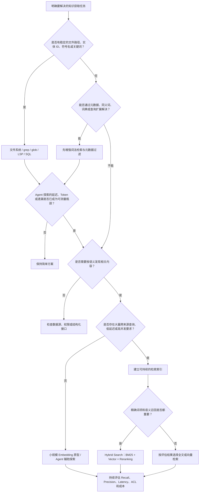

# 从 grep 到 Embedding：AI Agent 知识检索的架构分界线

**研究截止日期：2026 年 11 月 17 日**

本地使用 VS Code Copilot、Pi、Claude Code 这一类 AI Agent 时，很多知识获取任务并不需要 RAG。Agent 可以先用 `glob` 找文件，再用 `grep` 搜索术语或正则表达式，接着用 `find`、`bash`、`head`、`tail` 和文件读取逐步缩小范围。它不是一次性把整个目录塞进上下文，而是边探索、边读取、边修正搜索方向。

这套方式简单、透明，而且经常足够好。问题在于，很多知识库项目从一开始就把 Embedding、向量数据库、RAG Pipeline 当成默认配置，反而没有先回答一个更基础的问题：当前检索到底遇到了什么无法通过文件系统和文本搜索解决的问题？

**我的判断是：不要按文档数量决定是否上 Embedding，也不要按数据量决定是否上 OpenSearch。应该按查询任务的失败模式决定。** 当用户知道要找什么、知识有明确路径或标识、内容可通过关键词或结构化查询定位时，Agentic Search 通常更合适；当用户只能描述语义、无法预先知道文档使用了什么词，或者系统必须在大量来源中持续、低延迟、稳定地找出相关内容时，才有充分理由引入预计算索引。即使如此，Embedding 也不等于 OpenSearch，全文检索也不等于向量检索。

## 1. 为什么 grep / glob / find 已经能做很多事

先看一个常见的本地开发任务：

> 找出这个项目里所有处理用户身份认证的逻辑，说明登录、Token 校验和权限判断分别在哪里实现，以及它们之间的调用关系。

Agent 并不一定需要一个向量索引。它可以从项目入口和目录结构开始：

```bash
find . -maxdepth 3 -type f
rg -n -i "auth|authenticate|authorization|token|session" .
rg -n "verifyToken|checkPermission|requireAuth" src test
```

随后读取候选文件、沿着函数调用关系继续搜索，必要时查看配置、测试和 Git 历史。搜索结果不够好时，它可以换关键词、扩大目录、追踪引用，直到形成一份有源文件依据的解释。

这不是传统意义上一次查询、一次返回 Top-K 文档的 RAG。它更像一个会使用工具的研究者：提出假设、执行搜索、检查证据、调整假设。检索过程本身是 Agent 的推理循环。

Anthropic 在 2025 年的 [Effective context engineering for AI agents](https://www.anthropic.com/research/effective-context-engineering-for-ai-agents) 中专门讨论了这一变化：很多 AI 应用过去会在推理前通过 Embedding 预先检索上下文，而 Agentic Search 可以保留文件路径、查询、链接等轻量引用，在需要时通过工具动态加载内容。文章以 Claude Code 为例，说明 Agent 可以用 Bash、glob、grep 等原语按需探索；同时也明确指出，运行时探索会比预计算检索慢，Agent 还需要合适的工具和搜索启发式，否则可能浪费上下文、走入死胡同。Anthropic 给出的方向不是“永远不用索引”，而是根据任务选择自主探索与预取上下文的边界。

这和工具的实际设计相符。Pi 的 [CLI 文档](https://docs.pi.dev/latest/cli) 将 `read`、`bash`、`grep`、`find`、`ls` 作为内置工具；VS Code Copilot 则同时提供文本搜索、Grep、文件名搜索、符号引用和语义搜索。Copilot 的文档也说明，Grep 不需要索引，而语义搜索需要工作区索引。换句话说，即使是提供语义索引的产品，也没有把精确文本搜索淘汰掉。

参考：[Pi CLI Tools](https://docs.pi.dev/latest/cli#tools)；[VS Code：How Copilot understands your workspace](https://code.visualstudio.com/docs/agents/reference/workspace-context)。

### 1.1 Agentic Search 的优势来自渐进式发现

文件系统不仅存放内容，也保存了有用的组织信息。目录层次、文件名、扩展名、时间戳、Git 历史、模块边界和相邻文件，都是检索线索。

例如，`src/auth/token.ts`、`tests/auth/token.test.ts`、`docs/security/token-lifecycle.md` 即使没有被 Embedding 模型编码，也已经通过路径和命名表达了部分语义。Agent 可以先找到实现，再读测试和文档，逐层构建理解。

这种方式有几个很实际的特点：

- **精确性高**：已知函数名、错误码、配置键、业务术语或文件路径时，文本搜索通常比语义相似度更直接。
- **内容更新立即可见**：不需要等待文档切片、Embedding 生成和索引刷新。只要文件已经写入，下一次搜索就能看到。
- **证据路径清楚**：结果可以直接落到文件、行号和 Git commit，便于验证。
- **基础设施少**：不需要单独维护向量模型、Embedding Pipeline、索引存储和检索服务。
- **Agent 可以自适应**：第一次搜索不完整时，可以换词、沿调用关系搜索，或读取更多上下文。

### 1.2 但它不是免费的

Agentic Search 把一部分检索工作从离线索引阶段移到了每次任务的运行时。

一次复杂探索可能包含十几次工具调用。每次调用都可能产生延迟、消耗 Token，并把搜索结果带入上下文。更重要的是，Agent 的搜索策略不一定稳定：同一个问题，模型可能选用不同关键词、搜索不同目录，甚至遗漏一个重要文件。

VS Code Copilot 的工作区文档明确提醒：Grep 或文本搜索返回的匹配内容可能直接进入对话上下文，即使 Agent 没有打开对应文件。生成文件、构建产物、日志和大数据文件会造成噪声，因此排除规则会直接影响搜索速度、相关性和 Token 消耗。

因此，Agentic Search 的主要成本不只是 `grep` 执行时间，而是：

```text
任务总成本 =
  工具调用延迟
  + 搜索结果进入上下文的 Token
  + Agent 反复探索的推理成本
  + 搜索遗漏和错误理解的返工成本
```

当这些成本仍然低于建立、维护和调用索引的成本时，就没有必要为了“架构完整”而引入 RAG。

## 2. 真正的分界线：查询任务，而不是文档规模

把检索任务拆开看，会更容易判断。

| 查询任务 | 典型问题 | 优先方案 |
| --- | --- | --- |
| 已知实体或术语 | 找到 `payment_status` 在哪里定义 | grep / 精确文本搜索 |
| 已知文件或路径模式 | 找到所有 ADR、配置文件、测试文件 | glob / find |
| 已知代码符号 | 谁调用了这个函数，在哪里实现 | LSP / Symbol / AST 索引 |
| 结构化属性过滤 | 找出 2024 年之后、某业务域、某状态的文档 | SQL / 元数据过滤 |
| 词汇不一致 | 用户说“客户退出”，文档写的是“关系终止” | 同义词、词典、全文检索扩展，必要时 Embedding |
| 自然语言语义发现 | 不知道术语，只能描述一个业务现象 | Semantic Search / Embedding |
| 大规模跨来源检索 | 同时搜索 Wiki、SharePoint、邮件、工单和文件库 | 统一检索层或联邦检索 |
| 高并发、低延迟检索 | 每个 Agent 请求都要稳定地检索大量内容 | 预计算索引 |
| 多模态内容检索 | 按图片、图表或扫描件的内容找资料 | OCR / 多模态 Embedding / 专用索引 |

有一个容易被忽略的区别：**代码搜索和企业知识搜索的难点并不完全相同。**

代码有大量稳定的结构信号：符号名、调用关系、import、类型、文件路径和测试关系。即使用户提出的是自然语言问题，Agent 也可以先把问题转成候选符号或代码概念，再通过 LSP、AST、grep 和文件读取验证。单纯的向量检索未必能准确回答“这个函数有哪些调用方”或“哪个实现覆盖了这个接口”。

企业文档则经常缺少统一的命名和结构。一个业务概念可能在政策文件中叫“客户关系终止”，在操作手册中叫“账户关闭”，在邮件中写成“客户退出流程”。如果用户不知道文档采用的词，精确搜索就可能漏掉内容。这才是语义检索更有价值的地方。

## 3. Decision Tree：从最简单的检索开始

下面这棵决策树针对的是“如何为 Agent 选择知识检索方式”，不是“是否要部署某个数据库”。



这棵树的几个关键判断值得展开。

### 3.1 能精确定位，就不要先做语义检索

如果问题包含明确的代码符号、配置项、错误码、产品 ID、客户 ID、文档编号或法规条款号，优先使用精确检索。

例如：

- “查找所有调用 `calculate_nav` 的地方。”
- “找到包含规则编号 `INV-042` 的政策文件。”
- “哪些配置仍然使用旧的 `risk_model_version`？”
- “列出 2025 年之后更新过的全部投资限制政策。”

这些任务不需要 Embedding。对于最后一个问题，文件元数据或 SQL 过滤比向量搜索更自然。

不要为了统一架构而把所有查询都转成向量。向量相似度不是精确匹配的替代品。

### 3.2 词汇不一致，不等于必须上 Embedding

在引入向量模型之前，可以先检查词汇问题是否能通过更简单的方式解决。

比如“客户退出”可能对应：

```text
客户退出
客户关系终止
账户关闭
客户注销
relationship termination
account closure
```

可以通过业务词典、同义词扩展、查询重写和 BM25 的 synonym 配置扩大召回范围。金融服务领域尤其值得先做这一步：很多查询依赖明确的业务术语、产品代码、监管条款、指标名称和内部缩写。

如果同义词集合相对稳定，显式词典不仅成本更低，还更容易解释和审计。只有当用户表达与文档表达之间的语义差异无法被有限词典覆盖时，Embedding 才开始体现价值。

### 3.3 真正需要 Embedding 的，是“用户不知道应该搜什么词”

这是一个比较清晰的触发条件。

用户问：

> 找出所有讨论客户资产在市场剧烈波动期间如何保持流动性的材料。

文档可能分别使用“现金缓冲”“流动性覆盖”“赎回压力”“资产变现能力”“liquidity management”等表达。用户并不知道应该枚举哪些关键词。

Embedding 将文本和查询编码成向量，再通过向量相似度找到语义接近的内容。它解决的是词面不一致带来的发现问题，而不是所有检索问题。

不过，Embedding 也不是业务理解本身。它不能保证理解某个公司内部定义的专有概念，也不能保证区分相似但业务含义不同的术语。企业知识检索仍然需要业务词典、元数据、权限过滤和结果验证。

## 4. 不要把 Embedding、向量数据库和 OpenSearch 当成一个决策

这三个东西解决的问题不同。

**Embedding 是表示方式。** 它把文本、图片或其他内容编码成向量，使系统可以按相似度进行检索。它本身不负责文档管理、权限、全文检索、过滤、排序或服务治理。

**向量存储和索引负责保存、组织和查询向量。** 小规模场景可以从 PostgreSQL + pgvector 等现有数据库能力开始，不必立即部署独立向量数据库。数据规模、并发、索引维护和性能要求确实超出当前数据库能力时，再评估专用服务。

**OpenSearch 是搜索与分析引擎。** 它可以做倒排索引和 BM25 全文检索，也可以通过 k-NN 等能力做向量搜索，还支持把词法和语义结果合并为 Hybrid Search。OpenSearch 文档将这几种能力明确区分：向量检索、语义检索、混合检索、Reranking 和 RAG 并不是同一个功能。

参考：[OpenSearch Vector Search Concepts](https://docs.opensearch.org/latest/vector-search/getting-started/concepts/)；[OpenSearch Hybrid Search](https://docs.opensearch.org/latest/vector-search/ai-search/hybrid-search/)。

### 4.1 先判断需要哪一层

| 真实需求 | 需要考虑的能力 | 不应直接推导出的结论 |
| --- | --- | --- |
| 找到精确词项、错误码、实体编号 | 倒排索引 / BM25 | 不代表需要 Embedding |
| 找到语义相近的段落 | Embedding + Vector Search | 不代表需要 OpenSearch |
| 同时命中精确术语和语义表达 | Hybrid Search | 不代表一定需要独立向量数据库 |
| 按日期、业务域、文档状态、权限过滤 | Metadata / Structured Filter / ACL | 不应把过滤逻辑交给向量相似度 |
| 多来源统一搜索、高并发、稳定 SLA | 集中式检索服务与索引平台 | 不代表所有数据都必须向量化 |
| 精确检索初筛后提高语义相关性 | Reranker | 不代表需要对整个语料做复杂 RAG |

特别要注意：如果系统的问题是“搜索多个数据源很慢”，引入 Embedding 未必有用。真正需要的可能是连接器、增量同步、统一元数据、缓存或并行查询。如果问题是“用户没有权限的文档也被召回”，需要修复的是检索前的权限过滤和数据授权边界，不是换一个向量数据库。

### 4.2 为什么很多企业最终会走向 Hybrid Search

纯 BM25 对精确词项、专有名词、编号和短语通常很有效；纯向量检索更适合表达方式不同但含义相近的查询。两者有不同的召回偏好。

金融领域的查询尤其容易同时包含两种信息：

> 找到关于“集中度风险”的政策要求，并确认规则 INV-042 对单一发行人的限制。

“集中度风险”适合语义发现；`INV-042` 和“单一发行人”则需要精确匹配。只用向量可能错过编号和关键条款，只用关键词又可能错过用“issuer exposure”或“single-name exposure”表达的材料。

Hybrid Search 将两种结果合并，再根据需要做 Reranking。OpenSearch 提供基于分数归一化或 Reciprocal Rank Fusion（RRF）的混合结果处理方式。选择哪种方式应由相关性评估决定，而不是默认把所有分数相加。

## 5. 用数据判断是否应该升级

架构决策不能只靠“Agent 感觉搜索不方便”。建议先建立一个小型 Retrieval Evaluation Dataset，记录真实问题、预期相关文档、权限范围和答案所需的证据片段。

不需要一开始准备几千条。可以先从 30—100 个真实问题开始，覆盖精确查找、语义发现、跨文档关系、时间过滤、权限过滤和多轮探索。重要的是问题来自真实工作，而不是人为设计成向量检索擅长的样子。

对每个问题，至少比较两种实现：

1. 当前 Agentic Search：文件系统、grep、元数据查询、结构化工具。
2. 候选索引方案：BM25、Embedding 或 Hybrid Search。

记录以下指标：

| 指标 | 要回答的问题 | 观察重点 |
| --- | --- | --- |
| Recall@K | 前 K 条结果中是否包含真正需要的证据？ | 漏掉关键文档的比例 |
| Precision@K | 返回的结果中有多少真正相关？ | 噪声是否过多 |
| MRR / nDCG | 重要证据是否排在前面？ | Agent 是否需要反复翻找 |
| Task Success Rate | Agent 最终是否正确完成任务？ | 检索是否真正影响业务结果 |
| Time to Evidence | 从提问到找到可用证据需要多久？ | 包括 Agent 探索和索引查询 |
| Token / Tool Calls | 为检索消耗多少上下文和工具调用？ | 是否出现重复搜索 |
| Freshness Lag | 新增或修改内容多久能被查到？ | 索引同步延迟 |
| ACL Correctness | 是否只返回用户有权访问的内容？ | 越权召回必须为零 |
| Operating Cost | 建索引和运行检索服务花费多少？ | 包括 Embedding、存储、更新和运维 |

其中最容易被忽略的是 Task Success Rate。Recall@K 提升不一定意味着 Agent 的任务成功率提升。如果原先 Agent 已经可以通过 grep 找到关键文件，向量索引增加了一批相似但不必要的文档，最终答案甚至可能更差。

### 5.1 一个可执行的升级判据

建议用以下逻辑，而不是人为设定“超过十万篇文档就必须上向量数据库”：

- **继续使用 Agentic Search**：真实任务成功率满足要求，关键证据召回稳定，检索延迟和 Token 成本可接受，内容更新速度符合要求。
- **先优化现有检索**：失败主要来自目录混乱、排除规则错误、关键词不足、文件解析失败、缺少元数据或 Agent 搜索策略不合理。
- **先引入全文索引**：主要问题是跨目录、跨来源的精确检索速度、过滤、排序或并发，而语义召回不是主要短板。
- **试点 Embedding**：在经过人工确认的真实查询集中，词法搜索持续漏掉语义相关证据，而且同义词、词典和查询扩展无法经济地解决。
- **引入 Hybrid Search**：精确术语和语义发现同时重要，并且评估证明两种召回组合能提高最终任务成功率。
- **部署独立搜索平台**：除了检索质量，还出现跨系统统一接入、并发、服务 SLA、索引隔离、监控、权限过滤、数据生命周期和运维管理等平台级需求。

阈值应该来自业务 SLA 和基线测试。例如，如果一个任务要求 3 秒内返回候选证据，就应测量 Agentic Search 的 P95，而不是用平均耗时判断；如果某类监管问题要求不能漏掉适用政策，就要单独评估该类查询的召回率，不能被其他普通问题的平均表现掩盖。

## 6. 一个更稳妥的架构演进路径

不要从“文件搜索”一步跳到“企业级 RAG 平台”。可以按实际瓶颈逐层增加能力。

### Stage 1：文件系统就是检索层

适合本地 Agent、代码仓库、项目工作区、有限规模的文档集合。

```text
User Query
    |
    v
Agent
    |
    +-- glob / find
    +-- grep / rg
    +-- read file
    +-- bash / scripts
    +-- LSP / AST (for code)
    |
    v
Evidence in Context
    |
    v
Answer with file paths / line references
```

先做好文件命名、目录组织、排除规则和文档元数据。重要的项目说明可以通过 `AGENTS.md`、`CLAUDE.md` 或项目入口文档提供给 Agent。不要把整个知识库预先塞进上下文。

### Stage 2：增加轻量结构化索引

当文件数量增长、需要按时间、类型、业务域、来源和状态过滤时，可以先增加 SQLite、DuckDB 或 PostgreSQL 元数据表，保存文件路径、标题、来源、更新时间、版本和 ACL 引用。

文件正文仍由 Agent 按需读取。索引先解决“去哪里找”和“哪些文件符合条件”，不必急着解决语义相似度。

### Stage 3：增加全文检索

当跨目录或跨来源的精确搜索已经成为性能瓶颈，或者需要稳定的相关性排序、高并发查询时，引入倒排索引和 BM25。

可以先评估现有数据库的全文检索能力。如果数据源、规模、并发和查询复杂度确实需要独立服务，再评估 OpenSearch。此时不必默认开启向量检索。

### Stage 4：针对语义缺口增加 Embedding

先从一部分高价值文档和真实问题做试点。明确 Chunk 的边界、文档版本、元数据、Embedding 模型版本和更新机制，建立可重复的评估集。

不要只比较“向量搜索能不能返回结果”，要比较它是否找到了原本词法搜索遗漏的关键证据，以及这些证据是否改善最终任务结果。

### Stage 5：在证据充分时采用 Hybrid Search

当 BM25 和向量召回分别解决不同问题，而且组合后的任务成功率确实更好，再考虑统一检索接口：

```text
                 User Query
                      |
                Query Analysis
                      |
          +-----------+-----------+
          |                       |
      BM25 Search            Vector Search
          |                       |
          +-----------+-----------+
                      |
                Fusion / RRF
                      |
                  Reranker
                      |
              ACL + Metadata Check
                      |
              Evidence / Citations
                      |
                    Agent
```

这里的 ACL 不能只放在最后做展示过滤。对受保护内容，必须在检索候选集形成之前或检索过程中实施授权约束；最终结果仍需做权限校验，避免缓存、重排或其他处理环节造成越权。检索系统不能成为绕过原始 Data Entitlement 的旁路。

## 7. 金融服务企业的特殊考虑

在金融服务企业里，检索架构的分界线不只是文档规模和语义差异，还包括数据权属、权限和证据要求。

例如，一个 Investment Research Agent 可能需要同时读取：

- 研究报告和投资政策；
- Bloomberg、LSEG、MSCI 等外部数据及其定义；
- 内部投资组合、持仓和风险数据；
- 团队的分析笔记、审批记录和历史决策；
- 产品、账户、客户和投资限制相关的业务定义。

这不是一个简单的“把所有文件切片后放入向量数据库”的问题。

首先，结构化金融数据不应该被 Embedding 取代。价格、持仓、风险敞口、交易状态和基准数据应通过受控 SQL、API 或数据平台查询，保留精确过滤、时间语义和数据血缘。向量检索可以帮助找到相关政策、分析说明或指标定义，但不应该用相似文本回答“当前持仓是多少”或“某日 NAV 是多少”。

其次，权限必须在检索边界实施。不同用户对研究报告、客户数据、投资组合、交易记录和内部审批材料可能拥有不同权限。文档 ACL、数据行级权限、字段级权限和业务 Entitlement 不是同一件事。Embedding 索引必须继承并正确执行来源权限；不能先召回所有向量，再把权限交给 LLM 判断。

再次，证据和版本需要可追溯。监管政策、投资限制和研究结论可能随时间变化。检索结果至少要保留来源、版本、生效时间、更新时间和原文位置。Embedding 是派生数据，不能替代权威原文，也不能成为审计证据的唯一来源。

因此，企业级方案更合理的形态通常是多种检索方式并存：

| 知识类型 | 推荐检索方式 | 关键约束 |
| --- | --- | --- |
| 结构化持仓、价格、风险指标 | SQL / API / 数据平台 | 精确查询、时间口径、数据血缘 |
| 源代码、配置和工程文档 | grep / LSP / 文件搜索 | 版本、路径、行号 |
| 政策、研究报告、操作手册 | BM25 + 必要时 Embedding | 版本、生效日期、文档 ACL |
| 内部业务定义和指标口径 | 元数据 / 业务词典 / Semantic Layer | 定义所有权、口径一致性 |
| 邮件、工单、会议记录 | 来源连接器 + 全文检索，必要时 Hybrid | 用户权限、时间和来源 |
| 图片、扫描件、图表 | OCR / 文档解析 / 多模态检索 | 解析质量、原始文件引用 |

这也解释了为什么企业知识平台通常需要一个检索路由层，而不是一个“万能向量库”。Agent 根据任务选择合适的数据源和检索工具；检索服务负责权限、过滤、排序和证据定位；LLM 负责理解问题、组织检索步骤和综合证据。

## 8. 最后一个容易犯的错误：把 Agent 搜索能力差，当成缺少 Embedding

如果 Agent 经常找不到文件，不要立即加向量索引。先检查：

1. Agent 是否知道有哪些目录和数据源？
2. `grep` / `rg` 是否排除了需要搜索的文件？
3. 文件解析是否能正确处理 PDF、DOCX、HTML、表格和扫描件？
4. 业务缩写、别名和同义词是否有可用词典？
5. Agent 是否能在首次搜索失败后调整关键词和搜索范围？
6. 搜索结果是否过多，导致上下文被噪声填满？
7. 是否存在需要用 SQL、LSP、API 或专用连接器解决的问题？
8. Agent 是否能返回文件路径、版本、页码或行号，供人验证？

尤其要注意，**搜索不到内容和内容没有被正确解析，是两种不同的问题。** 如果 PDF 解析阶段丢失了表格，Embedding 只会把错误或不完整的文本向量化；如果文档根本没有进入索引，向量模型也不可能凭空找出它。

还有一种情况：Agent 的工具调用次数很多，但每次都在重复搜索相同内容。这可能需要更好的搜索计划、临时结果缓存、Agent Memory 或结构化笔记，而不一定需要向量数据库。Anthropic 在同一篇 Context Engineering 文章中把动态检索、结构化笔记、上下文压缩和 Sub-agent 视为解决长任务上下文问题的不同手段。不要把所有上下文问题都归到 RAG 名下。

## 结论：先证明文件检索不够，再引入索引

本地 AI Agent 的出现改变了知识检索的默认架构。过去，系统需要预先把大量内容整理成索引，再通过一个查询接口返回候选文档。现在，Agent 可以直接使用文件系统、命令行和结构化工具，按需发现内容、读取证据并继续探索。

这不意味着 Embedding 或 OpenSearch 失去了价值。它们的价值在于解决 Agentic Search 不擅长或无法经济解决的问题：语义表达差异、跨来源发现、稳定的低延迟、高并发、复杂过滤和集中式检索治理。

真正值得坚持的原则是：

**从精确检索开始；先修复数据和搜索策略；用真实任务测量失败；只有当失败模式明确指向语义召回或预计算索引时，再增加对应能力。**

如果最后需要的是 BM25，就不要为了 RAG 上 Embedding；如果只需要 Embedding，就不要为了向量检索顺手部署一整套 OpenSearch；如果需要的是结构化查询或权限治理，也不要指望向量相似度解决。

架构不是功能清单。每增加一层索引，都应该对应一个已经被测量、并且现有方案无法经济解决的问题。

## 参考资料

1. Anthropic, [Effective context engineering for AI agents](https://www.anthropic.com/research/effective-context-engineering-for-ai-agents), 2025-09-29。关于 Just-in-time Context、Agentic Search、预计算检索的权衡，以及 Claude Code 使用 glob / grep 的实践。
2. VS Code, [How Copilot understands your workspace](https://code.visualstudio.com/docs/agents/reference/workspace-context)。关于 Copilot 的文本搜索、Grep、文件搜索、符号检索、语义索引和排除规则。
3. Pi, [Command Line](https://docs.pi.dev/latest/cli)。关于 Pi 内置 read、bash、grep、find、ls 等工具及工具配置。
4. OpenSearch, [Vector search concepts](https://docs.opensearch.org/latest/vector-search/getting-started/concepts/)。关于 Embedding、k-NN、Semantic Search、Hybrid Search、Reranking 和 RAG 的能力边界。
5. OpenSearch, [Hybrid search](https://docs.opensearch.org/latest/vector-search/ai-search/hybrid-search/)。关于词法与语义检索结果的归一化和 RRF 融合。
6. GitHub Copilot, [Researching with GitHub Copilot CLI](https://docs.github.com/en/copilot/how-tos/copilot-cli/use-copilot-cli/research-with-copilot-cli)。关于使用 grep、glob 和 view 对代码仓库进行探索式研究。
