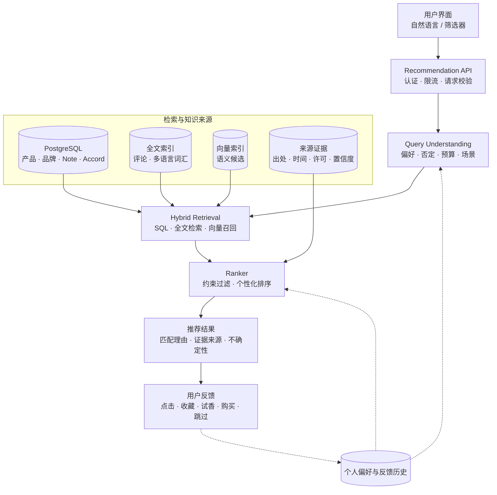

# 香水数据从哪里来？从中文香调知识到分子气味科学与 AI 推荐

**研究与链接核对日期：2026 年 11 月 4 日**

## 1. 从产品目录到气味知识

如果要做一个香水搜索或推荐系统，最先想到的通常是找一份包含品牌、香水名称、前调、中调、后调和价格的数据集。这些字段确实构成了产品目录，但它们并不能完整表达一款香水闻起来是什么感觉。

消费者描述气味时，可能会说“雨后森林”“晒过太阳的棉被”“旧书纸张”“干净的皂感”“奶油和木头混合的味道”。香水数据库则通常使用 Woody、Floral、Powdery、Aquatic、Gourmand 等标准化词汇。调香原料数据库记录的是具体物质、化学结构和气味描述；嗅觉科学研究还会涉及分子与嗅觉受体之间的响应。

这些信息处于不同层次，不能直接拼成一个字段：

- **香水产品数据**描述市场上有哪些产品，以及公开资料如何描述它们。
- **香调与 Accord 数据**描述人们如何归纳和表达气味。
- **原料与分子数据**描述可能参与气味形成的物质及其化学属性。
- **感官与嗅觉实验数据**描述人在实验条件下如何感知气味，或分子与嗅觉受体的响应。
- **用户评论与投票**描述消费者在特定语境下的主观体验。

目前能找到的公开资源并不均衡：国际香水目录和社区评论相对丰富，国内公开资源更多集中在分子气味、感官研究和早期知识图谱。中文商品目录、消费者评论和统一的中文气味词汇仍然分散。把这些数据放进同一个系统之前，必须先区分它们各自描述的对象和证据边界。

## 2. 产品资料、感官描述与分子数据不是一回事

### 2.1 香水产品的公开香调不是配方

一款香水的产品页可能标注玫瑰、茉莉、檀香、香草和麝香。这些信息通常是品牌或社区对气味结构的描述，不代表公开了实际配方，更不代表每个 Note 都对应一种直接加入的原料。

例如，产品资料中的 Rose 可能表达玫瑰气息，也可能由多种天然或合成材料共同构建。一个 Rose Accord 是气味效果或组合印象，不等于某个单一化学分子。

因此，数据模型至少应区分：

| 概念 | 含义 | 示例 |
|---|---|---|
| Note | 香水资料中用于描述气味的主题或原料印象 | Rose、Sandalwood |
| Accord | 多种气味材料形成的整体嗅觉印象 | Floral、Amber、Chypre |
| Ingredient | 配方或原料体系中的具体材料 | Rose oil、Vanillin |
| Molecule | 具有化学结构定义的物质 | Linalool、Limonene |
| Olfactory descriptor | 对气味感知的描述词 | Powdery、Green、Earthy |

同一个词在不同数据库中的含义也可能不同。比如 Vanilla 可以作为 Note，也可以出现在气味描述中；Vanillin 则是一个具体化学物质。数据整合时不能只靠字符串相同就建立实体等同关系。

### 2.2 前调、中调、后调是产品表达模型

Top / Heart / Base Notes 是香水行业常见的表达方式，用来说明香气随时间展开时的主要印象。它不是一份经过实验验证的完整挥发曲线，也不意味着每种香料只会出现在一个阶段。

产品数据可以保存这种金字塔结构，但要保留来源和证据类型，例如品牌官方描述、零售商描述、社区整理或用户推断。不同来源发生冲突时，不应该把它们覆盖成一个看似确定的事实。

### 2.3 气味标签不是化学性质

Woody、Fresh、Sweet、Animalic 等词属于感官描述或分类标签。它们不是分子本身的化学属性，也不是可以直接从分子结构无误推导出来的确定答案。

机器学习模型可以根据分子结构预测某些气味标签，但预测结果是模型输出，需要记录训练数据、标签体系、置信度和适用范围。

### 2.4 用户评价不是客观测量

“留香很久”“扩散很强”“闻起来很甜”都可能受到使用量、皮肤、气候、嗅觉适应、产品批次和个人偏好的影响。用户评价适合做偏好建模和体验分析，不应直接作为实验测量数据。

## 3. 国际香水产品数据库

### 3.1 FragDB：规模较大的多语言产品数据集

项目地址：[FragDB – Fragrance Database](https://github.com/FragDB/fragrance-database)  
数据说明：[FragDB Data Dictionary](https://github.com/FragDB/fragrance-database/blob/main/DATA_DICTIONARY.md)  
商业数据页面：[fragdb.net](https://www.fragdb.net/)  
Hugging Face 样例：[FragDB multilingual sample](https://huggingface.co/datasets/FragDBnet/fragrance-database)

FragDB 是一个值得评估的多语言香水目录。项目在 2026-11-01 发布的 v5.20 快照列出以下记录数：

| 数据类型 | 记录数 |
|---|---:|
| 香水 | 143,855 |
| 品牌 | 8,501 |
| 调香师 | 3,198 |
| Notes | 2,626 |
| Accords | 92 |
| 用户评论 | 5,026,322 |
| 编辑文章 | 25,981 |
| 社区新闻评论 | 280,874 |

数据按多个 CSV 和 Parquet 文件组织，包含产品、品牌、调香师、香调、Accord 和翻译词汇。项目说明支持 23 种语言，包括中文和日文，产品记录之间通过 ID 关联。

对跨语言检索更有用的是它的关系结构：产品可关联品牌、调香师、Note 和 Accord，词汇也有多语言映射。只有产品名称和描述的平面 CSV 很难支持这类查询。

不过，使用前要认真核对授权。FragDB 的更新记录曾明确修正过授权展示，指出完整数据实际采用 CC BY-NC 4.0，而不是此前页面显示的 MIT。免费样例、代码、完整数据和 API 的授权条件不能混为一谈。**CC BY-NC 4.0 不适合未经额外许可的商业产品使用。** 采购完整数据时还要确认评论、图片和上游来源是否有独立限制。

数据规模和版本数字来自项目自己的变更记录，属于数据发布方披露，不等于第三方独立审计结果。

### 3.2 ParfumDB：另一个商业数据方向

[ParfumDB](https://www.parfumdb.net/) 提供基于 Parfumo 产品资料整理的香水数据。公开产品介绍涵盖香水、品牌、调香师、Notes、Accords、评分、留香、扩散性、季节、场合和用户内容。

这类数据可用于产品目录、相似香水检索和偏好分析。采购前应索取数据字典和样本，并在合同中明确更新频率、字段覆盖率、来源、商业推荐、模型训练、缓存、衍生数据及评论展示的许可范围。

记录总数不能说明数据是否适合目标业务。评论是否包含正文、语言分布、产品 ID 稳定性和重复产品处理方式，都会直接影响推荐效果。

### 3.3 Scento：适合快速验证数据模型的小型开放数据

项目地址：[Scento Perfume Dataset](https://github.com/Scento-com/perfume-dataset)  
Hugging Face：[Scento perfume database](https://huggingface.co/datasets/scento/perfume-database)

Scento 规模较小，更适合用于 PoC 和数据模型验证。项目提供香水、品牌和材料相关数据，字段涉及前中后调、香调家族、次级香调、季节、使用时间、材料分类和气味描述。

数据结构相对直观，可用于验证 Perfume、Brand、Note、Material 和 Accord 之间的关系。公开页面标注 CC BY 4.0，但实际使用仍应以仓库当前 LICENSE 和数据来源说明为准，保留署名和来源信息。

### 3.4 doevent/perfume：规模较大的公开样例，但不是中国本土数据库

[Hugging Face – doevent/perfume](https://huggingface.co/datasets/doevent/perfume)

这个数据集的说明称其包含 26,000 多款香水，数据字段包括品牌、产品名、香调家族、子家族、香气描述、成分列表、产地、性别定位、年份和图片信息，并提供 SQLite、JSON、CSV 等格式。

该数据集托管在 Hugging Face，但不是中国机构建设的中文香水数据库。数据卡将其标记为英文数据，创建日期为 2024-05-01，页面声明 MIT。MIT 声明也不能自动解决原始图片、产品描述和上游抓取数据的权利问题。商业使用前仍需检查数据来源和具体文件的权利状态。

## 4. 中国的气味科学与产品知识图谱资源

国内公开资源以科研数据为主，集中在气味分子、感官标签和嗅觉机理；可补充香水知识，但不能替代产品目录。

### 4.1 CSLOdorDB / Atomevo-Odor：中国气味分子与嗅觉受体数据

数据库入口：[CSLOdorDB](http://cslodordatabase.7fx.cn/)  
国家基因组科学数据中心 Database Commons：[CSLOdorDB 数据库档案](https://ngdc.cncb.ac.cn/databasecommons/database/id/9908)  
论文：[Atomevo-odor: A database for understanding olfactory receptor-odorant pairs with multi-artificial intelligence methods](https://pubmed.ncbi.nlm.nih.gov/39977983/)

CSLOdorDB 是国内科研团队建设的气味数据库。Database Commons 的数据库档案将其归属地标记为中国、机构标记为佛山大学，数据集于 2025 年建立。论文发表于 2025 年的 Food Chemistry。

数据库档案介绍的内容包括：

- 超过 2,500 种挥发性化合物的化学结构和理化属性；
- 标准化气味描述；
- 气味分子与嗅觉受体（Olfactory Receptors）的关系；
- 气味相似性检索和可视化；
- SDF 化学结构文件及标准化描述符矩阵下载；
- 基于实验数据和 AI 方法的受体响应预测。

它把气味描述、候选分子和嗅觉受体响应关联起来，可用于气味科学研究、分子特征分析和原料知识库。

但不能把受体响应预测解释为“模型已经知道人闻到的完整香味”。嗅觉感知还涉及多种受体的组合响应、浓度、混合物相互作用、个体差异和实验条件。该数据库不是香水产品目录，也不提供商业香水的真实配方。

### 4.2 南开大学 OdorNet：标准化分子气味标签

项目地址：[NKU-DOIE/OdorNet](https://github.com/NKU-DOIE/OdorNet)  
数据归档与来源：[Zenodo](https://zenodo.org/records/19838455)

OdorNet 由南开大学电子信息与光学工程学院数字嗅觉与智能装备实验室维护，目标是把不同来源的分子气味描述整理为统一的层级标签体系。

其 GitHub 公开的机器学习数据版本包含 8,892 条分子记录，每条记录包括 SMILES 和 12 个一级气味类别标签：

| 一级分类 | 含义 |
|---|---|
| Animalic & Ambery | 动物香与琥珀 |
| Sweet & Gourmand | 甜香与美食调 |
| Floral | 花香 |
| Fruity & Vegetable | 果香与蔬菜气味 |
| Pungent & Disagreeable | 刺激性或令人不悦的气味 |
| Green & Herbal | 青绿与草本 |
| Nutty | 坚果 |
| Woody & Mossy | 木质与苔藓 |
| Resinous & Balsamic | 树脂与香脂 |
| Cooked | 熟食气味 |
| Odorless | 无气味 |
| Spice | 辛香 |

项目使用 SEA 方法组织异构标签：统计共现（Statistical co-occurrence）、专家校正（Expert correction）和 AI 辅助语义对齐（AI-assisted semantic alignment）。

公开数据按 7:2:1 划分为训练、验证和测试集，分别为 6,224、1,778 和 890 条。项目文档特别提醒：某条记录的 12 个标签全部为 0，不一定代表分子无气味，也可能是原始描述无法映射到当前标签空间。因此不能把缺失或无法归类的数据直接当作“无气味”的负样本。

仓库将代码和文档采用 MIT License，处理后的数据采用 CC BY 4.0；Zenodo 归档中的原始来源数据还应按其来源说明引用。使用时应保留数据集版本、来源和标签缺失策略。

OdorNet 可用于分子气味多标签分类、标签体系研究和分子检索。其 12 个一级类别不能替代香水行业的香调分类，数据也不包含大规模产品目录、调香师资料或消费者评论。

### 4.3 上海交通大学食品风味研究资源

入口：[上海交通大学食品风味创新团队数据库](https://mffi.sjtu.edu.cn/database)

食品风味与香水不是同一个行业，但在挥发性化合物、气味描述、感官评价和化学分析上有交叉。食品风味数据可以作为香料原料和气味语义知识的补充来源。

评估这类资源时，重点检查字段是否包含中文和英文名称、CAS Number、化学分类、气味或滋味描述、感官特性和文献来源。不同数据表可能面向不同食品研究任务，不应假定所有记录都可以直接用于香水推荐。

这类资源补充的是原料和感官知识，不是香水产品目录。若需要商业使用，应以数据库具体页面的授权和团队许可为准。

### 4.4 CosmeticsKG：中国科学院大学的化妆品知识图谱项目

项目地址：[5KG-UCAS/CosmeticsKG](https://github.com/5KG-UCAS/CosmeticsKG)

CosmeticsKG 是中国科学院大学 2019 年秋季学期自然语言处理课程项目。仓库介绍称，项目包含约 3,000 个节点和 15,000 条关系，覆盖口红和香水两个品类，支持图谱检索、可视化和问答。

项目的数据来源说明涉及化妆品官网、美妆 App 和电商网站；知识图谱实体包括品牌、国家、香水产品、口红系列、价格区间、评论等。它展示了如何把产品目录、品牌和评论组织成可查询的图结构。

CosmeticsKG 可作为领域知识图谱的教学和原型参考，不能代表当前中国香水市场。项目年代较早，仓库说明也提到在线 Demo 已失效。原始数据采集方式涉及第三方 App 和电商平台，今天重新采集时必须遵守平台条款、个人信息保护要求和数据授权边界。

### 4.5 国内资源的能力边界

| 资源 | 产品目录 | 分子结构 | 气味标签 | 嗅觉受体 | 用户评价 | 主要用途 |
|---|---|---|---|---|---|---|
| CSLOdorDB | 否 | 是 | 是 | 是 | 否 | 分子与嗅觉科学 |
| OdorNet | 否 | 是（SMILES） | 是 | 非核心字段 | 否 | 分子气味分类 |
| 上交大食品风味资源 | 否 | 视具体数据表 | 是 | 非核心字段 | 感官研究数据视具体项目 | 食品风味与原料研究 |
| CosmeticsKG | 是，规模有限 | 否 | 有限 | 否 | 有限 | 产品知识图谱原型 |
| doevent/perfume | 是 | 部分字段为成分列表 | 是 | 否 | 未明确 | 产品目录样例 |
| FragDB | 是 | 不是完整配方库 | 是 | 否 | 是 | 多语言产品与社区数据 |

表中只列各项目公开说明涉及的主要数据类型；字段覆盖程度、下载条件和商业许可仍需逐项核对。

## 5. 日本、韩国与印度的气味数据资源

如果目标是做面向东亚和南亚用户的香型推荐，只使用欧美香水目录和英文气味描述是不够的。不同地区的用户会用不同的生活经验描述气味：日本研究中常见的是以具体物体命名的气味词，韩国有面向本土感知习惯的气味描述词分类，印度的公开资源则更偏向药用与芳香植物、精油及其化学组成。这些资源不全是香水产品数据库，但它们能补足国际香水目录缺少的区域气味语义和天然香料知识。

### 5.1 日本：日常气味词汇与消费者感知

| 资源 | 数据内容 | 规模与特点 | 获取方式及限制 | 对推荐系统的价值 |
|---|---|---|---|---|
| [日本日常气味词汇研究（Zushi et al., 2023）](https://journals.plos.org/plosone/article?id=10.1371/journal.pone.0289368) | 从日文商品评论提取气味表达，分析名词及上下文 | 研究使用 2015—2019 年乐天评论；从约 6962 万条评论中筛出 619,841 条包含气味表达的评论，并整理出 617,208 条气味描述句，并将高频的 100 个气味名词归入 15 个簇 | 论文开放获取；原始乐天评论需要向 NII 的 IDR 申请，且当前规则限定日本大学和公共研究机构的学术研究，民营企业不能直接申请 | 建立日语气味词表、生活场景词汇和日语到标准气味概念的映射 |
| [NII / Rakuten Dataset](https://www.nii.ac.jp/dsc/idr/rakuten/) | 乐天市场商品、商品评论、店铺评论等 | 2025 年页面列出约 2.83 亿商品、约 7000 万商品评论和约 2250 万店铺评论 | 免费申请不等于开放下载；需要符合资格、签署使用条款并遵守研究用途限制 | 可在符合资格的研究项目中继续挖掘日文消费品气味表达；不能把论文中提取的语料直接当作可商用数据 |
| [NTT DATA Institute：香り×人モデル](https://www.nttdata-strategy.com/newsrelease/240627/) | 香料的官能评价与人的特性之间的关联数据和预测模型 | 截至 2024 年 6 月，使用 115 种香料、107 项官能评价，以及约 900 人的 138 项人类特性评价；使用 24 项气味特征描述子进行聚类和预测 | 企业研究会以半开放、成员共同研究的方式扩充数据；不是可直接下载的公共数据集，需要联系研究会或参与合作 | 研究“什么样的人喜欢什么气味”以及个性化排序，不只是商品属性相似度 |
| [OSIT-J 日本嗅觉识别测试](https://pubmed.ncbi.nlm.nih.gov/16495437/) | 日本人熟悉的 13 种气味刺激及跨文化识别表现 | 研究显示日本和美国受试者对部分气味的识别率存在差异，反映气味熟悉度与文化背景有关 | 属于标准化测试及研究，不是通用香水目录或可下载的用户偏好数据集；使用测试材料需遵守相应规范 | 提醒推荐系统不能假设不同国家用户对同一气味词或气味样本有相同熟悉度 |

这几项日本资源中，最值得优先研究的是日常气味词汇论文。它揭示了一个对推荐系统很重要的现象：人们描述气味时，经常不是使用抽象的“木质、花香、辛香”，而是说“像某种食物、植物、材料或生活场景”。这类表达适合通过上下文和语义模型映射到标准概念，而不是仅靠词典做一对一翻译。

但乐天数据的访问限制必须认真对待。论文开放，不代表论文使用的原始评论也开放；NII 当前的数据提供对象与用途有明确限制。企业项目不能因为论文中出现了数据集名称，就假定自己可以下载、训练或再分发原始评论。

### 5.2 韩国：气味描述、植物精油与食品香气

| 资源 | 数据内容 | 规模与特点 | 获取方式及限制 | 对推荐系统的价值 |
|---|---|---|---|---|
| [한국인 정서에 맞는 냄새 표현 어구 분류（2004）](https://www.kci.go.kr/kciportal/ci/sereArticleSearch/ciSereArtiView.kci?sereArticleSearchBean.artiId=ART001296357) | 面向韩国人感知习惯的气味描述词和分类轮 | 整理 10 个主要气味主题及 142 个下级描述词 | 论文研究成果；不是具有统一 API 或标准下载许可的产品数据库 | 建立韩语气味词典，处理韩语表达中的语义细分和负面气味描述 |
| [韩国国立森林科学研究院植物精油银行（식물정유은행）](https://www.data.go.kr/data/15072621/fileData.do) | 韩国本土植物精油的理化性质、气味成分、挥发特性、功能性和香料资源属性 | 公共数据门户登记为 CSV，50 行；页面还关联该数据的 Open API | 页面标注免费、利用许可范围不受限制；数据更新方式为一次性/不定期，实际使用仍应核对下载文件和 API 的字段说明 | 补充韩国本土植物、天然精油和香料原料知识，适合连接植物—精油—化学成分 |
| [Traditional Korean Doenjang Aroma Lexicon（2026）](https://pubmed.ncbi.nlm.nih.gov/42733177/) | 传统韩国大酱的标准化香气词汇、参考物和感官轮 | 81 个样本来自韩国 9 个地区；训练型感官小组建立 80 个描述词，分为 10 个一级和 19 个二级类别 | 2026 年开放获取论文；研究对象是发酵食品，不是香水；使用论文中的词汇或材料时应保留研究语境和出处 | 提供发酵、豆类、谷物、烘烤、果香、脂质等气味概念的本土感官定义，可辅助扩充气味本体 |

韩国的两个词汇体系值得分开看。2004 年的气味描述词研究面向更广义的韩国环境气味表达，包含 142 个下级描述词；2026 年的大酱研究则是经过训练的感官小组针对特定食品建立的参考型词汇，包含 80 个描述词。前者更适合做韩语语义入口，后者适合提供特定气味类别的定义、参照物和感官评价方法。

韩国植物精油银行是这里比较接近“可直接获取的数据资源”的项目。它由韩国国立森林科学研究院提供，数据门户列出 50 行 CSV，并标记免费和不受限制的利用范围。不过，50 行意味着它更适合作为区域性原料补充，不应把它描述成覆盖完整韩国香料产业的数据库。

目前检索到的韩国公开资源中，感官词汇、食品香气和植物精油资料比面向消费者的完整香水产品目录更突出。对于韩国香水商品、品牌、价格、用户评价等数据，仍需单独寻找品牌官网、零售商授权数据或商业数据供应商，不能用上述研究数据代替。

### 5.3 印度：精油化学组成与芳香植物数据库

印度这部分有两个值得优先接入的数据库，而且它们解决的问题不同。

**sCentInDB：印度药用植物精油化学谱数据库。** 这是目前找到的印度区域资源中结构最完整的一项。数据库从公开研究文献中人工整理印度药用植物的精油化学组成，覆盖 554 种植物、2,170 份精油 profile、3,420 种化学物质，以及植物部位与气味、颜色、治疗用途之间的关联。数据还记录样本地点、精油提取方法和化学分析方法。它提供批量下载，文件包括精油信息、气味与颜色信息、化学信息和分子描述符等。

- [sCentInDB 主站](https://cb.imsc.res.in/scentindb/)
- [sCentInDB 批量下载](https://cb.imsc.res.in/scentindb/download)
- [sCentInDB 论文](https://doi.org/10.1007/s11030-025-11215-5)

需要特别注意：论文采用 CC BY 4.0 开放许可，但数据库网站对数据库内容标注的是 **CC BY-NC 4.0**。两者不是同一许可。商业推荐产品如果要使用数据库中的整理数据，应按数据库自身的非商业许可处理，先联系维护团队取得商业使用授权；不能因为论文是开放获取，就推断批量数据可以用于商业模型。

**AromaDb：药用与芳香植物的香气分子数据库。** 由印度 CSIR-CIMAP 建立，覆盖约 190 种植物、1,322 种香气分子和 442 个 fragrance type。数据涉及植物品种、chemotype、精油产量与组成、色谱、主要和次要化学成分、分子结构及理化性质。其分子列表可以看到化合物名称、IUPAC 名称、关联气味和化学类别。

- [AromaDb 主站](https://bioinfo.cimap.res.in/aromadb/)
- [AromaDb 香气分子列表](https://bioinfo.cimap.res.in/aromadb/web_aroma_molecules.php)
- [AromaDb 论文（2018）](https://doi.org/10.3389/fpls.2018.01089)

AromaDb 的植物来源包含印度和其他国家的药用、芳香植物，因此不能把所有记录都标记成“印度本土植物”。它更适合用作植物—精油—化学分子—气味类型的知识库。当前公开页面没有清晰展示可将全部数据用于商业再分发的许可条款，接入前需要向维护机构确认。

### 5.4 如何整合区域数据

不要把日文、韩文、印地语气味词直接塞进英文 Note 或 Accord 字段。建议增加一个区域化的气味表达层，并把“用户怎么说”“感官研究如何定义”“产品目录公开了什么”分别存储：

| 数据层 | 示例字段 | 典型来源 | 用途 |
|---|---|---|---|
| Regional expression | language、surface_form、locale、context | 日本评论词汇研究、韩国气味描述词 | 识别用户的原始表达 |
| Canonical odor concept | concept_id、parent_id、definition、concept_type | 统一嗅觉本体 | 跨语言召回与排序 |
| Cultural familiarity | locale、stimulus、familiarity_score、study_id | OSIT-J 等跨文化研究 | 调整用户对气味的熟悉度估计 |
| Sensory reference | descriptor、reference_material、intensity_scale、sample_context | 韩国大酱感官词汇研究 | 为概念提供可复核的感官定义 |
| Botanical material | plant_taxon、plant_part、origin、chemotype | sCentInDB、AromaDb、韩国植物精油银行 | 连接天然原料与气味知识 |
| Chemical profile | compound_id、concentration、method、sample_id | 精油化学谱数据库 | 分析原料化学组成和批次差异 |
| Product assertion | perfume_id、note_or_accord、source_id、confidence | 品牌资料、授权零售商、香水目录 | 描述具体香水的公开属性 |

例如，日语的“雨上がりの土の匂い”、韩语中表达潮湿泥土或发酵气息的词，以及中文的“雨后泥土味”，可以在经过人工审核后关联到 earthy、petrichor 或更细的子概念。但这种映射应该保留原词、语言、上下文、映射置信度和审核状态。不能因为三个词在某个场景下接近，就把它们视为所有语境下完全相同的同义词。

同样，sCentInDB 中某种植物精油的化学组成，不代表某款香水就含有该精油；韩国食品的“发酵豆香”也不等于香水中的某个标准 Accord。它们是气味知识和感官语义的参考证据，产品事实仍然必须来自香水品牌或经过授权的商品资料。

### 5.5 接入顺序

| 优先级 | 资源 | 建议动作 | 原因 |
|---|---|---|---|
| P0 | 日本日常气味词汇研究 | 提取论文中的 100 个气味名词和 15 个类别，建立日语词汇映射原型 | 直接改善日语自然语言查询理解 |
| P0 | 韩国 142 个气味描述词 | 从论文整理韩语词汇和分类，建立本土语义映射 | 补足英语 Accord 体系不擅长表达的本地词汇 |
| P0 | sCentInDB | 先下载非商业研究数据，建立植物、部位、精油、化合物和气味关联的导入流程 | 数据规模和来源信息较完整，适合验证原料知识模型 |
| P1 | 韩国植物精油银行 | 导入 CSV，核对字段和 API，连接韩国植物分类 | 数据小但区域针对性强，许可信息相对明确 |
| P1 | AromaDb | 先验证数据结构和许可，再导入分子与植物关联 | 可补充印度及其他地区芳香植物和化合物知识 |
| P1 | 韩国大酱香气词汇 | 只抽取可迁移的感官描述定义，并保留食品领域标签 | 可以丰富发酵、烘烤、谷物等气味概念，但不应直接当作香水标签 |
| P2 | NTT DATA 香り×人模型 | 通过研究会或企业合作评估数据接入 | 对个性化推荐很有价值，但不是公开下载数据 |
| P2 | Rakuten 评论原始数据 | 仅在满足 NII/IDR 资格和学术用途限制时申请 | 数据量大，但企业商业使用存在明确门槛 |

实施时可先用开放论文建立日语、韩语词汇映射；用韩国植物精油银行和印度 sCentInDB 做原料知识接入；AromaDb 作为补充；再以品牌官网和有授权的商品目录构建真实香水产品层。消费者偏好数据则单独通过合法授权的数据合作或自己的用户反馈采集。

区域词汇用于理解本地表达，植物和分子数据库补充原料知识，产品目录则提供具体商品信息。三类数据应通过有来源的关系连接，不能从原料研究推断某款香水的实际配方。

## 6. 中文气味表达需要语义映射，不是词典翻译

国际香水数据中的分类词汇通常围绕行业惯用表达。中文消费者的描述则经常是生活经验和联想，例如：

- 雨后泥土、潮湿森林、苔藓；
- 洗净衣物、肥皂、晒过太阳的棉被；
- 旧书、纸张、铅笔、木质家具；
- 奶油、牛奶、香草甜点；
- 金属、烟熏、灰烬、皮革；
- 清凉、刺鼻、药感、消毒水。

这些表达通常跨越多个感官维度，不能简单映射到单一香调分类。“像旧书”可能同时涉及纸张、木质、粉感、干燥和微弱的烟熏联想；“干净的味道”也可能指皂感、白麝香、柑橘或清新花香。

### 6.1 保留原始表达，建立多对多映射

建议建立多层语义模型：

| 层次 | 示例 | 作用 |
|---|---|---|
| 原始表达 | 雨后森林、晒过太阳的棉被 | 保存用户原话 |
| 感官维度 | 湿润、干燥、清凉、甜、粉 | 描述感知属性 |
| 标准气味描述 | Earthy、Mossy、Green、Powdery | 连接国际词汇 |
| 香调分类 | Woody、Fresh、Floral | 产品级分类 |
| 原料关联 | Geosmin、Moss materials、Musk materials | 关联原料知识 |
| 分子关联 | 具体分子及其结构 | 连接化学数据 |

原始表达应与规范化概念同时保存。映射关系需要可追溯，并允许一个词关联多个概念，不能用英文标签覆盖用户原话。

### 6.2 记录映射依据和适用语境

例如“雨后泥土”可以关联 Earthy、Wet Soil 和 Petrichor 等描述，但不能据此断定某款香水含有 Geosmin。Geosmin 是一种具有典型土腥气味的分子，它可以作为知识解释中的候选关联，却不能仅凭消费者描述推断产品配方。

建议映射记录包含：

- 原始中文词汇和语言；
- 规范化概念及其版本；
- 关联关系类型（同义、近义、上位、下位、联想或候选原料）；
- 证据来源；
- 人工审核状态；
- 置信度和适用语境。

这可以避免把语义相似误当成化学成分相同。

## 7. 六个市场的香水描述与消费者评论语言

跨市场比较时，需要把“描述香味的词”和“评价商品的词”分开。前者回答闻起来像什么，后者回答消费者是否喜欢、是否值得购买，以及实际使用效果如何。比如“粉感、木质、奶香”属于气味描述；“留香短、扩散弱、包装漏液、性价比高”则是产品体验或购买评价。把它们混成一组标签，会让推荐系统误把“喜欢某种香味”和“要求持久”当成同一件事。

下表整理的是各市场常见、值得纳入语料标注的表达类型，不是按出现频率排列的排行榜，也不代表该国所有消费者的共同偏好。证据来源包括消费者评论语料、嗅觉词汇研究、语言学研究和可观察到的本地零售评论。不同平台、年龄层、品牌档次和香水社群之间的差异，可能大于国家之间的平均差异。

| 市场 | 气味与意象描述（原文示例） | 评价与使用表现词 | 评论中常见的表达方式 | 证据与解释边界 |
|---|---|---|---|---|
| 中国（中文） | 皂感、粉感、茶感、木质、奶感、果感、药感、脂粉感、清冷、干净、温柔、像雨后森林/旧书/晒过的被子 | 留香、扩香、晕香、刺鼻、齁甜、层次、前中后调、性价比、正品/真假 | 常把气味连接到具体物件、食物、天气、空间和记忆；也会用“适不适合通勤/办公室”“会不会撞香”表达场景判断 | 2026 年一项中国香水评论语料研究分析了 NoseTime 上 36 款香水的 29,372 条评论，将描述归为实体/来源型、抽象型和评价型，实体/来源型表达最常见。表中的具体词是可用于标注的本地词汇样例，不应误读为该研究公布的全国词频榜。[28] |
| 日本（日语） | 爽やか（清爽）、ほのか（淡淡的/若有若无）、上品（优雅）、気品のある（有格调）、華やか（华丽）、甘い（甜）、神秘的、軽い（轻盈） | 香りが強い/弱い（香气强/弱）、持続性（持久度）、残り香（残香）、控えめ（克制）、使いやすい（日常好用） | 除香调本身，也常以清爽、优雅、轻盈、淡雅等整体印象描述；“香气是否过强、是否打扰他人”是值得单独识别的评价维度 | 日本研究使用大型商品评论数据系统整理气味名词；较早的香氛语言研究记录了 sawayaka、honoka、kihin 等描述词。但“日本人普遍只喜欢淡香”属于过度概括，不能直接作为个体推荐规则。[15][29] |
| 韩国（韩语） | 은은한（淡雅/柔和）、포근한（温暖柔软）、비누향（皂香）、살냄새（体香/肌肤气息）、파우더리（粉感）、머스크（麝香）、플로럴（花香）、우디（木质） | 발향（扩散/发香表现）、지속력（持久度）、잔향（残香）、진하다（浓）、부담스럽다（有负担/过于强烈）、데일리（适合日常） | 评论常把香味写成触感、体温、洗浴和个人形象，例如“像刚洗完澡”“像自己的体香”；同时明确讨论扩散、残香和日常使用是否有负担 | 韩国嗅觉语言研究讨论了触觉等感官向嗅觉的跨感官映射；本地零售评论也能观察到上述词汇。现有材料不足以据此断言这些词在韩国消费者中的全国性频率或偏好排序。[30][31] |
| 印度（英语及本地语言语境） | attar/itr（香精油/传统香油语境）、oud/agarwood（沉香）、musk、rose/gulab（玫瑰）、mitti（雨后泥土气息）、khus/vetiver（香根草）、sandalwood/chandan（檀香）、spicy、amber | longevity（留香）、projection（扩散距离）、sillage（香迹）、performance（表现）、value for money（性价比）、alcohol-free（无酒精） | 英语香评常用 longevity、projection、performance 等词比较表现；attar、oud、玫瑰、檀香等词则可能涉及具体产品传统和原料语境。评论还会结合炎热天气、婚礼/节庆、通勤和使用场合 | 印度的精油数据库能支持植物和化学成分知识，却不能代表消费者评论语料。当前公开证据对 Hindi、Tamil、Bengali 等本地语言香水评论的系统研究仍不足；这些词应视为待验证的语料入口，而非全国消费者词频结论。[22][32][33] |
| 法国（法语） | frais（清新）、léger（轻盈）、floral（花香）、boisé（木质）、poudré（粉感）、musqué（麝香）、ambré（琥珀调）、capiteux/entêtant（浓郁/令人沉醉或过于浓烈） | tenue（留香/持久度）、sillage（香迹）、projection（扩散）、odeur/parfum（气味/香水）、flacon（瓶身）、prix（价格）、rapport qualité-prix（性价比） | 评论会把香味本身与持久度、包装、价格和整体满意度分开评价；“tenue”和“sillage”是需要保留的法语原词，不宜简单合并成一个 longevity 标签 | 一项基于 Beauté-test 的研究分析了 48 款香水的 7,544 条评论，分别标注 fragrance、persistence、packaging、price 等产品方面，并提取 553 个形容词。这为法国评论的多维结构提供了直接证据。[34] |
| 国际（以英语香评平台为主） | fresh、clean、soapy、powdery、woody、floral、citrus、green、aquatic、gourmand、smoky、leathery、animalic、skin scent | longevity、projection、sillage、dry-down、opening、performance、compliment factor、blind buy、value | 专业香评常按 opening / heart / dry-down 叙述气味变化，也会比较扩散、香迹、留香和皮肤化学反应；社区评论还包含人格、记忆和场景叙事 | 国际评论库覆盖多语言内容，但英语术语不应当作所有语言的标准答案。FragDB 声称其评论数据覆盖 23 种语言，可用于同款香水跨语言比较；使用前仍需检查数据许可、平台构成和语言分布。[35] |

### 7.1 对比后能得出的结论

**第一，消费者不是只在描述香调，而是在描述一种体验。** 花香、木质、柑橘等标准香调词只是其中一层。消费者还会说“像晒过的棉被”“像刚洗完澡”“像雨后泥土”，这些表达把气味与触感、物件、场景、记忆和情绪联系起来。中文研究中实体/来源型描述占主导，日本和韩国的语言研究也说明，嗅觉表达经常借用其他感官或抽象概念。[28][29][30]

**第二，产品表现词应该成为独立维度。** 留香、扩散、香迹、残香、浓度感和是否令人不适，并不等同于气味喜好。法国评论语料把香味、持久度、包装和价格分开标注；韩国和英语评论也经常直接讨论 발향、지속력、projection、sillage。推荐系统若把这些词统统映射成“香味好坏”，会丢失重要信息。[31][34]

**第三，文化差异应体现在语言和场景解释上，而不是预设国家口味。** 日本评论中的“ほのか”可以映射为强度较低、存在感克制；韩国的“살냄새”更接近肌肤气息或贴肤感；中文“皂感”可能是干净、洗浴联想，也可能在特定语境中表达刺鼻的洗涤剂感。相同的表面词需要上下文和情感极性，不能按字典做一对一翻译。

**第四，印度需要单独补充本地语料。** attar、mitti、khus、gulab、chandan 等词具有明确的原料或文化语境，但不能把它们当成印度消费者共同偏好的证明。现有公开数据更容易找到精油化学组成和植物资源，消费者评论的多语言、跨平台语料仍是明显缺口。应把英语、Hindi、Tamil、Bengali 等语言分开采集、标注和评估，而不是先翻译成英语再丢失原文。

**第五，全球标准本体与本地词汇应该并存。** 标准本体负责跨市场检索和统计，本地词汇负责保留真实语义。比如“皂感”“비누향”“soapy”可以关联到 clean/soapy 这一上位概念，但必须保留原词、语境、情感极性和使用场景。它们不一定完全同义，也不一定在每个市场都带有相同评价。

### 7.2 对推荐系统的数据模型有什么影响

建议不要建立一张只有 `scent_tag` 的扁平标签表。至少需要把以下信息拆开：

| 维度 | 示例 | 建模要求 |
|---|---|---|
| 原始词与语言 | 皂感、ほのか、살냄새、mitti、poudré | 原文保存，不覆盖、不强制翻译 |
| 标准气味概念 | clean/soapy、powdery、woody、earthy | 支持多对多映射和概念版本 |
| 感知强度与质地 | 轻/重、淡/浓、干/湿、柔和/尖锐 | 与香调分类分开 |
| 表现属性 | 留香、扩散、香迹、残香、贴肤程度 | 按产品类型和评价时间建模 |
| 情感与态度 | 喜欢、排斥、中性、无法判断 | 保存作用对象和否定范围 |
| 场景 | 办公室、通勤、约会、夏季、婚礼 | 作为场景偏好，不直接等价于气味 |
| 商品评价 | 价格、包装、正品、性价比、购买意愿 | 与气味偏好分离 |
| 证据上下文 | 评论原句、平台、地区、时间、SKU | 用于审计、去重和重新标注 |

同一个词可能描述不同对象。例如“浓”可能是气味强度，也可能是甜度高、香精感重；“持久”是性能评价，不是香调；“高级”是综合主观评价，不能直接转成某个气味概念。标注时应记录词语作用对象、否定词、比较对象和评论时间。

### 7.3 建议如何验证，而不是凭印象做文化标签

可以用 FragDB 的多语言同款评论作为跨语言起点，再分别补充中文平台、日本评论、韩国评论、法国评论和印度本地语言数据。分析时先按同一产品或同一香调家族做对照，尽量控制品牌、浓度、价格段和评论平台差异。否则所谓“国家差异”可能只是某个市场讨论的产品不同。

建议至少做四类测量：

1. **词汇覆盖率**：本地评论中有多少表达能映射到标准概念，哪些表达长期无法映射。
2. **语义一致性**：同一个本地词在不同语境中是否表达相同感知；由人工抽样复核模型结果。
3. **情感极性差异**：同一描述在不同市场是否有不同褒贬含义，例如 soapy / 皂感 / 비누향。
4. **推荐效果差异**：在相同产品集合上，比较只用英文标准标签与“标准本体 + 本地词汇”两种模型的 Recall@K、NDCG@K 和用户实际试香反馈。

在获得足够样本前，地区只能作为解释上下文和分层评估字段，不应该成为推荐排序的强先验。这样可以识别真实的语言差异，又不会把少量平台评论固化成文化刻板印象。

## 8. 商业数据采购：先核对覆盖率和授权

如果准备采购商业数据，建议先拿到一份样本和完整数据字典，再讨论价格。以下问题应写进采购评估：

| 评估项 | 需要供应商回答的问题 |
|---|---|
| 数据来源 | 来自品牌官网、零售商、社区、第三方数据库还是抓取？ |
| 覆盖范围 | 国际品牌、独立品牌、中国品牌和小众品牌分别覆盖多少？ |
| 产品粒度 | 同一香水的 EDT、EDP、Parfum、不同容量是否分别建档？ |
| 标识符 | 是否有稳定的产品 ID、品牌 ID、调香师 ID？ |
| 香调质量 | 前中后调是品牌资料、社区投票还是编辑推断？ |
| 中文字段 | 是人工翻译、机器翻译还是行业术语校订？ |
| 评论数据 | 是否包含原文、语言、时间、评分、用户标识和来源链接？ |
| 更新机制 | 增量更新频率如何？产品改名、停产和品牌合并如何处理？ |
| 权利边界 | 是否允许商业展示、缓存、模型训练、衍生数据和再分发？ |
| 可审计性 | 是否有来源字段、采集时间、版本号、删除记录和数据血缘？ |

商业产品必须在数据接入设计阶段处理许可问题，不能等到上线前再补法律说明。尤其是评论、图片和第三方社区内容，数据库供应商拥有数据副本不一定意味着它可以把所有上游内容再许可给客户。

还要避免将“可下载”误认为“可商业使用”，将“代码 MIT”误认为“数据 MIT”。代码、结构化数据、图片、评论和原始来源可能有不同的授权。

## 9. 电商商品评估：从详情页和评价中提取有效信息

在淘宝或天猫看到一款香水、香薰蜡烛时，商品页通常能提供品牌、香调、规格、价格和卖家描述，评价区则可能包含实际使用感受。没有试闻条件时，这些信息可以帮助缩小选择范围，但无法保证准确还原气味。评估的重点是核对商品身份、区分不同来源的说法，并判断现有证据是否足以支持偏好匹配。

### 9.1 商品资料的来源与可信度

| 数据源 | 可获取信息 | 主要局限 | 推荐用途 |
|---|---|---|---|
| 淘宝/天猫商品详情 | 标题、品牌、SKU、规格、香调文案、成分说明、价格、产地、图片 | 商家描述可能使用营销词，Note 不等于配方 | 建立商品身份和卖家声明 |
| 商品评价与追评 | 甜度、粉感、刺鼻感、扩香、留香、冷香/热香、与描述是否相符 | 评价可能失真、样本偏差、刷评或受使用环境影响 | 提取具体的体验观察，不把星级直接当作喜好 |
| 品牌官网和官方目录 | 产品型号、官方香调、产品规格、使用方式、官方声明 | 不一定有完整配方，也不一定覆盖国内品牌 | 核验品牌和产品身份，优先于卖家转述 |
| 香水数据库 | 香调、Note、Accord、调香师、相似产品、社区评分 | 国际品牌覆盖较好，国内白牌和小众品牌可能缺失 | 跨平台查找同款产品和相似香水 |
| 原料/分子/精油数据库 | 香材、分子结构、精油化学 profile、气味描述 | 原料知识不能证明成品实际用了该原料 | 解释气味概念和原料背景，不能反推配方 |
| 个人试香记录 | 自己对甜度、扩散、留香、皮肤表现的真实体验 | 初期数据少，需要持续积累 | 作为个人偏好学习的高价值反馈 |

淘宝开放平台提供的商品接口受应用权限和授权范围约束，不能假设普通用户仅凭商品链接就能取得完整详情、全部 SKU 或买家评价。实际接入应区分公开页面、商家授权数据、平台开放 API 和用户主动提供的内容；遵守平台条款、访问控制和个人信息保护要求，不应把绕过登录或反爬机制当作数据采集方案。第三方评论文本也不能因为网页可见就自动获得模型训练或再分发权。

个人使用的第一版可接受商品链接、截图或复制文本，由用户确认商品标题、SKU、香调、规格和价格；OCR 负责辅助识别图片文字，再用品牌官网和香水数据库核对型号。没有授权的评论抓取、平台账号访问和反爬绕过不属于推荐系统的必要前提。

### 9.2 从评价中提取具体体验

“很好闻，推荐购买”“高级感”“氛围感十足”这类评价几乎无法用于个性化匹配。更有价值的是具体、可比较的观察：

- 气味方向：木质、茶香、柑橘、花香、绿色、树脂、皮革、烟熏等。
- 感官维度：甜度、酸度、干燥度、清新度、粉感、皂感、脂感、药感、刺鼻感。
- 时间变化：刚喷时、数小时后、干燥后调；蜡烛则区分未点燃的冷香和点燃后的热香。
- 使用表现：香水的扩散和皮肤留香；蜡烛的热香强度、空间覆盖、烟味和燃烧稳定性。
- 评价语境：使用量、皮肤/衣物、房间面积、通风、季节和用户是否熟悉该类气味。

气味词需要结合上下文解释。“甜”可能是香草、焦糖、果香或花蜜感；“干净”可能是皂感、白麝香、柑橘或清新草本。评论抽取应保留原句、语言、时间、来源链接和上下文，不应只保存模型归纳后的标签。

### 9.3 香水和蜡烛分别评价

两者可以共享一部分气味概念本体，例如雪松、檀香、茶香和麝香，但产品表现必须分开建模。

| 维度 | 香水 | 香薰蜡烛 |
|---|---|---|
| 主要感知对象 | 皮肤或衣物上的气味变化 | 空间中的气味 |
| 时间结构 | 前调、中调、后调及干燥过程 | 冷香（未点燃）与热香（点燃后） |
| 关键表现 | 扩散、留香、皮肤表现、喷洒量 | 冷香强度、热香强度、空间覆盖、燃烧时间 |
| 重要环境因素 | 体温、皮肤、气候、使用量 | 蜡材、烛芯、香精比例、房间面积、通风 |
| 购买前的主要未知项 | 自己皮肤上的实际表现 | 点燃后的热香和真实扩香能力 |

因此，某款香水的雪松评价不能直接证明同品牌蜡烛也会有相同表现；蜡烛未点燃时闻起来很好，也不能证明点燃后仍然如此。香氛蜡烛应单独收集冷香、热香、燃烧稳定性和使用环境数据。安全资料（例如适用产品类别的 IFRA 符合性信息）属于产品安全核验，不等于气味偏好或性能评价；也不能把供应商的符合性声明误称为 IFRA 机构颁发的认证。

### 9.4 将偏好细化到气味维度和使用场景

偏好档案可记录四类信息：

1. **气味家族**：木质、柑橘、花香、果香、茶香、绿色、辛香、琥珀、麝香、皮革、烟熏。
2. **感官维度**：甜度、酸度、干燥度、清新度、粉感、皂感、脂感、烟熏感、动物感、洁净感和温暖感。
3. **产品表现**：香水的扩散与留香；蜡烛的冷香、热香、空间覆盖和燃烧表现。
4. **个人反馈**：喜欢/不喜欢、程度、原因、使用场景、是否愿意再次试香或购买。

“喜欢木质”还不够精确。干燥雪松、铅笔屑感、潮湿苔藓、甜润檀香和烟熏木头可能完全不同。偏好档案应允许用户分别表达喜欢、排斥、中性和不确定，并记录强度、置信度与反馈时间。自己实际闻过后的明确反馈，通常比匿名大众评分更适合个性化排序。

### 9.5 匹配结果必须能追溯到证据

商品特征不应被合并成一个没有来源的“真实香调”字段。每条声明都应保留来源，并区分以下类型：

| 证据类型 | 示例 | 解释 |
|---|---|---|
| official_spec | 官方规格、官方产品说明 | 适合确认型号和规格，不代表公开配方 |
| brand_description | 品牌官方香调说明 | 官方对产品气味的描述 |
| seller_description | 淘宝卖家详情页文案 | 可能是转述或营销描述，权重应较低 |
| review_observation | 买家对甜度、粉感、热香等具体观察 | 主观体验，需要多条独立评价交叉验证 |
| database_fact | 专业香水数据库中的产品记录 | 需要核对是否同款、同浓度、同版本 |
| model_inference | 模型根据文字推测的气味特征 | 只能作为低置信度推断，不能写成产品事实 |

匹配分数可先采用以下形式：

\[
Score = PositiveMatch - \lambda NegativeMatch - \mu Uncertainty
\]

PositiveMatch 表示商品证据与正向偏好的吻合程度，NegativeMatch 表示与明确排斥项的冲突，Uncertainty 则反映资料缺失、来源可靠性和评价分歧。系数应根据个人试香反馈校准。

商品资料只有“高级、治愈、氛围感”等营销词时，系统不应据此判定喜欢或不喜欢，而应返回“信息不足”，并指出缺少的项目，例如蜡烛热香表现、甜度或粉感。

## 10. 香水推荐系统参考架构

前面的数据资源和语义映射最终要服务于商品检索与个性化推荐。参考架构将产品事实、气味语义、检索服务和用户反馈分开：PostgreSQL 保存可核验的产品与来源数据；全文和向量索引负责候选召回；排序层处理用户偏好、排除条件和证据质量；反馈数据用于持续修正个人偏好。

图中展示的是逻辑组件和数据关系。也提供独立的 [SVG 架构图](/diagrams/fragrance-recommender-architecture.svg) 和[交互版本](/diagrams/fragrance-recommender-architecture.html)，便于放大查看与复用。

架构图展示的是逻辑组件边界，不意味着第一版就要部署多个独立服务或数据库。产品目录、来源证据和偏好状态可以先由一个应用和 PostgreSQL 承担；只有在检索规模、查询复杂度或团队边界出现实际需求时，再拆分搜索服务、向量索引和排序服务。

数据模型、检索策略、排序公式、评估方法和 API 示例已独立整理为[香水推荐系统技术设计文档](https://github.com/devweekly/devweekly.github.io/blob/main/docs/research/fragrance-recommender-technical-design.md)。该文档保存在仓库中，不作为博客文章发布。

## 11. 结语

香水推荐系统的数据基础不是单一的“香水数据库”，而是产品目录、气味语义、原料与分子研究、消费者体验和个人偏好等不同证据的组合。它们可以互相补充，但不能相互替代：产品香调不是配方，分子气味预测不是实际试闻，评论也不是标准化感官实验。

建设顺序应从产品身份和来源治理开始，再补充多语言气味语义与个人反馈。推荐系统需要说明依据，也需要在证据不足时明确保留判断。

## 参考资料与数据入口

1. [FragDB – Fragrance Database](https://github.com/FragDB/fragrance-database)
2. [FragDB Data Dictionary](https://github.com/FragDB/fragrance-database/blob/main/DATA_DICTIONARY.md)
3. [FragDB v5.20 multilingual sample](https://huggingface.co/datasets/FragDBnet/fragrance-database)
4. [ParfumDB](https://www.parfumdb.net/)
5. [Scento Perfume Dataset](https://github.com/Scento-com/perfume-dataset)
6. [Scento Perfume Database – Hugging Face](https://huggingface.co/datasets/scento/perfume-database)
7. [doevent/perfume – Hugging Face](https://huggingface.co/datasets/doevent/perfume)
8. [CSLOdorDB](http://cslodordatabase.7fx.cn/)
9. [CSLOdorDB – Database Commons](https://ngdc.cncb.ac.cn/databasecommons/database/id/9908)
10. [Atomevo-odor: A database for understanding olfactory receptor-odorant pairs with multi-artificial intelligence methods](https://pubmed.ncbi.nlm.nih.gov/39977983/)
11. [NKU-DOIE/OdorNet](https://github.com/NKU-DOIE/OdorNet)
12. [OdorNet – Zenodo](https://zenodo.org/records/19838455)
13. [上海交通大学食品风味创新团队数据库](https://mffi.sjtu.edu.cn/database)
14. [5KG-UCAS/CosmeticsKG](https://github.com/5KG-UCAS/CosmeticsKG)
15. [日本日常气味词汇研究：A new systematic collection and classification of odour words](https://journals.plos.org/plosone/article?id=10.1371/journal.pone.0289368)
16. [NII / IDR Rakuten Dataset：数据范围、申请资格与使用条件](https://www.nii.ac.jp/dsc/idr/rakuten/)
17. [NTT DATA：香り×人間情報データベース研究会](https://www.nttdata-strategy.com/newsrelease/240627/)
18. [OSIT-J：Cross-cultural comparison of data using the odor stick identification test for Japanese](https://pubmed.ncbi.nlm.nih.gov/16495437/)
19. [韩国气味描述词分类研究：Odor Descriptors Well-Indicating Korean's Sensory Feelings](https://www.kci.go.kr/kciportal/ci/sereArticleSearch/ciSereArtiView.kci?sereArticleSearchBean.artiId=ART001296357)
20. [韩国国立森林科学研究院植物精油银行（CSV / Open API）](https://www.data.go.kr/data/15072621/fileData.do)
21. [Traditional Korean Doenjang Aroma Lexicon and Sensory Wheel (2026)](https://doi.org/10.1111/1750-3841.71481)
22. [sCentInDB – Indian medicinal plant essential oil profiles](https://cb.imsc.res.in/scentindb/)
23. [sCentInDB batch download](https://cb.imsc.res.in/scentindb/download)
24. [AromaDb – CSIR-CIMAP](https://bioinfo.cimap.res.in/aromadb/)
25. [AromaDb publication](https://doi.org/10.3389/fpls.2018.01089)
26. [淘宝开放平台](https://open.taobao.com/)：商品 API 与应用权限说明；实际可用接口以应用授权为准。
27. [IFRA Standards](https://ifrafragrance.org/safe-use/ifra-standards)：香料使用标准与安全资料；符合性声明不等于个人气味偏好评价。
28. Zhou, H., Zhou, K., Zhu, Z., & Zou, L. (2026). [The language of scents: a corpus-based study of Chinese perfume descriptions](https://doi.org/10.1057/s41599-026-07494-4). *Humanities and Social Sciences Communications*, 13, 1149. DOI: 10.1057/s41599-026-07494-4。研究分析 NoseTime 上 36 款香水的 29,372 条中文评论。
29. [A new systematic collection and classification of odour words by using a product review dataset](https://doi.org/10.1371/journal.pone.0289368). *PLOS ONE* (2023)。日本商品评论语料的气味词系统收集与分类研究。
30. [Linguistic synesthesia in language contact: Sino-Korean vs. native Korean synesthetic compounds](https://doi.org/10.1057/s41599-024-03423-5). *Humanities and Social Sciences Communications* (2024)。讨论韩语嗅觉表达中的跨感官映射；不是香水消费者偏好调查。
31. [Vuscent Korean fragrance reviews](https://www.vuscent.com/board/review/list.html?board_no=4)：韩国品牌公开评论样例，用于观察 은은한、살냄새、비누향、잔향、지속력等实际用语；属于单一品牌评论，不代表全国分布。
32. [sCentInDB – Database of Essential oil Chemical profiles of Medicinal plants of India](https://cb.imsc.res.in/scentindb/)：印度药用植物精油化学组成数据库，提供原料研究背景，不是消费者香水评论语料。
33. [Fragrantica – India fragrance discussions](https://www.fragrantica.com/board/)：印度香水/attar讨论的社区入口；论坛讨论有自选样本偏差。
34. [A French resource of evaluative expressions in online perfume reviews](https://aclanthology.org/L16-1177.pdf). *Proceedings of LREC* (2016)。分析 Beauté-test 上 48 款香水的 7,544 条评论，涵盖 fragrance、persistence、packaging 和 price。
35. [FragDB – Fragrance Database](https://github.com/FragDB/fragrance-database)：项目说明提供多语言香水评论语料；跨市场研究前需检查各语言样本量、来源构成和数据许可。
