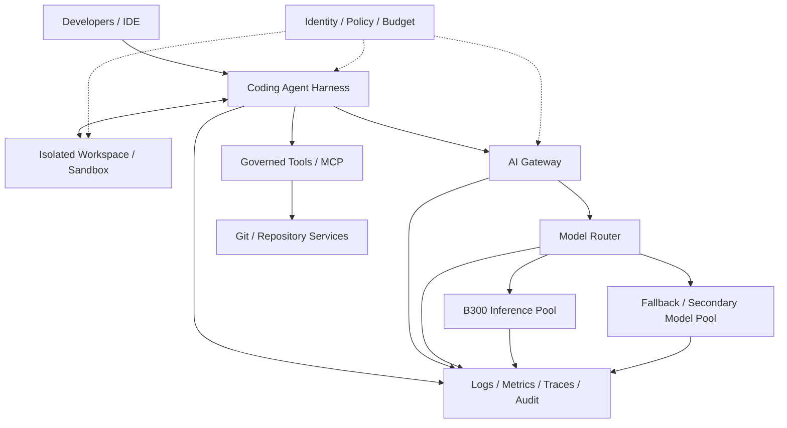
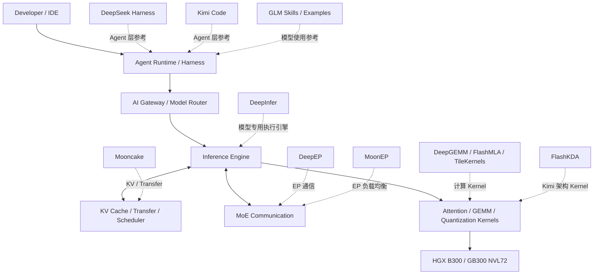
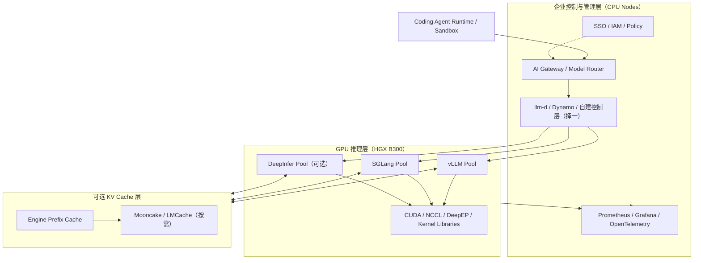

# 企业级 GPU AI Coding 平台：从 B300 集群部署到推理与 Agent 工程

本文讨论的不是在一台工作站上运行一个开源模型，而是建设一套企业内部 AI Coding 服务：模型部署在企业自有或租用的 NVIDIA GPU 集群上，向约 1000 名开发者提供统一的模型 API 和 Coding Agent 能力，并具备生产环境所需的容量、隔离、安全、监控、成本核算和故障恢复能力。

这里有两个不同但必须协同设计的系统：**GPU 推理平台**负责把 GPU 资源转换成稳定的模型服务；**Coding Agent 平台**负责管理开发者会话、代码仓库上下文、工具调用、代码执行和任务验证。把两者混成一个应用，会让资源调度、安全责任和故障边界变得模糊。

本文以 NVIDIA B300 / HGX B300 为主要讨论对象，同时解释 GB300 NVL72 的定位。硬件和软件能力以 2026 年 10 月 30 日能够查到的公开资料为准。厂商规格表示产品能力，不等于特定模型、特定量化和特定 Agent Harness 下的实测性能；容量和成本结论必须通过目标 workload 的 POC 验证。

## 1. 先明确部署对象：GPU、服务器节点和机架不是一回事

讨论采购时，最容易出现的错误是把 GPU 芯片、8-GPU 服务器和 rack-scale 系统都按“多少张卡”比较。它们的互联范围、网络拓扑、供电、散热、管理和租赁单位完全不同。

| 层次 | 典型产品 | 物理含义 | 主要架构问题 |
| --- | --- | --- | --- |
| GPU | NVIDIA B300 / B200 | 单颗 GPU 加速器 | 显存容量、HBM 带宽、计算精度、功耗 |
| GPU 服务器平台 | HGX B300 | 8 张 SXM GPU、NVLink/NVSwitch 和主机平台 | 单节点 GPU 通信、CPU/PCIe 拓扑、节点功耗 |
| 机架级系统 | GB300 NVL72 | 72 张 Blackwell Ultra GPU、36 颗 Grace CPU 和 NVLink Switch | 72-GPU scale-up 域、液冷、机架供电和集群网络 |
| 多机架集群 | 多个 HGX 节点或多个 NVL72 | 多个节点/机架通过外部网络互联 | RDMA Fabric、拓扑感知调度、故障域和扩展成本 |

### 1.1 HGX B300：适合从 8-GPU 节点构建集群

NVIDIA 的 HGX B300 参考架构包含 8 张 Blackwell Ultra GPU。官方参考架构列出的关键规格包括：

| 指标 | HGX B300 |
| --- | --- |
| GPU 数量 | 8 |
| 单 GPU HBM3e | 288 GB |
| 单节点 GPU 显存合计 | 约 2.30 TB |
| 单 GPU HBM 带宽 | 最高 8 TB/s |
| GPU 互联 | 第五代 NVLink + NVSwitch |
| GPU-to-GPU 带宽 | 最高 1.8 TB/s（双向口径，需按厂商定义理解） |
| 节点 NVLink 聚合带宽 | 14.4 TB/s |
| Scale-out 网络 | 8 个 ConnectX-8 SuperNIC，最高 800 Gb/s/adapter（具体系统实现以 OEM BOM 为准） |

这里的 1.8 TB/s 是 GPU 间链路带宽口径，不应与节点聚合带宽 14.4 TB/s 混用，也不应直接与外部以太网/InfiniBand 的端口速率比较。

HGX B300 的 8 张 GPU 构成高速 scale-up 域。若部署 4 台 HGX B300，虽然总共有 32 张 GPU，但并不意味着 32 张 GPU 自动成为一个 NVLink 域。跨节点的 GPU 通信要经过外部计算网络，性能取决于 NIC、交换机、布线、RDMA 配置和应用并行策略。

### 1.2 GB300 NVL72：机架级 scale-up 系统

GB300 NVL72 将 72 张 Blackwell Ultra GPU 和 36 颗 Grace CPU 集成在一个液冷机架系统中。NVIDIA 的参考架构描述了 18 个计算托盘，每个托盘包含 4 张 GPU；机架内通过 NVLink Switch 形成一个 72-GPU NVLink 域，官方资料列出的 NVLink 聚合带宽为 130 TB/s。该参考设计的机架功耗最高约 142 kW。

这类系统的价值在于：对需要大量 GPU 间通信的超大模型或 MoE Expert Parallelism，可以把更多通信留在机架内的 NVLink 域中。但这并不自动意味着它对所有推理任务都比多个 HGX B300 节点便宜或更快。若模型能在单台 8-GPU 节点内运行，额外的机架级互联能力可能没有被充分利用。

GB300 NVL72 也不是“72 张 GPU 的普通服务器”。它需要匹配的液冷设施、机架供电、CDU、液冷管路、泄漏检测、机房承重与运维流程。数据中心是否具备这些条件，可能比 GPU 软件部署本身更早成为项目约束。

### 1.3 B300、B200、GB300 怎么选

| 方案 | 适用场景 | 主要优势 | 主要代价/限制 |
| --- | --- | --- | --- |
| HGX B200 | 成本敏感、模型能够适配 8-GPU 节点 | Blackwell 软件生态、显存容量相对 B300 较小 | 单 GPU 显存少于 B300，复杂模型更容易受显存约束 |
| HGX B300 | 大模型推理、长上下文、较高 KV Cache 容量需求 | 288 GB HBM3e/GPU，8-GPU 节点内高速互联 | 节点价格、供电和散热成本较高 |
| GB300 NVL72 | 大型 MoE、跨多 GPU 的高通信推理、超大模型 | 72-GPU NVLink 域，机架级集成 | 高密度液冷和供电要求，采购与部署复杂度高 |
| H200 | 作为上一代成本/可用性基准 | 供应商选择可能较多，适合做价格基线 | 显存和互联能力较新一代平台弱 |

**建议不要从“1000 个开发者”直接推导出“需要多少张 B300”。** 先确定模型和请求形态，再比较 HGX B300 节点集群与 GB300 NVL72。对企业 Coding Agent，常见的合理起点是先租用或采购一个 8-GPU 节点做 POC，验证目标模型、量化、上下文长度和 Agent 工作流，再决定扩展方式。

## 2. GPU 基础设施工程：硬件清单之外还要设计什么

GPU 节点交付不等于 GPU 平台可用。生产部署至少要同时设计计算、网络、存储、管理和设施五个平面。

### 2.1 计算节点

每台 GPU 节点需要明确：

- GPU 型号、数量、SXM 形态和显存规格；
- CPU 型号、物理核心数、NUMA 拓扑和内存通道；
- GPU 到 CPU 的 PCIe Root Complex 关系；
- GPU、NIC、DPU 和 NVMe 的 PCIe 拓扑；
- 本地 NVMe 容量、读写性能和故障更换方式；
- BMC、TPM 2.0、Secure Boot、固件版本；
- 电源冗余、风扇或液冷方案、保修和现场响应时间。

不能只接受供应商报价单中的“8×B300”。需要拿到完整 BOM、拓扑图、固件/驱动兼容矩阵、功耗范围、冷却要求和验收工具。尤其要核实 OEM 服务器的 NIC 数量、端口速率、DPU 配置、NVMe 盘位以及实际可持续功耗。

### 2.2 网络必须按用途分平面

GPU 集群至少有三类网络流量：

1. **GPU Compute Fabric（East-West）**：节点之间的 GPU 集合通信和模型并行流量，通常使用 InfiniBand 或经过严格设计的 RoCE。
2. **Storage / North-South Fabric**：模型权重加载、数据访问、日志和外部存储流量。
3. **Management / OOB Fabric**：BMC、交换机管理、节点 provisioning、运维访问和故障诊断。

不要让模型通信、开发者 API、存储访问和 BMC 管理全部挤在一张普通以太网里。网络隔离不仅是安全要求，也直接影响推理性能的可预测性。

对于 RoCE，需要具备以太网无损或拥塞管理方面的工程能力，包括 PFC、ECN、拥塞控制、交换机缓冲、队列和端到端验证。不能把“网卡支持 RoCE”理解成网络已经配置正确。对于 InfiniBand，需要理解 Subnet Manager、Fabric Health、端口状态、路由和链路故障诊断。

网络设计应明确：

- 每个 GPU 节点的有效上行带宽和 oversubscription；
- Leaf-Spine 拓扑、双平面或 rail-optimized 设计；
- RDMA 是否端到端启用，是否经过不支持的中间设备；
- NCCL 测试是否覆盖单节点、多节点和故障链路；
- 计算 Fabric 与存储 Fabric 是否隔离；
- 多租户场景下的带宽配额和网络策略。

### 2.3 存储与模型分发

模型权重通常是数百 GB 到 TB 级别。扩容或故障恢复时，如果所有节点同时从远端对象存储拉取权重，模型启动时间和存储出口可能成为瓶颈。

建议分层：

| 存储层 | 用途 | 设计重点 |
| --- | --- | --- |
| 本地 NVMe | 模型热缓存、临时文件、编译缓存 | 容量、吞吐、节点重建后的缓存策略 |
| 共享高性能文件系统 | 多节点模型加载、共享数据 | 并发读、元数据性能、故障域 |
| 对象存储 | 模型权重、数据集、日志归档、评估产物 | 生命周期、版本、校验和、访问权限 |
| 元数据数据库 | 模型版本、部署配置、评估记录 | 备份、事务一致性、审计 |

模型制品需要不可变版本、SHA-256 校验、来源记录、许可信息和安全扫描。生产服务不应直接依赖某个可变的 Hugging Face branch 或未经验证的下载地址。

### 2.4 机房设施和电力散热

B300 HGX 节点和 GB300 NVL72 的机房要求不同。尤其是 NVL72，液冷、供电和机架功率密度是项目级设计，不是服务器团队自行解决的小问题。

设施评估应覆盖：

- 单机柜 IT 负载、峰值功率和冗余供电；
- UPS、PDU、母线和配电余量；
- 液冷 CDU 容量、泵冗余、供回水温度和流量；
- 冷却液质量、过滤、泄漏检测和应急隔离；
- 地板承重、机柜尺寸、布线和维护空间；
- 机房消防、环境监控和运维授权；
- 断电、冷却故障和网络故障时的安全停机策略。

不要将 GPU TDP 简单相加作为机柜最终功耗，也不要只根据产品宣传的峰值算电力预算。应以 OEM 的系统功耗、机架设计和设施工程评估为准。

## 3. 分布式 GPU 软件栈

软件栈需要版本化管理。GPU Driver、CUDA、Container Toolkit、NCCL、OFED/网络驱动、GPU Operator、推理引擎和模型依赖之间存在兼容关系。生产环境不能依赖“升级到最新版应该就行”。

### 3.1 主机操作系统与驱动

需要掌握：

- Linux 发行版、Kernel、systemd、udev、NUMA；
- NVIDIA Data Center Driver 与 CUDA Runtime/Toolkit 的兼容关系；
- NVIDIA Container Toolkit 和 containerd；
- Fabric Manager（按 GPU 平台和部署方式决定）；
- OFED、RDMA Core、NIC 固件和交换机软件；
- 固件、BIOS、BMC、GPU 驱动的升级顺序和回滚方法。

要区分 CUDA Toolkit 与 CUDA Runtime，也要区分宿主机驱动和容器中的 CUDA 用户态库。容器不能替代宿主机驱动；驱动升级也不能被当成普通应用镜像升级。

### 3.2 Kubernetes 与 GPU Operator

Kubernetes 可以管理 GPU 工作负载，但默认调度器只知道资源请求和节点状态。它不会自动理解某个模型的 Tensor Parallel Group 是否必须落在同一个 NVLink 域，也不会天然知道跨节点通信拓扑的性能代价。

NVIDIA GPU Operator 将 GPU 节点的软件栈 Kubernetes 化。官方文档列出的典型组件包括 NVIDIA Driver、Container Toolkit、Device Plugin、DCGM Exporter 和 MIG Manager。实际启用哪些组件，应根据操作系统、驱动管理方式、集群策略和 GPU 型号决定。

需要掌握：

- Kubernetes Node Labels、Taints、Tolerations、Affinity；
- Device Plugin 与 GPU 资源声明；
- GPU Operator、ClusterPolicy、Helm；
- GPU 节点池和普通 CPU 节点池隔离；
- DaemonSet、Pod Security Admission、RBAC；
- GPU 拓扑感知调度和 gang scheduling；
- 节点 drain、升级、cordon、恢复和故障隔离；
- 多租户 GPU 配额与资源公平性。

对模型推理，建议将 API Gateway、Model Router、Agent Runtime、数据库、队列和监控组件部署在 CPU 节点；GPU 节点主要运行推理引擎及必要的 GPU 管理组件。不要把所有业务服务都塞进昂贵的 GPU 节点。

MIG、GPU sharing、time-slicing 和 DRA 不能混为一谈。它们的硬件支持范围、隔离强度和调度语义不同。是否可用于 B300、是否满足目标模型和安全要求，必须以对应版本的官方支持矩阵与实际测试为准。不要因为 Kubernetes 能声明共享 GPU，就把它当成硬件级安全隔离。

### 3.3 NCCL 与分布式通信

NCCL 是多 GPU 集合通信的重要基础。需要理解：

- AllReduce、AllGather、ReduceScatter、Broadcast；
- Ring、Tree、NVLS 等通信算法概念；
- 单节点 NVLink/NVSwitch 与跨节点 RDMA 的区别；
- NCCL Topology Detection；
- NCCL Tests、带宽与延迟测试；
- 环境变量、接口选择、日志和故障诊断；
- GPU Direct RDMA、GPUDirect Storage 的适用条件。

验收不能只运行一次 nvidia-smi。至少要分别测试：

1. 单 GPU CUDA 基础计算；
2. 单节点 8 GPU P2P 和 NCCL；
3. 跨节点 NCCL；
4. GPU 与 NIC 的拓扑亲和性；
5. 节点重启、NIC 故障、交换机端口故障后的恢复。

## 4. 大模型推理工程：从模型文件到稳定 API

对于 AI Coding 平台，推理工程是最直接影响体验和成本的部分。要理解模型结构、精度、并行策略、KV Cache、请求调度和服务指标。

### 4.1 Transformer、Dense 与 MoE

不要求平台工程师训练 Transformer，但需要理解模型推理时发生了什么：

- Attention、MHA、GQA、MLA 等注意力结构；
- Dense 模型与 Mixture of Experts（MoE）；
- Tokenizer、Embedding、模型权重和模型配置；
- Prefill 与 Decode；
- KV Cache；
- Tensor Parallelism、Pipeline Parallelism、Data Parallelism；
- MoE Expert Parallelism 和 Router。

MoE 的总参数量不等于每个 Token 实际参与计算的参数量。但 Expert Routing 会产生 GPU 间 Token Dispatch / Combine 通信，因此模型的激活参数量小，并不代表它可以在少量 GPU 上高效运行。模型结构、Expert 数量、路由策略和通信拓扑都要纳入部署设计。

### 4.2 FP16、BF16、FP8、FP4 与量化

精度选择直接影响模型权重占用、吞吐和生成质量。

| 精度/格式 | 典型用途 | 主要考虑 |
| --- | --- | --- |
| BF16 / FP16 | 精度基线、兼容性对照 | 显存占用较大，适合做质量基线 |
| FP8 | 高性能推理 | 需要检查模型权重和推理引擎支持 |
| FP4 / NVFP4 | Blackwell 平台上的高压缩推理 | 需要评估量化误差、算子支持和模型质量 |
| INT8 / INT4 等 | 特定模型和推理路径 | 不同量化方案的精度和内核支持差异较大 |

不能只根据权重大小计算可部署性。显存还要容纳 KV Cache、CUDA Graph、激活、通信 Buffer、临时 Workspace 和运行时开销。也不能把 FP4 的理论算力直接当成生产吞吐：真实性能取决于模型结构、内核、批处理、上下文长度和通信。

量化验收至少应包含：代码生成正确性、工具调用 JSON/Schema 合法率、函数参数准确率、长上下文检索、代码修改回归率和任务成功率。对 Coding Agent 来说，模型输出格式和工具调用稳定性可能比一般问答的语言流畅度更重要。

### 4.3 并行策略

| 并行方式 | 作用 | 适用场景 | 代价 |
| --- | --- | --- | --- |
| Tensor Parallelism（TP） | 将单层矩阵计算拆到多 GPU | 单模型权重或计算无法高效放入单 GPU | 每层产生通信，依赖高速互联 |
| Pipeline Parallelism（PP） | 将模型层拆分到不同 GPU | 模型深度较大、需要跨节点扩展 | Pipeline Bubble、调度和跨阶段传输 |
| Data Parallelism（DP） | 复制模型副本处理更多请求 | 单个模型副本已能放入资源域，需要提高吞吐 | 增加模型副本和权重显存 |
| Expert Parallelism（EP） | 将 MoE Experts 分布在多 GPU | MoE 模型 | Token Dispatch / Combine 的通信成本 |
| Context / Sequence Parallelism | 将长序列计算拆分 | 超长上下文和特定模型结构 | 实现复杂，依赖引擎支持 |

一个实用的起点是：优先让单个模型副本使用同一台 HGX 节点内的高速 NVLink；只有模型大小、吞吐或 MoE 分布需求确实要求跨节点时，再引入跨节点并行。这个原则不是绝对规则，最终要以模型框架支持和性能测试为准。

### 4.4 KV Cache 决定长上下文并发能力

Coding Agent 的上下文不只是用户问题，还可能包含系统提示、工具定义、仓库文件、代码片段、终端输出、历史对话和工具结果。长上下文会显著占用 KV Cache。

需要掌握：

- KV Cache 的显存估算；
- PagedAttention 或同类分页管理机制；
- Prefix Caching / Automatic Prefix Caching；
- KV Cache 命中率、复用边界和缓存隔离；
- Cache Eviction、Block 管理和显存碎片；
- Chunked Prefill；
- Context Truncation / Compaction；
- 长上下文下的 TTFT、TPOT 和并发退化。

Prefix Cache 的命中并非只由“前缀文本相同”决定，还受到 Tokenization、模型版本、LoRA、缓存配置和安全隔离边界影响。不同租户的缓存能否共享，必须做威胁建模和框架验证，不能为了命中率跨越数据隔离边界。

### 4.5 Prefill / Decode 与请求调度

Prefill 处理输入 Token，决定模型读取长上下文的计算量，通常显著影响 Time To First Token（TTFT）。Decode 逐 Token 生成输出，常受到显存带宽、KV Cache 访问和批处理调度影响，影响 Time Per Output Token（TPOT 或 ITL）。

推理引擎需要处理：

- Continuous Batching；
- Dynamic / In-flight Batching；
- Chunked Prefill；
- Prefix Cache；
- Request Queue；
- 最大并发和最大序列长度；
- 长短请求的公平调度；
- 交互请求与后台任务的优先级；
- 超时、取消、客户端断连和请求重试。

Prefill/Decode Disaggregation 可以将两阶段放到不同 GPU 池，减少阶段间干扰，但需要传输 KV Cache，并增加网络、调度和运维复杂度。它不是默认必须部署的组件。只有测量发现两阶段资源需求明显冲突，并且跨池 KV 传输成本可接受时，才值得引入。

## 5. 推理框架和服务层

不要先选框架再寻找模型。先列出模型、精度、并行策略、API、上下文长度和目标 SLO，再通过兼容性矩阵选择推理框架。

| 框架 | 主要定位 | 评估重点 |
| --- | --- | --- |
| vLLM | 通用 LLM serving，OpenAI-compatible API 和批处理能力 | 目标模型、Blackwell Kernel、FP8/FP4、MoE、KV Cache 和多节点支持 |
| SGLang | 高性能结构化生成与 LLM serving | 目标模型实现、Radix/Prefix Cache、调度、MoE 和工具调用 |
| TensorRT-LLM | NVIDIA 推理优化技术栈 | Blackwell 支持矩阵、构建流程、量化、MoE、部署复杂度和升级成本 |

截至本文日期，NVIDIA GPU Operator 官方文档显示当前 patch release 为 v26.7.2；但这不代表所有 B300 OEM 服务器、操作系统、驱动和推理框架组合都已经过生产验证。vLLM、SGLang 和 TensorRT-LLM 的能力应按具体 release、模型实现和部署配置逐项确认。

建议采用一个主推理引擎和一个候选引擎，不要一开始同时运营三套生产系统。可以让 vLLM 作为首个基线，再用同样模型和请求 Trace 对比 SGLang；若 NVIDIA 优化路径带来明确收益，再评估 TensorRT-LLM。不同框架之间的性能数字只有在模型、精度、上下文、并发、硬件和 SLO 相同的情况下才有比较价值。

### 5.1 推理服务 API

统一 API 层至少要处理：

- OpenAI-compatible Chat Completions 或 Responses API（按 Coding Agent 实际协议选择）；
- Streaming / SSE；
- Tool Calling / Function Calling；
- JSON Schema / Structured Output；
- Cancellation；
- Model ID 和模型版本；
- Usage / Token Accounting；
- Request ID、Trace ID 和租户标识；
- 超时、限流、重试和错误语义。

“兼容 OpenAI API”不是充分条件。不同 Coding Agent 对 tool_calls、并行工具调用、流式事件、usage 统计、finish_reason、上下文窗口和特定 API 扩展的依赖可能不同。需要针对 Claude Code、OpenCode、Copilot SDK 或企业实际使用的 Agent Harness 建立协议兼容测试集。

### 5.2 Model Router

Router 不应只是随机选择一台推理服务器。它需要理解模型能力、租户策略和资源状态。

路由决策可以考虑：

- 任务类型：代码补全、解释、重构、跨文件修改、测试修复；
- 模型能力和质量评估；
- 上下文长度和模型窗口；
- 用户、团队和项目配额；
- GPU Pool 负载、队列长度和缓存命中；
- SLO、请求优先级和任务截止时间；
- 模型故障、容量不足和降级策略。

建议把模型路由策略作为版本化配置管理，并支持 shadow traffic、canary、A/B test 和快速回滚。不要让模型自己决定可以绕过的预算、权限或安全策略。

## 6. Coding Agent 平台：不要把 Agent 当成普通聊天请求

1000 名开发者的 AI Coding 平台，真正消耗资源的单位不是“用户登录数”，而是活跃 Agent Session 和任务执行轨迹。

一次 Agent 任务可能包含多轮模型调用、文件读取、代码搜索、工具执行、测试、错误分析和重试。模型输出 Token 量只是成本的一部分，Agent 工具运行和上下文构造也会产生 CPU、内存、存储和网络开销。

### 6.1 Agent Runtime 的职责

Agent Runtime 应负责：

- Session 和 Task 生命周期；
- Prompt、上下文和模型调用编排；
- Tool Calling 和结果回传；
- 文件、终端、测试、Git 等工具执行；
- 超时、取消、重试和检查点；
- 人工确认和权限升级；
- 任务状态、日志和审计；
- 任务结果验证和交付。

Agent Runtime 不应该直接管理 GPU 驱动、NCCL 或模型进程。它通过 AI Gateway 调用推理服务，避免把模型服务和业务 Agent 的发布周期绑定。

### 6.2 Agent Sandbox 与凭证隔离

Coding Agent 可以读写代码、运行 shell、安装依赖、访问网络和调用 MCP 工具，因此它的风险远高于只读聊天机器人。

最低安全要求：

- 每个用户或任务有独立 Workspace / Sandbox；
- 非 root 用户、只读根文件系统和资源限制；
- 默认禁止任意网络出口，按需开放域名或服务；
- 短期、最小权限的身份凭证；
- 不把长期 API Key、云凭证和生产 Secret 暴露给模型上下文；
- MCP Server 的凭证由受控服务端注入；
- 文件系统、进程、网络和容器之间隔离；
- 工具调用进行授权检查和审计；
- 对敏感动作实施人工确认；
- 任务结束后销毁或按策略保留 Workspace。

2026 年 10 月 21 日，NVIDIA 发布了 OpenShell Reference Architecture 相关技术文章，描述 Gateway、Supervisor、Sandbox 和 Policy Prover 等边界，并讨论 BlueField-4 / NVIDIA Sentry 等硬件辅助治理方向。这是值得评估的新参考架构，但不能仅凭厂商参考设计就认定其已经适合所有企业生产环境。应通过威胁建模、隔离测试、逃逸测试和运维验证评估。

### 6.3 Agent 与 GPU 服务的边界

这张图是逻辑架构，不代表每个方框都必须部署成独立微服务。初期可以将 Router 和 Gateway 合并为一个可独立扩展的服务，但 Agent Runtime、GPU 推理进程和不可信代码执行环境应保持明确的安全边界。

## 7. 1000 名开发者的容量规划

“1000 个账号”不是容量指标。至少要区分：

- Registered Developers：注册开发者数量；
- Daily Active Developers：日活开发者；
- Concurrent Agent Sessions：同时运行的 Agent Session；
- Concurrent Model Requests：同时在途的模型请求；
- Request Arrival Rate：请求到达速率；
- Input / Output Token Distribution：输入和输出 Token 分布；
- Context Length Distribution：上下文长度分布；
- Task Duration：Agent 任务持续时间；
- Retry / Tool Call Distribution：重试和工具调用分布。

一个开发者可能只偶尔问一个问题，也可能同时运行多个 Agent。一个 Agent Session 也不等于一个模型请求：工具调用结束后可能发起下一轮请求。因此不能用“1000 人 ÷ 每张卡能服务多少用户”这种方式计算 GPU 数量。

### 7.1 先建立负载模型

建议从现有 Coding Agent 日志或试点用户采样，得到以下分布：

| 维度 | 需要采集的内容 |
| --- | --- |
| 用户行为 | 日活、活跃时段、每人每天任务数 |
| Agent 并发 | 每用户并发 Session、Session 持续时间 |
| 模型请求 | 每个任务模型调用次数、请求到达间隔、重试次数 |
| 输入长度 | System Prompt、工具定义、仓库上下文、历史消息的 Token 分布 |
| 输出长度 | 普通回复、代码生成、工具参数和总结的 Token 分布 |
| 上下文增长 | Session 生命周期内 Context Length 的变化 |
| 模型分布 | 不同模型、量化和任务路由比例 |
| 服务质量 | 可接受 TTFT、TPOT、端到端延迟和失败率 |

在没有真实数据时，可以设置低、中、高三种情景做预算，但这些数字只能作为压测输入，不应被写成 B300 的确定服务能力。

### 7.2 容量计算的基本方法

对单个模型部署副本，先测出在目标 SLO 下的有效吞吐 Goodput，而不是峰值吞吐。设：

- D：目标输入/输出 Token 需求率；
- G：单个副本在满足 SLO 时的实测有效吞吐；
- R：故障、突发和升级预留比例。

可以先用下面的公式估算副本数量：

[
N = leftlceil rac{D}{G} 	imes (1 + R) 
ight
ceil
]

但这里的 D 和 G 必须按输入/输出阶段、模型、上下文长度和负载分布拆分。不同模型、不同精度、不同并行策略的吞吐不能直接相加。若有多个模型池，应分别计算后再汇总。

此外，容量必须同时满足显存约束：

[
M_{weights} + M_{KV} + M_{runtime} + M_{workspace} + M_{reserve}
leq M_{available}
]

模型权重能装进 GPU，不代表能够满足目标并发。长上下文和高并发通常首先消耗 KV Cache。要通过真实引擎测量，而不是只按参数量乘以每参数字节数来估算。

### 7.3 Benchmark 应测什么

| 指标 | 含义 | 主要用于判断 |
| --- | --- | --- |
| TTFT p50/p95/p99 | 首 Token 延迟 | 输入处理、队列和 Prefill |
| TPOT / ITL p50/p95/p99 | 输出 Token 间隔 | Decode 体验 |
| End-to-End Latency | 完整请求耗时 | 用户整体等待时间 |
| Input / Output Tokens/s | 输入、输出吞吐 | 资源产出 |
| Goodput | 满足延迟、错误率和质量门槛的有效吞吐 | 真正可承诺的服务能力 |
| Queue Time | 排队时间 | 调度和容量不足 |
| KV Cache Usage / Hit Rate | KV Cache 占用和复用 | 长上下文并发与缓存收益 |
| GPU Utilization / HBM | GPU 使用率和显存 | 瓶颈定位，不是最终成功指标 |
| OOM / Retry / Cancellation | 失败和重试 | 稳定性与浪费 |
| Cost per Successful Task | 每个成功代码任务成本 | 企业 FinOps |

对 Coding Agent 还要增加业务指标：

- Task Success Rate；
- Human Intervention Rate；
- Tests Passed / Regression Rate；
- Tool Call Success Rate；
- Invalid Tool Arguments；
- Tokens per Successful Task；
- Time to Complete a Task；
- Cost per Successful Task。

高 Token Throughput 不等于高业务产出。如果模型生成得更快，但代码任务失败率更高，实际单位成功任务成本可能更差。

### 7.4 推荐的 POC 压测矩阵

| 维度 | 建议测试档位 |
| --- | --- |
| GPU 配置 | 单 GPU、单节点 8 GPU；之后再测多节点 |
| 并发 Agent Session | 50、100、200、300，按实际业务修订 |
| 上下文长度 | 8K、32K、64K、128K；必要时增加更长档位 |
| 输入/输出分布 | 使用生产采样 Trace，不用统一固定长度代替 |
| 模型精度 | BF16/FP8 基线，候选 FP4/NVFP4 |
| 请求模式 | 突发、稳定到达、长短请求混合、后台批量任务 |
| 缓存 | 冷启动、Prefix Cache 命中、缓存失效 |
| 故障 | 单副本退出、GPU OOM、节点重启、网络中断、模型加载失败 |
| 发布 | 滚动升级、双版本并存、回滚和缓存冷启动 |

50/100/200/300 是测试梯度，不是 B300 对应的用户承载承诺。必须用同一个 Agent Harness、相同工具、相同仓库和相同任务集比较不同 GPU 与推理引擎。

## 8. 可观测性：GPU 指标、推理指标和 Agent Trace 必须关联

只监控 GPU Utilization 无法解释开发者为什么觉得慢。只看 API 延迟也无法定位是队列、Prefill、Decode、网络还是工具执行导致的。

建议建立三层可观测性：

| 层次 | 指标/日志 | 典型问题 |
| --- | --- | --- |
| Infrastructure | GPU 温度、功耗、HBM、XID、ECC、NVLink、PCIe、NIC、RDMA、磁盘、节点健康 | GPU 降频、链路异常、硬件故障 |
| Inference | Queue Time、TTFT、TPOT、Tokens/s、Batch Size、KV Cache、OOM、请求错误 | 模型服务过载、缓存不足、调度不公平 |
| Agent | Session、Task、模型调用、Tool Call、Workspace、测试结果、人工介入、任务成本 | Agent 循环、工具失败、上下文膨胀、任务未完成 |

推荐的基础组件：

- NVIDIA DCGM / DCGM Exporter：GPU 指标；
- Prometheus：时序指标；
- Grafana：仪表盘；
- OpenTelemetry：Trace、Metric、Log 的统一关联；
- Loki 或 Elasticsearch：日志；
- ClickHouse 或其他分析型存储：大规模调用与成本分析（按数据量和现有平台决定）。

每个 Agent Task 应有稳定的 Trace ID；每一次模型请求、工具调用和测试执行都应成为可关联的 Span。日志中记录模型版本、量化、推理节点、Token 用量、队列等待、延迟、错误类型和成本。Prompt 与代码内容是否落日志，需要根据数据分类、隐私和保留政策单独决定，默认应避免记录敏感源代码和 Secret 明文。

## 9. 安全与治理：模型 API 不是唯一的攻击面

企业 AI Coding 服务至少涉及四类安全边界：

1. 开发者身份和企业授权；
2. 模型请求、上下文和数据保护；
3. Agent 工具、MCP 和代码执行；
4. GPU 集群、模型制品和基础设施管理。

### 9.1 身份与访问控制

- 接入企业 SSO / OIDC；
- 用户、团队、项目和环境级授权；
- Model Allowlist 和模型能力策略；
- API Key 短期化、可撤销和最小权限；
- 组织、团队、用户和 Session 多层预算；
- 管理员操作、模型发布和策略变更审计。

### 9.2 数据保护

- 代码仓库、Prompt、模型输入输出按数据分类管理；
- 明确数据是否离开企业网络、是否进入第三方模型或遥测服务；
- 明确日志内容、采样、保留期和访问权限；
- 对 Secret、Token、证书和个人数据做检测与脱敏；
- 模型权重、Tokenizer、依赖和容器镜像做来源校验；
- 模型服务与 Agent Workspace 的网络隔离；
- 对跨租户缓存和共享文件系统进行威胁建模。

### 9.3 Agent 工具安全

Agent 的权限必须由平台策略强制执行，不能依赖 System Prompt 要求模型“不要做危险的事”。

对 shell、文件、Git、数据库、云 API 和 MCP 工具，应定义明确的权限边界。对生产环境写操作、删除、发布、凭证读取和外部通信，使用独立授权或人工确认。Sandbox 应默认拒绝未授权网络出口，凭证通过受控 Broker 按请求注入，而不是放进环境变量或模型上下文。

## 10. 生产运维与可靠性设计

GPU 平台的故障不仅是 Pod Crash。还包括 GPU XID、ECC 错误、NVLink 退化、NIC/RDMA 问题、交换机拥塞、驱动不兼容、模型加载失败、KV Cache OOM 和推理引擎死锁。

至少要建立以下 Runbook：

| 事件 | 检测信号 | 处理原则 |
| --- | --- | --- |
| GPU 健康异常 | DCGM Health、XID、ECC、温度/功耗异常 | 隔离节点或 GPU，采集诊断信息，按 OEM 流程维修 |
| NVLink / NCCL 故障 | P2P 测试失败、NCCL timeout、链路错误 | 检查拓扑、交换机/固件/驱动，避免盲目重启整个集群 |
| GPU OOM | 推理引擎 OOM、KV Cache 分配失败 | 限制上下文/并发，检查缓存和批处理配置，必要时扩容 |
| 模型加载失败 | 权重校验、启动超时、内存不足 | 检查制品、磁盘、版本兼容和加载并发 |
| 请求积压 | Queue Time、TTFT 持续升高 | 限流、优先级调度、切换备用池或降低后台负载 |
| 节点维护 | Node NotReady、驱动升级 | Drain、迁移流量、验证备用容量，再进行维护 |
| 网络故障 | RDMA 错误、丢包、拥塞、吞吐下降 | 检查 NIC、交换机、光模块、PFC/ECN 和路由 |
| 区域/机房故障 | 多节点不可用 | 按灾备设计切换到备用区域/服务商或外部模型 |

生产发布需要版本锁定和分阶段升级：

1. 先在隔离测试节点验证 Driver、CUDA、NCCL、GPU Operator 和推理引擎；
2. 使用固定评估集验证模型质量和工具调用；
3. 对少量流量 Canary；
4. 观察延迟、错误率、GPU 健康和 Agent 成功率；
5. 达到门槛后逐步扩流；
6. 保留可回滚的镜像、模型制品和配置版本。

不要在高峰时段同时升级 GPU Driver、Kubernetes、推理引擎和模型。每次变更应尽量控制变量。

## 11. 成本模型与供应商采购

GPU 租赁成本只是平台总成本的一部分。至少要把成本拆成：

[
TCO = GPU + Network + Storage + Facility + Software + People + Support + FailureReserve
]

其中 GPU 成本不能只用标价乘以卡数。应比较在目标 SLO 下的有效吞吐，以及每个成功代码任务的全成本。

[
CostPerSuccessfulTask =
rac{GPU + Infrastructure + Platform + Operations + FailedAttempts}
{SuccessfulTasks}
]

采购询价应要求供应商回答：

- 报价是按 GPU、8-GPU 节点还是完整 NVL72 机架；
- 是否承诺整组节点同时可用；
- GPU 是否属于同一 NVLink 域；
- NIC、交换机、RDMA 和 oversubscription 配置；
- 节点间网络是否独占，是否有带宽保障；
- 是否包含存储、模型缓存和流量费用；
- 是否提供 DCGM、NCCL、硬件健康和故障数据；
- SLA、故障更换时限和维护窗口；
- 预留容量、扩容提前期、缩容条款；
- 数据驻留、日志、远程运维和人员访问方式；
- 价格是否包含软件、支持、税费和跨区域流量。

长期合同前先做短期 POC。需要对比按需、预留、容量块和长期承诺的 break-even utilization。未测出真实工作负载下的 Goodput，不应把公开的每 GPU 小时价格直接转换成年度预算结论。

## 12. 工程团队需要哪些能力

不要求所有人都成为 CUDA Kernel Engineer。企业建设团队需要覆盖基础设施、分布式系统、推理服务、Agent 应用、安全和 SRE。

| 角色 | 主要责任 | 必备知识 |
| --- | --- | --- |
| GPU / Infrastructure Engineer | 服务器、GPU、网络、存储、机房 | B300/HGX、Linux、PCIe、NVLink、RDMA、液冷 |
| Platform Engineer | Kubernetes、GPU Operator、自动化和调度 | Kubernetes、Helm、Terraform、Ansible、GitOps |
| ML Systems / Inference Engineer | 模型部署、并行、量化、性能优化 | CUDA 基础、NCCL、vLLM、SGLang、TensorRT-LLM |
| Backend / AI Platform Engineer | Gateway、Router、配额、会话和 API | Go/Java/Python/TypeScript、API、Redis、队列、数据库 |
| Agent Engineer | Coding Agent、工具、上下文和沙箱集成 | Agent Runtime、Tool Calling、MCP、代码执行 |
| SRE / Observability Engineer | 监控、告警、故障响应、容量和成本 | Prometheus、Grafana、OpenTelemetry、Incident Management |
| Security Engineer | 身份、策略、凭证、网络和审计 | IAM、OIDC、OPA、Sandbox、供应链安全、威胁建模 |

如果企业已经有成熟 Kubernetes、网络和 SRE 团队，新增 GPU 推理平台的初期核心团队可以从 3–5 名专职工程师开始，再由安全、网络和数据中心团队提供专业支持。这个人数只适用于模型推理平台的初期建设，不包括基础模型训练、数据集研发、模型微调和 7×24 大规模现场硬件运维。若没有现成基础设施能力，团队规模和交付周期都需要上调。

## 13. 建议的实施路线图

不要一次采购几十张 GPU 后才开始验证模型。按阶段交付，每阶段都有明确退出条件。

| 阶段 | 时间参考 | 工作内容 | 退出条件 |
| --- | --- | --- | --- |
| 0. Discovery | 1–2 周 | 采集开发者行为、模型候选、代码任务、数据分类、区域和预算约束 | Workload Profile、需求基线和采购约束确认 |
| 1. Single-node POC | 2–3 周 | 一台 8-GPU HGX B300 或租用等价节点；部署驱动、CUDA、推理引擎和目标模型 | 模型加载、单节点 NCCL、API、质量和初步性能通过 |
| 2. Agent Integration | 2–3 周 | 接入真实 Coding Agent、工具、代码仓库和 Sandbox | 端到端代码任务可运行，权限和审计有效 |
| 3. Multi-node Scale | 2–4 周 | 增加节点、配置 RDMA Fabric、调度和缓存 | 跨节点通信、扩容、故障隔离和负载测试通过 |
| 4. Production Hardening | 2–4 周 | HA、SLO、监控、告警、容量、发布和灾备 | SLO、故障演练、安全测试和运维 Runbook 通过 |
| 5. Rollout | 分批 | 先试点团队，再逐步开放更多开发者 | 业务指标、成本和用户反馈达到门槛 |

时间只是典型项目拆分，不是交付承诺。机房液冷改造、网络采购、GPU 供应和安全审批可能成为关键路径，且往往不在软件团队控制范围内。

## 14. 验收标准：用可交付结果判断平台是否完成

| 验收域 | 验收内容 |
| --- | --- |
| Hardware | GPU、HBM、NVLink、NIC、NVMe、BMC、功耗和温度状态可验证 |
| Fabric | 单节点和跨节点 NCCL 测试达到设计目标，网络故障可定位 |
| Kubernetes | GPU 节点可注册、调度、隔离、维护和恢复 |
| Model Serving | 模型可重复部署，API/Streaming/Tool Calling 兼容性测试通过 |
| Performance | 在目标上下文和并发下达到约定 TTFT、TPOT、Goodput |
| Quality | 固定 Coding Benchmark 和内部任务集达到最低质量门槛 |
| Agent | 任务执行、工具调用、Sandbox、人工确认和结果验证可审计 |
| Security | 越权、网络逃逸、凭证暴露、跨租户访问测试通过 |
| Reliability | 节点故障、GPU 故障、网络故障、模型升级和回滚演练通过 |
| FinOps | GPU、模型、用户、团队和成功任务成本可归因 |

建议把性能验收写成负载合同：模型版本、量化格式、输入输出长度分布、并发、到达率、缓存条件、SLO 和质量门槛都必须固定。否则供应商或团队之间的 benchmark 数字没有可比性。

## 15. 学习与工程准备清单

### GPU 与数据中心

- NVIDIA Blackwell / Blackwell Ultra 架构；
- HGX B300、GB300 NVL72 参考架构；
- HBM、NVLink、NVSwitch、PCIe、NUMA；
- InfiniBand、RoCE、RDMA、ConnectX、BlueField；
- BMC、固件、机架供电、液冷和 CDU。

### 集群平台

- Linux、NVIDIA Driver、CUDA；
- NVIDIA Container Toolkit、containerd；
- Kubernetes、GPU Operator、Device Plugin；
- NCCL、NCCL Tests、GPU Direct RDMA；
- Helm、Terraform、Ansible、GitOps；
- 节点池、拓扑感知调度、gang scheduling 和故障隔离。

### 推理系统

- Transformer、MoE、Attention、Tokenizer；
- FP8、FP4/NVFP4 和量化质量评估；
- TP、PP、DP、EP；
- KV Cache、PagedAttention、Prefix Cache；
- Prefill、Decode、Continuous Batching；
- vLLM、SGLang、TensorRT-LLM；
- TTFT、TPOT、Goodput、长上下文压测。

### AI Coding 平台

- OpenAI-compatible API、Streaming、Tool Calling；
- Agent Runtime、Session、Task Lifecycle；
- MCP、工具授权、结果回传；
- Repository Context、代码检索和上下文压缩；
- Sandbox、Workspace、网络出口治理；
- Model Router、Token Budget、租户配额；
- Agent Evaluation、回归测试和 Human-in-the-loop。

### 生产运维与安全

- Prometheus、Grafana、DCGM Exporter；
- OpenTelemetry、Trace、Log、Metrics；
- SLO、SLA、Error Budget、Incident Response；
- IAM、OIDC、OPA、Secret Broker；
- 镜像签名、SBOM、模型制品校验；
- 数据分类、日志保留、审计和 FinOps。

## 16. 推荐的官方资料与工程入口

以下资料优先作为团队的学习和设计依据。阅读时应固定文档版本，尤其是 GPU Operator、CUDA、vLLM、SGLang 和 TensorRT-LLM；不要把 latest 文档中的能力直接视为当前生产环境已验证能力。

### NVIDIA 硬件与数据中心

- [NVIDIA HGX AI Factory — Components](https://docs.nvidia.com/enterprise-reference-architectures/hgx-ai-factory/latest/components.html)：HGX B300 节点规格、组件和系统要求。
- [NVIDIA NVL72 AI Factory — Overview](https://docs.nvidia.com/enterprise-reference-architectures/nvl72-ai-factory/latest/overview.html)：GB300 NVL72 机架级参考架构。
- [NVIDIA NVL72 AI Factory — System Hardware & Components](https://docs.nvidia.com/enterprise-reference-architectures/nvl72-ai-factory/latest/components.html)：计算托盘、NVLink Switch、网络和功耗。
- [NVIDIA NVL72 AI Factory — Networking Physical Topologies](https://docs.nvidia.com/enterprise-reference-architectures/nvl72-ai-factory/latest/networking-physical-topologies.html)：计算 Fabric 与 North-South 网络拓扑。
- [NVIDIA GPU Operator](https://docs.nvidia.com/datacenter/cloud-native/gpu-operator/latest/)：Kubernetes GPU 软件栈。
- [NVIDIA NCCL Documentation](https://docs.nvidia.com/deeplearning/nccl/user-guide/docs/)：多 GPU 通信。
- [NVIDIA DCGM](https://docs.nvidia.com/datacenter/dcgm/latest/)：GPU 健康和遥测。
- [NVIDIA DCGM Exporter](https://docs.nvidia.com/datacenter/cloud-native/gpu-telemetry/latest/dcgm-exporter.html)：Prometheus GPU 指标。

### 推理框架

- [vLLM Documentation](https://docs.vllm.ai/)：模型推理、并行、KV Cache 和 Serving。
- [SGLang Documentation](https://docs.sglang.ai/)：结构化生成和高性能 Serving。
- [TensorRT-LLM Documentation](https://nvidia.github.io/TensorRT-LLM/)：NVIDIA 推理优化框架。
- [NVIDIA TensorRT Documentation](https://docs.nvidia.com/deeplearning/tensorrt/latest/)：TensorRT 核心能力与支持矩阵。

### Agent 安全与平台工程

- [NVIDIA OpenShell](https://github.com/NVIDIA/OpenShell)：Agent Sandbox 和治理运行时。
- [NVIDIA Technical Blog: OpenShell Reference Architecture](https://developer.nvidia.com/blog/how-nvidia-openshell-reference-architecture-secures-and-governs-ai-agent-workloads-at-scale/)：2026 年 10 月发布的 Agent 治理参考架构。
- [Kubernetes Documentation](https://kubernetes.io/docs/home/)：容器编排与资源管理。
- [OpenTelemetry Documentation](https://opentelemetry.io/docs/)：分布式追踪、指标和日志。
- [OWASP Top 10 for LLM Applications](https://owasp.org/www-project-top-10-for-large-language-model-applications/)：LLM 应用安全风险参考。
- [NIST AI Risk Management Framework](https://www.nist.gov/itl/ai-risk-management-framework)：AI 风险治理框架。

---

## 17. DeepSeek、Kimi、GLM 的开源项目：哪些与企业 GPU 平台直接相关

本章关注 DeepSeek、Moonshot AI（Kimi）和 Z.ai / 智谱（GLM）公开的代码仓库，而不只是模型权重。它们的开源内容覆盖不同层次：完整或部分推理引擎、CUDA Kernel 和 MoE 通信库、KV Cache 基础设施、Coding Agent Runtime、模型训练和评测。

需要先区分三个概念：

- **模型开源 / Open Weights**：提供模型权重、配置、Tokenizer 和模型说明。它解决“运行哪个模型”，不等于提供生产 Serving 系统。
- **推理组件开源**：提供 Attention Kernel、GEMM、Expert Parallelism、KV Cache 或调度模块。它们解决推理系统的局部性能问题，通常需要集成到 vLLM、SGLang 等运行时。
- **生产服务系统开源**：提供模型执行引擎、请求调度、缓存、路由和故障处理等更完整的能力。即使如此，也要检查公开版本是否包含线上服务所需的全部组件。

### 17.1 DeepSeek：最值得关注的是推理内核、MoE 通信和 DeepInfer

DeepSeek 的开源仓库与 GPU 推理架构关系非常直接。其技术路线不是只发布模型，而是把支撑大规模 MoE 推理的底层能力逐步拆出来。

| 项目 | 所属层次 | 解决的问题 | 与 B300 / GB300 的关系 | 建议关注度 |
| --- | --- | --- | --- | --- |
| [DeepInfer](https://github.com/deepseek-ai/DeepInfer) | 推理执行引擎 | DeepSeek-V4.1-Flash 高性能离线推理，包含模型运行时、调度、并行、采样和结构化输出 | 直接涉及 SM100 GPU、Attention DP、Context Parallel、MoE EP/EPLB、推测解码 | **最高：重点 POC** |
| [DeepEP](https://github.com/deepseek-ai/DeepEP) | MoE 通信库 | Expert Parallelism 的 Token Dispatch / Combine、All-to-All 通信 | 依赖 NVLink 和跨节点 RDMA；与 HGX B300 多节点和 GB300 NVL72 互联拓扑直接相关 | **最高：重点研究** |
| [DeepGEMM](https://github.com/deepseek-ai/DeepGEMM) | GEMM / Tensor Core Kernel | FP8、FP4、BF16 矩阵计算及融合 MoE GEMM | 影响 Blackwell 上 MoE 专家矩阵计算效率 | **最高：持续跟踪** |
| [FlashMLA](https://github.com/deepseek-ai/FlashMLA) | Attention Kernel | Multi-head Latent Attention、稀疏 Attention、FP8/FP4 KV Cache 相关计算 | 对采用 MLA / DeepSeek Sparse Attention 的模型尤其重要；需核对 GPU 架构和 CUDA 版本 | **高：模型相关** |
| [TileKernels](https://github.com/deepseek-ai/TileKernels) | Kernel 集合 | MoE Routing、量化、Engram、RoPE 等优化算子 | 可作为 Blackwell Kernel 优化与 TileLang 开发的参考 | **高：底层工程跟踪** |
| [DeepSelect](https://github.com/deepseek-ai/DeepSelect) | Top-K / Sparse Attention Kernel | DSA 和采样中的 Top-K 选择 | 对稀疏 Attention 的索引和选择路径有价值 | 中高：模型相关 |
| [DeepJIT](https://github.com/deepseek-ai/DeepJIT) | Kernel JIT 编译 | GPU / xPU Kernel 的运行时编译支持 | 是 DeepGEMM、DeepEP 等底层组件的构建和运行路径之一 | 中：理解依赖 |
| [deepseek-recipe](https://github.com/deepseek-ai/deepseek-recipe) | Tokenizer / API 协议适配 | 高性能 Token 编解码及 API 协议行为对齐 | 对 API Gateway 和 Model Adapter 的协议兼容测试有参考价值，不负责 GPU 调度 | 中：接口层参考 |
| [deepseek-harness](https://github.com/deepseek-ai/deepseek-harness) | Coding Agent Harness | 插件化 Agent、工具和工作流执行 | 位于 GPU 推理服务上层，可研究 Agent Runtime、插件边界和工具扩展 | 高：Agent 层参考 |
| [3FS](https://github.com/deepseek-ai/3FS) | 分布式文件系统 | 面向 AI 训练和推理的高性能分布式文件存储 | 可研究大模型权重加载、共享数据和高吞吐存储；不一定需要直接采用 | 中：存储架构参考 |
| [DeepSpec](https://github.com/deepseek-ai/DeepSpec) | 推测解码研究与评测 | Speculative Decoding 算法训练和评估 | 对降低 Decode 成本有参考价值，需看是否已被主推理引擎更成熟地集成 | 中：专项研究 |

#### DeepInfer 应该怎样理解

DeepInfer 是这组项目中最值得首先验证的项目，但必须准确理解它的公开边界。它面向 DeepSeek-V4.1-Flash，公开内容包括优化 Kernel、模型和 Sampler Runtime、Attention DP / Balanced CP、MoE EP 与 EPLB、推测解码、异步调度、Batch-invariant Inference 和 Structured Output。

它并不等于下载后就能得到完整的 DeepSeek 在线服务。官方公开说明指出，完整服务还需要 KV Cache 系统、Prefill/Decode 或 Vision Encoder 的分离部署，以及跨 Data Parallel 副本的负载均衡。公开版本没有把这些服务组件全部包含进来。生产部署还需要自行提供 API、身份认证、配额、路由、缓存、监控和多副本故障处理。

这一区别对架构决策很重要：**DeepInfer 可以作为 DeepSeek 模型的专用推理执行路径进行 POC，但不能直接替代企业统一 Serving Control Plane。** 如果企业同时部署 DeepSeek、Kimi 和 GLM，仍然需要一个统一入口和统一运营层。

DeepInfer 的公开依赖和硬件要求也需要进入 POC 兼容性矩阵。当前 README 提到 Linux、Python 3.12、CUDA 13，以及 NVIDIA SM100 GPU；项目也列出 Ascend 950 支持。不能因为它是 DeepSeek 官方项目，就假设任意 CUDA、驱动、推理框架版本和所有 Blackwell SKU 都可以直接运行。需要锁定 commit、CUDA、编译器、PyTorch、NCCL 和 GPU 型号后验证。

#### DeepEP 为什么值得 B300 集群工程师重点学习

DeepEP 不是一个完整推理服务，而是 MoE Expert Parallelism 通信库。MoE 模型在每个 Token 上选择若干 Experts，Token 需要被发送到相应 GPU 上的 Expert，再把结果汇总回来。这个 Dispatch / Combine 过程可能跨 GPU、跨节点，通信效率会直接影响端到端 Decode 和 Prefill 性能。

对 B300 集群来说，应重点验证：

- 单个 HGX B300 节点内 NVLink / NVSwitch 通信；
- 多节点之间通过 InfiniBand 或 RoCE RDMA 进行的通信；
- GPU 与 NIC 的 PCIe / NUMA 亲和关系；
- All-to-All 的小消息延迟和大消息带宽；
- Expert 负载不均衡、热点 Expert 和 EPLB；
- 通信与 GEMM 计算是否能够有效重叠；
- 节点或链路异常时，通信是否超时、恢复或正确失败。

DeepEP 文档列出的环境要求包括 Hopper 或更新 GPU、CUDA 13.1 及以上、NCCL 2.32.3 及以上，以及节点内 NVLink 和节点间 RDMA。它明确说明 InfiniBand 是经过充分测试的网络，RoCE 在理论上兼容，但不能据此认定任意 RoCE Fabric 已经验证。企业若使用 RoCE，必须自行完成端到端压力和故障测试。

#### DeepSeek Harness 与 DeepInfer 是两个不同层次

DeepSeek Harness 是插件化 Coding Agent 项目，关注 Agent 如何组织工具、插件和任务执行；DeepInfer 则关注模型如何在 GPU 上执行。两者可以处于同一企业平台的不同层：

- Harness / Agent Runtime：会话、工具调用、任务编排、工作区和执行过程；
- AI Gateway：模型路由、身份、配额、审计和协议兼容；
- DeepInfer / vLLM / SGLang：模型推理执行；
- DeepEP / DeepGEMM / FlashMLA：更底层的通信和计算 Kernel。

对于企业 AI Coding 平台，DeepSeek Harness 值得作为 Agent Runtime 的架构参考，但不应与 GPU Serving 层混为一谈。若企业已有 Agent Runtime，应重点比较插件生命周期、工具权限、状态持久化、任务恢复和审计能力，而不是为了使用某个模型就替换整个 Agent 平台。

### 17.2 Moonshot AI / Kimi：Mooncake 是最有架构价值的项目

Moonshot 的开源项目覆盖模型、Coding Agent、MoE 通信、Attention Kernel 和 KV Cache 基础设施。其中对 GPU 集群架构最有价值的不是 Kimi Code，而是 Mooncake。

| 项目 | 所属层次 | 解决的问题 | 与 B300 / GB300 的关系 | 建议关注度 |
| --- | --- | --- | --- | --- |
| [Mooncake](https://github.com/kvcache-ai/Mooncake) | KV Cache / Transfer / Serving Infrastructure | KV-centric 架构、Prefill/Decode 分离、分布式 KV Cache 和高速数据传输 | 对长上下文、多轮 Agent、跨节点 KV 复用和 RDMA 传输很有价值 | **最高：重点研究和 POC** |
| [MoonEP](https://github.com/MoonshotAI/MoonEP) | MoE Expert Parallelism | 动态冗余 Experts，改善不同 Rank 的 Token 负载平衡 | 与 DeepEP 属于相邻问题域，可比较负载均衡和通信机制 | 高：MoE 专项比较 |
| [FlashKDA](https://github.com/MoonshotAI/FlashKDA) | Attention Kernel | Kimi Delta Attention 的高性能 Kernel | 只有采用 KDA / 对应 Kimi 模型架构时才直接相关 | 中高：模型相关 |
| [checkpoint-engine](https://github.com/MoonshotAI/checkpoint-engine) | 模型权重热更新 | 在 LLM 推理引擎运行期间更新模型权重 | 适用于模型版本切换、权重更新和减少服务中断的设计研究 | 中高：发布运维方向 |
| [kimi-code](https://github.com/MoonshotAI/kimi-code) | Coding Agent | CLI Agent、代码工作流和开发者交互 | 位于 Agent Runtime 层，不负责 GPU 推理集群管理 | 高：Agent 层参考 |
| [Kimi-K2 / Kimi-K2.5 / Kimi-K3](https://github.com/MoonshotAI) | 模型与模型架构 | MoE、Agentic Coding、长上下文和多模态能力 | 用于模型候选和架构适配测试，不是部署控制平面 | 高：模型选型 |
| [Kimi-Vendor-Verifier](https://github.com/MoonshotAI/Kimi-Vendor-Verifier) | 模型 API 一致性验证 | 检查不同模型服务商的 API 输出是否保持一致 | 对多模型供应商、多推理后端的兼容性回归有参考价值 | 中：验证工具 |

#### Mooncake：把 KV Cache 从 GPU 进程内部资源提升为集群级基础设施

传统推理服务通常由一个模型实例管理自己的 KV Cache。请求进入哪个实例，前缀缓存就主要在该实例内部复用。实例重启、请求被路由到其它节点或模型扩容时，缓存复用会受到限制。

Mooncake 的设计把 KV Cache 作为核心资源来管理：分离 Prefill 与 Decode 集群，并利用 GPU 节点中未充分利用的 CPU、DRAM、SSD 和 NIC 资源，形成分层、分布式的 KV Cache 池。它的主要组件可以按职责理解：

- **Mooncake Transfer Engine**：提供跨节点、跨存储和异构设备的数据传输能力，支持 RDMA、拓扑感知路径选择和多网卡带宽聚合。
- **Mooncake Store**：提供分布式 KV Cache 和模型权重相关存储能力。
- **KV-aware Scheduler / Conductor 思路**：根据缓存复用、请求负载和 SLO 选择 Prefill / Decode 实例。
- **Prefill / Decode Disaggregation**：把输入处理和逐 Token 生成拆到不同资源池，允许独立扩缩容。

对 Coding Agent 来说，Mooncake 的价值尤其明显。多个任务可能共享系统提示、工具定义、代码仓库公共上下文，且一个 Session 会产生多轮模型请求。若路由、缓存键和安全隔离设计合理，跨请求复用 KV 可以减少重复 Prefill；长上下文场景还可以把部分缓存放到 GPU 之外的存储层。

但它不是“装上 Mooncake 就能自动节省成本”。必须测量 KV Cache 的实际命中率、缓存块大小、数据传输成本、SSD/DRAM 带宽、缓存淘汰策略、租户隔离和 SLO。若请求前缀高度动态、上下文复用率低，分布式缓存系统本身的网络和运维成本可能超过收益。

Mooncake 也不是只能配 Kimi 模型。其项目定位是 Serving Infrastructure，并已与 vLLM、SGLang 等生态集成。对企业平台来说，应该把它作为可选 KV Cache / Transfer 层评估，而不是绑定某个模型厂商。

#### MoonEP 与 DeepEP：不要把两个项目视为同一个东西

DeepEP 和 MoonEP 都与 MoE Expert Parallelism 有关，但设计重点并不完全相同。DeepEP 更侧重高性能 EP Dispatch / Combine 通信原语；MoonEP 的项目定位强调通过动态冗余 Experts 改善各 Rank 的 Token 负载平衡。

在实际部署中应比较：通信延迟、带宽、Expert 热点、负载均衡开销、冗余 Expert 的显存成本、与 vLLM / SGLang / DeepInfer 的集成方式，以及跨节点网络要求。不要只比较单个 All-to-All Benchmark。

### 17.3 Z.ai / 智谱 GLM：重点在模型适配和 Agent 能力，不是独立 GPU Serving 栈

GLM 官方仓库主要提供模型权重、模型说明、工具调用和推理部署 Recipes。就目前公开项目而言，GLM 并没有一个与 vLLM、SGLang 或 NVIDIA Dynamo 对等的通用 GPU Serving Control Plane。

| 项目 / 资源 | 所属层次 | 解决的问题 | 与 B300 / GB300 的关系 | 建议关注度 |
| --- | --- | --- | --- | --- |
| [zai-org/GLM-5](https://github.com/zai-org/GLM-5) | 模型、部署 Recipes、Agent Skills | GLM-5 系列权重、模型配置、工具调用和本地部署说明 | 用于验证 vLLM / SGLang 对 GLM 的模型实现、Parser、量化和并行支持 | **最高：模型适配基线** |
| [GLM-5.3-Flash 等模型权重](https://github.com/zai-org/GLM-5) | 模型 | 不同规模和精度的模型变体 | 可用于测试 B300 上 FP8 / 其它支持格式的吞吐与质量 | 高：模型候选 |
| [THUDM/slime](https://github.com/THUDM/slime) | RL 后训练框架 | LLM 强化学习扩展和训练 | 若未来要做自有模型后训练才需要；不是在线推理服务 | 中：后训练方向 |
| [THUDM/AgentRL](https://github.com/THUDM/AgentRL) | Agent RL | 多轮、多任务 Agent 强化学习 | 用于研究 Agent 行为优化和训练，不属于在线 Agent Runtime | 中：研究方向 |
| [THUDM/IndexCache](https://github.com/THUDM/IndexCache) | Sparse Attention 优化研究 | 跨层索引复用，降低稀疏 Attention 的索引开销 | 对 GLM 稀疏 Attention 和长上下文架构有研究价值 | 中：模型架构方向 |
| [THUDM/AgentBench](https://github.com/THUDM/AgentBench) | Agent Benchmark | 评估模型在不同 Agent 环境中的能力 | 可作为模型和 Agent Harness 评测的补充，不是 GPU 压测工具 | 中：评测参考 |
| [THUDM/DeepDive](https://github.com/THUDM/DeepDive) | Deep Search Agent / RL | 多轮搜索 Agent 与知识图谱相关研究 | 与 Coding GPU 平台不是直接依赖，但可参考多轮 Agent 评估和执行 | 低到中：按需研究 |

GLM-5 系列的部署说明值得重点阅读，因为它清楚地展示了模型能力与 Serving Engine 的分工：模型仓库提供权重和参数配置，实际部署推荐使用 vLLM、SGLang 等推理引擎，并配置对应的 Reasoning Parser、Tool Call Parser 和 Speculative Decoding。换言之，GLM 模型是否能在企业平台稳定运行，很大程度上取决于推理引擎的模型适配是否成熟。

对于 Coding Agent，不能只验证 Chat Completions API 返回正常。需要单独测试 GLM 的 thinking 内容处理、reasoning parser、tool-call parser、并行工具调用、JSON 参数格式、长任务中间状态和多轮上下文。尤其要验证 Agent Harness 是否正确处理模型的思考字段与工具调用边界，避免把内部 reasoning 内容错误地当作普通回答或持久化到不合适的日志中。

GLM-5 仓库还提供模型相关的 Agent Skill 和示例，可以用来理解 GLM 的推荐使用方式，但这并不等于提供了完整的企业 Agent Runtime。企业仍需要自行实现 Session 生命周期、工具权限、沙箱、审计、任务恢复和模型路由。

### 17.4 三家项目在架构中的位置

下面的图将三家公司的开源项目映射到企业 GPU AI Coding 平台。它表示逻辑分层，不意味着所有组件都应该同时部署。

### 17.5 面向企业 B300 项目的优先级建议

| 优先级 | 项目 | 建议动作 | 原因 |
| --- | --- | --- | --- |
| P0 | DeepSeek DeepInfer | 使用目标 DeepSeek 模型做独立 POC；确认它与统一 Serving 层的集成边界 | 官方推理执行路径，可能带来模型专用性能收益，但公开版不是完整在线服务 |
| P0 | DeepEP | 在单节点 NVLink 和跨节点 RDMA 环境分别测试 | MoE 模型的通信效率可能成为 B300 集群的核心瓶颈 |
| P0 | Mooncake | 先验证 KV Cache 命中、Store 和 Transfer Engine，再考虑 Prefill/Decode 分离 | Coding Agent 多轮请求和共享前缀有潜在收益 |
| P0 | vLLM / SGLang | 作为 DeepSeek、Kimi、GLM 的统一基线引擎 | 跨模型兼容性和生态成熟度比单一厂商专用引擎更重要 |
| P1 | DeepGEMM / FlashMLA / TileKernels | 跟踪其在目标模型和 Blackwell 上的上游集成及性能差异 | 决定 FP8/FP4、Attention 和 MoE Kernel 的性能上限 |
| P1 | MoonEP | 与 DeepEP 在相同 MoE Trace 下比较 | 关注动态 Expert 负载平衡是否能提高集群有效吞吐 |
| P1 | DeepSeek Harness / Kimi Code | 评估 Agent Runtime 的插件、工具和任务管理设计 | 对上层 Coding Agent 平台有参考价值，但不应替代 GPU Serving |
| P1 | GLM-5 部署 Recipes | 建立模型适配自动化和 Tool/Reasoning Parser 回归测试 | 多模型平台必须保证模型协议行为一致 |
| P2 | checkpoint-engine | 在多副本模型更新和无中断发布有明确需求时做验证 | 解决模型权重更新问题，不是首期必需组件 |
| P2 | 3FS | 只有模型加载或共享存储成为瓶颈时才做专项评估 | 企业已有高性能存储时不一定值得替换 |
| P2 | slime / AgentRL / DeepSpec | 只有开展后训练、Agent RL 或推测解码研发时再投入 | 不属于首期在线推理平台的必要依赖 |

建议把三家项目分为两条技术路线：一条是**模型专用优化**，例如 DeepInfer、DeepEP、FlashMLA；另一条是**通用平台基础设施**，例如 Mooncake、vLLM、SGLang 和统一 Gateway。模型专用优化应通过适配层引入，不能让企业平台的控制面被单一模型厂商的实现锁定。

## 18. 其它值得关注的 GPU 大模型部署与推理开源项目

DeepSeek、Kimi 和 GLM 的项目能反映模型厂商自身的技术路线，但企业平台不能只依赖模型厂商的仓库。真正的生产部署生态由多个社区共同构成：推理引擎、分布式 Serving、KV Cache、GPU Kernel、量化、Kubernetes 管理、监控和 Benchmark 各有专门项目。

本节按工程职责分类。项目被列入并不代表应该全部引入；优先选择少数成熟组件，避免出现多个 Gateway、多个 Scheduler 和多套 KV Cache 管理系统互相争抢职责。

### 18.1 核心推理引擎：先比较这三个

| 项目 | 定位 | 主要能力 | 对 B300 的评估建议 |
| --- | --- | --- | --- |
| [vLLM](https://github.com/vllm-project/vllm) | 通用 LLM Serving Engine | PagedAttention、Continuous Batching、Prefix Caching、OpenAI API、TP/PP/EP 和多种 KV Connector | **首选基线**。模型覆盖广、生态和集成多，优先验证目标模型的 Blackwell Kernel、量化和多节点 EP |
| [SGLang](https://github.com/sgl-project/sglang) | 高性能 Serving Runtime | RadixAttention、结构化生成、Prefix Cache、Speculative Decoding、MoE 和多种分布式 Serving 路径 | **必须并行评估**。特别关注 GLM、Kimi、DeepSeek 的模型适配、Blackwell 镜像和 Agent 多轮缓存 |
| [TensorRT-LLM](https://github.com/NVIDIA/TensorRT-LLM) | NVIDIA 优化推理框架 | TensorRT 优化、量化、专用 Kernel、分布式推理和 Serving | **NVIDIA 环境重点候选**。适合验证 NVFP4、Blackwell 专项优化；要考虑 Engine Build、版本矩阵和模型支持成本 |

三者不是简单的“谁的 tokens/s 更高”。对企业 Coding Agent，建议用相同模型权重、量化格式、上下文长度、请求 Trace 和 Agent Harness，分别测量 TTFT、TPOT、Goodput、KV Cache 命中率、工具调用正确率和每个成功任务成本。

首期不要把三种引擎全部作为长期生产系统运营。建议 vLLM 作为兼容性基线，SGLang 作为性能和 Agent 工作负载候选；如果 TensorRT-LLM 在目标 B300 配置上带来足够明确的收益，再决定是否承担其专用构建和维护流程。

### 18.2 分布式 Serving 与控制平面：把单机引擎变成集群服务

| 项目 | 定位 | 主要职责 | 适合解决的问题 |
| --- | --- | --- | --- |
| [NVIDIA Dynamo](https://github.com/ai-dynamo/dynamo) | 分布式推理框架 / 控制层 | Frontend、KV-aware Router、SLO Planner、KV 管理、NIXL、Prefill/Decode 分离和 Grove | 多节点、多 GPU Pool、Prefill/Decode 独立扩缩容、KV-aware 路由 |
| [llm-d](https://github.com/llm-d/llm-d) | Kubernetes-native 推理平台 | 在 Kubernetes 上编排 vLLM、SGLang 等 Model Server，提供 Inference Scheduler、Endpoint Picker、Prefix Cache 感知路由和运维路径 | 已有 Kubernetes 平台，希望用云原生方式部署和运营推理服务 |
| [AIBrix](https://github.com/vllm-project/aibrix) | Kubernetes LLM Control Plane | Gateway、模型路由、推理指标驱动 Autoscaling、LoRA 生命周期、KV Cache 和多引擎管理 | 多模型、多副本、多租户和成本优化 |
| [Ray](https://github.com/ray-project/ray) / [KubeRay](https://github.com/ray-project/kuberay) | 分布式计算与编排 | 分布式任务、Actor、Serve 和集群管理 | 需要自定义分布式执行或特定推理框架依赖 Ray 时 |
| [KServe](https://github.com/kserve/kserve) | Kubernetes Model Serving | 模型服务 CRD、部署、扩缩容和标准化 Serving 接口 | 企业已有 KServe 生态或同时部署传统 ML / 多模态模型时 |

#### Dynamo、llm-d 和 AIBrix 如何选择

这三个项目都在解决推理服务的集群化问题，但抽象边界和生态重点不同。

- **Dynamo** 更偏向分布式推理运行时和数据路径，强调 KV-aware Routing、Prefill/Decode Disaggregation、NIXL 数据传输、SLO Planner，以及与 vLLM、SGLang、TensorRT-LLM 的组合。
- **llm-d** 更偏向 Kubernetes-native 的推理编排和生产运营，把模型 Server 与 Router / Scheduler 分开，提供 Well-Lit Paths、InferencePool、Endpoint Picker、Prefix Cache 感知调度和生产运维能力。
- **AIBrix** 更偏向 LLM 应用基础设施和控制面，关注 Gateway、模型与 LoRA 生命周期、推理指标驱动扩缩容、KV Cache 和多模型运营。

不建议把三者全部部署后再决定谁负责路由。它们在 Gateway、Scheduler、Autoscaler、KV-aware Routing 等领域存在重叠。POC 时应画出实际组件边界，明确每个能力只有一个 Owner。例如：由 Dynamo 负责 P/D 和 KV 传输，外层 Gateway 负责企业身份与配额；或者由 llm-d 负责 Kubernetes InferencePool 和调度，底层引擎使用 vLLM。不要让两个控制平面同时管理同一批 Pod 和同一组流量策略。

### 18.3 KV Cache、数据传输和 Prefill / Decode 分离

| 项目 | 定位 | 核心能力 | 评估重点 |
| --- | --- | --- | --- |
| [Mooncake](https://github.com/kvcache-ai/Mooncake) | KV Cache Store / Transfer Engine | 分布式 KV Cache、RDMA Transfer、Prefill/Decode 分离 | 长上下文、多轮 Agent、跨实例前缀复用 |
| [LMCache](https://github.com/LMCache/LMCache) | KV Cache 管理与 Offload | GPU、CPU、磁盘等层级的 KV 缓存和复用 | 与 vLLM / SGLang 的连接器、缓存命中和 Offload 成本 |
| [NIXL](https://github.com/ai-dynamo/nixl) | NVIDIA 低延迟数据传输库 | KV Cache 等数据在 GPU、主机和存储之间的传输 | GPU Direct RDMA、NVLink、InfiniBand / UCX 和拓扑适配 |
| [UCX](https://github.com/openucx/ucx) | HPC 通信框架 | 高性能网络通信抽象 | RDMA / InfiniBand / RoCE 底层传输和网络诊断 |
| [NCCL](https://github.com/NVIDIA/nccl) | GPU Collective Communication | AllReduce、AllGather、ReduceScatter 等集合通信 | Tensor / Expert Parallelism 的核心依赖，不是通用 KV Store |
| [3FS](https://github.com/deepseek-ai/3FS) | 分布式文件系统 | 高性能共享文件和数据访问 | 模型权重加载、数据集和大规模缓存存储 |

这里要区分 **Collective Communication** 和 **Point-to-Point KV Transfer**。NCCL 主要解决 GPU 集合通信；NIXL、Mooncake Transfer Engine 关注数据在生产者和消费者之间的传输；Mooncake Store、LMCache 关注 KV Cache 的存储、复用和分层管理。它们可以协作，但不能简单互相替代。

对于 1000 人 Coding Agent 平台，KV Cache 项目值得重点研究，但部署顺序应是：

1. 先验证引擎内部 Prefix Cache；
2. 采集真实 Agent Session 的前缀复用率和上下文分布；
3. 再测试 CPU / DRAM / SSD Offload；
4. 当单实例缓存局部性明显限制容量时，才测试跨节点共享 KV；
5. 最后再决定是否分离 Prefill 和 Decode。

如果直接从第一天就部署跨节点 KV Cache 和 P/D 分离，复杂度会明显增加，而且可能尚未有足够流量证明收益。

### 18.4 GPU Kernel 与算子库：决定性能上限

| 项目 | 主要职责 | 与 B300 的关系 | 建议 |
| --- | --- | --- | --- |
| [FlashInfer](https://github.com/flashinfer-ai/flashinfer) | Attention、KV Cache、GEMM、MoE、Sampling Kernel | 支持 Paged/Ragged KV、MLA、FP8/FP4、Blackwell GEMM 等 | **重点关注**，检查目标引擎是否已集成，避免重复手工替换 |
| [FlashAttention](https://github.com/Dao-AILab/flash-attention) | 高效 Attention Kernel | 是多个推理框架常用的 Attention 实现基础之一 | 关注具体版本、GPU 架构和模型 Attention 类型 |
| [CUTLASS](https://github.com/NVIDIA/cutlass) | CUDA C++ Kernel 模板库 | Blackwell Tensor Core 和矩阵计算优化的重要基础 | Kernel 工程师重点学习 |
| [Triton](https://github.com/triton-lang/triton) | GPU Kernel 编程语言 / 编译器 | 用于快速开发和优化 GPU Kernel；注意它不是 Triton Inference Server | 对自定义算子和性能调优很有价值 |
| [TileLang](https://github.com/tile-ai/tilelang) | Tile-based Kernel DSL | DeepSeek TileKernels 等项目使用的 Kernel 开发方向 | 适合研究高性能算子和多后端 Kernel |
| [DeepGEMM](https://github.com/deepseek-ai/DeepGEMM) | FP8 / FP4 GEMM 和 MoE Kernel | DeepSeek 模型和 Blackwell 低精度矩阵计算相关 | 对 MoE / FP8 / FP4 workload 重点评估 |
| [DeepEP](https://github.com/deepseek-ai/DeepEP) | MoE 通信 Kernel | Expert Parallelism 的 Dispatch / Combine | 与 GPU 网络和 NCCL 测试一起评估 |
| [AITER](https://github.com/ROCm/aiter) | AMD GPU 优化算子 | AMD MI 系列平台的算子路径 | 只有考虑 AMD GPU 时重点投入 |

大多数企业平台团队不应该自己维护一套 Attention Kernel。优先使用 vLLM / SGLang / TensorRT-LLM 已验证的 Kernel 组合，只有 Profiling 证明某个算子是瓶颈，且上游没有合适实现时，才开发自定义 Kernel。

### 18.5 量化与模型压缩

| 项目 | 主要职责 | 适用场景 | 注意事项 |
| --- | --- | --- | --- |
| [NVIDIA Model Optimizer](https://github.com/NVIDIA/Model-Optimizer) | NVIDIA 模型量化和优化工具 | FP8、NVFP4 等 NVIDIA GPU 优化路径 | 重点验证 Blackwell 格式、校准和推理引擎集成 |
| [llm-compressor](https://github.com/vllm-project/llm-compressor) | LLM 量化与压缩 | 为 vLLM 等推理后端准备量化模型 | 检查模型结构、量化算法、权重格式和运行时支持 |
| [bitsandbytes](https://github.com/bitsandbytes-foundation/bitsandbytes) | 低比特量化和优化器组件 | 低成本实验、特定模型量化 | 不要假定其量化路径等同于 Blackwell 原生 NVFP4 |
| [AutoGPTQ](https://github.com/AutoGPTQ/AutoGPTQ) | GPTQ 量化 | 既有 GPTQ 模型和兼容生态 | 需要确认维护状态、模型支持和目标 GPU Kernel；不建议未经验证作为新平台默认方案 |

量化工具与推理引擎必须配套选择。量化产物的格式、Group Size、Scale、Activation Quantization、KV Cache 精度和 Kernel 支持都可能不同。一个模型可以被量化，不代表目标 Serving Engine 能以高性能加载它。

对 B300 的建议是先用模型官方 FP8 权重建立基线，再测试 NVIDIA 原生 FP4 / NVFP4 或模型官方支持的低精度方案。比较时要同时看模型质量、工具调用正确率、长上下文退化、吞吐和成本，不能只看显存缩小比例。

### 18.6 Kubernetes GPU 管理、可观测性与性能测试

| 项目 | 主要职责 | 建议关注点 |
| --- | --- | --- |
| [NVIDIA GPU Operator](https://github.com/NVIDIA/gpu-operator) | 在 Kubernetes 部署 Driver、Device Plugin、Container Toolkit、DCGM 等组件 | GPU 节点标准化、升级、驱动管理和健康状态 |
| [NVIDIA DCGM](https://github.com/NVIDIA/DCGM) | GPU 健康、性能和遥测 | XID、ECC、温度、功耗、HBM、NVLink 和 GPU Health |
| [Prometheus](https://github.com/prometheus/prometheus) / [Grafana](https://github.com/grafana/grafana) | 指标采集与可视化 | GPU、推理引擎、Router 和 Agent 的统一 Dashboard |
| [OpenTelemetry](https://github.com/open-telemetry/opentelemetry-collector) | Trace / Metric / Log 采集 | 关联 Agent Task、模型请求、KV Cache 和 GPU Worker |
| [NVIDIA AIPerf](https://github.com/NVIDIA/aiperf) | 生成式 AI Serving 性能测试 | TTFT、ITL、吞吐和并发测试；注意固定模型和请求分布 |
| [vLLM Benchmarks](https://github.com/vllm-project/vllm/tree/main/benchmarks) | vLLM Serving Benchmark | 适合推理引擎基准测试和回归 |
| [GuideLLM](https://github.com/vllm-project/guidellm) | LLM Serving 负载生成和性能分析 | 通过真实或合成请求分布测试服务能力 |
| [GenAI-Perf](https://github.com/triton-inference-server/perf_analyzer) | 生成式 AI 推理性能分析工具 | 适合兼容相关接口的 Serving Benchmark，注意与 AIPerf 的工具定位重叠 |

性能工具也要分层：NCCL Tests 测通信，DCGM 测硬件状态，AIPerf / GuideLLM / vLLM Bench 测 Serving，Agent Evaluation 测代码任务成功率。没有一个工具可以替代完整的端到端压测。

### 18.7 Triton Inference Server 与 Triton 语言不要混淆

NVIDIA 生态里有两个容易混淆的项目：

- [Triton Inference Server](https://github.com/triton-inference-server/server)：模型 Serving Server，支持多种模型后端和协议，适合传统 ML、视觉、Embedding、Reranker 及多模型组合服务。
- [Triton Language](https://github.com/triton-lang/triton)：GPU Kernel 编程语言和编译器，用来编写 GPU 算子。

在当前以自回归 LLM 为主的 Coding Agent 平台中，vLLM、SGLang、TensorRT-LLM 更适合作为核心 LLM Runtime；Triton Inference Server 可以承担非自回归模型或多模型组合 Serving，Triton Language 则属于 Kernel 开发工具。不要把它们当成同一层的替代品。

### 18.8 推荐的企业技术组合

对一个以 B300 / HGX B300 为主、约 1000 名开发者使用的企业平台，建议按阶段组合，而不是一次性引入全部开源项目。

| 架构层 | 首选候选 | 第二候选 / 专项组件 | 首期是否必须 |
| --- | --- | --- | --- |
| GPU Node Runtime | NVIDIA Driver + CUDA + Container Toolkit | OFED / RDMA Core、Fabric Manager | 是 |
| Kubernetes GPU | NVIDIA GPU Operator | KubeRay（确有 Ray 负载时） | 已有 K8s 时建议 |
| GPU Communication | NCCL + NCCL Tests | DeepEP、MoonEP、NIXL | NCCL 必须；EP / NIXL 按模型架构决定 |
| Model Serving | vLLM | SGLang；TensorRT-LLM | 是，至少选一个 |
| Model-specific Runtime | DeepInfer（仅目标 DeepSeek 模型） | 其它模型专用实现 | 否 |
| Distributed Serving | llm-d 或 NVIDIA Dynamo 或 AIBrix | 根据现有 K8s 和推理架构选择 | 初期可以不引入 |
| KV Cache | 引擎内置 Prefix Cache | LMCache / Mooncake | 内置缓存先行，外部缓存按数据验证 |
| Kernel | 推理引擎内置 Kernel | FlashInfer、DeepGEMM、FlashMLA、CUTLASS | 不需要全部直接管理 |
| Quantization | 模型官方 FP8 + Model Optimizer / llm-compressor | FP4 / NVFP4 专项路径 | FP8 基线必须，低精度按质量验证 |
| Metrics / Logs / Trace | DCGM + Prometheus + Grafana + OpenTelemetry | Loki / ClickHouse 等 | 是 |
| Serving Benchmark | AIPerf / GuideLLM / vLLM Bench | 自建 Trace Replay | 是 |
| Agent Evaluation | 企业内部 Coding Task Set | AgentBench 等公开评测 | 是，必须有内部任务集 |

#### 推荐的初期架构

图中的 llm-d、Dynamo 和 AIBrix 是可选控制层，不是要求同时部署。初期若只有一个模型、一个引擎和少量副本，可以先用简单 Gateway + Kubernetes Service；等到多模型、多副本、KV-aware Routing 和独立 P/D Pool 成为真实需求，再引入更完整的控制平面。

### 18.9 最终选型原则

对于 B300 企业推理平台，最重要的不是开源项目数量，而是清楚划分职责并保持可替换性：

1. **模型与 Serving Engine 解耦**：模型仓库提供权重和模型配置，推理引擎负责运行，Gateway 负责模型路由和企业策略。
2. **推理引擎与控制平面解耦**：vLLM / SGLang / TensorRT-LLM 负责执行，Dynamo / llm-d / AIBrix 负责集群层调度和运营。
3. **计算通信与 KV 数据传输分开**：NCCL / DeepEP 处理集合通信和 MoE 通信，NIXL / Mooncake Transfer Engine 处理 KV 等数据移动。
4. **内存缓存先于分布式缓存**：先把引擎内 Prefix Cache 用好，再根据真实命中率引入 LMCache 或 Mooncake。
5. **Kernel 采用上游集成优先**：先使用推理引擎已经验证的 Kernel，只有 Profiling 找到瓶颈才替换或自研。
6. **性能基准与业务评测并行**：AIPerf / GuideLLM 测服务吞吐，内部 Coding Task Set 测代码任务成功率和单位成功任务成本。
7. **控制平面只保留一个主 Owner**：避免 Dynamo、llm-d、AIBrix 和自建 Gateway 对路由、扩缩容和模型生命周期产生重叠控制。

对于当前项目，建议先深入阅读和 POC 的项目顺序是：**vLLM、SGLang、DeepEP、DeepInfer、Mooncake、NVIDIA Dynamo / llm-d（二选一先做架构比较）、FlashInfer、NVIDIA GPU Operator、DCGM、AIPerf**。这组项目覆盖从 GPU 节点到模型 Serving、分布式推理、缓存、观测和压测的主要技术链路。其余项目根据模型架构和实际瓶颈逐步引入，而不是预先全部部署。

## 结论

企业级 GPU AI Coding 平台不是“买几台 B300、安装 vLLM、开放一个 API”这么简单。真正的工程工作横跨 GPU 硬件、RDMA 网络、Kubernetes、分布式推理、Agent Runtime、安全隔离和生产运维。

对于约 1000 名开发者的目标，合理的推进方式是先建立真实 workload profile，用一台 8-GPU HGX B300 节点验证模型与 Agent Harness，再逐步验证多节点网络和服务容量。只有当模型并行通信确实需要更大的 scale-up 域时，才应把 GB300 NVL72 纳入优先方案。采购规模应由满足 SLO 的 Goodput 和每个成功代码任务成本决定，而不是由注册用户数、GPU 峰值算力或厂商宣传的 Tokens/s 决定。

最终交付物应当是一套可重复部署、可观测、可审计、可升级、可回滚并能持续进行容量与成本管理的企业 AI 平台，而不只是一个模型推理 Endpoint。
