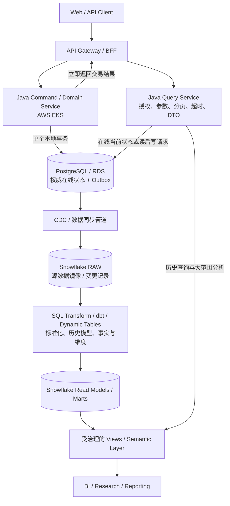

**主题：** 当在线交易保存在 PostgreSQL、五年至十年历史数据放在 Snowflake 时，如何划分命令处理、查询、业务规则与数据模型。  
**面向读者：** 金融服务领域的解决方案架构师、应用架构师、数据架构师和工程负责人。  
**资料检索日期：** 2026-10-12。产品功能、区域支持、GA/Preview 状态和配额会变化，实施前应复核官方文档及所在 Snowflake 账户的实际能力。

## 一、先回答核心问题

你的方案大致是：

- Java Domain Service 运行在 AWS EKS，处理业务新增、修改、删除以及需要严格事务语义的操作。
- PostgreSQL 保存在线业务的权威状态，完成交易事务。
- Snowflake 保存长期历史数据，服务跨年查询、大范围筛选、复杂 Join、聚合和报表。
- 一部分查询 SQL 在 Snowflake 里，一部分业务处理在 Java 中，因此担心业务逻辑分散在两个地方。

**这条路总体合理。需要调整的不是“把所有逻辑放到一个地方”，而是先把不同类型的逻辑分清楚，再定义它们之间的契约。**

推荐的默认原则是：

1. **交易规则由 Domain Service 负责，PostgreSQL 负责事务和数据完整性。** 比如交易状态转换、授权、业务资格、并发修改、幂等、审批和需要原子提交的更新，不能因为分析数据也在 Snowflake 就改由查询 SQL 决定。
2. **面向历史数据的集合运算由 Snowflake 执行。** 例如跨五年或十年的过滤、关联、窗口函数、聚合、历史快照、报表宽表和面向分析的投影。这些计算不应先把大量行拉回 Java 再计算。
3. **Java 仍可保留 Query Service，但不必把所有查询计算写成 Java 业务代码。** 它负责 API、身份与授权检查、请求校验、查询选择、参数绑定、超时、分页、DTO、调用编排和错误处理。真正扫描大量数据的 SQL 可以在 Snowflake 的受控模型中执行。
4. **业务定义不能在 Java 与 SQL 中各写一套、各自演变。** 必须明确哪些定义是交易不变量，哪些是报表口径，并通过版本化规则、受治理的 SQL 模型、语义层、测试和数据对账保证口径一致。
5. **PostgreSQL 到 Snowflake 的同步是架构的一等组成部分，不是一个后台小任务。** 要明确定义延迟、删除、重复、顺序、迟到数据、重放、对账和查询的数据新鲜度要求。

这最接近 CQRS（Command Query Responsibility Segregation，命令查询职责分离）与 Operational Store + Analytical Store 的组合，而不意味着必须一开始就拆成两个微服务团队或采用事件溯源。

## 二、建议架构

### 2.1 目标架构：写入权威源与分析读模型分开

关键不是规定所有查询都必须经过 Snowflake，而是按查询的**数据范围、延迟要求和一致性语义**选择数据源。

- 在线操作完成后，界面要显示刚刚提交的状态，通常应返回 Command Service 的提交结果，或读取 PostgreSQL 的权威记录。
- 用户查询十年交易历史、跨账户聚合或历史风险敞口，可以读 Snowflake 中已经构建并通过质量校验的分析模型。
- 如果某个页面必须在一次响应中同时显示“刚刚更新的当前状态”和十年历史汇总，需要显式定义一致性策略：短期从 PostgreSQL 补当前状态、接受一个明确的数据延迟，或者在确认模型和成本后构建统一读模型。不要默认 Snowflake 一定已经看到了刚提交的 PostgreSQL 事务。

### 2.2 为什么不是让每个服务随意访问两套数据库？

如果 Domain Service、报表 API、批处理和其他微服务都可以随意读取两边的原始表，短期看很方便，长期会产生几类问题：

- 同一个 API 的字段可能来自不同时间点的数据，前端很难解释不一致。
- 多个服务分别实现客户、账户、持仓、收益等定义，计算结果逐渐出现差异。
- 源表结构一变，Java SQL、Snowflake 模型、报表和数据导出都可能同时损坏。
- 访问权限容易跟着技术路径扩散：某个服务为了查询方便获得了本不需要的原始数据权限。
- 无法说清某个报表的结果基于哪批已同步数据、哪个规则版本以及什么“截至时间”。

所以应当把 Snowflake 中的 RAW 镜像与正式读模型分开。RAW 层解决的是“接到了源系统什么数据”；标准化和业务数据模型解决的是“这批数据代表什么”；Serving / Mart 层解决的是“哪些查询可以稳定消费它”。

## 三、业界模式：CQRS，而不是“Java 写、SQL 查”这么简单

### 3.1 CQRS 的含义

CQRS 将处理命令（Command）与处理查询（Query）的职责和模型分开。AWS Prescriptive Guidance 将其作为微服务数据持久化的一种模式，并明确指出，当更新和查询在吞吐、延迟或一致性方面有不同要求时，可以分别设计命令侧和查询侧：

- [AWS Prescriptive Guidance：CQRS pattern](https://docs.aws.amazon.com/prescriptive-guidance/latest/modernization-data-persistence/cqrs-pattern.html)
- [Microsoft Azure Architecture Center：CQRS pattern](https://learn.microsoft.com/en-us/azure/architecture/patterns/cqrs)

这两个来源都强调了分离读写模型的价值，同时也提醒读模型同步和最终一致性会引入额外复杂度。

CQRS 并不等于以下固定规定：

- 不要求命令和查询必须是两个独立的微服务。
- 不要求读写必须用不同数据库；读写模型可以先逻辑分离，再按负载决定是否物理分离。
- 不意味着 Query 侧没有任何业务知识。
- 更不代表交易业务规则可以从 Command Service 挪到分析数据库。

对你的场景，已经存在 PostgreSQL 与 Snowflake 两种数据平台，数据模型也明显不同，采用“写模型 + 独立分析读模型”很自然。它可以是一个 Java 应用中的两个模块，也可以是两个服务；先按职责隔离，是否独立部署由团队边界、伸缩、稳定性和运维成本决定。

### 3.2 把“业务逻辑”分成四类

“业务逻辑应该在哪里？”不能只按 CRUD 与 SQL 来判断。更有效的方法是按它对业务正确性的作用分类。

| 逻辑类型 | 例子 | 推荐归属 | 原因 |
|---|---|---|---|
| 交易不变量与状态转换 | 订单或交易状态是否合法、账户能否执行操作、审批是否完成、持仓修改是否合法 | Java Domain Service；必要时配合 PostgreSQL 约束与事务 | 必须在写入时执行，并在并发、重试及失败时保持正确 |
| 在线持久化与并发控制 | 锁、乐观并发版本、幂等键、唯一性、原子更新、回滚 | PostgreSQL 事务 / 约束与写服务 | 这是权威交易状态的完整性边界 |
| 大规模读取与派生数据 | 十年数据过滤、时间序列、跨账户 Join、窗口函数、分组汇总、历史快照 | Snowflake SQL、受版本控制的数据模型、必要时的 Dynamic Tables | 计算靠近大规模数据，避免将整批记录拉进应用内存 |
| 查询 API 与产品体验 | 鉴权、参数验证、分页、排序白名单、DTO、结果脱敏、超时、任务状态 | Java Query Service / API 层 | 这是服务契约、访问控制和请求生命周期的职责 |

对处在边界的规则，问两个问题：

**第一，这条规则必须在交易提交前阻止非法状态吗？** 如果必须，它不能只存在于异步刷新后的 Snowflake 读模型中。

**第二，这条逻辑主要是在解释大量已提交数据、构建一个面向读取的投影吗？** 如果是，通常适合在 Snowflake 中用 SQL 实现，并通过模型测试和发布流程管理。

例如，“本次交易是否允许从 Pending 变为 Approved”是命令侧规则；“展示过去十年每个账户每月的已批准交易金额”是查询侧计算。后者可以完全用 SQL 计算，但其“已批准”的定义必须与交易系统约定一致，而不能由报表作者自行发明。

### 3.3 查询也有业务语义，但不一定需要 Domain Service 执行计算

查询侧不是没有业务含义。比如“净流入”“已实现收益”“有效账户”“客户总资产”都是业务定义。问题在于，定义应该由谁治理，以及计算在哪里执行。

一个实用的划分是：

- **领域规则的权威定义：** 由负责该业务能力的领域团队维护，包含规则解释、适用条件、版本和例外情况。
- **交易写入的强制执行：** 在 Domain Service 和交易数据库中落实必要的不变量。
- **历史分析的高效执行：** 在 Snowflake 的数据模型中使用 SQL 实现同一口径或经过明确批准的分析口径。
- **指标与查询契约：** 通过文档、模型元数据、语义视图或受治理的 API 暴露；同时给出定义、更新时间和适用范围。

如果交易规则在 Java 实现，而报表 SQL 为了方便重新实现了一个“差不多”的规则，这才是需要修复的逻辑分散。把所有计算移到 Java 并不能解决定义分叉，反而可能让十年历史数据的处理成本很高。

## 四、Snowflake 能不能直接承担新增、修改和删除？

可以执行 SQL 写操作，但要区分**标准表（Standard Table）**和 **Hybrid Table**。这是两种不同的架构决策。

### 4.1 Snowflake 标准表：支持 DML，不应因此被视为传统 OLTP 替代品

Snowflake 标准表支持 INSERT、UPDATE、DELETE、MERGE 和事务；所以“Snowflake 不能修改数据”是不正确的。然而它的标准表以列式微分区为基础，主要面向分析工作负载。

需要特别注意的差异：

1. **主键、唯一键和外键约束默认不替你强制维护。** Snowflake 官方说明，标准表支持定义约束，但除了 NOT NULL 和 CHECK，PRIMARY KEY、UNIQUE、FOREIGN KEY 通常不强制执行。不能依靠一个声明出来的主键来防止生产写入产生重复记录。
2. **标准表的锁与高并发小事务模型不同。** Snowflake 对事务资源的锁定说明指出，标准表上的 UPDATE、DELETE、MERGE 通常无法像独立行锁模型那样自由地同时修改同一资源；并发写操作可能相互阻塞。
3. **行级随机读写不是标准表的主要优化目标。** 对只按业务 ID 读一行、经常对一行做小修改的请求，列式分析表并不是最自然的模型。
4. **查询计算和写入后的查询负载仍然需要计算资源管理。** 应用的在线写路径不能只考虑 SQL 是否能执行，还要测试端到端延迟、排队、并发、错误恢复和成本。

参考：
- [Snowflake：Constraints](https://docs.snowflake.com/en/sql-reference/constraints)
- [Snowflake：Transactions](https://docs.snowflake.com/en/sql-reference/transactions)
- [Snowflake：Key concepts and architecture](https://docs.snowflake.com/en/user-guide/intro-key-concepts)

标准表很适合由 ETL 或数据团队执行批量 MERGE、回补数据、修正分析模型，以及受控的低频维护任务。但对于核心交易表的每笔在线小事务，不应仅凭它“支持 UPDATE”就决定把 PostgreSQL 换掉。

### 4.2 Hybrid Tables：Snowflake 确实提供了偏事务型的选择

Snowflake Hybrid Tables 是这项讨论必须研究的功能。官方文档将其描述为面向低延迟、高吞吐事务型应用的表，采用行式主存储、支持行级锁，支持通过索引进行随机查找，并强制执行主键、唯一键和外键等约束。它可以与标准 Snowflake 表一起使用，也支持在同一事务中跨 Hybrid Tables 与标准表操作。

官方资料：
- [Snowflake：Hybrid Tables](https://docs.snowflake.com/en/user-guide/tables-hybrid)
- [Hybrid Tables：限制与不支持的功能](https://docs.snowflake.com/en/user-guide/tables-hybrid-limitations)
- [Hybrid Tables：成本评估](https://docs.snowflake.com/en/user-guide/tables-hybrid-cost)

这说明 Snowflake 的选择不只是一种“数仓只能读”的老式观点。对某些应用型数据，尤其是轻量事务、元数据、工作流状态、低延迟点查，以及需要在分析平台内同时读事务表与分析表的场景，Hybrid Tables 值得进入 PoC。

不过，**Hybrid Tables 是一种特定工作负载选项，不等于 Snowflake 无条件替代 PostgreSQL。**

以下限制需要在设计阶段逐项评估：

- **容量和节流：** 官方当前文档列出的默认活动 Hybrid Table 行存储容量限制为每个数据库 2 TB。文档还给出了特定读写比例下约 16,000 次操作/秒的参考配额，并提醒请求量可能受到节流，实际可承载能力取决于工作负载与账户配置。这些数字不是你的应用能够无条件获得的 SLA，必须与 Snowflake 一起核实。
- **成本：** Hybrid Table 的行存储部分比传统 Snowflake 标准存储贵；SQL 查询仍然会使用 Virtual Warehouse 计算资源。存储成本和查询计算成本都要测量。
- **功能差异：** 官方限制清单当前列出了 Streams、Dynamic Tables、Snowpipe、Snowpipe Streaming、Materialized Views、Search Optimization Service、Replication 和 Data Sharing 等不支持项。具体功能会演进，设计时应按目标账户和目标版本逐条核实。
- **一致性语义：** 默认情况下，Hybrid Table 使用 session-based consistency：同一会话能读取到自己写入的最新数据，而会话之外的变更可能有小于 100 ms 的陈旧窗口。官方提供 READ_LATEST_WRITES 选项来避免相应的跨会话陈旧读取，但可能增加几毫秒延迟。
- **事务范围和现有集成：** Hybrid Table 的事务与约束能力有特定边界。现有依赖 PostgreSQL 特性、CDC、ORM、报表工具或备份恢复流程的应用，需要做兼容性验证，而不是只看 SQL 是否能够运行。

### 4.3 三种选择的判断

| 方案 | 合适场景 | 主要风险 / 代价 | 对你的默认建议 |
|---|---|---|---|
| PostgreSQL 写入 + Snowflake 标准表分析 | 高频在线事务与多年历史分析并存 | CDC、数据新鲜度、双模型治理需要设计 | **首先采用** |
| PostgreSQL 写入 + Snowflake Hybrid Tables（用于有限的应用型数据） | 部分在线状态或点查需要低延迟，又希望与分析数据共处一套平台 | 配额、费用、功能限制、跨会话一致性及生态兼容 | 对小范围数据做 PoC，不要一次迁移全部交易 |
| Snowflake 标准表直接承担应用的高频 CRUD | 批处理、受控修数、分析表维护 | 事务并发、完整性和点查性能模型可能不适合 | 不建议作为核心在线交易的默认方案 |

如果将来业务希望完全基于 Snowflake 实现某个新的轻量应用，可以单独评估 Hybrid Tables。评估时应使用真实业务 SQL 和真实并发模型，而不是以简单插入测试作为结论。至少要测点查延迟、写入 p95/p99、同一记录争用、不同记录并发写、事务回滚、约束冲突、读后写、连接建立、峰值节流、故障恢复和全成本。

## 五、PostgreSQL 到 Snowflake：CDC、Outbox 与最终一致性

把在线库和分析库分开，意味着它们不再天然处于同一个本地事务中。这里是整个设计最容易被低估的部分。

### 5.1 不要在业务请求中做“双写”

一种看似简单的实现是：

1. Java 写 PostgreSQL。
2. Java 再写一份数据到 Snowflake。
3. 两边都成功后才返回成功。

这会制造分布式双写问题：PostgreSQL 成功而 Snowflake 失败怎么办？Snowflake 成功但应用超时、不知道结果怎么办？重试时会不会重复创建记录？让一个 HTTP 请求同步依赖两个数据库，不仅增加延迟，也让故障恢复更加复杂。

默认方案应当是：

- PostgreSQL 是在线事务的权威记录。
- 事务提交后通过 CDC 或事件管道，把需要分析的数据送入 Snowflake。
- 对允许最终一致的读模型，明确数据新鲜度目标。
- 对必须强一致的命令和读后写路径，依然读取权威数据源或返回已提交的命令结果。

### 5.2 行级 CDC 与 Domain Event 不是同一种契约

这两种数据流很容易混在一起，实际上解决不同的问题。

**行级 CDC** 通常记录某张表的 INSERT、UPDATE、DELETE，适合把业务数据库复制到 Snowflake 作为源表镜像，用于历史留存、重建读模型和数据对账。它反映的是数据库记录发生了什么变化。

**Domain Event** 表达业务上发生了什么，例如 TradeApproved、AccountClosed、PositionAdjusted。它应包含稳定的业务语义，而不只是表名、字段和变更前后值。它适合其他服务的业务集成、工作流触发及事件消费。

不要让下游系统把每一个数据库行更新都当作稳定业务 API。数据库表结构通常比领域事件更容易变动。

### 5.3 Outbox 解决什么问题？

当一次业务操作既需要更新 PostgreSQL，又需要发布业务事件时，推荐评估 Transactional Outbox：

- 在同一个 PostgreSQL 本地事务内，更新业务记录并插入一条 Outbox 事件记录。
- 事务提交后，再由 CDC 或后台发布器把 Outbox 事件发送到消息系统。
- 消费者使用事件 ID 做幂等处理，并按业务要求管理聚合键、事件顺序、重复和重放。

这样，业务状态与待发布事件在数据库里原子提交，避免出现“交易成功了，却因为发布消息失败而永远通知不到下游”的双写漏洞。

相关资料：
- [AWS Prescriptive Guidance：Transactional outbox pattern](https://docs.aws.amazon.com/prescriptive-guidance/latest/cloud-design-patterns/transactional-outbox.html)
- [Debezium：PostgreSQL Connector](https://debezium.io/documentation/reference/stable/connectors/postgresql.html)
- [Debezium：Outbox Event Router](https://debezium.io/documentation/reference/stable/transformations/outbox-event-router.html)

但请注意：Outbox 不是所有 PostgreSQL 到 Snowflake 数据复制的必要前置步骤。如果目标只是持续复制源表供历史查询，直接采用经过验证的表级 CDC 方案可能更合适。Outbox 主要用于需要稳定业务事件契约的场景。必要时可以同时维护两条不同用途的管道。

### 5.4 CDC 方案怎么选？

可按现有平台能力评估以下选项：

| 路线 | 适合情况 | 实施时要确认的事项 |
|---|---|---|
| Snowflake Openflow PostgreSQL Connector | 希望使用 Snowflake 提供的 PostgreSQL 初始快照与 CDC 集成 | PostgreSQL logical replication 配置、源权限、网络、Connector 代际与部署状态 |
| Debezium + Kafka / Amazon MSK + Snowflake 消费端 | 已有 Kafka / MSK、事件平台或需要更多流处理控制 | Schema Evolution、消息保留、重复、顺序、回放、消费者扩缩容和运维责任 |
| 商业 CDC / 数据集成产品 | 团队希望降低自建 Connector 的运维负担 | 许可成本、延迟、删除语义、重同步能力、数据驻留和支持范围 |
| 定时增量批处理 | 业务接受小时级、日级延迟，数据规模与变更量可控 | 水位线、迟到更新、删除捕获、重跑幂等、回补与对账 |

Snowflake 当前的 Openflow PostgreSQL 文档说明，它能够捕获 PostgreSQL 的初始数据和后续变更；RDS 环境通常还需要启用逻辑复制相关参数并授予连接器所需的复制权限。需要特别留意 Openflow 的代际状态：截至检索日，官方文档将 Gen 1 PostgreSQL Connector 标记为 GA，而 Gen 2 Connector 配置仍标记为 Public Preview；新建 Openflow 部署的默认方向已经是 Gen 2。不能把“Connector 名称相同”误解为所有代际均已 GA。

- [Snowflake：Openflow Connector for PostgreSQL](https://docs.snowflake.com/en/user-guide/data-integration/openflow/connectors/postgres/about)
- [Snowflake：配置 PostgreSQL Connector](https://docs.snowflake.com/en/user-guide/data-integration/openflow/connectors/postgres/setup)
- [Snowflake：Openflow Gen 1 与 Gen 2](https://docs.snowflake.com/en/user-guide/data-integration/openflow/gen2/openflow-generations)

### 5.5 必须定义同步契约和故障恢复

不要只设一个“CDC 延迟目标”就认为链路可靠。至少明确以下项目：

- **新鲜度：** 哪些 API 允许数秒、数分钟或小时级延迟？哪些不能接受延迟？
- **删除处理：** DELETE 如何映射到下游模型？是软删除标记、删除事件，还是在镜像中物理删除？
- **重复处理：** 消息重复投递或作业重跑时，如何避免重复计数？
- **顺序与版本：** 相同业务对象出现多次修改时，如何识别版本较旧的事件，避免覆盖新状态？
- **初始化快照与持续复制的衔接：** 如何避免快照期间的变更丢失或重复应用？
- **故障恢复：** CDC 中断后，源 WAL / replication slot 能否支撑恢复？如果不能，如何补全数据？
- **对账：** 用主键范围、记录数、关键金额、版本水位和业务总量判断复制是否完整，而不是仅检查连接器处于 Running。
- **模式变更：** PostgreSQL 列、枚举、主键或事件 Schema 变更时，先兼容下游再发布上游，或者使用清晰的版本策略。
- **数据治理：** 只复制允许进入分析环境的字段；对个人数据、账户标识、敏感字段和行级权限建立明确控制。

## 六、历史数据不是简单地“把旧行放进 Snowflake”

金融业务里，保留五年、十年的数据，重点不仅是存量大，还包括**历史口径是否能复现**。

### 6.1 区分业务有效时间与系统记录时间

假设某个投资交易在 2024 年发生，但由于外部文件修正，2026 年才收到更正信息。如果系统只保存“当前正确状态”，旧数据可能被覆盖，导致无法回答：

- 当时系统认为发生了什么？
- 更正后我们现在认为什么是正确的？
- 某个历史报表在当日出具时，使用了哪一版数据？
- 某次合规或投资决策当时依据的事实是什么？

因此，根据业务要求考虑同时保存：

- **Business / Effective Time：** 业务事实在哪个时间生效或发生。
- **Recorded / Ingested Time：** 系统什么时候收到或记录它。
- **Source Version / Change Position：** 数据版本、来源事务或 CDC 顺序。
- **Correction / Reversal Link：** 如适用，原记录与更正、冲销的关联。

并非每张表都需要完整的双时态模型，但涉及财务事实、历史估值、交易修正、监管报送或可重现报表时，应当先明确审计要求，再决定是保留不可变事件、版本化记录、SCD Type 2，还是其他历史模型。

如果某个历史数字必须“按当时可见的数据重现”，仅把当前 PostgreSQL 表复制到 Snowflake 并不断 MERGE 覆盖是不够的。必须保留足够的信息来重建当时的数据状态。

### 6.2 不要把分析仓库误认为财务账本

如果业务涉及资金、交易确认或需要精确追溯的持仓变化，应该明确系统的金融事实来源。Snowflake 可以保留历史镜像、构造审计分析模型并加快查询，但不能仅因为它保存了多年数据，就把它当作在线交易账本或交易状态的权威写入系统。

在需要的领域，采用不可变的业务事件、分录记录、冲正而非覆盖、源系统对账等设计。这部分具体如何实现，应由业务的记账模型、监管要求和原系统责任来决定。

### 6.3 RAW、标准化模型和查询模型应各有职责

一种可维护的 Snowflake 数据分层可以是：

- **RAW / Landing：** 尽量保留可追溯的源记录、来源标识、同步时间和版本信息。此层主要服务审计、排障和重建，不直接成为所有业务查询的长期接口。
- **Standardized / Conformed：** 统一类型、时间、标识、状态映射和删除规则，解决同一实体在多个来源里的标准化问题。
- **Facts / Dimensions / History：** 建立事实、维度、历史快照和可复用业务模型。
- **Serving / Mart / Semantic View：** 对特定产品、风险或研究查询提供稳定、经过治理的字段与业务指标。

不是每个项目都必须采用相同的层数。关键是把“源数据原样复制”“业务数据标准化”与“面向使用者优化的查询结构”区别开，不让一条面向某个报表的 SQL 成为所有应用都依赖的隐式接口。

## 七、查询逻辑放在 Snowflake，Java 还需要做什么？

### 7.1 一种可执行的责任边界

建议将 Query Service 设计成清晰的应用服务，而不是再建一套完整 Domain Service 去复制所有交易模型。

Java Query Service 负责：

- 认证和授权，确定调用者可访问的业务范围。
- 校验参数、选择被允许的查询、绑定 SQL 参数，限制排序和过滤字段。
- 根据一致性和数据范围决定读取 PostgreSQL 还是 Snowflake。
- 管理分页、超时、取消、异步查询状态和错误转换。
- 把结果映射成 API DTO，并保证接口契约稳定。
- 在结果中明确适用的 as-of 时间、数据新鲜度或模型版本（业务需要时）。

Snowflake 负责：

- 对大批历史数据进行过滤、关联、窗口计算、聚合和排序。
- 执行版本化的标准化与分析 SQL 模型。
- 暴露受治理的 Views / Marts / Semantic Views 给不同的查询消费者。
- 借助 Warehouse 资源隔离承载交互式报表、数据转换和大规模历史查询。

因此，**“Query Service 在 Java”与“查询计算在 Snowflake”并不矛盾**。前者是应用接口和控制责任，后者是数据密集型计算的位置。

### 7.2 SQL 模型要当成产品代码维护

不要把复杂业务 SQL 散落在 Java 字符串、BI 报表和个人 worksheet 里。对被多个应用依赖的查询，建议至少做到：

1. SQL、视图和模型定义纳入 Git 版本管理，变更走 Review 与环境发布流程。
2. 为核心指标写定义，明确分子、分母、排除条件、时间范围和口径版本。
3. 建立自动化测试：空值、重复、边界日期、迟到数据、删除、更正、重复事件以及历史重算。
4. 比较关键业务量：记录数、金额、仓位、账户总量及源目标差异。
5. 对重要读模型保留数据更新时间、处理水位或源端版本，以便解释查询结果。
6. 对破坏性 Schema 变更采用先增后删的兼容发布，避免 Java 新版本和旧版本同时运行时读不到字段。

如果公司已经有数据建模框架，例如 dbt，可以利用其管理 SQL 模型、依赖与测试；如果没有，也可以从 SQL 文件、迁移脚本、CI 检查和质量测试开始。不要因为 CQRS 就先引入大量工具。

### 7.3 语义层的意义：减少“同一个词，不同算法”

当查询涉及“净资产”“收益率”“有效账户”“资产类别”“风险敞口”等词汇时，应把口径变成有所有者、有定义、有测试、有版本的数据产品。

Snowflake 的 Views / Semantic Views 可以作为对外暴露数据定义和度量的方式；它们有助于把可复用指标集中起来，但不应取代交易系统对写入有效性的判断。

例如，交易服务保证某个交易状态满足业务规则；分析模型根据已批准的状态映射汇总历史交易金额；查询 API 通过受控模型提供报表。三者必须使用兼容的状态定义，但无需把十年金额汇总放进 Java Domain Entity 中计算。

对 Financial Services 而言，语义层不仅为了 BI，也能为 API、投资研究工具和 AI Agent 提供更一致的字段解释。前提是明确权限边界和口径所有权；不能让查询端自行拼接原始表并绕过数据授权。

## 八、AWS EKS + Java + PostgreSQL + Snowflake 的工程注意事项

### 8.1 在线命令路径与历史查询路径应分开治理

不要让一个 EKS Deployment 中的所有请求共享同样的执行策略。

**命令路径：** 关注短事务、连接池、事务超时、锁等待、幂等键、并发冲突、重试边界及审计信息。失败重试必须确认操作可重入，不可以把“网络超时”当成“交易一定没提交”。

**查询路径：** 关注 SQL 扫描量、Warehouse 排队、查询取消、分页方式、超时、数据新鲜度和每个用户/租户的资源公平。大范围查询不应无限制占用 HTTP 连接，也不应允许任意客户端提交不受控 SQL。

可为交互查询、数据转换和重型历史报表配置不同的 Snowflake Virtual Warehouse 或独立资源策略，避免装载或大作业影响在线查询体验。Snowflake 的数据加载指导也建议根据工作负载将装载与查询计算分开规划。

- [Snowflake：Planning a Data Load](https://docs.snowflake.com/en/user-guide/data-load-considerations-plan)
- [Snowflake：Key Concepts and Architecture](https://docs.snowflake.com/en/user-guide/intro-key-concepts)

### 8.2 不要把连接池大小当成吞吐量旋钮

EKS Pod 横向扩展后，应用连接数可能随之成倍增加。对 Snowflake 来说，更多连接并不必然意味着更快；如果每个 Pod 都发起昂贵的查询，可能让 Warehouse 进入排队，并把成本放大。

至少应设定：

- 有上限的客户端并发与连接池。
- SQL 执行超时、请求取消及长任务异步化策略。
- 查询标签或 Query Tag，能将请求关联到 API、调用者类别、应用版本及业务功能。
- 适当的 Warehouse 规模、自动挂起、并发与预算告警。
- 重点查询的 Query Profile、扫描字节、运行时间、排队时间和费用观察。
- 对昂贵的开放式筛选、无界时间范围、超大导出和无效重复查询进行限制。

如果需要生成十年的大文件，通常把请求建模为异步任务、返回任务 ID、保存任务状态和可控的下载结果，比在 HTTP 请求里等待长时间 SQL 更稳妥。

### 8.3 权限边界必须按数据库职责划分

应用使用 Snowflake 查询，不代表应该拥有修改所有 Snowflake 表的权限。

- Command Service 通过受限数据库账号或角色访问 PostgreSQL 的指定写模型。
- Query Service 使用最小权限 Snowflake Role，只能访问受治理的读模型。
- 数据同步账号拥有执行复制所需的源端复制权限和目标端落地权限，不与普通应用凭证混用。
- 数据转换身份只访问它负责的 RAW / 模型 / 输出对象。
- 对敏感字段使用 Snowflake 的权限模型、行访问策略、动态数据屏蔽或受控视图，并结合应用侧的授权判断。
- 对交易写入、查询数据、模型刷新与数据导出保留可关联的审计信息。

应用层校验不能替代数据库层权限；数据库权限也不能独自表达全部业务授权。两层需要相互配合。

### 8.4 指标和告警要覆盖整个读写链路

建议将以下指标纳入生产观测：

**命令侧：** 写入成功率、事务延迟 p95/p99、锁等待、死锁、连接池等待、乐观锁冲突、幂等命中、超时、重试和业务拒绝原因。

**CDC 侧：** 复制延迟、源 WAL / replication slot 积压、消费位置、连接器重启、数据丢弃、异常行、Schema 不兼容和回放进度。

**Snowflake 模型侧：** 数据新鲜度、动态表实际延迟、模型刷新失败、质量测试失败、源目标对账差异、积压及重算耗时。

**Query 侧：** API 延迟、Snowflake 排队时间、执行时间、扫描字节、结果行数、取消率、Warehouse 消耗、按查询族统计的成本。

需要区分“数据库查询成功”和“用户得到了业务正确的结果”。连接器显示运行、SQL 成功返回、模型完成刷新，都不能单独证明数据完整、历史口径正确或权限判断无误。

## 九、哪些查询应该去哪边？一张决策表

| 典型需求 | 首选执行位置 | 说明 |
|---|---|---|
| 更新账户状态并保证状态转换合法 | Java Domain Service + PostgreSQL | 写入权威状态；规则需在提交前校验 |
| 判断同一业务对象是否被其他请求同时修改 | PostgreSQL 事务 / 锁或乐观并发控制 | Snowflake 分析模型不应该承担交易并发仲裁 |
| 刚提交交易后立即显示本次交易结果 | Command Service 返回提交结果，或查询 PostgreSQL | 避免将异步 CDC 的延迟暴露为错误结果 |
| 查询一个对象当前的权威状态 | PostgreSQL 或明确设计的在线读模型 | 视延迟、查询负载和一致性要求决定 |
| 展示过去十年的交易记录、跨账户筛选与汇总 | Snowflake 读模型 | 应有明确的 as-of 时间、过滤策略和分页/导出方式 |
| 高成本历史汇总，多个产品重复使用 | Snowflake 标准化模型、Mart 或预计算读模型 | 避免每个 API 都重复写一套复杂 SQL |
| 把一批更正后的历史数据重新计算 | 受控数据作业 / Snowflake 模型 | 记录修正来源、重算范围、版本和对账结果 |
| 为多个下游服务发布“交易已批准”业务事件 | Outbox + 事件管道 | 不要把内部表字段变化直接当成稳定的领域契约 |
| 少量、低频地修改 Snowflake 派生表或修复分析数据 | Snowflake SQL DML | 有权限、审计、备份/恢复与重算方案 |
| 高并发低延迟的小事务，想完全放在 Snowflake | 先评估 Hybrid Tables | 通过真实业务负载 PoC 验证限制、费用与功能兼容 |

## 十、推荐的落地路线

### 阶段 1：先定义权威源与查询契约

先选 1–2 个有代表性的业务对象，例如交易、账户或持仓，写清：

- 谁可以创建、修改和撤销它？哪个系统是权威写入源？
- 哪些字段属于不可变的业务事实，哪些是当前状态，哪些是派生字段？
- 哪些查询必须读到刚提交的写入，哪些可以接受分钟级延迟？
- 什么是历史记录的时间口径？更正后是否需要复现更正前的报表？
- 哪些用户、账户或客户有权看到哪些数据？
- 一次业务修改成功后，下游必须保证发生什么？

不要先从拆微服务开始。先把数据所有权、业务不变量与查询契约写清楚。

### 阶段 2：建立可靠的 PostgreSQL → Snowflake 同步

选择适合现有团队能力和当前产品成熟度的 CDC 方案，完成一次初始快照并建立持续同步。

PoC 必须模拟 INSERT、UPDATE、DELETE、快速连续修改、重复、源端重启、连接器中断、Schema 变更和恢复，并验证 Snowflake 中最终结果正确。若历史数据必须逐事件还原，还要验证采用的机制是否保留了所需的事件顺序和版本信息，而非只提供最新行状态。

### 阶段 3：构建一条被多个查询消费的正式读模型

挑选一个具有代表性的五年或十年历史查询，把 SQL 建立在标准化后的 Snowflake 模型上，避免它直接依赖一堆临时 RAW 表。

为它建立字段与指标定义、数据质量测试、历史边界测试、权限测试、扫描量基线和成本预算。把 API 需要的 DTO 与模型输出字段形成稳定契约。验证完成后，再迁移更多查询。

### 阶段 4：引入清晰的 Query Service 边界

由 Java API 层确定调用者能查什么、输入是否合法、采用哪个模型、时间范围是否有限制、什么时候应该转异步任务；SQL 负责执行集合运算。对需要读后写一致性的操作单独设计，不要期待同一条历史分析 API 同时满足所有一致性等级。

### 阶段 5：根据实际瓶颈再决定是否深化 CQRS 或采用 Hybrid Tables

如果查询与写入的伸缩、安全、发布频率和可靠性要求明显不同，再考虑把 Command Service 与 Query Service 独立部署。

如果某些业务数据天然适合低延迟随机读写，而且确实需要与 Snowflake 的分析表共存，可以对 Hybrid Tables 做独立的限范围 PoC。不能只拿简单 CRUD 通过作为迁移依据；必须验证官方限制、账户配额、故障恢复、成本和相关数据管道。

## 十一、最终建议

对你当前描述的金融服务应用，我会以如下方案作为架构基线：

**Java Domain Service（EKS）+ PostgreSQL 作为交易写入权威源；通过可靠 CDC 将必要的源数据同步到 Snowflake；在 Snowflake 中维护版本化的历史数据模型与分析读模型；保留 Java Query Service 负责 API、授权和查询编排。**

这种架构把两个容易混淆的问题分开：

- **业务规则归属：** 谁定义规则、谁有权批准变更、谁保证交易合法。
- **计算执行位置：** 一次查询在哪个引擎执行才能兼顾正确性、性能、可维护性和成本。

没有必要为了“所有业务逻辑只能在一个地方”而把十年历史聚合写回 Java，也没必要为了“SQL 都放在 Snowflake”而把交易合法性与在线状态迁移到分析数据模型里。

最重要的工程约束是：交易规则有单一权威、查询口径可追溯、CDC 延迟可观察、历史更正可解释、数据访问受控，并且任意一次查询都能说明它读的是什么模型、截至什么时候的数据。

## 十二、参考资料

### 架构模式

1. [AWS Prescriptive Guidance：CQRS pattern](https://docs.aws.amazon.com/prescriptive-guidance/latest/modernization-data-persistence/cqrs-pattern.html) — 读写分离、不同延迟与一致性要求下的命令侧和查询侧设计。
2. [Microsoft Azure Architecture Center：CQRS pattern](https://learn.microsoft.com/en-us/azure/architecture/patterns/cqrs) — 读写模型分离、同步读模型、最终一致性及 Outbox 的取舍。
3. [AWS Prescriptive Guidance：Database-per-service pattern](https://docs.aws.amazon.com/prescriptive-guidance/latest/modernization-data-persistence/database-per-service.html) — 数据所有权、服务解耦，以及跨数据源查询的代价。
4. [AWS Prescriptive Guidance：Transactional outbox pattern](https://docs.aws.amazon.com/prescriptive-guidance/latest/cloud-design-patterns/transactional-outbox.html) — 避免数据库写入与消息发送双写不一致。

### Snowflake 事务与分析能力

5. [Snowflake：Hybrid Tables](https://docs.snowflake.com/en/user-guide/tables-hybrid) — 行式存储、行锁、索引、强制约束以及与标准表组合使用。
6. [Snowflake：Hybrid Tables limitations](https://docs.snowflake.com/en/user-guide/tables-hybrid-limitations) — 容量、吞吐、事务、一致性与暂不支持的功能。
7. [Snowflake：Evaluate cost for Hybrid Tables](https://docs.snowflake.com/en/user-guide/tables-hybrid-cost) — 行存储费用与 Warehouse 查询计算成本。
8. [Snowflake：Constraints](https://docs.snowflake.com/en/sql-reference/constraints) — 标准表和 Hybrid Tables 在约束强制执行方面的区别。
9. [Snowflake：Transactions](https://docs.snowflake.com/en/sql-reference/transactions) — 事务与资源锁定行为。
10. [Snowflake：Key concepts and architecture](https://docs.snowflake.com/en/user-guide/intro-key-concepts) — 存储、计算与云服务架构。

### 数据同步与历史模型

11. [Snowflake：Openflow Connector for PostgreSQL](https://docs.snowflake.com/en/user-guide/data-integration/openflow/connectors/postgres/about) — PostgreSQL 初始快照和 CDC 复制能力。
12. [Snowflake：PostgreSQL Connector setup](https://docs.snowflake.com/en/user-guide/data-integration/openflow/connectors/postgres/setup) — logical replication、RDS 参数、权限和连接器配置。
13. [Snowflake：Openflow Gen 1 and Gen 2](https://docs.snowflake.com/en/user-guide/data-integration/openflow/gen2/openflow-generations) — Openflow 管理模式与连接器成熟度状态。
14. [Debezium：PostgreSQL Connector](https://debezium.io/documentation/reference/stable/connectors/postgresql.html) — 基于 PostgreSQL logical decoding 的快照和持续变更捕获。
15. [Debezium：Outbox Event Router](https://debezium.io/documentation/reference/stable/transformations/outbox-event-router.html) — 将 Outbox 表转化为业务事件的实践。
16. [Snowflake：Introduction to Streams](https://docs.snowflake.com/en/user-guide/streams-intro) — Snowflake 内部表变更捕获；注意不能据此假设 Hybrid Tables 支持 Streams。
17. [Snowflake：Set the target lag for a Dynamic Table](https://docs.snowflake.com/user-guide/dynamic-tables-target-lag) — Target Lag 是新鲜度目标而非严格刷新周期，实际延迟需要监控。
18. [Snowflake：Planning a Data Load](https://docs.snowflake.com/en/user-guide/data-load-considerations-plan) — 将数据装载和分析查询计算按工作负载分开规划。

---

**结论：** 对于需要强交易一致性、在线写入与多年历史分析并存的金融服务系统，PostgreSQL + Snowflake + CDC + CQRS 式读模型分离，是比“把所有查询和写入都改成 Snowflake”更稳妥的默认架构。Hybrid Tables 应作为有明确适用范围的技术选项，而不是忽略事务边界、数据新鲜度和生态限制的全面替代方案。
