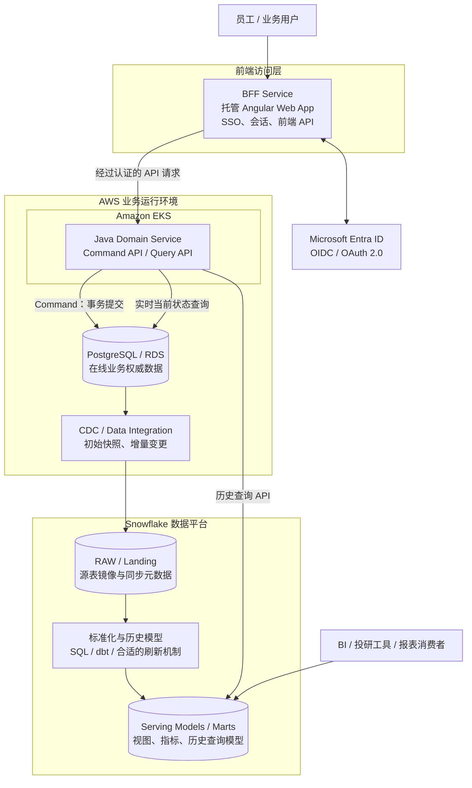
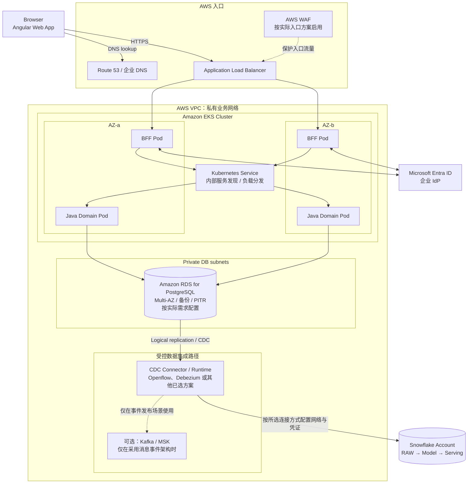
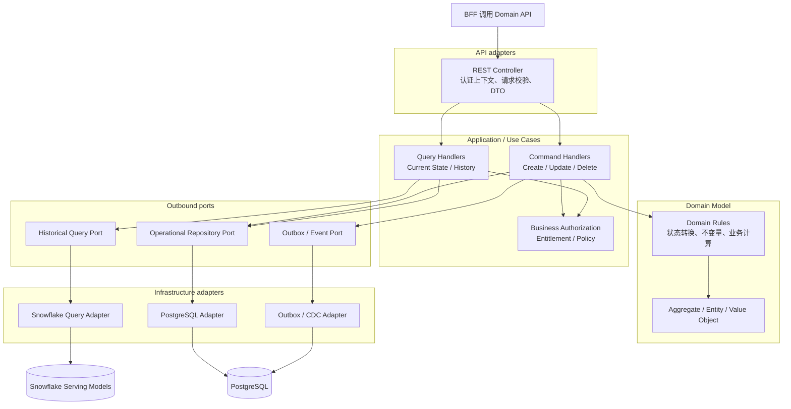
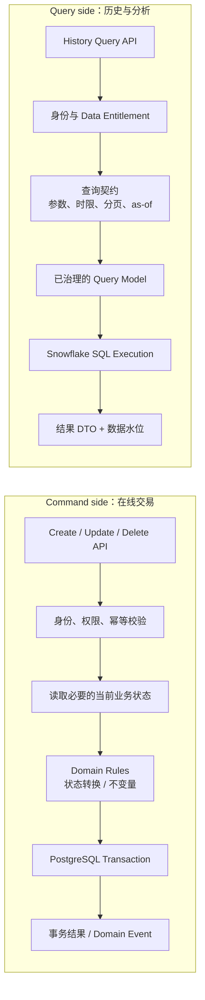
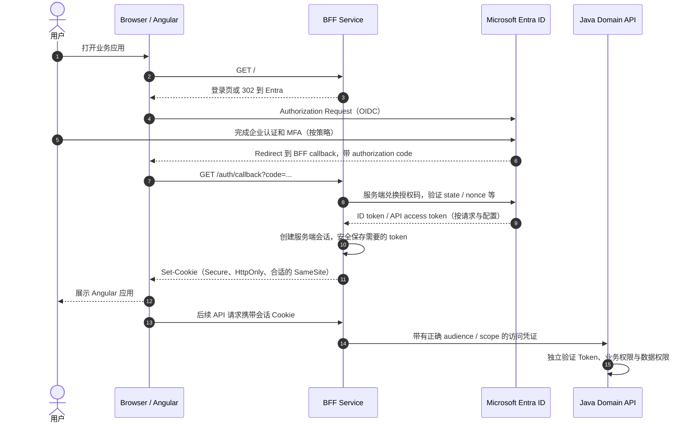
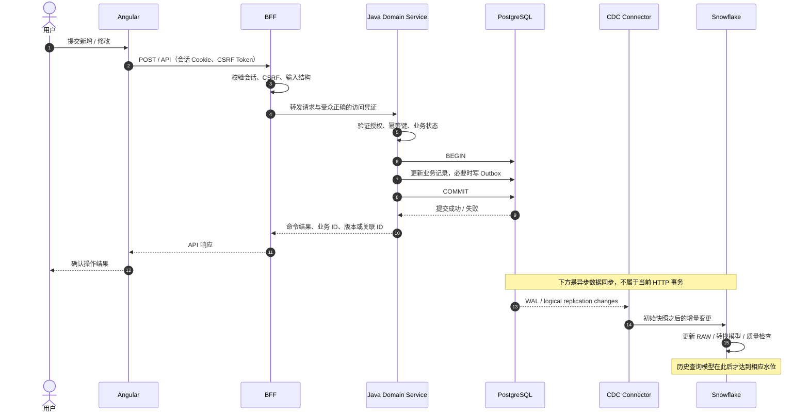
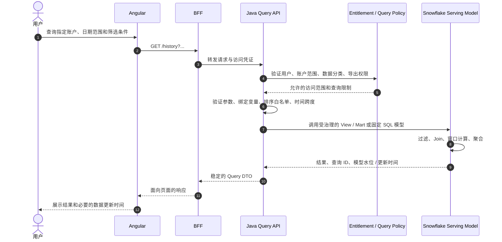
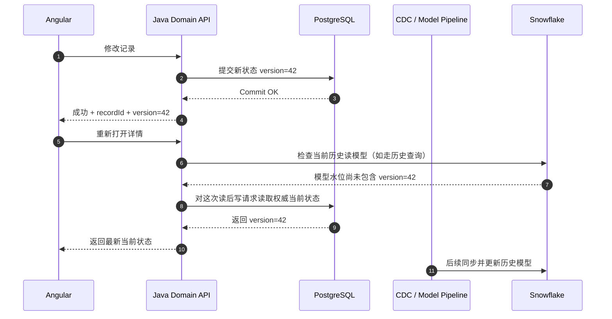
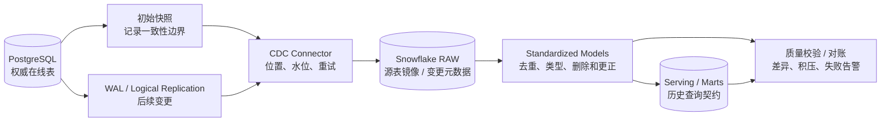
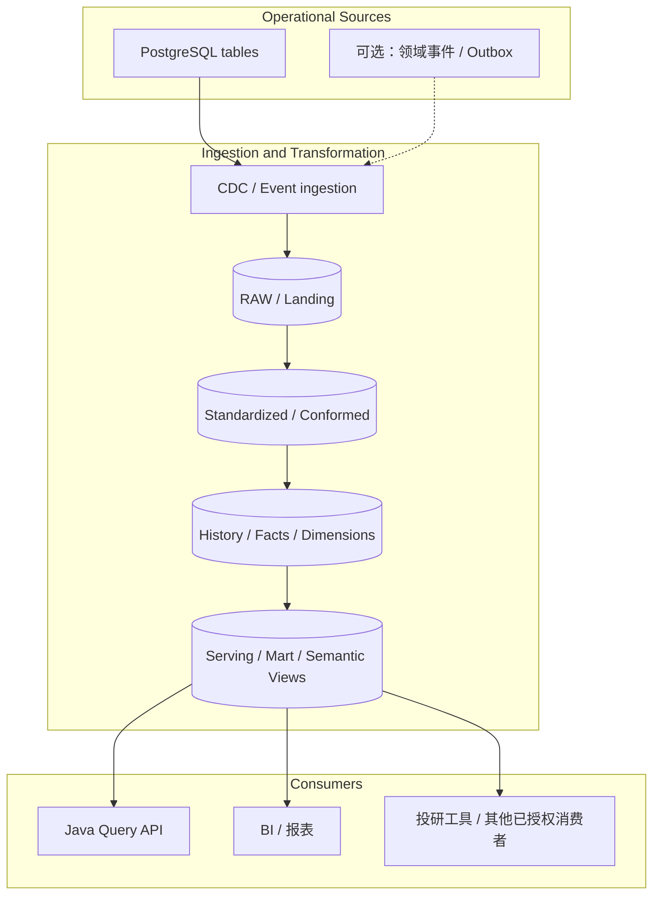

## 一、先把现有系统画清楚

本文讨论的系统有五个确定的组成部分：Angular Web 应用由 BFF Service 托管；BFF 集成 Microsoft Entra ID，负责 SSO 和面向前端的接口；Java Domain Service 部署在 AWS EKS；PostgreSQL 承担在线业务写入；Snowflake 保存多年历史数据并执行大范围查询。

争议集中在最后两项：修改放在 Java 和 PostgreSQL，历史查询放在 Snowflake，业务逻辑会不会因此被拆成两套？这需要区分**业务规则由谁定义**和**计算由哪个引擎执行**。两者相关，但不是同一个问题。

### 1.1 系统上下文与整体架构

这张图是建议目标架构，不是对某个现有环境的反向还原。里面有两条不同的请求路径：

- **在线命令和当前状态**：Angular 调用 BFF，BFF 转发到 Java Domain Service，再由 Java 使用 PostgreSQL 本地事务更新权威记录。
- **历史查询**：请求仍从 BFF 和 Java API 进入，但历史数据过滤、Join、窗口计算和聚合在 Snowflake 完成。应用层不需要把十年记录取回内存再处理。

PostgreSQL 到 Snowflake 的同步是异步链路，不在交易提交的同步调用栈内。除非另外建立强一致性机制，在线写入成功并不表示 Snowflake 的查询模型已经刷新。

### 1.2 AWS 部署图

下面按典型的私有网络部署画出边界。它假设 BFF 和 Java 服务均作为工作负载运行在 EKS；如果实际部署把 BFF 放在独立容器平台或托管应用服务，只需调整入口和运行位置，业务分层不变。

部署时要落实这些边界：

1. RDS 不应直接暴露公网；只允许必要的 EKS 工作负载和数据集成组件访问对应端口。
2. BFF 与 Java Domain Service 即使同处 EKS，也应使用不同的 Kubernetes Service Account、网络策略和云端访问身份。浏览器不应获得数据库凭证，也不应直接连接 Snowflake。
3. Snowflake 是独立的数据平台边界。跨 AWS 账户或网络访问方式取决于 Snowflake 部署区域、账户配置和所选 Connector；PrivateLink 等私有连接能力需要单独核实，不能从这张图推定已经配置。
4. RDS Multi-AZ 主要处理数据库可用性与故障切换，不负责替 Snowflake 提供查询能力。
5. 图里的 Connector 只是部署位置的抽象。Openflow、Debezium 配合消息平台、托管 CDC 产品的运行方式并不相同，选型后要用实际部署图替换这一块。

### 1.3 BFF、Domain Service 与 Snowflake 的边界

微软的 [Backends for Frontends pattern](https://learn.microsoft.com/en-us/azure/architecture/patterns/backends-for-frontends) 对 BFF 的定位很明确：它服务某一种前端体验，负责客户端需要的 API 组合和适配，不应成为第二个领域服务。

| 组件                | 应该放在这里的职责                                                                        | 不应该越界做的事                                     |
| ------------------- | ----------------------------------------------------------------------------------------- | ---------------------------------------------------- |
| Angular             | 页面状态、用户交互、请求和结果展示                                                        | 保存长期凭证；绕过服务端权限检查                     |
| BFF Service         | 托管 Angular 静态资源、Entra 登录回调、会话管理、CSRF 防护、前端 DTO、页面所需的 API 组合 | 再写一套交易状态机、财务计算规则或直接访问原始数据库 |
| Java Domain Service | 领域规则、交易状态转换、业务授权、用例编排、命令和查询 API                                | 把十年历史明细全部拉到 JVM 再聚合                    |
| PostgreSQL          | 事务、权威当前状态、唯一性和完整性约束、并发控制                                          | 承接无界历史报表而拖慢交易请求                       |
| Snowflake           | 历史数据处理、大范围 SQL、标准化模型、分析指标与受治理读模型                              | 代替交易服务决定一笔命令是否有效                     |

BFF 可以调用多个 Domain API，再把数据组织成 Angular 页面需要的结构。它可以根据页面场景决定取哪一个已定义的查询接口，但“净资产怎么算”“交易状态能否变更”“某账户是否满足业务资格”这类业务含义不能因放在 BFF 里方便就由 BFF 私自决定。

同样，查询使用 Snowflake 不表示整个查询用例都要写成一段 SQL。Java 依然负责验证请求者是否能查询某个账户、控制查询参数和时间范围、选择已批准的数据模型、处理超时并生成 API 响应；Snowflake 执行大规模数据计算。

### 1.4 Middle layer：应用服务、领域模型与数据适配器

Java 服务内部建议按用例、业务规则与基础设施拆分，不必先把它们做成三个独立微服务。下面是逻辑模块图；它描述代码和依赖方向，不等于 Kubernetes 部署单元。

依赖方向有两个实际好处。第一，领域规则不会直接依赖 JDBC、Snowflake SQL 或某个 CDC 产品。第二，切换查询实现时，只要用例契约与业务定义不变，就不必改动命令侧的领域模型。

这里有一个边界需要说清：Snowflake SQL 中的指标和转换规则由业务数据产品或领域团队治理，Java 不需要把每个聚合重新写一遍；但领域层仍拥有交易不变量和业务决策。数据计算放在 Snowflake，不等于业务所有权转移给 Snowflake。

### 1.5 Command 与 Query 的详细分层

命令侧的判定要在提交前完成，不能依赖延迟更新的分析模型。例如账户状态是否合法、调用者是否拥有操作权限、交易是否处于允许修改的状态，都应在 Domain Service 与 PostgreSQL 交易边界内处理。

查询侧则先验证调用者能查什么，再确定读模型和执行方式。对五年或十年的历史查询，可以在 Snowflake 中用 SQL、窗口函数和预先维护的分析模型完成集合计算。若一条查询需要同时用当前状态和历史数据，API 契约必须声明对实时性和结果一致性的要求，而不是隐藏一次跨库查询。

## 二、关键请求时序

### 2.1 Angular 首次登录：Microsoft Entra SSO

以下流程采用服务端 BFF 会话的常见设计：浏览器持有 HttpOnly 会话 Cookie，访问令牌留在 BFF 服务端。实际 OAuth/OIDC 应用注册、回调 URI、令牌受众和 token acquisition 方式应以企业 Entra 配置为准。

需要逐项检查：

- BFF 在登录过程中校验 state、nonce 和回调参数，授权码只能兑换一次，回调地址必须精确匹配注册配置。
- Cookie 使用 Secure、HttpOnly 和合适的 SameSite 设置。Cookie 会话仍需考虑 CSRF；不能因为 Angular 和 BFF 同域就跳过设计。
- BFF 不应把访问令牌放进页面 HTML、localStorage 或 JavaScript 可读取的会话对象。
- Domain API 不能因为流量来自 BFF 就跳过授权校验。它需要验证自己的令牌受众、权限范围与业务授权；如使用 On-Behalf-Of（OBO），需正确配置下游 API 权限。
- Entra 负责认证和身份声明，不会自动替应用判断某用户是否有权修改某账户、查看某客户或导出某类金融数据。

可对照 Microsoft 的 [BFF 架构模式](https://learn.microsoft.com/en-us/azure/architecture/patterns/backends-for-frontends)、[Microsoft identity platform 应用类型与令牌流程](https://learn.microsoft.com/en-us/entra/identity-platform/v2-app-types)，以及 [OAuth 2.0 for Browser-Based Applications](https://www.rfc-editor.org/info/rfc10017/)。

### 2.2 新增或修改交易：数据库提交是同步成功点

HTTP 命令不应该等待 Snowflake 模型刷新。交易提交后，前端可以直接展示 Domain Service 返回的已提交结果。Snowflake 数据稍后到达，不代表交易失败，也不应触发第二次交易提交。

更新操作要有幂等与并发策略。若客户端因超时重试 POST，服务端应通过幂等键或等价机制避免重复执行。乐观锁可用版本字段检测陈旧更新；需要跨行不变量的场景，则要按 PostgreSQL 的事务隔离、约束或锁策略设计。

如果还要发布 TradeApproved 这类业务事件，Outbox 记录应与业务修改在同一 PostgreSQL 事务中提交。表级 CDC 用于复制源表与构造历史镜像；Domain Event 用于表达稳定的业务语义，两者可以共存，但不能把所有数据库行变更都当成领域事件。

### 2.3 查询十年历史：API 负责边界，Snowflake 负责大范围计算

以下事情不应该交给 BFF 临时决定：SQL 中哪些状态算有效、净值或收益如何计算、历史更正用哪个版本、数据权限是否允许放宽。它们应由受治理的 Query API、数据模型和业务授权规则决定。

对十年查询，还需要限制时间跨度、扫描资源和导出方式。常规 API 不一定适合一次返回全部记录；大批量下载通常应成为可追踪的异步任务。Snowflake 的 Query Tag、Query Profile、排队时间、扫描字节和模型更新时间可以帮助解释慢查询或数据滞后。

### 2.4 刚写完就查询：明确 Read-Your-Own-Writes 规则

用户提交修改，命令已经成功，但 CDC 和模型转换还没完成。如果 UI 立刻重新查询 Snowflake，它可能暂时读到旧状态。

建议先选一种明确策略：

- 命令响应中直接返回已提交的记录或版本，前端先显示该结果。
- 对需要确认最新当前状态的请求，短期从 PostgreSQL 读取。
- 对能够接受延迟的历史查询，显示数据更新时间或同步水位。
- 如果业务必须等待读模型追上指定版本，设计有超时上限的等待或重试协议；不能无限阻塞在线请求。

这里的 version=42 是为了说明协议而使用的示例值，不要求所有业务都实现同样的版本字段。具体可以用源端 LSN、水位、事件版本或业务版本来判定是否追上。若无法可靠地关联某条业务更新与分析模型水位，就不要声称已经实现严格的 read-your-own-writes 保证。

### 2.5 初始快照、CDC 与模型刷新

源端快照和增量变更必须在一致的起点衔接，避免漏变更或重复应用。发生中断时，恢复程序应能确认当前复制位置、是否还能从源 WAL 恢复、需要重放哪些数据，以及何时改走重装载与对账。Connector 显示 Running 只能证明进程在运行，不能证明数据正确。

删除、重复和历史更正应分别设计：

- DELETE 在下游是物理删除、删除标记还是保留变更事件，要由历史与审计要求决定。
- 增量重放应具备幂等性，不能因同一 CDC 事件重复送达就重复计入金额。
- 如果需要还原某一历史时点当时知道的事实，只在 Snowflake 不断 MERGE 当前行不够；要保存源版本、记录时间，以及必要的更正或冲销关系。
- 质量对账应包括记录数、金额或数量总和、源端水位、重复主键、缺失记录和延迟分布。

## 三、Snowflake 的查询模型如何与业务模型分工

### 3.1 Java 管业务规则，Snowflake 做集合运算；边界在具体规则

| 逻辑                             | 维护位置                                              | 计算执行位置                                                    |
| -------------------------------- | ----------------------------------------------------- | --------------------------------------------------------------- |
| 某状态是否允许转为 Approved      | 领域团队维护交易规则                                  | Java Domain Service；必要的约束在 PostgreSQL                    |
| 同一对象是否被其他请求更新       | 应用与数据库共同定义并发契约                          | PostgreSQL 锁、版本字段和事务                                   |
| 某账户过去十年每月的交易总额     | 领域/数据产品共同定义口径                             | Snowflake SQL / 读模型                                          |
| 如何把账户、持仓和交易汇总成页面 | 前端体验团队定义页面合同；领域 API 定义可复用业务数据 | BFF 组装 DTO；大范围统计在 Snowflake                            |
| 用户是否能访问某账户             | 安全与业务责任方维护授权策略                          | Domain API 必须强制执行；Snowflake 另有数据访问控制             |
| “有效交易”在历史报表里的含义     | 业务领域拥有定义，数据团队共同维护模型实现            | 写入时的规则在 Java；历史筛选在 Snowflake，需用相同状态口径测试 |

更难的情况是横跨多个域的指标，例如净资产、组合收益率或风险敞口。它们需要业务定义和验证，但不意味着应在每个 Java 请求里重新扫描历史交易计算一次。可以把规则作为有版本的口径维护，在 Snowflake 模型里批量计算，并用固定案例测试输出是否符合业务预期。

### 3.2 Snowflake 的分层模型

RAW 记录来源，标准化层统一类型、标识、状态与删除处理，历史层保存业务需要的事实、维度和版本，Serving 层则面向明确的查询契约。实际项目可以把几层合并，但不要让每个 API 自己对 RAW 表做一套独立解释。

Snowflake 中的普通 View、Materialized View、Dynamic Table 与手工编排 SQL 作业并非可以随意互换。应根据数据量、依赖关系、目标新鲜度、刷新代价和具体功能支持情况选择。无论用哪一种，Serving 模型都要定义数据更新时间或可核验的水位。

### 3.3 把 SQL 模型当作生产代码维护

只要某个查询会被多个应用依赖，就应该有版本管理、Review、自动化测试和发布流程，而不是把 SQL 留在某个人的 worksheet 或 Java 字符串里。

至少应为核心模型维护业务定义与责任人、输入输出 Schema、测试数据、对账测试、数据水位和权限契约。测试要覆盖重复行、空值、跨年边界、迟到记录、删除、更正与重放；对账要核对记录数以及关键金额、数量和汇总差异。

Snowflake 语义视图可以帮助统一可复用的业务指标定义，尤其是多个查询消费者需要同一组字段和度量时。它不能代替 Java 写入规则，也不会自动解决业务口径争议；必须有团队负责规则、模型和测试。

## 四、Snowflake 能否直接承担新增、修改和删除？

答案不是“不可以”。Snowflake Standard Tables 支持 DML 和事务；Hybrid Tables 则是面向特定事务型应用场景的另一种表类型。但 SQL 语法可用，并不意味着数据库在锁、约束、点查、故障恢复与运行费用方面可以直接替换 PostgreSQL。

### 4.1 Standard Tables

标准表以分析型存储与计算方式为主要设计目标。它们适合历史数据装载、批量 MERGE、数据修正和转换任务，不宜仅因支持 UPDATE 就用来承接每次点击触发的一笔核心交易。

有两点最容易被忽略：

- Snowflake 标准表上，PRIMARY KEY、UNIQUE 和 FOREIGN KEY 通常是声明性约束，并不会像传统 OLTP 数据库那样强制保证唯一性和引用完整性；NOT NULL 和 CHECK 是例外。应用不能依靠一个声明出来的主键来防止生产表出现重复业务记录。
- 高频小事务、同一记录争用和大量随机点查，需要专门验证其并发与延迟表现。批量分析查询快，并不能用来推断在线 CRUD 的行为。

参考：[Snowflake Constraints](https://docs.snowflake.com/en/sql-reference/constraints)、[Snowflake Transactions](https://docs.snowflake.com/en/sql-reference/transactions)、[Snowflake Architecture](https://docs.snowflake.com/en/user-guide/intro-key-concepts)。

### 4.2 Hybrid Tables

Hybrid Tables 支持事务型访问模式，包括行级锁、索引随机查找及强制执行主键、唯一键和外键约束。它们可以与标准表一起用，但有各自的功能边界、容量规划和费用结构。

不要只做一个 insert/select PoC 就决定迁移。至少验证目标区域与账户的功能可用性、表容量和节流、读写 p95/p99、同一行争用、事务回滚、约束冲突、读后写语义、驱动与 ORM 兼容、备份恢复和全成本。还应逐项核对 [Hybrid Tables 的功能限制](https://docs.snowflake.com/en/user-guide/tables-hybrid-limitations) 与 [费用说明](https://docs.snowflake.com/en/user-guide/tables-hybrid-cost)；产品限制和配额会变，不能把一次查询结果写成长期承诺。

| 方案                                        | 更适合                                                            | 设计前要验证                             |
| ------------------------------------------- | ----------------------------------------------------------------- | ---------------------------------------- |
| PostgreSQL + Snowflake Standard Tables      | 核心交易与多年历史分析并存                                        | CDC 新鲜度、历史口径、两套模型的治理成本 |
| PostgreSQL + 少量 Hybrid Tables             | 有边界的低延迟事务型数据，且与 Snowflake 内分析数据组合有实际价值 | 功能限制、并发、读后写、费用和集成兼容   |
| Snowflake Standard Tables 直接服务所有 CRUD | 低频批量修数、分析表维护、受控装载                                | 不要以此推定适合高并发交易 API           |

对目前描述的系统，没有必要为了让“所有数据都在一个平台”而替换整个 PostgreSQL 交易写入层。更合理的做法是先把 Snowflake 当作分析模型平台；如果某个范围明确的业务以后适合 Hybrid Tables，再单独验证。

## 五、历史数据的时间和审计语义

五年或十年历史数据的难点往往不是查询写法，而是“历史记录”究竟要表达什么。

假设一笔交易发生在 2024 年，但外部来源在 2026 年才发送更正。业务可能需要回答两种不同的问题：更正后我们认为这笔交易的正确状态是什么；以及 2025 年出具历史报表时，系统当时掌握的事实是什么。这两种答案不一定相同。

涉及更正、冲销、历史估值或监管报送的模型，应根据需求区分业务生效或发生时间（effective / business time）、系统收到或记录时间（recorded / ingestion time）、源版本或 CDC 位置，以及原记录与更正、冲销之间的关联。

不是所有表都需要完整的双时态设计。如果报表只关心当前认可的最终状态，保留当前状态加必要审计字段可能已经够用；如果要重现某个历史日期当时可见的数据，就必须保留能够重建该状态的历史版本或不可变事件。

不要让 Snowflake 的 RAW 镜像意外成为财务账本的唯一来源。交易事实、记账模型和冲正方式应由相应的业务系统与控制框架确定。Snowflake 可以保留历史镜像、支持分析和对账，但其分析模型不是交易提交记录的替代品。

## 六、可借鉴的大厂架构图

以下图来自微软官方架构指导、AWS 发布的参考架构和 Netflix Engineering Blog。它们分别解决不同问题，不是一个可以照抄的完整方案。先看原图，再看本文建议的设计，能更清楚地区分通用结构与具体产品选型。

### 6.1 Microsoft：BFF 夹在前端与业务服务之间

微软 Azure Architecture Center 的 BFF 图展示了客户端专属 BFF 与后端服务的分工。此处可借鉴的是前端体验隔离：Angular 需要的页面组合放在 BFF，跨消费者可复用的业务能力放在 Domain API。

来源：[Backends for Frontends pattern — Microsoft Azure Architecture Center](https://learn.microsoft.com/en-us/azure/architecture/patterns/backends-for-frontends)。

这张图讨论的是模式，不是某个金融客户的生产部署图。当前系统还需要补上 Entra 身份认证、服务端会话、EKS 部署、PostgreSQL 与 Snowflake 的数据路径。上文时序图表达了这些额外边界。

### 6.2 AWS：支付接口现代化参考架构

来源：[Payment System Interface Modernization on AWS](https://docs.aws.amazon.com/architecture-diagrams/latest/payment-system-interface-modernization/payment-system-interface-modernization.html)。

AWS 的参考图包含 API Gateway、EKS、RDS、MSK、缓存与监控等组件。它适合参考网络入口、容器服务、事务数据和事件流怎样分层。不过它发布于 2022 年，不能把图中每个服务都当作当前项目的必选项；本系统应按现有 AWS 网络、EKS 入口和数据平台配置重新绘制部署图。

### 6.3 Netflix：Data Mesh 的控制面与数据面

来源：[Data Mesh — A Data Movement and Processing Platform @ Netflix](https://netflixtechblog.com/data-mesh-a-data-movement-and-processing-platform-netflix-1288bcab2873)。

Netflix 将自己的 Data Mesh 分为管理管道生命周期的控制面与执行数据移动的管道数据面。对当前系统有参考价值的是把“谁配置和管理同步”与“谁执行同步和转换”分开，而不是所有东西塞进一个 CDC Job。Netflix 的平台规模和内部技术栈与这里不同，图用于理解结构，不代表需要引入同样的平台。

### 6.4 Netflix：Delta 的 CDC 到下游读模型

来源：[Delta: A Data Synchronization and Enrichment Platform](https://netflixtechblog.com/delta-a-data-synchronization-and-enrichment-platform-e82c36a79aee)。

这篇文章介绍的生产平台用 CDC 捕获源数据变更，再经 Kafka 与流处理逻辑将数据送到下游搜索索引。它也解释了为什么双写很难长期维护，以及为什么需要可复用的数据同步层。这里的目标端是搜索索引等下游系统，不是 Snowflake；可借鉴的是 CDC、事件传输、转换与下游读模型之间的边界，而不是直接照搬组件组合。

### 6.5 Kotak Mahindra Bank：把交易写入与只读查询分开

来源：[AWS for Industries — Kotak Mahindra Bank Modernizes Microledgers Using Amazon DynamoDB for Predictable Low Latency at Scale](https://aws.amazon.com/blogs/industries/kotak-bank-modernizes-microledgers-using-amazon-dynamodb-for-predictable-low-latency-at-scale/)（2025-12-10）。

这是 AWS 发布的客户架构案例，不是通用产品参考图。文章介绍了两条路径：RTS 接受交易，再通过 MSK 异步向核心银行系统回写；ROS 把读取放到独立的只读投影上，当投影数据超过新鲜度要求时，查询回退到核心系统，并在响应中带上时间信息。它使用 EKS、DynamoDB、MSK、Redis 等组件，不是 PostgreSQL + Snowflake。

这里值得借鉴的是：把写入和查询路径分开后，仍要为读模型的延迟制定可执行的策略，并且有回源、监控和对账。不能直接照搬它的存储选择，也不能把该案例当成目标架构已经得到验证的证据。

### 6.6 这几张图对当前架构意味着什么

| 借鉴对象             | 适合借鉴的部分                                | 不应照搬的部分                                                 |
| -------------------- | --------------------------------------------- | -------------------------------------------------------------- |
| Microsoft BFF        | 前端适配与业务能力分离                        | 不意味着 BFF 应实现交易规则                                    |
| AWS 支付接口参考架构 | EKS、RDS、入口和事件流的部署关系              | 图中的每个服务都不是本系统的必需组件                           |
| Netflix Data Mesh    | 管道控制面与执行面分开，数据契约与复用        | 不要求为当前规模自建一套数据移动平台                           |
| Netflix Delta        | 避免双写，使用 CDC 与可复用管道维护下游读模型 | 其 Kafka / Flink / 搜索索引实现不等于必须使用的 Snowflake 链路 |

## 七、运行与治理：上线前需要做的决定

### 7.1 连接池、超时与查询负载

EKS 扩容后，Java Pod 数量可能带动连接数与查询并发一起增长。不要把“增加 Pod”当作所有查询问题的解决办法。在线 Command API 与历史 Query API 应分别设定并发上限、超时、重试和监控维度。

历史查询应记录 Snowflake query ID、调用 API、请求类别、时间范围和数据模型版本（通过 Query Tag 或等价机制关联）；同时监控队列等待、运行时间、扫描字节与费用。超大导出最好做成异步任务，保存作业状态和结果引用，不要让浏览器请求一直占着应用线程。

### 7.2 授权必须贯穿 BFF、Domain API 与数据模型

Entra 验证用户是谁，不代表这个用户有权访问所有客户或账户。Domain API 应执行业务级授权；Snowflake Role、受控 View、行访问策略或动态数据屏蔽等机制则限制数据平台可访问的范围。两层用途不同，不能互相替代。

BFF 只应该传递和适配会话及访问凭证，不应成为唯一的授权检查点。CDC 身份、模型刷新身份和应用查询身份也要分开，按实际负责的对象授予最小权限。对敏感字段和导出操作保留审计记录，并确保记录能关联到用户、应用请求、查询 ID 和相关数据模型。

### 7.3 生产监控要能定位“哪一段出了问题”

| 路径                 | 应观测的内容                                                                |
| -------------------- | --------------------------------------------------------------------------- |
| BFF / SSO            | 登录失败、回调错误、会话续期失败、CSRF 拦截、下游调用失败                   |
| Command / PostgreSQL | 交易延迟 p95/p99、锁等待、死锁、幂等命中、冲突、连接池等待和重试            |
| CDC / 模型           | 延迟、复制水位、WAL 积压、连接器状态、重放进度、刷新失败和数据对账差异      |
| Query / Snowflake    | 查询排队与执行时间、扫描字节、取消率、查询 ID、模型更新时间、Warehouse 消耗 |

连接器 Running、SQL 返回成功或模型刷新完成，都不能单独证明数据完整、口径正确或用户权限适当。对核心金额和数量字段，应定期核对源端与目标端；发现差异时需要有重放或受控回补流程。

## 八、落地顺序

先选一个交易对象和一个十年历史查询来验证整条链路，不必同时改造所有 API。

1. **把边界写成接口契约。** 定义交易规则、权威数据源、当前状态读取、历史模型、用户与账户授权、数据新鲜度，以及哪些查询允许最终一致。
2. **验证 PostgreSQL 到 Snowflake 的同步。** 覆盖初始快照、INSERT / UPDATE / DELETE、重复事件、连接器中断、Schema 变化、重放和源目标对账。
3. **迁移一个真实历史查询。** 建立标准化模型或 Serving View，测试边界日期、历史更正、权限和执行成本，再将 Java Query API 指向它。
4. **验证 BFF SSO 和下游身份传递。** 检查 Entra 回调、服务端会话、Token audience / scope、Domain API 独立授权、CSRF 与日志中的敏感信息。
5. **压测两条路径。** 单独测交易写入并发、历史查询峰值和同步积压；再测它们同时发生时，交易 p95/p99 是否受分析工作负载影响。
6. **之后再评估更复杂的 CQRS 或 Hybrid Tables。** 只有当服务发布、负载、可用性或数据模型确实要求独立演进时，才有必要把 Command 和 Query 拆成独立部署。Hybrid Tables 则通过独立 PoC 判断是否能改善某个明确的事务型工作负载。

### 结论

对当前系统，推荐的设计是 **Angular + BFF（Entra SSO）→ Java Domain Service → PostgreSQL 交易写入；PostgreSQL 通过可靠 CDC 同步至 Snowflake；Java Query API 调用 Snowflake 中受治理的历史模型执行大范围查询**。

这样并没有把业务逻辑随意拆散。交易规则在领域服务中定义并于提交时强制执行；历史数据的指标和变换在 Snowflake 模型中计算；BFF 只处理前端体验与会话；Query API 负责授权、查询契约和请求控制。要保持一致的是业务定义和数据契约，不是要求同一条规则在 Java、BFF 和 SQL 中重复实现三遍。

### 参考资料

#### 业界架构与分层模式

1. [Microsoft Azure Architecture Center — Backends for Frontends](https://learn.microsoft.com/en-us/azure/architecture/patterns/backends-for-frontends) — BFF 的职责边界与官方图。
2. [Microsoft identity platform — Application types](https://learn.microsoft.com/en-us/entra/identity-platform/v2-app-types) — Web App 与 SPA 的认证流程差异。
3. [OAuth 2.0 for Browser-Based Applications](https://www.rfc-editor.org/info/rfc10017/) — 浏览器应用和 BFF 作为服务端 OAuth Client 的安全边界。
4. [AWS Prescriptive Guidance — CQRS pattern](https://docs.aws.amazon.com/prescriptive-guidance/latest/modernization-data-persistence/cqrs-pattern.html) — 命令侧与查询侧按不同负载要求建模。
5. [AWS Prescriptive Guidance — Transactional outbox pattern](https://docs.aws.amazon.com/prescriptive-guidance/latest/cloud-design-patterns/transactional-outbox.html) — 业务修改与事件发布的原子性。

#### AWS 与 Netflix 架构图

6. [AWS — Payment System Interface Modernization](https://docs.aws.amazon.com/architecture-diagrams/latest/payment-system-interface-modernization/payment-system-interface-modernization.html) — EKS、RDS、MSK 和 API 入口的 AWS 参考架构。
7. [Netflix Technology Blog — Data Mesh](https://netflixtechblog.com/data-mesh-a-data-movement-and-processing-platform-netflix-1288bcab2873) — 管道控制面、数据面、连接器和处理器。
8. [Netflix Technology Blog — Delta](https://netflixtechblog.com/delta-a-data-synchronization-and-enrichment-platform-e82c36a79aee) — CDC、事件传输和下游读模型同步的生产平台设计。
9. [Spotify Engineering — Software Visualization](https://engineering.atspotify.com/2022/7/software-visualization-challenge-accepted) — 用标准化组件模型和 C4 思路理解、生成和维护系统架构图。

#### Snowflake 与数据同步

10. [Snowflake — Hybrid Tables](https://docs.snowflake.com/en/user-guide/tables-hybrid) — 面向事务型工作负载的表类型。
11. [Snowflake — Hybrid Tables limitations](https://docs.snowflake.com/en/user-guide/tables-hybrid-limitations) — Hybrid Tables 的功能边界。
12. [Snowflake — Hybrid Tables cost](https://docs.snowflake.com/en/user-guide/tables-hybrid-cost) — 存储和计算费用。
13. [Snowflake — Constraints](https://docs.snowflake.com/en/sql-reference/constraints) — 标准表和 Hybrid Tables 的约束差异。
14. [Snowflake — Transactions](https://docs.snowflake.com/en/sql-reference/transactions) — 事务与锁相关语义。
15. [Snowflake — Key concepts and architecture](https://docs.snowflake.com/en/user-guide/intro-key-concepts) — 存储、计算与云服务层。
16. [Snowflake Openflow Connector for PostgreSQL](https://docs.snowflake.com/en/user-guide/data-integration/openflow/connectors/postgres/about) — 初始快照和变更复制能力。
17. [Debezium PostgreSQL Connector](https://debezium.io/documentation/reference/stable/connectors/postgresql.html) — PostgreSQL logical decoding 与 CDC。
18. [Debezium Outbox Event Router](https://debezium.io/documentation/reference/stable/transformations/outbox-event-router.html) — 领域事件的 Outbox 发布方式。
