## 一、先把现有系统画清楚

本文讨论的系统有五个确定的组成部分：Angular Web 应用由 BFF Service 托管；BFF 集成 Microsoft Entra ID，负责 SSO 和面向前端的接口；Java Domain Service 部署在 AWS EKS；PostgreSQL 承担在线业务写入；Snowflake 保存多年历史数据并执行大范围查询。

争议集中在最后两项：修改放在 Java 和 PostgreSQL，历史查询放在 Snowflake，业务逻辑会不会因此被拆成两套？这需要区分**业务规则由谁定义**和**计算由哪个引擎执行**。两者相关，但不是同一个问题。

### 1.1 系统上下文与整体架构

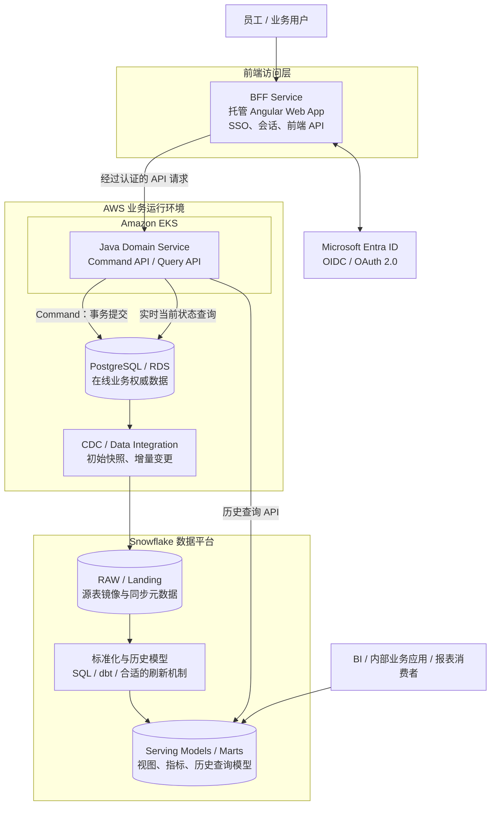

这张图是建议目标架构，不是对某个现有环境的反向还原。里面有两条不同的请求路径：

- **在线命令和当前状态**：Angular 调用 BFF，BFF 转发到 Java Domain Service，再由 Java 使用 PostgreSQL 本地事务更新权威记录。
- **历史查询**：请求仍从 BFF 和 Java API 进入，但历史数据过滤、Join、窗口计算和聚合在 Snowflake 完成。应用层不需要把十年记录取回内存再处理。

PostgreSQL 到 Snowflake 的同步是异步链路，不在交易提交的同步调用栈内。除非另外建立强一致性机制，在线写入成功并不表示 Snowflake 的查询模型已经刷新。

### 1.2 AWS 部署图

下面按典型的私有网络部署画出边界。它假设 BFF 和 Java 服务均作为工作负载运行在 EKS；如果实际部署把 BFF 放在独立容器平台或托管应用服务，只需调整入口和运行位置，业务分层不变。

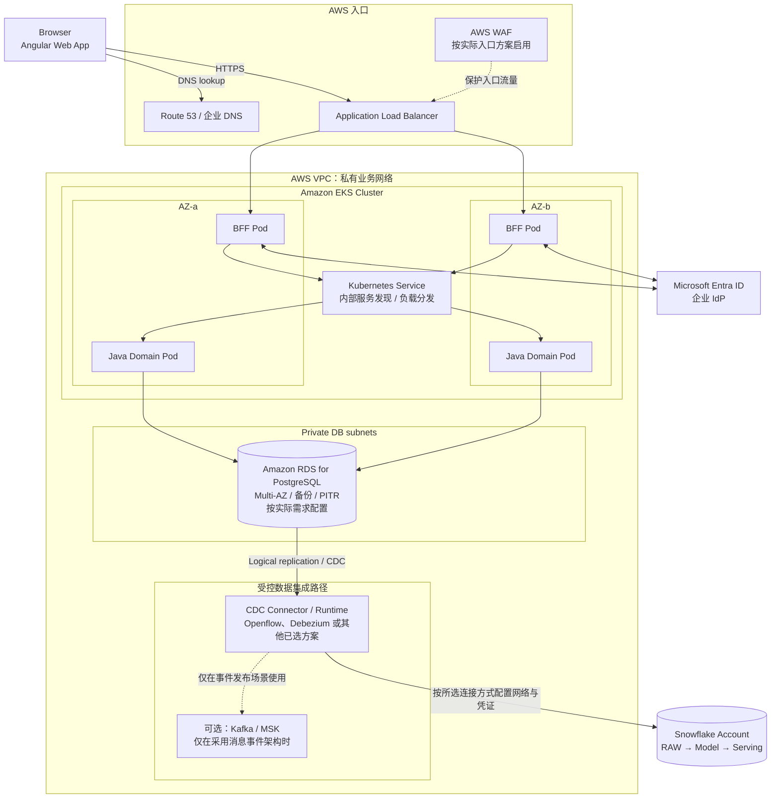

部署时要落实这些边界：

1. RDS 不应直接暴露公网；只允许必要的 EKS 工作负载和数据集成组件访问对应端口。
2. BFF 与 Java Domain Service 即使同处 EKS，也应使用不同的 Kubernetes Service Account、网络策略和云端访问身份。浏览器不应获得数据库凭证，也不应直接连接 Snowflake。
3. Snowflake 是独立的数据平台边界。跨 AWS 账户或网络访问方式取决于 Snowflake 部署区域、账户配置和所选 Connector；PrivateLink 等私有连接能力需要单独核实，不能从这张图推定已经配置。
4. RDS Multi-AZ 主要处理数据库可用性与故障切换，不负责替 Snowflake 提供查询能力。
5. 图里的 Connector 只是部署位置的抽象。Openflow、Debezium 配合消息平台、托管 CDC 产品的运行方式并不相同，选型后要用实际部署图替换这一块。

### 1.3 BFF、Domain Service 与 Snowflake 的边界

微软的 [Backends for Frontends pattern](https://learn.microsoft.com/en-us/azure/architecture/patterns/backends-for-frontends) 对 BFF 的定位很明确：它服务某一种前端体验，负责客户端需要的 API 组合和适配，不应成为第二个领域服务。

| 组件                | 应该放在这里的职责                                                                        | 不应该越界做的事                                     |
| ------------------- | ----------------------------------------------------------------------------------------- | ---------------------------------------------------- |
| Angular             | 页面状态、用户交互、请求和结果展示                                                        | 保存长期凭证；绕过服务端权限检查                     |
| BFF Service         | 托管 Angular 静态资源、Entra 登录回调、会话管理、CSRF 防护、前端 DTO、页面所需的 API 组合 | 再写一套交易状态机、财务计算规则或直接访问原始数据库 |
| Java Domain Service | 领域规则、交易状态转换、业务授权、用例编排、命令和查询 API                                | 把十年历史明细全部拉到 JVM 再聚合                    |
| PostgreSQL          | 事务、权威当前状态、唯一性和完整性约束、并发控制                                          | 承接无界历史报表而拖慢交易请求                       |
| Snowflake           | 历史数据处理、大范围 SQL、标准化模型、分析指标与受治理读模型                              | 代替交易服务决定一笔命令是否有效                     |

BFF 可以调用多个 Domain API，再把数据组织成 Angular 页面需要的结构。它可以根据页面场景决定取哪一个已定义的查询接口，但“净资产怎么算”“交易状态能否变更”“某账户是否满足业务资格”这类业务含义不能因放在 BFF 里方便就由 BFF 私自决定。

同样，查询使用 Snowflake 不表示整个查询用例都要写成一段 SQL。Java 依然负责验证请求者是否能查询某个账户、控制查询参数和时间范围、选择已批准的数据模型、处理超时并生成 API 响应；Snowflake 执行大规模数据计算。

### 1.4 Middle layer：应用服务、领域模型与数据适配器

Java 服务内部建议按用例、业务规则与基础设施拆分，不必先把它们做成三个独立微服务。下面是逻辑模块图；它描述代码和依赖方向，不等于 Kubernetes 部署单元。

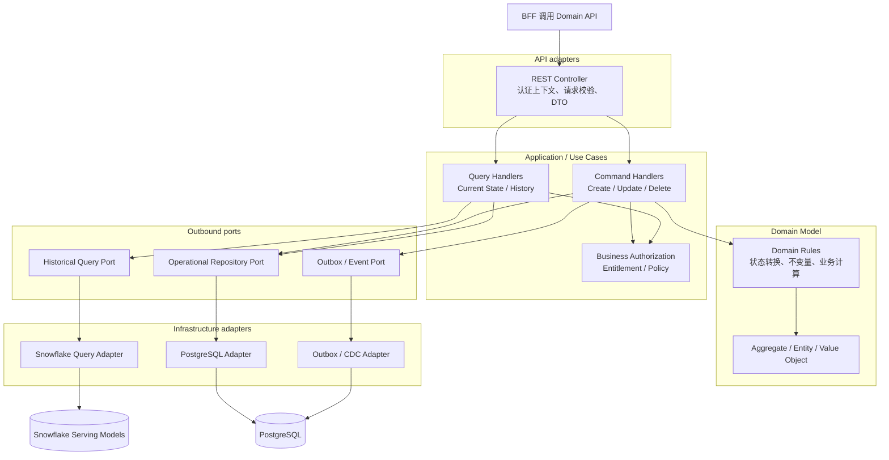

依赖方向有两个实际好处。第一，领域规则不会直接依赖 JDBC、Snowflake SQL 或某个 CDC 产品。第二，切换查询实现时，只要用例契约与业务定义不变，就不必改动命令侧的领域模型。

这里有一个边界需要说清：Snowflake SQL 中的指标和转换规则由业务数据产品或领域团队治理，Java 不需要把每个聚合重新写一遍；但领域层仍拥有交易不变量和业务决策。数据计算放在 Snowflake，不等于业务所有权转移给 Snowflake。

### 1.5 Command 与 Query 的详细分层

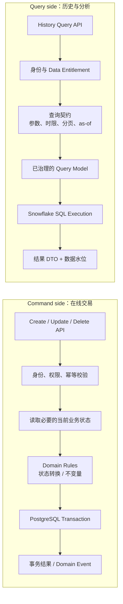

命令侧的判定要在提交前完成，不能依赖延迟更新的分析模型。例如账户状态是否合法、调用者是否拥有操作权限、交易是否处于允许修改的状态，都应在 Domain Service 与 PostgreSQL 交易边界内处理。

查询侧则先验证调用者能查什么，再确定读模型和执行方式。对五年或十年的历史查询，可以在 Snowflake 中用 SQL、窗口函数和预先维护的分析模型完成集合计算。若一条查询需要同时用当前状态和历史数据，API 契约必须声明对实时性和结果一致性的要求，而不是隐藏一次跨库查询。

## 二、关键请求时序

### 2.1 Angular 首次登录：Microsoft Entra SSO

以下流程采用服务端 BFF 会话的常见设计：浏览器持有 HttpOnly 会话 Cookie，访问令牌留在 BFF 服务端。实际 OAuth/OIDC 应用注册、回调 URI、令牌受众和 token acquisition 方式应以企业 Entra 配置为准。

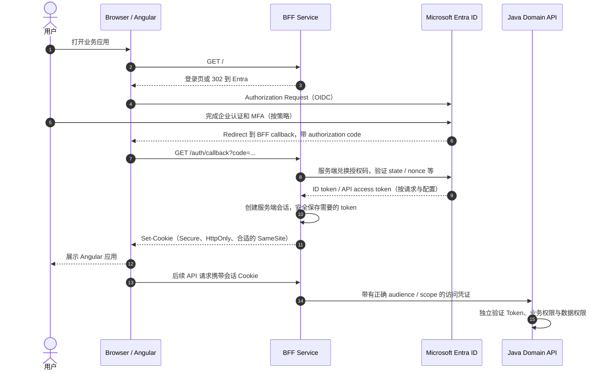

需要逐项检查：

- BFF 在登录过程中校验 state、nonce 和回调参数，授权码只能兑换一次，回调地址必须精确匹配注册配置。
- Cookie 使用 Secure、HttpOnly 和合适的 SameSite 设置。Cookie 会话仍需考虑 CSRF；不能因为 Angular 和 BFF 同域就跳过设计。
- BFF 不应把访问令牌放进页面 HTML、localStorage 或 JavaScript 可读取的会话对象。
- Domain API 不能因为流量来自 BFF 就跳过授权校验。它需要验证自己的令牌受众、权限范围与业务授权；如使用 On-Behalf-Of（OBO），需正确配置下游 API 权限。
- Entra 负责认证和身份声明，不会自动替应用判断某用户是否有权修改某账户、查看某客户或导出某类金融数据。

可对照 Microsoft 的 [BFF 架构模式](https://learn.microsoft.com/en-us/azure/architecture/patterns/backends-for-frontends)、[Microsoft identity platform 应用类型与令牌流程](https://learn.microsoft.com/en-us/entra/identity-platform/v2-app-types)，以及 [OAuth 2.0 for Browser-Based Applications](https://www.rfc-editor.org/info/rfc10017/)。

### 2.2 新增或修改交易：数据库提交是同步成功点

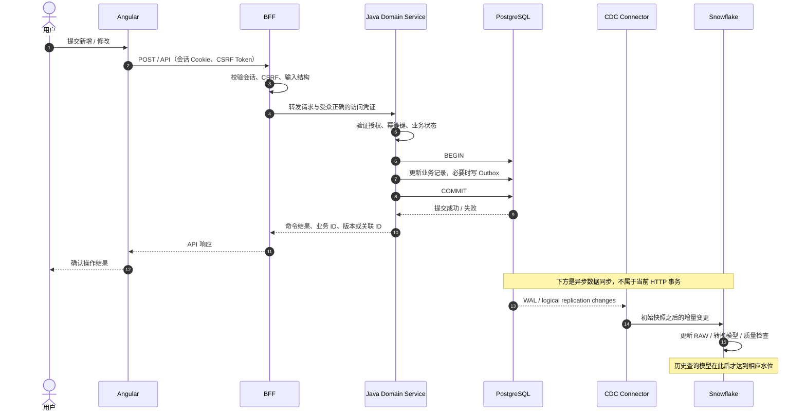

HTTP 命令不应该等待 Snowflake 模型刷新。交易提交后，前端可以直接展示 Domain Service 返回的已提交结果。Snowflake 数据稍后到达，不代表交易失败，也不应触发第二次交易提交。

更新操作要有幂等与并发策略。若客户端因超时重试 POST，服务端应通过幂等键或等价机制避免重复执行。乐观锁可用版本字段检测陈旧更新；需要跨行不变量的场景，则要按 PostgreSQL 的事务隔离、约束或锁策略设计。

如果还要发布 TradeApproved 这类业务事件，Outbox 记录应与业务修改在同一 PostgreSQL 事务中提交。表级 CDC 用于复制源表与构造历史镜像；Domain Event 用于表达稳定的业务语义，两者可以共存，但不能把所有数据库行变更都当成领域事件。

### 2.3 查询十年历史：API 负责边界，Snowflake 负责大范围计算

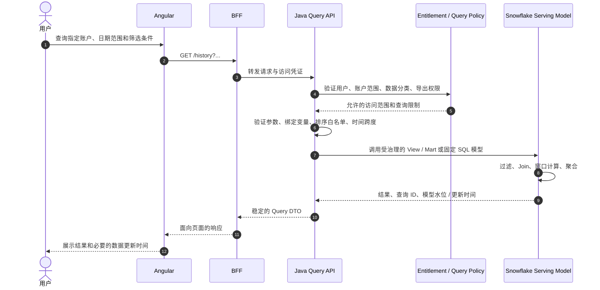

以下事情不应该交给 BFF 临时决定：SQL 中哪些状态算有效、净值或收益如何计算、历史更正用哪个版本、数据权限是否允许放宽。它们应由受治理的 Query API、数据模型和业务授权规则决定。

对十年查询，还需要限制时间跨度、扫描资源和导出方式。常规 API 不一定适合一次返回全部记录；大批量下载通常应成为可追踪的异步任务。Snowflake 的 Query Tag、Query Profile、排队时间、扫描字节和模型更新时间可以帮助解释慢查询或数据滞后。

### 2.4 刚写完就查询：明确 Read-Your-Own-Writes 规则

用户提交修改，命令已经成功，但 CDC 和模型转换还没完成。如果 UI 立刻重新查询 Snowflake，它可能暂时读到旧状态。

建议先选一种明确策略：

- 命令响应中直接返回已提交的记录或版本，前端先显示该结果。
- 对需要确认最新当前状态的请求，短期从 PostgreSQL 读取。
- 对能够接受延迟的历史查询，显示数据更新时间或同步水位。
- 如果业务必须等待读模型追上指定版本，设计有超时上限的等待或重试协议；不能无限阻塞在线请求。

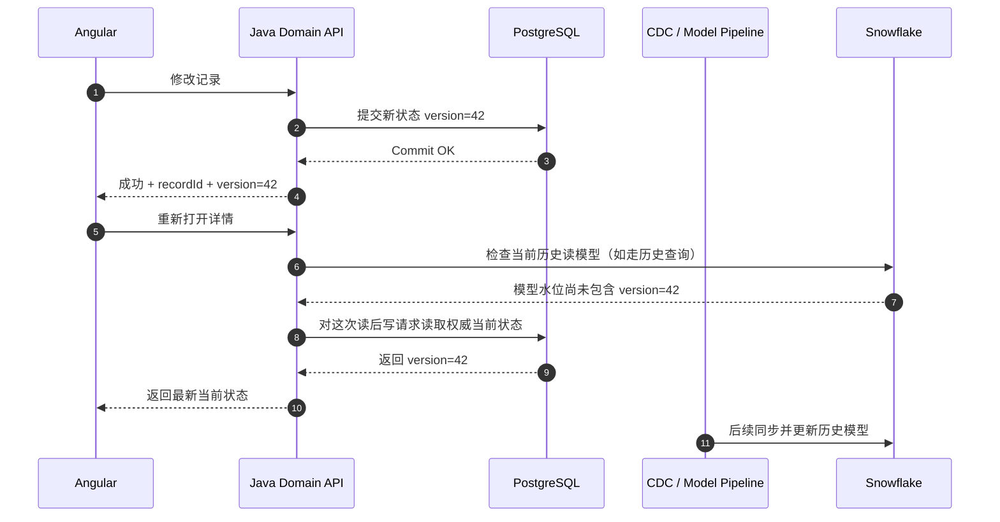

这里的 version=42 是为了说明协议而使用的示例值，不要求所有业务都实现同样的版本字段。具体可以用源端 LSN、水位、事件版本或业务版本来判定是否追上。若无法可靠地关联某条业务更新与分析模型水位，就不要声称已经实现严格的 read-your-own-writes 保证。

### 2.5 初始快照、CDC 与模型刷新

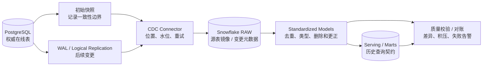

源端快照和增量变更必须在一致的起点衔接，避免漏变更或重复应用。发生中断时，恢复程序应能确认当前复制位置、是否还能从源 WAL 恢复、需要重放哪些数据，以及何时改走重装载与对账。Connector 显示 Running 只能证明进程在运行，不能证明数据正确。

删除、重复和历史更正应分别设计：

- DELETE 在下游是物理删除、删除标记还是保留变更事件，要由历史与审计要求决定。
- 增量重放应具备幂等性，不能因同一 CDC 事件重复送达就重复计入金额。
- 如果需要还原某一历史时点当时知道的事实，只在 Snowflake 不断 MERGE 当前行不够；要保存源版本、记录时间，以及必要的更正或冲销关系。
- 质量对账应包括记录数、金额或数量总和、源端水位、重复主键、缺失记录和延迟分布。

## 三、Snowflake 的查询模型如何与业务模型分工

### 3.1 Java 管业务规则，Snowflake 做集合运算；边界在具体规则

| 逻辑                             | 维护位置                                              | 计算执行位置                                                    |
| -------------------------------- | ----------------------------------------------------- | --------------------------------------------------------------- |
| 某状态是否允许转为 Approved      | 领域团队维护交易规则                                  | Java Domain Service；必要的约束在 PostgreSQL                    |
| 同一对象是否被其他请求更新       | 应用与数据库共同定义并发契约                          | PostgreSQL 锁、版本字段和事务                                   |
| 某账户过去十年每月的交易总额     | 领域/数据产品共同定义口径                             | Snowflake SQL / 读模型                                          |
| 如何把账户、持仓和交易汇总成页面 | 前端体验团队定义页面合同；领域 API 定义可复用业务数据 | BFF 组装 DTO；大范围统计在 Snowflake                            |
| 用户是否能访问某账户             | 安全与业务责任方维护授权策略                          | Domain API 必须强制执行；Snowflake 另有数据访问控制             |
| “有效交易”在历史报表里的含义     | 业务领域拥有定义，数据团队共同维护模型实现            | 写入时的规则在 Java；历史筛选在 Snowflake，需用相同状态口径测试 |

更难的情况是横跨多个域的指标，例如净资产、组合收益率或风险敞口。它们需要业务定义和验证，但不意味着应在每个 Java 请求里重新扫描历史交易计算一次。可以把规则作为有版本的口径维护，在 Snowflake 模型里批量计算，并用固定案例测试输出是否符合业务预期。

### 3.2 Snowflake 的分层模型

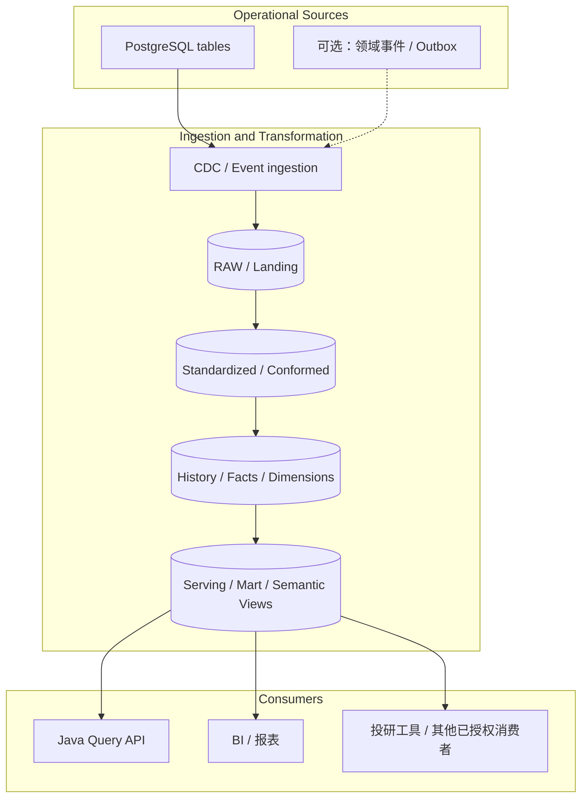

RAW 记录来源，标准化层统一类型、标识、状态与删除处理，历史层保存业务需要的事实、维度和版本，Serving 层则面向明确的查询契约。实际项目可以把几层合并，但不要让每个 API 自己对 RAW 表做一套独立解释。

Snowflake 中的普通 View、Materialized View、Dynamic Table 与手工编排 SQL 作业并非可以随意互换。应根据数据量、依赖关系、目标新鲜度、刷新代价和具体功能支持情况选择。无论用哪一种，Serving 模型都要定义数据更新时间或可核验的水位。

### 3.3 Query Service 到底怎么构造：API 在 Java，查询计算在 Snowflake

这里先纠正一个容易造成误解的说法：通常不是把一套 Query Service 微服务部署到 Snowflake。**建议把 Java Query API 继续运行在 EKS，把要查询的数据模型和 SQL 放在 Snowflake。** Java 服务接收查询请求、做授权与参数校验、选择查询定义，再通过 Snowflake JDBC 执行 SQL。Snowflake 负责扫描数据、Join、窗口计算和聚合。

Snowflake 也提供 SQL API，可以通过 REST 提交 SQL、查看执行状态、取消查询和获取结果；但它只是数据库的执行接口，不是完整的业务查询 API。它不会替你定义面向 Angular 的请求合同、业务权限、可选条件规则、结果 DTO 和查询 SLA。不要让浏览器直接拿数据库身份执行任意 SQL，也不要因为有 SQL API 就再造一套通用 SQL 代理。

#### 查询请求的完整路径

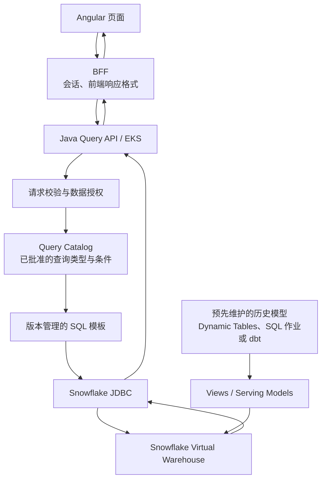

Query Catalog 不一定要成为独立产品。第一版可以是 Java 中的一组命名查询和请求 schema，再加上 Snowflake 中受版本管理的 View / 表模型。查询数量增长后，可以把 SQL 模板和元数据集中管理，但不需要先引入一套复杂的通用查询引擎。

一次请求的处理顺序建议固定：

1. BFF 把登录会话和调用上下文传给 Java API；Java 验证 token、调用者身份和业务权限，不能只因为请求来自 BFF 就默认放行。
2. API 校验请求 schema、日期边界、可选筛选条件、排序字段、分页大小和导出权限。它只接受产品明确支持的查询参数，不接受前端直接传入 SQL 或任意 WHERE 字符串。
3. 根据查询类型选择一个已批准的查询模板。不同查询可以共享基础 View，但不必把所有业务条件硬塞到同一个万能 SQL。
4. Java 将输入值作为绑定参数交给 Snowflake JDBC，执行并读取结果。对大结果集使用有界分页或异步任务，而不是把所有行加载到 JVM。
5. API 将结果转换为稳定的 DTO，并按需要返回查询 ID、所用模型的更新时间或 as-of 水位。日志关联到请求 ID 和 Snowflake query ID，便于追查耗时与费用。

#### Snowflake 里面应该写哪种东西？

| Snowflake 中的对象 | 用在哪里 | 不要把它当成什么 |
|---|---|---|
| 普通 View | 给复杂 Join、字段标准化或常用业务概念一个稳定名称 | View 定义本身通常不保存结果；创建 View 不意味着已经预计算或查询一定更快 |
| SQL 查询：CTE、子查询、EXISTS、窗口函数 | 对本次请求执行的过滤、关联、取最新事件、跨期统计和排序 | 不必把每一个 AND 条件都单独做成数据库对象 |
| 预先维护的表或读模型 | 多个页面反复使用同一套昂贵计算，或者查询必须按一致的历史口径还原 | 不应与源数据镜像混成一张未经治理的大宽表 |
| Dynamic Tables、Tasks、dbt 等转换流程 | 在查询到来之前构建或更新标准化数据、快照、聚合和 Serving 模型 | Dynamic Tables 是数据转换与刷新机制，不是面向用户请求的 REST Query Service |
| Stored Procedure | 在 Snowflake 侧按顺序执行多条 SQL、做分支控制或封装受控的数据操作 | 不必给每一种搜索条件都创建一个存储过程 |
| Snowpark Python / Java / Scala | SQL 难以清楚表达、适合靠近数据执行的转换或计算 | 不应把普通关系查询换成程序代码，只为“看起来更像服务” |
| UDF / UDTF | 把可复用的标量逻辑或表函数嵌入 SQL 计算 | 不应拿 UDF 代替跨表的数据模型、API 授权或完整的领域服务 |

官方资料：[Views](https://docs.snowflake.com/en/user-guide/views-introduction)、[Dynamic Tables](https://docs.snowflake.com/en/user-guide/dynamic-tables-intro)、[Snowpark](https://docs.snowflake.com/en/developer-guide/snowpark/python)、[在运行时构造 SQL](https://docs.snowflake.com/en/user-guide/querying-construct-at-runtime)、[SQL API](https://docs.snowflake.com/en/developer-guide/sql-api/intro)。

对当前架构，我会从 **Java Query API + JDBC + 版本化 SQL 模板 + Snowflake Serving View / 历史模型** 起步。只有当一段流程确实需要在 Snowflake 内多步执行，才考虑 Stored Procedure；只有当重复计算昂贵、更新节奏可预测时，才考虑预先生成读模型。不要为了“把 Query Service 放进 Snowflake”先移植一套 Java 服务逻辑。

#### Decision tree：该用哪种查询方式？

这里要把三个不同的选择拆开：**应用如何连接 Snowflake、查询逻辑用什么写、结果是否要提前计算**。SQL、JDBC、Snowpark 和 Dynamic Tables 并不是同一层的替代品：SQL 是主要的关系查询语言；JDBC / SQL API 是提交与读取查询的接口；Snowpark 是另一种编写数据处理逻辑的 API；Dynamic Tables / Tasks 解决的是读模型何时准备好。

~~~mermaid
flowchart TD
    A["先判断请求的业务语义"] --> B{"是否属于在线业务读取，且需要权威当前状态？<br/>例如当前待办、审批状态、资格校验"}
    B -- "是" --> C["Java Domain API + PostgreSQL 权威状态"]
    B -- "否：历史、跨期、组合筛选或分析" --> D["Java Query API 做授权与请求约束"]
    D --> E{"主要是关系型筛选、Join、窗口、聚合吗？"}
    E -- "是" --> F["Snowflake SQL：CTE、EXISTS、窗口函数"]
    E -- "否，确有专用程序计算" --> G{"是否可以用受控函数表达？"}
    G -- "单值或逐行转换" --> H["UDF / UDTF"]
    G -- "多步处理或复杂转换" --> I["Snowpark / Stored Procedure"]
    F --> J{"同一昂贵计算是否被反复执行？"}
    J -- "否" --> K["普通 View + 本次 SQL"]
    J -- "是，数据变化慢且查询形状稳定" --> L["评估 Materialized View 的限制与维护成本"]
    J -- "是，跨表模型或多阶段 Serving Model" --> M["Dynamic Tables / Tasks / dbt 等预构建读模型"]
    D --> N{"应用怎样提交查询？"}
    N -- "Java 服务" --> O["优先 JDBC Driver"]
    N -- "只能走 REST / 需轮询状态或取消语句" --> P["SQL API"]
    N -- "第三方 BI / 桌面分析客户端" --> Q["使用受支持的 ODBC / JDBC 连接器"]
    N -- "要把自定义容器应用作为 Snowflake 内服务运行" --> R["单独评估 Snowpark Container Services"]
~~~

上图的第一道分支比“SQL 还是 Snowpark”更重要：**操作工作台中的当前待办、当前审批状态和投票指令不应依赖有刷新延迟的分析读模型作最终判断**。这类页面优先从 PostgreSQL 读取；Snowflake 负责历史记录、跨期间筛选、批量汇总和分析模型。具体投票决策仍由 Java 领域规则和授权控制。

| 选项 | 适用情况 | 本架构的推荐 |
|---|---|---|
| Java Query API + Snowflake JDBC + SQL | Java 已是 EKS 中的应用服务；查询参数、业务授权、DTO 和超时需要清晰控制 | **默认方案**。SQL 模板在代码仓库版本管理，使用参数绑定；应用层 API 不暴露数据库身份 |
| Snowflake SQL API（REST） | 集成方无法使用驱动，或需要 HTTP 提交语句、查询状态、取消语句和取回结果 | 是 JDBC 的连接/调用方式替代，不是 SQL 语言的替代，也不是完整业务 API |
| ODBC / JDBC 客户端直连 | 受控的 BI、报表工具或内部分析客户端，有明确的用户身份和角色映射 | 适用于受管理的分析入口；不要把直连凭证下发到浏览器或普通终端应用 |
| 普通 View + 单次 SQL | 重用命名、标准化字段或共享 Join；计算不昂贵、结果使用不频繁 | 先选它。普通 View 保存查询定义，不等于缓存结果 |
| Materialized View | 同一查询形状反复执行、底表相对少变、计算成本高，且目标查询满足产品限制 | 先用 Query Profile 验证；当前实现有单表、不能 Join、不能使用窗口函数等限制，不能拿它当通用多表读模型 |
| Dynamic Tables | 需要用 SQL 构建多阶段、跨表的 Serving Model，并以目标新鲜度驱动刷新 | 用于预先构建查询模型；TARGET_LAG 是尽力而为的新鲜度目标，不是严格 SLA |
| Tasks + SQL / dbt 或其他编排 | 定时快照、批量回填、质量校验、重算、跨作业依赖和发布流程 | 以团队已采用的编排工具为准。避免再叠一套没有运营责任人的调度系统 |
| Stored Procedure / Snowflake Scripting | 一次数据库侧操作需要受控地顺序执行多条 SQL、变量分支、异常处理或事务内编排 | 用在数据库侧操作边界清楚的场景，不要将整个领域服务搬进去 |
| UDF / UDTF | 多个查询需要重用同一段单值计算或表函数逻辑 | 保持小而可测；行访问授权、复杂跨表查询和完整业务流程不应塞进函数 |
| Snowpark DataFrame API（Python / Java / Scala） | 自定义转换明显比 SQL 更清楚，或需要使用支持的语言库，同时希望计算靠近 Snowflake 数据执行 | 先做 PoC，检查生成 SQL、可观测性、包依赖和成本；不要只为避开 SQL 而迁移 |
| Snowpark Container Services（SPCS） | 必须运行容器化应用、专用运行时或长运行服务，并且适合在 Snowflake 管理的 Compute Pool 中运营 | **不是默认的 Domain API 部署点**。它可以暴露服务端点，但会引入镜像、Compute Pool、服务权限、网络入口和独立运维边界 |
| Cortex / 自然语言分析能力 | 用户要用自然语言探索指标或提出临时分析问题 | 作为辅助分析入口单独治理；不能替代确定性的业务授权、固定查询合同、批准流程或投票指令校验 |

#### 推荐方案：先按默认组合落地

对这里的金融服务应用，建议从 **Java Query API + JDBC + 版本化 SQL + Snowflake 受治理的 Serving Models** 起步。只有出现可量化的瓶颈或明确的程序化需求，再选预计算、存储过程或 Snowpark。

1. **简单查询先写 SQL。** CTE、EXISTS / NOT EXISTS、窗口函数和聚合通常足以表达历史查询；优先把查询语义和数据模型设计清楚。
2. **重复而昂贵的计算才预计算。** 先观察 Query Profile、访问频次、底表变化率和实际刷新需求。Materialized View 与 Dynamic Tables 的适用条件不同，不能混为一类。
3. **需要调度时单独设计刷新责任。** 设定数据水位、重试、回填、对账、告警和发布方式；不要只配置一个刷新时间，就假定数据一定按时可见。
4. **复杂代码不自动意味着 Snowpark。** 先证明 SQL 表达不清或无法满足约束；再测量 Snowpark 的开发、执行、包管理、排错和计算成本。
5. **把查询入口与业务授权分开。** JDBC 或 SQL API 能执行的 SQL 范围必须由服务端限定。无论接口用哪种协议，都不能接受前端提交任意 SQL、任意列名、任意对象名或任意过滤表达式。
6. **任何分析结果都要带上新鲜度语义。** 对有时点意义的查询，返回模型水位 / as-of 时间，且在水位超限时降级、提示或回源；不能把异步投影伪装成与主库强一致。

#### 查询条件不是一个简单的 WHERE 时，怎么表达？

复杂不等于必须写程序逐行处理。很多高级搜索实际上是几种关系运算的组合：

- 当前状态和指定日期之前的历史状态必须同时满足；
- 记录必须经历过若干指定阶段，但不能出现某类后续事件；
- 同一记录有很多次变更，只取指定时点最后生效的一次；
- 先按主体或类别分组，再取每组最新记录、排名或累计值；
- 对记录的历史版本做时间点关联，并统计后续一个观察窗口内的结果。

这类查询通常可以用规范化的历史模型、CTE、EXISTS / NOT EXISTS、ROW_NUMBER() / QUALIFY、窗口函数和分组聚合表达。真正的设计工作不是把条件堆进一条很长的 SQL，而是明确查询语义，再选择合适的数据模型和拆分层次。

前端可以提交有类型的查询请求，而不是自己编 SQL：

```json
{
  "asOf": {
    "effectiveDate": "2026-09-30",
    "knownAt": "2026-09-30T23:59:59Z"
  },
  "filters": {
    "statuses": ["ACTIVE", "PENDING"],
    "requiredStages": ["CHECK_A", "CHECK_B"],
    "excludeEvents": ["BLOCKED", "WITHDRAWN"],
    "changedBetween": {
      "from": "2025-01-01",
      "to": "2026-09-30"
    }
  },
  "sort": {
    "field": "lastChangedAt",
    "direction": "DESC"
  },
  "page": {
    "size": 50,
    "cursor": null
  }
}
```

这些状态和阶段代码是虚构示例。API 必须定义条件的确切语义：requiredStages 是“每个阶段都曾在该时点以前完成”，还是“命中过任意阶段即可”；excludeEvents 是指截至时点曾经发生过，还是只看最新状态。两种定义会生成不同 SQL，不能把它们当成普通字段过滤。

一种可行的 SQL 结构如下。它用于说明关系运算，不是可以直接拷贝的生产查询；真实表名、事件定义、参数占位符和访问条件要按实际模型确定。

```sql
WITH latest_stage_event AS (
    SELECT
        record_id,
        stage_code,
        event_type,
        effective_at,
        recorded_at,
        ROW_NUMBER() OVER (
            PARTITION BY record_id, stage_code
            ORDER BY effective_at DESC, recorded_at DESC, event_id DESC
        ) AS rn
    FROM MART.RECORD_STAGE_EVENT
    WHERE effective_at <= ?
      AND recorded_at <= ?
),
eligible_records AS (
    SELECT r.record_id, r.status, r.last_changed_at
    FROM MART.RECORD_CURRENT r
    WHERE r.effective_at <= ?
      AND r.recorded_at <= ?
      AND r.status IN (?, ?)
      AND EXISTS (
          SELECT 1
          FROM latest_stage_event e
          WHERE e.record_id = r.record_id
            AND e.stage_code = ?
            AND e.event_type = 'COMPLETED'
            AND e.rn = 1
      )
      AND NOT EXISTS (
          SELECT 1
          FROM latest_stage_event e
          WHERE e.record_id = r.record_id
            AND e.stage_code = ?
            AND e.event_type = 'BLOCKED'
            AND e.rn = 1
      )
)
SELECT record_id, status, last_changed_at
FROM eligible_records
ORDER BY last_changed_at DESC
LIMIT ?;
```

上例用问号表示 JDBC 参数。日期、状态和值都应绑定，不要拼接字符串。排序字段、列名和表名通常不能直接用值参数绑定，应从服务端白名单中选择。

可选过滤条件较多时，按已批准的查询形状组织有限几种 SQL 模板，而不是生成任何用户想要的 SQL。状态列表等变长输入，应使用驱动支持的安全绑定方式，或依据经过校验的值生成占位符。如果某些搜索需要大量阶段和事件关联，可以先构建可复用的“截至某时点的当前状态 / 阶段投影”，让查询针对稳定、粒度清楚的模型，而不是每次从原始事件表重建所有状态。

若业务用户确实需要组合很多条件，可以设计受限的查询 DSL：每个条件由字段 ID、操作符、值和组合节点构成；字段和操作符由服务器注册，服务器检查字段类型、允许的关系、最大嵌套层数与时间跨度，再编译为固定 SQL 结构。第一版只实现真实使用的条件类型，不需要做成通用 SQL Builder 产品。

#### 跨期回溯查询要先设计历史模型

常见困难不是 WHERE 写得不够长，而是缺少能回答历史问题的数据结构。至少要判断是否需要以下内容：

| 数据结构 | 作用 |
|---|---|
| 当前记录 / 主体表 | 保存当前认可的状态和稳定标识 |
| 事件历史表 | 记录状态或属性何时生效、何时被系统记录以及事件顺序 |
| 历史快照 / 版本化模型 | 支持“在某个时间点，系统已知的状态是什么” |
| 后续结果事实表 | 保存观察期内发生的结果、度量和结果可用时间 |
| 规则与指标版本 | 说明历史计算使用哪一版定义、排除条件和观察窗口 |

必须区分 effective_at（业务事实何时生效）与 recorded_at（系统何时获知事实）。例如，某条更正数据在九月才到达，却把六月的业务值改掉，那么“按六月的最终修正值统计”与“重现六月当时能看到的结果”不是同一项查询。回溯分析如果只按业务日期关联、却使用后来才出现的数据，可能把未来信息带入历史结果。是否需要双时态历史要由可复现性要求决定，不是所有表都要无条件做成双时态。

查询模型中还要固定观察窗口、指标口径和版本。例如结果是截至某个日期，还是在记录创建后 30 天、90 天或一年观察；缺失结果是未知、零，还是不纳入计算；纠正记录是否重算既往结果。这些都是查询语义，不应散落在多个 API 的 if/else 中。

#### 哪些逻辑留在 Java，哪些放在 Snowflake？

| 逻辑 | 建议位置 |
|---|---|
| 交易提交前必须通过的业务规则、权限判定、状态转换 | Java Domain Service；需要原子性的数据约束由 PostgreSQL 共同保证 |
| 对大量历史行做过滤、事件存在性判断、窗口计算、排名、跨期聚合 | Snowflake SQL / 查询模型 |
| 多个查询共享、且每次临时计算昂贵的历史派生数据 | 预先维护的 Snowflake 模型；按新鲜度要求选择刷新机制 |
| 多步批处理、受控分支或需在 Snowflake 内顺序执行的数据库操作 | 评估 Snowflake Stored Procedure / Task |
| 难以表达为关系运算的专用计算 | 先确认 SQL 不适用，再评估 Snowpark；保留可测试、可版本化的实现 |
| Angular 页面字段拼装、页面专属 DTO | BFF |
| 请求校验、查询模式选择、授权、超时、分页、结果 DTO 与审计关联 | Java Query API |

即便同一项业务定义既影响写入规则，也影响历史分析，也不要让 Java 和 SQL 各自出现两个互不校验的实现。交易侧需要在提交时执行；历史侧可以在 Snowflake 批量计算，但要用版本化定义和固定案例验证两边的含义一致。

#### 性能与安全一起设计

Snowflake 普通 View 是已命名的查询定义，不会自动保存结果；Materialized View 和预先维护的读模型会引入存储及维护成本。Dynamic Tables 的 [TARGET_LAG](https://docs.snowflake.com/en/user-guide/dynamic-tables-target-lag) 表示期望的新鲜度目标，不应当作每一次刷新都准时完成的 SLA。选型前应先看 SQL Profile 与实际延迟，再决定是否值得预计算。

查询 API 需要控制的内容包括：

- 参数必须绑定；动态列名、排序字段和可选 Join 必须来自服务端白名单。
- 限制日期跨度、最大返回行数、查询执行时间和并发；大导出改走异步任务。
- 给 SQL 加 Query Tag 或等价关联信息，并记录 Snowflake query ID、请求类型、数据模型版本和处理水位。
- Java 的业务授权与 Snowflake 的 Role / Row Access Policy / Secure View 是互补关系。若所有用户共用一个 Snowflake service role，Snowflake 不会自动知道每个 Entra 用户的业务权限；要在 Java 侧校验，或设计经过服务端验证的身份/权限映射，不能把 Query Tag 当授权机制。

这些边界比选择“纯 SQL 还是 Snowpark”更重要。通常先把关系计算写成 SQL；只有在 SQL 确实难以表达或需要程序化控制时再引入 Snowpark / Stored Procedure。大部分查询复杂度应通过有版本的查询模板与合理的数据模型来管理，不必把整套业务逻辑移植到 Snowflake 的过程代码里。

### 3.4 把 SQL 模型当作生产代码维护

只要某个查询会被多个应用依赖，就应该有版本管理、Review、自动化测试和发布流程，而不是把 SQL 留在某个人的 worksheet 或 Java 字符串里。

至少应为核心模型维护业务定义与责任人、输入输出 Schema、测试数据、对账测试、数据水位和权限契约。测试要覆盖重复行、空值、跨年边界、迟到记录、删除、更正与重放；对账要核对记录数以及关键金额、数量和汇总差异。

Snowflake 语义视图可以帮助统一可复用的业务指标定义，尤其是多个查询消费者需要同一组字段和度量时。它不能代替 Java 写入规则，也不会自动解决业务口径争议；必须有团队负责规则、模型和测试。

## 四、Snowflake 能否直接承担新增、修改和删除？

答案不是“不可以”。Snowflake Standard Tables 支持 DML 和事务；Hybrid Tables 则是面向特定事务型应用场景的另一种表类型。但 SQL 语法可用，并不意味着数据库在锁、约束、点查、故障恢复与运行费用方面可以直接替换 PostgreSQL。

### 4.1 Standard Tables

标准表以分析型存储与计算方式为主要设计目标。它们适合历史数据装载、批量 MERGE、数据修正和转换任务，不宜仅因支持 UPDATE 就用来承接每次点击触发的一笔核心交易。

有两点最容易被忽略：

- Snowflake 标准表上，PRIMARY KEY、UNIQUE 和 FOREIGN KEY 通常是声明性约束，并不会像传统 OLTP 数据库那样强制保证唯一性和引用完整性；NOT NULL 和 CHECK 是例外。应用不能依靠一个声明出来的主键来防止生产表出现重复业务记录。
- 高频小事务、同一记录争用和大量随机点查，需要专门验证其并发与延迟表现。批量分析查询快，并不能用来推断在线 CRUD 的行为。

参考：[Snowflake Constraints](https://docs.snowflake.com/en/sql-reference/constraints)、[Snowflake Transactions](https://docs.snowflake.com/en/sql-reference/transactions)、[Snowflake Architecture](https://docs.snowflake.com/en/user-guide/intro-key-concepts)。

### 4.2 Hybrid Tables

Hybrid Tables 支持事务型访问模式，包括行级锁、索引随机查找及强制执行主键、唯一键和外键约束。它们可以与标准表一起用，但有各自的功能边界、容量规划和费用结构。

不要只做一个 insert/select PoC 就决定迁移。至少验证目标区域与账户的功能可用性、表容量和节流、读写 p95/p99、同一行争用、事务回滚、约束冲突、读后写语义、驱动与 ORM 兼容、备份恢复和全成本。还应逐项核对 [Hybrid Tables 的功能限制](https://docs.snowflake.com/en/user-guide/tables-hybrid-limitations) 与 [费用说明](https://docs.snowflake.com/en/user-guide/tables-hybrid-cost)；产品限制和配额会变，不能把一次查询结果写成长期承诺。

| 方案                                        | 更适合                                                            | 设计前要验证                             |
| ------------------------------------------- | ----------------------------------------------------------------- | ---------------------------------------- |
| PostgreSQL + Snowflake Standard Tables      | 核心交易与多年历史分析并存                                        | CDC 新鲜度、历史口径、两套模型的治理成本 |
| PostgreSQL + 少量 Hybrid Tables             | 有边界的低延迟事务型数据，且与 Snowflake 内分析数据组合有实际价值 | 功能限制、并发、读后写、费用和集成兼容   |
| Snowflake Standard Tables 直接服务所有 CRUD | 低频批量修数、分析表维护、受控装载                                | 不要以此推定适合高并发交易 API           |

对目前描述的系统，没有必要为了让“所有数据都在一个平台”而替换整个 PostgreSQL 交易写入层。更合理的做法是先把 Snowflake 当作分析模型平台；如果某个范围明确的业务以后适合 Hybrid Tables，再单独验证。

## 五、历史数据的时间和审计语义

五年或十年历史数据的难点往往不是查询写法，而是“历史记录”究竟要表达什么。

假设一笔交易发生在 2024 年，但外部来源在 2026 年才发送更正。业务可能需要回答两种不同的问题：更正后我们认为这笔交易的正确状态是什么；以及 2025 年出具历史报表时，系统当时掌握的事实是什么。这两种答案不一定相同。

涉及更正、冲销、历史估值或监管报送的模型，应根据需求区分业务生效或发生时间（effective / business time）、系统收到或记录时间（recorded / ingestion time）、源版本或 CDC 位置，以及原记录与更正、冲销之间的关联。

不是所有表都需要完整的双时态设计。如果报表只关心当前认可的最终状态，保留当前状态加必要审计字段可能已经够用；如果要重现某个历史日期当时可见的数据，就必须保留能够重建该状态的历史版本或不可变事件。

不要让 Snowflake 的 RAW 镜像意外成为财务账本的唯一来源。交易事实、记账模型和冲正方式应由相应的业务系统与控制框架确定。Snowflake 可以保留历史镜像、支持分析和对账，但其分析模型不是交易提交记录的替代品。

## 六、公开参考架构的 Mermaid 概念重绘

以下图不是厂商原图的逐组件复刻，而是依据原始公开资料，把与当前设计有关的结构重新画成 Mermaid。保留来源链接便于核对；为避免误导，不再把外部图片直接嵌入文章，也不把案例里使用的产品当作本系统的必选组件。

### 6.1 Microsoft：BFF 按前端体验拆分，而非承接领域规则

微软的 BFF 模式重点是客户端适配、路由与聚合：不同前端可以有自己的 BFF，共享的业务能力仍放在后端服务。以下图是该模式的概念摘要，不是 Azure 产品拓扑的逐项重画。

~~~mermaid
flowchart LR
    Mobile["移动端"] --> Gateway["网关 / 路由层"]
    Desktop["Web / 桌面端"] --> Gateway
    Gateway --> MobileBFF["Mobile BFF"]
    Gateway --> WebBFF["Web BFF"]
    MobileBFF --> Domain["共享业务 API"]
    WebBFF --> Domain
    Entra["企业身份提供商"] -. "认证 / Token" .-> Gateway
    WebBFF --> Obs["日志与监控"]
    MobileBFF --> Obs
~~~

对当前系统的借鉴是让 Angular 页面适配留在 BFF，交易规则、账户权限与指令状态流转留在 Java Domain Service。来源：[Microsoft — Backends for Frontends pattern](https://learn.microsoft.com/en-us/azure/architecture/patterns/backends-for-frontends)。

### 6.2 AWS：支付接口现代化参考架构中的部署与集成边界

AWS 于 2022 年发布的 Payment System Interface Modernization 图展示了请求接入、容器化微服务、RDS、Redis、MSK、可观测性以及 IAM / KMS / Secrets Manager 等分层。下面只提炼对当前方案有用的边界，**并不表示本文系统需要采用图里的全部组件**。

~~~mermaid
flowchart TB
    Client["内部渠道 / 外部调用方"] --> Entry["受控入口<br/>WAF / API Gateway / ALB<br/>按实际接入方式选择"]
    subgraph VPC["私有 AWS 网络"]
        Entry --> EKS["EKS 上的业务服务"]
        EKS --> RDS[("RDS / PostgreSQL<br/>权威事务数据")]
        EKS --> Cache[("可选缓存<br/>仅针对已定义的缓存需求")]
        EKS -. "可选：异步事件" .-> MSK["MSK / 消息平台"]
        Sec["IAM / 工作负载身份<br/>Secrets Manager / KMS"] -. "身份与密钥控制" .-> EKS
        Obs["CloudWatch / 日志与告警"] --- EKS
    end
    MSK -. "事件消费者 / 集成" .-> Downstream["下游系统"]
    RDS --> CDC["受控 CDC / 数据集成"]
    CDC --> SF[("Snowflake 读模型")]
~~~

本系统应按已有 AWS Landing Zone、EKS 入口、RDS 网络和 Snowflake 连接方式重新确认具体部署。不要仅凭一张参考图就假定 Direct Connect、HSM、MSK、Redis 或某一种 API Gateway 已经存在。来源：[AWS — Payment System Interface Modernization on AWS](https://docs.aws.amazon.com/architecture-diagrams/latest/payment-system-interface-modernization/payment-system-interface-modernization.html)，原图发布日期 2022-04-06。

### 6.3 Netflix Data Mesh：管道控制面与执行面分离

Netflix 公开文章将其数据移动平台区分为 Controller 控制面和 Pipeline 数据面：前者接收请求、部署并管理管道生命周期；后者实际消费源数据、执行转换并写入目标。图中组件名称是文章结构的概念摘要，不代表本文应另建同等规模的平台。

~~~mermaid
flowchart TB
    Operator["平台使用者 / 配置接口"] --> Controller["Control Plane<br/>管道定义、配置、部署、生命周期"]
    Controller --> Registry["管道配置 / 元数据"]
    Controller -. "创建、更新、管理" .-> Runtime["Data Plane：运行中的 Pipeline"]
    SourceDB[("源系统 / 数据库")] --> Source["Source Connector"]
    Source --> Transport["事件传输层"] --> Processor["过滤 / 映射 / Join 等处理"] --> Sink["Destination Connector"] --> Target[("目标存储 / 读模型")]
    Runtime -. "配置与管理" .-> Source
    Runtime -. "配置与管理" .-> Processor
~~~

可以借鉴“谁管理同步配置”与“谁执行数据复制和转换”是不同职责。当前规模如果一个托管连接器加上模型代码就能解决问题，不需要为了复刻 Netflix 而自建管道控制平台。来源：[Netflix Technology Blog — Data Mesh](https://netflixtechblog.com/data-mesh-a-data-movement-and-processing-platform-netflix-1288bcab2873)。

### 6.4 Netflix Delta：避免双写，以 CDC 维护派生读模型

Netflix Delta 的公开案例从源数据变更捕获 CDC 事件，经消息传输与流处理，必要时调用其他服务做数据丰富，最后更新搜索索引。目标是说明派生数据同步模式，而非证明某种消息平台是 Snowflake 的必需前置组件。

~~~mermaid
flowchart LR
    Writer["写入源系统的应用"] --> SourceDB[("权威源数据库")]
    SourceDB --> CDC["CDC Connector"]
    CDC --> Topic["事件传输 / Kafka Topic"]
    Topic --> Processor["流处理与数据丰富<br/>可调用其他业务服务"]
    Processor --> Search[("派生搜索索引")]
    Search --> Query["查询消费者"]
~~~

对本文的直接启示是：写操作应先提交到权威源，派生读模型通过可重放的异步链路维护；同步失败要有重试、回补与对账，不能把两个系统的独立写入假装为同一事务。实际的 Snowflake 路径可由 CDC、RAW 层与模型刷新构成，不必复制 Netflix 的 Kafka / Flink 组合。来源：[Netflix Technology Blog — Delta: A Data Synchronization and Enrichment Platform](https://netflixtechblog.com/delta-a-data-synchronization-and-enrichment-platform-e82c36a79aee)。

### 6.5 Kotak Mahindra Bank：独立只读投影需要新鲜度判断和回源

AWS 在 2025 年公开的 Kotak Mahindra Bank 案例描述了 RTS 写入路径和 ROS / Account Inquiry Service 只读路径。只读服务使用外部维护的投影降低核心系统查询压力，但会检测数据延迟；超出 SLO 时回源到核心系统，并返回数据更新时间。下图只概括 ROS 的查询决策，不重画 RTS 的完整交易架构。

~~~mermaid
flowchart TB
    Core[("核心事务系统")] --> CDC["变更捕获 / 事件流"]
    CDC --> Projection[("独立只读投影")]
    User["账户查询调用方"] --> AIS["Account Inquiry Service"]
    AIS --> Fresh{"投影延迟是否满足 SLO？"}
    Projection --> Fresh
    Fresh -- "满足" --> ReplyProjection["从只读投影返回结果"]
    Fresh -- "超限或投影不可用" --> Fallback["回源核心系统"]
    Fallback --> Core
    ReplyProjection --> Response["结果 + 数据更新时间"]
    Fallback --> Response
    Reconcile["对账 / 新鲜度监控"] --- Projection
~~~

这里可以借鉴按新鲜度决定读源、展示数据时间、监控投影与权威源差异的原则。不能直接照搬 DynamoDB、MSK、Redis 或案例中的延迟和吞吐数字；这些是该银行环境中的具体选择与结果。来源：[AWS for Industries — Kotak Mahindra Bank Modernizes Microledgers](https://aws.amazon.com/blogs/industries/kotak-bank-modernizes-microledgers-using-amazon-dynamodb-for-predictable-low-latency-at-scale/)。

### 6.6 参考图能支撑什么结论

| 来源 | 可借鉴的架构原则 | 不能从案例直接推出的结论 |
|---|---|---|
| Microsoft BFF | 前端适配层与共享业务服务分开 | BFF 是领域服务或唯一授权点 |
| AWS 支付接口图 | 网络入口、容器、事务数据、事件流和运维能力需要各有边界 | 每个 AWS 服务都是必选项；2022 年图等于当前环境的部署事实 |
| Netflix Data Mesh | 管道配置与管道执行可以分离 | 当前项目需要自建大型数据移动平台 |
| Netflix Delta | 避免应用双写；CDC、处理和读模型应有可恢复链路 | Snowflake 必须用相同的 Kafka / Flink 组件链 |
| Kotak Mahindra Bank | 读投影需要新鲜度决策、回源、时间戳与对账 | 特定银行的技术栈、性能指标可直接复制到 PostgreSQL + Snowflake |

## 七、运行与治理：上线前需要做的决定

### 7.1 连接池、超时与查询负载

EKS 扩容后，Java Pod 数量可能带动连接数与查询并发一起增长。不要把“增加 Pod”当作所有查询问题的解决办法。在线 Command API 与历史 Query API 应分别设定并发上限、超时、重试和监控维度。

历史查询应记录 Snowflake query ID、调用 API、请求类别、时间范围和数据模型版本（通过 Query Tag 或等价机制关联）；同时监控队列等待、运行时间、扫描字节与费用。超大导出最好做成异步任务，保存作业状态和结果引用，不要让浏览器请求一直占着应用线程。

### 7.2 端到端安全架构：认证、业务授权与数据权限分别执行

Entra 登录只回答“调用者是谁”；Domain API 必须回答“这个人现在能对哪个业务对象做什么”；Snowflake 的 Role、Row Access Policy、Masking Policy / Secure View 等再限制“查询身份能够看到哪些数据”。这三层要互相配合，不能把身份认证、角色菜单或 Query Tag 当成完整的授权方案。

~~~mermaid
flowchart TB
    User["员工 / 业务用户"] --> Browser["Angular 浏览器<br/>无数据库凭证"]
    Browser --> BFF["BFF<br/>服务端会话、CSRF、请求适配"]
    Entra["Microsoft Entra ID<br/>OIDC / MFA / 用户身份"] <--> BFF
    BFF -->|"目标 API 的 access token"| API["Java Domain / Query API"]
    API --> Authz["Policy / Entitlement<br/>用户 × 业务对象 × 动作"]
    Authz --> Decision{"允许本次动作？"}
    Decision -- "否" --> Deny["拒绝并记录原因"]
    Decision -- "是" --> Route{"命令还是查询？"}
    Route -- "命令" --> PG[("PostgreSQL<br/>权威状态 + 原子事务")]
    Route -- "历史查询" --> Adapter["Snowflake Adapter<br/>固定查询目录 / 参数绑定"]
    Adapter --> SFRoles["Snowflake 最小权限应用角色"]
    SFRoles --> Policies["Row Access / Masking / 受控 View"]
    Policies --> SF[("Serving Models")]
    PG --> CDC["独立 CDC 身份"]
    CDC --> RAW[("Snowflake RAW / 模型层")]
    SF --> Audit["应用审计 + Query ID / Access History"]
    PG --> Audit
    API --> Audit
    style Deny fill:#ffe2e2,stroke:#b42318,color:#7a271a
~~~

#### 权限模型建议

| 控制点 | 实际检查内容 | 必须避免的设计 |
|---|---|---|
| Entra / BFF | 用户身份、MFA / 条件访问策略、正确的 OIDC 状态与回调；服务端会话保护、CSRF 与 Cookie 属性 | 把 access token 放进浏览器可读取存储；把 ID Token 当成下游 API 的授权凭证 |
| Java Domain API | 每次请求验证目标 API 的 access token（签名、issuer、audience、过期、scope / role）；检查用户、账户、组合、区域、任务分配和动作权限 | 因为请求经过 BFF 或菜单隐藏了按钮，就默认有权访问 |
| 业务策略 | 根据动作、业务对象、当前工作流状态和职责分离要求做 Policy Decision；高风险操作要求独立审批 | 由前端、SQL 条件或 LLM 单方面决定访问边界 |
| PostgreSQL | 应用工作负载专用数据库角色；事务约束、唯一键、乐观锁；必要时使用数据库权限和行级策略作纵深防御 | 让只读查询角色写业务表；把数据库管理员凭证放进应用；将权限只放在 UI |
| Snowflake | 应用查询 Role 只读访问批准的 Serving Schema；按需采用 Secure View、Row Access Policy、动态 Masking；Transformation、CDC、应用查询与管理员身份分离 | 应用服务使用 ACCOUNTADMIN / 高权限角色；让面向终端用户的请求触达 RAW；用 Query Tag 当行级授权条件 |
| 工作负载身份 | EKS 中 BFF、Domain API、CDC、模型刷新和导出作业使用不同 Service Account / IAM Role；凭证进入 Secrets Manager / 合规密钥系统，定期轮换 | 多个工作负载共用一个全权 AWS Role 或 Snowflake 用户，导致无法收窄权限与追查责任 |
| 网络与密钥 | RDS 放在私有子网；按实际部署收敛 EKS 到 RDS 的网络；限制 Snowflake 入站来源；评估 PrivateLink / 私有连接、TLS、KMS 与出站白名单 | 认为启用 TLS 等于网络隔离，或者把私有连接能力当作默认已配置 |
| 审计与证据 | 关联用户 / workload identity、业务对象、动作、审批人、请求 ID、PostgreSQL transaction / version、Snowflake query ID、模型版本与数据水位；按策略保留并限制修改 | 只保留应用字符串日志；把“SQL 成功”“Connector Running”当作合规证据 |

#### 需要明确的身份映射方式

如果 Java 用一个共用 Snowflake service role 查询，那么 Snowflake 默认看到的是该服务身份，不会凭 Query Tag 自动知道某个 Entra 用户属于哪个投资组合或账户。可采用两种经过评估的模式：

- **应用层业务授权 + Snowflake 服务角色纵深防御**：Java 在查询前完成对象级 Entitlement 检查；Snowflake Role 只能读取批准的 Serving 数据集。若查询跨多个账户，服务端必须把已验证的授权范围转成经过约束的过滤条件，并把可访问数据范围纳入测试。
- **Snowflake 也能执行用户级策略的受控映射**：只有当 Snowflake 侧 Row Access Policy 所需的身份 / 映射可信且可维护时才使用。传入的用户标识不能由浏览器自行声明；需要防止连接池上下文串用、角色切换错误和查询复用导致越权。应有针对不同用户、不同账户的负向测试。

不要因为第一种模式容易实现就把 Snowflake 当成没有数据层防护；同样，不能把 Row Access Policy 当成 Java 领域授权的替代品。权限边界需要分别测试，尤其是跨账户过滤、导出、历史查询、服务身份误配置和异常回退路径。

#### 审计与生产控制

1. **审计记录至少分两类。** 业务审计记录谁在何时对哪个业务对象执行了什么、使用了哪一版规则、由谁审批以及外部系统确认了什么；技术审计记录调用链、执行身份、查询 ID、数据模型版本、失败与重试。两类记录要通过关联 ID 串起来。
2. **外部数据访问与连接器使用独立身份。** CDC 只读取必要的 PostgreSQL 变更并写入指定 RAW 区域；转换身份只能写入模型层；在线 Query API 通常只读 Serving Schema。不要用同一身份同时复制、改模、查询和管理账户。
3. **导出是独立动作。** 导出权限不能从“可以看页面”自动继承；控制行数、敏感字段、接收位置、有效期与下载审计。批量导出使用可追踪任务，不把大型结果装入普通 HTTP 响应。
4. **新鲜度与授权不能混为一谈。** 即使 Snowflake 模型水位符合目标，用户仍可能已经失去业务授权；对审批、指令提交等动作必须回到 Domain API 和权威当前状态做校验。
5. **高风险动作要有可验证的停机路径。** 管理员应能够禁用某类命令、撤销外部发送能力、停用相关服务身份或隔离连接器；执行开关、授权策略变更和紧急操作本身也要被审计。

### 7.3 生产监控要能定位“哪一段出了问题”

| 路径                 | 应观测的内容                                                                |
| -------------------- | --------------------------------------------------------------------------- |
| BFF / SSO            | 登录失败、回调错误、会话续期失败、CSRF 拦截、下游调用失败                   |
| Command / PostgreSQL | 交易延迟 p95/p99、锁等待、死锁、幂等命中、冲突、连接池等待和重试            |
| CDC / 模型           | 延迟、复制水位、WAL 积压、连接器状态、重放进度、刷新失败和数据对账差异      |
| Query / Snowflake    | 查询排队与执行时间、扫描字节、取消率、查询 ID、模型更新时间、Warehouse 消耗 |

连接器 Running、SQL 返回成功或模型刷新完成，都不能单独证明数据完整、口径正确或用户权限适当。对核心金额和数量字段，应定期核对源端与目标端；发现差异时需要有重放或受控回补流程。

## 八、落地顺序

先选一个交易对象和一个十年历史查询来验证整条链路，不必同时改造所有 API。

1. **把边界写成接口契约。** 定义交易规则、权威数据源、当前状态读取、历史模型、用户与账户授权、数据新鲜度，以及哪些查询允许最终一致。
2. **验证 PostgreSQL 到 Snowflake 的同步。** 覆盖初始快照、INSERT / UPDATE / DELETE、重复事件、连接器中断、Schema 变化、重放和源目标对账。
3. **迁移一个真实历史查询。** 建立标准化模型或 Serving View，测试边界日期、历史更正、权限和执行成本，再将 Java Query API 指向它。
4. **验证 BFF SSO 和下游身份传递。** 检查 Entra 回调、服务端会话、Token audience / scope、Domain API 独立授权、CSRF 与日志中的敏感信息。
5. **压测两条路径。** 单独测交易写入并发、历史查询峰值和同步积压；再测它们同时发生时，交易 p95/p99 是否受分析工作负载影响。
6. **之后再评估更复杂的 CQRS 或 Hybrid Tables。** 只有当服务发布、负载、可用性或数据模型确实要求独立演进时，才有必要把 Command 和 Query 拆成独立部署。Hybrid Tables 则通过独立 PoC 判断是否能改善某个明确的事务型工作负载。

### 结论

对当前系统，推荐的设计是 **Angular + BFF（Entra SSO）→ Java Domain Service → PostgreSQL 交易写入；PostgreSQL 通过可靠 CDC 同步至 Snowflake；Java Query API 调用 Snowflake 中受治理的历史模型执行大范围查询**。

这样并没有把业务逻辑随意拆散。交易规则在领域服务中定义并于提交时强制执行；历史数据的指标和变换在 Snowflake 模型中计算；BFF 只处理前端体验与会话；Query API 负责授权、查询契约和请求控制。要保持一致的是业务定义和数据契约，不是要求同一条规则在 Java、BFF 和 SQL 中重复实现三遍。

### 参考资料

#### 业界架构与分层模式

1. [Microsoft Azure Architecture Center — Backends for Frontends](https://learn.microsoft.com/en-us/azure/architecture/patterns/backends-for-frontends) — BFF 的职责边界与官方图。
2. [Microsoft identity platform — Application types](https://learn.microsoft.com/en-us/entra/identity-platform/v2-app-types) — Web App 与 SPA 的认证流程差异。
3. [OAuth 2.0 for Browser-Based Applications](https://www.rfc-editor.org/info/rfc10017/) — 浏览器应用和 BFF 作为服务端 OAuth Client 的安全边界。
4. [AWS Prescriptive Guidance — CQRS pattern](https://docs.aws.amazon.com/prescriptive-guidance/latest/modernization-data-persistence/cqrs-pattern.html) — 命令侧与查询侧按不同负载要求建模。
5. [AWS Prescriptive Guidance — Transactional outbox pattern](https://docs.aws.amazon.com/prescriptive-guidance/latest/cloud-design-patterns/transactional-outbox.html) — 业务修改与事件发布的原子性。

#### AWS 与 Netflix 架构图

6. [AWS — Payment System Interface Modernization](https://docs.aws.amazon.com/architecture-diagrams/latest/payment-system-interface-modernization/payment-system-interface-modernization.html) — EKS、RDS、MSK 和 API 入口的 AWS 参考架构。
7. [Netflix Technology Blog — Data Mesh](https://netflixtechblog.com/data-mesh-a-data-movement-and-processing-platform-netflix-1288bcab2873) — 管道控制面、数据面、连接器和处理器。
8. [Netflix Technology Blog — Delta](https://netflixtechblog.com/delta-a-data-synchronization-and-enrichment-platform-e82c36a79aee) — CDC、事件传输和下游读模型同步的生产平台设计。
9. [Spotify Engineering — Software Visualization](https://engineering.atspotify.com/2022/7/software-visualization-challenge-accepted) — 用标准化组件模型和 C4 思路理解、生成和维护系统架构图。

#### Snowflake 与数据同步

10. [Snowflake — Hybrid Tables](https://docs.snowflake.com/en/user-guide/tables-hybrid) — 面向事务型工作负载的表类型。
11. [Snowflake — Hybrid Tables limitations](https://docs.snowflake.com/en/user-guide/tables-hybrid-limitations) — Hybrid Tables 的功能边界。
12. [Snowflake — Hybrid Tables cost](https://docs.snowflake.com/en/user-guide/tables-hybrid-cost) — 存储和计算费用。
13. [Snowflake — Constraints](https://docs.snowflake.com/en/sql-reference/constraints) — 标准表和 Hybrid Tables 的约束差异。
14. [Snowflake — Transactions](https://docs.snowflake.com/en/sql-reference/transactions) — 事务与锁相关语义。
15. [Snowflake — Key concepts and architecture](https://docs.snowflake.com/en/user-guide/intro-key-concepts) — 存储、计算与云服务层。
16. [Snowflake Openflow Connector for PostgreSQL](https://docs.snowflake.com/en/user-guide/data-integration/openflow/connectors/postgres/about) — 初始快照和变更复制能力。
17. [Debezium PostgreSQL Connector](https://debezium.io/documentation/reference/stable/connectors/postgresql.html) — PostgreSQL logical decoding 与 CDC。
18. [Debezium Outbox Event Router](https://debezium.io/documentation/reference/stable/transformations/outbox-event-router.html) — 领域事件的 Outbox 发布方式。

19. [Snowflake：Overview of Views](https://docs.snowflake.com/en/user-guide/views-introduction) — 普通 View、Materialized View 与 Secure View 的职责和代价。
20. [Snowflake：Constructing SQL at runtime](https://docs.snowflake.com/en/user-guide/querying-construct-at-runtime) — 动态 SQL、绑定变量和对用户输入的校验要求。
21. [Snowflake：Bind variables](https://docs.snowflake.com/en/sql-reference/bind-variables) — SQL 参数化与绑定变量限制。
22. [Snowflake：Snowpark Python Developer Guide](https://docs.snowflake.com/en/developer-guide/snowpark/python) — 在 Snowflake 侧执行数据处理，以及 UDF / Stored Procedure 的用法。
23. [Snowflake：Introduction to the SQL API](https://docs.snowflake.com/en/developer-guide/sql-api/intro) — 通过 REST 提交 SQL、获取状态、取消查询与检索结果。
24. [Snowflake：JDBC Driver](https://docs.snowflake.com/en/developer-guide/jdbc/jdbc-using) — Java 服务连接、参数绑定和异步查询能力。
25. [Snowflake：Understanding row access policies](https://docs.snowflake.com/en/user-guide/security-row-intro) — 在数据平台执行行级数据访问约束。
26. [Snowflake：Set the target lag for a Dynamic Table](https://docs.snowflake.com/en/user-guide/dynamic-tables-target-lag) — Target Lag 是新鲜度目标，不是严格刷新时间保证。
27. [Snowflake — SQL API](https://docs.snowflake.com/en/developer-guide/sql-api) — 通过 REST 提交 SQL、查看状态、取消查询并获取结果；它不是完整的领域 API。
28. [Snowflake — Snowpark Container Services: Working with services](https://docs.snowflake.com/en/developer-guide/snowpark-container-services/working-with-services) — 容器服务、Job Service 与受权限控制的服务端点。
29. [Snowflake — Working with Materialized Views](https://docs.snowflake.com/en/user-guide/views-materialized) — 物化视图的适用条件、自动维护机制与单表等限制。
30. [Snowflake — Snowpark Developer Guide for Java](https://docs.snowflake.com/en/developer-guide/snowpark/java/index) — Java DataFrame API、UDF、Stored Procedure 与底层 SQL 可观测性。
31. [Snowflake — User-defined functions overview](https://docs.snowflake.com/en/developer-guide/udf/udf-overview) — UDF 与 Stored Procedure 的区别和适用语义。
32. [Snowflake — Working with DataFrames in Snowpark Python](https://docs.snowflake.com/en/developer-guide/snowpark/python/working-with-dataframes) — Snowpark DataFrame 的惰性执行与数据转换 API。
33. [Snowflake — Stored Procedures overview](https://docs.snowflake.com/en/developer-guide/stored-procedure/stored-procedures-overview) — 数据库侧过程逻辑的能力与约束。
34. [Snowflake — Overview of Access Control](https://docs.snowflake.com/en/user-guide/security-access-control-overview) — Snowflake 对象权限、角色层次与访问控制框架。
35. [Snowflake — Row Access Policies](https://docs.snowflake.com/en/user-guide/security-row-intro) — 数据行级访问限制；是否使用需结合账户版本和部署方式确认。
36. [Snowflake — Dynamic Data Masking](https://docs.snowflake.com/en/user-guide/security-column-ddm-intro) — 查询时的列级动态屏蔽；需要核实版本和敏感数据场景。
37. [Snowflake — Network Policies](https://docs.snowflake.com/en/user-guide/network-policies) — 限制到 Snowflake 服务的入站网络访问。
38. [Snowflake — Access History](https://docs.snowflake.com/en/user-guide/access-history) — 查询所访问对象及所引用的数据保护策略等审计信息。
39. [AWS — Grant Kubernetes workloads access to AWS using Kubernetes Service Accounts](https://docs.aws.amazon.com/eks/latest/userguide/service-accounts.html) — EKS 工作负载身份与细粒度 AWS 权限。
