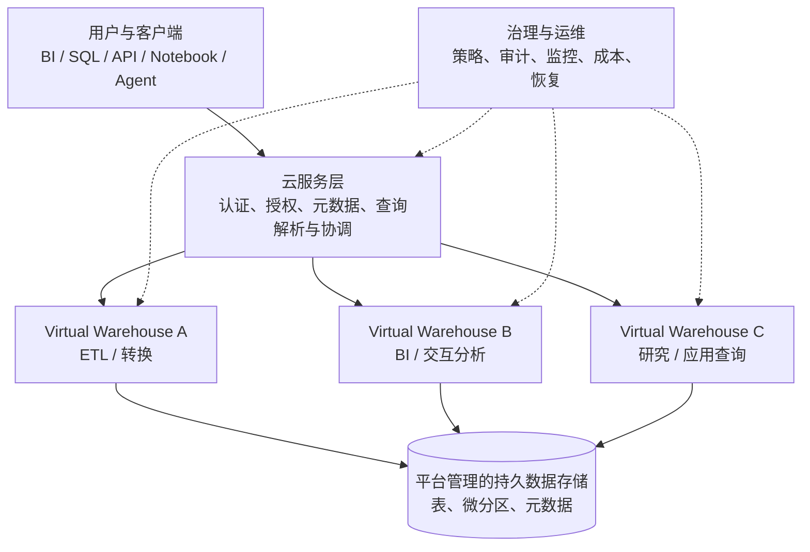
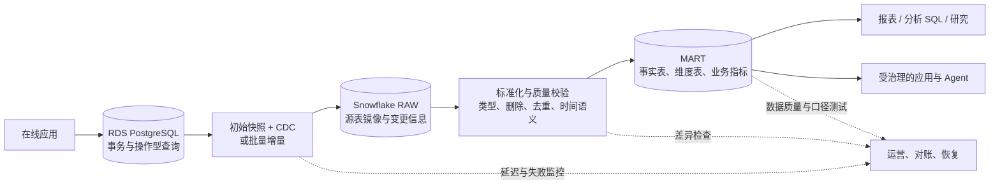
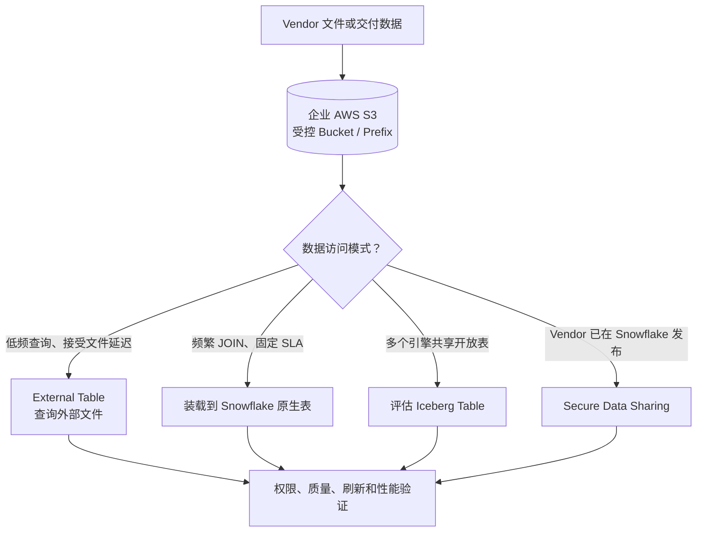
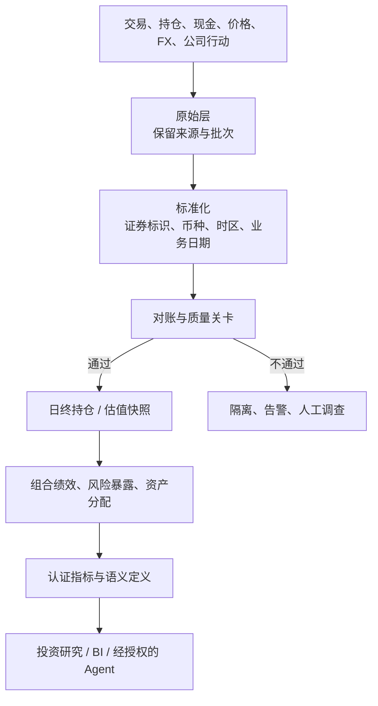

# Snowflake快速学习2026：解决方案架构师的实战指南

> **这不是 Snowflake 全功能目录，而是一份架构决策指南。** 目标读者是熟悉 SQL、关系数据库和云服务，但还没有系统使用 Snowflake 的 Solution Architect、Data Architect、工程负责人和金融服务技术人员。你不需要先记住所有命令；更重要的是知道 Snowflake 适合解决什么问题、它为什么这样设计，以及具体项目里哪些决定会影响安全、成本、性能和数据可信度。

**资料核对日期：2026 年 10 月 11 日。** Snowflake 的产品能力、区域支持、版本许可和预览状态会变化。本文涉及具体功能时，优先链接官方文档；正式选型前应再次核对目标云、区域、版本、账号配置和合同条款。

## 先读结论：架构师应该记住的十件事

1. **Snowflake 首先是分析数据平台，而不是把 PostgreSQL、Oracle 或 SQL Server 原样搬到云上的托管实例。** 它擅长跨系统整合、历史分析、大规模扫描与聚合、数据产品、BI、自助分析和受治理的数据共享。交易主路径、复杂事务、低延迟单行更新仍要按实际工作负载评估，不能因为 SQL 看起来相似就直接替换 OLTP。
2. **理解存储、计算和云服务分离，是理解 Snowflake 的关键。** 数据保存在平台管理的存储层，虚拟仓库（Virtual Warehouse）执行查询与转换，云服务层承担元数据、认证、权限和查询协调等平台职责。不同用户和工作负载可以使用不同计算资源，而不必为每种分析负载复制一份完整数据。
3. **虚拟仓库是计算资源，不是数据库。** 仓库大小影响单条查询的计算能力；多集群仓库主要帮助并发；自动挂起和自动恢复用于控制空闲成本。扩大仓库并不会自动修复糟糕的数据模型或低效 SQL。
4. **微分区裁剪往往比盲目加大仓库更重要。** 过滤条件是否能缩小扫描范围、是否反复扫描宽表、表的数据排列是否与查询模式匹配，会直接影响延迟和费用。聚类、Search Optimization 和 Query Acceleration 是针对特定问题的工具，不是默认要打开的开关。
5. **数据摄取和数据转换是两件事。** COPY INTO、Snowpipe、Snowpipe Streaming、Openflow/连接器解决不同的接入模式；Dynamic Tables、Streams/Tasks、Snowpark 和外部编排分别适用于不同的转换需求。选工具之前，先定义数据新鲜度、删除语义、可重放能力和失败恢复方式。
6. **外部表、Snowflake 原生表和 Iceberg 表不是一回事。** 如果 Vendor 文件已经放在企业 AWS S3，Snowflake 可以通过受控的云身份访问，但“可以查询 S3 文件”不等于文件自动具备数据库表的完整能力、性能或治理语义。选择取决于数据是否需要复制、更新频率、查询频率和是否要被其他引擎共同访问。
7. **数据质量与历史语义必须由工程设计明确。** CDC 事件不是已经重建好的当前表；当前余额不是历史时点余额；业务生效时间不等于数据到达时间。金融服务系统尤其要设计对账、时点查询、修订、更正和可重复计算。
8. **安全要在数据库内部执行，不能只依赖 BI 过滤或应用代码。** 通过 RBAC、受管理的 Schema、行访问策略、动态数据掩码、标签、Secure Views 和审计记录建立分层控制。AI Agent、Notebook 或 BI 用户也必须经过同一授权边界，不能凭自然语言提示绕过 Data Entitlement。
9. **Snowflake 的弹性不等于自动具备灾备能力。** Time Travel、Fail-safe、跨账号复制和 Failover Group 解决的问题不同。需要将 RPO、RTO、跨区域约束、复制延迟、密钥、网络、用户和权限对象纳入灾备演练。
10. **成本治理必须成为平台设计的一部分。** 给不同团队与任务划分仓库、自动挂起、配置预算和资源监控、跟踪扫描量与查询历史，并建立成本归属。数据存储便宜并不代表重复刷新、过度扫描、长期空转的计算也便宜。

建议按章节顺序学习：第 1–4 章建立基础心智模型；第 5–9 章理解表设计、视图、数据接入与管道；第 10–12 章掌握性能成本、安全和恢复；第 13–15 章学习业务语义与 AI；第 16–20 章把这些知识用于金融服务设计、落地与评审。

**建议阅读顺序**：先建立平台心智模型，再理解对象和数据建模；接着学习接入、转换与运维；最后深入 Semantic Views、AI 与金融服务参考架构。遇到具体实施问题时，再跳到文末对应的官方专题。

---

**第一部分｜先建立 Snowflake 的心智模型**

## 1. Snowflake 解决什么问题？先别从 SQL 语法学起

### 用一个熟悉的场景理解它

假设一家金融机构有这些系统：

- 核心业务数据库记录客户、账户和交易；
- 投资组合系统记录持仓、现金、交易和估值；
- CRM 记录客户关系与服务活动；
- 风险平台提供市场行情、评级或模型结果；
- 外部 Vendor 每天交付证券主数据、参考数据或研究数据；
- 报表、数据分析人员和 AI 应用需要跨系统回答问题。

如果所有分析都直接对生产数据库运行，复杂 JOIN 和大范围聚合可能影响交易系统；如果每个部门各自复制数据，又容易产生多个“客户数”“净资产”“当日收益”等版本。传统数据仓库早已解决了其中一些问题，Snowflake 的价值在于用托管平台、弹性计算和平台治理，让多个工作负载更容易共享同一套经过管理的数据资产。

因此，通常不是“把所有数据库替换成 Snowflake”，而是建立职责分工：

- 在线数据库继续处理交易写入和操作型查询；
- Snowflake 集中存放用于分析的数据、历史状态、业务模型和面向消费的数据集；
- 数据集通过受控接入、转换、对账和发布流程形成；
- BI、分析人员、下游应用和获授权的 Agent 通过不同的接口访问这些数据；
- 平台团队统一管理权限、计算资源、审计、成本和恢复。

### 先判断你遇到的是什么类型的问题

| 工作负载 | 常见需求 | 初步判断 |
| --- | --- | --- |
| 在线交易（OLTP） | 根据账户 ID 读取一行；同步更新交易状态；多行事务；低延迟写入 | 通常由 PostgreSQL、Oracle、SQL Server 或专用交易平台承担 |
| 分析与数仓（OLAP） | 按客户、证券、日期汇总数十亿条记录；复杂 JOIN；跨年趋势与组合分析 | Snowflake 的典型适用场景 |
| 数据湖与文件分析 | 数据留在 S3；需要直接查询 Parquet、CSV、JSON，或者让多个计算引擎共用数据 | 比较 External Tables、原生表和 Iceberg |
| 数据工程 | 持续摄取、清洗、去重、关联、增量计算与数据质量测试 | 组合使用摄取工具、SQL 转换、Dynamic Tables 或 Streams/Tasks |
| 数据产品与共享 | 给不同业务域、子公司或合作机构提供有限且可追踪的数据视图 | 评估 Secure Views、Secure Data Sharing 和相应的访问控制 |
| 低延迟键值或小规模事务应用 | 高频点查、短事务更新、强约束 | 不要默认用普通 Snowflake 表；可评估现有事务数据库，或在合适区域和限制内测试 Hybrid Tables |

Snowflake 现在也提供 Hybrid Tables 等面向事务型工作负载的能力，所以“Snowflake 完全不能处理事务”并不准确；但这也不意味着它与通用 OLTP 数据库等价。Hybrid Tables 在存储容量、吞吐、功能组合、事务范围、复制和部分数据工程能力方面有明确限制。若应用核心路径依赖毫秒级响应、强约束和复杂事务，必须用真实负载做 PoC，而不是只看功能名称。

参考：[Snowflake 核心概念与架构](https://docs.snowflake.com/en/user-guide/intro-key-concepts) · [Hybrid Tables 限制](https://docs.snowflake.com/en/user-guide/tables-hybrid-limitations)

## 2. Snowflake 与传统数据库的关键区别

“传统数据库”不是单一架构。下面主要对比两种常见对象：以 PostgreSQL/Oracle 为代表的事务数据库，以及需要自建和运维计算集群的传统数仓。具体产品之间仍然存在差异。

| 维度 | 事务数据库，例如 PostgreSQL / Oracle | Snowflake 的典型模式 |
| --- | --- | --- |
| 主要目标 | 可靠处理业务状态变化与操作型查询 | 大规模分析、跨系统数据整合和共享 |
| 计算与存储 | 资源通常与数据库实例或集群配置紧密关联 | 持久数据存储与虚拟仓库计算分离 |
| 查询特点 | 索引点查、短事务、频繁 INSERT/UPDATE/DELETE | 列式分析、过滤、聚合、窗口函数和大型 JOIN |
| 并发隔离 | 通过实例、连接池、读副本、资源限制等管理 | 可为 ETL、BI、数据科学和其他工作负载分配独立仓库 |
| 数据物理组织 | 索引、表空间、分区、统计信息和数据库维护 | 自动微分区、元数据裁剪，以及按需要进行的聚类与搜索优化 |
| 容量扩展 | 可能需要扩容实例、分片、改造存储或引入读写分离 | 计算可按仓库独立调整；平台管理底层存储 |
| 数据接入 | 应用事务写入或外部工具同步 | COPY、Snowpipe、Snowpipe Streaming、连接器、共享和文件访问等多种入口 |
| 历史数据 | 通常靠业务历史表、日志、备份和归档机制设计 | 可结合 Time Travel、克隆、历史表、快照和对象存储；业务历史仍需建模 |
| 物理调优 | 索引设计、执行计划、锁、连接数、Vacuum/统计信息等 | 先关注裁剪、查询模式、仓库资源、并发、缓存和刷新成本 |
| 运营方式 | 自建数据库时要管理主机、补丁、故障转移和容量 | 更多底层基础设施由服务托管，但账户、访问策略、管道、成本和数据语义仍需负责 |

### 存储与计算分离，实际改变了什么？

传统数据库扩容时，经常需要考虑整台实例或集群的 CPU、内存、磁盘、连接数与高可用；而 Snowflake 可以让分析仓库和数据持久存储相对独立。

例如，数据平台可能有：

- INGEST_WH：小型、间歇运行，负责装载；
- TRANSFORM_WH：专门执行数据清洗与模型刷新；
- BI_WH：面向仪表板和交互查询；
- DATA_SCIENCE_WH：给研究人员跑探索性 SQL；
- APP_QUERY_WH：给经过控制的应用查询使用。

它们可以访问同一套授权数据，但计算资源能够分别调整、暂停和监控。研究人员运行一条很重的查询，不一定非要和早晨的运营仪表盘抢同一份计算资源。

这不意味着每种工作负载都必须独立建仓库。仓库太多也会增加管理开销。设计时应基于隔离需求、并发特征、SLA、预算和故障影响范围来分组。

### 平台做了很多运维工作，但没有替你做业务设计

Snowflake 负责管理存储格式、微分区、底层基础设施和不少查询执行细节；但它不会自动知道：

- 客户在 CRM 与交易系统中如何匹配；
- 证券代码变更后怎样保留历史关联；
- 某笔交易应该按成交日、结算日还是入账日统计；
- 日终持仓如何对账，迟到的数据应该重算哪一天；
- “净资产”“已实现收益”“有效客户”应该如何定义；
- 哪些角色可以查看客户明细，哪些人只可以查看聚合结果。

这些才是架构项目中更容易出错的部分。托管平台降低的是基础设施管理负担，不是业务语义、数据质量与治理的责任。

## 3. 核心架构：三层模型与一次查询的旅程

Snowflake 官方将平台架构概括为数据存储层、计算层和云服务层。用这三层理解新功能，比记住产品名更有效。

### 数据存储层：不必自己维护普通表的底层文件

Snowflake 的标准表将数据存储在平台管理的列式格式和微分区中。用户通常不需要自己创建文件目录、分区文件、压缩块，也不用按传统数据库的方式管理底层磁盘布局。

**微分区（Micro-partition）** 可以简单理解为 Snowflake 自动组织的一组数据块，并附带可帮助排除无关数据的元数据。查询只需要少量日期、账户或证券时，平台有机会跳过大量不可能匹配的微分区。

例如，研究人员经常查询最近 90 天的交易，如果表按时间自然组织，过滤交易日期可能只读取一部分数据；但如果查询没有任何有效过滤，或者经常按一个低相关度的字段做筛选，Snowflake 仍可能需要扫描很多数据。

重点不是记住微分区的内部实现，而是理解：**数据量并不等于每次查询都必须读取的量；有效裁剪是性能和成本的共同基础。**

参考：[Micro-partitions 与 Data Clustering](https://docs.snowflake.com/en/user-guide/tables-clustering-micropartitions)

### 计算层：Virtual Warehouse 是查询执行资源

虚拟仓库负责运行 SQL、装载或转换等需要计算的工作。创建仓库时，会选择规模、自动挂起/恢复和并发相关设置。仓库运行会消耗 credits；暂停后不再为该仓库持续计算计费，但存储费用仍然存在，云服务层也可能有其他费用。

常见的两个调整方向：

- **Scale up（扩大仓库）：** 给当前仓库更多计算资源，适用于一条查询计算量较大、延迟不达标的情况。
- **Scale out（多集群/更多可承载并发的资源）：** 适用于很多用户同时查询、排队时间变长的情况。

两者解决的问题不同。假设月末风险报表只有一条特别慢的查询，优先调查 SQL、扫描量和仓库大小；假设所有用户在开市后涌入导致大量查询排队，那么多集群或工作负载拆分才可能更有帮助。

对于间歇性任务，开启自动挂起通常能省钱；对几乎连续有请求、缓存很重要的交互式 BI，过短的自动挂起又可能让仓库频繁启动、反复冷启动并丢失仓库缓存。需要测量真实请求间隔，不要把所有仓库套用同一个值。

参考：[Virtual Warehouse 的考虑事项](https://docs.snowflake.com/en/user-guide/warehouses-considerations) · [Warehouse 成本控制](https://docs.snowflake.com/en/user-guide/cost-controlling-controls)

### 云服务层：它不仅是一台 SQL 计算机

云服务层协调认证、授权、元数据、查询解析和优化等工作。架构师需要注意的是，它和计算仓库并不是同一件资源。暂停某个仓库不等于禁用了账号、对象权限、治理规则或所有其他平台服务。

### 一次查询大致会发生什么？

当用户提交查询时，平台会检查身份和对象权限，解析 SQL，利用表元数据与优化器规划执行，再由选定仓库执行扫描、过滤、JOIN 和聚合等操作，最后返回结果。实际体验不仅取决于仓库大小，也取决于扫描量、JOIN 方式、数据倾斜、并发排队、缓存是否命中、下游刷新和网络调用等。

所以性能调查最好顺序如下：

1. 查清楚慢的是 SQL 执行，还是前面的排队/编译/连接阶段；
2. 看读取了多少数据、多少微分区被裁剪、返回了多少行；
3. 看 JOIN 的基数和中间结果是否异常膨胀；
4. 确认仓库是否被其他查询挤占，是否发生排队；
5. 最后再试仓库扩容或专用加速服务，并比较增加的费用。

## 4. 日常工作中会遇到的 Snowflake 基本对象

本章补上新手最常遇到的“对象名都认识，但不知道它们如何组织”的问题。先记住：Snowflake 里的对象不是一台数据库服务器上的一堆表名，而是由账户、命名空间、计算资源和授权关系一起组成的平台。

### Snowflake 的基本对象：它们分别代表什么？

| 对象 | 可以怎样理解 | 典型架构问题 |
| --- | --- | --- |
| Organization / Account | 组织与 Snowflake 账户边界。账户会关联云、区域和版本配置 | 开发、测试、生产是否分账户？灾备账户在哪里？数据驻留约束是什么？ |
| Database / Schema / Table | Database 是数据库命名空间；Schema 是其中的对象分组；Table 是存放结构化数据的对象 | 哪些数据域共用 Database？哪些对象由不同团队维护？如何规划命名和权限边界？ |
| View / Semantic View | View 封装 SQL 查询；Semantic View 在物理数据之上补充业务实体、关系、维度和指标 | 应该向消费者暴露原始表，还是经过认证的业务接口？ |
| Virtual Warehouse | 负责执行 SQL、装载和数据转换的计算资源，不是数据存放位置 | 这项工作负载需要多少计算能力？是否应与 BI 或其他团队隔离？ |
| User / Role / Grant | User 是使用者或服务身份；Role 组织权限；Grant 把对象权限授予角色等主体 | 谁能查询、修改、分享或管理策略？权限能否按职责分离？ |
| Stage / File Format / Pipe | Stage 指向文件位置；File Format 描述 CSV、JSON、Parquet 等格式；Pipe 可用于自动加载 | 文件从哪里来？谁能读？重复和失败如何重试？ |
| Stream / Task | Stream 跟踪受支持对象的变化；Task 按时间或依赖关系执行 SQL 等工作 | 增量变化由谁消费？失败能否恢复？任务之间的依赖如何观察？ |
| Share / Policy / Tag | Share 控制数据共享；Policy 执行访问或隐私规则；Tag 为对象添加可治理的分类元数据 | 如何分享有限数据？敏感列如何分类？策略是否覆盖新建对象？ |

### 怎样读懂一个全限定表名？

例如 `ANALYTICS_DB.MART.FCT_TRADE` 通常可读作 Database.Schema.Table：

- `ANALYTICS_DB`：数据库；
- `MART`：Schema；
- `FCT_TRADE`：事实表。

在企业项目里，应给命名空间定义清晰约定，例如 RAW、STAGING、MART，或按业务域拆分 Schema。名字不是安全控制：能否访问仍由角色授权、策略和对象权限决定。

### 一条查询如何找到数据并运行？

用户或应用以某个身份连接账户，使用有权访问的角色，指定或使用默认 Virtual Warehouse 执行查询。查询访问哪个表由 SQL 名称解析和对象权限决定；实际扫描和计算由 Warehouse 承担；查询费用与相应资源和服务使用情况相关。因此，至少要分别治理三个东西：**数据对象及其授权、执行查询的身份、承担计算的 Warehouse**。

新手练习时，可创建一个测试 Schema，加载一小份文件，创建一个普通 View，再分别用两个权限不同的角色读取。这样比只在 UI 中浏览对象列表，更容易理解“对象在哪里、谁能读、查询由什么资源执行”。

---

**第二部分｜理解数据模型和数据库对象**

## 5. 表设计与数据类型：从关系数据库思维转向分析建模

Snowflake 与 PostgreSQL/Oracle 都使用 SQL，但物理存储和约束语义有差别。先理解这些差异，再决定怎么设计事实表、维度表、快照和外部数据对象。不要把 OLTP 的索引、分区和约束假设直接套到 Snowflake 标准表上。

### 表设计和 PostgreSQL / Oracle 有什么不同？

学习 Snowflake 时，最容易犯的错误是把关系数据库的设计习惯原封不动搬过来。SQL 语法相似，但物理组织、约束、索引与典型工作负载并不相同。

| 设计问题 | PostgreSQL / Oracle 常见做法 | Snowflake 标准表的思路 |
| --- | --- | --- |
| 物理存储 | 以行存为主；按访问模式设计索引、分区、表空间等。Oracle 也广泛使用分区与索引组合 | 面向分析的列式存储和自动微分区由平台管理；通常不需要自己维护传统 B-tree 索引或手工分区文件 |
| 主键、唯一键与外键 | 数据库可强制执行约束，帮助阻止重复键和无效引用 | 标准表的 PRIMARY KEY、UNIQUE、FOREIGN KEY 通常是信息性约束，不会替你拦截重复值或无效引用；NOT NULL 和 CHECK 会执行。Hybrid Tables 的约束行为不同 |
| 点查性能 | 合适的索引可快速定位一行 | 先检查微分区裁剪；对选择性很高的点查，按需要评估 Search Optimization，而不是每个字段都建索引 |
| 分区 | 按日期/业务键做分区，并考虑分区裁剪与维护成本 | 标准表自动划分微分区。先按自然加载顺序和过滤模式测量，再决定是否需要 CLUSTER BY；它不是通用的“分区键”替代物 |
| 数据粒度 | OLTP 常用高度规范化模型以减少更新异常 | 分析层常使用事实表、维度表、快照或适度宽表以减少重复 JOIN；并不意味着 RAW 来源表应被随意扁平化 |
| 事务与并发 | 常用于高频短事务、细粒度锁与业务写入 | 标准表主要为分析优化。不能因支持事务与 SQL 就假设它等价于高并发 OLTP；事务型需求应评估现有数据库或受限的 Hybrid Tables |
| 临时与环境隔离 | 临时表、分区表、物化视图、只读副本等各有用途 | 可按生命周期选择 permanent、transient、temporary 表，使用零拷贝克隆建立隔离测试；必须确认数据保留与恢复要求后再选择对象类型 |
| 查询复用 | 普通 View、Materialized View、索引与物化结果各有用途 | 普通 View 复用逻辑定义；Materialized View 为受限查询维护预计算结果；Dynamic Table 更适合描述持续刷新的转换数据集 |

#### 设计 Snowflake 表时，优先确定这六件事

1. **先确定粒度，再谈列和主键。** 例如一行是一笔成交、一只证券在一个账户的日终持仓，还是一份 Vendor 文件中的一条记录？粒度没写清楚，后续聚合极容易重复计数。
2. **主键约束不执行，就必须把数据质量测试补上。** 业务主键依然重要，但不要以为声明 PRIMARY KEY 后 Snowflake 一定会阻止重复。对交易 ID、账户/证券/估值日组合键等设置唯一性检查，并在发布前处理失败。
3. **金额用精确数值，时间语义显式化。** 财务金额通常使用适当精度的 NUMBER/DECIMAL，而不是近似浮点类型；区分 DATE、当地时间、UTC 时间、带/不带时区的 TIMESTAMP，明确交易日、结算日和入账日。不要把日期和金额长期存成 VARCHAR 后再隐式转换。
4. **从星型模型开始，而不是照搬源系统的每张规范化表。** 例如 FCT_TRADE 以成交或交易事件为粒度，DIM_ACCOUNT、DIM_SECURITY、DIM_DATE 承载上下文；若需历史时点分析，再定义有效期和快照。不是每个场景都必须做星型模型，但每个模型必须清楚说明粒度、关系与聚合行为。
5. **按真实过滤方式调优。** 常按 trade_date 筛选，就检查日期裁剪；常按 account/security 做极高选择性检索，再评估 Search Optimization；多类大查询反复按相同维度过滤且裁剪效果差，才评估聚类。优化必须有 Query Profile 基线和费用对照。
6. **对象类型影响成本与恢复。** 临时表用于会话/任务中的短期结果；transient 表常用于可重建、无需 Fail-safe 的中间数据，但仍要核对其 Time Travel/恢复策略；永久表用于需要相应保护的长期对象。不要仅为节省一点存储，把需要审计或恢复的核心数据放入不适合的对象类型。

官方表设计文档尤其值得阅读的一个差异是：标准表的主外键声明不能代替数据质量控制。若交易事实表与账户维度通过 ACCOUNT_ID 关联，应显式检查孤立账户、重复主键、迟到更正和关联基数。Snowflake 不会因为 SQL 成功就证明关系满足业务约束。

参考：[Table Design Considerations](https://docs.snowflake.com/en/user-guide/table-considerations) · [Snowflake 数据类型](https://docs.snowflake.com/en/sql-reference-data-types) · [Hybrid Tables](https://docs.snowflake.com/en/user-guide/tables-hybrid) · [Views、Materialized Views 与 Dynamic Tables](https://docs.snowflake.com/en/user-guide/overview-view-mview-dts)

### 半结构化数据：JSON 不一定要先全部拆平

金融服务的数据经常来自 REST API、事件总线、监管文件和 Vendor 数据。JSON 字段可能随版本变化，部分字段很少被用到。

Snowflake 支持如 VARIANT 这样的半结构化数据类型，适合先保留原始结构，再按业务需要投影出稳定字段。它能减少早期接入时因结构变化而频繁改表的负担，但不代表最终模型应该永远只存一个巨大的 JSON 列。

比较稳妥的做法：

1. 原始层保留来源、获取时间、批次 ID、原始 payload 以及校验信息；
2. 标准化层抽取常用字段并明确类型、时区、币种与空值含义；
3. 面向分析的模型对主键、业务时间、历史版本和关联规则做显式建模；
4. 对未识别字段的新增与格式变化建立监控，避免静默丢失数据。

## 6. 如何读取、预计算和持续转换数据：View、物化视图与 Dynamic Tables

数据到达 Snowflake 后，还要决定如何把源数据转成可消费的业务数据。不要把所有转换需求都塞进同一种工具。

### View、Materialized View、Dynamic Table：三种东西分别解决什么问题？

这三个对象表面上都能通过 SQL 得到“一个结果集”，但刷新、存储、成本和使用目的不同。选择错了会带来两种问题：每次查询重复计算而很慢，或者平台持续刷新不需要的结果而增加成本。

| 对象 | 它保存什么 | 数据何时计算/刷新 | 适合什么 | 主要代价与限制 |
| --- | --- | --- | --- | --- |
| 普通 View | SQL 定义，不保存完整查询结果 | 用户查询时计算 | 复用 JOIN/过滤规则、封装字段、提供消费接口 | 每次查询仍要读取底层数据并计算；底层表变更后会读到当前可见数据 |
| Secure View | 受保护的视图定义与查询接口；核心用途之一是减少定义暴露并支持安全共享 | 类似普通 View，通常查询时计算 | 不希望消费者看到实现细节或需要受控共享 | 不能代替 RBAC、行策略或掩码；应评估安全视图的性能特征 |
| Materialized View（物化视图） | 平台维护的预计算查询结果 | Snowflake 自动维护，使其保持最新；合适情况下可被查询优化器使用 | 重复、高频、基于单张基础表的受支持查询，尤其筛选、投影或聚合 | 额外存储和维护计算；支持的 SQL 形态有限，不能把复杂多表模型随意改成物化视图 |
| Dynamic Table（动态表） | 持久化转换结果与刷新定义 | 按 TARGET_LAG 和依赖关系由平台调度刷新 | 多表 JOIN、标准化、聚合及多步 SQL 数据管道 | 有刷新延迟与刷新成本；目标 lag 不是 SLA 保证；要确认刷新模式、支持的 SQL 和管道监控 |

#### 普通 View：先用它表达“消费接口”

View 类似一个命名查询。比如交易明细表里有内部技术字段、来源标记和客户标识符，可以创建视图只暴露分析需要的列，并把常用 JOIN 或过滤封装起来。View 本身不会把所有结果另存一份，因此通常不会因为物化结果增加存储；但用户每次查询时仍然要计算其逻辑。

它适合把重复的查询逻辑集中起来，却不能自动解决性能问题：如果一个 View 里叠了很多层复杂 View、多个大型 JOIN，最终查询仍可能很重。对安全场景，应通过角色授权、行访问策略和掩码共同保护数据，不要只靠“用户只能看这个 View”来判断权限是否安全。

#### Materialized View：给受支持的重复查询维护一份可复用结果

可以把物化视图理解为平台持续替你维护的查询结果。某些高频查询每次都在大表上做类似筛选、投影或聚合，物化视图有机会让读取更快。代价是结果要存储，底层数据变化时还需要维护。

它更像一项面向查询性能的优化，而不是完整的数据建模/ETL 框架。Snowflake 的 Materialized View 对查询形态有明显限制，例如不适合任意复杂多表 JOIN；选择前要核对当前文档支持的定义、维护成本和优化器使用条件。不能因为某个查询慢，就直接把原 SQL 包成物化视图。

#### Dynamic Table：定义目标数据集，让平台管理数据管道刷新

Dynamic Table 更接近一张由 SQL 定义并持续更新的转换表。你声明“我想得到什么数据”，Snowflake 根据源对象变化与依赖图调度刷新。可建立多个 Dynamic Table，将 RAW 转为标准化数据，再由其生成每日汇总或面向消费的数据集。和普通 View 不同，它把结果物化存起来；和 Materialized View 不同，它的主要用途是持续的数据转换和管道构建，而不只是加速一个简单查询。

**TARGET_LAG 是“数据新鲜度目标”，不是“每隔这么长时间强制刷新一次”，也不是硬 SLA。** 设置为 10 分钟，是要求平台尽力让数据相对根源表保持在目标陈旧度内；如果刷新耗时、仓库容量、数据变化量或依赖链路成为瓶颈，实际 lag 仍可能超出目标。设得越短也不自动越好：比业务真正需要的频率更短，通常意味着更多刷新和计算成本。

Dynamic Table 常见刷新模式包括：

- `INCREMENTAL`：在受支持的 SQL 定义下，处理上次刷新后的变化，通常适合变化量占比小的情况。
- `FULL`：每次重新计算完整结果；对某些不支持增量刷新的查询有用，但大数据集可能昂贵。
- `AUTO`：创建时由 Snowflake 根据定义选择刷新模式。生产中不要假设 AUTO 选到了预期模式，创建后应检查解析出的模式与刷新状态；如果明确要求增量，显式指定更容易暴露不兼容的 SQL。

更实用的落地方式是：让下游消费表指定合适的目标新鲜度；中间层在适当情况下用 `TARGET_LAG = DOWNSTREAM`，跟随真正的消费需求刷新；通过刷新历史和实际 lag 监控是否达到目标。如果模型涉及存储过程、API 调用、特殊 upsert/MERGE 或过程式分支，应重新判断 Dynamic Tables 是否适合，不要为了声明式而勉强套用。

参考：[三种对象官方比较](https://docs.snowflake.com/en/user-guide/overview-view-mview-dts) · [Dynamic Tables 概览](https://docs.snowflake.com/en/user-guide/dynamic-tables/overview) · [Dynamic Tables 选择决策指南](https://docs.snowflake.com/en/user-guide/dynamic-tables/decision-guide) · [TARGET_LAG](https://docs.snowflake.com/en/user-guide/dynamic-tables/target-lag)

### Dynamic Tables 的生产配置要点

一个简单的 RAW → STAGING → MART 管道可能由数个 Dynamic Tables 组成。设计和上线前，至少验证以下几点：

1. **先定刷新目标，再定工具。** 市场参考数据每天更新，10 分钟刷新没有业务意义；盘中风险仪表盘可能需要几分钟级目标；交易监控可能需要亚分钟级或事件触发语义，此时 Dynamic Tables 未必适合。
2. **明确刷新模式。** 增量刷新常在仅小部分源数据变化时更经济；如果定义迫使系统做 FULL 刷新，频繁全表重算可能抵消收益。
3. **验证 SQL 支持。** 并非每种函数、连接、窗口逻辑和 SQL 结构都支持增量刷新。用真实模型做 PoC，查看解析出的刷新模式与原因，并持续回归测试。
4. **区分“任务成功”和“数据新鲜”。** 刷新作业可以运行成功，但若上游本来就延迟、刷新积压或依赖链较长，最终数据仍可能过期。
5. **观察依赖图和并发。** 下游刷新依赖上游结果；共享仓库负载、链路深度和某个慢表会影响最终数据的可用时间。
6. **算清刷新成本。** 对账、查新鲜度和日常监控要覆盖计算消耗。数据不变时能否跳过刷新、什么时候应该进行全量重建，需要用真实数据测量。

Dynamic Tables 是“减少自己维护转换调度代码”的工具，并不会自动定义业务的增量正确性。假设迟到一周的成交会影响过去七天的投资组合收益，仍要确认模型是否会重算受影响的日期、修订后的结果如何发布、之前发布的结果是否保留。

### Streams + Tasks：需要明确控制变化消费和执行顺序时使用

- **Stream** 记录表或视图的变化偏移，用于消费新增、更新和删除等变更信息。
- **Task** 负责定时或按依赖关系执行 SQL、存储过程等任务。
- 多个 Task 可以组成有依赖顺序的任务图，让数据处理有明确的运行链路。

它适合需要明确控制的 CDC 消费、特殊增量逻辑、过程式步骤、异常分支和自定义恢复流程。它并不自动保证业务级幂等，也不替代任务监控。

需要特别关注 Stream 的保鲜问题：如果源对象持续变化，但消费流程长时间未推进，Stream 可能变得 stale；源表被删除并重新创建，也可能使原来关联的 Stream 失效。应监控消费滞后、任务失败、未消费数据与恢复边界。

参考：[Streams 概览](https://docs.snowflake.com/en/user-guide/streams-intro) · [Tasks 概览](https://docs.snowflake.com/en/user-guide/tasks-intro)

### Snowpark：何时才需要把 Python 或其他代码带进数据平台

大多数数据转换先用 SQL 就足够。如果工作需要更复杂的 Python、Java 或 Scala 逻辑，或者要在 Snowflake 的执行环境中处理数据，可以评估 Snowpark。

但不要为了“统一技术栈”就把本来清晰的 SQL 改写成程序代码。复杂逻辑会影响测试、可读性、部署和性能分析。可优先遵循：

- 数据关系、过滤、JOIN、聚合和指标计算用 SQL 或声明式模型；
- 复杂算法、特定库依赖或适合程序化表达的逻辑再使用 Snowpark；
- 大规模转换的输入输出、依赖版本、资源与失败重试必须可观察；
- 尽量把业务规则作为版本化工件测试，而不是只留在 Notebook 里。

参考：[Snowpark 开发指南](https://docs.snowflake.com/en/developer-guide/snowpark/index)

---

**第三部分｜接入、加工和发布可靠的数据**

## 7. 数据接入方式：按新鲜度、数据源和恢复要求选型

不要先问“应该用 Snowpipe 还是 Kafka”，先明确：数据多久必须可用、数据源是什么、是否需要保留源文件、重复投递如何处理、源端更新和删除如何传递、失败后能否重放。

### 几种常见的数据入口

| 方式 | 适合的情况 | 需要特别设计的地方 |
| --- | --- | --- |
| COPY INTO | 批量 CSV/Parquet/JSON 文件；每日、每小时或按批次装载 | 批次完整性、文件清单、重复加载、失败记录与重跑 |
| Snowpipe | 文件到达后希望自动以微批方式装载，数据在几分钟级可用 | 云事件通知、文件到达顺序、管道延迟与错误处理 |
| Snowpipe Streaming | 应用持续发送行级事件，不想先生成文件再加载 | SDK/API 接入、吞吐、幂等键、事件顺序与消费者语义 |
| 数据库 CDC / Openflow / 外部连接器 | 从 PostgreSQL 等源系统持续捕获变化，或接入 SaaS 数据 | 初始快照与增量如何衔接、DELETE、Schema 演进和源端负载 |
| External Table | 数据仍放在自有 S3 等对象存储，Snowflake 需要查询其文件 | 外部元数据刷新、文件组织、权限、查询性能与可重复性 |
| Iceberg Table | 希望开放表格式，或需要 Snowflake 与其他引擎共享表元数据及数据文件 | Catalog、写入权威、快照和文件维护、兼容性与并发访问规则 |
| Secure Data Sharing | 数据来自另一个 Snowflake 提供方，双方希望按受控方式共享 | 共享对象范围、消费者权限、敏感字段和跨区域/账户限制 |

这些方式不是同一层面的互斥选项。例如，CDC 连接器可以把 PostgreSQL 变化写入 Snowflake 表，Dynamic Tables 再构建分析模型；Vendor 则可能每天把 Parquet 放进 S3，再由 COPY INTO 装载；另一家 Snowflake 账户提供的数据可能根本不需要再复制一份。

官方入口：[数据加载概览](https://docs.snowflake.com/en/user-guide/data-load-overview) · [Snowpipe](https://docs.snowflake.com/en/user-guide/data-load-snowpipe-intro) · [Snowpipe Streaming](https://docs.snowflake.com/en/user-guide/snowpipe-streaming/data-load-snowpipe-streaming-overview)

## 8. 两条典型数据管道：PostgreSQL CDC 与 Vendor S3 文件

理解了可选的数据入口后，再看两条在金融机构里常见的接入路线。两条路线的核心都不是“把数据传过去”，而是让传输、重放、对账和发布的规则可解释。

### PostgreSQL 在线库通过 CDC 进入 Snowflake：需要给出哪些工程答案？

假设账户或订单系统运行在 Amazon RDS for PostgreSQL，运营报表却需要跨多年数据做客户、产品和渠道分析。一个常见目标架构如下：

架构师应该回答的不只是“CDC 能不能跑”，还要把每个问题转成明确的工程答案。下面以 PostgreSQL 的交易/账户数据进入 Snowflake 为例。具体 LSN、事务边界与删除载荷字段取决于所选 CDC 产品，但设计目标不变。

| 问题 | 可执行的设计答案 | 验收方式 |
| --- | --- | --- |
| 初次快照如何与增量衔接？ | 选择能给出一致性快照边界、并从对应日志位置继续捕获的 CDC 方案。记录快照开始/完成时间和日志位点（例如 WAL/LSN 或连接器提供的等价 offset）。若工具不能协调快照和日志，就明确停写窗口或采用经验证的双阶段切换，不能“先导全量、再随便开 CDC”。 | 在导入期间持续写入测试记录；证明没有遗漏，并识别快照边界上的重复。 |
| UPDATE 与 DELETE 怎么办？ | 原始层保留操作类型、源主键、源端提交顺序/时间、摄取时间和必要的 before/after image。当前状态表按主键应用最新有效变化；DELETE 应真正从当前态移除或打上有明确语义的 tombstone；历史审计表则保留删除事件。 | 造一条记录并依次 INSERT、UPDATE、DELETE，检查当前态、历史态和业务汇总都符合预期。 |
| 重复、迟到和乱序事件如何处理？ | 假设至少一次投递会产生重复。为事件保存稳定标识或源端位点；在每个批次内先按主键与源端顺序去重，再做幂等的 MERGE/状态更新。不得只按 Snowflake 到达时间选“最新行”，因为网络重试或积压可能使旧变化晚到。 | 重放相同批次两次，结果应保持一致；故意乱序投递，最终状态仍符合源端提交顺序。 |
| 如何证明数据没有漏？ | 同步成功日志只证明工具完成了工作，不等于业务数据正确。对关键表按业务日期、状态或账户维度对账：行数、唯一主键数、金额总额、关键控制总额、最大源端位点、删除数量和迟延记录都要有差异阈值与负责人。 | 在同一个逻辑截止点比较源库与 Snowflake，记录差异、排除项、处置结果和复核人。 |
| 历史报表用当时数据还是最新更正数据？ | 分开保存业务生效时间（valid/effective time）和平台收到时间（ingestion/recorded time）。复现历史已发布结果时保存输入批次/快照标识、规则版本和运行参数；使用更正后的价格或分类重算时，生成新的修订版本，不能静默覆盖旧结果。 | 固定输入快照和模型版本，重复运行能产出可核对结果；修订后能说明影响哪些日期与下游报表。 |
| CDC 中断或源端日志过期怎么办？ | 明确连接器是否能续传。若日志位点已不可用，要有重新快照/重新初始化的操作手册，并能隔离受影响的表；不能只重启任务然后假设增量连续。 | 演练超出日志保留窗口、凭证过期、网络中断和源表 DDL 变化，记录恢复时间与人工步骤。 |

**一条可落地的最小规则：** RAW 层记录“收到什么”；标准化层用源端顺序与幂等逻辑还原当前状态；历史层保留业务需要的变化和有效期；MART 层只发布通过质量与业务对账的数据。关键批次对账失败时，应隔离、告警或阻止发布，不能只在日志里留一条 warning。

例如，账户交易表的 CDC 数据可以保留 `source_pk`、`operation_type`、`source_commit_position`、`source_commit_time`、`ingested_at` 和 `batch_id`。这些是概念字段，不要求所有厂商都使用相同列名；重点是能判断变化来自哪条源记录、在源端什么顺序提交、何时被平台收到，以及它属于哪个可重放批次。

最后，不要把“exactly-once”当作一个标签就结束设计。连接器可能提供特定边界内的去重或提交保证，但跨越源库、消息系统、Snowflake 表、转换作业与业务报表的端到端语义，仍须通过稳定事件身份、幂等转换、检查点和对账来实现。

### Vendor 文件落到企业 S3，是否一定要复制进 Snowflake？

不一定。这是一个常见的设计错误：因为所有分析最终发生在 Snowflake，就把所有来源数据无差别地复制、转换和长期存储。更好的做法是按使用方式做选择。

**External Table：** 数据文件留在 S3，Snowflake 读取外部文件并通过元数据了解表的文件与列信息。适合不常访问、数据较大且希望避免不必要复制的参考数据。要验证查询性能、文件格式、分区路径、刷新机制及跨区域流量成本；它也不等同于普通 Snowflake 原生表的全部能力。

**Snowflake 原生表：** 通过 COPY 等方式把需要的数据加载进 Snowflake 管理的表。适合经常与内部数据 JOIN、反复被仪表板查询、需要更稳定性能或需要在平台内建立增量模型的数据。代价是需要管理加载与更新流程、数据生命周期以及存储成本。

**Iceberg Table：** 当数据需要遵循开放表格式、被多个引擎读取，或者企业希望在自有对象存储与统一 Catalog 策略下管理数据时，值得评估。Iceberg 会引入 Catalog、快照、元数据文件和数据文件维护等设计事项；不要因为数据就在 S3，就把任意 Parquet 文件自动称为 Iceberg 表。

**Secure Data Sharing：** 如果数据已经由另一个 Snowflake 提供方管理，且合同和治理政策允许，直接共享授权数据对象可能比定期复制更合适。

在金融服务领域，还需要核对 Vendor 合同：是否允许复制、持久化、缓存、衍生数据、跨区域访问和内部再分发？原始文件能保留多久？撤回或修订数据后，企业是否必须删除或重新计算？技术可行不等于合同许可。

参考：[External Tables](https://docs.snowflake.com/en/user-guide/tables-external-intro) · [Iceberg 表存储选项](https://docs.snowflake.com/en/user-guide/tables-iceberg-storage) · [通过 S3 配置 Iceberg 外部存储](https://docs.snowflake.com/en/user-guide/tables-iceberg-managing-external-volumes)

### 文件接入要当作一个可运营的产品，而不只是一个 Bucket

建议把 Vendor 文件链路分成几个明确的区域，例如 landing、validated、ready 和 archive。Landing 接收原文件；validated 经过签名或校验和、格式、行数与文件清单验证；ready 中的文件才允许下游读取；archive 按合同和保留规则保留原始交付物。

至少定义：

- 每个业务批次的 ID、预期文件数、行数或校验和；
- 文件重复投递、迟到、撤回、重新发布的处理方式；
- S3 IAM 权限、Bucket Policy、KMS Key 和访问审计；
- 读取身份只拥有需要的 Bucket/Prefix 权限；
- 数据文件路径、外部表元数据刷新和批次完成标记；
- 谁能看到原始文件，谁只能访问清洗后的数据产品；
- 文件生命周期策略是否会破坏回放、调查或审计需要。

这套设计即使第一版只接一份日更 CSV，也值得做。否则，等同一 Vendor 的数据进入数十个模型后，再补充批次追踪和重放能力会更困难。

## 9. 从原始数据到可消费数据：分层、质量、血缘和运营告警

数据加载成功不是管道完成。下一步要确定哪些数据仍然只是原始输入，哪些已经标准化，哪些通过质量和业务规则验证后可以让报表、研究人员和应用消费。

### Raw / Standardized / Curated：每一层到底负责什么？

层名可以是 RAW / STAGING / MART，也可以是 Bronze / Silver / Gold；名字并不重要，职责要清晰。

| 层次 | 责任 | 不要在这一层做的事 |
| --- | --- | --- |
| RAW / Landing | 尽可能忠实保留来源数据、载入时间、批次、源主键与可追溯信息 | 不要让报表直接依赖没有质量保证的原始字段 |
| Standardized / STAGING | 标准化字段类型、时区、币种、状态、主键，处理去重和删除语义 | 不要在这里悄悄决定跨业务域的最终指标口径 |
| CURATED / MART | 明确事实表、维度表、历史模型与认证指标，建立数据质量测试 | 不要把来源差异与业务口径埋进不可追踪的临时 SQL |
| Semantic / Consumption | 面向业务提供受治理的定义、视图、API 或共享对象 | 不要让每个消费者重复实现核心指标和授权规则 |

层次不必机械地增加到五六层。每增加一层，都应回答它解决什么问题，例如数据可重放、质量隔离、性能复用或权限边界。如果只是为了符合某个架构图而复制数据，就是额外的存储与运营成本。

### 数据治理不只是访问控制：质量、血缘、隐私与告警

Snowflake 官方 Guides 还把数据质量监控、对象标签/分类、对象依赖、隐私策略和告警单独列为能力。对金融服务而言，至少要把它们放进数据产品的日常运营，而不是只在上线前检查一次。

**数据质量监控：** 对行数、非空值、唯一性、关联完整性、金额边界和新鲜度定义检查。Snowflake 的 Data Metric Functions（DMFs）可用于定期度量数据质量属性；部分数据质量监控能力受版本/edition 限制，需在采购与设计时核对。无论使用 DMF、dbt tests、Tasks 还是外部数据质量框架，都应明确阈值、失败责任人、告警方式和是否阻止发布。对日终持仓，除了行数与唯一性，还应核对账户持仓合计、现金、估值总额和源系统控制总数。

**血缘与变更影响：** 使用对象依赖与访问历史等元数据，帮助回答一个字段来自哪里、哪个 View 或模型依赖某张表、某次变更可能影响哪些消费者。但系统元数据通常有可见范围与采集延迟，不要假设它就是完整的监管审计记录。关键模型版本、批次、审批与业务运行记录还需要在数据工程流程里建立稳定关联。

**分类与隐私保护：** 标签和分类可以协助发现敏感字段，并关联掩码策略。除常见的列掩码与行访问外，官方 Privacy 指南还包括 Aggregation Policies（限制查询必须达到的聚合粒度）、Projection Policies（限制某列如何被投影）及其他面向共享数据隐私的能力。这些机制的适用场景、版本/edition 和状态不同；它们不是可以不经评审就统一打开的设置。要测试用户能否通过小群体筛选、重复查询或关联其他数据推断个体信息。

**Alerts 与通知：** 可以用告警/通知机制把质量阈值、任务失败、数据延迟或成本异常转成可运营事件。警报本身不是修复流程：应包含告警对象、严重级别、负责人、运行手册、重试/隔离策略及关闭条件。关键数据集在对账失败时，默认策略应明确是阻止发布、发布带状态标识，还是进入人工审批。

最小运营闭环是：**度量 → 阈值判断 → 告警 → 分派 → 隔离或恢复 → 复核 → 保留证据。** 没有后续动作的监控面板只是可视化，不是治理机制。

参考：[Data Governance 官方指南](https://docs.snowflake.com/en/guides-overview-govern) · [System Data Metric Functions](https://docs.snowflake.com/en/user-guide/data-quality-system-dmfs) · [Privacy 官方指南](https://docs.snowflake.com/en/guides-overview-privacy) · [Alerts 与通知](https://docs.snowflake.com/en/guides-overview-alerts) · [对象依赖](https://docs.snowflake.com/en/user-guide/object-dependencies)

---

**第四部分｜让平台安全、可观察、成本可控**

## 10. 性能与成本：从查询证据到计算资源治理

性能与费用是同一个问题的两面。先判断查询到底慢在哪里，再决定要不要调整仓库、数据模型或专门优化服务；每种优化都需要与增加的计算、维护和存储成本一起评估。

### 自动微分区与裁剪：大查询为什么不一定慢

普通分析往往会选取时间区间、资产类别、客户分群、地区、账户或证券等过滤条件。微分区元数据可以帮助查询跳过不相关的数据。

有三个常见设计习惯：

- 为常用访问路径保留清晰、可测试的过滤条件；
- 在模型中避免不必要地转换过滤列，以免影响裁剪机会；
- 使用 Query Profile 与查询历史验证裁剪和扫描效果，不要仅凭 SQL 外观判断。

**什么时候考虑聚类（Clustering）？** 当一张大表持续出现可预测的访问模式，但自动组织的微分区裁剪效果不理想，并且查询收益有可能抵消重组与维护成本时，再评估聚类。聚类不是等同于关系数据库的普通索引，也不是每张表都必须设置。

对于少量行的高选择性点查，例如反复用客户 ID 或业务事件 ID 查一小段记录，可以评估 **Search Optimization Service**。如果查询执行计划中有可被服务加速的部分，也可以评估 **Query Acceleration Service**。这两个服务涉及额外成本和版本要求，应对真实查询先做基线测试，不要为了“优化”而全部打开。

参考：[Search Optimization 的点查场景](https://docs.snowflake.com/en/user-guide/search-optimization/point-lookup-queries) · [Query Acceleration Service](https://docs.snowflake.com/en/user-guide/query-acceleration-service)

### 缓存：快是因为计算变快，还是结果直接复用？

Snowflake 有不同层面的缓存行为。实用上至少区分两类：

- **持久化查询结果缓存：** 在条件满足时，重复查询可以复用之前的结果。
- **仓库本地数据缓存：** 仓库保留近期读取的数据，可以减少后续查询再次读取远端存储的需要。

不要假设所有查询都能命中缓存。查询结果、底层数据、权限、函数和参数等变化都可能影响复用；暂停仓库会影响该仓库的数据缓存。因此，某条 SQL 第二次执行只用了很短时间，不一定说明新增计算资源能达到相同提升。

对月末批处理，应更关注持续扫描量、刷新频率和总运行时间；对长期开放的 BI，缓存热度与交互响应也值得纳入仓库策略。参考：[Optimizing the Warehouse Cache](https://docs.snowflake.com/en/user-guide/performance-query-warehouse-cache)

### 先理解计算费用来自哪里

主要要观察：

- 仓库规模、运行时长和启动频率；
- 空闲时间以及自动挂起设置；
- 同一模型的刷新频率和实际必要新鲜度；
- 重复扫描、无效 JOIN 和宽表读取；
- 并发导致的扩容或多集群消耗；
- 对特定查询开启的聚类、搜索优化或加速服务；
- Serverless 工作负载、云服务及不同部署选项涉及的费用；
- 失败重试、全量重建和无人维护的开发仓库。

不要只以 credits 总额判断某个团队“贵不贵”。还需要按数据产品、作业、仓库、环境和业务价值进行归因。

### 一套实用的优化次序

**第一步：建立基线。** 统计常见查询的执行时间、排队时间、扫描字节、返回行数、仓库与缓存指标，标出高频 SQL 与高费用任务。

**第二步：优化查询与数据模型。** 减少不必要的列扫描、提前过滤、检查 JOIN 关系和数据粒度，避免因多对多关系导致中间结果成倍增长。

**第三步：降低重复工作。** 对昂贵转换评估增量刷新、合理的模型复用和目标新鲜度。不要为“看起来实时”而每分钟全量重建大表。

**第四步：调整仓库。** 通过真实压测选大小与并发策略。把 ETL、BI 和探索性查询分离到有明确业务理由的资源组。

**第五步：只在证明有收益时启用专门服务。** 聚类、Search Optimization、Query Acceleration 等都需要基于查询特征判断，并通过成本与性能对比验证。

**第六步：建立持续控制。** 开启合适的 Auto-suspend/Auto-resume，设置资源监控、预算与异常告警，定期找出没有自动挂起或长期不使用的仓库。

Snowflake 的仓库自动挂起按秒级使用计费，但仓库每次恢复时通常存在最低计费时长，因此不应机械地把自动挂起设置为 1 秒。短间隔高频请求可能导致频繁启停和缓存损失；批处理任务则一般更适合在完成后快速挂起。应依据真实负载测量最合适的设置。

参考：[Warehouse 成本控制](https://docs.snowflake.com/en/user-guide/cost-controlling-controls) · [成本优化指南](https://www.snowflake.com/en/developers/guides/cost-optimization/) · [仓库缓存优化](https://docs.snowflake.com/en/user-guide/performance-query-warehouse-cache)

### 建议持续跟踪的指标

| 指标 | 为什么重要 | 异常后先查什么 |
| --- | --- | --- |
| 查询 P50 / P95 延迟 | 看普通与尾部体验 | 查询计划、排队、扫描量和仓库竞争 |
| 排队时间与并发 | 判断是否是资源争抢而非 SQL 本身慢 | 工作负载隔离、仓库规模、多集群和高峰时段 |
| Bytes scanned / 分区裁剪 | 发现不必要扫描 | 过滤条件、数据模型、聚类与查询模式 |
| 仓库使用与空闲时间 | 看资源是否浪费 | 自动挂起、任务时刻表和资源隔离 |
| 数据新鲜度与目标 lag | 衡量数据是否及时可用 | 摄取延迟、刷新任务、上游失败和仓库容量 |
| 数据质量与对账差异 | 衡量结果是否可信 | CDC 丢失/重复、源端变更、转换错误与业务口径 |
| 作业失败与重试次数 | 识别脆弱管道与隐性费用 | 失败类型、重试策略、幂等与外部依赖 |
| 每个认证数据产品的成本 | 把费用连接到业务价值 | 低效模型、无消费者的数据、重复计算及刷新策略 |

## 11. 安全与隐私：谁可以看到哪些数据，谁可以执行哪些操作

本章不是合规认证清单，而是设计审查时必须明确回答的问题。

### 身份、角色和职责分离

建议围绕工作职责定义角色，而不是按个人逐个授予对象权限。例如数据工程角色负责管道、数据所有者负责业务模型、消费角色负责读取经过认证的数据产品、平台角色负责仓库与资源、治理角色负责策略、审计角色负责调查。

生产架构中，常见的风险是把方便操作当成权限设计：所有 ETL 用一个高权限账号、所有 Agent 共用一个数据库角色、每个开发者都能改敏感表和授权策略。这样一旦凭证泄露或代码出现错误，很难限制影响范围。

需要在设计中明确：

- 人类用户、服务用户和运行时身份是否区分；
- 用户、角色、仓库和 Schema 的授权关系；
- 谁可授予权限、谁可变更掩码与行访问策略；
- 新建表/视图是否会通过 Future Grants 获得合适的默认权限；
- 服务凭证的轮换、撤销和泄露应急方式；
- 开发、测试和生产账户/数据是否隔离。

Managed Access Schema 可以将对象授权集中到 Schema 所有者或有相应授权管理权限的角色，减少对象创建者自行授予访问权限的情况。Future Grants 则帮助新对象按预先定义的规则获得权限；两者都需要结合角色结构认真设计，而不是简单使用一个全局管理员角色。

### 客户与账户数据的最小授权：不同角色应该看到什么？

不同业务角色可能看同一业务域，但不应看到完全相同的内容。客服可能查看所服务客户的明细；研究人员只需要去标识化数据；管理层只需要聚合；模型开发人员未必需要直接访问客户姓名和标识符。

可组合的控制包括：

- **RBAC：** 通过角色授予数据库、Schema、表、视图和仓库权限；
- **Row Access Policy：** 根据角色、地区、业务单元或 entitlement 规则限制可见行；
- **Masking Policy：** 根据角色和条件对账户号、邮箱或其他敏感字段脱敏；
- **标签与标签策略：** 把敏感分类和保护策略尽可能标准化，减少新建列或表时遗漏保护的风险；
- **Secure Views：** 向消费者暴露经过过滤、投影和业务规则处理的数据；
- **访问历史：** 通过访问历史与查询历史调查谁在何时访问了哪些对象（需要了解相应视图的记录范围和延迟）。

以一个简单的角色设计为例：

| 角色 | 允许的数据范围 | 应避免的权限 |
| --- | --- | --- |
| Data Engineer | 负责管道的 RAW 与标准化数据，按工作需要写入模型 | 不应默认拥有修改所有业务权限策略的能力 |
| Portfolio Analyst | 获授权组合的持仓、绩效与风险模型 | 不应自动看到其他团队或客户的全部明细 |
| Customer Service | 负责客户的操作所需字段 | 不应访问完整投资研究、风险模型或批量导出接口 |
| Executive BI | 聚合指标、趋势和管理报表 | 不应因为职位较高就默认拥有全量原始数据访问 |
| AI Agent Runtime Role | 指定任务所需的数据产品与有限查询能力 | 不应使用 ACCOUNTADMIN 或可跨越 Data Entitlement 的通用高权限角色 |
| Security / Audit | 按职责查看授权、策略、查询和对象访问证据 | 只读调查角色不应被无必要地授予业务数据修改权 |

**最重要的原则：权限应在数据平台和应用服务端强制执行，而不只是写进 Prompt。** 如果 Agent 只被要求“不要查看别的客户”，但所用账号实际拥有全库读取权限，那么 Prompt 不是安全边界。应让 Agent 以最小权限身份执行查询，并在数据库层落实行列策略和审计。

参考：[访问控制概览](https://docs.snowflake.com/en/user-guide/security-access-control-overview) · [Row Access Policies](https://docs.snowflake.com/en/user-guide/security-row-intro) · [Tag-based Masking Policies](https://docs.snowflake.com/en/user-guide/tag-based-masking-policies) · [Access History](https://docs.snowflake.com/en/user-guide/access-history)

### 网络、私有连接与加密

对金融机构来说，要确认：

- 客户端、数据管道、BI、Agent、云存储与 Snowflake 之间的网络路径；
- 是否要求 PrivateLink/私有访问、固定出口或网络策略；
- TLS、静态加密和企业密钥控制是否满足安全基线；
- 从 Snowflake 访问 AWS S3 时采用什么 IAM 角色和 Storage Integration；
- KMS Key Policy、轮换和撤销会不会影响正常读取或灾备；
- 日志与查询结果是否可能包含敏感内容；
- 供应商和下游消费者的数据共享是否符合合同与数据驻留要求。

不要将“数据是加密的”直接等同于访问已经得到控制。密钥管理、身份、授权、日志和网络边界需要一起审视。

### 数据分类、动态掩码与行过滤

掩码策略能依据授权上下文控制字段显示，行访问策略能控制可见记录；标签可帮助把敏感分类与保护措施关联起来，避免每次新增对象都从零判断。

一个可执行的落地顺序是：

1. 识别客户标识符、账户号、个人信息、交易明细与高敏感业务字段；
2. 定义哪些角色可以原样查看，哪些角色需要脱敏，哪些角色根本不应查询；
3. 将策略优先放到可信的数据消费边界上，而不是依赖每张报表手动过滤；
4. 对新 Schema、新列、新表和新共享对象设计默认保护；
5. 用不同角色和模拟上下文进行测试，验证真实查询结果；
6. 监控策略变更、授权变更和敏感对象访问，并定期做负向测试。

注意：Snowflake 文档中一些标签驱动的扩展策略可能仍处于预览状态或受版本限制。生产方案只应依赖目标环境中已正式支持、经安全与合规团队认可的能力。

## 12. 历史恢复、灾备与结果可重现

恢复能力至少有三个不同层次：恢复误操作前的数据、在更大范围的服务故障下切换到可用环境，以及重新生成某个业务报表并说明它使用了什么输入与规则。它们不能被一个“开启 Time Travel”替代。

### 先区分历史恢复、灾备切换和业务重现

| 能力 | 主要解决的问题 | 不应把它当成什么 |
| --- | --- | --- |
| Time Travel | 在保留期内查看旧数据、恢复误操作、克隆历史状态 | 不等于多年业务历史或异地灾备 |
| Fail-safe | 适用对象在 Time Travel 之后的额外恢复保护 | 不等于用户可查询的归档库或自助恢复功能 |
| 零拷贝克隆 | 开发、测试、变更验证与隔离实验 | 不等于完全独立且永不增加存储的副本 |
| 跨账号复制 | 在不同账户间复制支持的对象与数据 | 不等于已验证的应用级灾备切换 |
| Failover Group | 在可用的版本与配置中支持指定对象集合的灾备切换 | 不等于无延迟、无损失的同步副本 |
| 外部 S3 备份/归档 | 保留原始文件、长期留存或重建来源数据 | 不等于 Snowflake 的所有表、权限与业务模型都自动备份了 |

### Time Travel、零拷贝克隆与 Fail-safe：不是同一个恢复按钮

- **Time Travel：** 在保留期内查询历史数据、创建历史克隆，或恢复被误删的对象。标准版通常默认保留 1 天；Enterprise 及以上版本的永久对象可根据配置使用更长保留期，具体仍应核对当前版本与账户策略。
- **Zero-copy cloning：** 创建表、Schema 或数据库的逻辑克隆，适合开发测试、模型验证和数据变更前的隔离测试。初始时不要求完整复制所有物理数据，但后续改动会带来实际存储和计算成本。
- **Fail-safe：** 在适用的永久数据对象超出 Time Travel 保留期后，由 Snowflake 用于灾难恢复的额外保护阶段。它不是用户可随时查询的长期历史库，也不是业务连续性方案的替代品。

例如，数据工程师误执行了覆盖式转换，可以利用历史状态或克隆进行调查与恢复；但如果合规要求保留七年日终账本，不能只说“我们有 Time Travel”，因为它并不是用来代替业务历史数据模型、归档政策或法定保留策略的。

参考：[Time Travel 使用方法与限制](https://docs.snowflake.com/en/user-guide/data-time-travel)

### 把 RPO / RTO 转成设计与演练

- **RPO（Recovery Point Objective）：** 可以接受丢失多少时间的数据变化？
- **RTO（Recovery Time Objective）：** 从故障发生到恢复可用，允许耗时多久？

例如，“分析报表四小时内恢复”与“核心交易数据一分钟内无数据丢失”是完全不同的目标。先按业务服务定义恢复目标，再决定复制频率、目标账户、区域、对象范围、权限和网络配置。

灾备演练不应只确认“复制状态是成功”。还要验证目标账户能否被提升、角色与授权是否有效、网络和外部集成是否可用、加密密钥是否可访问、下游作业能否启动、应用连接是否切换，以及恢复点是否满足业务要求。

参考：[Snowflake 跨账户复制与故障转移](https://docs.snowflake.com/en/user-guide/account-replication-intro)

### 让关键数据集可重建

对金融数据产品，恢复不应只依赖“最后一份表快照”。建议保留足够的元信息，以便回答：

- 本次产出读了哪些源批次、源表版本或变更区间？
- 执行的是哪个 SQL、模型包或转换代码版本？
- 使用什么日期范围、时区、币种和过滤参数？
- 数据质量与业务对账结果是什么？
- 何时发布、由谁批准、哪些消费者使用了它？
- 更正数据后，如何识别并重跑受影响的下游产品？

这类信息可以分布在任务编排日志、数据目录、模型仓库、作业元数据和审计系统里，但必须能通过稳定的 Run ID、Batch ID、Query ID 或数据产品版本关联起来。

---

**第五部分｜业务语义与 AI：让数据被正确理解**

## 13. 业务语义为什么不能只靠表名和字段名

一个数据平台可能有完全正确的数据，但两个团队仍然会得出不同答案。例如：

- “客户数”是注册客户、活跃客户，还是有资产的客户？
- “本月收益”按交易日、结算日、估值日，还是会计入账日？
- “管理资产规模”是否包括现金、应计利息、待结算交易或外部托管资产？
- “违约客户”使用哪个模型版本与观察窗口？
- 绩效是否扣除费用、采用哪种基准、按何种币种折算？

这不是简单的 SQL 技巧问题，而是业务定义与数据模型的治理问题。

### 先建立可认证的数据产品

一套可消费的数据产品应该至少说明：

- 业务名称与定义；
- 数据所有者和技术维护人；
- 来源系统和字段血缘；
- 粒度、主键、时间语义和更新频率；
- 指标公式、过滤规则、币种和单位；
- 数据质量检查、已知限制与异常处理；
- 可访问的角色、敏感级别及允许用途；
- 版本变化与下游消费者影响。

BI 仪表板、下游 SQL 和 Agent 应优先使用认证的数据产品，而不是各自从 RAW 表开始写 JOIN。

## 14. Semantic Views 深入理解：把企业业务定义变成可查询的语义模型

完成物理数据建模后，才适合定义业务语义。Semantic View 的工作是告诉 BI 和 AI“这些表代表什么、怎么关联、指标怎么计算”，不是替代数据表、数据质量测试或授权策略。

### Semantic Views：给 AI 一份明确的业务词典、关系图和指标定义

Semantic View 不是一张重新存放所有数据的表，也不是给 LLM 看的普通说明文档。它是 Snowflake Schema 级别的语义对象，把物理表包装成业务可理解的模型，定义逻辑表、实体关系、事实、维度与指标；可以被有权限的 SQL 客户端查询，也可以提供给 Cortex Agents 等自然语言分析能力使用。与传统 BI 语义层相比，它更接近数据库中的受治理对象，可以利用 Snowflake 的权限与共享机制。Snowflake 当前将原生 Semantic Views 作为推荐的语义定义方式；已有的 stage-based legacy semantic model YAML 仍可用于兼容旧实现，但新项目宜优先评估原生 Semantic View，并把定义纳入版本控制和发布流程。

先区分几个概念：

- **物理表（physical tables）**：真实保存交易、持仓、客户、证券、行情等数据。
- **逻辑表（logical tables）**：语义视图中代表业务实体或事实集合的逻辑对象，可以通过已定义关系关联底层物理表。
- **Fact（事实属性）**：例如单笔交易的金额、数量或费用等粒度层级的数值。
- **Dimension（维度）**：用于分类、筛选或分组的属性，例如交易日期、组合、资产类别、币种、客户分群。
- **Metric（指标）**：从一组行聚合出来的业务度量，例如总交易金额、期末管理资产规模、客户数或交易笔数。跨逻辑表的指标还可能是 derived metrics。
- **Relationship（关系）**：说明逻辑表如何按业务键关联。若关联基数写错，或把一对多关系误当一对一，就可能造成重复计数。
- **Verified Query（已验证查询）**：经过业务/数据负责人验证的“自然语言问题 + 正确 SQL”样例，用于帮助系统处理相似问题，也可作为评估基准。
- **Custom Instructions（自定义说明）**：针对 SQL 生成或问题分类的有限指导，例如明确“期末资产规模必须按估值日和组合聚合，不得把每日余额跨日直接相加”。说明不能代替精确定义与测试。

#### 为什么它对 AI 特别重要？

通用 LLM 并不知道企业中“活跃账户”或“净收益”的真实业务定义，也无法仅凭表名猜出哪张交易表可以与哪张客户表关联。只有 Schema 时，模型可能猜错字段、把不同粒度的表 JOIN 在一起，或对余额类指标做出不合理的 SUM。Semantic View 把一部分关键选择显式化，让自然语言到 SQL 的映射减少自由猜测。

但必须理解实现边界：Cortex Agent/Analyst 会读取语义对象中的逻辑定义并生成 SQL；实际查询通常仍访问底层物理数据。因此 Semantic View 不是天然的结果缓存，也不是授权机制的替代品。底层对象权限、行访问策略、掩码和调用者/服务身份仍决定可见数据。需要额外性能时，应该单独评估数据模型、Dynamic Tables、Materialized Views 或语义视图的物化能力，不能把“语义层”误认为“计算已经预先完成”。

#### 投资组合分析的一个具体例子

假设物理层有 FCT_POSITION_DAILY（日终持仓）、DIM_PORTFOLIO（投资组合）、DIM_SECURITY（证券）和 DIM_DATE（日期）。先把最重要的业务语义写清楚：

| 语义元素 | 例子 | 必须说明的边界 |
| --- | --- | --- |
| 逻辑表与粒度 | 一行是一只证券在某个组合、某个估值日的持仓 | 若实际粒度还含托管机构、账户或币种，要纳入键或明确聚合规则 |
| 维度 | 组合名称、证券类别、估值日、基础币种 | 日期是估值日、交易日还是入账日？组合历史名称要不要用时点值？ |
| 事实 | 市值、持仓数量、现金金额、应计费用 | 数值来自哪种估值版本，单位和币种是什么？ |
| 指标 | 截止指定估值日的总市值或总资产规模 | “期末”如何定义；现金是否包含；是否按基础币种换算；是否允许跨日相加？ |
| 关系 | Position 通过 PORTFOLIO_ID、SECURITY_ID 关联维度 | 关系是多对一还是多对多；是否会因证券映射或历史版本产生行数放大？ |
| 验证查询 | “截至 2026-09-30，各组合按资产类别的市值是多少？” | 保存经核对的 SQL、预期总额/结果、口径所有者与验证日期 |

不要只给 Metric 写一句“管理资产规模”。它至少要说明估值日、币种换算、负债/现金、待结算交易、价格来源与缺失值处理。要定义“每日总资产”与“某个期间总资产”的不同语义，并标记哪些指标不可跨时间维度直接相加（non-additive / semi-additive metrics）。

#### 如何把 Semantic View 做成可持续维护的数据产品？

1. **从业务问题开始，而不是从所有数据库表开始。** 挑出 10–20 个高频且口径容易争议的问题，为每个问题列出批准的答案、筛选条件和时间语义。
2. **先建立简单、稳定的星型数据模型。** 官方建议从简单模型开始；复杂多对多和模糊的关系应在物理模型里先处理，避免期待语义视图自动推理所有关系。
3. **写业务语言下的名字、同义词与描述。** 例如 users、clients、customers 在不同团队是否代表同一个概念？同义词可以帮助匹配提问，但相似名称不代表业务定义相同。
4. **明确度量的粒度、聚合方式与不可加总维度。** 对余额、持仓、敞口和期末计数尤其重要；不要让模型把日快照总额按日期 SUM 起来。
5. **建立 Verified Queries 回归集。** 每个关键问题保存固定日期范围、自然语言问法、正确 SQL 和已核对结果；语义定义更新后重新生成 SQL、比对结果并记录回归。
6. **小心使用 Custom Instructions。** 用它解释边界和询问澄清的条件，不要用几十段自由文本重建整个业务规则系统。规则应尽可能体现在可测试的指标定义、关系、过滤器与物理模型中。
7. **版本化与部署。** Semantic View 应有 owner、变更审查、开发/测试/生产发布流程、权限和下游影响检查，不能只由某位分析师在 UI 上修改后无人知晓。
8. **做三类评估。** SQL 正确性（生成 SQL 是否按口径计算）、结果正确性（输出是否匹配已核对结果）、权限正确性（不能访问哪些行/列）；同时跟踪延迟和 AI/计算费用。

Verified Query 不是训练模型的“魔法提示”，也不保证系统以后总会复现同一条 SQL。它是经验证的参考样例与评估材料；要用一组覆盖典型问题、边界条件、歧义问法和历史日期的测试集衡量改动后的效果。对于“去年”“最新”“期末”这样的相对或含糊时间表达，评估集最好固定绝对日期，或明确要求 Agent 追问。

参考：[Semantic Views 概览](https://docs.snowflake.com/en/user-guide/views-semantic/overview) · [Semantic View 最佳实践](https://docs.snowflake.com/en/user-guide/views-semantic/best-practices) · [Verified Query Repository](https://docs.snowflake.com/en/user-guide/views-semantic/verified-query-repository) · [Semantic View 评估](https://docs.snowflake.com/en/user-guide/snowflake-cortex/cortex-analyst-evaluations)

## 15. Snowflake AI / ML 能力地图，以及怎样验证 AI 结果

有了业务语义基础之后，再来看 Snowflake 的 AI/ML 功能各自适合解决什么问题。不要先选一个 Agent，再试图让它处理所有结构化数据、文件检索、模型预测和业务操作。

### Snowflake 的 AI / ML 功能地图：别把所有 AI 问题都交给一个 Agent

Snowflake 官方 AI/ML 指南不只包含自然语言转 SQL。实用上可以按“输入是什么、要产出什么”来选功能：

| 业务问题 | 适合了解的能力 | 它解决什么 | 主要边界 |
| --- | --- | --- | --- |
| 用自然语言问结构化业务数据 | Semantic Views + Cortex Analyst / Cortex Agents | 将“组合 A 上季度的净流入”映射成有业务定义的查询，再执行 SQL | 语义定义、关系、SQL 评估与数据库权限仍然需要工程治理 |
| 对合同、研究报告、政策文件做检索 | Cortex Search + RAG / Agent | 提供关键词与向量结合的检索能力，返回相关文本供模型回答 | 需要正确切块、元数据过滤、数据刷新和引用溯源；检索命中不代表结论正确 |
| 摘要、分类、提取字段、翻译或对文本/图像做分析 | Cortex AI Functions（具体函数/模型依目标区域和权限而定） | 在数据工作流中调用受管模型能力，不必把每条数据都搬到独立推理平台 | 需测试质量、吞吐、隐私、模型可用性与使用成本 |
| 组合多个数据/搜索/外部工具完成多步骤任务 | Cortex Agents | 在一个 Agent 流程中组合合适的分析、检索和工具调用 | Agent 规划不是授权边界；所有工具仍要最小权限、输入输出验证和操作审计 |
| 训练、管理并部署预测模型 | Snowflake ML、Feature Store、Model Registry、ML Jobs / Observability | 在受管的数据环境中做特征工程、训练、模型版本管理、推理和监控 | 仍要负责训练/验证切分、漂移监测、模型风险、特征时间正确性与生产发布 |
| 帮助开发者查询平台、理解数据或写代码 | Cortex Code / 相关开发者工具 | 提升平台交互和工程开发效率 | 代码建议仍需 review、测试、权限控制与变更审批 |

这张表是一张架构选择地图，不是每个功能的完整使用手册。Snowflake AI 产品迭代很快；部署前应检查目标区域、版本、模型可用性、网络访问、数据驻留与计费方式，并区分 GA、Preview 和不同服务边界。当前官方文档对新建自然语言数据分析体验建议优先评估 Cortex Agents；Cortex Analyst 的语义建模、SQL 生成和评估文档仍然有用，但不应据此假设所有新系统都应独立部署 Analyst API。应结合 Agent 工具组合、已有调用方式、可用性与迁移计划做决策。

#### 结构化数据与非结构化知识通常是两条不同的路径

对于“上季度各组合的持仓下降了多少，主要原因是什么？”这样的研究问题，单一的向量检索不够：

- 持仓和收益属于结构化数据，应通过受治理的语义模型生成并执行聚合 SQL；
- 投资委员会纪要、公司公告或研究报告属于非结构化文本，可以用 Cortex Search 检索相关段落；
- Agent 负责判断先查询数值还是先检索文档，并把两类有来源的证据组合成说明；
- 回答应把数值与引用分开显示，说明计算口径、数据日期和来源段落；
- 若需创建任务、发邮件或修改系统，必须调用具有独立授权和审批机制的工具，不能让 Agent 自行扩大权限。

Cortex Search 解决“从一堆文字里找到相关内容”；Semantic View/Analyst 解决“按业务口径查询结构化数据”；Agent 负责决定怎样组合工具与信息。三者可以协作，但并不是同一个组件。

参考：[Snowflake AI & ML 官方指南总览](https://docs.snowflake.com/en/guides-overview-ai-features) · [Cortex Search 概览](https://docs.snowflake.com/en/user-guide/snowflake-cortex/cortex-search/cortex-search-overview) · [Snowflake ML 概览](https://docs.snowflake.com/en/developer-guide/snowflake-ml/overview) · [Cortex Agents 工具集](https://docs.snowflake.com/en/user-guide/snowflake-cortex/cortex-agents-toolsets)

### 用什么标准判断 AI 数据回答是否可用于金融业务？

至少分开验证四件事：

1. **检索相关性：** 找到的文件、章节或段落是不是回答所需信息，是否具有适用日期和可信来源？
2. **查询正确性：** 生成 SQL 是否使用正确粒度、JOIN 关系、筛选、币种、日期及指标定义？
3. **结果正确性：** SQL 执行成功不等于数值正确。应与已批准的样例、来源总额、控制报表或独立计算对照。
4. **授权正确性：** 查询身份有权访问这些行和列吗？Agent 是否只调用批准的工具？日志能否关联到提问者、服务身份、生成 SQL、Query ID、引用和输出？

对高风险用途，不应只根据一次自然语言问答成功就投产。建立固定评估题集，覆盖正常问题、边界情况、歧义问题、越权请求、空数据、迟到修订和跨团队数据隔离；每次改变语义模型、提示词、权限或工具后回归测试。

---

**第六部分｜金融服务参考架构**

## 16. 金融服务参考架构：把平台能力落到投资、风险和共享场景

以下是基于金融服务常见需求整理的参考模式，用于帮助设计方案；它们不是对某家特定机构内部实现细节的声称。正式设计仍需要结合本地监管、业务流程、风险偏好和数据分类标准。

### 投资组合与日终持仓分析

**业务问题：** 投资经理希望按客户、组合、资产类别和日期查看持仓、现金、估值、收益与风险；同时需要回看任意过去时点，并能解释某天的数据为什么和后续修订后的结果不同。

**推荐设计：**

- 将成交、结算、持仓、现金、价格、汇率、公司行动和基准数据分别建模，明确每张表的粒度和主键；
- 保留来源时间、事件时间、载入时间、估值日期、业务有效期和模型版本；
- 对每日持仓或估值快照定义截止时点、晚到数据和重算规则；
- 区分“当时发布的报表”和“使用修订数据重新计算的报表”；
- 每个日终批次做账户数量、持仓数量、现金、总市值或关键财务控制总额对账；
- 使用专门的转换仓库完成批处理，用独立的研究/BI 仓库承载交互式查询；
- 报表只暴露认证的组合、收益和风险模型，不让用户自行拼接未经验证的原始表。

一个示意数据流：

**为什么 Snowflake 适合：** 大范围时间序列分析、组合聚合、跨来源数据整合和多个分析团队共享模型，属于数仓的典型工作。但如果交易执行或核心账务必须在一个强一致的事务中完成，仍应由相应交易系统承担。

### 监管报表、风险与审计调查

风险和监管场景的关键往往不是单纯的查询速度，而是结果的可解释性与可重现性。

设计时至少确定：

- 报表使用的原始数据快照、业务截止日期和时间区；
- 迟到数据、纠正数据和重述报表的处理规则；
- 转换代码、参数、参考数据和模型版本；
- 哪个角色批准了规则变更，哪些数据被访问；
- 对账失败时阻止发布还是允许带标记发布；
- 如何恢复某次错误加载，如何重跑同一批次；
- 如何证明某次报表使用的是当时可获得的数据，而不是后来更正后的最新数据。

Time Travel 对查错、临时恢复和短期回看有用，但不能单独证明报表的业务正确性。对关键报表，需要保存输入批次、模型版本、对账结果、运行状态与发布审批等证据。访问日志也只是证据链的一部分，还必须能关联到身份、作业、版本和业务审批记录。

### 多子公司、内部团队或合作伙伴之间共享数据

如果多个团队分别建立自己的数据副本，常见问题包括重复存储、更新延迟、权限漂移和不同版本的指标。Snowflake Secure Data Sharing 允许数据提供方将受授权的数据库对象分享给消费者，而不是先把所有数据复制到每个消费方的账户里。

但共享不意味着无条件开放底表。常见模式是通过 Secure Views 控制字段、行和业务逻辑，再共享经过批准的对象。对于敏感数据，需检查提供方与消费方的账户类型、区域、合同、法律依据、数据分类、撤销流程与访问日志。

**架构建议：** 把每个共享数据集定义成一个数据产品，有明确 owner、消费者、用途、字段清单、刷新语义、SLA、撤销方式和支持流程。对外共享与内部跨团队共享也应使用不同的风险评估门槛。

参考：[配置和管理 Data Shares](https://docs.snowflake.com/en/user-guide/data-sharing-provider)

### Vendor 或市场数据：按授权范围和消费频率选路径

如果外部供应商交付证券静态数据、市场数据、基准成分或评级信息，可根据合同和实际查询模式选择：

- 直接使用受控的共享数据集；
- 将原文件保留在企业私有 S3，用 External Table 做低频查询；
- 把经常 JOIN 的必要字段加载到 Snowflake 原生表；
- 当确有多个引擎共用开放表格式需求时评估 Iceberg；
- 对被修订、撤回或回补的数据保留批次和版本信息，定义哪些历史报告需要重算。

切记“供应商发布的最新值”与“上次报告计算时使用的值”可能不一样。对于依赖历史价格、成分或评级的分析，需要明确是使用当日可知值，还是最新回补后的值；否则回测、历史绩效和合规解释可能出现前视偏差。

---

**第七部分｜学习、实施与方案评审**

## 17. 设计中常见的错误：按问题归类复盘

### 错误一：把 Snowflake 当成“云端的大 PostgreSQL”

这会导致按 OLTP 思路移植索引、事务和应用查询，并忽略其最适合的分析访问模式。正确做法是根据工作负载决定哪些系统仍负责交易，哪些数据进入 Snowflake。

### 错误二：先复制所有数据，过后再考虑用途

每复制一份数据，就要付出存储、权限、质量检查、保留、更新和删改同步的成本。优先回答消费者、用途、新鲜度、合同约束和历史需求，再决定直连共享、外部表还是落地原生表。

### 错误三：把 CDC 事件直接当作干净的当前状态表

增删改事件包含的是变化，不天然具备最终业务表的去重、顺序、删除和历史语义。必须定义主键、顺序字段、幂等规则、快照边界和对账。

### 错误四：把实时刷新设得越短越好

更短的目标 lag 可能带来更频繁的刷新和更高成本，而业务价值并没有提高。应按 SLA 定义不同层的时效目标，并监控实际延迟。

### 错误五：用更大的仓库修复所有性能问题

如果查询在做不必要的大范围扫描或多对多 JOIN，扩大仓库可能只是更快地花更多钱。先看 Query Profile、扫描量和数据粒度，再做资源调优。

### 错误六：把 RBAC、行列策略和应用过滤混为一谈

BI 仪表板隐藏字段，不代表底层数据就不可访问；Prompt 要求 Agent 不要越权，也不是授权控制。应在 Snowflake 对象与应用身份上实施最小权限，并通过负向测试验证。

### 错误七：把 Time Travel 当作审计档案

Time Travel 有明确的保留期限，Fail-safe 也不是面向用户的长期历史分析工具。长期监管、日终估值、交易重放和可重现报表需要独立的业务历史与保留策略。

### 错误八：没有成本归属

如果所有团队共用一个仓库，又不为任务打标签、不记录工作流运行 ID，就很难知道费用对应什么业务。适度隔离计算资源并建立使用报表，通常比年末才分析账单更有效。

### 错误九：认为数据平台会自动统一业务口径

表结构和字段相同，不代表业务定义相同。必须给关键指标明确所有者、公式、粒度、时间语义、版本与验收用例。

### 错误十：把灾备配置成功视为灾备测试通过

恢复能力必须用真实演练验证，包括对象、权限、密钥、网络、作业和应用入口，而不是只看复制状态。

## 18. 30 天学习和落地路线

如果你需要尽快具备设计评审和 PoC 能力，不建议从所有 SQL 函数开始学。可以围绕一个真实业务域分四周推进。

### 第 1 周：建立心智模型，完成一个小数据集

- 熟悉账户、Database、Schema、Warehouse、Role 和 Stage 等核心对象；
- 用一个 CSV 或 Parquet 文件完成加载、查询和基本数据校验；
- 对同一查询比较不同过滤条件、仓库规模和自动挂起行为；
- 阅读 Query Profile，弄明白扫描、过滤、JOIN 与排队信息；
- 写清楚该数据集的来源、粒度、主键和业务用途。

**验收结果：** 能解释一次查询使用什么计算资源、为什么会消耗费用，以及如何确认结果数据可信。

### 第 2 周：做一条可重放的数据管道

- 选一个可控的 PostgreSQL 表或可获得的测试数据；
- 确定是批量增量还是 CDC，不为了“实时”默认选复杂方案；
- 建立 RAW、标准化层和一个简单的分析模型；
- 测试重复投递、更新、删除、失败重跑和源端 Schema 变化；
- 为关键字段和总量建立质量验证。

**验收结果：** 不仅能成功加载，也能解释重复、删除、迟到和失败是如何处理的。

### 第 3 周：加入业务语义和安全边界

- 定义 3–5 个业务指标及其粒度、日期和单位；
- 创建面向消费者的认证视图或数据产品；
- 设置不同角色的对象权限与至少一项行/列保护策略；
- 用实际测试身份验证允许和拒绝访问的结果；
- 为数据产品补全 Owner、来源、质量、更新频率与限制。

**验收结果：** 不同用户通过授权的接口获得正确范围的数据，不依赖报表或 Prompt 隐藏敏感字段。

### 第 4 周：做成本、故障恢复与架构评审

- 统计主要查询和模型刷新的延迟、扫描量及成本；
- 根据工作负载决定仓库是否需要分离；
- 配置适当的自动挂起和预算告警；
- 演练错误覆盖、上游缺数、刷新失败和权限误配；
- 为业务定义 RPO/RTO，并检查目标区域、账户、网络和外部集成；
- 写一页 ADR（Architecture Decision Record），记录选型、替代方案、假设和未解决风险。

**验收结果：** 你可以向评审者说明为什么选择当前架构、成本在哪里、发生故障如何恢复，以及哪些条件变化会要求重新设计。

## 19. 架构评审清单：上线前需要有证据的答案

### 业务与数据

- [ ] 这套平台承载的是 OLTP、OLAP，还是两者的组合？边界明确吗？
- [ ] 每个数据产品有明确的业务用途、所有者和消费者吗？
- [ ] 主键、粒度、币种、时区、业务日期和状态定义清楚吗？
- [ ] 是保留当前状态、变更历史、业务有效历史，还是日终快照？有没有混淆？
- [ ] 关键数据是否有行数、金额、主键、覆盖率和业务规则对账？
- [ ] 发生迟到、重复、删除、修订或更正时，如何处理和重算？

### 接入与工程

- [ ] 全量快照与增量变化怎样衔接？
- [ ] 接入失败后能从明确的批次或偏移重放吗？
- [ ] CDC 顺序、重复事件、删除语义与 Schema 演进都被测试了吗？
- [ ] Dynamic Tables 的实际刷新模式与 lag 有监控吗？
- [ ] Streams 不会因长期未消费而变 stale 吗？
- [ ] 外部 S3 文件有清单、校验、生命周期和撤回/重发流程吗？
- [ ] 开发、测试与生产模型是否版本化并可追溯？

### 安全与监管

- [ ] 人类、服务身份、Agent、BI 和数据工程有清晰的角色边界吗？
- [ ] 敏感字段的掩码、行过滤和共享视图有负向测试吗？
- [ ] 新建表、视图与 Schema 是否有默认授权策略？
- [ ] Vendor 合同是否允许复制、缓存、衍生、共享和所需保留期限？
- [ ] 查询、数据访问、角色变更和策略修改的审计能串起事件吗？
- [ ] 私有连接、S3 IAM、KMS 与跨区域数据路径符合安全要求吗？

### 性能、成本与恢复

- [ ] 主要查询有延迟、排队、扫描量和成本基线吗？
- [ ] 仓库按需隔离，自动挂起和预算告警是否生效？
- [ ] 聚类、Search Optimization 或 Query Acceleration 是否通过真实测试证明有收益？
- [ ] 业务已经定义 RPO/RTO，而不是只说“需要高可用”吗？
- [ ] 已演练数据恢复、账户切换、权限、密钥、网络与下游应用恢复吗？
- [ ] 日终、监管或关键报表是否可以用明确版本的输入和转换逻辑重现？

## 20. 五个问题快速判断一个 Snowflake 方案是否合理

在方案评审中，可以用下面五个问题快速发现大多数设计缺口：

**一，为什么必须进入 Snowflake？** 是为了分析规模、跨系统整合、受治理共享、降低源数据库分析负载，还是有其他明确原因？如果只是把单行业务查询从一个数据库搬到另一个数据库，首先应验证是否真的值得。

**二，为什么用这个接入和转换方式？** 数据新鲜度、更新删除语义、历史要求、合同约束和失败恢复是否支持当前选择？有没有更简单的批量或共享方式？

**三，结果如何证明可信？** 不只是 SQL 执行成功，而是能说明来源、粒度、口径、版本、时间语义和对账结果。

**四，谁可以访问，以及如何证明没有越权？** 需要从身份、角色、对象策略和测试结果回答，而不是仅靠设计文档、报表过滤或 Prompt 声明。

**五，成本和故障如何控制？** 能说明主要计算费用来自哪里、最重要的 SLA 是什么、哪些任务可以降级，以及出故障后如何恢复到业务可接受状态吗？

对于金融服务 Solution Architect，Snowflake 的真正学习目标不是背诵一百个功能，而是能把这五个问题落到架构、数据模型、权限、运行指标和恢复演练上。

## 对照 Snowflake 官方 Guides 目录：覆盖范围与有意略过的内容

我把 [Snowflake User Guides 总目录](https://docs.snowflake.com/en/guides) 和主要子目录作为覆盖基线。官方目录会持续更新，因此这里说明的是本文学习范围，不承诺逐页、逐功能完整复述所有官方文档。目标是帮助 Solution Architect 建立选择能力，并在具体实施时知道该打开哪个官方专题。

| 官方 Guides 主题 | 本文对应章节 | 覆盖深度 |
| --- | --- | --- |
| Snowflake 基础、架构与 Virtual Warehouses | 第 1–4、10 章 | 重点：平台分层、账户/对象、仓库、查询路径、微分区与缓存 |
| Tables、Views、Materialized Views、Dynamic Tables、Streams/Tasks | 第 5–6、9 章 | 重点：表设计与约束、对象差异、刷新机制和选择原则 |
| 数据类型与 SQL 查询 | 第 5、6、10 章 | 解释精确数值、时间、半结构化数据、JOIN/聚合和性能影响；不罗列所有 SQL 函数 |
| 数据加载与集成 | 第 7–8 章 | 重点：批量、Snowpipe、Streaming、CDC、S3 文件、恢复与对账；不逐项写连接器安装步骤 |
| 数据转换与数据质量 | 第 6、8–9 章 | 重点：Dynamic Tables、Streams/Tasks、分层、质量、血缘和告警 |
| Semantic Views、Cortex Analyst/Agents、Cortex Search、AI Functions、Snowflake ML | 第 13–15 章 | 按 Solution Architect 场景介绍：语义、结构化查询、非结构化检索、工具协作与评估；不覆盖全部 API 参数 |
| 数据共享与协作 | 第 8、11、16 章 | 覆盖 S3/外部表、Secure Data Sharing、数据产品和合同边界；略过 Marketplace 发布/采购操作 |
| 安全与访问控制 | 第 11 章 | 重点：RBAC、行访问、掩码、服务身份、网络、密钥与审计 |
| 数据治理、分类、血缘和隐私 | 第 9、11、13 章 | 重点：质量度量、对象依赖、标签、最小权限、聚合/投影隐私思路 |
| Organizations、Accounts、环境隔离 | 第 4、11、12 章 | 部分覆盖：介绍边界与设计问题，不逐步演示账户创建或区域迁移 |
| Business Continuity & Data Recovery | 第 12 章 | 重点：Time Travel、Fail-safe、克隆、复制、Failover Group、RPO/RTO；不代替具体灾备运行手册 |
| Performance、Cost & Billing | 第 3、10 章 | 重点：Query Profile、扫描、排队、仓库、预算和成本归属；略过所有账单 SQL 和发票操作 |
| Alerts、Notifications、连接器与开发工具 | 第 4、7、9 章及官方链接 | 解释在架构中的位置；Snowsight、CLI、驱动、SDK、邮件通知等配置细节按官方专题实施 |

### 为什么没有把每个目录都写成一节？

官方 Guides 还包含 SQL 参考、数据类型逐项说明、连接器/客户端配置、账户管理、具体命令、Marketplace 发布操作、逐个 AI 函数与模型、账单查询等内容。这些是实现阶段需要按目标账号版本查阅的参考手册，不适合在架构入门文章中逐页复制。

本文的组织顺序是：**先理解平台和对象，再理解数据模型及处理方式，然后学习运行治理，最后进入 AI 和金融服务参考架构。** 这样既保留深入内容，也避免在刚介绍核心概念时就混入实现细节。对于具体项目，仍需检查功能在目标云、区域、edition 中的可用性，以及 GA/Preview 状态和实际计费规则。

## 官方文档与进一步阅读

以下链接优先选择 Snowflake 官方资料。功能可用性、许可与预览状态应以目标账号对应版本和区域的最新文档为准。

### 架构与性能

- [Snowflake User Guides 总目录](https://docs.snowflake.com/en/guides) — 官方各专题入口。
- [Table Design Considerations](https://docs.snowflake.com/en/user-guide/table-considerations) — 表约束和设计差异。
- [Views、Materialized Views 与 Dynamic Tables](https://docs.snowflake.com/en/user-guide/overview-view-mview-dts) — 三类对象的官方对比。
- [Dynamic Tables 决策指南](https://docs.snowflake.com/en/user-guide/dynamic-tables/decision-guide) — 选择刷新与转换机制。

- [Snowflake User Guides 总目录](https://docs.snowflake.com/en/guides) — 按连接、基础对象、加载、查询、AI/ML、安全、治理、隐私、恢复、性能和成本浏览专题。
- [Table Design Considerations](https://docs.snowflake.com/en/user-guide/table-considerations) — 标准表约束与表设计差异。
- [Views、Materialized Views 与 Dynamic Tables](https://docs.snowflake.com/en/user-guide/overview-view-mview-dts) — 三类对象的官方对比。
- [Dynamic Table 决策指南](https://docs.snowflake.com/en/user-guide/dynamic-tables/decision-guide) — 在 Dynamic Tables、Streams/Tasks 与物化视图之间作选择。

1. [Snowflake 核心概念与架构](https://docs.snowflake.com/en/user-guide/intro-key-concepts) — 存储、计算、云服务和基础对象。
2. [微分区与数据聚类](https://docs.snowflake.com/en/user-guide/tables-clustering-micropartitions) — 裁剪和聚类思路。
3. [Virtual Warehouse 使用考虑事项](https://docs.snowflake.com/en/user-guide/warehouses-considerations) — 仓库资源、自动挂起与并发。
4. [Warehouse 成本控制](https://docs.snowflake.com/en/user-guide/cost-controlling-controls) — 自动挂起、资源监控和费用保护。
5. [Search Optimization 点查场景](https://docs.snowflake.com/en/user-guide/search-optimization/point-lookup-queries) — 何时评估点查优化。
6. [Query Acceleration Service](https://docs.snowflake.com/en/user-guide/query-acceleration-service) — 评估查询加速与额外成本。
7. [Warehouse Cache 优化](https://docs.snowflake.com/en/user-guide/performance-query-warehouse-cache) — 缓存与自动挂起的关系。

### 数据摄取与转换

- [加载数据总览](https://docs.snowflake.com/en/guides-overview-loading-data) — 官方加载专题目录。

8. [数据加载概览](https://docs.snowflake.com/en/user-guide/data-load-overview) — 批量加载的入口。
9. [Snowpipe](https://docs.snowflake.com/en/user-guide/data-load-snowpipe-intro) — 文件到达后的微批加载。
10. [Snowpipe Streaming](https://docs.snowflake.com/en/user-guide/snowpipe-streaming/data-load-snowpipe-streaming-overview) — 行级流式摄取。
11. [Dynamic Tables](https://docs.snowflake.com/en/user-guide/dynamic-tables/overview) — 声明式数据转换。
12. [Dynamic Tables 的 TARGET_LAG](https://docs.snowflake.com/en/user-guide/dynamic-tables/target-lag) — 新鲜度目标与实际延迟。
13. [Streams](https://docs.snowflake.com/en/user-guide/streams-intro) 和 [Tasks](https://docs.snowflake.com/en/user-guide/tasks-intro) — 变化消费和任务编排。
14. [Snowpark](https://docs.snowflake.com/en/developer-guide/snowpark/index) — 需要程序化逻辑时的开发选项。

### 文件、开放表格式与共享

15. [External Tables](https://docs.snowflake.com/en/user-guide/tables-external-intro) — 查询外部对象存储中的文件。
16. [Iceberg 表的存储选择](https://docs.snowflake.com/en/user-guide/tables-iceberg-storage) — Snowflake 管理存储与外部卷。
17. [External Volumes for Iceberg](https://docs.snowflake.com/en/user-guide/tables-iceberg-managing-external-volumes) — 使用自有云存储时的配置。
18. [Data Sharing 提供方指南](https://docs.snowflake.com/en/user-guide/data-sharing-provider) — 用受保护的对象共享数据。

### AI 与机器学习

- [Semantic Views 最佳实践](https://docs.snowflake.com/en/user-guide/views-semantic/best-practices) — 语义建模、部署、已验证查询和准确性迭代。
- [Semantic Views 官方概览](https://docs.snowflake.com/en/user-guide/views-semantic/overview) — 语义对象的作用、创建与使用。
- [Cortex Agents](https://docs.snowflake.com/en/user-guide/snowflake-cortex/cortex-agents) — 组合结构化、非结构化数据和工具。

- [Snowflake AI & ML 总览](https://docs.snowflake.com/en/guides-overview-ai-features) — Cortex Agents、AI Functions、Analyst、Search 与 Snowflake ML 的官方能力地图。
- [Cortex Search](https://docs.snowflake.com/en/user-guide/snowflake-cortex/cortex-search/cortex-search-overview) — 面向检索和 RAG 的混合搜索。
- [Snowflake ML](https://docs.snowflake.com/en/developer-guide/snowflake-ml/overview) — Feature Store、训练、模型注册与观测。

### 治理、安全与恢复

- [Data Governance 总览](https://docs.snowflake.com/en/guides-overview-govern) — 质量度量、列/行安全、标签、分类、血缘与审计。
- [Privacy 总览](https://docs.snowflake.com/en/guides-overview-privacy) — Aggregation Policies、Projection Policies 等隐私能力与版本限制。
- [Cost & Billing 总览](https://docs.snowflake.com/en/guides-overview-cost) — 成本归属、控制、异常调查和账单对账。

19. [访问控制概览](https://docs.snowflake.com/en/user-guide/security-access-control-overview) — 角色和权限。
20. [Row Access Policies](https://docs.snowflake.com/en/user-guide/security-row-intro) — 行级访问控制。
21. [Tag-based Masking Policies](https://docs.snowflake.com/en/user-guide/tag-based-masking-policies) — 标签驱动的字段保护。
22. [Access History](https://docs.snowflake.com/en/user-guide/access-history) — 访问调查与数据治理。
23. [Time Travel](https://docs.snowflake.com/en/user-guide/data-time-travel) — 历史查询、克隆和恢复边界。
24. [账号复制与故障转移](https://docs.snowflake.com/en/user-guide/account-replication-intro) — 跨账号灾备的主要概念。
25. [Hybrid Tables 限制](https://docs.snowflake.com/en/user-guide/tables-hybrid-limitations) — 在评估事务型负载时必须阅读。
26. [Semantic Views](https://docs.snowflake.com/en/user-guide/views-semantic/overview) — 将指标、实体与关系作为可治理的语义对象。

### 本仓库相关工程实践

如果需要从学习地图进一步进入工程实施，可继续阅读本仓库中的：

- [PostgreSQL + Snowflake 企业落地实践报告](https://github.com/devweekly/devweekly.github.io/blob/main/src/content/blog/snowflake_postgres_enterprise_practice_guide_zh.md) — 以在线数据库和分析平台分工为主线，讨论 CDC、数据建模、S3/Vendor 文件、质量控制和落地步骤。
- [用 DuckDB + S3 搭一个轻量版 Snowflake](https://github.com/devweekly/devweekly.github.io/blob/main/src/content/blog/duckdb-s3-lite-snowflake-report.md) — 从开放数据文件、计算引擎、元数据、查询服务与运营治理角度，理解托管数仓做了哪些事，以及自建方案需要补齐什么。

---

**最终建议：** 选一个有清晰业务问题的数据集，做一条小而真实、可以重放、可对账、能控制权限和费用的端到端链路。能可靠回答“数据从哪里来、何时有效、口径是什么、谁可以访问、结果怎么验证、失败后怎么恢复、成本由谁承担”，才算真正掌握了 Snowflake 的架构设计。
