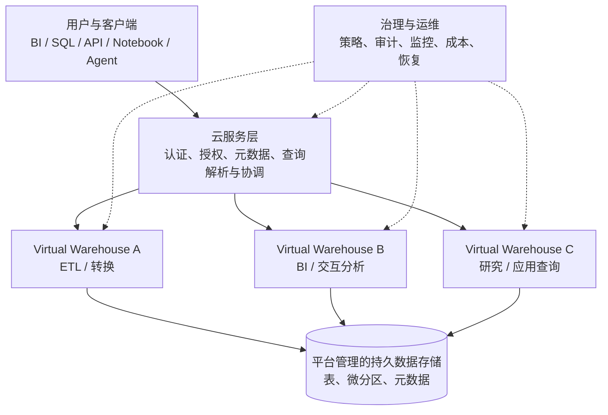
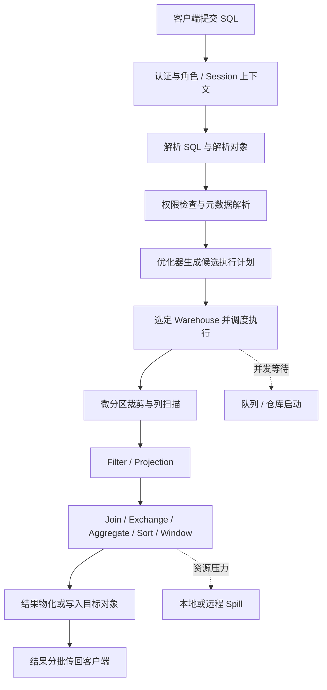
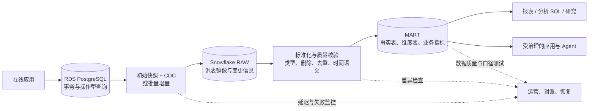
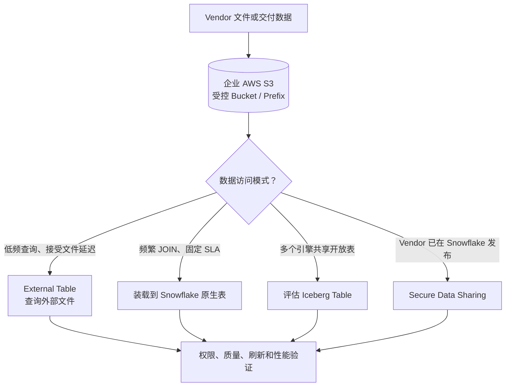
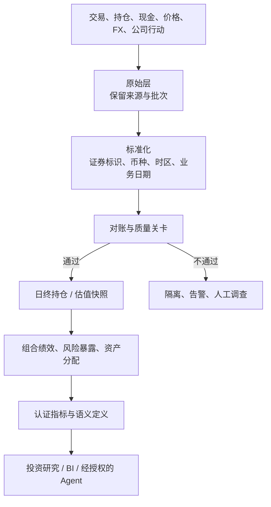
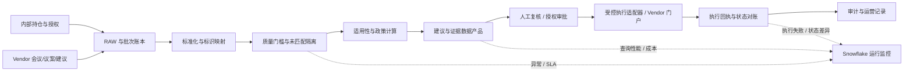
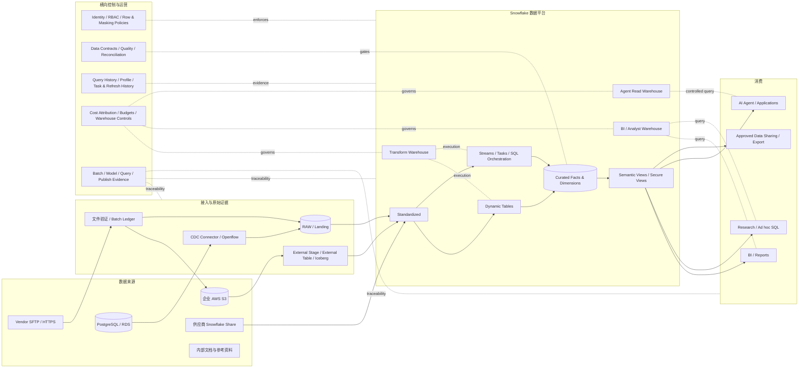
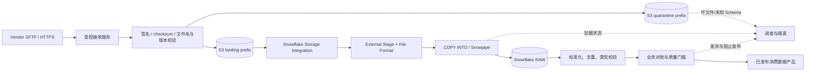

# Snowflake快速学习2026：解决方案架构师的实战指南

> **这不是 Snowflake 全功能目录，而是一份架构决策指南。** 目标读者已经理解数据库、SQL、分布式系统与架构设计，只是需要系统建立 Snowflake 的产品模型和工程经验。本文不重复数据库入门知识，而是解释 Snowflake 特有的执行与存储机制、资源边界、数据接入和转换语义、性能证据、治理模型，以及这些机制在金融服务系统中的实际影响。涉及平台特有名词时会先准确界定，再讨论设计取舍；不把产品功能清单当成架构分析。

**资料核对日期：2026 年 10 月 11 日。** Snowflake 的产品能力、区域支持、版本许可和预览状态会变化。本文涉及具体功能时，优先链接官方文档；正式选型前应再次核对目标云、区域、版本、账号配置和合同条款。

---

**第一部分｜Snowflake 的架构与执行模型**

## 1. Snowflake 解决什么问题？先别从 SQL 语法学起


| 工作负载 | 常见需求 | 初步判断 |
| --- | --- | --- |
| 在线交易（OLTP） | 根据账户 ID 读取一行；同步更新交易状态；多行事务；低延迟写入 | 通常由 PostgreSQL、Oracle、SQL Server 或专用交易平台承担 |
| 分析与数仓（OLAP） | 按客户、证券、日期汇总数十亿条记录；复杂 JOIN；跨年趋势与组合分析 | Snowflake 的典型适用场景 |
| 数据湖与文件分析 | 数据留在 S3；需要直接查询 Parquet、CSV、JSON，或者让多个计算引擎共用数据 | 比较 External Tables、原生表和 Iceberg |
| 数据工程 | 持续摄取、清洗、去重、关联、增量计算与数据质量测试 | 组合使用摄取工具、SQL 转换、Dynamic Tables 或 Streams/Tasks |
| 数据产品与共享 | 给不同业务域、子公司或合作机构提供有限且可追踪的数据视图 | 评估 Secure Views、Secure Data Sharing 和相应的访问控制 |
| 低延迟键值或小规模事务应用 | 高频点查、短事务更新、强约束 | 不要默认用普通 Snowflake 表；可评估现有事务数据库，或在合适区域和限制内测试 Hybrid Tables |

Snowflake 现在也提供 Hybrid Tables 等面向事务型工作负载的能力，所以“Snowflake 完全不能处理事务”并不准确；但这也不意味着它与通用 OLTP 数据库等价。Hybrid Tables 在存储容量、吞吐、功能组合、事务范围、复制和部分数据工程能力方面有明确限制。若应用核心路径依赖毫秒级响应、强约束和复杂事务，必须用真实负载做 PoC，而不是只看功能名称。

参考：[Snowflake 核心概念与架构](https://docs.snowflake.com/en/user-guide/intro-key-concepts) · [Hybrid Tables 限制](https://docs.snowflake.com/en/user-guide/tables-hybrid-limitations)

## 2. Snowflake 与传统数据库的关键区别

“传统数据库”不是单一架构。下面主要对比两种常见对象：以 PostgreSQL/Oracle 为代表的事务数据库，以及需要自建和运维计算集群的传统数仓。具体产品之间仍然存在差异。

| 维度 | 事务数据库，例如 PostgreSQL / Oracle | Snowflake 的典型模式 |
| --- | --- | --- |
| 主要目标 | 可靠处理业务状态变化与操作型查询 | 大规模分析、跨系统数据整合和共享 |
| 计算与存储 | 资源通常与数据库实例或集群配置紧密关联 | 持久数据存储与虚拟仓库计算分离 |
| 查询特点 | 索引点查、短事务、频繁 INSERT/UPDATE/DELETE | 列式分析、过滤、聚合、窗口函数和大型 JOIN |
| 并发隔离 | 通过实例、连接池、读副本、资源限制等管理 | 可为 ETL、BI、数据科学和其他工作负载分配独立仓库 |
| 数据物理组织 | 索引、表空间、分区、统计信息和数据库维护 | 自动微分区、元数据裁剪，以及按需要进行的聚类与搜索优化 |
| 容量扩展 | 可能需要扩容实例、分片、改造存储或引入读写分离 | 计算可按仓库独立调整；平台管理底层存储 |
| 数据接入 | 应用事务写入或外部工具同步 | COPY、Snowpipe、Snowpipe Streaming、连接器、共享和文件访问等多种入口 |
| 历史数据 | 通常靠业务历史表、日志、备份和归档机制设计 | 可结合 Time Travel、克隆、历史表、快照和对象存储；业务历史仍需建模 |
| 物理调优 | 索引设计、执行计划、锁、连接数、Vacuum/统计信息等 | 先关注裁剪、查询模式、仓库资源、并发、缓存和刷新成本 |
| 运营方式 | 自建数据库时要管理主机、补丁、故障转移和容量 | 更多底层基础设施由服务托管，但账户、访问策略、管道、成本和数据语义仍需负责 |

### 存储与计算分离：资源解耦、执行拓扑与成本模型

不要把“存储与计算分离”理解成“数据放在对象存储，计算节点来读文件”这么简单。Snowflake 的关键是把持久数据的生命周期和 SQL 执行集群的生命周期分开管理，同时保留适合大规模分析的 MPP（Massively Parallel Processing）执行方式。官方将其架构描述为传统 shared-disk 与 shared-nothing 架构的混合：多个计算集群可以访问同一份持久数据，但一次查询仍在一个具体的计算集群内被拆分到多个执行节点上处理。[官方架构说明](https://docs.snowflake.com/en/user-guide/intro-key-concepts)

#### 1. 这三个平面分别负责什么

| 平面 | 典型职责 | 生命周期由什么决定 | 对架构设计的影响 |
|---|---|---|---|
| 持久化平面 | 表数据、压缩后的列式数据组织、微分区元数据、表版本与保留策略 | 数据加载/写入、数据保留、Time Travel、表生命周期 | 不需要自行管理数据文件切分、压缩和普通表的底层存储布局，但仍要设计数据粒度、保留期、复制和恢复 |
| 查询执行平面 | 扫描、过滤、连接、聚合、排序、窗口计算、UDF/Snowpark 执行等 | Virtual Warehouse 启动、运行、扩缩容与挂起 | 不同团队可用不同 Warehouse 分担竞争；每条查询的实际代价仍取决于计划、数据量、并发和中间结果 |
| 控制与服务平面 | 身份认证、授权检查、对象解析、元数据、SQL 解析与优化、查询协调、基础设施管理 | 平台托管服务 | 用户通常不需要管理控制节点，但查询延迟、角色权限、对象可见性和元数据操作仍依赖这一层 |

三层之间不是绝对隔离。执行节点会缓存最近读取的数据；查询执行需要访问元数据；优化器使用统计信息和数据组织特征选择计划；写入也需要更新元数据与表状态。因此，“分离”代表管理和伸缩路径解耦，而不是运行时没有依赖，更不保证任意工作负载都可以无限扩展。

#### 2. 独立 Warehouse 为什么能减少工作负载互相干扰

假设夜间有 ETL 回填，早晨有投资研究分析，盘中还有数据质量检查。把三类任务放到同一个 Warehouse，会让它们争抢同一组计算资源：大扫描可能延迟交互式查询，回填任务也可能因为前台负载而排队。

可以为不同负载分配不同 Warehouse：

- `TRANSFORM_WH`：运行批处理、MERGE、回填和重建任务。
- `ANALYST_WH`：服务交互式研究与探索式查询。
- `BI_WH`：服务仪表盘和有稳定 SLA 的业务报表。
- `OPS_WH`：执行低频、受控的检查与运维任务。

这些 Warehouse 访问同一套已授权的持久数据，并不意味着数据被复制四份。这样可以独立设置大小、自动挂起、并发策略和成本归属，也更容易在一个负载变慢时判断是执行资源问题，还是 SQL/数据模型问题。

但这不是硬件意义上的“完全无影响”。它们仍可能共享账户级别的服务、网络、存储吞吐、云区容量和组织预算；同时运行的 Warehouse 仍然产生总成本。独立 Warehouse 可以隔离主要计算竞争，不应被描述为不需要容量管理的无限隔离。

#### 3. 扩大单个 Warehouse 与增加集群数，解决的是不同问题

**垂直扩展（resize）**增加单个 Warehouse 的计算资源，常用于单条查询需要更多并行能力、JOIN/聚合中间状态较大或执行时间过长的情况。它可能缩短查询，但对低效 SQL、错误 JOIN 或严重数据倾斜不一定有效，费用也可能随规格提升。

**多集群扩展（multi-cluster）**主要应对多个查询同时到达造成的并发压力，让系统可以按配置增加集群以承载更多并发。它通常不是把一条查询自动拆到多个独立 Warehouse 中执行；一条查询的执行并行度主要由它所在的 Warehouse 及查询计划决定。

选型时要区分：
- 同一条查询耗时过长：先看计划、裁剪、连接基数和 spill，再做 Warehouse 大小实验。
- 查询本身很快，但一忙就排队：检查并发、仓库启动延迟、调度和多集群设置。
- 夜间任务拖慢白天分析：优先评估负载隔离与调度，而不是单纯扩大全部 Warehouse。
- 成本高但查询不快：检查扫描与重复工作；增加资源可能只是让低效计划更快地产生更高费用。

#### 4. 为什么“共享数据”不等于“无须考虑数据移动”

MPP 查询一般包含扫描与交换两个阶段。扫描阶段由执行节点读取相关微分区；连接、去重、排序或聚合等算子可能需要把中间数据按连接键或分组键在节点间重新分布（exchange/shuffle）。例如两个大型表按高基数键连接时，即使原始数据共享访问，执行过程仍可能产生大量跨节点数据交换。如果一个连接键的数据分布极不均匀，少数节点就可能成为长尾。

因此，Query Profile 中的网络/交换节点、输入输出行数、耗时和内存溢写，依然能揭示执行瓶颈。共享存储让计算资源的伸缩和分配更灵活，但不消除分布式计算的基本约束。

#### 5. 缓存有帮助，但不能把它当成架构承诺

Warehouse 可能利用本地缓存减少重复读取，Snowflake 也有查询结果缓存等机制。缓存效果取决于查询是否满足复用条件、底层数据是否变化、会话与执行环境，以及查询文本和语义。缓存不应被用来掩盖扫描低效：缓存命中时毫秒级返回，不代表同样查询在缓存失效或数据更新后仍能满足 SLA。

做性能基线时至少记录是否命中结果缓存、Warehouse 是否已经热起来、数据范围、运行时段与查询 ID。比较优化前后时，必须把缓存条件尽量保持一致，否则很容易把缓存收益误判成 SQL 优化收益。

#### 6. 什么时候这种架构优势最明显，什么时候优势有限

优势通常来自：多个团队共享同一数据集、分析负载有明显的日间/夜间差别、不同 SLA 需要不同资源配置、存储规模增长快于持续计算需求、临时分析资源需要快速创建与回收。

优势有限或仍需重点验证的情况包括：极高频的单行随机更新、必须在极低延迟内完成的同步事务、庞大的单次结果集需要传回应用、查询包含严重数据倾斜、频繁重算大量历史分区，或者大多数查询都扫描几乎整张超大表。Snowflake 能隐藏不少平台运维细节，但它不改变工作负载本身的计算复杂度。

**架构判断的落点：** 不要只问“存储和计算分离是否好”，而要问“哪些负载应该共享数据、哪些负载必须隔离资源、哪种扩容方式能缓解当前瓶颈、以及增加的计算费用是否换来了业务 SLA 的改善”。

### 托管服务的抽象边界：平台负责什么，架构仍需决定什么

Snowflake 托管底层计算实例、软件升级、普通表的数据组织与压缩、基础设施维护等事项。对使用者来说，减少的是传统数据库平台中很多需要人工配置和反复维护的工作；并不是所有工程复杂度都消失，而是责任边界发生了变化。

可以把责任划分为三类：

| 责任类型 | Snowflake 平台主要承担 | 解决方案/数据平台团队仍需承担 |
|---|---|---|
| 基础设施 | 计算实例与基础服务的托管、底层存储、平台软件更新 | 云区域与账号布局、网络接入、私有连通、容量策略和供应商依赖评估 |
| 数据库物理管理 | 普通表的内部文件组织、压缩、微分区元数据 | 业务粒度、数据类型、历史语义、数据保留、聚类是否值得、加载与回填策略 |
| 查询执行 | SQL 解析优化与分布式执行框架 | SQL 逻辑是否正确、JOIN 粒度、扫描量、并发隔离、Warehouse 大小与成本 |
| 安全 | 身份认证、授权原语、策略执行和相关元数据 | 角色模型、最小权限、敏感数据分类、职责分离、审批、访问审计与异常处置 |
| 数据工程能力 | COPY、Snowpipe、Dynamic Tables、Streams/Tasks 等托管功能 | 输入契约、去重、迟到/删除事件、质量门槛、幂等重试、版本管理与故障恢复 |
| 业务语义 | 提供表/视图/语义模型等承载机制 | 定义“资产”“活跃客户”“净流入”“可投票证券”等业务概念及其责任人和版本 |
| 灾备与合规 | 提供 Time Travel、克隆、复制等平台功能 | 定义 RPO/RTO、选择保留期、处理跨区域约束、定期演练并证明恢复结果 |

一个常见错误，是把“平台托管”推导为“无需调优、无需建模、无需运维”。真实情况是：常规的底层数据库运维减少了，工程重心转向查询与资源治理、数据质量、权限模型、变更发布、数据消费契约、成本控制和可恢复性。它们不再是可有可无的补充，而是平台上线后能否稳定运行的关键。

在金融服务场景，数据平台团队需要明确每个生产数据集的业务所有者、技术所有者、数据合同、访问控制、质量规则、发布时限、修订策略和恢复方法。Snowflake 可以执行其中很多技术机制，但无法从字段名推断某个“市值”到底采用交易时价格、收盘价还是经修订的官方估值，也不可能替业务负责人决定允许谁看到客户级持仓。

可用一句话描述分工：**平台提供可组合的机制，架构与业务团队必须把机制组合成可验证的系统规则。**

## 3. 核心架构：三层模型与一次查询的旅程

Snowflake 官方将平台架构概括为数据存储层、计算层和云服务层。用这三层理解新功能，比记住产品名更有效。



### 数据存储层：不必自己维护普通表的底层文件

Snowflake 的标准表将数据存储在平台管理的列式格式和微分区中。用户通常不需要自己创建文件目录、分区文件、压缩块，也不用按传统数据库的方式管理底层磁盘布局。

**微分区（Micro-partition）** 可以简单理解为 Snowflake 自动组织的一组数据块，并附带可帮助排除无关数据的元数据。查询只需要少量日期、账户或证券时，平台有机会跳过大量不可能匹配的微分区。

例如，研究人员经常查询最近 90 天的交易，如果表按时间自然组织，过滤交易日期可能只读取一部分数据；但如果查询没有任何有效过滤，或者经常按一个低相关度的字段做筛选，Snowflake 仍可能需要扫描很多数据。

重点不是记住微分区的内部实现，而是理解：**数据量并不等于每次查询都必须读取的量；有效裁剪是性能和成本的共同基础。**

参考：[Micro-partitions 与 Data Clustering](https://docs.snowflake.com/en/user-guide/tables-clustering-micropartitions)

### 计算层：Virtual Warehouse 是查询执行资源

虚拟仓库负责运行 SQL、装载或转换等需要计算的工作。创建仓库时，会选择规模、自动挂起/恢复和并发相关设置。仓库运行会消耗 credits；暂停后不再为该仓库持续计算计费，但存储费用仍然存在，云服务层也可能有其他费用。

常见的两个调整方向：

- **Scale up（扩大仓库）：** 给当前仓库更多计算资源，适用于一条查询计算量较大、延迟不达标的情况。
- **Scale out（多集群/更多可承载并发的资源）：** 适用于很多用户同时查询、排队时间变长的情况。

两者解决的问题不同。假设月末风险报表只有一条特别慢的查询，优先调查 SQL、扫描量和仓库大小；假设所有用户在开市后涌入导致大量查询排队，那么多集群或工作负载拆分才可能更有帮助。

对于间歇性任务，开启自动挂起通常能省钱；对几乎连续有请求、缓存很重要的交互式 BI，过短的自动挂起又可能让仓库频繁启动、反复冷启动并丢失仓库缓存。需要测量真实请求间隔，不要把所有仓库套用同一个值。

参考：[Virtual Warehouse 的考虑事项](https://docs.snowflake.com/en/user-guide/warehouses-considerations) · [Warehouse 成本控制](https://docs.snowflake.com/en/user-guide/cost-controlling-controls)

### 云服务层：它不仅是一台 SQL 计算机

云服务层协调认证、授权、元数据、查询解析和优化等工作。架构师需要注意的是，它和计算仓库并不是同一件资源。暂停某个仓库不等于禁用了账号、对象权限、治理规则或所有其他平台服务。

### 一次查询的完整执行路径：从 SQL 到扫描、交换与结果

分析 Snowflake 性能时，不能只看 SQL 文本，也不能把“提交查询—返回结果”理解为一个黑盒。一次查询要经历请求校验、对象解析、优化、资源调度、分布式执行、结果生成和结果传回等阶段。不同阶段的等待和计算会体现在不同的观测证据中；诊断之前，先确认问题发生在哪一段。



这是为了理解问题边界的逻辑示意图，不是 Snowflake 内部组件的完整实现图。优化器的具体搜索策略、节点调度和物理运行时属于平台实现；下面关注的是架构师可以观察、验证并据此决策的部分。

#### 阶段 1：Session、角色、数据库上下文与 SQL 请求

相同 SQL 文本在不同上下文下不一定代表相同操作。活动角色、当前数据库和 Schema、Warehouse、会话参数、变量、时区以及对象授权都会影响 SQL 的解析与运行。应用应尽量显式管理连接上下文，避免依赖某个开发者会话里遗留的 `USE ROLE`、`USE DATABASE` 或时间区域设置。

权限检查不只是“能否打开表”。视图引用的对象、调用函数、读取 Stage、使用 Integration、执行 Task 或写目标表时，都可能需要不同权限。排查“开发环境可以运行，生产环境失败”时，应比较完整的角色上下文和对象授权，而不是立即赋予高权限角色。

#### 阶段 2：解析、绑定与优化

SQL 首先被解析成内部表示，并绑定到数据库对象、列、函数和类型。接下来优化器根据逻辑语义和可用的元数据，选择物理执行计划。这个过程会考虑过滤下推、列裁剪、连接顺序、连接算法、聚合与排序方式等因素。

优化器有能力重写查询，但不能可靠修复语义错误。例如：
- JOIN 键遗漏了 `portfolio_id`，导致不同组合的头寸互相连接；优化器可能高效地执行错误逻辑。
- 先将多对多关系 JOIN 到事实表，再对金额求和，得到的是重复后的金额；把 SQL 重写得更快并不能让结果变正确。
- 过滤使用错误的时间字段，例如拿数据到达时间代替业务生效时间；优化器无法推断业务语义。
- 对字段执行复杂转换可能让谓词更难与存储元数据匹配；应测量是否影响裁剪，而不是机械地规定所有表达式都不能出现在过滤条件中。

优化器并不会把查询文本的每个子句按书写顺序执行。SQL 是声明式语言；执行计划反映平台在不改变结果语义前提下采用的实现路径。工程师要学习看计划，而不仅是阅读 SQL 的缩进。

#### 阶段 3：Warehouse 启动、调度与排队

Warehouse 若已运行，可以较快接收新查询；若处于挂起状态，则需要恢复计算资源。并发达到当前容量限制时，查询还可能排队。因而用户感知的总耗时可以分解为：提交/编译与服务开销、Warehouse 启动或排队时间、执行时间、结果传输与客户端消费时间。

不同工作负载需要不同的处理方式：
- 执行时间短但队列很长：检查同一 Warehouse 上的并发、长查询占用、调度时间和集群策略。
- 偶发第一次查询慢，随后变快：检查 Warehouse 启动以及结果/本地缓存，不要直接把第二次速度当作真实基线。
- 查询执行已结束，但应用仍卡住：可能是客户端逐行读取、网络、分页、序列化或应用本身处理结果的成本，而不是 Snowflake 执行器慢。
- 编译耗时异常：先检查 SQL 复杂度、对象/视图展开和元数据访问情况，再结合 Query History 及支持材料调查。

#### 阶段 4：微分区裁剪、列扫描与过滤

标准 Snowflake 表会被组织成内部管理的微分区，平台在写入时收集用于裁剪的元数据。对于按日期、状态或其他列过滤的查询，执行引擎可以判断部分微分区不可能包含匹配数据，从而跳过它们。列式存储还意味着只读取所需列，通常不需要读取整行所有字段。

裁剪效果受数据分布、过滤选择性、数据类型转换和微分区重叠程度影响。仅写了 `WHERE valuation_date = ...` 并不证明发生了有效裁剪；应查看 Query Profile 中扫描的微分区和总微分区、扫描字节数与过滤后行数。过滤范围覆盖整张表时，良好的裁剪也不可能让一次全量计算变成点查。

#### 阶段 5：分布式算子、数据交换与中间结果

读取数据只是开始。引擎可能执行多阶段 Join、Partial/Final Aggregate、Sort、Window 或 Distinct。某些算子必须跨节点交换数据。例如 Hash Join 通常需要按连接键分配行，使同一个键的相关记录能在处理节点上相遇；GROUP BY 也可能先做局部聚合，再做全局合并。

应重点观察算子前后的行数：
- 连接输出远大于输入：检查键是否唯一、是否漏掉复合键、是否有多对多关系或脏数据。
- 过滤前扫描很多、过滤后仅剩极少数：可能需要改善裁剪或提前过滤，也可能是数据物理分布与查询不匹配。
- Sort / Window 占据大部分运行时间：检查是否排序范围过大、分区键是否符合需求、是否仅为去重而进行昂贵全局排序。
- 一个分支处理的行数远多于其他分支：注意数据倾斜与连接键分布，而不仅是总行数。
- 聚合节点只输出少量行，却处理极大量记录：确认聚合是否必要，是否可以先在正确粒度上预聚合，以及是否重复扫描数据。

分布式执行的核心成本常来自输入扫描、中间行数膨胀、数据重分布和需要保留的中间状态。把 JOIN 变少并不一定更快；更少但更早发生的过滤、正确的连接基数和可减少的中间数据，才是可验证的优化方向。

#### 阶段 6：内存压力、Spill 与长尾查询

Sort、Hash Join、Hash Aggregate 等算子需要内存状态。工作集超过可用资源时，执行器可能把部分数据写到本地或远程存储，再在后续阶段读回。远程溢写通常意味着额外的 I/O 和更长的运行时间；它并不单独证明 Warehouse 规格不足，也可能由扫描过多、连接基数错误或 SQL 中无效工作导致。

排障顺序建议为：
1. 确认输入数据量和连接结果是否合理。
2. 确认过滤与列裁剪是否减少了输入。
3. 查看哪个节点发生 spill，以及 spill 前后的处理量。
4. 检查同一时段是否有其他大查询争用资源。
5. 在保持输入范围、缓存条件和结果正确性可比的前提下测试更大 Warehouse。

如果只是扩大仓库让错误 JOIN 在更短时间内产生了更大的错误结果，那不是成功优化。性能评估必须同时验证业务结果。

#### 阶段 7：结果物化、写入提交与客户端取数

最终结果可能直接返回客户端，也可能写入表、临时结果或由后续任务消费。对写操作，还要考虑目标表锁定/并发语义、事务提交、重复运行以及下游可见性。应用一次取回数百万行时，瓶颈可能在网络和客户端内存；如果下游只需要聚合指标，应该在数据库内完成所需聚合并返回更小结果，而不是默认把所有明细拉回应用。

#### 用 Query Profile 把怀疑变成证据

建议每次调查至少记录：
- Query ID、用户/角色、Warehouse、查询文本或查询标签、发生时间；
- 总耗时，以及是否包含启动/排队；
- 扫描微分区 / 总微分区、扫描字节数；
- 各主要算子输入和输出行数；
- 本地/远程 spill 情况；
- 缓存条件和数据范围；
- 优化前后 SQL、结果校验和成本变化。

Query Profile 是诊断入口而不是最终结论。一个算子显示耗时高，可能是自身代价高，也可能是等待上游数据；应结合输入/输出规模和执行图阅读。官方参考：[Query History 与 Query Profile](https://docs.snowflake.com/en/user-guide/ui-snowsight-activity)、[Warehouse Memory 与 Spill](https://docs.snowflake.com/en/user-guide/performance-query-warehouse-memory)。

#### 一个可重复的性能实验模板

对同一个业务问题建立一个基线，固定数据日期和过滤范围，保存 Query ID 和结果校验。每次实验只改变一个主要因素，例如把宽泛的 `SELECT *` 改为列裁剪，或者修正一个 JOIN 键，或者单独调整 Warehouse 大小。记录执行时间、扫描量、spill、Credits、结果正确性和缓存状态。若多个变量同时改变，就很难判断收益来自哪里；若只比较单次耗时，又容易把热缓存、数据量波动和偶然负载误判为优化效果。

## 4. 日常工作中会遇到的 Snowflake 基本对象

本章补上新手最常遇到的“对象名都认识，但不知道它们如何组织”的问题。先记住：Snowflake 里的对象不是一台数据库服务器上的一堆表名，而是由账户、命名空间、计算资源和授权关系一起组成的平台。

### Snowflake 的基本对象：它们分别代表什么？

| 对象 | 可以怎样理解 | 典型架构问题 |
| --- | --- | --- |
| Organization / Account | 组织与 Snowflake 账户边界。账户会关联云、区域和版本配置 | 开发、测试、生产是否分账户？灾备账户在哪里？数据驻留约束是什么？ |
| Database / Schema / Table | Database 是数据库命名空间；Schema 是其中的对象分组；Table 是存放结构化数据的对象 | 哪些数据域共用 Database？哪些对象由不同团队维护？如何规划命名和权限边界？ |
| View / Semantic View | View 封装 SQL 查询；Semantic View 在物理数据之上补充业务实体、关系、维度和指标 | 应该向消费者暴露原始表，还是经过认证的业务接口？ |
| Virtual Warehouse | 负责执行 SQL、装载和数据转换的计算资源，不是数据存放位置 | 这项工作负载需要多少计算能力？是否应与 BI 或其他团队隔离？ |
| User / Role / Grant | User 是使用者或服务身份；Role 组织权限；Grant 把对象权限授予角色等主体 | 谁能查询、修改、分享或管理策略？权限能否按职责分离？ |
| Stage / File Format / Pipe | Stage 指向文件位置；File Format 描述 CSV、JSON、Parquet 等格式；Pipe 可用于自动加载 | 文件从哪里来？谁能读？重复和失败如何重试？ |
| Stream / Task | Stream 跟踪受支持对象的变化；Task 按时间或依赖关系执行 SQL 等工作 | 增量变化由谁消费？失败能否恢复？任务之间的依赖如何观察？ |
| Share / Policy / Tag | Share 控制数据共享；Policy 执行访问或隐私规则；Tag 为对象添加可治理的分类元数据 | 如何分享有限数据？敏感列如何分类？策略是否覆盖新建对象？ |

### 怎样读懂一个全限定表名？

例如 `ANALYTICS_DB.MART.FCT_TRADE` 通常可读作 Database.Schema.Table：

- `ANALYTICS_DB`：数据库；
- `MART`：Schema；
- `FCT_TRADE`：事实表。

在企业项目里，应给命名空间定义清晰约定，例如 RAW、STAGING、MART，或按业务域拆分 Schema。名字不是安全控制：能否访问仍由角色授权、策略和对象权限决定。

### 一条查询如何找到数据并运行？

用户或应用以某个身份连接账户，使用有权访问的角色，指定或使用默认 Virtual Warehouse 执行查询。查询访问哪个表由 SQL 名称解析和对象权限决定；实际扫描和计算由 Warehouse 承担；查询费用与相应资源和服务使用情况相关。因此，至少要分别治理三个东西：**数据对象及其授权、执行查询的身份、承担计算的 Warehouse**。

新手练习时，可创建一个测试 Schema，加载一小份文件，创建一个普通 View，再分别用两个权限不同的角色读取。这样比只在 UI 中浏览对象列表，更容易理解“对象在哪里、谁能读、查询由什么资源执行”。

---

**第二部分｜理解数据模型和数据库对象**

### 对象模型要按职责理解：数据对象、计算对象、接入对象与治理对象

Snowflake 的对象名看起来像普通数据库，但对象本身可能承载完全不同的职责。架构评审时不要只画 Database 和 Table，还要把连接数据、计算资源、自动执行、共享和策略对象放入同一张图。

| 对象 | 职责 | 常见误解 |
|---|---|---|
| Database / Schema | 命名空间、对象组织和授权边界 | 把 Schema 当成物理隔离区或独立计算资源 |
| Table / View | 持久化数据或逻辑查询接口 | 认为 View 就是缓存；普通 View 通常保存查询定义，不保存完整结果 |
| Virtual Warehouse | 执行查询与数据转换的计算资源 | 把 Warehouse 当成 Database，或认为每个表必须绑定某个 Warehouse |
| Stage / File Format | 定义文件存放位置或解析格式 | 认为创建 Stage 就表示文件已经进入可查询的原生表 |
| Storage Integration / External Access Integration | 建立受控的外部访问身份或网络访问机制 | 将长期云凭证写进 SQL 或应用配置 |
| Pipe / Snowpipe | 自动发现或持续摄取符合条件的文件/数据 | 将“文件已到 S3”当作“目标表已完整加载” |
| Stream / Task | 追踪表变化或调度 SQL/过程执行 | 把 Stream 当成永不消耗的队列，或认为 Task 成功就代表数据质量通过 |
| Dynamic Table | 根据定义查询维护派生数据，并按目标新鲜度协调刷新 | 把 target lag 理解成绝对刷新时限 |
| Share / Listing | 在治理边界内共享数据产品 | 把共享等同于复制出一份可随意修改的数据 |
| Masking / Row Access Policy / Tag | 表达列级保护、行级访问和分类语义 | 认为仅在应用层隐藏字段就已形成数据保护 |
| Resource Monitor / Budget / Query Tag | 识别、约束或归属消耗 | 将成本观察仅限于月度总账，而不关联负载和所有者 |

对象之间的关系应明确建模。例如一份外部 Vendor 数据先通过 Storage Integration 授权访问 S3，再通过 Stage 和 File Format 定义读取方式；由 COPY INTO 或 Snowpipe 将数据装载成原生表；随后 Dynamic Table 或 Streams/Tasks 生成标准化和消费层；最后通过角色、策略和 Secure View 让不同使用者访问。每一步都有独立的权限、失败模式与审计证据。

### 命名与部署：将账号、环境和权限上下文从 SQL 里显式化

在开发环境中使用 `MY_DB.PUBLIC.T1` 很方便，但企业方案应定义开发、测试、预生产和生产的对象命名与晋级规则。环境隔离应由账号/数据库/Schema/角色/资源配置的组合决定，而不是只在对象名里加一个 `_PROD` 后缀。

部署流程应能够回答：
- 数据定义、视图和策略的变更由谁审批；
- 生产对象由哪个部署角色创建和拥有；
- 表结构更新后，依赖视图、Dynamic Tables、Task、语义层和下游共享如何验证；
- 同一份 SQL 在不同环境使用哪个 Warehouse、数据库上下文和 Integration；
- 回滚是恢复对象定义、重放数据，还是从安全的历史版本恢复；
- 运行时使用的活动角色是否符合最小权限，而不是依赖人类管理员的默认角色。

可以把 Snowflake 对象与 SQL 作为代码管理，但要把数据迁移、权限变更、任务启停和业务发布视为不同类别的变更。一个 SQL 文件能执行成功，不代表整个部署已经具备一致性或可恢复性。

## 5. 表设计与数据类型：从关系数据库思维转向分析建模

Snowflake 与 PostgreSQL/Oracle 都使用 SQL，但物理存储和约束语义有差别。先理解这些差异，再决定怎么设计事实表、维度表、快照和外部数据对象。不要把 OLTP 的索引、分区和约束假设直接套到 Snowflake 标准表上。

### 表设计和 PostgreSQL / Oracle 有什么不同？

学习 Snowflake 时，最容易犯的错误是把关系数据库的设计习惯原封不动搬过来。SQL 语法相似，但物理组织、约束、索引与典型工作负载并不相同。

| 设计问题 | PostgreSQL / Oracle 常见做法 | Snowflake 标准表的思路 |
| --- | --- | --- |
| 物理存储 | 以行存为主；按访问模式设计索引、分区、表空间等。Oracle 也广泛使用分区与索引组合 | 面向分析的列式存储和自动微分区由平台管理；通常不需要自己维护传统 B-tree 索引或手工分区文件 |
| 主键、唯一键与外键 | 数据库可强制执行约束，帮助阻止重复键和无效引用 | 标准表的 PRIMARY KEY、UNIQUE、FOREIGN KEY 通常是信息性约束，不会替你拦截重复值或无效引用；NOT NULL 和 CHECK 会执行。Hybrid Tables 的约束行为不同 |
| 点查性能 | 合适的索引可快速定位一行 | 先检查微分区裁剪；对选择性很高的点查，按需要评估 Search Optimization，而不是每个字段都建索引 |
| 分区 | 按日期/业务键做分区，并考虑分区裁剪与维护成本 | 标准表自动划分微分区。先按自然加载顺序和过滤模式测量，再决定是否需要 CLUSTER BY；它不是通用的“分区键”替代物 |
| 数据粒度 | OLTP 常用高度规范化模型以减少更新异常 | 分析层常使用事实表、维度表、快照或适度宽表以减少重复 JOIN；并不意味着 RAW 来源表应被随意扁平化 |
| 事务与并发 | 常用于高频短事务、细粒度锁与业务写入 | 标准表主要为分析优化。不能因支持事务与 SQL 就假设它等价于高并发 OLTP；事务型需求应评估现有数据库或受限的 Hybrid Tables |
| 临时与环境隔离 | 临时表、分区表、物化视图、只读副本等各有用途 | 可按生命周期选择 permanent、transient、temporary 表，使用零拷贝克隆建立隔离测试；必须确认数据保留与恢复要求后再选择对象类型 |
| 查询复用 | 普通 View、Materialized View、索引与物化结果各有用途 | 普通 View 复用逻辑定义；Materialized View 为受限查询维护预计算结果；Dynamic Table 更适合描述持续刷新的转换数据集 |

#### 设计 Snowflake 表时，优先确定这六件事

1. **先确定粒度，再谈列和主键。** 例如一行是一笔成交、一只证券在一个账户的日终持仓，还是一份 Vendor 文件中的一条记录？粒度没写清楚，后续聚合极容易重复计数。
2. **主键约束不执行，就必须把数据质量测试补上。** 业务主键依然重要，但不要以为声明 PRIMARY KEY 后 Snowflake 一定会阻止重复。对交易 ID、账户/证券/估值日组合键等设置唯一性检查，并在发布前处理失败。
3. **金额用精确数值，时间语义显式化。** 财务金额通常使用适当精度的 NUMBER/DECIMAL，而不是近似浮点类型；区分 DATE、当地时间、UTC 时间、带/不带时区的 TIMESTAMP，明确交易日、结算日和入账日。不要把日期和金额长期存成 VARCHAR 后再隐式转换。
4. **从星型模型开始，而不是照搬源系统的每张规范化表。** 例如 FCT_TRADE 以成交或交易事件为粒度，DIM_ACCOUNT、DIM_SECURITY、DIM_DATE 承载上下文；若需历史时点分析，再定义有效期和快照。不是每个场景都必须做星型模型，但每个模型必须清楚说明粒度、关系与聚合行为。
5. **按真实过滤方式调优。** 常按 trade_date 筛选，就检查日期裁剪；常按 account/security 做极高选择性检索，再评估 Search Optimization；多类大查询反复按相同维度过滤且裁剪效果差，才评估聚类。优化必须有 Query Profile 基线和费用对照。
6. **对象类型影响成本与恢复。** 临时表用于会话/任务中的短期结果；transient 表常用于可重建、无需 Fail-safe 的中间数据，但仍要核对其 Time Travel/恢复策略；永久表用于需要相应保护的长期对象。不要仅为节省一点存储，把需要审计或恢复的核心数据放入不适合的对象类型。

官方表设计文档尤其值得阅读的一个差异是：标准表的主外键声明不能代替数据质量控制。若交易事实表与账户维度通过 ACCOUNT_ID 关联，应显式检查孤立账户、重复主键、迟到更正和关联基数。Snowflake 不会因为 SQL 成功就证明关系满足业务约束。

参考：[Table Design Considerations](https://docs.snowflake.com/en/user-guide/table-considerations) · [Snowflake 数据类型](https://docs.snowflake.com/en/sql-reference-data-types) · [Hybrid Tables](https://docs.snowflake.com/en/user-guide/tables-hybrid) · [Views、Materialized Views 与 Dynamic Tables](https://docs.snowflake.com/en/user-guide/overview-view-mview-dts)


### Schema Design 深入：先确定粒度，再决定星型模型、历史和物理布局

Schema design 不是先决定字段类型，而是先回答：**一行数据代表什么事实？这些事实在业务上如何被识别、关联、汇总和追溯？** 在投资组合场景里，最容易出错的不是 SQL 语法，而是把不同粒度的数据放到一张表、重复连接多对多关系，或把每日余额当成可跨日相加的流水。

#### 1. 从业务问题推导事实表粒度

假设目标是回答“每个组合在每个估值日持有哪些证券、数量多少、市值多少、以什么币种计量”。一个可解释的起点是：

| 对象 | 建议粒度 | 关键字段示例 | 设计注意点 |
|---|---|---|---|
| `FCT_POSITION_DAILY` | 估值日 × 组合 × 账户 × 证券 × 本位/计价币种 | `valuation_date`, `portfolio_id`, `account_id`, `security_id`, `currency_code`, `quantity`, `market_value` | 一行代表一个明确口径的日终持仓；要声明价格来源、估值币种和修订版本 |
| `FCT_CASH_FLOW` | 一笔业务流水/事件 | `trade_id`, `event_sequence`, `trade_ts`, `cash_flow_amount` | 流水一般可以按业务规则求和，但要区分冲正、撤销和更正事件 |
| `FCT_FX_RATE` | 日期 × 源币种 × 目标币种 × 汇率类型 | `rate_date`, `from_currency`, `to_currency`, `rate_type`, `rate` | “收盘汇率”“交易汇率”“月末汇率”不能只靠一个 `rate` 字段混在一起 |
| `DIM_SECURITY` | 证券业务键的一条当前/历史描述记录 | `security_id`, `issuer_id`, `asset_class`, `valid_from`, `valid_to` | 证券分类会变；需要当前视图还是历史时点视图，应由业务问题决定 |

粒度定义后，明确三类字段：
- **可加（additive）**：在业务约束允许的维度上可以相加，例如某类交易流水金额。
- **半可加（semi-additive）**：通常可以按组合、证券等维度求和，但不能把不同日期的快照余额再相加。日终持仓市值就是典型例子。
- **不可直接相加（non-additive）**：百分比、收益率、平均成本或某些比率，应从分子/分母重新计算，而不是对比率做 `SUM` 或简单平均。

如果报表需要总资产，应先在同一个估值日、统一计价币种、统一估值规则下汇总头寸，再处理现金、负债和汇率；不能因为 SQL 能返回一个数，就认定该数具有业务意义。

#### 2. 用星型模型表达稳定的分析路径

在维度模型中，事实表存可度量的事件或快照，维度表提供分析上下文，例如组合、证券、客户、日期和组织。星型模型的价值不是“越规范化越好”，而是让常见的分析问题有稳定的连接路径和可解释的粒度。

很多对多关系要特别谨慎。例如证券与投资主题可能是多对多。直接将持仓事实表连接到多条主题映射，再按组合汇总，会把持仓金额复制多次。解决方式取决于业务语义：为分析分配权重、保留多标签但禁止重复加总，或提供单独的桥接/关联事实；不要把连接造成的重复当作性能问题处理。

#### 3. 历史属性：用业务有效时间解释“当时知道什么”

维度属性经常会变化：证券分类、发行人归属、客户风险等级、组合负责人等。若报告需要解释历史日的口径，应考虑 Slowly Changing Dimension Type 2（SCD Type 2），保存业务有效起止时间与版本键，而不只是覆盖当前值。至少区分：
- **业务有效时间**：该属性从什么时候起在业务上生效。
- **数据到达/记录时间**：平台什么时候收到这条信息。
- **报告/估值时间**：下游计算采用哪个截止时点。

这三种时间不总是相同。若供应商在周五更正了周二的价格，系统既要能重算最新视图，也要能解释“周三发布的报告当时使用了什么数据”。这通常需要保留源版本、到达时间、批次 ID 和计算版本，而非仅覆盖当前记录。

#### 4. 物理设计要由访问模式和实测证据驱动

Snowflake 会自动把表组织为微分区，并维护用于裁剪的元数据。不要从传统数据库经验出发，为每一张表都设计聚簇键或大量索引。先观察代表性查询的扫描量、分区裁剪、过滤条件和数据规模，再比较默认布局与候选布局的收益及维护成本。

- 高频按日期范围扫描、且表非常大时，日期或与常见过滤组合相关的聚簇策略可能值得测试。
- 如果常见过滤字段选择性很高但布局无法有效裁剪，应先检查查询谓词、数据分布和微分区重叠情况。
- 维度表小不代表一定要强行复制；也不要假设 Snowflake 的优化器一定会消除错误的连接基数。
- 用真实代表性查询做 A/B 比较，并记录查询 ID、扫描字节数、执行时间、缓存状态和 Credits；避免只比较一次冷缓存与一次热缓存。

**业界案例边界：** BlackRock 公开案例说明 Snowflake 支持其 Aladdin 生态中的大规模数据处理与分析，但公开材料不等于披露了其内部事实表粒度、SCD 策略或具体聚簇键。本文中的持仓模型是可供架构评审讨论的设计示例，不应描述为 BlackRock 的内部实现。参见 [BlackRock 客户案例](https://www.snowflake.com/en/customers/all-customers/case-study/blackrock/)。

### Schema 设计中的三种时间、标识符与精度问题

在金融数据中，很多长期故障不是表结构“不能查询”，而是表结构没有保存足够的业务含义。

#### 1. 业务时间、源时间与平台到达时间不能混为一谈

至少区分：
- **事件/业务时间**：这条记录描述的业务何时发生或生效；
- **源端提交/变更时间**：上游系统何时记录或发布了这次变化；
- **到达时间**：Snowflake 在何时接收到文件或 CDC 事件；
- **处理/发布时间**：哪次管道运行将其转换并对消费者可见。

例如供应商在 10 月 12 日发布一条更正记录，将 10 月 8 日的价格改为新的值。只保存 `updated_at = 10/12` 仍不足以表达价格对应的市场日期是 10/8；只用市场日期又无法判断平台何时收到修订。需要同时记录业务日期、源版本或发布序号、摄取时间和处理批次。

这会影响增量管道的水位线。如果仅用 `WHERE business_date > MAX(business_date)` 过滤新数据，10 月 12 日到达的 10 月 8 日更正就会被漏掉。更稳妥的设计是使用源端变更序列、到达时间或批次作为摄取水位，并根据受影响业务日期重新计算结果。

#### 2. 业务主键与源系统主键是两个概念

多源整合通常需要同时保存：
- `source_system`：记录来源；
- `source_primary_key`：来源系统里的实体标识；
- `business_key`：跨系统用于匹配业务实体的键，前提是已经明确统一规则；
- `surrogate_key`：仓库内部用于维度历史版本或统一引用的代理键。

不要假定不同系统中相同的客户号、证券号或账户号一定代表同一实体，也不要把会变化的业务属性作为唯一键。证券标识可能因供应商、上市地、资产类别和有效时间而变化；客户合并、账户迁移等也需要可追溯的映射规则。统一标识的匹配规则应作为受版本控制的业务逻辑维护，而不是埋在多个报表的 JOIN 条件中。

#### 3. 数值类型是业务契约，不只是存储优化

金额、数量、价格、汇率、比例和计数应分别选择精度与尺度。浮点类型适合某些科学计算，但对于需要精确十进制口径的金额、单价和对账值，要审慎评估二进制浮点误差。不同 Vendor 的单位也必须显式规范：股、份、手、基础货币、报价货币、百分数与小数形式不应仅靠字段名区分。

示例：一个来源将收益率表示为 `2.5`，意味着 2.5%；另一个来源把收益率表示为 `0.025`。如果没有数据契约说明单位，二者都能成功加载成 NUMBER，查询也不会报错，但下游分析会相差 100 倍。

#### 4. NULL、零和“未知”有不同语义

`quantity = 0` 可能表示确认没有持仓；`quantity IS NULL` 可能表示供应商没有提供数量、解析失败或该字段不适用。这些语义需要通过源字段字典、解析状态或质量标记来区分。不要在所有转换里用 `COALESCE(value, 0)` 消除 NULL，这会把“未知”改写成“确定为零”。

### 数据约束：声明式约束不一定等于运行时验证

Snowflake 支持的表约束行为与事务数据库有所不同；对于标准 Snowflake 表，部分主键/唯一性约束一般主要用于元数据表达，并不替代实际的数据质量校验。若依赖业务键唯一性保证 JOIN 不重复，就应在管道中通过测试、去重和对账来验证，而不是因为 DDL 中写了 `PRIMARY KEY` 就假定脏数据无法进入。

一个生产模型可以定义如下质量测试思路：

```sql
-- 业务键重复检查：返回非空结果即需要调查
SELECT source_system, position_business_key, COUNT(*) AS n
FROM curated.position_current
GROUP BY source_system, position_business_key
HAVING COUNT(*) > 1;

-- 必要字段缺失：不要把解析失败悄悄转换成正常零值
SELECT COUNT(*) AS invalid_rows
FROM standardized.position_cdc
WHERE position_business_key IS NULL
   OR source_system IS NULL
   OR event_time IS NULL;

-- 金额控制总计；这里只是模板，需要按批次和币种定义可比口径
SELECT batch_id, currency_code, SUM(market_value) AS market_value_total
FROM curated.position_daily
GROUP BY batch_id, currency_code;
```

测试的重点不是查询数量多，而是能阻止什么业务风险。持仓报表应验证估值日、币种和组合粒度；交易流水应验证唯一事件与冲正；参考数据应验证有效时间与版本；对外发布的数据集应验证其 SLA 和授权边界。

### 半结构化数据：JSON 不一定要先全部拆平

金融服务的数据经常来自 REST API、事件总线、监管文件和 Vendor 数据。JSON 字段可能随版本变化，部分字段很少被用到。

Snowflake 支持如 VARIANT 这样的半结构化数据类型，适合先保留原始结构，再按业务需要投影出稳定字段。它能减少早期接入时因结构变化而频繁改表的负担，但不代表最终模型应该永远只存一个巨大的 JSON 列。

比较稳妥的做法：

1. 原始层保留来源、获取时间、批次 ID、原始 payload 以及校验信息；
2. 标准化层抽取常用字段并明确类型、时区、币种与空值含义；
3. 面向分析的模型对主键、业务时间、历史版本和关联规则做显式建模；
4. 对未识别字段的新增与格式变化建立监控，避免静默丢失数据。


### 半结构化数据的建模边界：VARIANT 不是免 Schema 的借口

`VARIANT` 让 Snowflake 可以先保留 JSON 等半结构化载荷，再按查询需要读取路径；这可以降低供应商格式频繁变化时的接入摩擦。但它不意味着业务模型可以无限期停留在嵌套 JSON 中。

通常可采用双层策略：
1. 原始层保存源载荷与来源元数据，便于审计和在解析规则变化后重放。
2. 标准层把跨报表重复使用、需要强类型校验、需要索引式访问语义或参与 JOIN 的字段提取成列。
3. 消费层只暴露业务认可的字段与解释，不要求每一个下游团队自行解析 Vendor 的 JSON。

当字段路径、类型或数组结构在源端改变时，原始载荷可以仍然成功加载，但下游路径解析可能变成 NULL 或不同结构。此类错误常常不会触发 SQL 语法错误，因此应把“关键字段解析成功率”和“预期节点是否存在”纳入数据质量测试。

数组展开还会改变粒度。对一个事件含 20 个持仓数组元素的 JSON 记录执行 FLATTEN 后，该事件变为 20 行。随后如果再连接到事件级元数据并做 SUM，必须确定哪些字段会随行重复；否则就会发生金额重复计算。展开 JSON 之前先说明输出一行代表什么，效果与设计关系型表时先确定 grain 一样重要。

### 高级 SQL：窗口函数、QUALIFY、ASOF JOIN 与半结构化展开

高级 SQL 的重点不是堆叠复杂语法，而是把**排序规则、时间语义和数据粒度**写清楚，让其他人能审计和复现结果。

#### 示例 A：计算账户现金流累计值

```sql
SELECT
    account_id,
    trade_ts,
    trade_id,
    cash_flow,
    SUM(cash_flow) OVER (
        PARTITION BY account_id
        ORDER BY trade_ts, trade_id
        ROWS BETWEEN UNBOUNDED PRECEDING AND CURRENT ROW
    ) AS running_cash_flow
FROM curated.trade_cash_flows
WHERE trade_ts < '2026-10-01'::TIMESTAMP_NTZ;
```

这里的 `trade_id` 是排序稳定性的补充键；如果同一时间存在多笔流水，只有按时间排序可能无法稳定重现结果。显式写出 `ROWS` 窗口框架，可避免读者误把默认窗口语义当成业务规则。此例只能用于满足业务定义的流水累计；不能把它直接套在每日持仓市值上。

#### 示例 B：用 QUALIFY 取 CDC 每个业务键的最新事件

```sql
SELECT *
FROM raw.position_cdc
QUALIFY ROW_NUMBER() OVER (
    PARTITION BY source_system, position_business_key
    ORDER BY source_commit_position DESC, source_event_sequence DESC
) = 1;
```

`QUALIFY` 可以直接按窗口函数结果过滤，避免再包一层子查询。关键在于排序字段必须反映源系统的真实提交/事件顺序。不要仅按可能重复的 `updated_at` 排序；也不能把最新的 DELETE tombstone 丢掉，否则被源端删除的记录可能在当前状态表中“复活”。如果需要构建当前状态表，应先定义 INSERT/UPDATE/DELETE 的处理规则，再把去重结果交给合并逻辑。

#### 示例 C：ASOF JOIN 对齐“某时点可用的最近价格”

```sql
SELECT
    t.trade_id,
    t.security_id,
    t.trade_ts,
    p.price_ts,
    p.close_price
FROM curated.trades AS t
ASOF JOIN curated.security_prices AS p
    MATCH_CONDITION (t.trade_ts >= p.price_ts)
    ON t.security_id = p.security_id;
```

这类连接适用于交易时点匹配该证券在此前最近一条可用价格等场景，但语义必须由业务确认：交易时间要采用哪个时区、价格是否已发布、周末/假日如何处理，以及是否允许使用当时尚未到达的数据。回测或历史风险计算尤其要防止 look-ahead bias（使用未来才知道的信息）。若同一证券同一时间有多个价格版本，还需先定义可采用的版本规则。

#### 示例 D：把 Vendor JSON 中的持仓数组拆成可查询行

```sql
SELECT
    e.event_id,
    f.index AS item_index,
    f.value:security_id::STRING AS security_id,
    f.value:quantity::NUMBER(18,6) AS quantity,
    f.value:market_value::NUMBER(20,2) AS market_value
FROM raw.position_events AS e,
LATERAL FLATTEN(INPUT => e.payload:positions) AS f;
```

保留原始 `payload`，再把稳定、重复使用的字段转换到标准层；不要在每次报表查询中重复写一整套 JSON 路径解析。对数值字段要验证缺失值、精度、币种和单位，不能把非法值静默转成 NULL 后就视为通过。关于窗口函数、QUALIFY、ASOF JOIN 和 FLATTEN 的行为，以相应 [官方参考文档](https://docs.snowflake.com/en/sql-reference/functions-window-syntax) 为准。

### 高级 SQL 补充：让查询语义在修订、迟到与历史版本下仍然成立

上面的示例覆盖窗口函数、QUALIFY、ASOF JOIN 与 FLATTEN。生产代码还常遇到三类更棘手的问题：同一业务键的历史版本、需要证明“当前值”与“当时值”的区别，以及跨表对账时如何找出丢失或多出来的记录。

#### 示例 E：构建有效时间维度时，先对齐版本再连接事实

假设证券的风险分类有历史版本，维度表包含 `valid_from` 和 `valid_to`。事实行应该匹配当时有效的分类，而不是简单连接当前分类。

```sql
SELECT
    p.valuation_date,
    p.portfolio_id,
    p.security_id,
    p.market_value,
    d.risk_class
FROM curated.position_daily AS p
JOIN curated.security_classification_history AS d
  ON d.security_id = p.security_id
 AND p.valuation_date >= d.valid_from
 AND p.valuation_date < COALESCE(d.valid_to, '9999-12-31'::DATE);
```

这个连接依赖维度历史的有效时间区间不重叠。若同一证券在同一天匹配到两条有效分类记录，事实金额会重复。维度表的重叠检测应该成为质量测试，而不是等到聚合金额异常才调查。

```sql
-- 找出同一实体的有效期间是否重叠：使用 LEAD 检查后一版本
WITH versions AS (
  SELECT
      security_id,
      valid_from,
      valid_to,
      LEAD(valid_from) OVER (
          PARTITION BY security_id
          ORDER BY valid_from
      ) AS next_valid_from
  FROM curated.security_classification_history
)
SELECT *
FROM versions
WHERE next_valid_from IS NOT NULL
  AND COALESCE(valid_to, '9999-12-31'::DATE) > next_valid_from;
```

这里假设有效区间采用左闭右开 `[valid_from, valid_to)`，同一天切换版本时不会重叠。企业必须统一并文档化区间约定；如果不同源使用包含结束日期的语义，转换时要明确处理。

#### 示例 F：用集合差异做批次对账，而不是只比较行数

两边行数相同不代表数据相同：一边可能少一条、多一条，最后数量刚好一致。对有业务键的集合，可分别检查缺失和多余记录。

```sql
-- 本应存在于源批次，却未在目标层出现的业务键
SELECT source_system, business_key
FROM standardized.source_batch
WHERE batch_id = :batch_id
MINUS
SELECT source_system, business_key
FROM curated.target_batch
WHERE batch_id = :batch_id;

-- 目标层出现、但源批次不包含的业务键
SELECT source_system, business_key
FROM curated.target_batch
WHERE batch_id = :batch_id
MINUS
SELECT source_system, business_key
FROM standardized.source_batch
WHERE batch_id = :batch_id;
```

`MINUS`/集合运算比较的是投影列集合；如需比较数值变动、金额精度和版本，需要把业务键与标准化后的重要列一起比较，或在业务键连接后逐列计算差异。源端与目标端必须采用相同的时间截止和业务过滤条件，否则差异可能来自比较口径不一致。

#### 示例 G：用显式条件构造收益率，不要平均每日收益率

假设数据集已存储每日净值，日收益率可按业务定义计算为当日净值/前一日净值减一：

```sql
WITH daily AS (
  SELECT
      portfolio_id,
      valuation_date,
      nav,
      LAG(nav) OVER (
          PARTITION BY portfolio_id
          ORDER BY valuation_date
      ) AS prior_nav
  FROM curated.portfolio_nav_daily
)
SELECT
    portfolio_id,
    valuation_date,
    CASE
      WHEN prior_nav > 0 THEN nav / prior_nav - 1
      ELSE NULL
    END AS daily_return
FROM daily;
```

这是简化的净值变化例子，不代表适用于所有投资收益口径。真实绩效可能需要处理外部现金流、分红、费用、公司行动、缺失估值日和不同的 Time-Weighted Return / Money-Weighted Return 规则。SQL 能计算比例，不会自动确定金融业务使用哪套绩效方法。

#### 高级 SQL 的通用审查准则

每个复杂查询都应该在 SQL 之外保留四样信息：目标粒度、时间规则、关键关系基数、结果校验。窗口函数排序是否稳定、ASOF JOIN 是否有 look-ahead、FLATTEN 是否改变行粒度、QUALIFY 是否忽略 DELETE 事件，都应通过小型反例测试。把边界条件写进测试，比增加更多注释更能防止后续修改破坏语义。

## 6. 如何读取、预计算和持续转换数据：View、物化视图与 Dynamic Tables

数据到达 Snowflake 后，还要决定如何把源数据转成可消费的业务数据。不要把所有转换需求都塞进同一种工具。

### View、Materialized View、Dynamic Table：三种东西分别解决什么问题？

这三个对象表面上都能通过 SQL 得到“一个结果集”，但刷新、存储、成本和使用目的不同。选择错了会带来两种问题：每次查询重复计算而很慢，或者平台持续刷新不需要的结果而增加成本。

| 对象 | 它保存什么 | 数据何时计算/刷新 | 适合什么 | 主要代价与限制 |
| --- | --- | --- | --- | --- |
| 普通 View | SQL 定义，不保存完整查询结果 | 用户查询时计算 | 复用 JOIN/过滤规则、封装字段、提供消费接口 | 每次查询仍要读取底层数据并计算；底层表变更后会读到当前可见数据 |
| Secure View | 受保护的视图定义与查询接口；核心用途之一是减少定义暴露并支持安全共享 | 类似普通 View，通常查询时计算 | 不希望消费者看到实现细节或需要受控共享 | 不能代替 RBAC、行策略或掩码；应评估安全视图的性能特征 |
| Materialized View（物化视图） | 平台维护的预计算查询结果 | Snowflake 自动维护，使其保持最新；合适情况下可被查询优化器使用 | 重复、高频、基于单张基础表的受支持查询，尤其筛选、投影或聚合 | 额外存储和维护计算；支持的 SQL 形态有限，不能把复杂多表模型随意改成物化视图 |
| Dynamic Table（动态表） | 持久化转换结果与刷新定义 | 按 TARGET_LAG 和依赖关系由平台调度刷新 | 多表 JOIN、标准化、聚合及多步 SQL 数据管道 | 有刷新延迟与刷新成本；目标 lag 不是 SLA 保证；要确认刷新模式、支持的 SQL 和管道监控 |

#### 普通 View：先用它表达“消费接口”

View 类似一个命名查询。比如交易明细表里有内部技术字段、来源标记和客户标识符，可以创建视图只暴露分析需要的列，并把常用 JOIN 或过滤封装起来。View 本身不会把所有结果另存一份，因此通常不会因为物化结果增加存储；但用户每次查询时仍然要计算其逻辑。

它适合把重复的查询逻辑集中起来，却不能自动解决性能问题：如果一个 View 里叠了很多层复杂 View、多个大型 JOIN，最终查询仍可能很重。对安全场景，应通过角色授权、行访问策略和掩码共同保护数据，不要只靠“用户只能看这个 View”来判断权限是否安全。

#### Materialized View：给受支持的重复查询维护一份可复用结果

可以把物化视图理解为平台持续替你维护的查询结果。某些高频查询每次都在大表上做类似筛选、投影或聚合，物化视图有机会让读取更快。代价是结果要存储，底层数据变化时还需要维护。

它更像一项面向查询性能的优化，而不是完整的数据建模/ETL 框架。Snowflake 的 Materialized View 对查询形态有明显限制，例如不适合任意复杂多表 JOIN；选择前要核对当前文档支持的定义、维护成本和优化器使用条件。不能因为某个查询慢，就直接把原 SQL 包成物化视图。

#### Dynamic Table：定义目标数据集，让平台管理数据管道刷新

Dynamic Table 更接近一张由 SQL 定义并持续更新的转换表。你声明“我想得到什么数据”，Snowflake 根据源对象变化与依赖图调度刷新。可建立多个 Dynamic Table，将 RAW 转为标准化数据，再由其生成每日汇总或面向消费的数据集。和普通 View 不同，它把结果物化存起来；和 Materialized View 不同，它的主要用途是持续的数据转换和管道构建，而不只是加速一个简单查询。

**TARGET_LAG 是“数据新鲜度目标”，不是“每隔这么长时间强制刷新一次”，也不是硬 SLA。** 设置为 10 分钟，是要求平台尽力让数据相对根源表保持在目标陈旧度内；如果刷新耗时、仓库容量、数据变化量或依赖链路成为瓶颈，实际 lag 仍可能超出目标。设得越短也不自动越好：比业务真正需要的频率更短，通常意味着更多刷新和计算成本。

Dynamic Table 常见刷新模式包括：

- `INCREMENTAL`：在受支持的 SQL 定义下，处理上次刷新后的变化，通常适合变化量占比小的情况。
- `FULL`：每次重新计算完整结果；对某些不支持增量刷新的查询有用，但大数据集可能昂贵。
- `AUTO`：创建时由 Snowflake 根据定义选择刷新模式。生产中不要假设 AUTO 选到了预期模式，创建后应检查解析出的模式与刷新状态；如果明确要求增量，显式指定更容易暴露不兼容的 SQL。

更实用的落地方式是：让下游消费表指定合适的目标新鲜度；中间层在适当情况下用 `TARGET_LAG = DOWNSTREAM`，跟随真正的消费需求刷新；通过刷新历史和实际 lag 监控是否达到目标。如果模型涉及存储过程、API 调用、特殊 upsert/MERGE 或过程式分支，应重新判断 Dynamic Tables 是否适合，不要为了声明式而勉强套用。

参考：[三种对象官方比较](https://docs.snowflake.com/en/user-guide/overview-view-mview-dts) · [Dynamic Tables 概览](https://docs.snowflake.com/en/user-guide/dynamic-tables/overview) · [Dynamic Tables 选择决策指南](https://docs.snowflake.com/en/user-guide/dynamic-tables/decision-guide) · [TARGET_LAG](https://docs.snowflake.com/en/user-guide/dynamic-tables/target-lag)

### Dynamic Tables 的生产配置要点

一个简单的 RAW → STAGING → MART 管道可能由数个 Dynamic Tables 组成。设计和上线前，至少验证以下几点：

1. **先定刷新目标，再定工具。** 市场参考数据每天更新，10 分钟刷新没有业务意义；盘中风险仪表盘可能需要几分钟级目标；交易监控可能需要亚分钟级或事件触发语义，此时 Dynamic Tables 未必适合。
2. **明确刷新模式。** 增量刷新常在仅小部分源数据变化时更经济；如果定义迫使系统做 FULL 刷新，频繁全表重算可能抵消收益。
3. **验证 SQL 支持。** 并非每种函数、连接、窗口逻辑和 SQL 结构都支持增量刷新。用真实模型做 PoC，查看解析出的刷新模式与原因，并持续回归测试。
4. **区分“任务成功”和“数据新鲜”。** 刷新作业可以运行成功，但若上游本来就延迟、刷新积压或依赖链较长，最终数据仍可能过期。
5. **观察依赖图和并发。** 下游刷新依赖上游结果；共享仓库负载、链路深度和某个慢表会影响最终数据的可用时间。
6. **算清刷新成本。** 对账、查新鲜度和日常监控要覆盖计算消耗。数据不变时能否跳过刷新、什么时候应该进行全量重建，需要用真实数据测量。

Dynamic Tables 是“减少自己维护转换调度代码”的工具，并不会自动定义业务的增量正确性。假设迟到一周的成交会影响过去七天的投资组合收益，仍要确认模型是否会重算受影响的日期、修订后的结果如何发布、之前发布的结果是否保留。

### Streams + Tasks：需要明确控制变化消费和执行顺序时使用

- **Stream** 记录表或视图的变化偏移，用于消费新增、更新和删除等变更信息。
- **Task** 负责定时或按依赖关系执行 SQL、存储过程等任务。
- 多个 Task 可以组成有依赖顺序的任务图，让数据处理有明确的运行链路。

它适合需要明确控制的 CDC 消费、特殊增量逻辑、过程式步骤、异常分支和自定义恢复流程。它并不自动保证业务级幂等，也不替代任务监控。

需要特别关注 Stream 的保鲜问题：如果源对象持续变化，但消费流程长时间未推进，Stream 可能变得 stale；源表被删除并重新创建，也可能使原来关联的 Stream 失效。应监控消费滞后、任务失败、未消费数据与恢复边界。

参考：[Streams 概览](https://docs.snowflake.com/en/user-guide/streams-intro) · [Tasks 概览](https://docs.snowflake.com/en/user-guide/tasks-intro)

### Snowpark：何时才需要把 Python 或其他代码带进数据平台

大多数数据转换先用 SQL 就足够。如果工作需要更复杂的 Python、Java 或 Scala 逻辑，或者要在 Snowflake 的执行环境中处理数据，可以评估 Snowpark。

但不要为了“统一技术栈”就把本来清晰的 SQL 改写成程序代码。复杂逻辑会影响测试、可读性、部署和性能分析。可优先遵循：

- 数据关系、过滤、JOIN、聚合和指标计算用 SQL 或声明式模型；
- 复杂算法、特定库依赖或适合程序化表达的逻辑再使用 Snowpark；
- 大规模转换的输入输出、依赖版本、资源与失败重试必须可观察；
- 尽量把业务规则作为版本化工件测试，而不是只留在 Notebook 里。

参考：[Snowpark 开发指南](https://docs.snowflake.com/en/developer-guide/snowpark/index)

---

**第三部分｜接入、加工和发布可靠的数据**


### Data Transformation 深入：把转换做成可重放、可验证的数据产品

数据转换不是“从 Raw 写一条 SQL 到 Curated”。一个可靠的转换至少应规定输入契约、业务键、粒度、时间字段、转换规则、质量门槛、增量策略、失败重试和结果版本。尤其在投资、估值和风险场景，迟到或修订的数据可能改变过去某一天的结果；只处理新到的记录而不处理受影响的历史分区，会生成表面成功但业务错误的数据。

#### 1. 推荐采用可解释的分层边界

- **Raw / Landing**：保留供应商原始文件或 CDC 事件，记录文件名、对象版本、接收时间、批次 ID、源系统和校验值。原则上不在这一层覆盖证据。
- **Standardized**：统一类型、时区、标识符、币种和代码值；显式记录解析失败与数据质量状态。
- **Curated / Business**：按明确业务粒度生成持仓、价格、现金流或参考数据集，处理更正、删除、有效时间和重复事件。
- **Serving / Semantic**：为报表、数据共享、分析和 Agent 提供稳定的消费接口与业务定义，避免每个消费者各自复制口径。

分层名字本身不是质量保证。每层都应能回答输入来自哪里、转换由哪个版本完成、失败如何重放，以及谁负责修复。

#### 2. 在 MERGE 之前解决事件顺序、重复和删除

下面展示“先按源顺序选出每个业务键最新事件，再写入目标”的核心形态。实际工程还必须明确 DELETE tombstone、源日志保留期和目标表唯一性；不同源系统的提交序列字段不可互换。

```sql
MERGE INTO curated.position_current AS tgt
USING (
    SELECT *
    FROM standardized.position_cdc
    WHERE batch_id = :batch_id
    QUALIFY ROW_NUMBER() OVER (
        PARTITION BY source_system, position_business_key
        ORDER BY source_commit_position DESC, source_event_sequence DESC
    ) = 1
) AS src
ON  tgt.source_system = src.source_system
AND tgt.position_business_key = src.position_business_key
WHEN MATCHED AND src.operation = 'DELETE' THEN DELETE
WHEN MATCHED THEN UPDATE SET
    quantity = src.quantity,
    market_value = src.market_value,
    source_commit_position = src.source_commit_position,
    last_batch_id = src.batch_id
WHEN NOT MATCHED AND src.operation <> 'DELETE' THEN INSERT (
    source_system, position_business_key, quantity, market_value,
    source_commit_position, last_batch_id
) VALUES (
    src.source_system, src.position_business_key, src.quantity, src.market_value,
    src.source_commit_position, src.batch_id
);
```

这是说明模式，不是可直接复制到任意源系统的通用 CDC 程序。应先用目标表的业务键保证匹配逻辑唯一，并验证同一批次重复执行时不会重复加总。对于每日快照，很多场景比“逐条累加变更”更适合重新构建受影响日期的分区；对于连续流水，则需要事件唯一性和冲正规则。

#### 3. 选择 Dynamic Tables、Streams/Tasks 或 dbt

| 方式 | 适合的情况 | 主要工程责任 |
|---|---|---|
| View | 转换轻、希望始终按当前底层数据计算 | SQL 逻辑版本、消费者性能和访问权限 |
| Dynamic Tables | 声明期望结果，让平台按目标新鲜度管理依赖刷新 | 延迟目标、刷新成本、变更传播、上游依赖和失败告警 |
| Streams + Tasks | 需要明确控制变化消费、执行顺序、存储过程或事务边界 | Stream 消费状态、Task 图、重试、幂等性和调度治理 |
| dbt | 希望把 SQL 模型、测试、文档、依赖与版本控制放入开发工作流 | 模型分层、测试覆盖、部署流程、环境隔离与回滚 |

不能仅凭“实时”“增量”几个词做技术选型。要测试上游更正/删除如何传播、刷新延迟在高峰期如何变化、重跑是否幂等，以及回填大历史数据时是否会与线上工作负载竞争。具体决策可参考 [Dynamic Tables 选型指南](https://docs.snowflake.com/en/user-guide/dynamic-tables/decision-guide) 与 [dbt 项目最佳实践](https://docs.snowflake.com/en/user-guide/data-engineering/dbt-projects-on-snowflake-best-practices)。

#### 4. 将质量门槛放在发布边界

至少验证：主键/业务键唯一性、非空关键字段、允许值范围、记录数与金额控制总计、跨表引用有效性、数据新鲜度，以及与上游批次的对账差异。对于日终估值数据，可以规定“输入批次已完整到达、价格覆盖率满足阈值、总资产差异在允许范围内，才发布该估值日”。失败时将批次标记为未发布，不要让下游误把上一个估值日或半成品当作今天的数据。

**业界实践：** State Street 的公开案例介绍了其以 Snowflake 改善数据运营的成果，说明金融数据平台不仅需要计算能力，也需要可重复的数据流程与可运营性。公开案例没有披露其内部 SQL 模型和任务编排的逐项实现，因此本节给出的 CDC/转换模板是工程建议，不应冒称为客户原样架构。参见 [State Street 客户案例](https://www.snowflake.com/en/customers/all-customers/case-study/state-street/)。

### 转换引擎的边界：刷新、消费位点、调度与业务发布不是一回事

选转换技术时，要把四个容易混淆的概念分开：

- **数据变化被发现**：来源发生了 INSERT、UPDATE、DELETE，或新文件到达。
- **转换被触发**：平台或编排器决定运行一次计算。
- **结果计算完成**：SQL/代码执行结束，目标对象已更新。
- **业务结果被发布**：数据质量、对账、时间窗口和授权检查通过，下游才可以把它当作已认证结果。

Dynamic Tables 把前面几步中的依赖和刷新调度托管给平台；Streams/Tasks 给出更明确的变化消费与执行编排控制；外部工作流引擎可以负责 Snowflake 之外的系统协调。它们都不能自动替代最后一步的业务发布判断。

#### Dynamic Tables：把“我想要什么表”表达成声明

Dynamic Table 的核心是声明式：定义目标查询、刷新模式、目标新鲜度和执行 Warehouse，让平台根据依赖关系安排刷新。适合转换逻辑主要能用受支持 SQL 表达、依赖关系比较清晰、团队希望减少自建编排代码的管道。

生产创建时应显式检查实际选择的 `REFRESH_MODE`，并检查调度状态；仅仅执行成功的 CREATE 语句，不证明平台选择了期望的增量模式，也不证明首次初始化完成。增量刷新一般只处理变化部分，但支持的 SQL 构造、连接方式和变更传播边界都需要根据实际定义验证。若选择 FULL，每次完整重算可能更简单，却可能让大数据集的计算成本远高于预期。

```sql
CREATE OR REPLACE DYNAMIC TABLE curated.position_daily
  TARGET_LAG = '30 minutes'
  WAREHOUSE = transform_wh
  REFRESH_MODE = INCREMENTAL
AS
SELECT
    valuation_date,
    portfolio_id,
    security_id,
    currency_code,
    SUM(quantity) AS quantity,
    SUM(market_value) AS market_value
FROM standardized.position_events
WHERE record_status = 'VALID'
GROUP BY
    valuation_date, portfolio_id, security_id, currency_code;

-- 建表后单独验证解析出的刷新模式与调度状态
SHOW DYNAMIC TABLES LIKE 'POSITION_DAILY' IN SCHEMA CURATED;
```

上例仅用于说明参数位置，不应不加判断地把交易事件直接 SUM 成持仓。真实模型要确认是否存在重复事件、冲正、DELETE、同一估值日重估，以及同一证券在多账户/多币种下的粒度。TARGET_LAG 表示相对源头数据的新鲜度目标，平台会尽力满足而非保证上限；需监控实际 lag 和刷新持续时间。参考：[Target lag 的准确语义](https://docs.snowflake.com/en/user-guide/dynamic-tables/target-lag)、[创建 Dynamic Table](https://docs.snowflake.com/en/user-guide/dynamic-tables/create)。

#### Streams + Tasks：在需要过程控制时显式定义状态迁移

Stream 用来记录某个表自上次消费边界之后的变更信息；Task 定义由调度或依赖关系触发的 SQL/过程执行。它们适合需要在步骤间明确控制时机和副作用的场景，例如读取增量变更、检查批次完整性、写审计表、执行 MERGE、更新控制表，再触发下游。Stream 不是消息系统意义上无限期保存的通用队列；它的可用性与底层对象版本、消费进度和保留行为相关，必须监控是否因长期未消费而失去所需变更。

Task 也不天然等于工作流平台。需要补齐失败后的重试策略、依赖失败传播、运行角色、启停状态、补跑窗口和幂等边界。若一个任务完成了一半，然后在写目标表后、更新控制表前失败，重跑时必须知道哪些副作用已经发生。否则，重试就是重复执行，而不是恢复。

#### 外部编排器：当流程横跨多个系统时不要强行塞进 SQL

一个金融数据流程可能先从 Vendor SFTP/HTTPS 下载文件，再校验 PGP 签名和 checksum，把文件放入 AWS S3，然后在 Snowflake 中加载、转换、对账，最后调用数据目录登记发布，并发送通知。Snowflake 内部 Task 可以承担部分步骤，但跨多个系统时，外部编排器往往更适合管理系统间依赖、凭证、重试、超时和人工审批。

设计时应指定一个可追踪的 `run_id` 或 `batch_id` 贯穿各系统，并为每个阶段留下状态：`RECEIVED`、`VALIDATED`、`LOADED`、`TRANSFORMED`、`RECONCILED`、`PUBLISHED` 或明确的失败状态。状态名应按本企业流程定义。不要只记录“工作流 green”；要能定位失败是外部下载、文件验证、加载、转换、业务对账还是发布环节。

## 7. 数据接入方式：按新鲜度、数据源和恢复要求选型

不要先问“应该用 Snowpipe 还是 Kafka”，先明确：数据多久必须可用、数据源是什么、是否需要保留源文件、重复投递如何处理、源端更新和删除如何传递、失败后能否重放。

### 几种常见的数据入口

| 方式 | 适合的情况 | 需要特别设计的地方 |
| --- | --- | --- |
| COPY INTO | 批量 CSV/Parquet/JSON 文件；每日、每小时或按批次装载 | 批次完整性、文件清单、重复加载、失败记录与重跑 |
| Snowpipe | 文件到达后希望自动以微批方式装载，数据在几分钟级可用 | 云事件通知、文件到达顺序、管道延迟与错误处理 |
| Snowpipe Streaming | 应用持续发送行级事件，不想先生成文件再加载 | SDK/API 接入、吞吐、幂等键、事件顺序与消费者语义 |
| 数据库 CDC / Openflow / 外部连接器 | 从 PostgreSQL 等源系统持续捕获变化，或接入 SaaS 数据 | 初始快照与增量如何衔接、DELETE、Schema 演进和源端负载 |
| External Table | 数据仍放在自有 S3 等对象存储，Snowflake 需要查询其文件 | 外部元数据刷新、文件组织、权限、查询性能与可重复性 |
| Iceberg Table | 希望开放表格式，或需要 Snowflake 与其他引擎共享表元数据及数据文件 | Catalog、写入权威、快照和文件维护、兼容性与并发访问规则 |
| Secure Data Sharing | 数据来自另一个 Snowflake 提供方，双方希望按受控方式共享 | 共享对象范围、消费者权限、敏感字段和跨区域/账户限制 |

这些方式不是同一层面的互斥选项。例如，CDC 连接器可以把 PostgreSQL 变化写入 Snowflake 表，Dynamic Tables 再构建分析模型；Vendor 则可能每天把 Parquet 放进 S3，再由 COPY INTO 装载；另一家 Snowflake 账户提供的数据可能根本不需要再复制一份。

官方入口：[数据加载概览](https://docs.snowflake.com/en/user-guide/data-load-overview) · [Snowpipe](https://docs.snowflake.com/en/user-guide/data-load-snowpipe-intro) · [Snowpipe Streaming](https://docs.snowflake.com/en/user-guide/snowpipe-streaming/data-load-snowpipe-streaming-overview)

### 接入方式的决策矩阵：用时间语义、数据所有权和恢复成本选方案

| 维度 | 需要回答的具体问题 | 可能改变技术选择的条件 |
|---|---|---|
| 新鲜度 | 消费者能接受多旧的数据？是几秒、几分钟、每小时还是 T+1？ | 秒级事件流与每日报表可能需要完全不同的接入方式 |
| 写入语义 | 数据是不可变事件、当前状态的变更，还是可被修订的快照？ | 事件可追加、状态需合并、快照需按业务日期替换 |
| 数据量与变化率 | 每批行数、每日文件数、单文件大小、峰值到达率如何？ | 小文件风暴、长尾批次、突发流量会改变加载和编排设计 |
| 乱序/重放 | 供应商是否重发旧文件？CDC 是否可能重复投递？源端是否允许回溯更正？ | 需要源端位点、文件指纹、批次账本、去重和可重建策略 |
| 数据是否需共享 | 是否只有 Snowflake 会消费，还是 Spark/Trino/其他云平台也要读取？ | 原生表、External Table 和 Iceberg 的选择不同 |
| 数据控制权 | 谁拥有原始文件、Catalog、加密密钥和生命周期规则？ | 决定存储层位置、Storage Integration、目录权威和跨账户关系 |
| 查询形态 | 高频点查、定时全表扫描、复杂 JOIN，还是大部分数据只偶尔查一次？ | 查询频率和过滤选择性影响是否复制为原生表 |
| 合规与许可 | 是否允许把 Vendor 数据复制到新平台、保留多少年、可向谁共享？ | 技术可行不代表合同授权与监管要求允许 |
| 恢复要求 | 某批次失败后，是重放原文件、从 CDC offset 继续，还是重建整个业务日期？ | 决定原始证据保留、控制表、快照版本和补跑窗口 |
| 运营责任 | 谁处理延迟、文件缺失、格式变更、超预算和对账失败？ | 决定监控、SLO、告警路由和操作手册 |

不要用单一吞吐量指标选工具。两个方案即使都能每天装载 500 GB，一个保留可审计的文件清单、可重放批次与失败隔离，另一个只能在成功/失败日志里看到结果，运营风险并不相同。接入模式的长期成本往往来自异常处理，而不仅是正常路径执行时间。

## 8. 两条典型数据管道：PostgreSQL CDC 与 Vendor S3 文件

理解了可选的数据入口后，再看两条在金融机构里常见的接入路线。两条路线的核心都不是“把数据传过去”，而是让传输、重放、对账和发布的规则可解释。

### PostgreSQL 在线库通过 CDC 进入 Snowflake：需要给出哪些工程答案？

假设账户或订单系统运行在 Amazon RDS for PostgreSQL，运营报表却需要跨多年数据做客户、产品和渠道分析。一个常见目标架构如下：



架构师应该回答的不只是“CDC 能不能跑”，还要把每个问题转成明确的工程答案。下面以 PostgreSQL 的交易/账户数据进入 Snowflake 为例。具体 LSN、事务边界与删除载荷字段取决于所选 CDC 产品，但设计目标不变。

| 问题 | 可执行的设计答案 | 验收方式 |
| --- | --- | --- |
| 初次快照如何与增量衔接？ | 选择能给出一致性快照边界、并从对应日志位置继续捕获的 CDC 方案。记录快照开始/完成时间和日志位点（例如 WAL/LSN 或连接器提供的等价 offset）。若工具不能协调快照和日志，就明确停写窗口或采用经验证的双阶段切换，不能“先导全量、再随便开 CDC”。 | 在导入期间持续写入测试记录；证明没有遗漏，并识别快照边界上的重复。 |
| UPDATE 与 DELETE 怎么办？ | 原始层保留操作类型、源主键、源端提交顺序/时间、摄取时间和必要的 before/after image。当前状态表按主键应用最新有效变化；DELETE 应真正从当前态移除或打上有明确语义的 tombstone；历史审计表则保留删除事件。 | 造一条记录并依次 INSERT、UPDATE、DELETE，检查当前态、历史态和业务汇总都符合预期。 |
| 重复、迟到和乱序事件如何处理？ | 假设至少一次投递会产生重复。为事件保存稳定标识或源端位点；在每个批次内先按主键与源端顺序去重，再做幂等的 MERGE/状态更新。不得只按 Snowflake 到达时间选“最新行”，因为网络重试或积压可能使旧变化晚到。 | 重放相同批次两次，结果应保持一致；故意乱序投递，最终状态仍符合源端提交顺序。 |
| 如何证明数据没有漏？ | 同步成功日志只证明工具完成了工作，不等于业务数据正确。对关键表按业务日期、状态或账户维度对账：行数、唯一主键数、金额总额、关键控制总额、最大源端位点、删除数量和迟延记录都要有差异阈值与负责人。 | 在同一个逻辑截止点比较源库与 Snowflake，记录差异、排除项、处置结果和复核人。 |
| 历史报表用当时数据还是最新更正数据？ | 分开保存业务生效时间（valid/effective time）和平台收到时间（ingestion/recorded time）。复现历史已发布结果时保存输入批次/快照标识、规则版本和运行参数；使用更正后的价格或分类重算时，生成新的修订版本，不能静默覆盖旧结果。 | 固定输入快照和模型版本，重复运行能产出可核对结果；修订后能说明影响哪些日期与下游报表。 |
| CDC 中断或源端日志过期怎么办？ | 明确连接器是否能续传。若日志位点已不可用，要有重新快照/重新初始化的操作手册，并能隔离受影响的表；不能只重启任务然后假设增量连续。 | 演练超出日志保留窗口、凭证过期、网络中断和源表 DDL 变化，记录恢复时间与人工步骤。 |

**一条可落地的最小规则：** RAW 层记录“收到什么”；标准化层用源端顺序与幂等逻辑还原当前状态；历史层保留业务需要的变化和有效期；MART 层只发布通过质量与业务对账的数据。关键批次对账失败时，应隔离、告警或阻止发布，不能只在日志里留一条 warning。

例如，账户交易表的 CDC 数据可以保留 `source_pk`、`operation_type`、`source_commit_position`、`source_commit_time`、`ingested_at` 和 `batch_id`。这些是概念字段，不要求所有厂商都使用相同列名；重点是能判断变化来自哪条源记录、在源端什么顺序提交、何时被平台收到，以及它属于哪个可重放批次。

最后，不要把“exactly-once”当作一个标签就结束设计。连接器可能提供特定边界内的去重或提交保证，但跨越源库、消息系统、Snowflake 表、转换作业与业务报表的端到端语义，仍须通过稳定事件身份、幂等转换、检查点和对账来实现。

### Vendor 文件落到企业 S3，是否一定要复制进 Snowflake？

不一定。这是一个常见的设计错误：因为所有分析最终发生在 Snowflake，就把所有来源数据无差别地复制、转换和长期存储。更好的做法是按使用方式做选择。



**External Table：** 数据文件留在 S3，Snowflake 读取外部文件并通过元数据了解表的文件与列信息。适合不常访问、数据较大且希望避免不必要复制的参考数据。要验证查询性能、文件格式、分区路径、刷新机制及跨区域流量成本；它也不等同于普通 Snowflake 原生表的全部能力。

**Snowflake 原生表：** 通过 COPY 等方式把需要的数据加载进 Snowflake 管理的表。适合经常与内部数据 JOIN、反复被仪表板查询、需要更稳定性能或需要在平台内建立增量模型的数据。代价是需要管理加载与更新流程、数据生命周期以及存储成本。

**Iceberg Table：** 当数据需要遵循开放表格式、被多个引擎读取，或者企业希望在自有对象存储与统一 Catalog 策略下管理数据时，值得评估。Iceberg 会引入 Catalog、快照、元数据文件和数据文件维护等设计事项；不要因为数据就在 S3，就把任意 Parquet 文件自动称为 Iceberg 表。

**Secure Data Sharing：** 如果数据已经由另一个 Snowflake 提供方管理，且合同和治理政策允许，直接共享授权数据对象可能比定期复制更合适。

在金融服务领域，还需要核对 Vendor 合同：是否允许复制、持久化、缓存、衍生数据、跨区域访问和内部再分发？原始文件能保留多久？撤回或修订数据后，企业是否必须删除或重新计算？技术可行不等于合同许可。

参考：[External Tables](https://docs.snowflake.com/en/user-guide/tables-external-intro) · [Iceberg 表存储选项](https://docs.snowflake.com/en/user-guide/tables-iceberg-storage) · [通过 S3 配置 Iceberg 外部存储](https://docs.snowflake.com/en/user-guide/tables-iceberg-managing-external-volumes)

### 文件接入要当作一个可运营的产品，而不只是一个 Bucket

建议把 Vendor 文件链路分成几个明确的区域，例如 landing、validated、ready 和 archive。Landing 接收原文件；validated 经过签名或校验和、格式、行数与文件清单验证；ready 中的文件才允许下游读取；archive 按合同和保留规则保留原始交付物。

至少定义：

- 每个业务批次的 ID、预期文件数、行数或校验和；
- 文件重复投递、迟到、撤回、重新发布的处理方式；
- S3 IAM 权限、Bucket Policy、KMS Key 和访问审计；
- 读取身份只拥有需要的 Bucket/Prefix 权限；
- 数据文件路径、外部表元数据刷新和批次完成标记；
- 谁能看到原始文件，谁只能访问清洗后的数据产品；
- 文件生命周期策略是否会破坏回放、调查或审计需要。

这套设计即使第一版只接一份日更 CSV，也值得做。否则，等同一 Vendor 的数据进入数十个模型后，再补充批次追踪和重放能力会更困难。

### Vendor 数据在 S3：External Table、原生表与 Iceberg 的工程差别

如果供应商数据已被授权放在公司特定 AWS 账号的 S3 中，下一步不是先问“怎么让 Snowflake 读”，而是决定谁拥有数据文件、谁维护表的元数据、查询频率如何，以及是否需要文件外的转换结果。

#### 模式 A：把文件装入 Snowflake 原生表

`COPY INTO` 或 Snowpipe 将选定文件装载进 Snowflake 表。优势是查询可使用 Snowflake 对数据的内部组织、微分区和列式压缩；对需要大量 JOIN、反复过滤、持续转换或作为认证数据产品的来源通常较方便。代价是出现一份平台管理的数据副本，需要明确加载费用、存储费用、更新/重装策略和复制许可。

选择原生表时，不能把“当前目录里有哪些文件”当作唯一事实。应维护批次账本，记录文件路径、对象版本或校验指纹、源端业务日期、加载状态、目标表、重跑状态和对账结果。失败后仅重跑失败的明确范围，避免一个新到文件触发整个月历史重复加载。

#### 模式 B：通过 External Table 查询仍留在 S3 的数据

External Table 保留的是外部文件的表化元数据入口；底层记录仍在外部存储，并不等于数据已经按普通 Snowflake 原生表方式重写成内部列式存储。它适合低频、探索性或不希望复制全部数据的场景，但要把文件布局、外部元数据刷新、文件解析、权限以及查询延迟纳入评估。

如果外部文件是每天多个供应商分别产生的小 CSV，直接查询会受文件数量、格式和元数据管理影响；如果是合理组织的 Parquet 文件，列式格式可能更适合分析，但依然要对实际扫描量与查询计划做基线。External Table 并不自动让原始文件获得数据库表的事务更新语义。供应商覆盖一个文件、删除对象或更改目录时，历史查询会看到怎样的结果，应通过具体外部表与分区配置验证。

#### 模式 C：Iceberg 用开放表格式定义数据所有权与多引擎协作

Iceberg 不是“更高级的 External Table”这种简单层级。它通过开放表格式的元数据与快照来定义表的数据文件集合及提交状态，使符合相应实现的引擎可以遵循同一表元数据协议。架构评审要确定 Catalog 谁是权威、谁有权限提交快照、哪些引擎能写、并发写如何协调、文件整理和快照过期由谁负责、Snowflake 当前使用模式有哪些限制。

若数据平台计划让 Snowflake 与其他引擎共同访问一个数据产品，需要在方案中写清：
- Catalog 是 Snowflake-managed、外部 Catalog，还是企业指定的目录服务；
- Snowflake 是读者还是写入者，另一引擎是否可能同时写入；
- 元数据刷新与提交可见性如何保证；
- Parquet 文件的排序/分区如何服务主要查询；
- 文件压缩、manifest/snapshot 清理、孤儿文件清理由哪个系统和角色负责；
- 故障后谁恢复 Catalog、谁确认最后一个完整快照；
- 数据保留和 Vendor 使用许可是否允许跨引擎读取或产生新副本。

选择 Iceberg 的理由应是开放表格式、数据所有权和多引擎协作的真实需求，而不是因为“开放格式总是更好”。如果只有 Snowflake 查询且数据经常被重用，原生表可能更简单；如果只是偶尔查看外部文件，External Table 可能足够。

#### AWS 访问控制：用授权角色连接，不在 SQL 中保存云密钥

典型做法是创建 AWS IAM Role，配置只对指定 S3 bucket/prefix 的最小权限，再通过 Snowflake Storage Integration 建立受控的云身份信任。随后在 Snowflake 内使用 external stage 指向准确路径，并按职责授予使用 Stage 的权限。访问范围应该由 IAM Policy、信任策略、Storage Integration 和 Snowflake 角色共同限定；不要把长效 AWS Access Key/Secret Key 粘贴到 SQL 或应用环境里作为长期方案。

以下只是结构示意，账户 ID、外部 ID、区域、Bucket、角色名和权限必须替换为企业值，并按当前官方配置流程验证：

```sql
-- 使用已经按官方流程绑定 AWS IAM Role 的 Integration
CREATE STAGE vendor_stage
  URL = 's3://company-vendor-data/vendor_a/'
  STORAGE_INTEGRATION = vendor_s3_integration
  FILE_FORMAT = (TYPE = PARQUET);

-- 检查该 Stage 可见的文件范围；大规模目录不应只依赖人工 LIST
LIST @vendor_stage;
```

`LIST` 只能证明特定时刻按当前权限可列出文件，不能证明文件完整、正确、未被重复消费或已经满足业务对账。生产装载还要验证文件清单、文件大小/校验、对象版本与业务日期、重复加载行为、权限变更告警和恢复步骤。参考：[Snowflake Storage Integration 与 S3 加载](https://docs.snowflake.com/en/user-guide/data-load-s3-config-storage-integration)。

### 将转换逻辑从一次性 SQL 变成可部署、可回滚的代码

SQL 转换在小规模探索时可以直接执行，但进入生产后，应像应用代码一样版本管理。最基本的工程实践包括：
- SQL 模型与配置进入 Git，明确谁能修改生产模型；
- 开发、测试和生产环境有可重复部署方式；
- 变更前运行静态检查、单元测试和数据质量测试；
- 对会改变指标口径的改动运行回归查询；
- 部署后验证模型依赖、刷新模式、调度状态和结果质量；
- 变更失败时知道回滚模型、重放数据还是恢复历史快照；
- 将模型版本关联到 Batch ID、Query ID 和发布记录。

dbt 或类似工具可以管理模型依赖、测试、文档与部署；它不会自动保证 SQL 的业务逻辑正确，也不会替代 Snowflake 中的数据访问策略。Dynamic Tables/Tasks 管理数据刷新或执行时，仍需建立独立的变更发布流程。

#### 采用“影子计算”验证重要转换

对风险高的模型变更，不应直接覆盖唯一的生产结果后再检查。可以先在隔离 Schema/临时目标中使用相同输入版本生成候选结果，再与生产结果比较：
- 关键业务键的缺失和新增；
- 金额/数量/比率的差异分布；
- 关键总计的绝对误差与相对误差；
- 日期覆盖、维度分布和异常值；
- 运行耗时、扫描量和成本变化；
- 访问策略和可见字段是否变化。

只有差异在批准范围内，才将新模型切为消费版本。若是指标定义变更，不能简单要求所有结果与旧版本完全相同；要记录差异原因、业务批准与生效日期，并保留历史版本可解释性。

#### 回填要与日常增量分离

很多转换成本和故障都来自同一流程兼顾两种不同工作：
- 日常增量处理新的事件或小范围修订；
- 历史回填处理很长时间范围、源数据修复或算法变更。

二者的输入范围、Warehouse、截止时间、优先级和发布方式不必相同。可以为回填任务设置独立 Warehouse 与 Query Tag，让它在不影响前台查询的条件下运行；也可以按日期/业务域分片回填，逐块对账后再发布。回填前应估算扫描规模和可能的历史影响，避免一个宽泛的任务在生产环境里无限扩展。

#### 数据契约应该包含“变化如何解释”

合同不只是字段名称和类型。对关键数据源，最少还应包含：
- 数据粒度和业务键；
- 事件时间、有效时间、到达时间及其时区；
- 单位、币种、精度、允许值、NULL 语义；
- 更新、删除、撤销、纠错、迟到事件的表示；
- 供应商 Schema 变更的兼容策略；
- 交付频率、完整性检查和失败通知；
- 重复文件或重复事件的识别方式；
- 保留期、修订窗口、许可范围和数据使用限制；
- 所有者、升级路径及下一次对账责任。

如果这些规则未写入数据契约，转换逻辑会逐渐演变为散落在多个脚本里的临时约定，后来接手的团队很难知道哪个行为是有意设计，哪个是偶然结果。

## 9. 从原始数据到可消费数据：分层、质量、血缘和运营告警

数据加载成功不是管道完成。下一步要确定哪些数据仍然只是原始输入，哪些已经标准化，哪些通过质量和业务规则验证后可以让报表、研究人员和应用消费。

### Raw / Standardized / Curated：每一层到底负责什么？

层名可以是 RAW / STAGING / MART，也可以是 Bronze / Silver / Gold；名字并不重要，职责要清晰。

| 层次 | 责任 | 不要在这一层做的事 |
| --- | --- | --- |
| RAW / Landing | 尽可能忠实保留来源数据、载入时间、批次、源主键与可追溯信息 | 不要让报表直接依赖没有质量保证的原始字段 |
| Standardized / STAGING | 标准化字段类型、时区、币种、状态、主键，处理去重和删除语义 | 不要在这里悄悄决定跨业务域的最终指标口径 |
| CURATED / MART | 明确事实表、维度表、历史模型与认证指标，建立数据质量测试 | 不要把来源差异与业务口径埋进不可追踪的临时 SQL |
| Semantic / Consumption | 面向业务提供受治理的定义、视图、API 或共享对象 | 不要让每个消费者重复实现核心指标和授权规则 |

层次不必机械地增加到五六层。每增加一层，都应回答它解决什么问题，例如数据可重放、质量隔离、性能复用或权限边界。如果只是为了符合某个架构图而复制数据，就是额外的存储与运营成本。

### 数据治理不只是访问控制：质量、血缘、隐私与告警

Snowflake 官方 Guides 还把数据质量监控、对象标签/分类、对象依赖、隐私策略和告警单独列为能力。对金融服务而言，至少要把它们放进数据产品的日常运营，而不是只在上线前检查一次。

**数据质量监控：** 对行数、非空值、唯一性、关联完整性、金额边界和新鲜度定义检查。Snowflake 的 Data Metric Functions（DMFs）可用于定期度量数据质量属性；部分数据质量监控能力受版本/edition 限制，需在采购与设计时核对。无论使用 DMF、dbt tests、Tasks 还是外部数据质量框架，都应明确阈值、失败责任人、告警方式和是否阻止发布。对日终持仓，除了行数与唯一性，还应核对账户持仓合计、现金、估值总额和源系统控制总数。

**血缘与变更影响：** 使用对象依赖与访问历史等元数据，帮助回答一个字段来自哪里、哪个 View 或模型依赖某张表、某次变更可能影响哪些消费者。但系统元数据通常有可见范围与采集延迟，不要假设它就是完整的监管审计记录。关键模型版本、批次、审批与业务运行记录还需要在数据工程流程里建立稳定关联。

**分类与隐私保护：** 标签和分类可以协助发现敏感字段，并关联掩码策略。除常见的列掩码与行访问外，官方 Privacy 指南还包括 Aggregation Policies（限制查询必须达到的聚合粒度）、Projection Policies（限制某列如何被投影）及其他面向共享数据隐私的能力。这些机制的适用场景、版本/edition 和状态不同；它们不是可以不经评审就统一打开的设置。要测试用户能否通过小群体筛选、重复查询或关联其他数据推断个体信息。

**Alerts 与通知：** 可以用告警/通知机制把质量阈值、任务失败、数据延迟或成本异常转成可运营事件。警报本身不是修复流程：应包含告警对象、严重级别、负责人、运行手册、重试/隔离策略及关闭条件。关键数据集在对账失败时，默认策略应明确是阻止发布、发布带状态标识，还是进入人工审批。

最小运营闭环是：**度量 → 阈值判断 → 告警 → 分派 → 隔离或恢复 → 复核 → 保留证据。** 没有后续动作的监控面板只是可视化，不是治理机制。

参考：[Data Governance 官方指南](https://docs.snowflake.com/en/guides-overview-govern) · [System Data Metric Functions](https://docs.snowflake.com/en/user-guide/data-quality-system-dmfs) · [Privacy 官方指南](https://docs.snowflake.com/en/guides-overview-privacy) · [Alerts 与通知](https://docs.snowflake.com/en/guides-overview-alerts) · [对象依赖](https://docs.snowflake.com/en/user-guide/object-dependencies)

---

**第四部分｜让平台安全、可观察、成本可控**


### Monitoring 深入：同时监控查询、平台负载、管道和业务结果

生产监控不应只有“Task 成功/失败”一个绿灯。调度成功只说明某个动作完成，并不保证数据完整、口径正确或下游报告准时。建议把监控分为四层，每层都设置责任人、阈值、告警路由和处置手册。

1. **查询层**：耗时分位数、扫描字节数、分区裁剪、远程溢写、失败率，以及同一业务报表的性能回归。
2. **Warehouse / 成本层**：排队与执行耗时、并发、仓库利用率、Credits、异常增长和成本归属。
3. **管道层**：最后成功批次、文件到达时间、CDC 延迟、Stream 积压/消费状态、Task 失败、Dynamic Table 刷新延迟。
4. **数据与业务层**：记录数量和控制总计、主键重复、空值率、参考数据覆盖、估值日期是否完整、关键报告是否在 SLA 前发布。

#### 一个可作为起点的查询趋势汇总

```sql
SELECT
    warehouse_name,
    COUNT(*) AS query_count,
    APPROX_PERCENTILE(total_elapsed_time / 1000.0, 0.95) AS p95_elapsed_seconds,
    SUM(bytes_scanned) AS total_bytes_scanned,
    SUM(bytes_spilled_to_remote_storage) AS remote_spill_bytes
FROM SNOWFLAKE.ACCOUNT_USAGE.QUERY_HISTORY
WHERE start_time >= DATEADD(day, -7, CURRENT_TIMESTAMP())
  AND execution_status = 'SUCCESS'
  AND warehouse_name IS NOT NULL
GROUP BY warehouse_name
ORDER BY p95_elapsed_seconds DESC;
```

这份查询适合做趋势调查，不应不加调整地充当实时告警：Query History 中的 elapsed time 可能包含排队时间，`ACCOUNT_USAGE` 视图存在数据可见延迟；生产告警要确认延迟、权限和指标语义，并结合仓库负载、查询剖析、Task/Dynamic Table 历史及业务 SLA。平均值可能掩盖少数极慢的关键查询，因此应同时看 P50/P95/P99、失败率和业务重要性。

#### 以业务 SLA 做监控，而不只是用平台指标做监控

例如日终估值流程可以定义：
- 输入：所有必需 Vendor 文件在约定时间前到达，文件数量与校验和符合预期。
- 转换：原始记录解析错误率低于门槛，业务键重复和关键字段缺失受控。
- 对账：持仓数量、现金和资产总额与控制来源的差异在阈值内。
- 发布：只有所有前置条件通过后，才将某估值日标记为可供消费者使用。
- 恢复：记录 Batch ID、源文件版本、代码/模型版本、Query ID、数据质量结果及审批/发布状态。

这样，即使仓库指标“正常”，缺少一个 Vendor 文件仍能触发正确的业务告警；反过来，某个可重试的查询失败也不必自动判定整份报告不可用。

**业界实践：** DataHub 的公开案例报道了其通过数据平台与运营流程改进缩短事件处置时间、降低基础设施成本的经历。它说明数据可观测性要连接告警、所有权和故障处理，而不止是画图；其公开成果涉及整体实践，不能全部归因于 Snowflake 某个内置监控功能。参见 [DataHub 客户案例](https://www.snowflake.com/en/customers/all-customers/case-study/datahub/)。

## 10. 性能与成本：从查询证据到计算资源治理

性能与费用是同一个问题的两面。先判断查询到底慢在哪里，再决定要不要调整仓库、数据模型或专门优化服务；每种优化都需要与增加的计算、维护和存储成本一起评估。

### 自动微分区与裁剪：大查询为什么不一定慢

普通分析往往会选取时间区间、资产类别、客户分群、地区、账户或证券等过滤条件。微分区元数据可以帮助查询跳过不相关的数据。

有三个常见设计习惯：

- 为常用访问路径保留清晰、可测试的过滤条件；
- 在模型中避免不必要地转换过滤列，以免影响裁剪机会；
- 使用 Query Profile 与查询历史验证裁剪和扫描效果，不要仅凭 SQL 外观判断。

**什么时候考虑聚类（Clustering）？** 当一张大表持续出现可预测的访问模式，但自动组织的微分区裁剪效果不理想，并且查询收益有可能抵消重组与维护成本时，再评估聚类。聚类不是等同于关系数据库的普通索引，也不是每张表都必须设置。

对于少量行的高选择性点查，例如反复用客户 ID 或业务事件 ID 查一小段记录，可以评估 **Search Optimization Service**。如果查询执行计划中有可被服务加速的部分，也可以评估 **Query Acceleration Service**。这两个服务涉及额外成本和版本要求，应对真实查询先做基线测试，不要为了“优化”而全部打开。

参考：[Search Optimization 的点查场景](https://docs.snowflake.com/en/user-guide/search-optimization/point-lookup-queries) · [Query Acceleration Service](https://docs.snowflake.com/en/user-guide/query-acceleration-service)

### 缓存：快是因为计算变快，还是结果直接复用？

Snowflake 有不同层面的缓存行为。实用上至少区分两类：

- **持久化查询结果缓存：** 在条件满足时，重复查询可以复用之前的结果。
- **仓库本地数据缓存：** 仓库保留近期读取的数据，可以减少后续查询再次读取远端存储的需要。

不要假设所有查询都能命中缓存。查询结果、底层数据、权限、函数和参数等变化都可能影响复用；暂停仓库会影响该仓库的数据缓存。因此，某条 SQL 第二次执行只用了很短时间，不一定说明新增计算资源能达到相同提升。

对月末批处理，应更关注持续扫描量、刷新频率和总运行时间；对长期开放的 BI，缓存热度与交互响应也值得纳入仓库策略。参考：[Optimizing the Warehouse Cache](https://docs.snowflake.com/en/user-guide/performance-query-warehouse-cache)


### Query Optimization 深入：先诊断执行路径，再决定改 SQL 还是加资源

遇到慢查询，第一件事不是立即扩大 Warehouse，而是分清耗时发生在哪里：排队、扫描、连接、聚合、排序、数据溢写，还是下游等待。不同根因对应不同修复；盲目增加计算资源可能提高费用，却保留错误的连接逻辑或无效扫描。

#### 1. 按这个次序检查 Query Profile

1. **确认查询身份与可比性**：记录 Query ID、SQL、Warehouse、运行时间、是否命中缓存、输入日期范围和结果是否一致。不要把热缓存查询与冷缓存查询直接比较。
2. **先看排队**：如果主要时间花在 queued provisioning / queued overload，问题可能是仓库启动、并发或容量，不一定是 SQL 本身。
3. **再看扫描和分区裁剪**：检查扫描分区与总分区、扫描字节数、过滤谓词是否可下推。只选实际需要的字段，尽早过滤，并避免在过滤列上施加导致优化器难以有效裁剪的复杂表达式。
4. **检查 JOIN 输出基数**：输入各有 100 万行，JOIN 后却有数十亿行，通常要先检查键是否唯一、是否漏掉了复合键的一部分，或是否误连多对多桥接表。修正语义后再调资源。
5. **检查重复/无效工作**：重复计算相同表达式、反复解析相同半结构化路径、无必要的全量排序/去重、过宽的 SELECT、无用的多层视图，都可能增加工作量。
6. **检查内存与 spill**：远程溢写可能是大排序、大聚合或 JOIN 的征兆；先减少无效行和中间结果，再评估合适的 Warehouse 大小。
7. **最后评估平台配置**：对比 Warehouse 规格、自动挂起、并发、Multi-cluster、缓存、Clustering、Search Optimization、Materialized View 或 Query Acceleration Service 的适用性和费用。

#### 2. JOIN 变大不一定是平台性能问题

例如，持仓事实表每个组合/证券/估值日只有一行，但主题映射表对同一证券包含多个主题。将事实表连接主题表之后，如果仍按组合汇总市值，一条持仓可能被计算多次。首先要决定金额如何分配到主题，或将多标签关系作为非加总维度展示，而不是通过更大仓库解决。

#### 3. 微分区、聚簇与搜索优化不是通用开关

- 先检查过滤条件是否真的能减少扫描；若查询每次都读取大比例数据，单纯增加聚簇通常不会带来预期收益。
- Clustering Key 更可能适用于大型表及稳定、高频、具有明显局部性收益的访问模式；同时要测量维护 Credits 和数据写入/更新带来的成本。
- Search Optimization 针对某些选择性查找场景，不是所有宽范围分析查询的替代方案；确认数据类型、查询模式、版本/许可和成本后再试。
- Materialized View 对受支持且重复执行的查询可能有益，但它不意味着每条业务转换都应该物化。
- Query Acceleration Service 等服务需要按实际工作负载、支持条件和增量成本验证，不应仅依据“能加速”就默认打开。

#### 4. 用可复现的实验决定是否优化成功

选择代表性查询和固定数据范围，记录基线与改动后的 Query ID、结果正确性、P50/P95、扫描字节数、溢写、Credits 和缓存条件。每次尽量只改变一个主要因素，保留回滚方案。优化成功的标准不只是最快的一次运行，还要看总体成本、波动、并发下的 SLA 以及业务结果是否相同。

**业界案例：** FIS 的公开 Snowflake 客户案例报告其 Compliance Suite 查询速度约提升至原来的 2.5 倍，并减少了计算资源使用。这个结果能说明平台与工作负载调整可以同时改善性能和成本，但公开材料并没有证明结果来自某一个具体 SQL 重写或某个特定仓库参数；不能把客户总体成果简化为“把 Warehouse 调大”或某个万能技巧。参见 [FIS 客户案例](https://www.snowflake.com/en/customers/all-customers/case-study/fis/)。

### 用可度量的成本模型看 Warehouse，而不是只看 XS / M / L 标签

仓库的规格名称不能直接回答查询是否划算。应把成本和交付的工作关联：执行一个批次用了多少 Credits、完成多少行有效转换、是否在 SLA 内、是否因为失败重跑、有没有把同一数据反复扫描。

对固定大小的仓库，运行时长通常会影响总用量；增大仓库可能缩短运行时长，但每单位时间的消耗也更高。只有在大仓库缩短时间的比例足够大、资源竞争或执行瓶颈被缓解时，整体成本/时延的组合才可能改善。不同工作负载和计费参数有差异，应该用账户的实际计费视图核对，而不是把规格之间的差异机械换算成固定结论。

#### 一个可操作的 A/B 测试

选择一个代表性查询：
1. 固定输入表、日期范围、会话上下文和结果；
2. 记录 Warehouse 规格、启动/排队情况、缓存条件、Query ID；
3. 在候选规格下执行相同查询；
4. 比较执行时间、P95（若负载可重复）、扫描量、spill、结果校验与 Credits；
5. 分析“单次更快”是否换来更高的总成本，及该结论在并发负载下是否仍成立。

如果查询的大部分时间在队列里，扩大 Warehouse 规格未必解决队列；如果耗时集中在编译、客户端取数或外部系统等待，计算扩容同样可能没有帮助。要测量问题发生的阶段，再调整相应资源。

#### 将成本归属到团队、数据产品与运行类型

只按 Warehouse 统计成本还不够。一个共享 ETL Warehouse 可能同时运行日常增量、历史回填、数据质量扫描与临时调试。通过稳定的 Query Tag、运行 ID、任务名、服务账号和批次信息，可以把用量归到具体管道和工作负载。Query Tag 必须在运行入口可靠设置，且不要包含敏感个人信息或不可控的任意文本。

治理时可以把成本拆成：
- 正常每日增量的预算；
- 每月/季度回填与重算；
- 交互式探索和 ad hoc 查询；
- 失败重试与异常峰值；
- 表维护、聚类、物化及其他辅助计算；
- 无主对象、长时间不挂起的 Warehouse 或已失去消费者的数据集。

这样比只看当月账户总 Credits 更有可执行性：可以确定哪个作业需要优化、哪个团队需要控制查询、哪个数据产品在消耗资源却没有明确消费者。

### 先理解计算费用来自哪里

主要要观察：

- 仓库规模、运行时长和启动频率；
- 空闲时间以及自动挂起设置；
- 同一模型的刷新频率和实际必要新鲜度；
- 重复扫描、无效 JOIN 和宽表读取；
- 并发导致的扩容或多集群消耗；
- 对特定查询开启的聚类、搜索优化或加速服务；
- Serverless 工作负载、云服务及不同部署选项涉及的费用；
- 失败重试、全量重建和无人维护的开发仓库。

不要只以 credits 总额判断某个团队“贵不贵”。还需要按数据产品、作业、仓库、环境和业务价值进行归因。

### 一套实用的优化次序

**第一步：建立基线。** 统计常见查询的执行时间、排队时间、扫描字节、返回行数、仓库与缓存指标，标出高频 SQL 与高费用任务。

**第二步：优化查询与数据模型。** 减少不必要的列扫描、提前过滤、检查 JOIN 关系和数据粒度，避免因多对多关系导致中间结果成倍增长。

**第三步：降低重复工作。** 对昂贵转换评估增量刷新、合理的模型复用和目标新鲜度。不要为“看起来实时”而每分钟全量重建大表。

**第四步：调整仓库。** 通过真实压测选大小与并发策略。把 ETL、BI 和探索性查询分离到有明确业务理由的资源组。

**第五步：只在证明有收益时启用专门服务。** 聚类、Search Optimization、Query Acceleration 等都需要基于查询特征判断，并通过成本与性能对比验证。

**第六步：建立持续控制。** 开启合适的 Auto-suspend/Auto-resume，设置资源监控、预算与异常告警，定期找出没有自动挂起或长期不使用的仓库。

Snowflake 的仓库自动挂起按秒级使用计费，但仓库每次恢复时通常存在最低计费时长，因此不应机械地把自动挂起设置为 1 秒。短间隔高频请求可能导致频繁启停和缓存损失；批处理任务则一般更适合在完成后快速挂起。应依据真实负载测量最合适的设置。

参考：[Warehouse 成本控制](https://docs.snowflake.com/en/user-guide/cost-controlling-controls) · [成本优化指南](https://www.snowflake.com/en/developers/guides/cost-optimization/) · [仓库缓存优化](https://docs.snowflake.com/en/user-guide/performance-query-warehouse-cache)

### 建议持续跟踪的指标

| 指标 | 为什么重要 | 异常后先查什么 |
| --- | --- | --- |
| 查询 P50 / P95 延迟 | 看普通与尾部体验 | 查询计划、排队、扫描量和仓库竞争 |
| 排队时间与并发 | 判断是否是资源争抢而非 SQL 本身慢 | 工作负载隔离、仓库规模、多集群和高峰时段 |
| Bytes scanned / 分区裁剪 | 发现不必要扫描 | 过滤条件、数据模型、聚类与查询模式 |
| 仓库使用与空闲时间 | 看资源是否浪费 | 自动挂起、任务时刻表和资源隔离 |
| 数据新鲜度与目标 lag | 衡量数据是否及时可用 | 摄取延迟、刷新任务、上游失败和仓库容量 |
| 数据质量与对账差异 | 衡量结果是否可信 | CDC 丢失/重复、源端变更、转换错误与业务口径 |
| 作业失败与重试次数 | 识别脆弱管道与隐性费用 | 失败类型、重试策略、幂等与外部依赖 |
| 每个认证数据产品的成本 | 把费用连接到业务价值 | 低效模型、无消费者的数据、重复计算及刷新策略 |


### Troubleshooting：将生产症状映射到证据和修复动作

排障的目标是缩短从“发现异常”到“定位根因并安全恢复”的时间。先保留证据，再做修改；在金融数据链路里，不能为了让状态变绿而跳过数据质量检查或重复发布不完整结果。

| 症状 | 优先查看什么 | 常见原因 / 下一步 |
|---|---|---|
| 查询突然变慢 | Query ID、Query Profile、历史对比、Warehouse Load | 输入数据量变化、裁剪变差、连接基数膨胀、并发排队或溢写；先识别耗时节点 |
| SQL 很快但总耗时很高 | queued 时间、仓库启动/负载与并发 | 资源排队或仓库启动，不一定是 SQL 执行慢；测试调度、并发与 Warehouse 配置 |
| 总额突然翻倍 | 每层数据行数、JOIN 前后行数、业务键唯一性 | 多对多连接、重复 CDC、维度版本不唯一；用基数与控制总计定位，不要先做 DISTINCT 掩盖问题 |
| 数据少一截 | 文件清单、摄取历史、CDC offset/position、过滤时间边界 | 文件未到齐、源端删除/迟到、更改时区、过滤条件边界错误、解析失败被丢弃 |
| Task 未运行或持续失败 | Task 状态/历史、错误详情、依赖图、执行角色权限 | Task 可能尚未启用、依赖失败、执行上下文或权限变化；确认状态、恢复后验证是否补齐遗漏窗口 |
| Dynamic Table 刷新落后 | 目标新鲜度、刷新历史、上游变化量和依赖 | 计算量超出预期、上游刷新受阻或数据变化模式改变；先确定哪些下游 SLA 真正受到影响 |
| S3 文件未加载 | 外部阶段配置、对象路径、文件格式、Integration/Role 授权、Load History | 路径/格式错误、权限或加密配置不匹配、文件重复策略不明确 |
| Credits 突然上升 | 按 Warehouse、用户、查询标签和时间窗口拆分的消耗 | 仓库未及时挂起、重试风暴、回填任务与生产争用或查询计划退化；建立异常前后时间线 |
| 角色突然无权访问 | 当前角色与继承关系、对象授权、策略、数据库/Schema 所有权 | 授权变更、角色上下文变化或策略约束；不要用扩大到 ACCOUNTADMIN 的方式绕过调查 |

#### 推荐的七步查询排障流程

1. 从用户报错、报表或监控告警取得确切的 Query ID、业务日期和期望结果。
2. 读取 Query History：状态、耗时、Warehouse、错误码、扫描字节数、溢写等。
3. 打开 Query Profile，找出成本最大的节点及输入/输出行数；先看数据流，不要只看 SQL 文本长度。
4. 把可疑 JOIN、过滤、聚合拆成局部查询，验证行数、唯一性和业务键。
5. 对照近期数据量、Schema、代码、权限、Warehouse 配置和上游文件变更。
6. 选择最小、可回滚的修复；重跑前确认幂等性、时间边界和重复发布风险。
7. 验证业务控制总计、质量规则和下游 SLA，附上 Query ID、批次/运行 ID、修复版本和结论。

#### 重试前必须回答：这段处理是幂等的吗？

重试并不总是安全。若任务是“把每个新事件插入流水”，重复执行可能重复记账；若任务是“重建某估值日的整份快照”，可通过明确替换该日期分区并做发布控制实现幂等。应使用 Batch ID / Run ID 追踪每次运行，区分“任务执行失败”“数据处理部分完成”和“已发布业务结果”，避免把三种状态压成一个成功/失败标记。

在排障记录里至少保留：发生时间、受影响业务日期/数据集、Query ID、源批次/文件版本、最近代码变更、发现的根因、修复动作、重跑范围、质量验证结果、发布状态及后续预防措施。查询历史和监控是诊断证据的一部分，但金融业务还需要保留业务规则、输入版本和结果核对证据。

### 生产监控要覆盖运行状态、数据正确性和业务发布状态

建议为每个关键数据产品定义一份轻量的运营契约，至少列出：
- Owner 与值班/升级路径；
- 可接受的最大数据陈旧度；
- 输入截止时间和输入完整性规则；
- 数据质量检查及其阻止发布的阈值；
- 运行依赖与恢复路径；
- Query Tag、Batch ID 和日志/事件保留要求；
- 失败重试次数、隔离逻辑和需要人工审批的情况。

SLA 与 SLO 要写成可测量的句子。例如“每日估值报表在本地时间 07:00 前发布，并且每个必须的 Vendor 输入都完成；当关键价格覆盖率低于阈值时禁止发布”。不要只写“ETL 应稳定”“Dynamic Table 应实时”这种不可验证要求。

#### 示例：为每次批处理保留统一运行账本

```sql
CREATE TABLE IF NOT EXISTS ops.pipeline_run (
    run_id              STRING,
    pipeline_name       STRING,
    batch_id            STRING,
    business_date       DATE,
    source_version      STRING,
    started_at          TIMESTAMP_TZ,
    completed_at        TIMESTAMP_TZ,
    run_status          STRING,
    rows_read           NUMBER(38,0),
    rows_written        NUMBER(38,0),
    rejected_rows       NUMBER(38,0),
    control_total       NUMBER(38,6),
    quality_status      STRING,
    published_at        TIMESTAMP_TZ,
    query_id            STRING,
    code_version        STRING,
    failure_reason      STRING
);
```

这是概念级 Schema：实际可拆为运行表、逐源文件表、质量结果表和发布事件表，以避免同一 run 对多个文件时混淆粒度。关键在于账本能让支持人员回答这次处理用什么输入、产生多少有效输出、是否通过校验、是否发布，以及它对应哪个 Query ID 和代码版本。

#### 示例：从查询历史发现 Warehouse 的运行趋势

```sql
SELECT
    warehouse_name,
    COUNT(*) AS successful_queries,
    APPROX_PERCENTILE(total_elapsed_time / 1000.0, 0.95) AS p95_elapsed_seconds,
    SUM(bytes_scanned) AS bytes_scanned,
    SUM(bytes_spilled_to_remote_storage) AS remote_spill_bytes
FROM SNOWFLAKE.ACCOUNT_USAGE.QUERY_HISTORY
WHERE start_time >= DATEADD(day, -7, CURRENT_TIMESTAMP())
  AND execution_status = 'SUCCESS'
  AND warehouse_name IS NOT NULL
GROUP BY warehouse_name
ORDER BY p95_elapsed_seconds DESC;
```

这个汇总用来探索过去一段时间的工作负载，不是可以直接部署的 SLA 告警规则。P95 可能被不同 SQL 类型、查询量和排队时间共同影响；成功查询筛选也排除了失败率。生产监控应至少分别看失败查询、排队/执行时间、业务关键查询、数据延迟和成本，并考虑 `ACCOUNT_USAGE` 数据的可见延迟。

**业界案例的正确用法：** DataHub 的公开案例展示了通过数据平台、数据质量和运营流程协同缩短事件处理时间的价值。它不能证明单独打开某个 Snowflake 监控选项就会取得相同结果。实际设计应把采集、告警、Owner、Runbook 和复核流程一起作为系统的一部分。[DataHub 案例](https://www.snowflake.com/en/customers/all-customers/case-study/datahub/)。

### 数据接入运行手册：从文件到已发布数据的每个状态都要有定义

针对每日 Vendor 文件，建议将状态分成“对象到达、文件验证、入库、转换、对账、发布”。它们不应被压缩为一个布尔值 `loaded = TRUE`。一种常见的文件账本如下：

| 状态 | 入口检查 | 成功标准 | 失败处理 |
|---|---|---|---|
| RECEIVED | 清单里发现预期文件、对象路径与命名符合约定 | 文件名/业务日期/源版本可识别 | 生成 Missing File 告警并保留上游通知 |
| VALIDATED | 文件类型、大小、校验值、签名及字段结构符合合同 | 校验通过且记录文件指纹 | 移入隔离区，保留拒收理由，禁止自动进入标准层 |
| LOADED | COPY/Snowpipe 完成读取，载入记录可追踪 | 源文件与 Load History/批次账本关联 | 只补跑未成功范围，不把整批重复加载当作无害操作 |
| TRANSFORMED | 类型、标识符、时间和业务键规范化 | 转换运行 ID、输入版本及输出行数已记录 | 保留坏记录与错误分类，修复规则后重放 |
| RECONCILED | 行数、主键、金额总计、覆盖率等对账通过 | 差异处于业务批准门槛内 | 阻止发布或进入明确的人工审批路径 |
| PUBLISHED | 消费层版本更新，访问策略与质量状态有效 | 下游可通过认证接口查询到正确版本 | 回滚消费指针/版本，通知消费者并记录影响范围 |

#### 不要把同名文件当作唯一的幂等键

供应商可能重新发送同名文件，但内容已修订；也可能为同一内容更换文件名；还可能把一个逻辑批次拆成多个文件。可组合使用业务日期、Vendor、文件名、对象版本、校验和、源端批次 ID 等信息来确定文件身份。业务上需要保留更正版本时，应将“文件被重复投递”和“同一文件被新版本取代”区分开来。

加载工具可跟踪其所处理的文件，但企业自己的业务批次账本仍应记录预期文件清单、缺失文件、修订关系和对账结果。不能仅凭一次 COPY 返回的加载行数判定这个业务日期已经完整。

#### 文件格式漂移和坏数据的处理

CSV 字段顺序改变、字符串中出现转义字符、金额出现新的单位、JSON 数组改为对象、Parquet Schema 增加或变更类型，这些都可能造成解析错误或静默的业务含义改变。推荐先把新结构作为输入契约变更处理：隔离未知版本、分析差异、更新标准化逻辑与测试，经过验证后再放入常规流程。

对于不能自动解析的记录，保留来源文件、行号或记录标识、解析错误、接收时间和处理版本；若只把非法值转成 NULL 并继续，问题可能直到下游总额不符才被发现。生产管道必须定义坏记录比例的阈值、允许发布的条件和责任人。

### 生产查询的取证顺序：先固定 Query ID，再解释性能数字

当用户反馈报表慢、结果不一致或查询失败时，先收集以下信息：Query ID、业务日期、调用人/服务角色、Warehouse、输入数据版本、错误消息、应用超时记录和用户期望结果。若没有 Query ID，也应从 Query History 按时间、用户、仓库和查询标签缩小范围；不要直接用“今天慢了”这种模糊描述开始调优。

#### 示例：按仓库观察查询延迟和扫描量

```sql
SELECT
    warehouse_name,
    COUNT(*) AS query_count,
    APPROX_PERCENTILE(total_elapsed_time / 1000.0, 0.50) AS p50_elapsed_seconds,
    APPROX_PERCENTILE(total_elapsed_time / 1000.0, 0.95) AS p95_elapsed_seconds,
    SUM(bytes_scanned) AS bytes_scanned,
    SUM(bytes_spilled_to_local_storage) AS local_spill_bytes,
    SUM(bytes_spilled_to_remote_storage) AS remote_spill_bytes
FROM SNOWFLAKE.ACCOUNT_USAGE.QUERY_HISTORY
WHERE start_time >= DATEADD(day, -7, CURRENT_TIMESTAMP())
  AND warehouse_name IS NOT NULL
GROUP BY warehouse_name
ORDER BY p95_elapsed_seconds DESC;
```

实际使用时应先确认目标视图中对应字段与权限，并根据当前 Snowflake 文档调整。P95 用所有 SQL 类型混合计算可能没有解释力；生产分析应按业务标签、查询类型或规范化 SQL 指纹分组。查询总耗时也不一定等于执行耗时，其中可能包含等待时间；必要时应单独查看排队和执行字段。

#### 示例：检查最近失败的语句

```sql
SELECT
    start_time,
    user_name,
    role_name,
    warehouse_name,
    query_id,
    error_code,
    error_message,
    query_text
FROM SNOWFLAKE.ACCOUNT_USAGE.QUERY_HISTORY
WHERE start_time >= DATEADD(hour, -24, CURRENT_TIMESTAMP())
  AND execution_status = 'FAIL'
ORDER BY start_time DESC
LIMIT 100;
```

生产系统应限制谁能读取完整 SQL 文本，因为查询文本可能包含业务值、标识符甚至不应进入一般日志的内容。对外提供运营面板时，可以只展示 Query ID、分类错误码、归属和脱敏后的摘要；调查人员通过受控角色再查看原始文本。

#### 用标签将 SQL 对应到业务工作负载

如果公司有统一运行时或编排器，可在调用入口为作业设置 Query Tag，包括 pipeline、environment、run ID 和工作负载类型。标签字段应有统一格式，避免团队随意输入导致聚合失效。不要把客户姓名、账户号码或其他敏感数据直接放入 Query Tag；标签通常会被多个运维和成本视图读取。

诊断时还应考虑 Account Usage 的时间可见延迟。它适合历史分析与趋势诊断；要做秒级告警时，应选择适当的事件/任务监控方式，并在 Runbook 中记录数据延迟与告警本身的盲区。

## 11. 安全与隐私：谁可以看到哪些数据，谁可以执行哪些操作

本章不是合规认证清单，而是设计审查时必须明确回答的问题。

### 身份、角色和职责分离

建议围绕工作职责定义角色，而不是按个人逐个授予对象权限。例如数据工程角色负责管道、数据所有者负责业务模型、消费角色负责读取经过认证的数据产品、平台角色负责仓库与资源、治理角色负责策略、审计角色负责调查。

生产架构中，常见的风险是把方便操作当成权限设计：所有 ETL 用一个高权限账号、所有 Agent 共用一个数据库角色、每个开发者都能改敏感表和授权策略。这样一旦凭证泄露或代码出现错误，很难限制影响范围。

需要在设计中明确：

- 人类用户、服务用户和运行时身份是否区分；
- 用户、角色、仓库和 Schema 的授权关系；
- 谁可授予权限、谁可变更掩码与行访问策略；
- 新建表/视图是否会通过 Future Grants 获得合适的默认权限；
- 服务凭证的轮换、撤销和泄露应急方式；
- 开发、测试和生产账户/数据是否隔离。

Managed Access Schema 可以将对象授权集中到 Schema 所有者或有相应授权管理权限的角色，减少对象创建者自行授予访问权限的情况。Future Grants 则帮助新对象按预先定义的规则获得权限；两者都需要结合角色结构认真设计，而不是简单使用一个全局管理员角色。

### 客户与账户数据的最小授权：不同角色应该看到什么？

不同业务角色可能看同一业务域，但不应看到完全相同的内容。客服可能查看所服务客户的明细；研究人员只需要去标识化数据；管理层只需要聚合；模型开发人员未必需要直接访问客户姓名和标识符。

可组合的控制包括：

- **RBAC：** 通过角色授予数据库、Schema、表、视图和仓库权限；
- **Row Access Policy：** 根据角色、地区、业务单元或 entitlement 规则限制可见行；
- **Masking Policy：** 根据角色和条件对账户号、邮箱或其他敏感字段脱敏；
- **标签与标签策略：** 把敏感分类和保护策略尽可能标准化，减少新建列或表时遗漏保护的风险；
- **Secure Views：** 向消费者暴露经过过滤、投影和业务规则处理的数据；
- **访问历史：** 通过访问历史与查询历史调查谁在何时访问了哪些对象（需要了解相应视图的记录范围和延迟）。

以一个简单的角色设计为例：

| 角色 | 允许的数据范围 | 应避免的权限 |
| --- | --- | --- |
| Data Engineer | 负责管道的 RAW 与标准化数据，按工作需要写入模型 | 不应默认拥有修改所有业务权限策略的能力 |
| Portfolio Analyst | 获授权组合的持仓、绩效与风险模型 | 不应自动看到其他团队或客户的全部明细 |
| Customer Service | 负责客户的操作所需字段 | 不应访问完整投资研究、风险模型或批量导出接口 |
| Executive BI | 聚合指标、趋势和管理报表 | 不应因为职位较高就默认拥有全量原始数据访问 |
| AI Agent Runtime Role | 指定任务所需的数据产品与有限查询能力 | 不应使用 ACCOUNTADMIN 或可跨越 Data Entitlement 的通用高权限角色 |
| Security / Audit | 按职责查看授权、策略、查询和对象访问证据 | 只读调查角色不应被无必要地授予业务数据修改权 |

**最重要的原则：权限应在数据平台和应用服务端强制执行，而不只是写进 Prompt。** 如果 Agent 只被要求“不要查看别的客户”，但所用账号实际拥有全库读取权限，那么 Prompt 不是安全边界。应让 Agent 以最小权限身份执行查询，并在数据库层落实行列策略和审计。

参考：[访问控制概览](https://docs.snowflake.com/en/user-guide/security-access-control-overview) · [Row Access Policies](https://docs.snowflake.com/en/user-guide/security-row-intro) · [Tag-based Masking Policies](https://docs.snowflake.com/en/user-guide/tag-based-masking-policies) · [Access History](https://docs.snowflake.com/en/user-guide/access-history)

### 网络、私有连接与加密

对金融机构来说，要确认：

- 客户端、数据管道、BI、Agent、云存储与 Snowflake 之间的网络路径；
- 是否要求 PrivateLink/私有访问、固定出口或网络策略；
- TLS、静态加密和企业密钥控制是否满足安全基线；
- 从 Snowflake 访问 AWS S3 时采用什么 IAM 角色和 Storage Integration；
- KMS Key Policy、轮换和撤销会不会影响正常读取或灾备；
- 日志与查询结果是否可能包含敏感内容；
- 供应商和下游消费者的数据共享是否符合合同与数据驻留要求。

不要将“数据是加密的”直接等同于访问已经得到控制。密钥管理、身份、授权、日志和网络边界需要一起审视。

### 数据分类、动态掩码与行过滤

掩码策略能依据授权上下文控制字段显示，行访问策略能控制可见记录；标签可帮助把敏感分类与保护措施关联起来，避免每次新增对象都从零判断。

一个可执行的落地顺序是：

1. 识别客户标识符、账户号、个人信息、交易明细与高敏感业务字段；
2. 定义哪些角色可以原样查看，哪些角色需要脱敏，哪些角色根本不应查询；
3. 将策略优先放到可信的数据消费边界上，而不是依赖每张报表手动过滤；
4. 对新 Schema、新列、新表和新共享对象设计默认保护；
5. 用不同角色和模拟上下文进行测试，验证真实查询结果；
6. 监控策略变更、授权变更和敏感对象访问，并定期做负向测试。

注意：Snowflake 文档中一些标签驱动的扩展策略可能仍处于预览状态或受版本限制。生产方案只应依赖目标环境中已正式支持、经安全与合规团队认可的能力。

### 权限模型落地：角色图、对象授权和变更路径要一起审查

Snowflake 的授权模型不能简化为“用户有哪个 role”。实际有效权限来自活动角色、角色继承、对象权限、所有权、当前上下文以及某些特定的策略与服务授权。工程设计中要把“谁能读取”“谁能改数据”“谁能改权限”“谁能部署任务”分成不同问题。

#### 1. 把角色做成可审查的有向图

常见的企业角色层次可以按职责表达，而不是按组织通讯录逐个人授权：

```text
ACCOUNTADMIN（少数受控的账户管理职责）
        │
        ├── PLATFORM_ADMIN
        │      ├── WAREHOUSE_ADMIN
        │      └── SECURITY_ADMIN
        │
        ├── DATA_ENGINEER（按域拆分）
        │      └── DATA_TRANSFORMER
        │
        ├── DATA_STEWARD / DATA_OWNER
        │      └── GRANT_APPROVER（依企业控制模型配置）
        │
        ├── PORTFOLIO_ANALYST
        ├── RISK_ANALYST
        ├── BI_CONSUMER
        └── AGENT_RUNTIME_ROLE（按具体数据产品划分）
```

这只是职责模型示例，实际继承关系必须符合企业的权限政策。不要为了方便让每个团队角色都继承一个宽泛的全库读取角色，也不要把治理和平台管理角色混成一个万能角色。Snowflake 角色继承方向与所有权规则需要按官方文档逐项验证。[访问控制概览](https://docs.snowflake.com/en/user-guide/security-access-control-overview)

#### 2. 对象所有权、授权管理与运行权限是三个不同维度

创建对象的角色通常成为对象所有者。需要集中管理对象授权时，可以采用 Managed Access Schema，让授权决策集中于 Schema 所有者或具有对应权限的角色。Future Grants 可以为未来创建的对象预先设定授权规则，但不能以“设置了 Future Grants”代替验证具体对象的有效权限。

部署过程应使用受控的 Deployment Role 创建或变更对象，运行管道则使用 Runtime Role。不要因为执行 Task 的角色没有足够权限，就给运行账号永久追加账户级管理员能力。应按报错对象与具体操作授予最小权限，并通过部署测试验证新建对象是否正确继承授权。

#### 3. 行级权限策略要与数据粒度匹配

行访问策略适合实现“用户只看被授权的组合、地区或客户范围”等限制，但策略条件本身仍然依赖可信的 entitlement 映射。需要明确该映射表由谁维护、更新延迟可接受多少、当映射表缺失或冲突时默认允许还是拒绝，以及管理员是否有明确的 break-glass 流程。

示例只说明策略形态，实际对象名和授权关系需替换为企业配置：

```sql
CREATE OR REPLACE ROW ACCESS POLICY governance.portfolio_row_policy
AS (portfolio_id STRING) RETURNS BOOLEAN ->
    IS_ROLE_IN_SESSION('PORTFOLIO_ANALYST')
    AND EXISTS (
        SELECT 1
        FROM governance.role_portfolio_entitlement e
        WHERE e.role_name = CURRENT_ROLE()
          AND e.portfolio_id = portfolio_id
          AND e.is_active = TRUE
    );
```

不要直接复制这段示例用于生产：多角色激活、角色继承、共享消费者身份以及策略中允许使用的上下文函数，都需要通过当前 Snowflake 版本的语义检查。企业级方案应测试角色切换、继承角色、策略映射缺失和紧急访问等场景，确保默认行为符合安全政策。

#### 4. 数据脱敏不等于数据匿名化，也不等于用途授权

Masking Policy 可以根据上下文控制列值的返回形式；Row Access Policy 可以限制记录范围。但敏感数据依然存在，授权用户仍有可能读取原始值，关联其他字段也可能带来重识别风险。脱敏后的数据是否能用于研究、模型训练、外部共享或 Agent 回答，需要独立的用途审查。

对于聚合报表，还要评估小群体推断：如果用户能连续改变筛选条件，逐渐减少样本数，就可能从多个聚合结果推断个体信息。是否采用聚合策略、最小分组阈值、查询审计或更严格的数据共享控制，应由风险场景与法规要求决定。

#### 5. 服务账号与 Agent 的安全边界

对 BI 服务、ETL、Notebook 和 AI Agent，不要共用一套无法区分的服务账号。至少为不同服务划分角色，限制可读取的 Schema/视图、可使用的 Warehouse、可执行的函数和可调用的外部访问能力。若 Agent 会根据用户输入生成 SQL，应额外做语句类型限制、查询超时、结果行数限制、成本/频率限制、SQL 审计和危险对象阻断；不过，这些应用层限制仍不能替代 Snowflake 数据库权限。

最关键的一点是：Agent 的 Prompt 不能授予或收回数据库权限。自然语言可以描述允许做什么，真正的边界必须由数据库角色、策略和受控服务层强制执行。

## 12. 历史恢复、灾备与结果可重现

恢复能力至少有三个不同层次：恢复误操作前的数据、在更大范围的服务故障下切换到可用环境，以及重新生成某个业务报表并说明它使用了什么输入与规则。它们不能被一个“开启 Time Travel”替代。

### 先区分历史恢复、灾备切换和业务重现

| 能力 | 主要解决的问题 | 不应把它当成什么 |
| --- | --- | --- |
| Time Travel | 在保留期内查看旧数据、恢复误操作、克隆历史状态 | 不等于多年业务历史或异地灾备 |
| Fail-safe | 适用对象在 Time Travel 之后的额外恢复保护 | 不等于用户可查询的归档库或自助恢复功能 |
| 零拷贝克隆 | 开发、测试、变更验证与隔离实验 | 不等于完全独立且永不增加存储的副本 |
| 跨账号复制 | 在不同账户间复制支持的对象与数据 | 不等于已验证的应用级灾备切换 |
| Failover Group | 在可用的版本与配置中支持指定对象集合的灾备切换 | 不等于无延迟、无损失的同步副本 |
| 外部 S3 备份/归档 | 保留原始文件、长期留存或重建来源数据 | 不等于 Snowflake 的所有表、权限与业务模型都自动备份了 |

### Time Travel、零拷贝克隆与 Fail-safe：不是同一个恢复按钮

- **Time Travel：** 在保留期内查询历史数据、创建历史克隆，或恢复被误删的对象。标准版通常默认保留 1 天；Enterprise 及以上版本的永久对象可根据配置使用更长保留期，具体仍应核对当前版本与账户策略。
- **Zero-copy cloning：** 创建表、Schema 或数据库的逻辑克隆，适合开发测试、模型验证和数据变更前的隔离测试。初始时不要求完整复制所有物理数据，但后续改动会带来实际存储和计算成本。
- **Fail-safe：** 在适用的永久数据对象超出 Time Travel 保留期后，由 Snowflake 用于灾难恢复的额外保护阶段。它不是用户可随时查询的长期历史库，也不是业务连续性方案的替代品。

例如，数据工程师误执行了覆盖式转换，可以利用历史状态或克隆进行调查与恢复；但如果合规要求保留七年日终账本，不能只说“我们有 Time Travel”，因为它并不是用来代替业务历史数据模型、归档政策或法定保留策略的。

参考：[Time Travel 使用方法与限制](https://docs.snowflake.com/en/user-guide/data-time-travel)

### 把 RPO / RTO 转成设计与演练

- **RPO（Recovery Point Objective）：** 可以接受丢失多少时间的数据变化？
- **RTO（Recovery Time Objective）：** 从故障发生到恢复可用，允许耗时多久？

例如，“分析报表四小时内恢复”与“核心交易数据一分钟内无数据丢失”是完全不同的目标。先按业务服务定义恢复目标，再决定复制频率、目标账户、区域、对象范围、权限和网络配置。

灾备演练不应只确认“复制状态是成功”。还要验证目标账户能否被提升、角色与授权是否有效、网络和外部集成是否可用、加密密钥是否可访问、下游作业能否启动、应用连接是否切换，以及恢复点是否满足业务要求。

参考：[Snowflake 跨账户复制与故障转移](https://docs.snowflake.com/en/user-guide/account-replication-intro)

### 让关键数据集可重建

对金融数据产品，恢复不应只依赖“最后一份表快照”。建议保留足够的元信息，以便回答：

- 本次产出读了哪些源批次、源表版本或变更区间？
- 执行的是哪个 SQL、模型包或转换代码版本？
- 使用什么日期范围、时区、币种和过滤参数？
- 数据质量与业务对账结果是什么？
- 何时发布、由谁批准、哪些消费者使用了它？
- 更正数据后，如何识别并重跑受影响的下游产品？

这类信息可以分布在任务编排日志、数据目录、模型仓库、作业元数据和审计系统里，但必须能通过稳定的 Run ID、Batch ID、Query ID 或数据产品版本关联起来。

---

**第五部分｜业务语义与 AI：让数据被正确理解**

### 历史恢复的三个目标：还原对象、重建业务结果、证明结果来源

在金融数据系统里，“把表恢复出来”与“复现上周提交给风险委员会的报告”不是同一个任务。前者是基础设施恢复，后者还要知道当时使用的输入数据版本、业务规则、代码版本、参数和权限边界。

| 目标 | 需要恢复什么 | 常见工具/证据 | 单独使用该机制的不足 |
|---|---|---|---|
| 恢复误删/误改的表数据 | 对象或数据在指定历史时点的状态 | Time Travel、克隆或从可用副本恢复 | 不能自动恢复已离开 Snowflake 的下游文件、外部 API 副作用或报告快照 |
| 恢复数据管道 | 能再次读取的输入、变更位点、转换代码、参数与目标表 | 原始文件版本、CDC offset、Batch ID、代码仓库、作业日志 | 如果原始供应商数据已过期或源端日志已清理，可能无法完全重建 |
| 复现已发布业务结果 | 输入版本、口径版本、模型版本、计算参数与发布记录 | Snapshot/Run ID、结果快照、SQL/代码版本、质量与审批记录 | 只恢复“当前表”通常会得到今天的修订结果，而非历史发布结果 |
| 跨区域/账号灾备 | 指定故障假设下可用的对象、权限、数据与服务 | Replication/Failover Group、复制监控、切换与回切演练 | 复制延迟、区域/对象支持限制、网络/密钥/身份配置都可能影响可用性 |
| 合规审计 | 谁在什么授权下执行了什么动作，数据如何产生 | Query History、Access History、平台审计、业务运行账本、审批证据 | 平台查询记录不是整个业务控制流程的完整证据 |

### Time Travel、Fail-safe 与灾备副本要按不同目的设计

Time Travel 用于查询或恢复保留期内的历史数据状态；Fail-safe 是 Snowflake 针对永久数据丢失的额外恢复机制，不应当被当作用户随时调用的备份服务；跨账号/跨区域复制则服务于特定的灾备与业务连续性目标。这些能力的可用范围、保留期、触发条件与恢复流程不同，应按当前官方定义核查。[Time Travel](https://docs.snowflake.com/en/user-guide/data-time-travel)、[Fail-safe](https://docs.snowflake.com/en/user-guide/data-failsafe)、[复制与故障切换](https://docs.snowflake.com/en/user-guide/account-replication-intro)。

设计时先写出故障场景和恢复目标：
- 用户误删当天刚加载的数据；
- 错误的 MERGE 将大量记录覆盖；
- Vendor 在数日后更正历史数据，需要重新计算受影响日期；
- 区域级故障导致主账号不可用；
- 平台可用，但身份提供商、网络、密钥或外部数据源不可用；
- 数据表仍在，但转换代码版本已被部署覆盖；
- 数据结果恢复后，外部系统已收到旧结果，需要补发修订通知。

每种场景需要不同的 Runbook。将“启用复制”或“设置保留期”当成完整灾备设计，是把一个技术配置误当作业务恢复目标。

### 用恢复演练测出 RPO/RTO，而不是从架构图推断

RPO（恢复点目标）要回答允许丢失多长时间的数据变化；RTO（恢复时间目标）要回答业务在多长时间内恢复可用。二者不能只看 Snowflake 服务状态：如果 CDC 中断 40 分钟，跨区域复制仍然正常，备用端的数据也可能落后 40 分钟；如果查询仓库已恢复但关键角色、外部 Integration 或 Task 尚未配置，数据并未真正可用。

至少演练以下步骤：
1. 明确故障时间、受影响对象和业务截止点。
2. 识别备用数据与源端位点，计算数据实际落后程度。
3. 恢复必要对象、授权、策略、Warehouse、任务和外部连接。
4. 重放未完成批次或从明确的快照边界重新运行。
5. 对账关键行数、唯一键、金额总计、日期覆盖与发布状态。
6. 验证消费者能够通过正确角色读取结果，且没有跨越安全策略。
7. 记录真实 RPO/RTO、人工步骤、缺失权限、恢复失败点及后续改进。

对账必须是恢复流程的一部分。表可查询不代表它包含完整数据，Task 状态为成功也不代表报表达到正确的业务截止点。

## 13. 业务语义为什么不能只靠表名和字段名

一个数据平台可能有完全正确的数据，但两个团队仍然会得出不同答案。例如：

- “客户数”是注册客户、活跃客户，还是有资产的客户？
- “本月收益”按交易日、结算日、估值日，还是会计入账日？
- “管理资产规模”是否包括现金、应计利息、待结算交易或外部托管资产？
- “违约客户”使用哪个模型版本与观察窗口？
- 绩效是否扣除费用、采用哪种基准、按何种币种折算？

这不是简单的 SQL 技巧问题，而是业务定义与数据模型的治理问题。

### 先建立可认证的数据产品

一套可消费的数据产品应该至少说明：

- 业务名称与定义；
- 数据所有者和技术维护人；
- 来源系统和字段血缘；
- 粒度、主键、时间语义和更新频率；
- 指标公式、过滤规则、币种和单位；
- 数据质量检查、已知限制与异常处理；
- 可访问的角色、敏感级别及允许用途；
- 版本变化与下游消费者影响。

BI 仪表板、下游 SQL 和 Agent 应优先使用认证的数据产品，而不是各自从 RAW 表开始写 JOIN。

### 业务语义为什么要进入数据产品设计，而不是留在报表里

同一个词在不同团队里可能指不同的口径。“客户”“活跃客户”“可投资资产”“日终市值”“投票适用证券”“净现金流”都不是单纯的字段名。它们可能依赖生效时间、排除规则、汇率选择、重复客户合并、资产类别边界和监管定义。

若这些定义只存在于 BI 计算字段、个人 SQL 或 Prompt 中，平台会在不知不觉中积累多个版本。更可靠的做法是把业务定义作为受版本控制的数据产品资产，至少包括：
- 概念名称、业务含义、Owner 和适用范围；
- 输入实体、事实表粒度、关联键与历史时间规则；
- 公式、过滤边界、单位、精度和空值语义；
- 对账样例和黄金测试用例；
- 变更审批、版本、生效日期和下游影响；
- 可被哪些角色消费、是否可用于模型/Agent、是否允许外部共享。

不是所有概念都必须在数据库里表达成同一种对象。部分逻辑适合放在规范化模型、View 或 dbt 模型中；稳定的指标定义可被语义层管理；面向消费的接口则应把口径和权限边界保持一致。真正要避免的是同一个业务指标被多个消费者复制实现，却没有统一的定义、测试和版本管理。

## 14. Semantic Views 深入理解：把企业业务定义变成可查询的语义模型

完成物理数据建模后，才适合定义业务语义。Semantic View 的工作是告诉 BI 和 AI“这些表代表什么、怎么关联、指标怎么计算”，不是替代数据表、数据质量测试或授权策略。

### Semantic Views：给 AI 一份明确的业务词典、关系图和指标定义

Semantic View 不是一张重新存放所有数据的表，也不是给 LLM 看的普通说明文档。它是 Snowflake Schema 级别的语义对象，把物理表包装成业务可理解的模型，定义逻辑表、实体关系、事实、维度与指标；可以被有权限的 SQL 客户端查询，也可以提供给 Cortex Agents 等自然语言分析能力使用。与传统 BI 语义层相比，它更接近数据库中的受治理对象，可以利用 Snowflake 的权限与共享机制。Snowflake 当前将原生 Semantic Views 作为推荐的语义定义方式；已有的 stage-based legacy semantic model YAML 仍可用于兼容旧实现，但新项目宜优先评估原生 Semantic View，并把定义纳入版本控制和发布流程。

先区分几个概念：

- **物理表（physical tables）**：真实保存交易、持仓、客户、证券、行情等数据。
- **逻辑表（logical tables）**：语义视图中代表业务实体或事实集合的逻辑对象，可以通过已定义关系关联底层物理表。
- **Fact（事实属性）**：例如单笔交易的金额、数量或费用等粒度层级的数值。
- **Dimension（维度）**：用于分类、筛选或分组的属性，例如交易日期、组合、资产类别、币种、客户分群。
- **Metric（指标）**：从一组行聚合出来的业务度量，例如总交易金额、期末管理资产规模、客户数或交易笔数。跨逻辑表的指标还可能是 derived metrics。
- **Relationship（关系）**：说明逻辑表如何按业务键关联。若关联基数写错，或把一对多关系误当一对一，就可能造成重复计数。
- **Verified Query（已验证查询）**：经过业务/数据负责人验证的“自然语言问题 + 正确 SQL”样例，用于帮助系统处理相似问题，也可作为评估基准。
- **Custom Instructions（自定义说明）**：针对 SQL 生成或问题分类的有限指导，例如明确“期末资产规模必须按估值日和组合聚合，不得把每日余额跨日直接相加”。说明不能代替精确定义与测试。

#### 为什么它对 AI 特别重要？

通用 LLM 并不知道企业中“活跃账户”或“净收益”的真实业务定义，也无法仅凭表名猜出哪张交易表可以与哪张客户表关联。只有 Schema 时，模型可能猜错字段、把不同粒度的表 JOIN 在一起，或对余额类指标做出不合理的 SUM。Semantic View 把一部分关键选择显式化，让自然语言到 SQL 的映射减少自由猜测。

但必须理解实现边界：Cortex Agent/Analyst 会读取语义对象中的逻辑定义并生成 SQL；实际查询通常仍访问底层物理数据。因此 Semantic View 不是天然的结果缓存，也不是授权机制的替代品。底层对象权限、行访问策略、掩码和调用者/服务身份仍决定可见数据。需要额外性能时，应该单独评估数据模型、Dynamic Tables、Materialized Views 或语义视图的物化能力，不能把“语义层”误认为“计算已经预先完成”。

#### 投资组合分析的一个具体例子

假设物理层有 FCT_POSITION_DAILY（日终持仓）、DIM_PORTFOLIO（投资组合）、DIM_SECURITY（证券）和 DIM_DATE（日期）。先把最重要的业务语义写清楚：

| 语义元素 | 例子 | 必须说明的边界 |
| --- | --- | --- |
| 逻辑表与粒度 | 一行是一只证券在某个组合、某个估值日的持仓 | 若实际粒度还含托管机构、账户或币种，要纳入键或明确聚合规则 |
| 维度 | 组合名称、证券类别、估值日、基础币种 | 日期是估值日、交易日还是入账日？组合历史名称要不要用时点值？ |
| 事实 | 市值、持仓数量、现金金额、应计费用 | 数值来自哪种估值版本，单位和币种是什么？ |
| 指标 | 截止指定估值日的总市值或总资产规模 | “期末”如何定义；现金是否包含；是否按基础币种换算；是否允许跨日相加？ |
| 关系 | Position 通过 PORTFOLIO_ID、SECURITY_ID 关联维度 | 关系是多对一还是多对多；是否会因证券映射或历史版本产生行数放大？ |
| 验证查询 | “截至 2026-09-30，各组合按资产类别的市值是多少？” | 保存经核对的 SQL、预期总额/结果、口径所有者与验证日期 |

不要只给 Metric 写一句“管理资产规模”。它至少要说明估值日、币种换算、负债/现金、待结算交易、价格来源与缺失值处理。要定义“每日总资产”与“某个期间总资产”的不同语义，并标记哪些指标不可跨时间维度直接相加（non-additive / semi-additive metrics）。

#### 如何把 Semantic View 做成可持续维护的数据产品？

1. **从业务问题开始，而不是从所有数据库表开始。** 挑出 10–20 个高频且口径容易争议的问题，为每个问题列出批准的答案、筛选条件和时间语义。
2. **先建立简单、稳定的星型数据模型。** 官方建议从简单模型开始；复杂多对多和模糊的关系应在物理模型里先处理，避免期待语义视图自动推理所有关系。
3. **写业务语言下的名字、同义词与描述。** 例如 users、clients、customers 在不同团队是否代表同一个概念？同义词可以帮助匹配提问，但相似名称不代表业务定义相同。
4. **明确度量的粒度、聚合方式与不可加总维度。** 对余额、持仓、敞口和期末计数尤其重要；不要让模型把日快照总额按日期 SUM 起来。
5. **建立 Verified Queries 回归集。** 每个关键问题保存固定日期范围、自然语言问法、正确 SQL 和已核对结果；语义定义更新后重新生成 SQL、比对结果并记录回归。
6. **小心使用 Custom Instructions。** 用它解释边界和询问澄清的条件，不要用几十段自由文本重建整个业务规则系统。规则应尽可能体现在可测试的指标定义、关系、过滤器与物理模型中。
7. **版本化与部署。** Semantic View 应有 owner、变更审查、开发/测试/生产发布流程、权限和下游影响检查，不能只由某位分析师在 UI 上修改后无人知晓。
8. **做三类评估。** SQL 正确性（生成 SQL 是否按口径计算）、结果正确性（输出是否匹配已核对结果）、权限正确性（不能访问哪些行/列）；同时跟踪延迟和 AI/计算费用。

Verified Query 不是训练模型的“魔法提示”，也不保证系统以后总会复现同一条 SQL。它是经验证的参考样例与评估材料；要用一组覆盖典型问题、边界条件、歧义问法和历史日期的测试集衡量改动后的效果。对于“去年”“最新”“期末”这样的相对或含糊时间表达，评估集最好固定绝对日期，或明确要求 Agent 追问。

参考：[Semantic Views 概览](https://docs.snowflake.com/en/user-guide/views-semantic/overview) · [Semantic View 最佳实践](https://docs.snowflake.com/en/user-guide/views-semantic/best-practices) · [Verified Query Repository](https://docs.snowflake.com/en/user-guide/views-semantic/verified-query-repository) · [Semantic View 评估](https://docs.snowflake.com/en/user-guide/snowflake-cortex/cortex-analyst-evaluations)

### Semantic Views 的设计与验证：不要把“自然语言可查询”当作正确性证明

语义层的目标不是替 SQL 加上一层自然语言描述，而是把业务实体、关系、维度、指标及其约束变成可复用的机器可读契约。对一个组合分析语义模型，至少要明确：
- **事实和粒度**：持仓事实按什么组合、账户、证券、日期和币种粒度保存；
- **关系基数**：一个组合对应多个账户、一个证券对应多条供应商参考记录时，关系如何定义；
- **维度和有效时间**：证券分类、客户组织和组合归属是否有历史版本；
- **指标公式**：净资产、收益率、净流入、费用和基准比较怎样计算；
- **时间约束**：日终报表用哪个时区、何时作为数据截止、迟到数据是否会重述历史；
- **可用字段与排除项**：哪些列可以用于筛选，哪些字段不应被误当作汇总度量；
- **权限**：语义定义可发现，不表示当前调用者一定有权访问底层数据。

#### 用黄金问题验证语义模型

建立一组固定问题及预期结果，而不是让产品演示时随意问几个“看起来会答”的问题。例如：
1. 截至指定估值日，组合净资产是多少？指定的是哪个估值币种？
2. 和上一估值日比较时，结果是否受价格修订、现金流或公司行动影响？
3. 指定组合下的证券持仓汇总，是否会因为主题桥接表而重复计数？
4. 只允许访问组合 A 的用户询问组合 B 时，语义层和数据库策略是否会拒绝或限制结果？
5. 用户问“本月收益率”但没有说明 TWR/MWR、基准或费用前后口径时，系统应先澄清什么？
6. 对缺少价格或汇率的持仓，结果是排除、估算、标成不完整，还是阻断发布？

每个黄金问题都应有数据快照、正确答案或允许误差、口径说明和安全预期。语义模型改变关系、指标或过滤条件后，要运行回归测试，证明常见问题没有改变结果，或变化已得到业务批准。

#### 防止关系定义造成重复计算

如果 `FCT_POSITION_DAILY` 到 `DIM_SECURITY` 是多对一关系，而 `DIM_SECURITY_THEME_BRIDGE` 是一对多关系，用户按 Theme 分析时很容易把一份市值分配给多个主题。语义模型需要声明这种关系是否适合被用于加总、是否有权重、是否只作筛选/标签，或是否要求聚合到安全的粒度后再连接。自然语言模型不应该自行推断这些会计/投资语义。

#### 语义内容的变更治理

新增别名通常影响较小，变更净资产公式、证券映射规则、FX 选用逻辑或关系基数则可能改变历史报告。建议为语义模型建立版本与变更类型：
- 文案/同义词调整；
- 新增维度或可用筛选字段；
- 关系定义或多重性改变；
- 指标公式变更；
- 数据安全策略变更。

后三类通常应要求回归测试、Owner 审批和下游影响分析。变更生效后，要保留旧版本可解释性，至少使历史发布结果可追溯其语义/代码版本。

## 15. Snowflake AI / ML 能力地图，以及怎样验证 AI 结果

有了业务语义基础之后，再来看 Snowflake 的 AI/ML 功能各自适合解决什么问题。不要先选一个 Agent，再试图让它处理所有结构化数据、文件检索、模型预测和业务操作。

### Snowflake 的 AI / ML 功能地图：别把所有 AI 问题都交给一个 Agent

Snowflake 官方 AI/ML 指南不只包含自然语言转 SQL。实用上可以按“输入是什么、要产出什么”来选功能：

| 业务问题 | 适合了解的能力 | 它解决什么 | 主要边界 |
| --- | --- | --- | --- |
| 用自然语言问结构化业务数据 | Semantic Views + Cortex Analyst / Cortex Agents | 将“组合 A 上季度的净流入”映射成有业务定义的查询，再执行 SQL | 语义定义、关系、SQL 评估与数据库权限仍然需要工程治理 |
| 对合同、研究报告、政策文件做检索 | Cortex Search + RAG / Agent | 提供关键词与向量结合的检索能力，返回相关文本供模型回答 | 需要正确切块、元数据过滤、数据刷新和引用溯源；检索命中不代表结论正确 |
| 摘要、分类、提取字段、翻译或对文本/图像做分析 | Cortex AI Functions（具体函数/模型依目标区域和权限而定） | 在数据工作流中调用受管模型能力，不必把每条数据都搬到独立推理平台 | 需测试质量、吞吐、隐私、模型可用性与使用成本 |
| 组合多个数据/搜索/外部工具完成多步骤任务 | Cortex Agents | 在一个 Agent 流程中组合合适的分析、检索和工具调用 | Agent 规划不是授权边界；所有工具仍要最小权限、输入输出验证和操作审计 |
| 训练、管理并部署预测模型 | Snowflake ML、Feature Store、Model Registry、ML Jobs / Observability | 在受管的数据环境中做特征工程、训练、模型版本管理、推理和监控 | 仍要负责训练/验证切分、漂移监测、模型风险、特征时间正确性与生产发布 |
| 帮助开发者查询平台、理解数据或写代码 | Cortex Code / 相关开发者工具 | 提升平台交互和工程开发效率 | 代码建议仍需 review、测试、权限控制与变更审批 |

这张表是一张架构选择地图，不是每个功能的完整使用手册。Snowflake AI 产品迭代很快；部署前应检查目标区域、版本、模型可用性、网络访问、数据驻留与计费方式，并区分 GA、Preview 和不同服务边界。当前官方文档对新建自然语言数据分析体验建议优先评估 Cortex Agents；Cortex Analyst 的语义建模、SQL 生成和评估文档仍然有用，但不应据此假设所有新系统都应独立部署 Analyst API。应结合 Agent 工具组合、已有调用方式、可用性与迁移计划做决策。

#### 结构化数据与非结构化知识通常是两条不同的路径

对于“上季度各组合的持仓下降了多少，主要原因是什么？”这样的研究问题，单一的向量检索不够：

- 持仓和收益属于结构化数据，应通过受治理的语义模型生成并执行聚合 SQL；
- 投资委员会纪要、公司公告或研究报告属于非结构化文本，可以用 Cortex Search 检索相关段落；
- Agent 负责判断先查询数值还是先检索文档，并把两类有来源的证据组合成说明；
- 回答应把数值与引用分开显示，说明计算口径、数据日期和来源段落；
- 若需创建任务、发邮件或修改系统，必须调用具有独立授权和审批机制的工具，不能让 Agent 自行扩大权限。

Cortex Search 解决“从一堆文字里找到相关内容”；Semantic View/Analyst 解决“按业务口径查询结构化数据”；Agent 负责决定怎样组合工具与信息。三者可以协作，但并不是同一个组件。

参考：[Snowflake AI & ML 官方指南总览](https://docs.snowflake.com/en/guides-overview-ai-features) · [Cortex Search 概览](https://docs.snowflake.com/en/user-guide/snowflake-cortex/cortex-search/cortex-search-overview) · [Snowflake ML 概览](https://docs.snowflake.com/en/developer-guide/snowflake-ml/overview) · [Cortex Agents 工具集](https://docs.snowflake.com/en/user-guide/snowflake-cortex/cortex-agents-toolsets)

### 用什么标准判断 AI 数据回答是否可用于金融业务？

至少分开验证四件事：

1. **检索相关性：** 找到的文件、章节或段落是不是回答所需信息，是否具有适用日期和可信来源？
2. **查询正确性：** 生成 SQL 是否使用正确粒度、JOIN 关系、筛选、币种、日期及指标定义？
3. **结果正确性：** SQL 执行成功不等于数值正确。应与已批准的样例、来源总额、控制报表或独立计算对照。
4. **授权正确性：** 查询身份有权访问这些行和列吗？Agent 是否只调用批准的工具？日志能否关联到提问者、服务身份、生成 SQL、Query ID、引用和输出？

对高风险用途，不应只根据一次自然语言问答成功就投产。建立固定评估题集，覆盖正常问题、边界情况、歧义问题、越权请求、空数据、迟到修订和跨团队数据隔离；每次改变语义模型、提示词、权限或工具后回归测试。

---

**第六部分｜金融服务参考架构**

### AI 数据访问的最小信任架构：检索、SQL 生成与执行要分开治理

Snowflake 的 AI 能力可以接近数据执行，但“模型能生成 SQL”不等于“SQL 对业务正确”，更不等于“模型有权访问所有返回的数据”。对金融应用，建议把链路拆成独立控制点：

1. **请求理解**：判断用户要问的指标、时间区间、账户/组合范围和输出形式；口径不完整时，应向用户澄清或按已批准的默认定义执行。
2. **业务语义解析**：将自然语言映射到认证实体、指标、关系与单位，不让模型随意猜字段名或拼接隐藏的口径。
3. **权限约束**：按真实的终端用户身份或受控服务身份检查 Data Entitlement；模型上下文里“声明自己有权”不算授权证据。
4. **SQL 生成与静态检查**：限制允许的 SQL 类型和对象范围；检查函数、JOIN、行数、超时和成本预算；对写操作采用单独的受控审批路径。
5. **数据库执行**：在 Snowflake 上用最小权限角色执行，由数据库策略最终限制可以读取的数据。
6. **结果验证**：检查返回字段、口径、数据新鲜度、质量状态、异常数量与输出规模。
7. **回答与引用**：说明使用的指标定义、日期、过滤边界、数据更新时间和需要注意的缺失/修订，不应只输出一个数字。
8. **日志与审计**：保存请求/语义解析版本、执行 Query ID、活动角色、使用的数据产品、规则版本和结果校验状态；日志内容本身也必须满足隐私控制。

这条链路最重要的安全原则是分层防御：Prompt 和模型输出不是授权机制；应用的 SQL 校验器不是最终权限边界；数据库角色和策略是必要的强制控制；返回结果还要经过业务语义与质量检查。

#### 对 AI 生成 SQL 建立边界

如果应用只需读已认证的业务数据，可以考虑只允许 SELECT，并将目标限定在面向消费的 Views/Semantic Models。再按需要限制：
- 允许访问的数据库、Schema、View 和函数；
- 是否允许查询高敏感字段；
- 最大查询耗时、返回行数和单次成本；
- 是否允许交叉组合多个受限的数据域；
- 是否允许使用外部函数或需要网络访问的对象；
- 是否需要人工审批才可以进行导出或生成文件。

不能通过简单的字符串搜索来证明 SQL 安全。SQL 是有语法结构的语言，注释、子查询、CTE、函数和对象别名都可能让字符串规则失效。应使用可靠解析/编译方法或受限查询模板，且最终让 Snowflake 权限与策略执行访问控制。

#### AI 结果的正确性度量

把模型输出拆为几个不同维度评价：
- **数值正确性**：是否与黄金 SQL/经审核结果一致；
- **语义正确性**：使用的指标、日期与粒度是否符合问题；
- **数据新鲜度**：输入是否满足对应 SLA；
- **权限正确性**：是否只返回允许的业务范围；
- **可解释性**：是否给出关键口径和缺失数据说明；
- **运行效率**：扫描量、耗时、Credits 与失败率是否受控；
- **可恢复性**：失败后是否能定位 Query ID 并重现输入及模型版本。

引用数据库表或给出 Query ID 只能证明系统使用了某些数据/执行过查询，不能单独证明业务结论正确。金融分析应把黄金测试、结果对账、安全测试和模型评测结合起来。

## 16. 金融服务参考架构：把平台能力落到投资、风险和共享场景

以下是基于金融服务常见需求整理的参考模式，用于帮助设计方案；它们不是对某家特定机构内部实现细节的声称。正式设计仍需要结合本地监管、业务流程、风险偏好和数据分类标准。

### 投资组合与日终持仓分析

**业务问题：** 投资经理希望按客户、组合、资产类别和日期查看持仓、现金、估值、收益与风险；同时需要回看任意过去时点，并能解释某天的数据为什么和后续修订后的结果不同。

**推荐设计：**

- 将成交、结算、持仓、现金、价格、汇率、公司行动和基准数据分别建模，明确每张表的粒度和主键；
- 保留来源时间、事件时间、载入时间、估值日期、业务有效期和模型版本；
- 对每日持仓或估值快照定义截止时点、晚到数据和重算规则；
- 区分“当时发布的报表”和“使用修订数据重新计算的报表”；
- 每个日终批次做账户数量、持仓数量、现金、总市值或关键财务控制总额对账；
- 使用专门的转换仓库完成批处理，用独立的研究/BI 仓库承载交互式查询；
- 报表只暴露认证的组合、收益和风险模型，不让用户自行拼接未经验证的原始表。

一个示意数据流：



**为什么 Snowflake 适合：** 大范围时间序列分析、组合聚合、跨来源数据整合和多个分析团队共享模型，属于数仓的典型工作。但如果交易执行或核心账务必须在一个强一致的事务中完成，仍应由相应交易系统承担。

### 监管报表、风险与审计调查

风险和监管场景的关键往往不是单纯的查询速度，而是结果的可解释性与可重现性。

设计时至少确定：

- 报表使用的原始数据快照、业务截止日期和时间区；
- 迟到数据、纠正数据和重述报表的处理规则；
- 转换代码、参数、参考数据和模型版本；
- 哪个角色批准了规则变更，哪些数据被访问；
- 对账失败时阻止发布还是允许带标记发布；
- 如何恢复某次错误加载，如何重跑同一批次；
- 如何证明某次报表使用的是当时可获得的数据，而不是后来更正后的最新数据。

Time Travel 对查错、临时恢复和短期回看有用，但不能单独证明报表的业务正确性。对关键报表，需要保存输入批次、模型版本、对账结果、运行状态与发布审批等证据。访问日志也只是证据链的一部分，还必须能关联到身份、作业、版本和业务审批记录。

### 多子公司、内部团队或合作伙伴之间共享数据

如果多个团队分别建立自己的数据副本，常见问题包括重复存储、更新延迟、权限漂移和不同版本的指标。Snowflake Secure Data Sharing 允许数据提供方将受授权的数据库对象分享给消费者，而不是先把所有数据复制到每个消费方的账户里。

但共享不意味着无条件开放底表。常见模式是通过 Secure Views 控制字段、行和业务逻辑，再共享经过批准的对象。对于敏感数据，需检查提供方与消费方的账户类型、区域、合同、法律依据、数据分类、撤销流程与访问日志。

**架构建议：** 把每个共享数据集定义成一个数据产品，有明确 owner、消费者、用途、字段清单、刷新语义、SLA、撤销方式和支持流程。对外共享与内部跨团队共享也应使用不同的风险评估门槛。

参考：[配置和管理 Data Shares](https://docs.snowflake.com/en/user-guide/data-sharing-provider)

### Vendor 或市场数据：按授权范围和消费频率选路径

如果外部供应商交付证券静态数据、市场数据、基准成分或评级信息，可根据合同和实际查询模式选择：

- 直接使用受控的共享数据集；
- 将原文件保留在企业私有 S3，用 External Table 做低频查询；
- 把经常 JOIN 的必要字段加载到 Snowflake 原生表；
- 当确有多个引擎共用开放表格式需求时评估 Iceberg；
- 对被修订、撤回或回补的数据保留批次和版本信息，定义哪些历史报告需要重算。

切记“供应商发布的最新值”与“上次报告计算时使用的值”可能不一样。对于依赖历史价格、成分或评级的分析，需要明确是使用当日可知值，还是最新回补后的值；否则回测、历史绩效和合规解释可能出现前视偏差。

---

**第七部分｜学习、实施与方案评审**


### Geospatial Analytics 深入：把位置数据转换成可验证的业务判断

地理空间分析常见于保险风险、网点服务半径、物流停靠、资产分布和区域暴露分析。设计时先区分坐标系统、空间对象类型、距离单位与业务判断边界；函数可以回答空间关系，但不能自行定义承保规则、监管区域或业务政策。

#### 1. GEOGRAPHY 与 GEOMETRY 怎么选？

- **GEOGRAPHY** 适合以地球表面为基础的经纬度位置和地理对象，空间计算遵循地球曲面语义。
- **GEOMETRY** 适合已知投影坐标系中的平面几何计算；坐标单位和投影必须明确，不能把米、英尺与经纬度数字混着算。

常见错误是把 `latitude, longitude` 的顺序传反。对 `ST_MAKEPOINT` 这类函数，要确认输入顺序为经度、纬度；还要确认距离单位、坐标来源、精度和无效几何的处理方式。

#### 2. 示例：查找东京站附近 5 公里内的服务点

```sql
WITH origin AS (
    SELECT ST_MAKEPOINT(139.7671, 35.6812)::GEOGRAPHY AS location
)
SELECT
    b.branch_id,
    b.branch_name,
    ST_DISTANCE(b.location::GEOGRAPHY, o.location) AS distance_meters
FROM curated.branch_locations AS b
CROSS JOIN origin AS o
WHERE ST_DWITHIN(b.location::GEOGRAPHY, o.location, 5000)
ORDER BY distance_meters;
```

经纬度坐标是演示值。生产数据应在摄入时校验坐标顺序、有效范围、缺失值和坐标来源，并明确“5 公里”是直线距离还是道路行驶距离；空间直线距离并不等于开车时间或步行时间。

#### 3. 示例：把保险标的与洪水风险区域做空间相交分析

```sql
SELECT
    p.policy_id,
    z.zone_id,
    z.risk_level
FROM curated.policy_locations AS p
JOIN curated.flood_zones AS z
  ON ST_INTERSECTS(
       p.location::GEOGRAPHY,
       z.zone_geometry::GEOGRAPHY
     )
WHERE p.policy_status = 'ACTIVE';
```

空间相交结果可以作为后续风险审查的候选证据，但它不能自动等价于“保单位于承保禁区”。业务仍需确认几何边界版本、生效日期、缓冲区规则、行政区域例外、数据来源可靠性及误差容忍度。若区域边界会更新，应同时保存边界版本和有效时间，才能解释历史决策。

#### 4. 大数据量空间分析的优化顺序

1. 先用时间、业务状态和地区等非空间条件缩小候选记录。
2. 检查空间对象是否已经规范化并按稳定类型保存，避免在每条查询中反复解析原始 WKT/GeoJSON。
3. 用空间函数精确确认候选关系；若使用 H3、geohash 或规则网格，可先用它们减少候选集，再进行精确的距离/相交计算。网格编码本身不是最终法律或风险边界。
4. 通过 Query Profile 测量候选行数、连接基数与扫描量；再评估聚簇或空间搜索优化是否适用、是否受 Edition/数据类型限制及其维护费用。
5. 明确空间数据的许可、供应商使用限制、地理精度和隐私要求，限制精细位置的访问范围。

**业界案例：** Zurich 的公开案例介绍了将 LiDAR 等外部数据用于风险分析、定价或承保相关场景；Werner 的公开材料介绍了车队/车辆位置数据和地理空间能力的业务用途。这些案例说明空间数据可以成为保险和物流决策的输入，但客户公开资料没有给出可直接复刻的完整 SQL、空间索引或内部数据模型。参见 [Zurich 客户案例](https://www.snowflake.com/en/customers/all-customers/case-study/zurich/) 与 [Werner 地理空间实践](https://www.snowflake.com/en/blog/werner-gains-advanced-geospatial-capabilities/)。

### 投资管理工作流示例：Vendor 数据到组合决策，需要哪些数据产品边界

以机构投资组合研究与代理投票（proxy voting）流程为例，数据来自内部持仓/账户、证券主数据、投票政策、委托授权和 Vendor 投票建议。现实系统可能同时涉及 Excel 文件、邮件审批和供应商门户。将分析能力迁移到 Snowflake 时，核心不是把所有文件放进一张大表，而是为不同业务状态建立可对账、可追溯的数据接口。

#### 建议将工作流拆成四类数据产品

**1. 输入与来源证据**
- 日终持仓及其估值日期、来源批次与修订版本；
- Vendor 会议/议案/建议文件以及原始文件校验值；
- 内部持仓、客户委托与投票授权的有效时间；
- 证券标识映射、发行人、市场、会议日期和截止时间；
- 文件到达时间、解析结果、未匹配记录和人工纠正记录。

这一层的目标是证明“当时收到的内容是什么”，不是直接给出最终投票指令。对于 Vendor 更正过的文件，不应覆盖到完全失去旧版本的程度；至少要能说明某个决策使用哪一次输入。

**2. 标准化议案与映射**
- 统一证券、发行人、会议和议案标识；
- 标准化国家/市场、会议时间、投票选项与建议代码；
- 显式管理一对多和多对一映射，保留无法自动匹配的记录；
- 保存解析规则版本与人工修正的责任人、理由和时间；
- 对日期、议案编号和目标证券等关键字段建立质量测试。

不要把未匹配议案默默丢弃，也不要仅凭名称模糊匹配就将其自动标记为确定关联。自动匹配结果应包含匹配依据、置信级别或复核状态，并按业务风险决定自动通过还是需要人工确认。

**3. 适用性与建议分析**
- 将持仓、授权、会议与议案关联到同一个明确的业务截止点；
- 判断账户是否在记录日持有相关证券、是否有投票权，以及是否存在限制/豁免；
- 把 Vendor 建议与内部政策分别保留，不能把外部建议视作最终决定；
- 对同一证券属于多个账户或 Mandate 的情况按授权与政策分开计算；
- 记录分析采用的政策版本、输入批次和规则版本。

这部分适合形成经过授权的中间表和面向分析人员的视图。Snowflake 可以查询和校验这些数据，但“适不适用”“谁有权投票”“是否需要升级审批”依然是业务规则，必须由经批准的政策表达并接受测试。

**4. 决策、审批与执行状态**
最终的投票意向、审批结果、提交到 Vendor 门户的结果和回执，应当与分析数据分开记录。数据库里计算出的建议不应自动等价于已经执行的外部操作。至少要有决策 ID、数据版本、政策版本、审批人/时间、执行状态、门户回执或错误、人工覆盖原因和最终对账。

#### 一条安全的数据流



这个架构把“分析建议”和“外部执行”隔开。若后续 Agent 帮助解释差异或准备审批材料，Agent 只能在已批准的数据域与动作范围内工作；实际写回或外部提交应经过独立工具权限、审批和幂等控制。Snowflake 的 Query History 记录了查询执行情况，但不会自动证明某项投票已被外部 Vendor 接受；执行回执必须由外部系统或集成层记录并核对。

#### 在这个案例中，哪些内容应该落在 Snowflake？

适合存放或治理：批次索引、标准化与历史数据、分析模型、适用性结果、质量差异、决策证据和可复现的业务查询结果。是否在 Snowflake 复制 Vendor 的全部原始文件，则要依据许可、用途、保留期、访问频率及其他消费者来决定；文件可留在受控 S3，必要时通过外部访问读取。门户凭证、审批流程和外部执行的实时状态管理不应被一个数据仓库表替代。

**架构收获：** 以数据产品划分业务责任，而不是以来源系统或单张宽表划分；将输入证据、解释规则、建议、审批与执行回执保留为不同的可追溯对象。

## 17. 设计中常见的错误：按问题归类复盘

### 错误一：把 Snowflake 当成“云端的大 PostgreSQL”

这会导致按 OLTP 思路移植索引、事务和应用查询，并忽略其最适合的分析访问模式。正确做法是根据工作负载决定哪些系统仍负责交易，哪些数据进入 Snowflake。

### 错误二：先复制所有数据，过后再考虑用途

每复制一份数据，就要付出存储、权限、质量检查、保留、更新和删改同步的成本。优先回答消费者、用途、新鲜度、合同约束和历史需求，再决定直连共享、外部表还是落地原生表。

### 错误三：把 CDC 事件直接当作干净的当前状态表

增删改事件包含的是变化，不天然具备最终业务表的去重、顺序、删除和历史语义。必须定义主键、顺序字段、幂等规则、快照边界和对账。

### 错误四：把实时刷新设得越短越好

更短的目标 lag 可能带来更频繁的刷新和更高成本，而业务价值并没有提高。应按 SLA 定义不同层的时效目标，并监控实际延迟。

### 错误五：用更大的仓库修复所有性能问题

如果查询在做不必要的大范围扫描或多对多 JOIN，扩大仓库可能只是更快地花更多钱。先看 Query Profile、扫描量和数据粒度，再做资源调优。

### 错误六：把 RBAC、行列策略和应用过滤混为一谈

BI 仪表板隐藏字段，不代表底层数据就不可访问；Prompt 要求 Agent 不要越权，也不是授权控制。应在 Snowflake 对象与应用身份上实施最小权限，并通过负向测试验证。

### 错误七：把 Time Travel 当作审计档案

Time Travel 有明确的保留期限，Fail-safe 也不是面向用户的长期历史分析工具。长期监管、日终估值、交易重放和可重现报表需要独立的业务历史与保留策略。

### 错误八：没有成本归属

如果所有团队共用一个仓库，又不为任务打标签、不记录工作流运行 ID，就很难知道费用对应什么业务。适度隔离计算资源并建立使用报表，通常比年末才分析账单更有效。

### 错误九：认为数据平台会自动统一业务口径

表结构和字段相同，不代表业务定义相同。必须给关键指标明确所有者、公式、粒度、时间语义、版本与验收用例。

### 错误十：把灾备配置成功视为灾备测试通过

恢复能力必须用真实演练验证，包括对象、权限、密钥、网络、作业和应用入口，而不是只看复制状态。

### 反例复盘：性能、数据质量和权限问题怎样同时出现

设想一份每日组合暴露报表突然显示总市值增长 70%，查询也比平时慢一倍。只从 SQL 性能角度调大 Warehouse，可能让错误报表更快生成。合理的调查顺序应是：

1. 锁定异常业务日期、查询 ID、数据批次与代码版本，先暂停向下游发布未经验证的结果。
2. 比较各来源行数、唯一业务键数、金额控制总计和价格覆盖率，判断输入变化是否真实。
3. 查看 JOIN 前后行数与业务键唯一性，重点检查新加入的证券分类/主题/账户映射是否造成一对多膨胀。
4. 查看 Query Profile 的扫描量、分区裁剪与 spill。若扫描增加来自回填数据或连接基数膨胀，资源扩容只能部分缓解。
5. 检查当日新增的数据修订是否改变业务日期，CDC 重放是否再次写入历史事件，以及聚合是否重复计数。
6. 比较查询活动角色和策略变更，确认新的字段/视图是否暴露了额外记录范围。
7. 仅在结果逻辑正确后评估 SQL 重写、物理布局、Warehouse 和调度改变。
8. 重新运行质量测试，发布修订版结果，记录旧输出为何被撤回、受影响报表及后续预防措施。

这类事件往往同时包含数据语义、模型粒度、执行性能和治理问题。把它归类为“查询慢”会错过真正的风险；把它归类为“数据错误”而不看执行计划，则可能留下导致下次故障的成本问题。

## 18. 30 天学习和落地路线

如果你需要尽快具备设计评审和 PoC 能力，不建议从所有 SQL 函数开始学。可以围绕一个真实业务域分四周推进。

### 第 1 周：建立心智模型，完成一个小数据集

- 熟悉账户、Database、Schema、Warehouse、Role 和 Stage 等核心对象；
- 用一个 CSV 或 Parquet 文件完成加载、查询和基本数据校验；
- 对同一查询比较不同过滤条件、仓库规模和自动挂起行为；
- 阅读 Query Profile，弄明白扫描、过滤、JOIN 与排队信息；
- 写清楚该数据集的来源、粒度、主键和业务用途。

**验收结果：** 能解释一次查询使用什么计算资源、为什么会消耗费用，以及如何确认结果数据可信。

### 第 2 周：做一条可重放的数据管道

- 选一个可控的 PostgreSQL 表或可获得的测试数据；
- 确定是批量增量还是 CDC，不为了“实时”默认选复杂方案；
- 建立 RAW、标准化层和一个简单的分析模型；
- 测试重复投递、更新、删除、失败重跑和源端 Schema 变化；
- 为关键字段和总量建立质量验证。

**验收结果：** 不仅能成功加载，也能解释重复、删除、迟到和失败是如何处理的。

### 第 3 周：加入业务语义和安全边界

- 定义 3–5 个业务指标及其粒度、日期和单位；
- 创建面向消费者的认证视图或数据产品；
- 设置不同角色的对象权限与至少一项行/列保护策略；
- 用实际测试身份验证允许和拒绝访问的结果；
- 为数据产品补全 Owner、来源、质量、更新频率与限制。

**验收结果：** 不同用户通过授权的接口获得正确范围的数据，不依赖报表或 Prompt 隐藏敏感字段。

### 第 4 周：做成本、故障恢复与架构评审

- 统计主要查询和模型刷新的延迟、扫描量及成本；
- 根据工作负载决定仓库是否需要分离；
- 配置适当的自动挂起和预算告警；
- 演练错误覆盖、上游缺数、刷新失败和权限误配；
- 为业务定义 RPO/RTO，并检查目标区域、账户、网络和外部集成；
- 写一页 ADR（Architecture Decision Record），记录选型、替代方案、假设和未解决风险。

**验收结果：** 你可以向评审者说明为什么选择当前架构、成本在哪里、发生故障如何恢复，以及哪些条件变化会要求重新设计。

## 19. 架构评审清单：上线前需要有证据的答案

### 业务与数据

- [ ] 这套平台承载的是 OLTP、OLAP，还是两者的组合？边界明确吗？
- [ ] 每个数据产品有明确的业务用途、所有者和消费者吗？
- [ ] 主键、粒度、币种、时区、业务日期和状态定义清楚吗？
- [ ] 是保留当前状态、变更历史、业务有效历史，还是日终快照？有没有混淆？
- [ ] 关键数据是否有行数、金额、主键、覆盖率和业务规则对账？
- [ ] 发生迟到、重复、删除、修订或更正时，如何处理和重算？

### 接入与工程

- [ ] 全量快照与增量变化怎样衔接？
- [ ] 接入失败后能从明确的批次或偏移重放吗？
- [ ] CDC 顺序、重复事件、删除语义与 Schema 演进都被测试了吗？
- [ ] Dynamic Tables 的实际刷新模式与 lag 有监控吗？
- [ ] Streams 不会因长期未消费而变 stale 吗？
- [ ] 外部 S3 文件有清单、校验、生命周期和撤回/重发流程吗？
- [ ] 开发、测试与生产模型是否版本化并可追溯？

### 安全与监管

- [ ] 人类、服务身份、Agent、BI 和数据工程有清晰的角色边界吗？
- [ ] 敏感字段的掩码、行过滤和共享视图有负向测试吗？
- [ ] 新建表、视图与 Schema 是否有默认授权策略？
- [ ] Vendor 合同是否允许复制、缓存、衍生、共享和所需保留期限？
- [ ] 查询、数据访问、角色变更和策略修改的审计能串起事件吗？
- [ ] 私有连接、S3 IAM、KMS 与跨区域数据路径符合安全要求吗？

### 性能、成本与恢复

- [ ] 主要查询有延迟、排队、扫描量和成本基线吗？
- [ ] 仓库按需隔离，自动挂起和预算告警是否生效？
- [ ] 聚类、Search Optimization 或 Query Acceleration 是否通过真实测试证明有收益？
- [ ] 业务已经定义 RPO/RTO，而不是只说“需要高可用”吗？
- [ ] 已演练数据恢复、账户切换、权限、密钥、网络与下游应用恢复吗？
- [ ] 日终、监管或关键报表是否可以用明确版本的输入和转换逻辑重现？

## 20. 五个问题快速判断一个 Snowflake 方案是否合理

在方案评审中，可以用下面五个问题快速发现大多数设计缺口：

**一，为什么必须进入 Snowflake？** 是为了分析规模、跨系统整合、受治理共享、降低源数据库分析负载，还是有其他明确原因？如果只是把单行业务查询从一个数据库搬到另一个数据库，首先应验证是否真的值得。

**二，为什么用这个接入和转换方式？** 数据新鲜度、更新删除语义、历史要求、合同约束和失败恢复是否支持当前选择？有没有更简单的批量或共享方式？

**三，结果如何证明可信？** 不只是 SQL 执行成功，而是能说明来源、粒度、口径、版本、时间语义和对账结果。

**四，谁可以访问，以及如何证明没有越权？** 需要从身份、角色、对象策略和测试结果回答，而不是仅靠设计文档、报表过滤或 Prompt 声明。

**五，成本和故障如何控制？** 能说明主要计算费用来自哪里、最重要的 SLA 是什么、哪些任务可以降级，以及出故障后如何恢复到业务可接受状态吗？

对于金融服务 Solution Architect，Snowflake 的真正学习目标不是背诵一百个功能，而是能把这五个问题落到架构、数据模型、权限、运行指标和恢复演练上。

---

# 第六部分｜一套可复现的工程练习

下面的练习把前文涉及的表设计、SQL、增量处理、质量校验、性能诊断和发布治理串在一起。它不是对某个真实客户内部实现的复刻，而是一套可在受控开发环境中验证 Snowflake 行为的实验。表名和字段是教学模型，运行前应按目标账户的权限和资源策略调整。

## 21. 实战实验：从持仓事件构建可审计的日终持仓数据产品

### 21.1 先写清要回答的问题和结果粒度

实验目标是生成一个经过校验的持仓数据集，可支持以下查询：
- 某个估值日、组合和证券的持仓数量与市值；
- 某组合在一个估值日的总市值；
- 相邻估值日之间的数量/市值变化；
- 某批次哪些记录被接受、隔离或拒绝；
- 如果供应商后来修订了记录，能找出受影响的估值日期并重新计算。

先明确粒度：`FCT_POSITION_DAILY` 每行代表“估值日 × 组合 × 账户 × 证券 × 计价币种”。不要一开始创建只有一个 `portfolio_id` 和一个 `market_value` 的汇总表，否则会失去支持对账、解释和多账户拆分的能力。

### 21.2 为 RAW 输入保留载荷和来源证据

概念级 DDL：

```sql
CREATE TABLE IF NOT EXISTS raw.vendor_position_event (
    source_system           STRING,
    source_file             STRING,
    source_file_version     STRING,
    source_record_id        STRING,
    batch_id                STRING,
    ingested_at             TIMESTAMP_TZ,
    payload                 VARIANT,
    parse_status            STRING,
    parse_error             STRING
);
```

这里选择 `VARIANT` 保存原始载荷，便于供应商新增字段或修复解析规则后重放；同时保留文件名、版本、批次、到达时间和解析状态。它并不是要求把每一种原始数据都转成 JSON 存储；若来源本身是可保留的 Parquet、Iceberg 或其他受控文件，也可把源文件和批次账本作为证据层。设计重点是原始输入必须能定位，且不能在没有记录的情况下被覆盖。

对大型批次，应再建一张文件级账本，使每个文件有一个稳定身份、预期记录数、加载记录数、校验结果和最终状态。文件级账本与记录级 RAW 表粒度不同，不应把多个文件的状态直接重复存到每条记录上当作唯一真相。

### 21.3 标准化事件并显式区分解析失败

```sql
CREATE OR REPLACE VIEW standardized.vendor_position_event AS
SELECT
    source_system,
    source_file,
    source_file_version,
    source_record_id,
    batch_id,
    ingested_at,
    payload:event_id::STRING AS event_id,
    payload:operation::STRING AS operation,
    payload:position_business_key::STRING AS position_business_key,
    payload:portfolio_id::STRING AS portfolio_id,
    payload:account_id::STRING AS account_id,
    payload:security_id::STRING AS security_id,
    TRY_TO_DATE(payload:valuation_date::STRING) AS valuation_date,
    payload:currency_code::STRING AS currency_code,
    TRY_TO_DECIMAL(payload:quantity::STRING, 18, 6) AS quantity,
    TRY_TO_DECIMAL(payload:market_value::STRING, 20, 2) AS market_value,
    TRY_TO_TIMESTAMP_TZ(payload:source_event_time::STRING) AS source_event_time,
    payload:source_sequence::NUMBER AS source_sequence
FROM raw.vendor_position_event;
```

这是一个便于探索的 View 示例。生产流程要额外判断 TRY 转换失败的字段并把记录送入错误分类，不能因为 TRY 函数返回 NULL 就将记录视为正常。日期字符串的格式、时区、币种和金额单位都应由数据契约规定；若供应商提供显式版本号或单调递增序列，应优先保存原值以供追溯。

### 21.4 用质量测试在数据进入消费层前挡住错误

至少对以下约束建立可运行测试：

```sql
-- A. 关键标识符缺失
SELECT COUNT(*) AS invalid_key_rows
FROM standardized.vendor_position_event
WHERE position_business_key IS NULL
   OR portfolio_id IS NULL
   OR security_id IS NULL
   OR valuation_date IS NULL;

-- B. 事件唯一性（实际键需按供应商契约确定）
SELECT source_system, event_id, COUNT(*) AS n
FROM standardized.vendor_position_event
WHERE event_id IS NOT NULL
GROUP BY source_system, event_id
HAVING COUNT(*) > 1;

-- C. 非业务性负值/异常值筛查。具体规则必须由业务决定
SELECT *
FROM standardized.vendor_position_event
WHERE quantity IS NULL
   OR market_value IS NULL
   OR currency_code IS NULL;

-- D. 同一业务位置的事件顺序重复或冲突
SELECT
    source_system,
    position_business_key,
    source_sequence,
    COUNT(*) AS n
FROM standardized.vendor_position_event
WHERE source_sequence IS NOT NULL
GROUP BY source_system, position_business_key, source_sequence
HAVING COUNT(*) > 1;
```

这些查询需要和业务规则共同使用。负数量可能是卖空或其他合法业务场景，负市值也可能在某些产品上有意义；不能没有业务解释就把所有负数定义为坏数据。测试返回记录后，要按约定规则分为拒绝、隔离、警告或允许，并保留阈值版本和责任人。

### 21.5 去重时以源端顺序为准，而不是摄取时间

假设每个业务位置的事件有稳定的源端顺序，可先提取当前批次每个业务键的最后一个事件：

```sql
SELECT *
FROM standardized.vendor_position_event
WHERE batch_id = :batch_id
QUALIFY ROW_NUMBER() OVER (
    PARTITION BY source_system, position_business_key
    ORDER BY source_sequence DESC, ingested_at DESC, source_record_id DESC
) = 1;
```

示例中的最后两个排序字段只用于在源顺序相同或缺失时形成稳定排序；它们不能替代源端业务顺序。如果多个不同事件拥有相同源序列，应先认定是否属于源数据冲突，而不是仅通过追加一个 ID 让冲突“消失”。DELETE tombstone 也要保留并按实际状态模型处理；不能在去重之前把它们从输入中删掉。

### 21.6 为当前态、历史态和日终快照分别选择模型

当前态表回答“现在认为这条业务记录的状态是什么”；历史事件表回答“发生过哪些变化”；日终快照回答“在某一估值日/截止点，业务结果是什么”。三者不能用一个表的 `updated_at` 字段完全替代。

- 若业务要求保留每一次原始变更，保存不可覆盖的事件记录和源端顺序。
- 若下游需要快速查询当前状态，维护可幂等更新的 Current 表，且将删除与撤销的语义明确化。
- 若用户需要比较历史估值日，保存符合业务截止点的 Daily Snapshot；迟到更正后可以产生修订版本或按政策重算受影响日期。
- 若需要复现历史发布报告，记录当时输入批次/版本和模型版本，而不是只保存后来被更新的当前态。

将事件流按简单的 `SUM` 汇总为每日持仓，只有在源数据已经是合法的持仓增减量、符号约定与冲正规则明确时才正确。如果事件是完整持仓快照，就应该选择当日有效的快照，而不是对多个快照加总。

### 21.7 构建消费层前做控制总计与键差异检查

针对同一批次或估值日，质量校验不能只看行数。一个合理的发布门槛可能包括：
- 目标关键键唯一；
- 必需证券/组合映射覆盖率达到门槛；
- 输入与输出记录数差异在预期范围；
- 按币种、业务日期和账户范围核对控制总计；
- 无无法解释的源端位点缺口；
- 源文件和批次的完整性已验证；
- 下游使用的策略与授权已生效。

金额总计比较前先统一计价币种、汇率类型和估值截止；把不同币种金额直接 SUM，只会得到语法上合法但业务上无意义的数值。

### 21.8 发布时采用版本指针或显式状态，不要只覆盖表

对经过质量门槛的数据集，可记录 `dataset_name`、`business_date`、`data_version`、`model_version`、`batch_id`、`quality_status`、`published_at` 和 `supersedes_version`。下游通过已批准视图或发布记录判断当前应使用哪个版本。这样，供应商修订导致旧版本失效时，可以明确新版本取代了什么、影响哪些消费者，以及为什么旧报告与修订报告不同。

这个机制可以是独立发布表、受控 View、任务流程或数据目录中的版本状态。重要的是发布状态必须可查、可审计、可回滚，而不是某个 SQL 成功后所有下游自动假定数据正确。

## 22. 实战实验：对一条慢查询做证据驱动的性能诊断

### 22.1 先声明业务结果，再设性能目标

选择一个具有代表性的查询，例如“指定估值日、多个组合的证券和现金暴露”。记录：
- 查询参数与使用范围；
- 预期结果的粒度与控制总计；
- 目标延迟，例如交互式分析的 P95 或某批次完成时限；
- 当前的执行时间、扫描量、spill、Warehouse 规格与 Credits；
- 查询是否冷缓存、是否存在竞争负载。

结果口径先于性能目标。一个返回错误金额的 2 秒查询不能算成功优化。性能优化之前要固定输入版本、SQL 和业务校验方法。

### 22.2 从查询历史中找到可比样本

在具备权限且字段可用时，可以用 `SNOWFLAKE.ACCOUNT_USAGE.QUERY_HISTORY` 取得历史查询。先不要混合不同 SQL 的执行时间；要按 Query Tag、业务作业名、查询指纹或规范化后的查询类别找到同类样本。

```sql
SELECT
    query_id,
    query_tag,
    user_name,
    role_name,
    warehouse_name,
    start_time,
    execution_status,
    total_elapsed_time / 1000.0 AS elapsed_seconds,
    execution_time / 1000.0 AS execution_seconds,
    compilation_time / 1000.0 AS compilation_seconds,
    queued_provisioning_time / 1000.0 AS queued_provisioning_seconds,
    queued_overload_time / 1000.0 AS queued_overload_seconds,
    bytes_scanned,
    bytes_spilled_to_local_storage,
    bytes_spilled_to_remote_storage,
    query_text
FROM SNOWFLAKE.ACCOUNT_USAGE.QUERY_HISTORY
WHERE start_time >= DATEADD(day, -7, CURRENT_TIMESTAMP())
  AND query_tag ILIKE '%portfolio_exposure%'
ORDER BY start_time DESC
LIMIT 200;
```

不同接口的字段名称、可见延迟和权限要求要以当前官方文档为准。这段 SQL 的目的在于展示应收集哪些指标，不代表所有账户都已有相同 Query Tag。查询文本可能包含敏感信息，不应无差别暴露给一般用户。

### 22.3 沿执行计划自上而下定位代价

使用 Snowsight 打开代表性 Query ID 的 Query Profile，检查：
1. 哪个节点耗时最多，是否有明显串行阶段；
2. 扫描节点读取了多少微分区、多少字节、输出多少行；
3. 连接前后行数是否出现不合预期的倍增；
4. 聚合、排序和窗口运算是否产生大量中间状态；
5. 有没有本地或远程 spill；
6. 各分支之间是否存在数量级差异，提示数据倾斜；
7. 慢是在 SQL 执行阶段，还是排队、启动或结果传输阶段。

不要只根据图形中最大的节点就认定根因。某个节点的耗时可能包含等待上游数据的时间；应看它的输入、输出、父子节点和资源指标，再做局部查询验证。

### 22.4 每次实验只改变一个主要变量

建议的实验顺序：
- 实验 A：把 `SELECT *` 改成实际需要的列，比较扫描与结果。
- 实验 B：检查过滤时间范围是否与数据类型/粒度一致，比较裁剪效果。
- 实验 C：验证 JOIN 键唯一性和基数；修正缺失复合键或预聚合。
- 实验 D：拆分必需的逻辑层与纯展示层，避免重复计算或多次展开相同半结构化字段。
- 实验 E：在确认 SQL 合理后，再测试 Warehouse 规格或并发配置。
- 实验 F：有选择地测试聚类、搜索优化或加速服务，并将维护/服务成本计入。

每次都要保存 Query ID、结果控制总计、耗时、扫描、spill、成本、缓存状态和配置。不能同时改 SQL、Warehouse、聚类策略与缓存条件后，再把所有改善归因于某一个变化。

### 22.5 把性能回归做成可重复的工程测试

对核心查询建立基线，而不是只在出现事故后跑一次手工测试。测试集合至少包括：
- 常规日期和常规数据量；
- 月末、季度末等高峰数据量；
- 历史回填范围；
- 数据分布变化明显的极端情况；
- 数据质量错误或维度映射异常时的处理；
- 多查询并发时的服务表现。

若表规模、上游数据分布或业务筛选模式发生变化，要重新评估基线。Snowflake 可能调整优化器行为和平台能力，因此性能基准应跟随真实工作负载长期维护，而不是把某个 Query Profile 永久当作参考标准。

## 23. 实战实验：设计一份可审查的 Snowflake 架构决策记录

一份架构决策记录（ADR）应该能让后来接手的人理解为什么选了某条路，以及什么证据会让团队改变决定。每个重要决策建议按以下格式记录。

### 决策 1：Vendor 数据放在 S3 还是装入 Snowflake 原生表？

- **上下文**：文件大小/频率、消费频率、许可、需要的查询模式和其他引擎使用情况。
- **候选方案**：External Table、原生表、Iceberg 或混合方案。
- **决策**：明确是先外部查询、对常用数据集进行选择性加载，还是以开放表格式作为权威存储。
- **理由**：用查询基线、存储/计算成本、对象维护责任、数据新鲜度和许可限制作依据。
- **已知代价**：需要复制数据、额外维护文件/快照、外部元数据刷新或查询性能差异。
- **验证指标**：扫描量、P95、每批成本、失败恢复时间、可重放性和访问控制。
- **复核触发条件**：查询频率显著变化、供应商许可调整、文件量增加或新引擎加入。

### 决策 2：Dynamic Tables 还是 Streams/Tasks？

- **上下文**：转换是否能用受支持 SQL 表达、是否需要外部副作用、是否必须严格控制步骤顺序、允许多大数据延迟。
- **候选方案**：View、Dynamic Tables、Streams/Tasks、dbt/外部编排或组合。
- **决策理由**：目标新鲜度、支持的刷新模式、可观测性、团队操作能力和总成本。
- **风险点**：迟到数据、删除/冲正、批次重跑、目标延迟超过预期、上游依赖链变长。
- **验证指标**：实际 lag、刷新持续时间、失败次数、回填影响范围、重复处理风险。
- **复核触发条件**：数据变化比例上升、转换 SQL 不再支持增量、业务从分钟级转为秒级或相反。

### 决策 3：何时为表创建 Clustering Key？

- **上下文**：表规模、微分区数量、查询过滤模式与写入/更新频率。
- **候选方案**：默认布局、改变上游加载/数据组织、Clustering Key、物化结果或其他优化。
- **决策依据**：代表性查询基线、裁剪能力、扫描字节数与维护 Credits。
- **风险点**：维护成本超过扫描节省、工作负载改变后旧聚类不再有用。
- **复核指标**：相关查询的 P95、扫描量、聚类维护开销、每个业务批次的总成本。
- **复核触发条件**：访问模式、数据量或写入频率显著变化。

### 决策 4：业务结果何时可以发布？

- **上下文**：输入源、报告时间截止、质量规则、用户依赖和错误风险。
- **候选状态**：自动发布、满足门槛后发布、带警告发布、人工审批、禁止发布。
- **决策依据**：错误结果的业务后果、可用备用数据、修订规则和监管要求。
- **必要证据**：批次完整性、控制总计、质量结果、模型/政策版本、访问权限和发布日期。
- **失败动作**：隔离、阻止发布、通知、回滚、部分重新计算或人工批准。
- **复核触发条件**：SLA、输入合同、业务阈值或消费者范围改变。

不要让 ADR 变成描述平台功能的长文。它需要记录可选方案、决策理由、可验证证据、代价和复核条件。没有替代方案比较、运行指标和失败处理的“架构决策”通常只是技术介绍。

## 24. 生产化数据管道：幂等、迟到数据、回放与一致性边界

本节讨论数据管道中最容易被“成功运行”掩盖的工程问题。一个管道每天成功执行，不表示它对重复输入、迟到修订、删除、部分失败和历史重放都正确。生产设计应该先定义可观察的状态与语义，再选择使用 Dynamic Tables、Streams/Tasks、COPY、Snowpipe 或外部编排器。

### 24.1 “恰好一次”要具体到业务效果

不同系统可能提供不同的传输保证：至少一次、至多一次，或在特定边界内去重。但对整条管道而言，“端到端恰好一次”不是仅靠传输组件就能保证的抽象承诺。重复消息可能来自源端重发、连接器重试、任务中途失败、操作人员补跑或发布流程重启。

需要区分：
- **事件传输不重复**：上游组件是否对重复事件进行抑制；
- **目标写入幂等**：同一输入重复处理是否会改变最终状态；
- **业务副作用幂等**：是否会重复发送通知、生成审批单、触发外部操作；
- **结果发布幂等**：是否会重复发布同一版本或让消费者看到半成品。

即使目标表通过业务键 MERGE，也不代表外部副作用幂等。比如任务写完分析表后调用外部 API，随后在记录成功状态前失败；重跑可能再次调用 API。外部调用应有可复用的业务操作 ID，目标系统需要支持幂等键或提供可查询的状态确认。

### 24.2 批次账本应以稳定业务身份串起每个步骤

为每次运行产生一个 `run_id`，为逻辑输入批次产生一个 `batch_id`，为上游文件或日志范围保存稳定的来源标识。不要只以 Task 名或执行时间作为批次身份，因为重试可能跨多个运行时间，多个并行任务也可能处理同一业务日期。

常见账本字段：
- `run_id`、`batch_id`、`pipeline_name`、`business_date`；
- 来源系统、文件路径/版本/校验指纹，或 CDC 起止位点；
- 代码版本、模型版本、参数摘要和使用的 Warehouse；
- 开始/结束时间、处理状态、错误类型；
- 输入行数、接受行数、拒绝行数、目标行数和控制总计；
- 各阶段的 Query ID、实际数据延迟和质量测试结果；
- 发布时间、当前版本是否被取代、失败重试与人工操作记录。

账本自身也有粒度：一个 run 可以处理多个文件，一个文件可以产生多条质量错误，一个模型可能执行多个 SQL Query。因此，文件、运行、质量结果、查询和发布版本通常应拆成独立关系，不要把多个不同粒度的关系强行放进一张重复膨胀的宽表。

### 24.3 迟到事件必须触发正确的重算范围

不同模型对迟到数据的处理方式不同：

- **不可变事件事实**：迟到事件加入事实表，但需重新计算所有依赖它的聚合或指标。
- **当前状态表**：按源端顺序合并，迟到但较旧的事件不能覆盖较新的状态。
- **SCD Type 2 维度**：修正历史有效期间后，可能需要重新匹配该期间内相关事实。
- **每日快照**：若某个估值日的输入被修订，应按业务政策重建那个估值日，而不是仅更新当天。
- **滚动窗口指标**：一条更正可能影响从其业务时间到窗口结束的多个日期。
- **累计指标**：更早日期变化可能影响所有后续累计结果。

因此，管道应该明确“变化影响范围”的规则。对窗口型或累计型计算，不能把“新增事件的条数”直接当成“需要重算的数据量”。如果历史修订很少但影响范围巨大，应考虑按日期分区计算、版本化结果或批量重算策略。

### 24.4 增量与全量重算要采用双轨验证

增量计算一般更省资源，但依赖正确的变化追踪与传播规则；全量重算更容易理解，却可能扫描大量历史数据。不要仅凭数据变化百分比选择刷新模式，还要考虑查询结构、Join 方式、上游变化是否能被正确追踪，以及刷新失败的恢复成本。

对重要模型，可在开发阶段定期用全量计算生成基准结果，再与增量结果进行集合/数值对比。生产中出现异常时，可以对受影响的业务日期执行全量重算来验证，而不是盲目修改增量逻辑。实验应在独立目标和受控范围进行，避免对生产消费表造成不可控影响。

### 24.5 失败恢复必须区分失败前后已完成的副作用

在每个阶段明确提交边界：
1. 输入注册成功，但文件尚未加载；
2. 数据已加载到 RAW，但转换未执行；
3. 转换成功，但质量校验失败；
4. 质量通过，但业务对账失败；
5. 数据已发布，通知消费者失败；
6. 外部系统已接收操作，但本地运行状态未更新。

每一种状态都需要指定可安全重试的操作。最坏的设计是只保存一个 `RUNNING/FAILED/SUCCESS`，让运维人员不知道失败前已完成哪些副作用；最好的设计不是状态越多越好，而是状态足够支持安全恢复、故障定位和责任追踪。

## 25. 生产观测性：把查询、Warehouse、数据管道和业务 SLA 放在同一条证据链里

Snowflake 平台指标、数据工程指标和业务结果指标回答的是不同问题。Query Profile 能解释某条 SQL 如何执行；Warehouse Load 能帮助判断计算资源是否处于压力；Task/Dynamic Table 历史解释刷新或调度状态；数据质量测试检查结果；业务发布记录判断消费者拿到的是哪个版本。任何一类证据都不能替代其他类别。

### 25.1 定义最小可运营指标集

| 层次 | 指标例子 | 能回答的问题 | 不能单独证明什么 |
|---|---|---|---|
| 查询 | P50/P95、失败率、扫描字节、spill、排队时间 | 查询是否退化，问题偏向 SQL 还是资源 | 业务结果是否正确 |
| Warehouse | 活跃/排队查询、启动频率、运行时长、Credits | 容量、并发、空转与成本变化 | 数据是否按时到达 |
| 摄取 | 文件到达延迟、加载失败、未处理文件、源位点延迟 | 输入是否完整、摄取是否滞后 | 业务映射是否正确 |
| 转换 | 刷新延迟、处理行数、拒绝行数、运行版本 | 模型是否正常更新 | 报告是否通过控制总计 |
| 质量 | 唯一性、完整性、范围、对账差异、覆盖率 | 数据是否满足契约 | 数据是否对所有消费者都可用 |
| 发布 | 已发布版本、发布时间、批准状态、影响范围 | 消费者是否拿到获准结果 | 原始输入是否能在未来重建 |
| 安全 | 权限/策略变化、异常查询、敏感对象访问 | 访问是否可调查 | 每个业务决策是否得到授权审批 |

### 25.2 用 SLIs 和 SLOs 避免模糊监控

SLI（服务水平指标）是实际测量值；SLO（服务水平目标）是对这些值的目标。对关键日终数据产品，可定义：
- 输入完整性 SLI：截止时间前到齐的必需来源比例；
- 新鲜度 SLI：最后一条有效业务数据距当前的时间；
- 处理可靠性 SLI：成功且通过质量门槛的批次比例；
- 发布及时性 SLI：业务发布日期是否在 SLA 前；
- 数据正确性 SLI：关键控制总计差异、重复键和未映射率；
- 查询体验 SLI：重要消费查询的 P95/P99 与失败率；
- 成本效率 SLI：每批次或每百万有效记录的 Credits。

不要把所有指标都定成“100%”却没有定义分母、例外和统计窗口。假设一个供应商每季度有一个非必需字段缺失，不应与每日估值数据缺失同级；应该根据输入合同、业务风险和消费者用途定义严重级别。

### 25.3 告警要指向处置动作

一条有效告警应包含：异常对象、业务日期/批次、检测到的证据、阈值与当前值、影响的消费产品、责任人、Runbook 链接和重试是否安全。不要仅发出“Task failed”或“query slow”而不附上下文。

告警也有失败模式：阈值太敏感会造成噪声；事件合并不当会吞掉多个不同故障；告警延迟可能让业务截止时间已经错过；查询监控自身还可能受元数据延迟影响。因此，应在非生产环境模拟文件缺失、价格覆盖率下降、Task 暂停、Warehouse 额度异常和权限被撤销等事件，检查它是否触发预期告警并路由到正确责任人。

### 25.4 监控体系的自我验证

对每个告警做“反向测试”：人为制造可以控制的故障，确认：
1. 指标能够观察到故障；
2. 阈值和告警延迟满足需求；
3. 告警带有正确的对象与批次信息；
4. 值班人员能按 Runbook 定位原因；
5. 修复后告警能关闭；
6. 修复结果通过数据质量与业务对账；
7. 演练产生的证据有记录。

若监控无法在演练中发现故障，就不应该把它写成已覆盖的生产控制。

## 26. 安全验证实验：权限是否真正在数据库层生效

权限设计完成后，不能只审查角色图和 SQL 授权语句。应创建一组正向与反向测试，分别验证允许访问的用户可以完成工作、不应访问的数据无法被查询，以及策略变更不会因为新对象、角色继承或服务账号复用而失效。

### 26.1 最小测试矩阵

| 场景 | 预期结果 | 必需证据 |
|---|---|---|
| 组合 A 分析员读取已授权组合 A | 成功，字段与行范围正确 | Query ID、活动角色、数据集版本 |
| 组合 A 分析员查询组合 B | 被策略限制或返回无授权数据 | Query ID、测试用例、预期/实际行集比较 |
| 消费角色查询 RAW 明细 | 拒绝，除非有明确授权 | 授权快照与失败证据 |
| 新建消费 View | 自动获得预期授权，不多不少 | Future Grant 测试与对象授权检查 |
| 新建敏感字段 | 使用受控标签/保护流程 | 字段分类状态与策略验证结果 |
| ETL 角色尝试修改访问策略 | 拒绝 | SQL 错误与角色权限检查 |
| Agent 生成访问未授权对象的 SQL | 数据库层拒绝 | Agent 请求标识、Query ID、SQL 规则命中 |
| 用户切换到更宽权限角色 | 高风险操作有审批/审计 | 角色变化日志与审批记录 |
| 紧急访问流程 | 在批准的时间/范围内开放，随后撤销 | 工单、操作记录、撤销验证 |
| 外部分享消费者尝试访问未共享列/行 | 不可访问 | Share 范围、消费者角色和测试结果 |

### 26.2 把策略当作代码测试，但不要只做静态文本检查

策略定义可以放入版本管理与部署审核，但最终效果还取决于绑定到哪些表/视图、当前角色上下文、继承关系、共享模式和标签是否正确传播。测试至少包括：
- Policy 创建/修改后是否成功绑定到目标对象；
- 新增列/表是否触发分类与保护；
- 角色继承和多活动角色的上下文是否符合预期；
- 缺少 entitlement 记录时是否采用安全的默认行为；
- 策略过滤后行数变化是否会泄漏不应公开的信息；
- 通过 View、Join、聚合、函数和导出路径访问时是否仍保持边界；
- 开发、测试和生产环境的授权是否保持一致。

### 26.3 高权限访问要有明确的 break-glass 路径

金融机构不能假设永远不会需要紧急管理员操作，也不应把所有常规工作都放在管理员角色下。应明确紧急访问适用条件、审批/通知、身份验证、时间限制、操作记录、操作后复核和权限撤销。对高风险变更，可以要求双人复核或自动化保护流程。

break-glass 不是“先用管理员角色解决问题，再有时间补记录”。在允许使用该流程前，必须事先定义它如何产生证据，且操作后及时复核影响范围。

## 27. 空间数据生产化：坐标、精度、历史和空间连接成本

地理空间分析看似由一组函数组成，但金融应用中的风险边界、承保区域、分行服务圈和资产位置都需要明确数据来源与业务约束。空间函数算出的结果是几何关系；它不是政策、法律或商业判断本身。

### 27.1 空间数据的输入质量检查

至少验证：
- 坐标参考系、经纬度顺序和单位；
- 坐标是否落在合理范围，是否存在 (0,0)、空几何或重复点；
- 面几何是否有效、是否自交、是否存在环方向或边界问题；
- 空间数据生效日期、发布版本和数据提供方；
- 精度、四舍五入、定位误差与边界容差；
- 缺失位置与不确定位置应如何处理。

地理围栏边缘的距离误差可能改变判定结果。若业务规定 100 米缓冲区，应明确缓冲距离是为了处理定位误差、法规缓冲还是业务经验规则；不要在 SQL 中无说明地添加一个常数。

### 27.2 先粗筛候选，再精确判断

大规模空间连接可能会对许多点与许多区域计算空间谓词。合理的工程顺序通常是先根据日期、状态、国家/行政区等业务条件缩小数据，再根据空间覆盖范围生成候选对，最后使用准确的 `ST_DWITHIN`、`ST_INTERSECTS` 等谓词精确验证。H3/geohash/网格可帮助压缩候选集合，但网格边界会造成假阳性或假阴性，需要用精确空间函数完成最后判定。

不要盲目把空间对象转成字符串再比较，也不要用近似网格关系替代承保边界或监管地理定义。对高风险应用，应保留命中的区域 ID、边界数据版本、计算时间和判定规则版本，以便事后解释。

### 27.3 空间连接的成本优化依然依赖普通查询诊断

空间谓词之外，查询仍受到扫描、Join 候选对数量、计算资源和中间结果影响。若每个点都与全部区域相交，候选对数量可能接近点数乘以区域数；先做合理的候选筛选可显著缩小工作量。后续仍需通过 Query Profile 观察扫描、过滤、Join 输出行数和 spill。

在引入任何空间搜索优化或聚类策略之前，应先建立基线并确认当前数据类型、服务支持范围、Edition、维护成本和目标查询模式。官方支持清单可能变化，不能把某次测试结果当成所有数据类型与空间查询的保证。

### 27.4 空间分析的验证集

选择实际业务中的边界案例作为黄金测试集：
- 明确在风险区域内部、边界上与区域外部的点；
- 位于两个相邻区域边界附近的点；
- 缺坐标、错误坐标或定位精度不足的记录；
- 区域版本更新前后结果发生变化的案例；
- 同一对象多个位置版本或多个地址对应的情况；
- 数据日期与边界生效日期不一致的案例。

空间模型更新后要重跑这些测试，记录变化数量与业务影响。地图可视化有助于人工检查，但视觉上“看起来差不多”不能代替数值断言和边界测试。

## 28. 数据转换的进阶模式：SCD、历史修订与按业务日期重建

### 28.1 当前状态表与历史版本表不要混用

当前状态表一般希望每个业务键只有一行；SCD Type 2 历史维度通常允许同一个业务键有多个版本，但每个版本必须有清楚的有效期间。两者应由不同的表语义表达，不要用一个 `is_current` 字段就假定历史查询已经正确。

一个典型历史维度包含：
- 稳定业务键，例如 `security_id`；
- 代理版本键，例如 `security_version_sk`；
- 业务属性，例如 `asset_class`、`issuer_id`；
- `valid_from` 和 `valid_to`，定义业务有效期间；
- `recorded_at` 或载入批次，表示平台何时知道此版本；
- `source_version` / `batch_id` 和变更原因。

如果供应商后来更正历史记录，不要在无记录的情况下直接重写旧版本。要判断更正是影响“当前的属性状态”，还是也改变“过去已发布报告当时采用的知识”。这两者有时都需要保留。

### 28.2 使用 MERGE 做增量更新前，先建立稳定的 Source Delta

`MERGE` 只负责把 Source 与 Target 按匹配规则连接后执行更新/插入/删除动作。它不会自动：
- 从含重复事件的源批次里推断正确顺序；
- 保证 Source 对同一个 Target Key 只有一行；
- 解决迟到的旧事件覆盖新状态；
- 判断删除事件应移除当前态还是保留审计记录；
- 处理同一业务日期多个供应商版本冲突。

因此，先把 Source Delta 规整成每个目标业务键唯一且顺序正确的输入，再执行 MERGE。执行前应对 Source Delta 做唯一性检查；如果结果含重复目标键，应让流程明确失败，而不是让不同源行竞争更新目标。

### 28.3 对日终快照采用“按日期重建 + 版本发布”有时更稳健

如果某个业务日期的持仓是由大量源事件、证券分类、价格和汇率共同计算得到，细粒度追踪每一个受影响行的增量逻辑会很复杂。对少数发生修订的日期，可考虑：
1. 标记受影响的估值日期；
2. 固定修订后的输入版本和模型版本；
3. 在隔离目标中重算该日期；
4. 对比旧版与新版记录数、金额、缺失和映射状态；
5. 通过质量与业务对账后发布新版本；
6. 保留旧版本、修订原因和受影响报表清单。

这是一种计算策略，而不是要求所有数据都按日期全量重算。若每日规模极大、迟到修订多或刷新时限很短，可能需要更精细的增量依赖追踪；选择应基于重算影响范围、性能数据和可解释性。

### 28.4 不要在增量水位线上只用 MAX(business_date)

按业务日期增量的简单模式，例如 `WHERE business_date > (SELECT MAX(business_date) FROM target)`，在源数据严格只追加、日期永不回溯时才可能够用。如果供应商会更正过去日期、CDC 存在迟到消息、同一天多个版本重复到达，这种方式会漏掉历史更正。

更可靠的水位线通常来自源端提交位点、摄取时间、显式版本号或批次账本，并且要规定水位线与业务日期之间的关系。即便使用到达时间作为摄取边界，也要在业务层识别修订涉及的日期，决定重算哪些结果。

### 28.5 转换测试要包含反例，而不只测试正常记录

每个核心模型应有一组异常/边界用例：
- 同一个事件重复到达两次；
- 老事件晚于新事件到达；
- DELETE / tombstone 在重放后仍然能正确作用于当前状态；
- 业务日期相同但修订版本不同；
- 有效时间范围重叠或断档；
- 外币价格缺失或汇率已过期；
- 一个证券映射到多个来源 ID；
- JSON 字段从数字变成字符串或从对象变成数组；
- 任务在目标表写入后、账本更新前失败；
- 历史结果重算后，旧版与新版有差异且被记录。

如果只有 happy path 测试，管道在正常日子“运行成功”很容易，但最需要控制的异常状态从未被验证。

## 29. Warehouse 容量与成本治理：让计算资源对应工作负载，而不是个人偏好

### 29.1 Warehouse 大小是实验变量，不是固定的优先级排名

XS、S、M 等规格是平台提供的资源选择，不是对某类 SQL 的永久性能评级。相同 SQL 在不同时间、数据规模、缓存状态、并发负载和执行计划下，可能有完全不同的成本/时延组合。

建立 Warehouse 配置时，至少定义：
- 服务的工作负载与业务负责人；
- 目标延迟/吞吐量以及可接受的排队；
- 自动挂起和恢复的策略；
- 最大并发或集群扩展设置；
- 每日/每月预算、异常阈值和停用责任人；
- 运行时 Query Tag 与成本归属方式；
- 数据回填和突发任务是否使用独立资源；
- 评估规格是否有定期复核机制。

不要为每个用户创建一个 Warehouse，也不要把所有任务都塞到一个公共 Warehouse。合理的边界通常是工作负载和服务目标：ETL、交互式研究、BI 仪表盘、数据科学和管道质量检查具有不同的查询模式、时延要求和成本责任。

### 29.2 自动挂起的决策不是“越短越省”

挂起能减少空闲计算消耗，但过短的挂起设置可能让频繁访问的交互式 Warehouse 不断启动，增加首查询的等待时间。反过来，长时间不挂起会让无人使用的计算持续消耗。应基于实际查询间隔分布、启动体验和成本记录选择值，再用监控验证。

面向 BI 的 Warehouse 可能要权衡用户体验与空闲成本；短任务的批处理 Warehouse 可以与定时任务窗口配合；很少访问的探索式 Warehouse 可以接受冷启动。统一设置同一个值，通常忽略了这些工作负载的差别。

### 29.3 多集群解决并发，不能代替 SQL 优化

如果同一 Warehouse 上的查询在高峰期大量排队，多集群可能帮助承载并发。但要先确认队列是否来自容量不足、长任务占用或任务启动节奏。若一条查询本身因为错误 JOIN 变得极慢，增加集群数量并不等于把该查询拆成多份独立执行。它可能让更多查询同时开始，甚至把上游数据源或账户级资源压力放大。

验证多集群之前应收集峰值并发、排队时间、查询执行时长分布和服务目标。验证后再对比排队减少、执行时间、总 Credits、用户等待和是否发生新的资源竞争。

### 29.4 成本治理应该看单位业务产出

比起只看“本月使用了多少 Credits”，以下指标能帮助发现设计问题：
- 每个完整日终批次的 Credits；
- 每百万条有效记录的处理成本；
- 每次主要报表刷新或每次认证查询的成本；
- 失败重试所消耗的 Credits；
- 历史回填和常规增量各自的成本；
- 聚类/物化/其他维护服务对查询节省的比率；
- 空闲 Warehouse 的消耗；
- 无消费者数据集的刷新与存储成本。

单位成本可以随着业务规模变化而改善或恶化。若每日记录量增长一倍、成本增长五倍，要检查扫描范围、刷新频率、模型层级和工作负载分配，而不只是把绝对预算提高五倍。

### 29.5 为异常 Credits 建立分层调查顺序

当成本突然升高时：
1. 定位发生时间与负责 Warehouse/用户/Query Tag；
2. 判断是更多查询、单条查询变慢、仓库挂起策略变化，还是维护任务增加；
3. 将用量按工作负载、SQL 类型、批次、成功/失败和回填分组；
4. 检查是否有重试风暴、历史范围过大或下游刷新频率过高；
5. 关联 Query Profile 与数据量变化；
6. 先恢复异常配置或停止重复工作，再逐步优化正常负载；
7. 记录异常事件、业务影响、费用、修复动作和后续阈值。

不要只在 Credits 超预算时停掉所有 Warehouse；应该提前定义哪些任务可以暂停、哪些业务必须继续，以及暂停后是否会导致数据新鲜度或监管报告截止时间被破坏。

## 30. PostgreSQL / 传统数仓迁移到 Snowflake：不要把 DDL 转换当成迁移完成

迁移项目往往先自动转换表和 SQL，之后才发现事务语义、约束、权限和性能假设不同。数据库迁移、数据迁移和业务切换需要分开验收。

### 30.1 先做工作负载分类与依赖盘点

对现有系统中的对象分组：
- OLTP 主路径与短事务；
- 长期保留的历史数据与大扫描分析；
- 批处理 ETL、存储过程与调度任务；
- BI 报表、模型和临时探索查询；
- 触发器、序列、约束、索引和事务依赖；
- 权限、审计、加密、网络和数据保留要求；
- 与外部文件、Vendor、API 和消息系统的集成。

不能只统计表数和数据库容量。某个存储过程可能包含关键的日终业务规则，某条报表 SQL 可能依赖事务数据库特有行为；这些才决定迁移复杂度。

### 30.2 区分语法兼容和语义兼容

迁移工具能够转换 SQL，不代表语义一致。重点核对：
- NULL 处理、字符串比较、时区和日期转换；
- DECIMAL 精度、浮点计算、舍入和除法；
- 默认排序、窗口函数边界和分页行为；
- 唯一键与外键约束是否实际执行；
- 事务范围、隔离、并发写入和失败回滚；
- 序列生成、标识符大小写和对象解析；
- 存储过程、UDF 和外部副作用；
- 更新/删除与历史版本的处理方式。

每类差异要建立测试，不应等到用户拿到不同结果后才处理。

### 30.3 推荐采用分阶段迁移

1. **盘点与分层**：确定哪些工作负载迁移、保留或继续由原系统承担。
2. **数据复制**：确定初始快照、持续变化捕获和源端位点衔接方式。
3. **模型重建**：将面向事务的表结构转换为明确的事实、维度、历史与消费模型。
4. **并行对账**：相同业务截止点下比较记录数、金额、唯一键、异常和性能。
5. **影子读取**：让选定报表/用户读取新平台，但不立即改变正式业务操作。
6. **灰度切换**：按报表、业务域或消费者逐步切换，记录版本与回滚点。
7. **稳定性观察**：监控实际延迟、费用、失败与用户查询行为。
8. **退役旧链路**：在符合保留与审计要求后，再按批准流程退役旧系统的重复分析链路。

### 30.4 迁移切换必须有回滚条件

在切换前说明哪些情况触发回滚，例如关键控制总计不符、指定报表超出性能阈值、数据延迟越过 SLA、生产权限未按设计执行。回滚不应只写“切回旧数据库”，还要明确：
- 期间新增/修改的数据如何同步回旧路径；
- 两端数据版本如何对齐；
- 切换窗口中已运行的任务是否会重复；
- 消费者是否已经拿到新版结果；
- 哪些外部副作用不可自动撤销；
- 谁决定恢复旧路由，以及如何验证恢复完成。

迁移真正完成的条件是业务结果、性能、安全、运营和恢复都经过验证，而不只是目标平台里已有数据。

## 31. Snowflake SQL 生产规范：语法正确只是最低标准

这一节不再解释窗口函数或 JOIN 的基础用法，而是列出在生产分析 SQL 中最容易造成“结果看起来正常，实际口径已经变了”的问题。

### 31.1 CTE 的作用是组织逻辑，不是承诺结果物化

公用表表达式（CTE）可以把复杂查询拆成可读步骤，但不要假定每个 CTE 都会被物化成独立的中间表，也不要认为重复引用同一 CTE 一定只计算一次。优化器可能重写查询；具体代价应从最终执行计划验证。

把 SQL 写成：
- 输入过滤；
- 标准化和标识映射；
- 业务粒度上的去重；
- JOIN 与聚合；
- 结果质量校验或消费投影；

通常有利于代码审查与定位业务逻辑。但如果一个 CTE 被反复引用且内部计算很昂贵，应该观察实际执行计划，而不是因为它在文本里只出现一次就认定计算只发生一次。有需要时可选择持久化/临时中间结果，但要把额外存储、刷新和运行步骤成本一起纳入判断。

### 31.2 多个 LATERAL FLATTEN 可能造成意外的笛卡尔膨胀

假设一条 JSON 记录包含 `positions` 数组和 `fees` 数组。如果把它们分别展开并直接连接在同一行，3 条 positions 和 4 条 fees 可能组合成 12 行。若随后 SUM position amount，金额会被重复四次。

错误形态大致如下：

```sql
SELECT e.event_id,
       p.value:security_id::STRING AS security_id,
       f.value:fee_type::STRING AS fee_type
FROM raw.events e,
LATERAL FLATTEN(INPUT => e.payload:positions) p,
LATERAL FLATTEN(INPUT => e.payload:fees) f;
```

这段 SQL 只有在业务明确要求生成“每个持仓 × 每种费用”的组合时才正确。如果两个数组分别代表独立实体，应分别展开成不同的标准化表，再按真实业务键关联。不要把 JSON 数组展开后的行数变化当成单纯的技术细节；它已经改变了关系模型与汇总语义。

### 31.3 COUNT(*)、COUNT(column) 和去重计数回答不同的问题

- `COUNT(*)` 统计输入行数；
- `COUNT(column)` 只统计该表达式非 NULL 的行；
- `COUNT(DISTINCT business_key)` 统计不同键数，但对多个维度组合、NULL 语义和高基数数据要谨慎；
- `SUM`/AVG 是否忽略 NULL，也会影响缺失数据的含义。

例如某批次输入 100 万行，但 2 万行没有证券标识，`COUNT(DISTINCT security_id)` 可能看起来合理，却不能证明输入数据完整。对账应分层统计记录总数、有效键数、缺失键数、重复键数、业务状态分布以及关键度量的控制总计。

### 31.4 日期、时区和“当日”定义必须一致

金融系统常混用 UTC 时间戳、交易所本地时间、供应商文件日期、业务日历和会计日。下面几种值可能并不相同：
- 文件在 UTC 00:30 到达；
- 东京时间当天早上收到文件；
- 源系统记录的交易时间；
- 交易所定义的业务日期；
- 估值引擎使用的收盘截点；
- 管道发布数据的时间。

不要用 `CURRENT_DATE()` 代表所有业务日期；它依赖会话/时间语义，不一定等于来源的交易日。关键指标要明确时区、日历、节假日、边界是否包含结束时刻，以及迟到数据是否允许更改已发布的业务日。跨时区测试至少应覆盖夏令时切换（涉及的市场）和午夜附近记录。

### 31.5 精度与舍入应该放在业务定义里

`ROUND`、CAST 与除法会影响最终金额/比率，特别是在先逐行舍入还是最后汇总舍入这两种规则不同的场景。不要到每个报表最后一层才临时加两位小数，也不要把显示精度与计算精度混为一谈。

举例说，每笔交易先按币种规则舍入再求和，和先用高精度汇总、最后再舍入，可能产生不同结果。应与会计/财务规则明确舍入层级、精度、方向、负数处理和币种小数位，并用固定样例做黄金测试。对于会用于对账或监管输出的指标，容差需要定义为绝对/相对误差以及适用条件。

### 31.6 近似算法与精确指标要有清楚的使用边界

Snowflake 提供近似计数/分位数等聚合能力，用于大规模探索和监控时可能有性能价值。但“近似可接受”必须由消费者决定。账户/证券数量的运营趋势也许可以接受误差；会计余额、应付费用或需要精确对账的监管报表通常不应未经批准就使用近似结果。

在查询层可以使用近似 P95 观察性能趋势，但需保留窗口长度、样本量和查询范围。样本过少时，分位数本身可能波动很大；不能把一个近似统计值直接当成故障责任或服务违约的唯一判据。

### 31.7 ORDER BY 不能替代业务上的稳定排序键

如果结果只按时间戳排序，而多个事件拥有相同时间戳，则顺序可能不确定。分页、窗口累计、最近事件选择与历史重放都应增加稳定的次级排序键，例如源端序列、业务事件 ID 或确定性版本号。若没有稳定的源端顺序，就要明确冲突如何处理，并保留异常记录，而不是用任意 ID 把不确定性隐藏起来。

## 32. External Stage 与文件加载的工程检查项

当数据通过 S3、Stage、COPY INTO 或 Snowpipe 进入 Snowflake，常见问题并不总是 SQL 语法问题。访问身份、对象路径、文件格式、事件通知、加载历史、重复文件与业务完整性都需要逐项验证。

### 32.1 从 S3 到 Snowflake 的访问路径

典型路径是：
1. AWS 账号拥有指定 S3 Bucket/Prefix；
2. IAM Role 只被允许读取所需对象和必要元数据；
3. Snowflake Storage Integration 按官方流程配置对 IAM Role 的信任关系；
4. External Stage 引用该 Integration 与明确的 S3 路径；
5. File Format 定义 CSV/JSON/Parquet 的解析方式；
6. COPY INTO 或 Snowpipe 执行加载；
7. LOAD_HISTORY/管道历史与企业批次账本共同记录结果。

各项权限必须配套：IAM 允许访问不代表 Snowflake 角色可以使用 Stage；Snowflake 角色拥有 Stage 使用权也不代表底层 IAM 一定允许读取目标 Prefix。跨账号环境中要测试实际的 trust policy、External ID、KMS 访问权限以及对象加密配置。不要将 S3 Bucket 直接公开作为绕过授权问题的修复。

### 32.2 文件格式声明是数据契约的一部分

CSV 要明确分隔符、引号、转义、标题行、空字段、编码和列顺序是否稳定；JSON 要明确是否每行一个对象、数组如何处理、字段类型变化怎么应对；Parquet 要验证 Schema 演进与可兼容读取行为。仅仅“文件能被解析”不等于内容符合数据契约。

一旦供应商改变格式，应先隔离并审阅变化：新字段是新增信息还是原字段改名？金额单位是否变化？日期格式/时区是否改变？解析成 NULL 是因为缺失，还是因为 Schema 演进？只有把结构变化作为受控变更，才能避免静默数据漂移。

### 32.3 诊断加载结果时区分“文件已发现”和“记录已进入目标表”

不同加载方式暴露的历史与事件机制不同。按文件查询加载历史时，应核对状态字段、可用时间范围、角色权限和更新延迟。下面是一个用于查看当前 Schema 近期 COPY 加载情况的示例，实际列和视图范围应按当前官方文档验证：

```sql
SELECT *
FROM INFORMATION_SCHEMA.LOAD_HISTORY
WHERE LAST_LOAD_TIME >= DATEADD(day, -3, CURRENT_TIMESTAMP())
ORDER BY LAST_LOAD_TIME DESC;
```

这能帮助调查近期的常规文件加载，但不一定覆盖 Snowpipe、外部编排器、已过保留时间或其他账户范围的所有状态。把信息架构视图当作唯一完整的业务账本并不安全；应把平台加载历史与企业文件清单、批次状态和业务对账连接起来。

### 32.4 重复文件与修订文件要分别处理

同名文件可能：
- 是相同内容被重复发送；
- 是供应商修订了内容但沿用原文件名；
- 是另一个业务日期的文件命名错误；
- 仅部分文件重发；
- 是整个批次的重新交付。

应依据供应商合同定义文件身份，保存对象版本或内容校验指纹，并通过批次账本判断它是可忽略的重复，还是需要生成新修订版本。不要用“文件名处理过就永不再处理”的粗略规则取代业务版本控制；也不要用“每次都全量重装”来消除幂等问题。

### 32.5 排查格式错误时保留最小复现材料

对于失败文件，保留安全范围内的文件身份、格式定义版本、错误消息、错误行数、样例记录（脱敏后）、源版本和复现 SQL。调查结束后记录根因分类，例如格式变化、授权、路径配置、损坏文件、编码问题、Schema 演进或业务字段缺失。这样可以将一次故障转为可回归测试，防止同类问题下次再次进入生产。

## 33. 多账户与数据共享：让数据跨团队流动，同时保留所有权和控制边界

金融机构通常不只有一个 Snowflake 使用场景。投资、风险、财务、合规和数据科学团队可能有不同工作负载；不同国家/地区、子公司或业务域也可能需要不同的安全、网络和数据保留配置。把所有东西塞进一个账户，管理简单但授权和变更半径可能过大；为每个团队建立账户则会增加复制、运营和数据目录治理的复杂度。

### 33.1 什么时候用 Schema/Database 隔离，什么时候考虑独立 Account？

| 隔离方式 | 常见用途 | 优点 | 代价和注意事项 |
|---|---|---|---|
| Database / Schema | 相同平台治理边界内的数据域划分 | 对象和权限结构清晰，管理成本较低 | 仍然共享同一个账户级控制平面与部分配置；必须设计统一授权 |
| 独立 Warehouse | 不同查询/转换工作负载的计算隔离 | 可分别调度、调整大小、归属成本 | 不隔离对象权限，也不是数据副本或完整安全边界 |
| 独立 Account | 环境、法律实体、区域、风险等级或管理责任需要真正区分 | 清晰的账户级边界，可配置不同策略、网络和管理员 | 跨账户身份、复制、部署、数据目录和成本分析更复杂 |
| 独立 Region / Cloud | 数据驻留、延迟、可用区/区域灾备或云平台约束 | 满足区域约束或恢复目标 | 需要验证区域支持、复制限制、成本及故障切换过程 |

不要因为团队组织结构不同就自动创建独立账户；也不要因为共享数据方便，就将法规上需要独立管理的环境强行放入同一账户。隔离决策至少应包含威胁模型、区域/数据驻留要求、管理员职责、工作负载、共享需求和灾备目标。

### 33.2 Secure Data Sharing 与复制解决的是不同问题

Secure Data Sharing 的核心是在提供方控制的对象上建立共享关系，让消费者以受控方式查询可共享的数据，而不需要常规地为每个消费者复制一份完整的数据集。消费者的查询仍会消耗其使用的计算资源，提供方对数据对象的变更也可能影响消费者可见内容，因此共享契约需要明确版本、兼容性和发布时间。

复制更适合在目标账户需要独立的数据副本、独立运营或灾备能力时使用，但复制会引入延迟、容量/成本和同步问题。共享与复制可以组合，却不应在没有需求的情况下两者都做。

选择时应回答：
- 消费者是否需要自己维护一份数据副本，还是只需授权查询？
- 消费者能否直接使用提供方的表/视图权限，还是需要一个稳定的产品接口？
- 数据更新是连续变化还是按版本发布？消费者如何判断版本稳定？
- 源数据变更会不会破坏下游契约？有没有弃用/兼容期？
- 提供方和消费者的区域、云环境、Edition 与对象支持是否匹配？
- 消费者查询是否受自身 entitlement 约束，提供方的敏感数据策略如何作用？
- 事件调查时，能否关联提供方的数据版本、消费者的 Query ID 与业务用途？

### 33.3 用数据产品接口降低跨域耦合

不要把内部 RAW Schema 直接视为跨组织共享接口。更稳定的方式是发布明确的消费层：列含义与单位清晰，历史语义有定义，敏感字段经过处理，质量与新鲜度状态可查，破坏性变更有版本/通知流程。

例如投资组合域可以发布经过认证的持仓快照与关键风险指标，而不是让其他团队直接依赖内部的 Vendor 落地表和临时 Join。提供方维护指标口径与数据版本；消费者负责自己的下游用途和查询资源。共享可以减少不必要的数据副本，但不会自动解决消费者对业务含义的误解或授权用途的合规问题。

### 33.4 共享数据的审计与运营

生产共享要记录：谁提供数据产品、哪个对象/版本已共享、谁批准共享范围、谁可以消费、如何撤销、变更如何通知、消费者如何判断数据是否可用。共享撤销或某列策略变更后，还要评估消费者依赖以及已经导出的结果；访问控制不会自动收回已被合法导出的文件。

需要证据回答的问题包括：对象是否仍在共享范围、消费者查询时使用哪个身份、提供方是否能识别异常使用、消费者是否保留超出许可期限的副本，以及共享断开后业务如何回退。对监管数据产品，这些治理要求和性能一样重要。

## 34. Snowflake 数据工程的 CI/CD：让模型、权限和数据质量一起发布

只把 SQL 放入 Git 是起点，不是完整的数据库 CI/CD。一个可靠发布流程应验证源代码、依赖、权限、数据结果、刷新能力以及回滚方案。数据库对象和数据状态不同于普通无状态应用：一次 DDL 或 MERGE 可能改变长时间保留的数据，不能只看应用部署是否成功。

### 34.1 建立分层测试门禁

| 阶段 | 要测试什么 | 示例失败条件 | 是否阻止发布 |
|---|---|---|---|
| 静态检查 | SQL 风格、命名、危险语句、未使用列/对象、依赖声明 | 生产代码包含不允许的写操作或错误对象 | 应阻止 |
| 编译/对象检查 | 对目标环境对象可解析、类型匹配、权限充分 | View 引用不存在字段、函数或对象权限缺失 | 应阻止 |
| 单元测试 | 规则在小型固定数据样例上的预期结果 | 空值、去重、边界日期或删除事件处理错误 | 应阻止关键模型发布 |
| 数据质量测试 | 关键业务键、完整性、范围、质量阈值 | 重复键、必需映射缺失、控制总计超门槛 | 按产品级别阻止或隔离 |
| 集成测试 | 管道依赖、权限、刷新模式、Task/Stream 状态 | Dynamic Table 不按预期刷新、Task 使用错误角色 | 应阻止 |
| 回归测试 | 黄金问题与之前版本的结果差异 | 无批准的指标变化或历史输出异常 | 应阻止指标类变更 |
| 性能测试 | 扫描、耗时、spill、Credits、并发行为 | 核心查询超出预设范围 | 按 SLA 判定 |
| 安全测试 | 行列策略、角色继承、未来授权、导出边界 | 非授权测试主体可以读取受限对象 | 必须阻止 |
| 发布后检查 | 数据质量、实际新鲜度、依赖和消费层读取 | 发布成功但目标数据为空/延迟/不可访问 | 应自动回滚或暂停发布 |

### 34.2 把测试环境做成可重复的，而不是只凭人手点检

核心模型的测试样例应覆盖正常行、重复键、缺失字段、迟到修订、DELETE、极端日期、非预期枚举值和多对多连接。将这些用例以可重复的 SQL/数据文件保存，不要每次测试都由工程师临时编造几条样例。对依赖外部 Vendor 的测试，应保存允许用于非生产环境的固定测试样例及版本。

性能测试应固定数据范围与关键配置。不要每次跑在不同大小的 Warehouse、不同缓存状态和不同数据版本上，然后把时延差异当成代码回归或优化收益。也不要为了稳定的测试把生产数据直接复制到普通开发账户；应采用经批准的脱敏/合成样例和正确的访问边界。

### 34.3 数据库变更与业务结果变更要分开发布

以下变更风险不相同：
- 增加一个不被消费者引用的可选列；
- 修改字段类型或单位；
- 改变 JOIN 关系、事实表粒度或历史有效时间；
- 更新指标公式或默认过滤条件；
- 改变行访问/掩码策略；
- 更换加载方式或 Dynamic Table 刷新模式；
- 改动业务发布日期、允许迟到窗口和修订规则。

尤其是指标公式、关系基数和权限策略变更，不能只做 SQL 编译测试。要验证实际结果和授权效果，并按需要保存新旧版本并行运行的结果。

### 34.4 部署角色、运行角色与审计主体分离

部署流程通常需要创建/修改对象；运行流程只需要执行特定任务和访问限定的输入输出；审计角色需要查询运行与授权证据，却不应无必要地拥有业务数据修改权。将这些责任分离，可避免 CI/CD 令牌泄露后同时拥有读取、修改和授权全部生产数据的能力。

部署结束后应核对实际对象 Owner、Grants、策略绑定、Warehouse、调度状态和 Query Tag，而不是仅依据部署工具报告“成功”。在生产数据平台里，发布完成还必须用目标角色进行一次真实访问测试，并验证质量与数据新鲜度。

## 35. Semantic View 实作：把逻辑表、关系、维度、事实与指标显式定义出来

Semantic View 不是给表加几句描述的装饰层。它把一组逻辑表、关系、事实、维度和指标组织成可查询的业务模型，供查询工具或 AI 辅助生成 SQL。它可以用 SQL DDL、YAML 或 Snowsight 等方式建立并维护；对企业工程来说，版本管理、审查和部署方式与语义内容本身同样重要。[创建 Semantic Views](https://docs.snowflake.com/en/user-guide/views-semantic/creating)

### 35.1 从真实数据模型构造 Semantic View

以下示例展示语法骨架。表名、主键和指标只是演示；生产使用前必须先验证事实表粒度和键唯一性。示例中的 `PRIMARY KEY` 是语义模型对逻辑键的声明，不替代底层标准表的数据质量测试。

```sql
CREATE OR REPLACE SEMANTIC VIEW analytics.portfolio_exposure_sv

TABLES (
  positions AS analytics.curated.fct_position_daily
    PRIMARY KEY (
      valuation_date,
      portfolio_id,
      account_id,
      security_id,
      currency_code
    )
    COMMENT = 'One row per portfolio, account, security, valuation date and currency',

  portfolios AS analytics.curated.dim_portfolio
    PRIMARY KEY (portfolio_id)
    COMMENT = 'Portfolio definitions and business ownership',

  securities AS analytics.curated.dim_security
    PRIMARY KEY (security_id)
    COMMENT = 'Security reference data'
)

RELATIONSHIPS (
  positions_to_portfolios AS
    positions (portfolio_id) REFERENCES portfolios,

  positions_to_securities AS
    positions (security_id) REFERENCES securities
)

FACTS (
  positions.position_quantity AS quantity
    COMMENT = 'Position quantity at the valuation date',

  positions.position_market_value AS market_value
    COMMENT = 'Market value in the row currency'
)

DIMENSIONS (
  positions.valuation_date AS valuation_date
    COMMENT = 'Business valuation date, not ingestion date',

  positions.currency_code AS currency_code
    COMMENT = 'Currency in which this row is expressed',

  portfolios.portfolio_name AS portfolio_name
    COMMENT = 'Business-facing portfolio name',

  securities.security_name AS security_name
    COMMENT = 'Business-facing security name'
)

METRICS (
  positions.total_position_market_value AS SUM(market_value)
    COMMENT = 'Sum of position market value within a compatible valuation date and currency scope'
)

COMMENT = 'Governed semantic interface for daily portfolio exposure';
```

该模型仍有一个重要限制：`SUM(market_value)` 不会自动阻止用户跨不同估值日期或币种相加。把指标定义成 SUM 只说明 SQL 聚合表达式，不等于这个指标在所有筛选组合下都具有业务意义。实际模型应通过指标设计、非加总维度、字段可用性控制、查询指导和黄金测试，限定哪些聚合组合有效；若业务要求统一基准货币，必须显式规定 FX 选择规则并提供可验证的转换结果。

### 35.2 主键和关系是语义声明，不是清洗工具

如果 `DIM_SECURITY` 当前表实际存在重复 `security_id`，语义模型中把它声明为唯一键不会自动消除重复记录。关系图若把实际的一对多误标为多对一，生成的 SQL 可能形式正确但结果被放大。因此：
- 先在物理模型中建立并持续测试唯一性；
- 检查所有历史版本表的有效期间是否重叠；
- 对多对多关系明确是否允许参与金额聚合；
- 需要按有效时间关联时，明确采用 ASOF 语义或有效时间区间；
- 关系变化需运行黄金问题和指标回归，而不仅是验证 DDL 可以创建。

### 35.3 把自然语言的模糊处当成建模问题，不是只当作 Prompt 问题

用户询问“这个月组合表现如何”时，缺少的约束可能有：
- 当前月到今天，还是上一个完整月？
- 净资产变化、收益率还是相对基准的超额收益？
- TWR 还是 MWR？
- 毛收益还是扣费后收益？
- 哪个估值时区和数据截止点？
- 缺失估值的组合应排除、估算还是显示为不完整？

如果业务模型无法表达这些区别，增加同义词不会解决问题。语义设计要么建立明确的默认值并告知用户，要么要求问题补齐条件。对关键金融指标，不应让模型在不同问题中自行选择不同口径。

### 35.4 使用黄金问题、验证查询与生产反馈改进语义模型

为每个重要指标准备：
- 一个典型问题和相应认证 SQL；
- 至少一个边界问题，例如跨日期、币种或历史修订；
- 一个错误关系/错误粒度的反例；
- 一个权限负例，证明越权问题不会返回受限数据；
- 预期结果、可接受误差、使用的数据版本和 Owner；
- 语义/模型变更后是否需要重新审批。

Snowflake 文档明确支持将经过验证的查询作为提高 AI 查询准确性的一种机制，也可以通过自然语言指导约束查询生成。但验证查询必须代表企业批准的业务定义，而不能只是“模型之前答对过一次”。参见 [Semantic Views 的 AI 准确性实践](https://docs.snowflake.com/en/user-guide/views-semantic/improving-accuracy)。

## 36. 多账户数据共享的生产细节：权限、版本、区域和消费者行为

Secure Data Sharing 的实质是让消费者在受控边界内读取提供方的数据对象，而不是自动创建一份独立、可自行修改的数据副本。共享对象在消费者侧是只读的；提供方对已共享对象的更新可能对消费者可见。具体可共享的对象类型和权限限制应以当前版本文档为准。[Secure Data Sharing 概览](https://docs.snowflake.com/en/user-guide/data-sharing-intro)

### 36.1 共享接口要稳定，不能裸露内部暂存表

适合共享的通常是经过认证的表、Secure View 或语义模型，而非直接共享不断改字段、清洗规则尚未稳定的 RAW 表。稳定的数据产品应有：
- 明确的字段含义、单位与主键/粒度；
- 业务日期和数据版本；
- 对缺失/修订数据的状态标识；
- 兼容性承诺和变更通知；
- 消费者可查询的质量/新鲜度元数据；
- 对敏感字段的允许范围与用途说明；
- 版本弃用与回滚方式。

如果直接共享底层表，消费者可能与实现细节强耦合；如果只提供 Secure View，则提供方需要验证过滤/投影逻辑、性能和数据权限，不应只依靠 View 名称判断安全性。

### 36.2 不要假定所有共享对象的授权语义都一样

Secure Data Sharing 支持多种对象类型，但不同类型的对象有各自的限制。需要筛选行/列或保护实现细节时，要检查 Secure View、策略、函数和语义对象在提供方与消费者账户中的支持条件。依赖消费者账户内的 CURRENT_ROLE/CURRENT_USER 等上下文也可能不符合预期，因为提供方不能直接控制消费者账户的角色。跨区域或跨云共享还涉及复制/自动提供、区域支持和数据驻留要求。

上线前至少运行一个消费者模拟/测试流程，使用实际消费者角色验证：
- 消费者只读到了预期对象；
- 行列范围与批准的分享范围一致；
- 新增或重建对象没有意外脱离共享配置；
- 已撤销的授权不能继续通过其他对象访问；
- 共享内容版本改变后下游没有静默依赖破坏；
- 消费者有能力看到适当的新鲜度或质量状态。

### 36.3 共享、复制和导出是三种不同的数据流

- **共享**提供受控查询入口，消费者仍然运行查询并承担相应计算成本。
- **复制**在另一个账户/区域建立独立数据状态，适合灾备、独立运营或特定区域要求，但需要同步与容量管理。
- **导出**把结果文件交给某个系统或外部主体，意味着文件生命周期、访问、再分发和删除责任发生变化。

一旦用户导出 CSV 或者通过下游管道把共享数据复制到另一个存储系统，撤销 Share 并不自动删除已导出的副本。若数据涉及 Vendor 许可、客户敏感信息或数据驻留要求，要对数据路径做端到端追踪，而不是认为 Snowflake 内的授权就约束了所有后续使用。

## 37. 生产架构的责任矩阵与数据产品契约

Snowflake 项目容易在职责上出现空隙：平台团队配置了 Warehouse，数据工程写了 SQL，业务团队要求报表，但没有人明确负责源数据修订、指标口径、质量失败和消费者通知。数据产品契约应把技术责任和业务责任写在一起。

### 37.1 最低责任矩阵

| 责任 | Data Owner / Steward | Data Engineering | Platform Engineering | Security / Risk | Consumer Team |
|---|---|---|---|---|---|
| 业务指标定义 | 负责批准 | 提供实现影响分析 | 提供平台限制信息 | 评估风险控制 | 确认消费语义 |
| 源数据合同与修订规则 | 协商并批准 | 实现解析和重放 | 配置访问和连接 | 评估使用许可与保护 | 报告消费异常 |
| 表模型和转换代码 | 验收口径 | 负责实现与测试 | 提供部署平台 | 审核策略影响 | 参与结果回归 |
| 质量阈值与发布门槛 | 决定业务可接受差异 | 实现测试与对账 | 提供监控能力 | 定义高风险阻断要求 | 说明实际影响 |
| 角色和策略 | 决定业务 entitlement | 验证数据依赖 | 维护账户/角色机制 | 审批控制规则与例外 | 按授权范围使用 |
| 性能与成本 | 定义业务 SLA | 优化模型与查询 | 管理资源、预算与隔离 | 关注高风险滥用 | 提供工作负载需求 |
| 灾备与恢复 | 定义业务恢复优先级 | 证明数据可重建 | 负责平台恢复与演练 | 验证控制保持有效 | 验证消费端恢复 |
| 版本与弃用 | 批准语义变化 | 发布兼容模型 | 管理部署工具 | 审核安全变化 | 按通知迁移 |

矩阵不要求每家公司使用相同的职位名称，而是确保每个决定都有明确负责人。一个职能可以由多人承担，但不能无人负责。

### 37.2 数据产品契约样例字段

每个认证数据产品至少记录：
- 名称、业务描述、Owner、技术维护人；
- 粒度与主键/复合键定义；
- 业务时间、数据到达时间、时间区间约定；
- 度量单位、币种、精度与 NULL/零的区别；
- 关键关系与多对多处理方式；
- 来源系统、源版本、批次和转换版本；
- 质量测试、阈值、最近一次状态和差异处置；
- 新鲜度目标、实际延迟、发布日期；
- 可用角色、敏感字段和使用/分享限制；
- 变更兼容性、通知方式、弃用日期；
- 重放、重算、回滚和历史复现流程。

### 37.3 把契约变成测试，而不只是文档

对契约中的规则，应尽可能自动验证。例如：
- 键唯一性可以通过重复键查询测试；
- 必需字段可用非空检查验证；
- 关系完整性可以通过孤儿外键查询验证；
- 新鲜度可以由最新业务时间与当前时间差计算；
- 金额总计可以与源控制总数比较；
- 版本兼容性可以比较 Schema 和语义模型定义；
- 授权范围可通过正向/反向角色测试验证；
- 发布条件可通过集成测试确认。

文档负责解释规则、Owner 和例外；自动化检查负责证明数据是否满足规则。两者缺一不可。

## 38. Snowflake 诊断 SQL 工具箱：用系统视图和表函数定位问题

以下语句是运维调查的起点。运行前必须确认权限、视图/函数保留范围和数据延迟；不要把一个查询能返回结果理解为拥有全账户的完整可见性。

### 38.1 从 Query ID 看执行算子和连接膨胀

对最近执行过、已经完成的查询，可以直接使用 `GET_QUERY_OPERATOR_STATS` 读取算子级统计。这对定位 JOIN 输出行数异常尤其有用，不必只依赖手工截图。

```sql
-- 先运行需要诊断的查询，再保存其 Query ID
SET query_id_to_inspect = LAST_QUERY_ID();

SELECT
    step_id,
    operator_id,
    operator_type,
    operator_statistics:input_rows::NUMBER AS input_rows,
    operator_statistics:output_rows::NUMBER AS output_rows,
    IFF(
        operator_statistics:input_rows::NUMBER > 0,
        operator_statistics:output_rows::NUMBER
            / operator_statistics:input_rows::NUMBER,
        NULL
    ) AS output_to_input_ratio,
    execution_time_breakdown:overall_percentage::FLOAT AS pct_query_time,
    operator_attributes
FROM TABLE(GET_QUERY_OPERATOR_STATS($query_id_to_inspect))
ORDER BY step_id, operator_id;
```

字段名大小写和 VARIANT 路径应按当前输出确认。并不是每种算子都会提供 input/output 行数；结果节点也可能没有 `output_rows`。输出比例很高是调查信号，不是错误本身：聚合、生成行、展开数组等合法操作也会改变行数。对于 JOIN，先检查 Join Condition、左右输入的业务键唯一性和预期基数，再决定是否是爆炸式连接。

参考：[GET_QUERY_OPERATOR_STATS](https://docs.snowflake.com/en/sql-reference/functions/get_query_operator_stats)。该函数对过去 14 天内完成的查询提供统计，并要求对执行该查询的 Warehouse 具备相应 MONITOR/OPERATE 权限。

### 38.2 检查 Dynamic Table 刷新历史，而不是只看定义中的 TARGET_LAG

```sql
SELECT
    name,
    qualified_name,
    state,
    state_message,
    refresh_action,
    refresh_trigger,
    data_timestamp,
    refresh_start_time,
    refresh_end_time,
    completion_target,
    target_lag_sec,
    statistics:queuedTimeMs::NUMBER AS queued_ms,
    statistics:compilationTimeMs::NUMBER AS compilation_ms,
    statistics:executionTimeMs::NUMBER AS execution_ms,
    query_id
FROM TABLE(
    SNOWFLAKE.INFORMATION_SCHEMA.DYNAMIC_TABLE_REFRESH_HISTORY(
        DATA_TIMESTAMP_START => DATEADD(day, -2, CURRENT_TIMESTAMP()),
        RESULT_LIMIT => 1000,
        ERROR_ONLY => FALSE
    )
)
WHERE name ILIKE '%POSITION%'
ORDER BY refresh_start_time DESC;
```

这段查询的作用是查看指定时间窗口内动态表刷新是否成功、实际处理动作是增量还是全量、排队/编译/执行分别用了多久，以及出错信息和 Query ID。官方函数有结果条数上限；对多表账户查询时，要使用足够的时间范围和 RESULT_LIMIT，并尽量通过 NAME/NAME_PREFIX 缩小范围。若只看最终状态，可能漏掉上游失败、跳过刷新或反复重新初始化的问题。

要判断新鲜度是否真正达标，应比较数据时间戳与上游业务数据截止点，不能只用 `REFRESH_END_TIME` 判断。刷新完成时间晚，不一定表示数据滞后大；刷新很快，也不表示输入已经包含当天所需的所有源记录。参考：[DYNAMIC_TABLE_REFRESH_HISTORY](https://docs.snowflake.com/en/sql-reference/functions/dynamic_table_refresh_history)。

### 38.3 检查 Task 图的运行状态、失败原因与 Query ID

```sql
SELECT
    name,
    database_name,
    schema_name,
    state,
    scheduled_time,
    query_start_time,
    completed_time,
    query_id,
    error_code,
    error_message,
    graph_run_group_id,
    attempt_number,
    scheduled_from
FROM TABLE(
    SNOWFLAKE.INFORMATION_SCHEMA.TASK_HISTORY(
        SCHEDULED_TIME_RANGE_START => DATEADD(hour, -24, CURRENT_TIMESTAMP()),
        SCHEDULED_TIME_RANGE_END   => CURRENT_TIMESTAMP(),
        DATABASE_NAME => 'ANALYTICS',
        SCHEMA_NAME   => 'OPS',
        RESULT_LIMIT  => 1000
    )
)
ORDER BY scheduled_time DESC;
```

先在参数中限制时间范围和对象范围，可以避免表函数先取回一批不相关记录后再由外层 WHERE 过滤。Task History 需要相应对象权限或监控权限；若需要查看更长历史，还要选择合适的 Account Usage 视图。

观察时不要只看 `SUCCEEDED`。对 Task 图还要核对前驱/后继是否按预期运行、`SKIPPED` 是否是条件触发造成、失败是否自动暂停、重试次数是否异常，以及 Query ID 对应的 SQL 是否实际产生正确数据。用相同 Graph Run Group ID/Run ID 关联一轮图执行，通常比只按 Task 名称查看更有解释力。

参考：[TASK_HISTORY](https://docs.snowflake.com/en/sql-reference/functions/task_history)、[Task Monitoring](https://docs.snowflake.com/en/user-guide/tasks-monitor)。

### 38.4 检查 Warehouse 的计算消耗

```sql
SELECT
    warehouse_name,
    DATE_TRUNC('day', start_time) AS usage_day,
    SUM(credits_used_compute) AS compute_credits,
    SUM(credits_used_cloud_services) AS cloud_services_credits,
    SUM(credits_used) AS total_credits
FROM SNOWFLAKE.ACCOUNT_USAGE.WAREHOUSE_METERING_HISTORY
WHERE start_time >= DATEADD(day, -30, CURRENT_TIMESTAMP())
GROUP BY warehouse_name, DATE_TRUNC('day', start_time)
ORDER BY usage_day DESC, total_credits DESC;
```

这是账户使用历史的趋势分析，不是精确到单条 SQL 的归因。某个 Warehouse 同时跑多个任务时，要结合 Query History、Query Tag 和运行账本归属成本。注意平台视图的刷新延迟与计费规则；在核对财务成本时，以企业使用的实际账单与当前官方说明为准。

同时要看计算消耗和业务产出。例如，历史回填导致 Credits 增长可以是合理的；常规每日增量成本突然增加五倍、但有效记录数没有增长，则值得调查。不要因所有用量都合法产生，就认为没有成本治理问题。

### 38.5 用一张表记录诊断结论，避免重复调查

每次重大查询/管道异常可使用以下结构记录：
- 事件 ID、发生/发现时间、业务日期；
- Query ID / Task 名 / Dynamic Table 名 / Batch ID；
- 影响的数据产品、消费者、行数和业务范围；
- 预期行为和实际行为；
- 证据来源、查询结果与时间戳；
- 根因类别：数据输入、业务逻辑、查询计划、资源容量、权限、平台/连接或外部依赖；
- 临时缓解措施和永久修复；
- 重跑范围、幂等性确认、质量/对账验证；
- 是否回滚/重新发布、通知对象、最终 Owner；
- 根因预防措施和新增回归测试。

这份记录不仅用于复盘，还能积累已知故障知识，让下次问题更快定位。若故障描述只有“Snowflake 很慢”或“ETL 失败”，就无法可靠区分数据、SQL、计算、权限和上游问题。

## 39. 金融分析数据模型：把持仓、交易、价格、汇率和公司行动放在正确的粒度上

金融分析的结果往往由多个时间维度和来源共同构成。Schema 设计的关键不是选择“最少的表”，而是让每一张表的粒度、时间语义和度量含义足够明确，避免汇总与历史重放出现歧义。

### 39.1 常见事实表不是同一种数据

| 数据集 | 常见粒度 | 常见度量 | 主要风险 |
|---|---|---|---|
| 日终持仓 | 估值日 × 组合 × 账户 × 证券 × 币种 | 数量、市值、应计利息、成本 | 不同日期的余额不可直接相加；修订后需要版本/重算 |
| 交易流水 | 业务交易/事件 × 事件版本 | 数量变化、现金流、费用 | 冲正、取消、部分成交、迟到事件和重复事件 |
| 市场价格 | 证券 × 市场/价格类型 × 时间/来源版本 | 价格、成交量、报价状态 | 不同交易所、估值时点、币种和供应商版本 |
| FX 汇率 | 日期/时间 × 源币种 × 目标币种 × 汇率类型 | 汇率 | 交易汇率、月末汇率、收盘价和换算方向不可混用 |
| 公司行动 | 证券 × 公司行动事件 × 生效/记录时间 | 拆股比率、分红、权利/现金金额 | 宣布日、登记日、除权日和支付日代表不同语义 |
| 风险暴露 | 估值日 × 组合 × 风险因子/资产分组 | 暴露、敏感度、VaR/其他风险值 | 模型版本、行情版本、关联关系和汇总层级 |
| 参考数据维度 | 实体 × 有效版本 | 分类、发行人、市场、状态 | 多源标识映射、历史有效区间重叠、当前值与历史值混淆 |

对每个事实表，先确定它属于事件、快照、周期汇总还是计算结果，再决定是否覆盖、追加或按业务日期重建。交易流水与日终持仓即使都有证券 ID 和数量，也不能因为字段相似就直接合并为一张“资产表”。

### 39.2 不同度量有不同的可加性

市值通常可以在同一个估值日、统一币种和一致估值规则内跨证券与账户求和，但不能将连续 30 天的日终市值相加再称为月度资产。收益率不能简单对日收益率做平均，比例、每单位价格、平均成本和风险系数也通常需要按业务公式重新计算。

建模时应为每个度量记录：
- 单位与精度；
- 可在哪些维度上求和；
- 哪些维度是半可加/不可加；
- 跨币种处理规则；
- 缺失与估算值的语义；
- 使用哪个业务时间和版本；
- 对账方法和容许误差。

这些信息也应进入 Semantic View 或指标目录，避免用户在任意 GROUP BY 组合下得到一个算得出来、却不能解释的结果。

### 39.3 多源证券标识需要有有效时间和匹配证据

一个证券可能有内部 ID、ISIN、CUSIP、SEDOL、Ticker、Vendor 专有 ID、交易所代码等多种标识，且不同标识并不总是一对一。Ticker 可能随市场/时间复用；同一发行人可能有多种证券；一个供应商记录还可能在修订后被重新映射。

建议把标识映射本身建成受管理的数据集，至少含来源、原始值、规范实体 ID、市场/国家、匹配依据、生效时间、失效时间、来源版本和人工纠错信息。下游报表不应自行用 `LIKE` 或证券名称相似度临时匹配后就假定是同一资产。

### 39.4 外币价值应显式表达报价方向与汇率政策

例如将 EUR 资产换为 USD，使用的 FX 可能是 USD per EUR，也可能是 EUR per USD。两者在数值上互为倒数，但如果字段名没有单位含义，SQL 仍会正常运行并产生错误总额。需要明确：
- 汇率字段的 base/quote currency；
- 日期与时间点；
- rate type（收盘、交易、估值或其他）；
- 供应商优先级与回退规则；
- 缺失汇率/节假日回退；
- 汇率修订是否引发历史重算；
- 计算结果保留多少精度，在哪一步舍入。

将结果转换到组合本位币时，应该把 FX 选择规则作为模型/政策版本的一部分保存。不能仅在报表中写 `market_value * rate` 并把列名改成 `base_ccy_value`，就认为完成了跨币种建模。

## 40. 数据质量与业务对账 SQL：从“记录数一样”走向可解释差异

数据质量规则要针对模型粒度和风险来设计。相同行数不证明内容相同；相同总金额也不证明证券映射、账户归属或日期正确。应该让多个独立检查互相补充。

### 40.1 检查行数、唯一性和关键字段

```sql
-- 按业务日期与币种观察输出规模
SELECT
    valuation_date,
    currency_code,
    COUNT(*) AS row_count,
    COUNT(DISTINCT portfolio_id) AS portfolio_count,
    COUNT(DISTINCT security_id) AS security_count,
    SUM(IFF(security_id IS NULL, 1, 0)) AS missing_security_rows
FROM curated.position_daily
GROUP BY valuation_date, currency_code
ORDER BY valuation_date DESC, currency_code;

-- 按目标粒度检查重复键
SELECT
    valuation_date,
    portfolio_id,
    account_id,
    security_id,
    currency_code,
    COUNT(*) AS row_count
FROM curated.position_daily
GROUP BY
    valuation_date, portfolio_id, account_id, security_id, currency_code
HAVING COUNT(*) > 1;
```

重复检查中如果实际业务键还包括 custody account、lot、position type 或 source version，就必须把它们纳入粒度，或先在上游统一归并规则。否则，测试会误报合法多行，也可能漏掉真正的重复。

### 40.2 控制总计要按可比口径分组

```sql
SELECT
    valuation_date,
    currency_code,
    SUM(market_value) AS total_market_value,
    COUNT(*) AS row_count
FROM curated.position_daily
WHERE valuation_date = :business_date
GROUP BY valuation_date, currency_code
ORDER BY currency_code;
```

这只是目标端的统计。对账时还要从来源系统或认证的控制数据集中取得相同截止、相同实体范围与相同币种语义的数据。如果源端和目标端一边是“持仓币种市值”，另一边是“换算为组合本位币市值”，比较它们的总额毫无意义。对账结果应包含输入版本、取数时间、差异绝对值/相对值与是否超过批准阈值。

### 40.3 检查维度孤儿键与映射覆盖率

```sql
SELECT
    p.security_id,
    COUNT(*) AS position_rows
FROM curated.position_daily p
LEFT JOIN curated.dim_security s
  ON p.security_id = s.security_id
WHERE s.security_id IS NULL
GROUP BY p.security_id
ORDER BY position_rows DESC;
```

孤儿键不一定都应被自动丢弃。例如新发行证券可能先到持仓文件，几小时后才进入参考数据；但它必须在质量状态中明确出现，并按业务截止策略处理。重要的报表可以选择阻止发布、隔离未映射部分或发布带有受控的“不完整”状态。不能让 LEFT JOIN 后的 NULL 消失在报表过滤里。

### 40.4 差异处理要区分告警、隔离与阻止发布

不是所有质量问题都应该用同一个失败策略：
- 格式错误导致金额无法解析：通常应隔离或拒绝记录；
- 非关键描述字段暂缺：可能允许带警告发布；
- 证券标识未映射：依据金额占比和风险定级；
- 关键 Vendor 文件缺失：通常阻止依赖它的报告发布；
- 金额控制总计超限：阻止发布并触发调查；
- 数据延迟超过 SLA：即使查询成功也应将产品标记为过期；
- 历史修订尚未处理：需要明确发布旧版本、阻止发布还是显示修订状态。

每个策略都应有 Owner、阈值、通知对象和关闭条件，并保留人工放行的理由。若所有错误都被设置成 warning，质量门槛就失去控制意义；若任何非关键缺失都阻止整个数据域，运行也会变得脆弱。

## 41. 平台架构图：将账户、数据路径、计算、治理与消费一起设计

下图是一个常见金融服务数据平台的逻辑参考架构，不代表任何具体客户的既有部署。它强调数据路径、权限与运营证据应贯穿整个系统。



### 41.1 这张图最容易被误读的地方

- External Stage/External Table/Iceberg 并不是相同技术层级；图中放在接入附近只是表示它们涉及外部数据访问与表元数据，不代表只能在此处使用。
- Dynamic Tables 与 Streams/Tasks 可以按工作负载选型，也可以在不同链路组合使用；不要把图理解为每条管道都必须同时启用。
- Warehouse 是执行计算的资源，和表、Schema、数据域之间不存在“一表绑定一个仓库”的要求。图中分不同 Warehouse 是为了表达负载隔离。
- Security、Quality、Observability、Cost 和 Audit 是贯穿式控制，不是管道最后再附加的一组产品。
- Semantic View 或 Secure View 是消费接口的一部分，但访问仍需正确角色/策略执行；语义描述不是安全授权。
- Agent 是一种消费者/调用路径，不应获得比同类业务角色更宽的默认权限；其 SQL 与结果还需要独立的验证与审计。

### 41.2 逻辑架构要落到运行与故障边界

为每个边界回答：输入是什么、输出是什么、失败后哪一侧负责重放、状态如何被记录、权限由谁授予、监控由谁负责、哪些字段可用于下游、上线/回滚如何执行。

例如，文件从 S3 到 RAW 成功但质量校验失败时，应保留原始文件和 Load History，隔离标准化结果并阻止消费层发布；不是回头删除文件或把任务改成成功。Agent 的 SQL 查询已成功但返回了未经允许的持仓时，问题不只是模型回答错误，而是权限边界失效，必须按安全事件处理。架构图只有和这些失败路径结合，才足以支撑生产设计。

## 42. 生产事故演练：把症状、证据、恢复和业务验证连成闭环

下面的场景适合转成桌面演练或非生产环境测试。它们不是一份可以照抄的故障结论表；实际根因需要结合平台记录、输入版本、查询计划与业务口径判断。

### 42.1 场景一：查询突然变慢

**表面症状：** 日常报表从 40 秒变成 8 分钟，用户怀疑 Warehouse 资源不足。

**先取证：** Query ID、同类 SQL 的历史 P50/P95、Warehouse、排队/启动时间、扫描字节数、微分区裁剪、Join 输入/输出行数、spill、最近的数据和代码变更。

**不同证据对应不同方向：**
- 排队明显增加，执行本身没有变化：看并发、仓库容量、任务是否集中触发；
- 扫描量突然上升：看日期过滤、表规模、分区分布、是否误读了历史范围；
- Join 输出行数激增：查键重复、关系基数、遗漏复合键或多对多连接；
- Remote spill 上升：查中间数据规模、排序/Join/聚合状态和 Warehouse 大小；
- 执行时间看起来正常而应用更慢：查客户端读取、网络、序列化和结果量；
- 相同查询只在第一次慢：检查仓库启动与缓存，避免把缓存差异误认为计划退化。

**恢复：** 先避免继续发布未经验证的结果；对 SQL/数据语义问题先修复模型，对排队问题调整负载与调度，对真正的计算容量问题再测试资源配置。优化后重新核对业务结果，不能只以耗时下降作为闭环。

### 42.2 场景二：总市值翻倍，但查询运行正常

**表面症状：** SQL 运行成功，查询延迟甚至下降，但金额比昨天大很多。

**先取证：** 对账总额、事实表粒度、源/目标键唯一性、JOIN 前后输出行数、维度映射版本、来源文件/CDC 批次和最近模型变更。

**常见可能性：** 新增的证券主题映射使一条持仓匹配多条主题；重复文件二次进入目标表；同一日不同版本的快照被同时汇总；历史维度版本在有效期间重叠；币种混合或 FX 方向错误。

**恢复：** 暂停发布，保留现有输出的 Query ID/版本，定位受影响日期和数据范围。根据根因重建受影响分区、修正桥接或有效时间逻辑，再运行唯一性、键覆盖、总额和版本差异测试。不要只在最外层加 DISTINCT 或把金额除以 2；那会掩盖机制错误。

### 42.3 场景三：Dynamic Table 一直落后于目标新鲜度

**表面症状：** Dynamic Table 配置了 10 分钟 TARGET_LAG，但业务数据已落后半小时。

**先取证：** Dynamic Table 刷新历史、DATA_TIMESTAMP、COMPLETION_TARGET、刷新是 INCREMENTAL 还是 FULL、刷新耗时/排队、输入变化量、上游依赖、Warehouse 以及最近 DDL 变化。

**可能原因：** 目标设得比刷新吞吐能力还紧；依赖链过长；上游不断变化；查询不再适合增量刷新；任务竞争导致排队；有刷新被跳过、失败或重新初始化。

**恢复：** 先判断消费者 SLA 到底要求多新，决定应减轻刷新工作、拆分管道、调整刷新模式/SQL/资源，还是改变目标新鲜度。若下游当前读到的是过期数据，需要让消费接口显式显示数据时间戳/质量状态，而不是把 TARGET_LAG 当作硬 SLA。

### 42.4 场景四：Task 显示成功，但报表没有新数据

**表面症状：** 调度器显示成功，消费者仍然看到昨天的数据。

**先取证：** Task History 的 Query ID、实际输入行数、目标表更新时间、Stream 内容是否被消费、Task 图依赖与条件、目标业务日期、质量/发布门槛。

**可能原因：** Task 成功运行但输入为空；WHEN 条件为 FALSE 导致跳过；数据写入到错误环境/schema；目标分区筛选条件不正确；转换成功但业务对账未通过所以未发布；消费层仍指向旧版本。

**恢复：** 从实际 SQL 和目标表证据开始，检查执行角色与对象解析上下文。先确认正确数据已产生，再执行发布步骤。不要直接通过删除 Stream 或重新创建 Task 让状态“看起来正常”，因为这可能丢失变化边界或隐去真正的状态错配。

### 42.5 场景五：S3 文件未加载或加载数量异常

**表面症状：** 文件已经出现在 Bucket 中，但 Snowflake 表没有新记录，或只加载了部分数据。

**先取证：** Bucket/Prefix、Storage Integration、IAM Role Trust Policy、KMS 权限、Stage 路径、文件格式、Auto-refresh/Notification、COPY/Snowpipe 历史、企业文件清单和业务批次账本。

**可能原因：** 文件被放到不同 Prefix；角色只能读取对象却缺少必要列举权限；加密密钥授权不匹配；事件通知没有触发；格式变化导致解析失败；文件同名但内容修订却被误当重复；加载成功但数据质量门槛阻止发布。

**恢复：** 先确定文件身份和预期批次，再按已知失败范围重跑。保留加载历史、文件校验值和错误消息；不要简单关闭错误检查或对所有历史文件执行全量 COPY。

### 42.6 场景六：权限变更后，原本受限的数据可见

**表面症状：** 新建 View、Schema 或 Agent 服务角色后，用户能查到以前不允许看到的数据。

**先取证：** 活动角色、角色继承、对象 Owner、Future Grants、策略引用/绑定、Secure View 依赖和部署记录。比较“新建对象前后”的有效授权，而不只看单条 GRANT 语句。

**可能原因：** 角色继承范围过宽；Future Grants 与具体对象权限不一致；创建对象的角色带来意外所有权；新 View 直接投影了敏感底层字段；策略未绑定到新对象或对缺失 entitlement 默认放行。

**恢复：** 将该事件按访问控制问题处理。先阻断不合规读取路径，再修复授权/策略并用正向、反向测试验证。保留访问记录与受影响对象范围；不能只修改 Agent Prompt 让它“以后不要查询那个字段”。

### 42.7 场景七：Credits 突然增加，业务量却没有增长

**先取证：** Warehouse Metering、Query History、任务运行记录、Query Tags、刷新历史、聚类/辅助维护情况、失败重试与回填调度。

**可能原因：** Warehouse 空转、仓库大小被更改、重复任务、Dynamic Table 刷新频率不合理、历史回填与日常增量同时运行、SQL 执行计划退化、或新工作负载没有成本归属标签。

**恢复：** 找出消费增加的工作负载并先止住无效执行，再比较有效输出、扫描量和实际 SLA。不要根据账户总 Credits 平均分摊成本，也不要把某项合法使用费用直接判定为浪费；要根据业务产出、维护职责和预算归属判断。

### 42.8 事故结束前必须完成的五项验证

1. 根因已通过具体证据确认，或者明确记录仍未确认的部分；
2. 修复不会引入重复处理、数据丢失或越权；
3. 受影响业务日期和消费对象范围已识别；
4. 结果质量、对账及发布状态通过验证；
5. 新的回归测试、监控或运行手册已更新。

若只恢复服务、没有证明数据正确，就还不能把数据事故关闭。

## 43. AI Agent 与 Snowflake 的执行集成：会话、身份、SQL、预算和审计

当 Agent 通过自然语言帮助用户查询组合、风险、交易或 Vendor 数据时，系统多了一层动态 SQL 生成与工具编排。它改变的是请求到 SQL 的生成方式，不应该改变数据库授权的底线。平台架构需要将身份传递、语义映射、SQL 生成、执行、结果验证和审计拆成明确的责任步骤。

### 43.1 选择调用身份时，要先决定是代表谁执行

常见设计有两种：
- **代表终端用户执行**：数据库能直接识别用户或映射到用户对应的权限上下文。授权、审计和多用户隔离比较直接，但身份接入和连接管理更复杂。
- **使用受控的服务角色执行**：Agent 的运行身份只允许查询一组预先认证的数据接口，服务层再验证终端用户的 entitlement。实现更容易集中管理，但应用必须可靠执行用户范围检查，并防止通过参数/SQL 变形绕过范围限制。

无论选哪种，都应明确：终端用户身份如何验证、运行时凭证如何保护、角色如何选择、会话参数如何固定、查询与请求如何关联、服务角色可访问的最大数据范围是什么，以及异常发生时谁有权限撤销访问。

### 43.2 不让用户任意 SQL 穿过业务语义边界

如果业务要求用户查询“组合净资产”或“最近交易”，优先让 Agent 使用已认证的 Semantic View、业务 View 或受控 SQL 模板，而不是直接暴露所有底层表。若用户确实需要自由查询，也应设置：
- 允许访问的对象白名单；
- 只读语句限制，单独审批写操作；
- 查询时间、扫描量、返回行数或成本边界；
- 禁止访问内部控制表、密钥/凭证存放区和不允许消费的系统数据；
- 语句解析与静态验证；
- 查询超时、取消及并发限制；
- 审计中的请求 ID、终端用户、角色、生成 SQL、Query ID、语义版本和结果状态。

仅通过字符串包含 `SELECT`、拒绝某些关键字或检查 Prompt，无法充分验证 SQL 安全。SQL 有注释、CTE、子查询、别名、函数和复杂语法；应采用可靠的 SQL 解析/受限模板，并依靠 Snowflake 授权作为最终执行约束。

### 43.3 返回结果要附带数据上下文

面向分析人员的回答至少应携带或可追查：
- 指标/语义模型版本；
- 估值日、查询时间与数据更新时间；
- 实际采用的主要过滤条件；
- 输出是否通过质量门槛，是否存在迟到/缺失输入；
- Query ID 或可追溯的运行 ID；
- 是否进行了近似计算、采样、估算或受限行过滤；
- 结果是探索性分析，还是经过认证并可用于业务操作。

引用某张表或显示 Query ID 只能证明系统使用了某些数据/执行过某条 SQL，不能自动证明数字含义正确。Agent 如果无法确定收益口径、时间点或汇率类型，应该请求澄清或返回明确的缺失条件，而不是自行挑一个看起来合理的默认值。

### 43.4 为 Agent 建立数据与成本双重限额

除数据库角色外，运行时还要限制：
- 单请求最大查询数和执行时间；
- Agent 每轮最多触发多少个并行查询；
- 最大返回行数和输出 token/附件大小；
- 按用户、服务、数据产品和工作负载的计算预算；
- 超过成本/数据量门槛时是否要求用户确认；
- 失败重试次数、同一 SQL 的重复提交和取消策略。

这些应用层限制并不是授权控制的替代品，但能避免模型循环、工具重试或用户输入导致的意外成本放大。应使用 Query Tag/请求 ID 建立 Agent 请求到 Snowflake Query ID 的关联，且不把敏感个人数据直接写进标签。

### 43.5 Agent 的审计日志应表达业务请求与实际执行的关系

至少能从一次业务请求追踪到：
- 请求者与授权决定；
- 使用的语义模型、提示/Agent 配置和工具版本；
- 生成 SQL 的版本与静态检查结果；
- 运行的 Snowflake 角色、Warehouse、Query ID；
- 实际引用的数据对象（在可用审计数据范围内）；
- 结果质量/新鲜度检查与回答状态；
- 取消、失败、拒绝或需要人工批准的原因。

不要无差别保存全部原始提示、结果明细或 SQL 中的敏感值。审计记录本身也要有访问权限、保留期和脱敏规则。监管审计需要的是可解释的执行与授权证据，不是无限制收集所有数据。

## 44. 公开客户案例怎样用于架构判断：公开证据、工程推论和未披露细节

业界案例有助于理解平台在什么类型的问题上被使用，但不应该把营销材料当成完整的技术设计。阅读客户案例时，应分开记录“公开材料明确说了什么”“从中可以合理推论什么”以及“材料没有说明什么”。

| 案例 | 公开材料可支撑的讨论方向 | 可以合理推导的工程问题 | 不能仅凭公开案例断言的内容 |
|---|---|---|---|
| FIS | 金融合规类工作负载及其查询性能/资源收益 | 合规数据集的 SLA、查询性能基线、成本衡量和迭代方式 | 不能把总体性能收益归因于某一个 SQL 改写、Warehouse 大小或 Snowflake 特性 |
| BlackRock | 面向投资与风险分析的大规模数据平台应用 | 持仓/风险数据的治理、性能、共享与分析产品设计 | 公开页面没有完整披露其内部事实表粒度、SCD 规则、具体查询计划或访问控制实现 |
| State Street | 数据平台运营、数据流程和生产使用效果 | 数据处理效率、质量监控、运营责任和错误处理的组合设计 | 不能说某个 Dynamic Table、某个 SQL 或单一功能造成所有生产率变化 |
| Zurich | 将丰富地理/风险数据用于保险分析的方向 | 地理空间数据质量、外部数据接入、风险区域版本和分析流程 | 不能据此直接复制其内部空间 SQL、承保规则或物理布局 |
| Werner | 车队/位置数据与地理空间分析的业务价值 | 位置数据的时间属性、候选空间匹配、线路/停靠与经营分析 | 不能推断公开材料未披露的具体 H3、聚簇键、函数配置或仓库尺寸 |
| DataHub | 数据可观测性与运营实践对事件处理的价值 | 连接监控、责任人、告警和恢复流程，而非只做面板 | 不能把案例里的总体事件处理收益全部归因于 Snowflake 的某个内置监控组件 |

在使用客户案例时，最好为每项关键数字保留来源链接和发布日期，并确认它讲的是“提升倍数”“减少耗时”“成本下降”还是其他口径。案例适合回答“这种业务问题是否存在可行实践”，不能替代本企业的容量测试、安全评估、数据合同或总拥有成本估算。

对于金融服务架构方案，更有价值的问题通常是：这个案例说明的工作负载与我们的规模/延迟/合规要求是否相似？公开材料支持了哪些事实？我们还缺少哪些数据来证明方案适用？接下来应如何设计 PoC 来检验剩余假设？

## 45. Snowpipe Streaming 深入：Channel 不是 Kafka Topic，也不自动保证全链路无重复

Snowpipe Streaming 适合应用持续将行级事件写入 Snowflake，不必先把数据滚动成文件再走常规批量加载。选型时最容易误解的是“Streaming”这个名称：它描述的是一种接入路径，并不自动说明端到端的顺序、唯一性或数据可见性保证。当前高性能架构提供 Named Channels 和 Elastic Channels，两者面向的投递语义不同。[官方 Channel 类型选择](https://docs.snowflake.com/en/user-guide/snowpipe-streaming/snowpipe-streaming-choosing-channel-type)

### 45.1 先选择投递语义，再选择 SDK/API

| 语义 | Named Channels | Elastic Channels |
|---|---|---|
| 同一 Channel 内的顺序 | 保留 Channel 内事件顺序 | 不保证 |
| 重复投递 | 通过 offset token 和客户端恢复协议支持 exactly-once ingestion | At-least-once；模糊失败后重试可能重复 |
| 多生产者并发 | 通常按独立源分区映射 Channel，需遵循源端顺序 | 支持并发写入，顺序不保证 |
| 进度跟踪 | 应持久化源位点/offset token，恢复时从已提交位置继续 | 应跟踪每次 append 的持久确认；应用需自行维护安全检查点 |
| 适合场景 | CDC、账单、库存和需要稳定顺序/去重语义的数据 | 遥测、日志和允许重复或可在下游治理的数据 |

这里的 exactly-once 有明确边界：Named Channel 的顺序与去重恢复语义针对通过该 Channel 接入 Snowflake 的行和对应 offset token。它不意味着源端事务、跨多个 Channel 的全局排序、下游 Dynamic Table、外部 API 副作用或业务报表自动获得端到端 exactly-once。源端记录仍需要在确认提交前保留，以便恢复时重放。

### 45.2 以 Kafka/CDC 分区映射 Named Channel 为例

对于分区式事件源，可以考虑将每个 source partition 映射到一个稳定的 Named Channel，并保存：
- Topic/表/源分区身份；
- 源端 offset/LSN；
- 该 Channel 最近已提交的 offset token；
- append 请求与响应；
- 重启时从什么位置恢复；
- 哪些输入还在等待确认、必须继续保留；
- 每个源分区到目标表的映射版本。

不要在每次进程重启时随意生成一个新 Channel 名称，否则可能失去稳定的恢复边界。也不要让同一源分区由两个无法协调进度的生产者同时推进 checkpoint。正确性取决于应用是否将源位点和 Snowflake 返回的已提交进度以一致方式持久化。

Named Channel 的顺序保证是 Channel 内的，不是所有写入同一张表的 Channel 之间的全序。如果两个源分区会更新同一目标业务键，目标表还要定义跨分区的冲突解决策略；不能依靠最终到达顺序判断哪个业务版本更新。

### 45.3 Elastic Channel 的重试必须显式处理重复和乱序

Elastic Channel 更适合可以容忍重复、顺序不重要或由下游去重的工作负载。但若用于资产、交易、账单或库存变化，必须证明重复处理不会改变最终业务结果。常见做法包括：
- 给每条事件提供稳定的 `event_id` 和源端版本/位点；
- 在 RAW 层保存输入事件，避免在摄取阶段丢失诊断证据；
- 在标准化层去重并检验冲突；
- 当前状态层按来源定义的顺序规则应用变更；
- 对 DELETE、撤销和迟到旧消息制定明确策略；
- 对账源端提交位置与目标实际处理进度。

不要使用到达时间作为业务事件顺序的唯一判断，因为重试可能导致旧事件晚到。也不要用 `SELECT DISTINCT` 作为所有重复的统一修复方法：如果重复行内容略有差异，DISTINCT 可能保留两行；如果两行内容相同但属于不同事件，它又可能误删合法记录。

### 45.4 “已接收”与“可查询”要分开监控

持续写入系统通常有多个可观察状态：客户端生成了事件、调用已提交、服务端确认、事件被处理、记录在目标表可见、标准化完成、业务质量通过、下游结果发布。具体可见性语义依接入方式和管道而异，因此消费者 SLA 应从业务上需要的阶段定义，而不是将接口返回成功直接当作报表完成。

监控至少覆盖：
- 源端积压量与最早未确认位点；
- 发送/接收错误和重试率；
- 端到端事件延迟；
- 重复和乱序检测数量；
- RAW 到标准化的处理延迟；
- 质量门槛失败与当前业务数据时间；
- 运行预算与请求频率；
- 恢复时重放的范围及结果校验。

### 45.5 与批量文件接入的取舍

Streaming 并不总是比文件加载更优。若来源每晚只生成一次稳定文件，COPY INTO 与文件批次账本可能更容易实现完整性检查、重放和供应商对账。若事件持续高频产生，并且业务明确需要更低接入延迟，Snowpipe Streaming 才可能有更直接的价值。选择应基于数据可见延迟、重复/顺序语义、源端协议、操作复杂度、成本与故障恢复，而不是因为系统“看起来需要实时”就默认选流式接口。

官方资料：[Snowpipe Streaming Channel 类型](https://docs.snowflake.com/en/user-guide/snowpipe-streaming/snowpipe-streaming-choosing-channel-type) · [Named Channels 与 exactly-once](https://docs.snowflake.com/en/user-guide/snowpipe-streaming/snowpipe-streaming-channels) · [高性能 REST API](https://docs.snowflake.com/en/user-guide/snowpipe-streaming/snowpipe-streaming-high-performance-rest-api)。

## 46. Warehouse 并发与排队诊断：先判断要扩容、隔离还是优化 SQL

Warehouse 调优的一个常见误区，是把所有慢查询都归结为“计算不够”。实际上，慢查询可能来自仓库启动、并发排队、执行计划、数据扫描、数据交换、客户端取数等不同阶段。扩容方向必须匹配证据。

### 46.1 排队至少要区分两种常见原因

Snowflake 的 Warehouse Load 图表区分了 Queued (Provisioning) 与 Queued (Overload) 等状态。前者通常发生在仓库刚恢复、计算资源正在配置时；后者表示当前可用资源不足以立即执行更多查询。这两个队列的解决方式可能不同。[Warehouse Load Monitoring](https://docs.snowflake.com/en/user-guide/warehouses-load-monitoring)

| 现象 | 优先调查方向 | 可能的行动 |
|---|---|---|
| 首批查询在 Warehouse 恢复时等待 | AUTO_SUSPEND、请求到达间隔、冷启动 | 调整挂起策略，或将有明确 SLA 的工作负载与稀疏的临时查询分开 |
| 查询执行快，但高峰时等待队列增加 | 并发容量、长查询占用、任务集中触发 | 工作负载隔离、调度错峰、多集群或对并发做限制 |
| Warehouse 负载不高，单条查询仍慢 | SQL 计划、扫描量、Join、聚合、spill | 优化 SQL/数据模型，完成基线后再测试更大规格 |
| 运行负载低、空闲消耗长 | 仓库尺寸、挂起策略、最小集群数 | 降低规格或缩短空闲周期，并衡量启动体验与收益 |
| 仓库整体排队高但某个长作业占用资源 | 长任务和交互式请求的竞争 | 将批处理与交互式查询拆分，设置运行窗口或独立 Warehouse |

队列不是单一数字。要进一步看查询数量、耗时分布、出现时段、来源、使用者与仓库策略。有时将一个特别重的作业移到独立 Warehouse，比给整个 Warehouse 提高规格更稳健。

### 46.2 Multi-cluster Warehouse 是并发扩展，而不是单条 SQL 的多仓库执行

Multi-cluster Warehouse 可在并发升高时增加集群，从而扩大同一 Warehouse 可承载的查询执行容量。它需要核对 Edition、配置模式和预算；在 Auto-scale 模式下，Standard 与 Economy scaling policy 在延迟和成本之间做出不同取舍。Standard 更偏向减少排队，Economy 会更保守地增加集群，可能以排队时间换取更少的资源消耗。[Multi-cluster Warehouse](https://docs.snowflake.com/en/user-guide/warehouses-multicluster)

关键是区分两种目标：
- **Throughput/并发目标**：一分钟内需要服务多少条查询、多少个用户或作业；多集群可能有效。
- **单查询延迟目标**：某条查询本身需要多久完成；优先诊断物理计划和数据规模，必要时测试单仓库规格。

多集群并不意味着一条 SQL 会被拆到所有集群协同执行。查询分配到某个集群后，在该集群中按执行计划进行分布式计算。也不能假设加集群后每条查询延迟必然下降；若瓶颈是扫描低效、外部等待或错误 JOIN，增加并发能力不会修复这些问题。

### 46.3 用负载图观察“忙”与“贵”是否匹配

Warehouse Load Monitoring 的负载指标是一定时间间隔内正在运行或排队的查询所贡献的平均查询负载，不是 CPU 百分比。它可用来判断资源使用与队列情况，但要结合 Query History 解释具体查询。运行负载长期低于 1、却有较多持续运行时长和 Credits 消耗，可能表示仓库规格/空闲策略与实际工作负载不匹配；具体行动依然要看查询类型和 SLA。

对每日批处理，可以以批次完成时间、扫描量和 Credits 衡量；对 BI 仓库，观察峰值并发、P95 和队列；对于 Agent/应用查询，观察单请求的 Query 数量、总耗时和成本上限。把它们汇总成一个平均运行时间，容易掩盖不同业务的真正问题。

### 46.4 调整策略要有回滚条件

对仓库大小、多集群上下限、Scaling Policy 和自动挂起的变更，先定义目标、实验时间窗和回滚阈值。至少记录变更前后的队列、P50/P95、失败率、完成批次数、Credits、冷启动体验和下游 SLA。不要在高峰事故中随意同时更改仓库规格、SQL 和任务调度；否则即使表现改善，也无法确定哪个变化真正解决了问题。

当费用上升且排队下降时，判断是否可接受需要业务 SLO 与预算共同决策。没有性能目标和单位业务成本指标，仅凭仓库图表很难对“更快但更贵”做出合理选择。

## 47. 复制与灾备的技术设计：从对象一致性到可切换的业务服务

Snowflake 的复制与故障切换不是“在另一地区再建一个账户”这么简单。要在事故期间真正恢复业务，需要数据对象、账户级对象、计算资源、身份、网络、外部集成、任务编排、客户端连接路径和业务恢复验证一起工作。

### 47.1 先定义故障域，再选择复制策略

| 故障/变化类型 | 重点问题 | 需要的设计 |
|---|---|---|
| 表/视图误改、误删 | 能否还原对象在某个历史时点的状态？ | Time Travel、克隆/恢复流程、变更审计 |
| 单个管道中断 | 是否能从可确认的源位点或文件批次恢复？ | 批次账本、CDC offset、保留的输入、幂等重放 |
| 账户或区域不可用 | 哪些数据库、用户、角色、Warehouse 和配置要切换？ | 复制/故障切换组、连接切换、恢复演练 |
| 外部身份/网络不可用 | 备用账户是否能访问外部文件、密钥、身份提供方和 API？ | 备用路径、密钥和网络验证、外部服务依赖清单 |
| 错误结果已被下游消费 | 如何撤回或修订已发布的报告/导出？ | 数据版本、消费者通知、修订记录、下游回滚或补发 |
| 恶意/未经授权的修改 | 副本是否会同步错误/恶意修改？ | 独立的安全控制、异常检测、只读/隔离备份策略与审计 |

灾备复制能减少平台故障带来的恢复工作，但它不是防止所有逻辑错误的备份机制。若主账户被误执行的 SQL 删除了数据，这一变化也可能按复制语义传播到备用账户。因此，对“平台故障”和“逻辑破坏”应准备不同的恢复路径。

### 47.2 Replication Group 与 Failover Group 的职责要按当前功能区分

Snowflake 提供数据库/共享复制，以及可在符合条件时复制更多账户对象并支持故障切换的能力。Replication Group 主要围绕复制所选择的对象；Failover Group 还用于为选定对象建立故障切换能力。账户级用户、角色、Warehouse、网络/集成对象等对象是否支持复制，受对象类型、功能版本和 Edition 限制。不要假设“数据库复制成功”就代表所有连接参数和运行依赖也已经复制。[官方业务连续性与灾备概览](https://docs.snowflake.com/en/user-guide/replication-intro)

架构设计时，应当把对象分类：
- **可以复制的业务数据/元数据**：需要满足目标账户中的一致性与可见性要求；
- **账户和平台配置**：确认哪些角色、用户、Warehouse、Integration、网络策略等纳入复制范围；
- **外部依赖**：AWS IAM、KMS、私有网络、DNS/客户端连接、外部 API 凭证，通常需要在目标环境单独核对；
- **运行状态**：Task 启停、Stream 消费进度、Dynamic Table 刷新状态、外部编排器运行记录，都需要逐一测试；
- **不应复制的对象/秘密**：要根据企业安全模型判断，不能因为复制工具允许某类对象就无条件包含。

### 47.3 复制频率与 RPO 的关系不是简单的加减法

传统的定时复制通常由组织选择刷新频率并观察复制延迟。较短的计划间隔通常减少正常情况下的潜在数据丢失窗口，但不代表在大批量变更、对象变更或服务问题时一定达到相同延迟。应观测实际复制延迟，并把大批量历史导入、权限批量变更和大范围 DDL 作为单独场景进行测试。

Snowflake 目前提供 Optimized Refresh 和 RPO Assurance 等功能，面向符合条件的 Failover Group 改善刷新效率和 RPO 可预测性。但它们并不适用于所有账号、区域和对象组合：官方文档对 Edition、区域配对、Failover Group 配置、复制调度/连续刷新模式及变更量等有明确要求。RPO Assurance 的公开目标为 30 分钟（合同若另有约定则以书面合同为准），且 SLA 只适用于满足覆盖条件的配对；大量变更超出规定条件时，计量和覆盖方式也有约束。[Optimized Refresh 与 RPO Assurance](https://docs.snowflake.com/en/user-guide/account-replication-optimized-refresh)

因此，评估时应核对：
- 是否具备 Business Critical Edition 或对应功能资格；
- 源/目标区域和云平台是否属于支持组合；
- 目标复制组中每一类对象是否受支持；
- 复制刷新方式与计划配置是否符合新模式要求；
- 变更量峰值与日常差异量有多大；
- 实际的 `REPLICATION_GROUP_LAG_HISTORY` 与恢复记录显示什么；
- SLA 覆盖条件、排除条件、变更量上限和合同条款是什么。

不能直接把“配置了 RPO Assurance”写成“所有事故的数据丢失都保证不超过 30 分钟”。必须把功能开通、受支持配对、复制状态和合同覆盖一起核实。

### 47.4 灾备演练要验证真实客户端路径

仅验证备用账户里有数据库是不够的。演练至少包含：
1. 触发或模拟故障，记录切换决策与时间；
2. 确认复制数据时间戳、对象/角色/权限和策略已满足要求；
3. 将连接路由切换到备用账户或目标服务入口；
4. 验证应用使用的身份、Warehouse、数据库上下文、网络和外部 Integration；
5. 验证核心查询、管道、语义对象、Task/Dynamic Table 和数据共享可运行；
6. 检查目标账户没有意外同时运行原本应单写的任务，避免双重处理；
7. 重放未完成数据批次，执行质量与财务控制总计；
8. 验证业务使用者读到正确版本，且数据访问边界没有因切换而放宽；
9. 测量实际 RTO、数据损失窗口和人工步骤；
10. 设计回切路径，确认主环境恢复后如何重新建立角色与写入权威。

如果应用使用的是硬编码账号/区域 Endpoint，或 Secret/Integration 只在主账户配置，数据库复制本身无法让业务自动恢复。客户端 Redirect、连接重试和应用配置都应该进入真实的切换测试。

### 47.5 记录恢复后的数据可信度，而不只是服务恢复时间

恢复完成后，最少验证：
- 关键表的时间覆盖与业务截止；
- 主键唯一性、维度引用和金额控制总计；
- CDC 来源位点或文件批次是否有缺口；
- 动态表与 Task 的最新成功状态；
- 消费层指向的结果版本是否经过发布门槛；
- 数据权限和掩码策略是否与主环境一致；
- 下游报告、导出或外部系统是否需要修订/补发。

服务端能够接受查询只是技术层恢复。对于交易、持仓、风险和监管报告，业务恢复还要求结果可核对且来源可追溯。

## 48. 查询优化的第二层：微分区、聚类、搜索优化和加速服务怎样选

在确认 SQL 逻辑正确后，才进入更具体的物理优化。Snowflake 自动维护微分区信息并尝试裁剪，但“自动管理”不代表所有数据布局对所有查询都一样好。应先判断工作负载属于大范围扫描、选择性点查、重复聚合，还是高度并发的交互式查询，再比较候选方案。

### 48.1 微分区裁剪：看实际跳过了多少，而非只看过滤条件

当表按相近的日期顺序加载，且微分区的最小/最大值等元数据能够排除不相关区间时，按日期过滤可能只扫描少量微分区。若历史数据随机到达、不同日期混在相同的微分区中，按单个日期过滤仍可能扫描很多数据。

检查的核心是：
- 典型查询实际扫描的微分区数与总微分区数；
- 扫描字节数是否与需要返回/计算的数据量相称；
- 数据写入顺序、批次模式和过滤维度；
- 过滤后行数，以及过滤前读入的数据量；
- 同一查询对最近日期和历史日期的扫描差异。

如果每次查询都覆盖 90% 的表，聚簇可能并不会大幅减少扫描。若查询只需要很少行，却扫过了大量微分区，则应进一步分析数据分布、谓词写法和候选物理设计。

### 48.2 Clustering Key：只有稳定访问模式和足够规模才可能值得

聚类目标是改善数据在微分区中的组织，使常见的访问模式更容易裁剪。它与传统 B-tree 索引并不是同一机制，也不保证每条查询都会因此加速。维护聚类会消耗额外计算资源；如果表持续高频写入、数据分布不断变化或查询模式很分散，维护成本可能抵消查询节省。[Clustering Keys](https://docs.snowflake.com/en/user-guide/tables-clustering-keys)

建议用下列过程做决策：
1. 从 Query History 选出最常执行且扫描成本高的查询；
2. 确定共同的过滤条件及组合顺序，而不是看到某个字段常在 WHERE 就直接选它；
3. 观察表大小、微分区数量、聚类信息与重叠情况；
4. 估算为维护聚类增加的 Credits；
5. 在代表性表/数据范围上测试候选键，并维持可比较的缓存与 Warehouse 条件；
6. 比较典型查询扫描量、P95、维护成本和总体批次成本；
7. 检查访问模式改变后是否仍然受益。

不要把 Cluster Key 设计成“把所有查询用到的字段都写进去”。高维组合可能增加维护复杂度，却不一定提高裁剪能力。对时序数据常常值得先测试日期相关键；是否加入组合或证券字段，需用实际过滤方式和数据分布验证。

### 48.3 Search Optimization：针对特定的选择性查找，不是所有分析都需要

Search Optimization Service 面向符合条件的选择性查找模式，可以帮助减少某些查询需要扫描的数据。它有适用的列类型、查询形态和服务维护成本；它不是将普通表变成通用索引，也不适合自动替代所有扫描优化。

先问三个问题：
- 查询是否通常只匹配表中很小的一部分数据？
- 当前 Query Profile 是否显示扫描成本相对所返回/处理的记录过高？
- 这一类查询的频率和业务重要性，能否抵消 Search Optimization 的维护费用？

若查询需要扫描大量日期和大部分列来计算组合风险，Search Optimization 可能不是首选；如果服务请求反复通过一个高选择性的事件 ID 或特定字段筛选少量记录，则可以进一步评估。确认支持的列类型、表达式和 Edition 要求后，用真实工作负载做测试。

### 48.4 Query Acceleration Service：先检查可加速部分与总成本

Query Acceleration Service（QAS）可以为受支持查询提供额外的计算能力，尤其某些查询中的部分工作可以卸载或加速。它不是所有查询的万能加速器，也不消除不正确 SQL 的计算浪费。需要检查目标查询是否满足支持条件、查询的可加速部分占整体运行时多少、额外资源成本，以及该服务对实际 SLA 的影响。[QAS 文档](https://docs.snowflake.com/en/user-guide/query-acceleration-service)

使用前建立基线，测试后同时比较：
- 端到端耗时，不仅是某个节点时间；
- 扫描量和查询结果的正确性；
- QAS 相关成本与整个 Warehouse 用量；
- 在并发负载下是否仍然改善；
- 目标查询之外的工作负载是否受影响。

### 48.5 Materialized View：预计算查询结果与业务数据模型不同

Materialized View 更像特定查询形态的持续预计算优化。Dynamic Table 则主要用于定义持续转换得到的目标数据集。虽然二者都涉及物化结果，但架构意图不同：
- 为重复、受支持查询降低读取代价，可以评估 Materialized View；
- 将多步标准化、Join、业务转换形成可复用数据产品，通常要评估 Dynamic Tables、Streams/Tasks 或 dbt/其他模型编排；
- 需要保留一份可控发布、版本化和对账的业务结果，可能需要显式建模和发布表，而不是仅依赖查询优化器。

物化不代表免费。要计入额外存储与维护计算、底层数据变化频率、查询复用程度和支持限制。若基础查询极少执行，维护其结果可能得不偿失。

### 48.6 选择优化方法的实用矩阵

| 诊断证据 | 优先验证 | 不应先做的事 |
|---|---|---|
| 扫描微分区占比高，查询需要历史大范围 | 缩小实际查询范围、投影列、预聚合/增量模型 | 先加一个未经验证的 Cluster Key |
| 选择性点查却扫描很大范围 | 谓词与类型、数据布局、Search Optimization 适用性 | 假定 Warehouse 更大就能解决 |
| 大型 JOIN 输出远高于输入 | 键唯一性、复合键、多对多桥接、预聚合 | 先启用 QAS 或扩仓掩盖膨胀 |
| 大规模 Sort/Join 有 Remote Spill | 限制输入、中间结果、排序范围与并发竞争 | 只把 spill 数值当成扩大规格的唯一证据 |
| 同类查询反复做同样聚合 | 复用视图/派生数据，比较物化成本 | 把每个复杂 View 都自动物化 |
| 查询执行快但排队长 | 并发管理、多集群、负载隔离 | 把单仓库规格调大当成首选 |
| 查询完成快，客户端仍慢 | 返回行数、分页、网络和应用处理 | 继续优化 Snowflake 算子但不测端到端时间 |

最后的决策标准应同时包括结果正确性、典型工作负载延迟、资源费用、维护复杂度和变更后可回滚性。对架构师而言，优化方案必须能解释为什么这个机制与已观察到的根因匹配。

## 49. Snowflake 上的数据 Entitlement：从“能访问表”到“有权看这部分业务数据”

在金融服务系统中，授权往往不是静态的“分析师可以读这张表”。一个用户可能只负责若干组合、某些客户、特定地区或特定投资实体；授权范围还可能随客户关系、Mandate、职能、组织变更和时间而改变。把所有逻辑都编码在应用 SQL 或 Agent Prompt 里，容易让新入口绕过旧系统的业务权限。

### 49.1 把身份、角色与业务授权拆成不同层

至少要分清：

- **身份（Identity）**：谁在发起请求，是人类用户、后台服务、应用还是 Agent；
- **数据库角色（Role）**：请求在 Snowflake 中实际拥有什么对象级操作能力；
- **业务 Entitlement**：该身份在业务上获准读取哪些组合、账户、客户或数据产品；
- **数据分类与策略**：列是否敏感、哪些行可见、哪些字段需掩码，某类结果是否允许导出；
- **用途授权**：数据可否用于研究、模型开发、客户沟通或外部共享；
- **审批与例外**：谁能授权临时访问，访问何时失效，事后谁复核。

数据库角色控制“能对哪些对象做什么”，业务 Entitlement 进一步决定“在这些对象里能看到哪些业务范围”。某些企业将两者组合在角色与行访问策略内，另一些企业由可信的应用服务传入并校验授权上下文；无论采用哪种实现，都应该把信任边界写清楚。

### 49.2 使用 Entitlement 映射表时，要定义其权威来源与一致性要求

映射表可能来自投资组合授权系统、CRM、身份治理平台或主数据服务。要明确：
- 它的业务键是用户名、企业身份 ID、应用 Client ID 还是受控的主体 ID；
- 角色名是否稳定、角色重命名如何传播；
- 授权是永久、有效期内、待审批还是已撤销；
- 源端变更到 Snowflake 可见之间允许多少延迟；
- 新用户、缺失映射、冲突映射或数据延迟时默认拒绝还是允许；
- 对紧急访问采用哪种例外流程；
- 每次授权变更是否保留操作者、来源、理由与有效期。

如果授权映射延迟半天，员工离职或客户 Mandate 撤销后，旧权限就可能继续生效。应把授权数据新鲜度列为安全 SLO，而不只是普通主数据新鲜度。高风险数据可以要求授权状态过期即拒绝访问，不能让缺失映射退化为默认全部可见。

### 49.3 行访问策略与应用过滤各自扮演什么角色

应用层过滤可以改善使用体验并提前缩小查询范围，但如果它是唯一限制，用户绕过应用直接连接数据库时可能看到更宽的数据。行访问策略可以把某些范围限制放到数据平台强制执行；但策略依赖的 Entitlement 本身仍需正确维护，且在策略测试中要覆盖多角色上下文、继承、视图、共享消费者与服务身份。

以下是逻辑示例，说明需要根据受控主体查找授权关系；生产实现须按企业身份方案和当前策略语法验证：

```sql
CREATE OR REPLACE ROW ACCESS POLICY governance.portfolio_entitlement_policy
AS (portfolio_id STRING) RETURNS BOOLEAN ->
  EXISTS (
    SELECT 1
    FROM governance.portfolio_entitlement e
    WHERE e.subject_id = CURRENT_USER()
      AND e.portfolio_id = portfolio_id
      AND e.valid_from <= CURRENT_TIMESTAMP()
      AND (e.valid_to IS NULL OR CURRENT_TIMESTAMP() < e.valid_to)
      AND e.entitlement_status = 'ACTIVE'
  );
```

此处使用 `CURRENT_USER()` 只是说明绑定身份的思路，不意味着它适用于所有共享、服务用户或代理身份场景。在不同连接架构中，数据库看到的用户可能是服务身份；这时应使用经过验证、不可由请求者任意伪造的用户映射机制，且必须测试权限上下文是否能正确传递。若策略查询的 Entitlement 表被不恰当地开放给所有人，用户也可能直接枚举授权映射；应按最小权限保护该表，并评估策略实现的性能影响。

### 49.4 权限审查要覆盖数据路径的每一层

同一份业务数据可能通过原始表、标准化表、消费 View、Semantic View、导出 Stage、共享对象、Notebook 和 Agent 工具被访问。若只审查主表授权，却忽略了另外一条 View 或已导出的文件，整体权限设计仍会失效。

建议维护一份数据路径地图，列出：
- 认证数据产品及底层对象；
- 允许消费者的角色/主体；
- 行列策略及适用条件；
- 共享、复制与导出的路径；
- 使用该数据的 Agent/应用服务身份；
- 查询与访问审计记录能覆盖哪些路径；
- 数据离开 Snowflake 后的存储位置、Owner、保留和删除责任。

不要把“平台内访问已受控”表述成“数据全生命周期已受控”。文件导出、外部应用缓存、模型上下文和长期日志都可能形成新的数据副本，需要按数据分类管理。

### 49.5 授权撤销要验证“实际不能再访问”

撤销一条 GRANT 或更新一条 Entitlement 记录不是完整测试。应使用对应主体，分别尝试访问底层表、认证视图、语义接口、导出路径和 Agent 工具，确认已经失效。还要判断已运行的长查询、已导出的数据和历史快照如何处理；撤权通常不会自动删除已合法导出的副本。

授权测试应同时包含正向和反向用例，并保留活动角色、策略版本、Query ID、预期范围和实际结果。对高风险的权限误配，必须能查清在变更生效窗口内谁访问过相关对象，并把影响评估和通知流程纳入安全事件处理。

## 50. Iceberg 深入：数据文件放在 S3，不代表谁都可以安全地读写这张表

企业选择 Apache Iceberg，通常是希望在开放文件格式的基础上，让多个计算引擎共享一份表数据和快照元数据。要把它设计正确，必须明确数据文件、Catalog、写入权威、身份、元数据刷新和维护职责；仅仅把底层文件放进 S3 并创建一个 Snowflake 对象，还没有解决这些问题。

### 50.1 Iceberg 表由哪几类内容组成

可以把 Iceberg 表理解为三个相互关联的部分：
- **数据文件**：通常是 Parquet 等数据文件，包含实际记录；
- **表元数据与快照**：描述当前表使用哪些数据文件、分区与 Schema、快照版本和提交状态；
- **Catalog**：为引擎提供表标识和当前元数据位置，协调表名与当前快照的发现。

其中任意一部分不一致，查询就可能读到过时快照、缺少最新变更，或因为文件/元数据维护不当而失败。Iceberg 不应该被描述成“所有引擎都可以任意直接操作相同文件”。引擎必须遵循表格式和 Catalog 的提交/并发协议，并且对它声明支持的读写能力负责。

### 50.2 Snowflake-managed、External Catalog 与外部存储的决策轴

具体能力持续演进，创建前应查阅当前的 [Iceberg Table 文档](https://docs.snowflake.com/en/user-guide/tables-iceberg-create)，但架构决策可沿三条轴展开：

| 维度 | 选项举例 | 需要回答的问题 |
|---|---|---|
| 文件存储 | Snowflake-managed storage，或企业控制的外部 S3 | 哪个团队负责 Bucket、文件生命周期、加密与成本？ |
| Catalog 管理 | Snowflake Catalog，或外部 Catalog/REST Catalog 等受支持方案 | 谁是表元数据的权威？目录变更如何授权与同步？ |
| 写入权威 | Snowflake 写，外部引擎写，或按明确协议协调多引擎 | 是否支持需要的写入模式？如何避免并发覆盖和冲突？ |

“文件放在自己的 S3”与“采用外部 Catalog”是不同决策。可以让 Snowflake 管理 Iceberg 表，但把文件放在自己的云存储；也可以从外部 Catalog 读取由其他引擎管理的 Iceberg 表。具体语法、刷新方式、写入能力与对象限制应按使用的 Catalog 和管理模式核实。

### 50.3 单写者是默认简化，多引擎写入必须设计冲突语义

若多个引擎同时操作一个表，需要它们正确遵循 Iceberg Catalog/提交协议，并确认平台组合支持所需的并发写模式。不能仅凭大家都能读写 Parquet 就认为能安全并发更新。应明确：
- 哪个引擎有写入权；
- 事务/快照提交冲突如何报告与重试；
- 两个作业对同一业务键的更新哪个有效；
- Schema 演进由谁发起和批准；
- 删除和更新如何映射到文件及元数据；
- 各引擎对类型、分区、表属性和特性的支持差异；
- 故障后谁决定恢复到哪个快照。

对核心金融数据，能清楚定义单写者与消费端边界通常比追求“任何引擎都可随时写”更可靠。若确有多引擎协作需求，需要通过并发写入和冲突恢复 PoC 证明行为正确。

### 50.4 Metadata refresh 与文件维护必须协调

对于由外部 Catalog 管理的 Iceberg 表，Snowflake 需要及时获知外部元数据变化；具体可以通过支持的自动刷新或手动刷新方式完成。若外部引擎执行了文件压缩、快照过期或元数据清理，Snowflake 的刷新和外部维护流程应按官方要求协调，否则可能出现表元数据与维护状态不同步。[Iceberg 表维护](https://docs.snowflake.com/en/user-guide/tables-iceberg-manage)

要把以下事项列入运行手册：
- 何时刷新表元数据，刷新延迟可接受多少；
- 自动刷新依赖什么通知或事件；
- 快照过期和孤儿文件清理由谁执行；
- 清理操作前是否确认所有消费者不再需要旧快照；
- 维护失败时怎样检测及恢复；
- 文件数量、平均文件大小和小文件问题由谁负责；
- 数据格式/Schema 变更怎样通知所有引擎。

Snowflake 可能负责部分管理模式下的表维护；对于外部管理表，维护责任不同。不要将某一个管理模式的责任清单复制到另一种模式。

### 50.5 Iceberg 与原生 Snowflake 表的比较应基于访问与治理目标

| 问题 | 原生 Snowflake 表可能更合适 | Iceberg 可能更合适 |
|---|---|---|
| 主要消费者 | 主要使用 Snowflake 查询与数据工程能力 | 必须让兼容的其他引擎访问同一开放表 |
| 数据所有权 | 希望由 Snowflake 管理内部表存储与维护 | 希望数据文件/表格式在可管理的开放存储中共用 |
| 更新模式 | Snowflake 内部的转换和分析模式为主 | 多引擎读取/写入方案已经验证且需要开放格式 |
| 运维复杂度 | 希望减少外部 Catalog、快照和文件维护责任 | 团队有能力负责或协调这些额外职责 |
| 性能需求 | 期望使用 Snowflake 原生表组织与优化路径 | 愿意按 Iceberg 文件布局、元数据和查询形态做单独性能验证 |
| 迁移/可移植性 | Snowflake 平台内部的数据产品生命周期 | 需要跨引擎/跨平台访问或降低对单一查询引擎的依赖 |

不要把 Iceberg 简化成“避免 Snowflake 存储成本”或“性能更好”。外部存储仍然产生文件存储、请求、维护、目录和跨服务数据访问成本；查询性能取决于文件大小、分区、列/统计信息、元数据刷新和执行计划。开放格式有真实价值，但也有管理责任。

### 50.6 Iceberg 的测试矩阵

PoC 至少覆盖：
1. Snowflake 与另一目标引擎对同一表读取记录数、类型、NULL 与聚合结果是否一致；
2. 新增列、类型变化和 Schema 演进后两边如何读取；
3. 写入提交成功/失败、并发冲突和重试；
4. 外部 Catalog 更新后 Snowflake 的可见延迟；
5. 快照过期、压缩与孤儿文件清理；
6. 权限撤销、KMS/Storage Integration 错误和网络中断；
7. 跨引擎 JOIN 与大型分析查询的执行计划、扫描量和成本；
8. 通过保留快照/恢复流程重现指定历史结果。

如果 PoC 只跑一个 `SELECT COUNT(*)`，只能证明当前对象能被读取，不能证明表格式、并发、维护和恢复满足生产要求。

## 51. Snowpark、UDF、Stored Procedure 与 External Function：怎样选择执行位置

当 SQL 表达不方便处理某类逻辑时，Snowflake 并不只有“把数据拉到 Python 再处理”一种选择。Snowpark 可以在平台侧执行 Python/Java/Scala 等代码；UDF 适合为 SQL 提供自定义函数；Stored Procedure 适合把多步操作封装为一次调用；External Function 则把调用发往平台外的远程服务。它们的运算位置、数据移动、事务边界、部署和故障方式不同。

### 51.1 默认从 SQL 开始，但不要把 SQL 当成唯一语言

优先用 SQL 表达关系转换，理由不是“SQL 一定最快”，而是优化器能理解更多关系语义，有机会对过滤、连接、聚合、列裁剪和执行计划进行重写。对标准的投影、过滤、Join、聚合、窗口和数据质量检查，写成可理解的 SQL 通常最便于审查，也容易通过 Query Profile 诊断。

当转换包含复杂算法、已有成熟 Python/Java 库或结构化的过程逻辑时，可以考虑 Snowpark/UDF/Stored Procedure。但应先问：这段逻辑是否一定要在平台内运行？是否只在一次性分析中需要？数据量有多大？函数会不会遮蔽优化器可见的关系语义？需要外部网络或不允许的依赖吗？

### 51.2 这几个机制分别解决什么问题

| 机制 | 适合的职责 | 执行位置/资源 | 主要设计边界 |
|---|---|---|---|
| SQL | 数据过滤、Join、聚合、窗口、标准化和关系变换 | Snowflake 查询执行引擎 | 要让逻辑可读并保持业务粒度和关系语义 |
| SQL UDF | 可复用、主要由 SQL 表达的标量/表函数逻辑 | Snowflake 查询执行 | 可复用但不要把大型业务流程塞进无法审查的函数 |
| Python/Java UDF | 单行/分组中的自定义转换、需要受支持语言或库的计算 | Snowflake 管理的执行环境 | 包依赖、运行时/包版本、批次效率、函数可见性与可测试性 |
| Stored Procedure | 多步控制逻辑、调用多个 SQL 操作、按状态执行条件分支 | Snowflake 托管过程运行环境，相关 SQL 可使用指定 Warehouse 或平台能力 | 事务、副作用、异常、重试、权限模式和运行状态要明确定义 |
| Snowpark DataFrame | 用编程 API 构造可下推/可执行的数据操作计划 | 主要在 Snowflake 服务端处理数据，不要求先把大数据集取回客户端 | 需要确认操作是否能有效下推、数据是否意外转回客户端 |
| External Function | 调用外部 HTTPS 远程服务、需要外部专有库或已有服务 | 数据会经 Snowflake 的代理/集成路径发送到外部服务 | 网络、安全、远程延迟、重试、数据出境、返回大小与优化器可见性 |

Snowpark Python UDF 可以将函数代码和依赖上传到内部 Stage，并由平台侧执行，因此通常不需要把待处理的大型 DataFrame 全量返回客户端。外部函数则会把输入传送到平台外部的远程服务，额外引入网络、认证、服务可用性、数据处理授权和调用费用；Snowflake 优化器也无法像分析普通内置函数那样了解远程实现内部的逻辑。[Snowpark UDF](https://docs.snowflake.com/en/developer-guide/snowpark/python/creating-udfs) · [External Functions](https://docs.snowflake.com/en/sql-reference/external-functions-introduction)

### 51.3 为什么“先取到本地 Python，再处理”常会改变成本结构

假设要筛选数十亿条交易，再根据若干属性生成一个几十万行的风险结果。如果先把原表用 Connector 全量拉到本地 DataFrame，网络传输、客户端内存、进程扩容和序列化就会成为成本；而在 Snowpark 中，筛选与聚合可以在平台端执行，只把需要的结果或代码处理留在合适的执行位置。

但不能因此认为所有 Snowpark API 都自动被推送到服务端。某些操作、Python 代码或数据转换可能触发 collect/to_pandas 等客户端动作。代码评审应识别任何将大结果集拉回应用的操作，并比较预期返回量、内存和网络消耗。对于 Python UDF，还要确认函数调用颗粒度、输入/输出大小和打包方式，避免为每条记录重复执行昂贵的初始化或外部调用。

### 51.4 UDF 会不会妨碍优化器？

内置函数的行为与成本对优化器更透明。若将大量业务逻辑包进一个复杂 UDF，优化器通常无法像拆开原生 SQL 表达式那样重写内部计算，可能减少优化机会。对查询里的关键路径，建议：
- 尽量把可下推的过滤和投影放在自定义函数之前；
- 只把必要的列传入函数，避免不必要的大对象；
- 对可用 SQL 表达的部分保留在 SQL 中；
- 单独测量 UDF 前后的输入行数、耗时与失败率；
- 把包依赖、运行时版本和部署方式纳入 CI；
- 给昂贵调用加输入验证、超时和重试语义。

UDF 适合封装复用逻辑，不应该变成无法观察的“黑盒计算层”。

### 51.5 External Function 的真正边界在网络和数据外流

External Function 通过受控代理调用远程 HTTPS 服务，常见远端可以是云函数或 API 服务。它适合调用 Snowflake 内部没有的外部算法或既有服务；但每次调用会引入网络延迟、服务可用性和请求/响应序列化成本。通常不适合把每行的简单运算远程执行，因为高频小调用会造成大量额外开销。[External Function 概述](https://docs.snowflake.com/en/sql-reference/external-functions-introduction)

选择前需要确认：
- 发给远端服务的字段是否允许离开 Snowflake；
- 远端服务是否记录或保留输入；
- Endpoint、网络、私有连接和认证是否符合安全要求；
- 超时、失败重试和重复调用如何处理；
- 远端服务是否存在速率限制、并发限制和额外费用；
- 查询取消后外部请求是否仍继续执行；
- 远端结果能否被稳定复现，模型/算法版本是否留痕；
- External Function 是否能用于目标的共享、策略或其他对象场景，相关限制是否已核实。

若外部函数返回结果用于风险评级、合规结论或其他关键业务，应记录服务版本、输入版本、请求标识和结果状态，并为服务故障定义降级策略。不要默认超时就意味着远端没有执行；不明确副作用与幂等性时，简单重试可能重复操作。

### 51.6 选择执行位置的简明规则

先将关系型数据转换尽量留在 SQL；需要编程式数据操作但仍希望数据在平台端处理时，评估 Snowpark；多步控制流程或条件分支可评估 Stored Procedure；需要将外部专有算法暴露为 SQL 调用时，才引入 External Function。每多跨越一个执行边界，就要额外承担数据移动、错误语义、版本、监控和安全审查。

架构评审时要求作者说明：为什么不能用更直接的 SQL？自定义逻辑到底在哪里执行？数据是否离开平台？谁负责依赖和运行时升级？失败后怎样重跑？如何从查询/调用 ID 追踪真实成本？如果这些问题没有答案，选择 UDF、过程或外部函数还不算完成设计。

## 52. Snowflake Cortex 的架构边界：结构化分析、文档检索和模型调用不是一个问题

Snowflake 的 AI 功能不断演进，正式选型要核对所在 Region、Cloud、Edition、账号策略、模型可用性、数据处理条款与生命周期。架构上应先明确业务问题，再决定用哪种能力，而不是把“AI 功能”当作一个统一运行时。

### 52.1 三类问题要用不同路径解决

| 业务问题 | 常见技术路径 | 关键验证项 |
|---|---|---|
| 对表格数据回答“这个组合本月持仓/暴露是多少” | 认证业务模型、Semantic View、Cortex Analyst 或受控 Text-to-SQL | SQL/指标正确性、关系基数、访问控制、数值与时间口径 |
| 在内部文档/报告/政策中检索依据 | Cortex Search 或其他受治理检索服务 | 文档切分、版本、权限、索引新鲜度、召回/重排、引用可追溯性 |
| 对一列文本执行分类、提取或生成 | Cortex AI/LLM Functions 或受控模型服务 | 模型可用区域、吞吐/费用、失败/重试、敏感输入策略、评估集 |
| 执行多步骤业务流程 | 外部 Agent/工作流层调用受控工具；必要时使用平台能力 | 身份上下文、审批、状态迁移、外部副作用和审计证据 |

结构化问答需要正确的指标和 Join 逻辑；文档检索需要高质量分块、索引与出处；逐行推理需要控制调用量和数据外传；多步 Agent 流程则需要编排、状态、权限和恢复。把它们合并成一次“让模型回答”容易漏掉各自的工程门槛。

### 52.2 Cortex Analyst 的准确率主要受语义模型与评测约束

自然语言问数不是把列名提供给模型就结束。至少要让业务模型明确实体、事实粒度、指标公式、维度、关系基数、时间规则和字段可用性。对“净资产”“净流入”“持仓暴露”这种有专门金融语义的指标，不应依赖模型依据字段名称自行推断。

建立的黄金问题应包括：典型问法、模糊问法、关系/粒度陷阱、日期/币种边界、缺失数据和权限反例。对每个问题保存经审核的预期结果、验证 SQL、所用数据版本与业务规则版本。语义模型变更后运行回归集，不能仅凭一次演示成功判断其已具备生产可靠性。

Snowflake 提供 Semantic View 和 Cortex Analyst 相关评测能力，可以系统化地衡量生成 SQL/结果是否匹配评测集；但评价集必须代表实际业务问题与风险边界，不能只使用简单的单表 COUNT/SUM 问题。[Cortex Analyst Evaluations](https://docs.snowflake.com/en/user-guide/snowflake-cortex/cortex-analyst-evaluations) · [Semantic View 的准确性改进](https://docs.snowflake.com/en/user-guide/views-semantic/improving-accuracy)

### 52.3 Cortex Search：检索服务的数据 Owner 权限模型需要认真审查

Cortex Search 使用混合检索与排序，适合为文本检索建立专用服务，而非每次用户提问都扫描整张原始文档表。它需要底层对象权限与维护机制；官方文档特别指出，Cortex Search Service 采用 owner’s rights 语义。也就是说，不能只检查调用者有没有直接访问所有底层表，还必须理解服务所有者的权限与服务返回内容的边界。[Cortex Search 概览](https://docs.snowflake.com/en/user-guide/snowflake-cortex/cortex-search/cortex-search-overview)

生产部署应回答：
- 服务 Owner 的角色是否只拥有服务必要的底层读取权限；
- 索引中是否含不同用户/业务域的混合敏感文档；
- 每个检索结果是否能根据真实终端用户授权过滤；
- 删除、修订和访问策略变化如何传播到索引；
- 文档片段是否带有来源 ID、版本、有效期和访问范围；
- 查询是否会召回已撤销或过期的内容；
- 服务索引的刷新成本和延迟是否可观测；
- 下游回答是否能回溯到命中的具体文档与段落版本。

如果一个服务以有权读取全部文档的 Owner 角色建立，但调用者有更窄的业务授权，必须证明检索服务不会把 Owner 可见、调用者不可见的内容返回给调用者。仅依靠前端隐藏或 Prompt 指令是不够的。

### 52.4 LLM Function 的行级处理可能放大成本、延迟与数据风险

对大型表直接执行 AI_COMPLETE/分类/提取等函数，应该将其视作一项带成本的批量计算作业，而非普通的免费字符串函数。处理前先确定：
- 真正需要模型处理的记录范围；
- 是否可以在 SQL 层先过滤、去重和限制文本长度；
- 结果是否确定、能否安全重跑；
- 输入是否含客户个人信息、受许可限制的 Vendor 内容或机密信息；
- 模型/函数版本与区域是否满足合规要求；
- 输出是否需要结构验证、置信度检查或人工复核；
- 调用失败和模型输出格式异常时如何隔离；
- 如何监控 token、行数、吞吐、费用和业务质量。

例如供应商投票建议文件中可能有大量重复说明。先按文件版本与记录键去重，再只对新版本/发生变化的说明文本调用模型，可避免每次全量重处理。同时要保留输入原文、提示/规则版本、模型版本、输出和质量状态，让之后的审核能够解释某条分类如何产生。

### 52.5 Region 与模型生命周期是生产依赖，不是部署后的配置细节

Cortex AI Functions 的模型和区域可用性会变化，并可能有模型退役时间。区域不可用时是否允许跨区域推理，会影响数据路径和数据驻留判断。应在架构评审时查官方区域表与模型生命周期，部署流水线也要定期检查即将退役的模型、替代模型的评测结果和切换时间。[Cortex AI Functions 区域与模型可用性](https://docs.snowflake.com/en/user-guide/snowflake-cortex/aisql-regional-availability)

不要只因为某个模型在开发账户能运行，就假设生产区域、受监管环境和备用区域都支持。还要确定当模型不可用、被退役或延迟升高时，业务流程是暂停、使用经评测的备用模型，还是降级为非 AI 路径。

### 52.6 不让 AI 输出成为未经审查的事实表

模型结果应被视为有来源、有版本、有质量状态的派生数据。例如自动分类字段可包含：
- `model_name` 与版本；
- 输入文档/记录 ID 和版本；
- prompt/规则版本；
- 生成时间与运行 ID；
- 输出类别/结构；
- 验证状态和人工覆盖记录；
- 低置信度、冲突和需要复核的标记。

不要将模型输出直接覆盖权威参考数据或决定性业务字段。对投票适用性、监管分类、风险级别或客户权益等高风险场景，应由经过批准的业务规则和人工控制决定何时采用模型输出。模型“有结果”与业务“接受结果”必须是两个独立状态。

## 53. 查询审计与数据访问证据：Query History、Access History 和业务账本各自能证明什么

对生产金融系统来说，“有日志”不是审计设计。不同的证据源能证明不同的事情：查询历史能说明数据库执行过什么语句；访问历史可帮助识别查询引用/访问了哪些对象（取决于当前视图支持范围与记录延迟）；业务运行账本可以解释输入版本、模型版本、质量与发布状态；审批系统则记录谁批准了某个业务决定。把它们通过稳定标识关联起来，才能回答完整的问题。

### 53.1 证据类型的边界

| 证据来源 | 常见可回答的问题 | 不能单独证明什么 |
|---|---|---|
| QUERY_HISTORY | 谁在什么时间执行了哪条查询、用哪个 Warehouse、成功还是失败、耗时和扫描等指标 | 查询结果在业务上是否正确、是否获准作为正式报告 |
| ACCESS_HISTORY | 查询与数据对象/列访问之间的关联（按当前视图支持能力与可见范围） | 不一定覆盖所有外部工具、文件复制后的消费、每条业务决策的审批链 |
| Task / Dynamic Table 历史 | 哪个调度或刷新步骤运行、错误/状态、Query ID 等执行信息 | 业务发布是否通过质量门槛 |
| 文件/批次账本 | 输入来源、文件版本、批次边界、行数、对账与重跑状态 | 谁获准读取输出、指标定义是否经业务批准 |
| 数据产品目录/语义版本 | 指标定义、Owner、血缘、适用范围与变更版本 | 这次执行确实使用了哪个定义，除非运行记录有对应版本 |
| 审批/工单/发布事件 | 谁在什么依据下批准、放行或覆盖了检查 | 数据库里实际执行了哪些查询、返回了哪些对象 |
| 应用/Agent 执行日志 | 请求者、工具调用、生成 SQL、结果状态、请求与 Query ID 关联 | 数据库授权边界本身是否可靠，除非同时验证实际角色/策略 |

因此，不能把 SQL 文本、AI 的解释或引用的表名直接当成业务正确性证明；也不能只靠 Snowflake Query History 重建一个外部审批流程。审计架构必须说明各系统的证据保留范围、关联键、时间同步、权限和不可抵赖性要求。

### 53.2 为每条关键执行路径生成可关联的 ID

对 ETL/ELT、BI 和 Agent 查询建议采用稳定可查的标识，例如：
- `request_id`：终端请求或业务请求；
- `run_id`：一次工作流运行；
- `batch_id`：逻辑输入批次；
- `data_version`：被消费/发布的数据版本；
- `model_version`：SQL/语义模型/规则版本；
- `query_id`：Snowflake 实际执行标识；
- `approval_id`：关键业务放行或人工覆盖记录；
- `external_operation_id`：外部系统操作或回执标识。

这些 ID 的粒度不要混用。一次工作流可能产生多个 Query ID，一个 Batch 可以经历多次 Run，发布的一版数据也可能来自多个源批次。建立清晰的关联关系，比把所有字段都塞进一个日志 JSON 更易检索和审查。

Query Tag 可以帮助查询归属到工作负载，但不应含敏感客户信息。Tag 的生成与设定必须由运行入口可靠完成，不能允许终端用户通过任意文本伪造归属。对关键 Query Tag 要定义格式、字段范围、默认值和校验规则，避免成本报表中的标签碎片化。

### 53.3 查询历史的保留期与可见延迟决定它的使用边界

Snowflake 不同历史视图有各自的保留期和更新延迟；组织也可能有权限限制，某个角色只能看到自身有权监控的部分查询。生产审计不能只假定所有记录永久保留、立即可见且任何人都能查看。应从当前官方文档确认每个所需对象的历史范围和访问权限，并确定是否需要把关键运行事件定期存入企业审计平台。

对于重要业务运行，建议把不可替代的业务证据在发生时就写入运行账本：输入版本、代码/语义版本、质量结果、发布状态和审批 ID。查询/访问历史用于补充实际执行证据和调查异常，不应成为唯一业务历史档案。

### 53.4 用访问历史追踪敏感对象，但谨慎处理 SQL 文本

访问调查应先确认调用者、活动角色、Query ID、查询时间和相关业务数据集；再通过可用的 Access History 信息将查询映射到被引用/访问的对象。不同查询形态、视图、函数、共享对象和版本可能具有不同的可观察细节，需要按官方当前说明验证。不要默认一个账户级视图一定捕获了所有外部数据访问，也不要假定未出现在某个视图中就说明没有访问。

完整 SQL 可能包含筛选条件、业务标识符甚至用户输入的敏感信息。应明确哪些人员有权看原始查询文本、日志保存多久、调查导出如何脱敏，以及如何把审计数据与普通产品遥测隔离。审计要保证足够的证据，也要遵守最小化和隐私保护原则。

### 53.5 审计闭环：从“查了数据”到“业务结论被发布”

一次可审计的日终报表执行，应该可以串起来：
1. 哪些供应商/内部输入已到达，来源版本是什么；
2. 哪个转换/模型版本处理了它们；
3. 产生了哪些 Query ID，实际查询了哪些相关对象；
4. 哪些质量与业务控制总计执行过，阈值版本是什么；
5. 哪一版结果被认定为可发布，是否有人工放行；
6. 哪些消费者/服务读取了这个版本；
7. 后续是否发生修订，旧报告/外部导出如何处理；
8. 若有异常，使用哪个 Runbook、谁负责复核及何时关闭。

这条链路同时包含平台证据、业务控制和操作证据。它比单独把所有 SQL 放进日志或在 Agent 输出里附一个 Query ID 更接近企业审计需要的答案。

## 54. 架构 PoC 怎么设计：用可证伪的假设替代“跑通一个 Demo”

Snowflake PoC 的目标不应该只是证明某条 SQL 可以返回结果，或某份 Parquet 文件可以被查询。一个有价值的 PoC 应验证架构中最不确定、风险最高的假设，例如数据是否能在规定时限内到达，权限能否限制到正确的业务范围，某种表设计能否满足核心查询，或者灾备恢复是否能达到 RPO/RTO。

### 54.1 先写出假设和成功标准

| 假设 | 验证实验 | 成功标准示例 | 失败后能说明什么 |
|---|---|---|---|
| Vendor S3 文件可由 Snowflake 安全访问 | 按最小权限配置 Integration/Stage，从指定 Prefix 加载样例 | 只能访问批准路径；KMS/权限测试通过；数据与文件批次可追踪 | IAM/Integration/网络或数据所有权设计需要调整 |
| 原生表能满足研究查询 SLA | 使用代表性数据规模、字段宽度和 Join，建立查询集合 | P95、扫描量、并发和 Credits 均在批准阈值内 | 需要改变物理模型、Warehouse、查询模式或预聚合 |
| Dynamic Tables 能满足新鲜度目标 | 模拟不同变更量和高峰时段，观察实际 refresh lag | 目标延迟下刷新成功率和成本符合 SLA | 可能需要增量 SQL、链路拆分、不同工具或不同目标 |
| Iceberg 能被 Snowflake 与另一引擎正确消费 | 测试 Schema 变化、并发访问、更新与维护操作 | 同一快照的结果一致，Catalog/权限/写入权威明确 | 多引擎协议/目录/维护责任尚未解决 |
| 数据授权可阻止越权 | 用不同角色执行正向/反向测试 | 非授权行/字段无法访问，日志能定位测试主体 | 角色设计、策略映射、共享或应用路径存在缺口 |
| AI 查询能返回可信数据 | 用黄金问答、模糊条件和权限反例进行回归 | 数值、语义、权限和数据新鲜度均符合要求 | Semantic Model、指令、验证器或权限架构需要改进 |
| 灾备配置能恢复业务 | 模拟区域/账户故障并切换客户端 | RTO/RPO、主要查询和授权验证通过 | 备用对象、身份、连接、外部集成或恢复 Runbook 不完整 |

成功标准必须在实验前写清楚，而不是测试结束后根据结果移动门槛。对于性能测试，不能只写“明显更快”；要给出代表性查询、延迟分位数、数据规模、缓存条件、并发水平和成本范围。

### 54.2 测试数据必须保留真实的数据分布特征

过小的样例表很难暴露大型表的微分区裁剪、Join 基数、数据倾斜和并发问题。若用合成数据，应尽量保持关键分布特征：
- 业务键唯一性和重复/脏数据比例；
- 时间分布、迟到事件与历史修订比例；
- Join 关系的一对一/一对多/多对多基数；
- 宽列/半结构化字段占比和平均大小；
- 热点键、长尾组合和高/低选择性过滤；
- 正常批次与回填批次的数据量；
- 文件数量、单文件大小与到达方式。

如果这些特征未被保留，PoC 结果就只能说明示例数据能够运行，不能证明生产工作负载可行。

### 54.3 同时测试正常路径和异常路径

至少应安排以下故障注入：
- 上游文件晚到、缺失或重复；
- CDC 位点断档或旧事件晚到；
- 角色权限撤销或 Storage Integration 配置错误；
- Dynamic Table 刷新超时、Task 依赖失败；
- Warehouse 在高峰期排队；
- 目标表写入后运行账本更新失败；
- 修订文件导致历史输出变化；
- AI 调用模型不可用/超时或返回无法解析的结构；
- 消费层发布成功但下游读取失败；
- 故障恢复期间同一作业被重复触发。

PoC 若只测成功路径，往往是在测开发人员最熟悉的部分，而没有测试真正影响生产的复杂度。记录每个故障如何发现、定位、恢复，以及恢复后如何验证数据正确。

### 54.4 把实验做成可复现的技术证据包

每项重要实验保留：
- 假设与成功标准；
- 架构图、对象/角色配置与区域/Edition 条件；
- 数据范围、样例版本与来源；
- DDL、SQL、配置和代码版本；
- Query ID、执行计划和系统状态；
- 性能/成本结果和测试条件；
- 数据质量/对账结果；
- 故障注入及恢复记录；
- 未解决的限制、风险 Owner 与决策。

证据包可以用 Markdown、SQL、CI 报告与截图组合，关键是可重复追踪到具体版本。只有“演示视频”或一张 Snowsight 截图，通常不足以支撑技术采购、风险审批或正式架构决策。

### 54.5 结束 PoC 时给出三种结论之一

不要强行把所有实验归入“通过”。更清晰的结论可以是：
- **通过**：核心假设由规定的测试证据支持，可以按已声明的边界进入下一阶段；
- **有条件通过**：主要路径成立，但必须先完成明确的控制、成本、权限或运维工作；
- **不通过/证据不足**：当前方案不满足要求，或者现有测试规模与故障覆盖不足以支持结论。

“证据不足”不是技术失败，但必须被记录为未决风险，而不是用乐观推断填补。架构师的责任是让组织知道哪些决定已经被验证、哪些只是暂时假设。

## 55. 金融机构 Vendor 文件入湖的参考实现：企业 S3 到 Snowflake 的信任边界

如果供应商通过 FTP/SFTP/HTTPS 交付文件，企业希望先把文件接收到自有 AWS 账号的 S3，再让 Snowflake 读取，这条路径是可行的架构模式，但需要把文件交付、企业内部存储、跨云服务访问、数据加载和业务发布分成独立阶段。不要把“文件已经进入 S3”当作数据管道完成。

### 55.1 参考数据流



接收服务可以运行在企业 AWS 账号的专用网络和安全边界内。要先明确供应商连接到哪里、谁持有源端凭证、下载完成前是否使用临时文件、如何校验传输完整性、如何将文件从 quarantine 提升到 landing，以及如何记录文件版本。S3 的 landing prefix 不应直接兼任临时上传区、坏文件隔离区和已发布数据目录。

### 55.2 AWS 侧最小权限设计

对于只需要读取文件的 Snowflake 集成，AWS 策略应限制到实际需要的 Bucket/Prefix，避免授予整个账户的广泛权限。配置过程中需确认：
- Bucket Policy 与 IAM Role/Integration 信任关系是否符合当前 Snowflake 的配置方法；
- 若对象使用 SSE-KMS 加密，读取路径是否具有必要的 KMS 权限；
- Snowflake 能否列出指定路径和读取对象/版本；
- 是否允许 Put/Delete（通常读取型接入不应自动获得）；
- 跨账户 Bucket Policy 是否只信任批准的 Snowflake 身份；
- S3 生命周期规则是否会在数据仍可能被重放或核对前删除对象；
- 文件加密、传输加密、日志与密钥轮换是否满足组织基线。

Snowflake 官方推荐通过 Storage Integration 访问 S3，避免把长期 AWS Key/Secret 写进 Stage 或装载 SQL。Integration 支持限制允许访问的 Bucket 和路径；创建者还需要相应的 Integration、Schema 与 Stage 权限。[S3 Storage Integration](https://docs.snowflake.com/en/user-guide/data-load-s3-config-storage-integration)

生产中还要考虑访问撤销的实际生效时间。官方文档提到 Snowflake 会缓存临时云凭证一段时间；撤销云侧权限后，短时间内可能仍存在缓存影响。因此，不要把修改 Bucket Policy 后的瞬间作为严格即时撤权的唯一控制，尤其是敏感数据或安全事件中。

### 55.3 Network Policy、PrivateLink 与“公司防火墙内”的具体含义

“文件在公司 AWS 账号的 S3”不能直接推导出“Snowflake 查询就是从公司内网私密连接 S3”。数据服务之间的实际访问路径取决于 Snowflake 账户所在云/Region、所采用的 External Stage/Integration、区域支持、网络配置和组织安全要求。需要分别确认：
- 企业的 Vendor 接收网络与 S3 Endpoint 如何访问；
- Snowflake 服务访问 S3 的路径与身份如何配置；
- Snowflake 客户端访问 Snowflake 是否必须通过 PrivateLink/私有连接；
- AWS 区域、Snowflake Region 和 Bucket Region 是否兼容；
- 是否有数据驻留或跨区域复制/传输限制；
- 外部访问审计与企业 SIEM 的数据如何关联。

PrivateLink 主要解决特定网络端点的私有连通问题，不能替代 IAM 权限和数据访问策略。反过来，Storage Integration 解决的是云对象存储授权，也不自动保证客户端到 Snowflake 的网络路径满足私有访问要求。必须按数据路径逐段审查，避免把几个不同的安全控制当成同一个功能。

### 55.4 Landing、Quarantine 和 Archive 的生命周期

推荐至少区分：
- **Landing**：通过格式与完整性检查，等待 Snowflake 加载的不可变源文件；
- **Quarantine**：签名错误、格式未知、文件冲突、解析失败或安全扫描未通过的文件；
- **Archive**：按合同/合规规则保留的历史源证据，原则上不可被日常处理流程直接覆盖；
- **Derived/Export**：转换后或交给下游消费者的派生文件，使用另一套授权和保留策略。

这不要求一定用四个独立 Bucket，也可采用不同 Prefix、访问角色和生命周期；但必须做到权限与清理规则可区分。不要让加载任务的清理操作有权删除还需要留存的 Archive。源文件保留期限也应考虑 Vendor 使用许可：合规要求保留与合同禁止长期留存之间需要明确规则和审批，不能由技术团队自行假定。

### 55.5 文件完整性检查必须独立于 SQL 加载状态

文件进入 S3 后建议执行：
1. 验证供应商约定的名称、版本、业务日期和清单；
2. 在适用情况下验证签名、校验和、压缩完整性；
3. 记录字节大小、对象版本和接收时间；
4. 与应收文件清单比较，识别缺失、重复与额外文件；
5. 在批准后将对象从 quarantine 提升到 landing；
6. 检查 Snowflake Load History，记录实际装载记录数与错误数；
7. 与源端行数/金额控制总计对账；
8. 只有在数据质量与业务规则通过后发布下游数据集。

COPY INTO/Snowpipe 解决装载机制，不会自动证明 Vendor 交付的文件集合完整或业务正确。对每次加载保留批次 ID、文件版本、Query ID/Load History、模型版本和发布状态，才能在日后出现修订或争议时复现处理过程。

## 56. Time Travel 与 Zero-copy Clone：开发验证、误操作恢复和历史复现要分开设计

Snowflake 的 Time Travel 和 Zero-copy Clone 常被放在一起介绍，但二者的用途不同。Time Travel 提供在保留窗口内查询或恢复历史对象状态的能力；Zero-copy Clone 让开发者快速创建表、Schema 或数据库的逻辑副本，初始时复用已有数据存储结构，后续修改再按平台机制产生相应存储。它们可以组合做安全验证与恢复演练，但不应被当作长期归档、外部文件备份或灾备本身。

### 56.1 用 Time Travel 调查错误写入前的状态

当发现一次错误的 UPDATE/MERGE 覆盖了大量业务记录时，第一步是定位发生问题的 Query ID、执行时间和影响对象。不要立即用“昨天的表”替换生产数据，因为错误可能只影响部分键，而错误发生前的表也可能包含当天合法更新。

可在支持 Time Travel 的保留范围内检查历史状态，例如：

```sql
-- 示例：观察指定时间点的记录状态
SELECT COUNT(*) AS row_count
FROM analytics.curated.position_daily
  AT (TIMESTAMP => '2026-10-10 23:00:00'::TIMESTAMP_TZ)
WHERE valuation_date = '2026-10-10'::DATE;

-- 对比当前表和历史时点的业务键
SELECT portfolio_id, account_id, security_id, currency_code
FROM analytics.curated.position_daily
  AT (TIMESTAMP => '2026-10-10 23:00:00'::TIMESTAMP_TZ)
WHERE valuation_date = '2026-10-10'::DATE
MINUS
SELECT portfolio_id, account_id, security_id, currency_code
FROM analytics.curated.position_daily
WHERE valuation_date = '2026-10-10'::DATE;
```

时间点只是演示值，实际查询应使用准确时区和事故窗口，并确认对象类型、保留期限与权限。集合差异只能显示键存在性差异；对于数值变化，需要连接新旧结果并比较数量、市值、状态、版本等字段。

### 56.2 先克隆到隔离环境，再做修复预演

在生产表上直接尝试恢复或重算容易扩大影响。可以先克隆相关对象到隔离 Schema/数据库，检查差异、修复 SQL 和业务对账方式：

```sql
CREATE SCHEMA recovery_lab
  CLONE analytics.curated
  AT (TIMESTAMP => '2026-10-10 23:00:00'::TIMESTAMP_TZ);
```

语法与目标对象需按具体 Clone 对象类型调整；不能假设任何外部数据源、管道状态或所有账户对象都随一个 Schema Clone 自动复制。克隆后要确认源表依赖、策略、Warehouse、Task/Dynamic Table 状态、外部 Stage、Semantic View 和授权。对生产恢复演练，优先使用明确隔离的数据库/Schema和受控角色，防止开发任务意外写回生产表。

在克隆环境中完成：
1. 重现错误前的历史状态；
2. 对错误范围应用候选修复；
3. 比较修复前后主键和控制总计；
4. 运行下游黄金问题和质量测试；
5. 估算修复操作在生产的执行成本与锁/并发影响；
6. 评审从克隆结果回写生产的具体方式和回滚策略。

### 56.3 Clone 不是一份独立的冷备份

Zero-copy Clone 的初始创建不会立刻把所有数据完整复制成一份独立物理数据；它会让副本在平台存储结构上引用已有数据，后续变更的存储成本与生命周期则需要按平台机制理解。因此，Clone 非常适合开发验证、报告变更前后比较、修复 SQL 演练和某些数据沙箱；但不能仅凭“克隆成功”就认定已经建立与源数据生命周期完全独立的归档。

如果要应对账户级/区域级事故、恶意操作、保留期结束或合法留存要求，需要额外设计复制、外部备份/归档、不可变证据、保留政策与定期恢复演练。Clone 还可能暴露与源对象相同的敏感数据，因此应重新检查隔离环境的权限、掩码策略、数据脱敏和保留时限。

### 56.4 Time Travel 的保留范围要匹配业务，而不是只为省存储设最短值

保留期决策应考虑：
- 日常误操作发现平均延迟；
- Vendor 修订通常多久到达；
- 月末/季度末对账可能持续多久；
- 数据治理和监管审查时间窗；
- 关键模型是否有可重复重建流程；
- 存储成本与对象类别/Edition 限制；
- 历史数据是否还可从上游重新取得，许可是否允许。

不同表可以有不同的重要性和保留策略。RAW 输入可能需要保存文件版本或最初收到的证据；消费层可能需要保留已发布结果版本；临时表可以较短。不要把所有对象设置同一个值，也不要将 Time Travel 保留误当作法规要求的多年留存档案。

### 56.5 恢复工作要保存“修复前”和“修复后”的证据

事件完成后，保留的内容至少包括：错误 Query ID、发生时间、受影响对象和业务日期、历史时间点、克隆/恢复步骤、修复版本、修复范围、质量/对账结果、发布版本变化、消费者通知与复核人。若只是恢复表数据，但没有识别谁已经读到错误版本、哪些报告需要重发，业务事故还没有闭环。

官方参考：[Time Travel](https://docs.snowflake.com/en/user-guide/data-time-travel) · [Zero-copy Cloning](https://docs.snowflake.com/en/user-guide/object-clone) · [Fail-safe](https://docs.snowflake.com/en/user-guide/data-failsafe)。

## 57. 成本治理的完整账本：Warehouse、Serverless、Cloud Services、Storage 与 Data Transfer

Snowflake 的成本不能只用一个 Warehouse 的 Credits 代表。整个账户可能同时消耗用户管理的 Warehouse 计算、Snowflake 管理的 Serverless 计算、Cloud Services、存储、数据传输，以及特定功能或容器服务的资源。成本治理要能区分这些类型，才可以判断增长来自哪个工作负载以及是否符合预期。

### 57.1 五类成本分别对应什么

| 成本类别 | 常见来源 | 架构上要关注的事 |
|---|---|---|
| Warehouse Compute | 查询、DML、数据加载、由该 Warehouse 执行的任务 | 规格、运行时间、启动/挂起、排队与工作负载隔离 |
| Serverless Compute | Snowpipe、自动聚类、物化视图维护、部分告警/刷新/平台能力等 | 这些服务不一定由用户管理的 Warehouse 执行，需通过对应历史视图/预算观测 |
| Cloud Services | 身份、元数据、查询解析/优化、访问控制与请求协调等 | 高频元数据操作、复杂查询和其他平台行为可能增加消耗；实际账单按规则处理调整 |
| Storage | 原生表、历史版本、Fail-safe、Stage 文件与克隆修改产生的独立存储等 | 留存期、历史版本、临时/无人使用数据、克隆生命周期和文件清理 |
| Data Transfer / External Services | 跨区域或跨云数据传输、外部存储/网络/云服务费、第三方服务 | 这些费用可能不出现在同一个 Snowflake Warehouse 报表中，需要和云账单一起查看 |

官方成本指南将总体成本拆分为计算、存储和数据传输，计算还包括 Warehouse、Serverless 和 Cloud Services 等不同类型。功能的具体计费方式会变化，正式预算应按当前账单模型与 Service Consumption Table 核对。[Understanding Overall Cost](https://docs.snowflake.com/user-guide/cost-understanding-overall) · [Understanding Compute Cost](https://docs.snowflake.com/en/user-guide/cost-understanding-compute)

### 57.2 Warehouse Credits 与实际账单不是所有情况下都一比一

Warehouse 按运行资源与时间产生消耗；Serverless 功能使用由平台管理的计算资源；Cloud Services 则会产生与平台请求/协调相关的计算消耗。Snowflake 对 Cloud Services 有特定的日级调整规则：常见情况下，只有每日 Cloud Services 消耗超过当日 Warehouse 消耗的一定比例后，超出部分才按账单规则收费。Snowsight 或部分 Usage 视图可能展示调整前的使用量，而不等同于最终账单数。

因此，成本分析要区分：
- **实际资源消耗指标**：用于定位哪类活动在消耗资源；
- **计费调整后的用量**：用于核对实际可计费的 Credits；
- **合同单价与折扣**：用于换算最终费用；
- **外部云成本**：S3 请求、存储、KMS、网络、SQS/SNS 等可能另行计费。

不要把某个 Query History 里的 Warehouse 用量直接视为整个作业的全部成本，也不要简单把各视图里显示的 Cloud Services Credits 全部相加后当成账单。官方指南推荐使用计量历史视图来核对调整后的成本。[Exploring Compute Cost](https://docs.snowflake.com/en/user-guide/cost-exploring-compute)

### 57.3 Resource Monitor 与 Budget 的范围不同

Resource Monitor 主要用于监控和约束用户管理的 Warehouse；它可以配置阈值通知以及对标准 Warehouse 的挂起等动作，但不能全面控制所有 Serverless 或 AI 服务的支出。Budget 可监控支持范围内的 Warehouse 和 Serverless 等成本，并在预计超过支出限制时发出通知。二者不是互相替代的功能。[Controlling Cost](https://docs.snowflake.com/en/user-guide/cost-controlling) · [Resource Monitors](https://docs.snowflake.com/en/user-guide/resource-monitors)

生产成本治理应将它们结合起来：
- 为工作负载配置 Warehouse 级监控，异常时先告警或执行允许的挂起动作；
- 为部门/产品配置 Budget，覆盖相关的 Serverless 使用；
- 对 AI/模型功能和外部服务设置独立的调用量、费用和速率限制；
- 为回填、探索、BI 和生产管道设定不同的责任人和异常处理策略；
- 设定预算缓冲，不要把 100% 阈值当作绝对硬上限；触发与停止动作都有时间差。

如果某项支出不受 Resource Monitor 直接约束，不能因此不监控它；应为该功能选择相应的成本历史/预算机制。

### 57.4 Cloud Services 消耗异常时，检查操作模式而不只看 SQL Warehouse

Cloud Services 会处理查询协调、认证、元数据和其他平台服务工作。官方成本优化资料列出一些可能增加其消耗的模式，例如低选择性的 COPY 导致频繁列举大量文件、高频 DDL/克隆、高频简单查询、高频 INFORMATION_SCHEMA/SHOW 查询、单行频繁写入以及复杂 SQL。[Optimizing Cloud Services for Cost](https://docs.snowflake.com/en/user-guide/cost-optimize-cloud-services)

排查顺序可以是：
1. 按日期和工作负载查看 Cloud Services 使用趋势，确认异常开始时间；
2. 关联 ETL/应用发布、对象变更、克隆创建/删除和运维脚本频率；
3. 调查是否有每几秒反复轮询元数据的应用、BI 插件或运维工具；
4. 检查 COPY/Snowpipe 是否反复扫描大量小文件或无选择地列举路径；
5. 检查动态 SQL 是否不断创建临时对象、执行重复 DDL 或频繁查询 SHOW/INFORMATION_SCHEMA；
6. 识别与异常用量关联最强的应用和账户路径后，减少无效轮询/对象操作，再用相同时间窗口比较。

Cloud Services 使用量上升不一定等于故障；可能是合法的高频工作负载或对象数量增长。要将其归属到实际操作模式，而不是简单把某个大 Warehouse 设小。

### 57.5 Serverless 转换功能的成本应按目标数据集拆分

对 Dynamic Tables，应分别观察 Warehouse 执行成本、Cloud Services、结果存储与刷新频率；对于 Snowpipe、Automatic Clustering、Materialized View 或其他 Serverless 功能，则要使用对应的历史视图和成本定义。一个通用的“Warehouse 总 Credits”无法覆盖这些服务。

例如，某个 Dynamic Table 每 5 分钟完整刷新一次大规模聚合表，可能在刷新本身消耗大量资源；目标新鲜度设得更短，不表示消费者就一定能更快获得有用结果。应查看刷新是增量还是全量、每次处理多少变化、实际 lag、刷新失败重试及数据是否真的被消费。[Dynamic Table Cost](https://docs.snowflake.com/en/user-guide/dynamic-tables/cost)

### 57.6 成本归属要与业务产出对应

单纯按 Warehouse 统计不足以回答“哪条产品链路成本不合理”。建议至少计算：
- 每个成功发布的日终批次消耗多少 Credits；
- 每百万条有效记录的摄取与转换成本；
- 每次认证 BI/研究查询成本；
- 每个 Agent 请求的查询数、扫描量与费用；
- 每次失败/重试产生的成本；
- 历史回填成本与常规增量成本的比例；
- 为数据维护、聚类、物化和索引/搜索优化消耗的资源；
- 原始文件、历史版本、克隆和闲置数据带来的存储成本；
- 共享/导出所需的跨区与外部服务费用。

这些数字要按同一时间窗与一致业务口径对比。成本上涨可能是因为业务增长，也可能是重复刷新、重试风暴或模型回归。若有效产出与 SLA 相同，单位业务成本突然翻倍，就应调查而非自动扩大预算。

### 57.7 成本异常事件的关闭标准

一次成本异常的处置应留下：发现时间、预算/阈值、涉及对象、消耗类别、责任工作负载、根因证据、临时措施、永久修复、成本变化、业务影响、回滚条件和后续监控。事件关闭前验证：
- 无效计算已停止或有明确理由保留；
- 必需的业务 SLA/数据新鲜度没有被破坏；
- 修复未导致数据丢失、错误发布或权限下降；
- 成本归属与异常阈值已更新；
- 相同问题的回归测试或告警已添加。

成本治理的目标不是尽可能少用 Credits，而是用可解释的成本换取符合业务要求的正确结果、时延、安全和恢复能力。

## 58. Geospatial Analytics 的高级设计：距离、相交、时间版本与边界误差

### 58.1 距离分析要先决定业务距离语义

Snowflake 的空间函数可以计算几何对象之间的空间关系，但“附近”是业务定义，不是 SQL 自动推断的概念。常见区别包括：
- 直线距离与道路/实际通行距离；
- 以米表示的球面距离与投影平面坐标距离；
- 当前地址与估值日/交易日时有效的历史地址；
- 点落在一个区域内，与点处于区域边界的情况；
- 定位精度误差与业务缓冲区；
- 多地点中的最近点、多个候选点和相同距离的并列结果。

如果保险风险分析需要判断住宅是否在洪水区附近，直线距离可能是合理的第一步；如果零售分析需要判断分行五公里服务圈，不一定等价于五公里道路距离；如果物流需要评估卡车到终端的实际时间，空间直线距离无法代替道路网络分析。

### 58.2 点在面内、相交与距离函数的选择

| 业务问题 | 常见函数/模式 | 重点检查 |
|---|---|---|
| 某个位置是否位于行政区/风险区内 | ST_CONTAINS / ST_WITHIN | 函数的包含关系方向、边界点行为、几何有效性 |
| 位置或线路是否与区域相交 | ST_INTERSECTS | 是检查点、线还是面；边界触碰是否算命中 |
| 查找指定半径内的地点 | ST_DWITHIN + ST_DISTANCE | 输入类型、单位、地理/几何语义和定位精度 |
| 计算线段长度/多边形面积 | ST_LENGTH / ST_AREA | 曲面/平面语义、坐标系统与单位 |
| 多来源空间数据去重/匹配 | 几何相等/距离阈值与额外业务键 | 几何接近不意味着业务实体相同 |

不要只看函数名就推断边界条件。空间库中的 contains/within 对边界点可能具有特定语义；对法律、地籍或承保边界，应阅读当前函数文档并使用已知点/面测试集验证。

### 58.3 用空间区域版本重现历史业务判断

空间数据也有时间维度。洪水区、多边形风险等级、服务圈、行政边界或分行服务范围都会更新。如果报告声称“某项资产在 2025 年 6 月位于高风险区域”，查询时不应默认使用今天更新的风险边界。建议为空间对象保留：
- 稳定区域 ID；
- 边界几何与源端版本；
- 数据提供方、发布日期和导入批次；
- `valid_from` / `valid_to` 等业务有效期间；
- 来源精度和质量状态；
- 风险等级或区域分类版本；
- 下游使用的计算/政策版本。

如果一项风险评估要在数月后复现，需把资产位置版本、区域边界版本、空间谓词和距离阈值一起保存。只保存一个 `zone_id` 或 “inside=true”，无法解释边界变化前后的结论差异。

### 58.4 避免对每条位置记录反复解析文本几何

若坐标或区域以 WKT/GeoJSON 字符串形式反复存储和查询，可以在标准化层解析成合适的 GEOGRAPHY/GEOMETRY 类型，并验证有效性；保持原始内容用于追溯。每次查询都重复执行解析函数会增加工作量，也不利于统一处理无效几何。

对于空间对象变化不频繁、会被多条业务查询反复引用的数据，优先把对象的类型、坐标系统和有效时间标准化。对地理点需检查经纬度顺序和合理范围；对面几何需检查闭合、自相交、空面和多部件语义。

### 58.5 用候选集、网格与精确谓词两阶段查询

大规模位置分析可用空间网格、geohash 或 H3 将点和多边形转成候选桶，先按桶找候选对象，再以精确空间谓词确认结果。需要注意：
- 一个多边形通常会覆盖多个网格，必须按正确规则生成覆盖集合；
- 网格边界会带来候选假阳性，最终命中必须由精确谓词判定；
- 过粗网格减少不了足够候选；过细网格会增加索引/映射行数与连接工作量；
- 位置/区域发生变化后，网格映射也要同步更新；
- 性能收益需根据候选对数量和真实 Query Profile 验证。

若使用 Search Optimization 或其他空间查询优化能力，还应确认当前 Edition、GEOGRAPHY/GEOMETRY 类型、查询表达式和目标数据模式是否满足支持条件。不要把网格技巧或空间函数视为跨数据量通用的性能保证。

### 58.6 空间判断的结果需要可解释与可验证

对一个风险区域命中，输出除布尔值外，最好保留区域 ID、空间数据版本、距离（若相关）、输入位置版本、规则版本与数据质量状态。建立已知命中/未命中、边界内外、无效几何和历史版本的黄金样例，每次更新区域或算法都重新运行测试。

保险或合规场景下，空间计算结果可以作为业务判断的证据之一，但不自动等价于最终承保或法律判断。决策政策还需结合业务规则、日期、法规例外及人工复核。

## 59. Standard Table 与 Hybrid Table：什么时候需要真正的事务约束

Snowflake 的普通表（standard table）针对分析型访问优化：数据按列组织并采用微分区管理；它适合扫描、过滤、聚合、连接和分析型 SQL。Hybrid Table 面向某些操作型工作负载，采用行向主布局并支持索引与受约束的点查/更新模式。二者不是“新旧表类型”，也不能仅凭某项功能是否存在就决定选择。

### 59.1 约束是否强制执行，会直接影响数据模型正确性

Snowflake 的标准表可以声明 PRIMARY KEY、UNIQUE 和 FOREIGN KEY 等约束，但其中许多约束主要作为模型/兼容性元数据，并不在写入时强制执行；标准表上的 NOT NULL 和 CHECK 约束会执行。Hybrid Table 则要求主键，并支持执行主键、唯一键、外键和 CHECK 等约束，但它的其他能力与限制也不同。[标准表约束](https://docs.snowflake.com/en/sql-reference/constraints) · [Hybrid Tables](https://docs.snowflake.com/en/user-guide/tables-hybrid)

这一差异会改变应用架构。如果某个标准表被定义为 `PRIMARY KEY (trade_id)`，却有两条相同的 trade_id 进入表，数据库未必会拒绝写入。下游查询如果假设 trade_id 唯一，就可能出现重复 JOIN、结果膨胀或 MERGE 逻辑不确定。因此，标准表的关键约束必须通过装载前检查、数据质量测试与持续对账真正维护。

### 59.2 不要为了“Enforced Constraints”就把事实表迁移为 Hybrid Table

Hybrid Table 有其操作型用途和明确限制，包括区域/云可用性、数据规模/吞吐限制以及与部分功能（例如部分数据加载、共享、复制、Dynamic Tables、Streams、Search Optimization、Time Travel/Clone 等）的支持差异。功能支持会变化，选型前需要核对当前限制页面，而不是只看“主键强制执行”这一项。[Hybrid Table 限制](https://docs.snowflake.com/en/user-guide/tables-hybrid-limitations)

对大型持仓、行情、交易历史和风险事实表，标准表的列式存储、微分区和分析执行通常更适合大范围聚合。若需要真正的点查/频繁行更新和强约束，可以评估 Hybrid Table 用作特定操作状态或小型参考数据；分析事实仍放在标准表中，按明确的数据管道同步到分析模型。两类表共存时，要定义哪个是业务写入权威、复制/同步延迟和冲突处理。

### 59.3 将关系完整性检查做成生产门禁

即使所有表都在标准表中，仍可以对关键数据产品建立约束测试。例如：

```sql
-- 目标唯一键检查
SELECT trade_id, COUNT(*) AS n
FROM curated.trade
GROUP BY trade_id
HAVING COUNT(*) > 1;

-- 事实表对证券维度的孤儿引用
SELECT f.security_id, COUNT(*) AS row_count
FROM curated.position_daily f
LEFT JOIN curated.dim_security d
  ON f.security_id = d.security_id
WHERE d.security_id IS NULL
GROUP BY f.security_id;

-- Child 表对 Parent 表的引用完整性
SELECT t.account_id, COUNT(*) AS row_count
FROM curated.trade t
LEFT JOIN curated.dim_account a
  ON t.account_id = a.account_id
WHERE a.account_id IS NULL
GROUP BY t.account_id;
```

这些检查应按业务规则处理，而不一定每一个差异都直接终止所有流水。新证券可以有短时间未映射，但必须处于可见的异常/未发布状态；客户授权缺失可能是安全阻断条件；交易流水引用不存在账户通常应隔离或拒绝。不要把“约束测试失败”统一翻译成同一个告警等级。

### 59.4 约束元数据可能影响消费者工具

一些 BI 或 SQL 工具会使用声明的主键/外键信息做 Join 优化或语义推断。即使标准表上的某些约束不在写入时强制执行，错误的约束声明也可能让下游工具作出错误假设。因此：
- 只在有可靠数据质量机制维护时声明关键唯一键；
- 约束字段和实际粒度必须一致；
- 每次更改业务键、复合键或关系基数都要重跑唯一性与引用检查；
- 把约束视为对消费者的契约，而不只是 DDL 装饰；
- 检查下游是否依据这些元数据做了 Join elimination 或模型关系推断。

### 59.5 如果选择 Hybrid Table，要先按它的限制设计用例

Hybrid Table 不应被当成全功能 OLTP 数据库的无条件替代品。需要测真实写入吞吐、点查延迟、热点键、并发冲突、事务行为、约束成本和维护操作；并核对目标云/区域、最大数据量与当前支持列表。它的行向布局与索引机制可能适合低延迟操作型查询，但对于扫描大范围历史记录和复杂分析，普通标准表通常是不同的优化方向。

评审时把每一类工作负载列清楚：写入频率、单次数据范围、需要的事务/隔离特征、查询形态、备份/Time Travel/复制需求，以及与 Dynamic Table/Streams/共享能力的依赖。选择表类型是工作负载设计的一部分，不能等到性能调优时才决定。

## 60. PostgreSQL CDC 的一致性边界：初始快照、WAL 位点和增量流怎样衔接

从 PostgreSQL/RDS 将数据复制到 Snowflake，最危险的错误不是“有几行 SQL 不兼容”，而是初始全量快照和后续增量之间存在缺口或重复。CDC 链路需要明确源端快照对应的日志位点、增量从哪里开始消费、删除如何表达、Schema 变化如何处理，以及复制延迟超过源端日志保留期后怎么办。

### 60.1 初始快照与变更流必须有一致的边界

典型启动过程需要协调两个来源：
- **初始快照**：在某个一致性时点读取现有表的内容；
- **持续变更**：从与该快照边界衔接的 WAL/日志位点开始读取后续变化。

如果快照扫描尚未完成时，增量流已经开始，并且没有正确协调边界，同一行可能被重复插入；相反，如果先完成快照再从太晚的日志位点开始，扫描窗口内的 UPDATE/DELETE 可能丢失。具体 CDC 产品如何实现 snapshot/LSN 协调，应以该连接器官方文档和实测为准，不能只根据“开启 CDC”配置就认为边界正确。

上线前要验证：
1. 初始快照期间创建、更新和删除的记录最终状态正确；
2. 长事务提交延迟时不会把日志顺序处理错；
3. 复制中断后从确认的位点恢复，没有缺口；
4. 连接器重启/重新部署后不会从错误起点重复处理；
5. 新增/删除/改类型等 DDL 变化会被检测并按约定处理；
6. 源表、日志保留、连接器状态和目标表的恢复策略一致。

### 60.2 WAL/源端日志保留是下游可恢复性的前置条件

如果连接器或下游管道停机太久，PostgreSQL 端可能因为日志保留/复制槽机制积累大量 WAL，占用磁盘；若清理或状态恢复策略不当，也可能失去继续读取所需的日志位点。另一方面，保留时间长但没有监控，也可能让复制槽占用持续增长。

对 CDC 管道监控：
- 当前源端 LSN 与已消费/已确认 LSN 的差距；
- 最早未处理变更的时间；
- 复制槽状态、滞留日志量和源端磁盘压力；
- 连接器心跳、重启次数和持续错误；
- Snowflake 目标数据的最大源事件时间/位点；
- 从源位点到标准化/消费层的端到端延迟。

具体字段依 PostgreSQL 版本、RDS 权限和连接器而异；在 RDS 环境中，某些超级用户/系统权限受到托管服务限制，需要通过 AWS 和连接器的受支持方式观察，不应假设可用传统自建 PostgreSQL 的所有管理权限。

### 60.3 删除和主键变化不能只依赖 updated_at

CDC 一般需要明确 INSERT、UPDATE 和 DELETE 的表示方式。DELETE 记录可能以 tombstone、操作类型字段或连接器元数据的形式到达。若标准化 SQL 先过滤出非 NULL 业务字段、或者只保留当前 updated_at 最大的记录，很容易把删除事件丢弃，使已删除记录在下游继续存在。

复合键也要注意变化。如果一行以 account_id + security_id + valid_date 组成逻辑键，连接器只把其中一个字段用于目标表匹配，就可能覆盖另一条合法记录。若源表主键变更，需要确认连接器输出旧键删除与新键插入，或明确其他处理语义。

### 60.4 CDC 的顺序语义与业务时间不是一回事

WAL/源端位点表达的是源数据库变更顺序，不一定等于业务事件发生顺序；业务时间可能早于写入时间，供应商或应用也可能回补历史交易。当前态表通常按源端变更顺序更新，而分析事实需要按业务时间建模。二者都应保存，不能用一列 event_time 代替所有时间语义。

如果一条更新在较晚的 WAL 位点修正了过去的估值日，CDC 必须把修订送进来；下游则需要识别修订影响的业务日期并重算。摄取只负责带来变化，不会自动决定历史报表是否重述。

### 60.5 CDC 停机超过可恢复窗口时如何处理

故障 Runbook 要定义：
- 能否从持久化 checkpoint/offset 继续；
- 源端是否仍保留所需日志；
- 如果日志已不可用，是否重新执行一致性快照；
- 全量重载会怎样与目标表去重、删除和历史版本结合；
- 重载期间消费者读取旧版本还是被阻止发布；
- 哪些检查证明重载后数据与源端一致；
- 重建所需时间和成本是否满足 RTO。

不要仅通过删除复制槽或重启连接器来恢复。对生产 CDC，复制位点是数据一致性状态的一部分，任何人工修改都应该有备份、理由、复核和恢复后对账。

## 对照 Snowflake 官方 Guides 目录：覆盖范围与有意略过的内容

我把 [Snowflake User Guides 总目录](https://docs.snowflake.com/en/guides) 和主要子目录作为覆盖基线。官方目录会持续更新，因此这里说明的是本文学习范围，不承诺逐页、逐功能完整复述所有官方文档。目标是帮助 Solution Architect 建立选择能力，并在具体实施时知道该打开哪个官方专题。

| 官方 Guides 主题 | 本文对应章节 | 覆盖深度 |
| --- | --- | --- |
| Snowflake 基础、架构与 Virtual Warehouses | 第 1–4、10 章 | 重点：平台分层、账户/对象、仓库、查询路径、微分区与缓存 |
| Tables、Views、Materialized Views、Dynamic Tables、Streams/Tasks | 第 5–6、9 章 | 重点：表设计与约束、对象差异、刷新机制和选择原则 |
| 数据类型与 SQL 查询 | 第 5、6、10 章 | 解释精确数值、时间、半结构化数据、JOIN/聚合和性能影响；不罗列所有 SQL 函数 |
| 数据加载与集成 | 第 7–8 章 | 重点：批量、Snowpipe、Streaming、CDC、S3 文件、恢复与对账；不逐项写连接器安装步骤 |
| 数据转换与数据质量 | 第 6、8–9 章 | 重点：Dynamic Tables、Streams/Tasks、分层、质量、血缘和告警 |
| Semantic Views、Cortex Analyst/Agents、Cortex Search、AI Functions、Snowflake ML | 第 13–15 章 | 按 Solution Architect 场景介绍：语义、结构化查询、非结构化检索、工具协作与评估；不覆盖全部 API 参数 |
| 数据共享与协作 | 第 8、11、16 章 | 覆盖 S3/外部表、Secure Data Sharing、数据产品和合同边界；略过 Marketplace 发布/采购操作 |
| 安全与访问控制 | 第 11 章 | 重点：RBAC、行访问、掩码、服务身份、网络、密钥与审计 |
| 数据治理、分类、血缘和隐私 | 第 9、11、13 章 | 重点：质量度量、对象依赖、标签、最小权限、聚合/投影隐私思路 |
| Organizations、Accounts、环境隔离 | 第 4、11、12 章 | 部分覆盖：介绍边界与设计问题，不逐步演示账户创建或区域迁移 |
| Business Continuity & Data Recovery | 第 12 章 | 重点：Time Travel、Fail-safe、克隆、复制、Failover Group、RPO/RTO；不代替具体灾备运行手册 |
| Performance、Cost & Billing | 第 3、10 章 | 重点：Query Profile、扫描、排队、仓库、预算和成本归属；略过所有账单 SQL 和发票操作 |
| Alerts、Notifications、连接器与开发工具 | 第 4、7、9 章及官方链接 | 解释在架构中的位置；Snowsight、CLI、驱动、SDK、邮件通知等配置细节按官方专题实施 |

### 为什么没有把每个目录都写成一节？

官方 Guides 还包含 SQL 参考、数据类型逐项说明、连接器/客户端配置、账户管理、具体命令、Marketplace 发布操作、逐个 AI 函数与模型、账单查询等内容。这些是实现阶段需要按目标账号版本查阅的参考手册，不适合在架构入门文章中逐页复制。

本文的组织顺序是：**先理解平台和对象，再理解数据模型及处理方式，然后学习运行治理，最后进入 AI 和金融服务参考架构。** 这样既保留深入内容，也避免在刚介绍核心概念时就混入实现细节。对于具体项目，仍需检查功能在目标云、区域、edition 中的可用性，以及 GA/Preview 状态和实际计费规则。

## 官方文档与进一步阅读

以下链接优先选择 Snowflake 官方资料。功能可用性、许可与预览状态应以目标账号对应版本和区域的最新文档为准。

### 架构与性能

- [Snowflake User Guides 总目录](https://docs.snowflake.com/en/guides) — 官方各专题入口。
- [Table Design Considerations](https://docs.snowflake.com/en/user-guide/table-considerations) — 表约束和设计差异。
- [Views、Materialized Views 与 Dynamic Tables](https://docs.snowflake.com/en/user-guide/overview-view-mview-dts) — 三类对象的官方对比。
- [Dynamic Tables 决策指南](https://docs.snowflake.com/en/user-guide/dynamic-tables/decision-guide) — 选择刷新与转换机制。

- [Snowflake User Guides 总目录](https://docs.snowflake.com/en/guides) — 按连接、基础对象、加载、查询、AI/ML、安全、治理、隐私、恢复、性能和成本浏览专题。
- [Table Design Considerations](https://docs.snowflake.com/en/user-guide/table-considerations) — 标准表约束与表设计差异。
- [Views、Materialized Views 与 Dynamic Tables](https://docs.snowflake.com/en/user-guide/overview-view-mview-dts) — 三类对象的官方对比。
- [Dynamic Table 决策指南](https://docs.snowflake.com/en/user-guide/dynamic-tables/decision-guide) — 在 Dynamic Tables、Streams/Tasks 与物化视图之间作选择。

1. [Snowflake 核心概念与架构](https://docs.snowflake.com/en/user-guide/intro-key-concepts) — 存储、计算、云服务和基础对象。
2. [微分区与数据聚类](https://docs.snowflake.com/en/user-guide/tables-clustering-micropartitions) — 裁剪和聚类思路。
3. [Virtual Warehouse 使用考虑事项](https://docs.snowflake.com/en/user-guide/warehouses-considerations) — 仓库资源、自动挂起与并发。
4. [Warehouse 成本控制](https://docs.snowflake.com/en/user-guide/cost-controlling-controls) — 自动挂起、资源监控和费用保护。
5. [Search Optimization 点查场景](https://docs.snowflake.com/en/user-guide/search-optimization/point-lookup-queries) — 何时评估点查优化。
6. [Query Acceleration Service](https://docs.snowflake.com/en/user-guide/query-acceleration-service) — 评估查询加速与额外成本。
7. [Warehouse Cache 优化](https://docs.snowflake.com/en/user-guide/performance-query-warehouse-cache) — 缓存与自动挂起的关系。

### 数据摄取与转换

- [加载数据总览](https://docs.snowflake.com/en/guides-overview-loading-data) — 官方加载专题目录。

8. [数据加载概览](https://docs.snowflake.com/en/user-guide/data-load-overview) — 批量加载的入口。
9. [Snowpipe](https://docs.snowflake.com/en/user-guide/data-load-snowpipe-intro) — 文件到达后的微批加载。
10. [Snowpipe Streaming](https://docs.snowflake.com/en/user-guide/snowpipe-streaming/data-load-snowpipe-streaming-overview) — 行级流式摄取。
11. [Dynamic Tables](https://docs.snowflake.com/en/user-guide/dynamic-tables/overview) — 声明式数据转换。
12. [Dynamic Tables 的 TARGET_LAG](https://docs.snowflake.com/en/user-guide/dynamic-tables/target-lag) — 新鲜度目标与实际延迟。
13. [Streams](https://docs.snowflake.com/en/user-guide/streams-intro) 和 [Tasks](https://docs.snowflake.com/en/user-guide/tasks-intro) — 变化消费和任务编排。
14. [Snowpark](https://docs.snowflake.com/en/developer-guide/snowpark/index) — 需要程序化逻辑时的开发选项。

### 文件、开放表格式与共享

15. [External Tables](https://docs.snowflake.com/en/user-guide/tables-external-intro) — 查询外部对象存储中的文件。
16. [Iceberg 表的存储选择](https://docs.snowflake.com/en/user-guide/tables-iceberg-storage) — Snowflake 管理存储与外部卷。
17. [External Volumes for Iceberg](https://docs.snowflake.com/en/user-guide/tables-iceberg-managing-external-volumes) — 使用自有云存储时的配置。
18. [Data Sharing 提供方指南](https://docs.snowflake.com/en/user-guide/data-sharing-provider) — 用受保护的对象共享数据。

### AI 与机器学习

- [Semantic Views 最佳实践](https://docs.snowflake.com/en/user-guide/views-semantic/best-practices) — 语义建模、部署、已验证查询和准确性迭代。
- [Semantic Views 官方概览](https://docs.snowflake.com/en/user-guide/views-semantic/overview) — 语义对象的作用、创建与使用。
- [Cortex Agents](https://docs.snowflake.com/en/user-guide/snowflake-cortex/cortex-agents) — 组合结构化、非结构化数据和工具。

- [Snowflake AI & ML 总览](https://docs.snowflake.com/en/guides-overview-ai-features) — Cortex Agents、AI Functions、Analyst、Search 与 Snowflake ML 的官方能力地图。
- [Cortex Search](https://docs.snowflake.com/en/user-guide/snowflake-cortex/cortex-search/cortex-search-overview) — 面向检索和 RAG 的混合搜索。
- [Snowflake ML](https://docs.snowflake.com/en/developer-guide/snowflake-ml/overview) — Feature Store、训练、模型注册与观测。

### 治理、安全与恢复

- [Data Governance 总览](https://docs.snowflake.com/en/guides-overview-govern) — 质量度量、列/行安全、标签、分类、血缘与审计。
- [Privacy 总览](https://docs.snowflake.com/en/guides-overview-privacy) — Aggregation Policies、Projection Policies 等隐私能力与版本限制。
- [Cost & Billing 总览](https://docs.snowflake.com/en/guides-overview-cost) — 成本归属、控制、异常调查和账单对账。

19. [访问控制概览](https://docs.snowflake.com/en/user-guide/security-access-control-overview) — 角色和权限。
20. [Row Access Policies](https://docs.snowflake.com/en/user-guide/security-row-intro) — 行级访问控制。
21. [Tag-based Masking Policies](https://docs.snowflake.com/en/user-guide/tag-based-masking-policies) — 标签驱动的字段保护。
22. [Access History](https://docs.snowflake.com/en/user-guide/access-history) — 访问调查与数据治理。
23. [Time Travel](https://docs.snowflake.com/en/user-guide/data-time-travel) — 历史查询、克隆和恢复边界。
24. [账号复制与故障转移](https://docs.snowflake.com/en/user-guide/account-replication-intro) — 跨账号灾备的主要概念。
25. [Hybrid Tables 限制](https://docs.snowflake.com/en/user-guide/tables-hybrid-limitations) — 在评估事务型负载时必须阅读。
26. [Semantic Views](https://docs.snowflake.com/en/user-guide/views-semantic/overview) — 将指标、实体与关系作为可治理的语义对象。


### 七个专题的官方文档与业界案例

- 高级 SQL： [Window Functions](https://docs.snowflake.com/en/user-guide/functions-window-using)、[Window Frame Syntax](https://docs.snowflake.com/en/sql-reference/functions-window-syntax)、[QUALIFY](https://docs.snowflake.com/en/sql-reference/constructs/qualify)、[ASOF JOIN](https://docs.snowflake.com/en/sql-reference/constructs/asof-join)、[FLATTEN](https://docs.snowflake.com/en/sql-reference/functions/flatten)。
- Schema 与物理设计： [Table Considerations](https://docs.snowflake.com/en/user-guide/table-considerations)、[Clustering Keys](https://docs.snowflake.com/en/user-guide/tables-clustering-keys)。
- 数据转换： [Dynamic Tables Decision Guide](https://docs.snowflake.com/en/user-guide/dynamic-tables/decision-guide)、[dbt Best Practices](https://docs.snowflake.com/en/user-guide/data-engineering/dbt-projects-on-snowflake-best-practices)。
- 查询性能和排障： [Query Insights](https://docs.snowflake.com/en/user-guide/query-insights)、[Query Activity / Profile](https://docs.snowflake.com/en/user-guide/ui-snowsight-activity)、[Warehouse Memory and Spill](https://docs.snowflake.com/en/user-guide/performance-query-warehouse-memory)。
- 空间分析： [Geospatial Functions](https://docs.snowflake.com/en/sql-reference/functions-geospatial)、[Search Optimization for Geospatial Queries](https://docs.snowflake.com/en/user-guide/search-optimization/geospatial-queries)。
- 监控： [Warehouse Load Monitoring](https://docs.snowflake.com/en/user-guide/warehouses-load-monitoring)、[Task Monitoring](https://docs.snowflake.com/en/user-guide/tasks-monitor)、[Task Troubleshooting](https://docs.snowflake.com/en/user-guide/tasks-ts)。
- 案例： [FIS](https://www.snowflake.com/en/customers/all-customers/case-study/fis/)、[BlackRock](https://www.snowflake.com/en/customers/all-customers/case-study/blackrock/)、[State Street](https://www.snowflake.com/en/customers/all-customers/case-study/state-street/)、[Zurich](https://www.snowflake.com/en/customers/all-customers/case-study/zurich/)、[Werner](https://www.snowflake.com/en/blog/werner-gains-advanced-geospatial-capabilities/)、[DataHub](https://www.snowflake.com/en/customers/all-customers/case-study/datahub/)。

业界案例只用于佐证业务问题与平台实践价值；除非客户公开材料明确说明，不把案例成果归因于某段 SQL、某个 Schema 或某个 Snowflake 参数。

### 本仓库相关工程实践

如果需要从学习地图进一步进入工程实施，可继续阅读本仓库中的：

- [PostgreSQL + Snowflake 企业落地实践报告](https://github.com/devweekly/devweekly.github.io/blob/main/src/content/blog/snowflake_postgres_enterprise_practice_guide_zh.md) — 以在线数据库和分析平台分工为主线，讨论 CDC、数据建模、S3/Vendor 文件、质量控制和落地步骤。
- [用 DuckDB + S3 搭一个轻量版 Snowflake](https://github.com/devweekly/devweekly.github.io/blob/main/src/content/blog/duckdb-s3-lite-snowflake-report.md) — 从开放数据文件、计算引擎、元数据、查询服务与运营治理角度，理解托管数仓做了哪些事，以及自建方案需要补齐什么。

---

**最终建议：** 选一个有清晰业务问题的数据集，做一条小而真实、可以重放、可对账、能控制权限和费用的端到端链路。能可靠回答“数据从哪里来、何时有效、口径是什么、谁可以访问、结果怎么验证、失败后怎么恢复、成本由谁承担”，才算真正掌握了 Snowflake 的架构设计。
