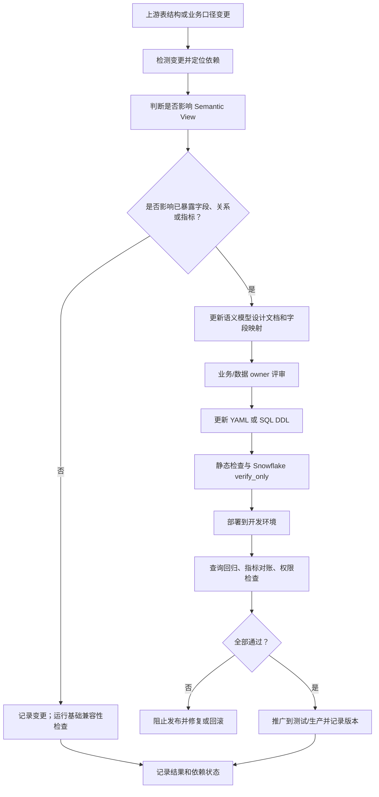

# 如何在 Snowflake 添加 Semantic View：手把手教程

这篇文章不假设你已经熟悉 Snowflake。我们会从一组常见的投资管理数据开始，逐步建立一个可查询、可维护、可自动部署的 Semantic View。重点不是把 SQL 跑通就结束，而是弄清楚业务指标为什么可信、修改怎样上线、失败怎样发现和回退，以及它在企业数据架构里应该放在哪里。

**资料核对日期：2026 年 10 月 28 日。** Snowflake 的语法、可用区域、产品状态和权限要求可能变化。本文涉及平台行为时优先引用 Snowflake 官方文档；示例中的数据库、账户、证券持仓和金额是可重复运行的教学 fixture，不代表任何真实客户或实时市场报价。示例业务模型和列名贴近投资组合分析，但接入实际数据前必须与数据所有者核对。

## 先说清楚：Semantic View 到底是什么？

可以先把它理解为一份在 Snowflake 内登记的、由机器和人都能理解的“业务数据说明书”，而不是另一份复制出来的数据。

底层表通常使用技术字段名，连接关系也由工程师理解；业务人员却会问“某个组合在某个估值日的市场价值是多少”“按资产类别看未实现盈亏”。Semantic View 将物理表映射为逻辑表，并明确维度、事实、指标、关系和业务描述。查询者可以使用业务口径，而不必每次重新猜表怎么连、指标该怎么算。

Snowflake 将 Semantic View 作为 schema 级对象管理，能纳入 Snowflake 的授权、目录和分享机制。它可以直接用 SQL 查询，也可以作为 Cortex Analyst / Cortex Agents 的业务语义上下文。新项目通常优先考虑原生 Semantic View；历史上基于 stage YAML 的 semantic model 仍有兼容场景，但两者不是同一个对象。参阅 [Semantic Views 概览](https://docs.snowflake.com/en/user-guide/views-semantic/overview) 和 [YAML 与 DDL 的选择](https://docs.snowflake.com/en/user-guide/views-semantic/yaml-vs-ddl)。

### 几个容易混淆的名词

| 名词 | 实际职责 | 是否存放一份独立的业务明细数据 |
|---|---|---|
| 普通 View | 保存一段 SQL 查询定义 | 通常不保存独立结果 |
| Materialized View | 按其支持的规则维护预计算结果 | 是，维护物化数据 |
| Semantic View | 声明逻辑表、关系、维度、事实、指标及 AI 辅助信息 | 语义定义本身不是业务明细副本 |
| 旧式 Semantic Model YAML | 以 YAML 描述 Cortex Analyst 可使用的语义模型，常见旧流程涉及 stage | YAML 文件本身不是业务明细副本 |
| Cortex Analyst / Agent | 根据语义信息和自然语言请求产生或执行分析查询 | 不是指标定义的权威来源 |

Semantic View 不会自动把业务口径变正确，也不会因为加了 AI 描述就保证自然语言问题一定生成正确 SQL。它只是把业务知识、连接规则和指标计算变成显式、可审查的对象；底层数据质量、业务定义、权限和测试仍然要由团队负责。

## 本教程要做出什么？

本示例使用一个小型投资组合分析域：

- 组合主数据：组合名称、投资策略、基础币种、风险属性。
- 证券主数据：证券代码、名称、资产类别、行业、计价币种和发行地。
- 每日持仓快照：估值日、组合、证券、持有数量、美元市场价值、美元成本基础、未实现盈亏和应计利息。

这是投资管理数据平台中常见的分析切面。我们刻意把每日持仓建模为**快照事实表**：一行代表某个组合在某个估值日对某个证券的一笔汇总持仓。这里不是交易逐笔明细；也不包含税务批次、衍生品风险、公司行动等复杂数据。真实环境可能需要把托管账户、资产批次、价格来源、估值状态、报告币种、汇率和证券有效日期加入模型，不能简单把这个最小模型当成生产最终模型。

仓库中的配套材料位于 [temp/snowflake-semantic-view](https://github.com/devweekly/devweekly.github.io/tree/main/temp/snowflake-semantic-view)，包括 YAML 定义、建表和部署 SQL、测试 SQL、Python 部署脚本以及 Notebook。

## 一、准备 Snowflake 环境

### 1. 登录并确认角色

打开 [Snowsight](https://app.snowflake.com/) 并登录。创建一个 Worksheet，确认当前连接的账户、角色、数据库、schema 和 warehouse。建议先在独立的 sandbox 数据库操作，不要直接使用生产数据或生产 schema。

    SELECT CURRENT_ACCOUNT(),
           CURRENT_USER(),
           CURRENT_ROLE(),
           CURRENT_DATABASE(),
           CURRENT_SCHEMA(),
           CURRENT_WAREHOUSE();

如果没有合适的数据库、schema、warehouse 或权限，请联系 Snowflake 管理员。不要为了教程长期使用 ACCOUNTADMIN；它适合受控的管理操作，不应成为应用和日常部署的默认运行角色。

配套脚本使用数据库 SV_FINANCE_LAB 和 schema MART。你可以调整名称，但要同步调整 YAML 文件中三个物理表的完全限定名称以及后续 SQL 的目标 schema。

### 2. 创建隔离的练习对象

打开仓库中的 sql/00_setup_demo.sql，检查里面的对象名，再在 Worksheet 执行。脚本会创建一个教学数据库、三个表并插入少量确定性样例记录。**不要在已有重要对象的同名数据库中执行；示例建表脚本是为隔离练习环境准备的。**

这里故意把几类数据分开：

- DIM_PORTFOLIO：组合维度，不是持仓明细。
- DIM_SECURITY：证券维度，不是价格历史。
- FACT_POSITION_DAILY：每日持仓快照事实表。

样例代码使用了现实市场中能识别的证券代码和常见 ETF 名称，但演示持有数量、估值和成本数字是人工构造的固定测试数据，并非从行情源实时抓取。这样做的目的，是让每次运行都能得到可核对的预期结果，不能把这些金额用于投资决策。

### 3. 理解表的粒度，再继续

在建立语义模型之前，先把下面这句话写清楚：

**FACT_POSITION_DAILY 的一行 = 一个估值日 + 一个组合 + 一个证券的汇总持仓。**

因此，在此示例里组合、证券和估值日的组合键应当唯一。假如真实来源是 lot-level（税务批次级）持仓，则粒度已经不同，不能继续沿用相同的主键声明；需要先决定语义模型暴露 lot 级持仓，还是先在数据转换层汇总到组合/证券/估值日。

可以先运行以下数据检查。它们很重要，因为 Snowflake 中普通表的主键约束通常不会替你保证每条加载路径都满足业务唯一性。

    -- 检查预期的复合粒度是否重复
    SELECT PORTFOLIO_ID, SECURITY_ID, AS_OF_DATE, COUNT(*) AS ROWS_PER_KEY
    FROM SV_FINANCE_LAB.MART.FACT_POSITION_DAILY
    GROUP BY 1, 2, 3
    HAVING COUNT(*) > 1;

    -- 检查组合维度主键
    SELECT PORTFOLIO_ID, COUNT(*)
    FROM SV_FINANCE_LAB.MART.DIM_PORTFOLIO
    GROUP BY 1
    HAVING COUNT(*) > 1;

    -- 检查持仓是否存在无法关联的组合或证券
    SELECT COUNT(*) AS ORPHAN_POSITIONS
    FROM SV_FINANCE_LAB.MART.FACT_POSITION_DAILY p
    LEFT JOIN SV_FINANCE_LAB.MART.DIM_PORTFOLIO f
      ON p.PORTFOLIO_ID = f.PORTFOLIO_ID
    LEFT JOIN SV_FINANCE_LAB.MART.DIM_SECURITY s
      ON p.SECURITY_ID = s.SECURITY_ID
    WHERE f.PORTFOLIO_ID IS NULL OR s.SECURITY_ID IS NULL;

预期：重复键查询返回 0 行，孤立持仓数量为 0。真实环境中，如果结果不为零，应先修复来源数据或修正粒度，不要用 Semantic View 的定义去掩盖数据错误。

### 4. 配置创建对象所需的权限

创建 Semantic View 不只是对业务表有 SELECT 权限。创建者通常需要目标数据库和 schema 的 USAGE、schema 上的 CREATE SEMANTIC VIEW，以及定义中引用表/视图的 SELECT；修改已有对象还涉及其 OWNERSHIP 权限。具体要求请以 [官方 SQL 操作文档](https://docs.snowflake.com/en/user-guide/views-semantic/sql) 和账户的 RBAC 配置为准。

    GRANT USAGE ON DATABASE SV_FINANCE_LAB TO ROLE <MODEL_DEVELOPER_ROLE>;
    GRANT USAGE ON SCHEMA SV_FINANCE_LAB.MART TO ROLE <MODEL_DEVELOPER_ROLE>;
    GRANT CREATE SEMANTIC VIEW ON SCHEMA SV_FINANCE_LAB.MART
      TO ROLE <MODEL_DEVELOPER_ROLE>;
    GRANT SELECT ON ALL TABLES IN SCHEMA SV_FINANCE_LAB.MART
      TO ROLE <MODEL_DEVELOPER_ROLE>;

以上是说明性模板，尖括号内的角色名必须替换成实际名称；授权前应先与管理员确认职责分工，不要把模板原样执行。若同一角色需要管理后续新建的依赖表，是否授予 future grants 应单独评估。

## 二、设计语义模型：先定义业务，再写 YAML

这里不应该从“打开 YAML 编辑器”开始。YAML 是最终交付给 Snowflake 的结构化定义，不是业务人员讨论需求的好工具。若团队一开始就围绕 YAML 字段开会，大家很容易讨论 `primary_key`、`expr` 和 `data_type` 怎么填，却没有先确认“市场价值究竟是什么”“一行数据代表什么”“同一指标能不能跨日期求和”。这些问题一旦在部署后才发现，修正成本会高得多。

更合理的顺序是：先用业务问题确定范围，再写一份人能审阅的语义模型设计文档；通过业务与数据负责人评审后，把已确认的部分映射成 YAML 或 SQL DDL；最后在 Snowflake 验证、部署和对账。**不要要求业务人员直接维护 YAML，也不要把 AI 生成的 YAML 当成已批准的业务定义。**

### 2.1 从要回答的问题开始，而不是从所有数据库列开始

先选定一个明确的分析场景。本例是“投资组合每日持仓分析”，目标问题包括：

- 在指定估值日，每个组合的持仓市场价值、成本基础和未实现盈亏是多少？
- 某个组合的市场价值按资产类别、行业和证券如何分布？
- 某个投资策略在指定估值日持有多少市场价值的资产？
- 同一个组合在两个估值日之间的市场价值变化是多少？（这是跨日期比较，不是把两个日期的快照金额相加。）

这些问题决定第一版 Semantic View 的范围。暂时不需要回答的内容，例如交易逐笔分析、税务批次、风险因子敞口和公司行动，不应为了“字段齐全”而一并塞进来。

把问题整理成一张简单的需求表：

| 业务问题 | 需要的维度 | 需要的指标 | 必须澄清的口径 |
|---|---|---|---|
| 某日各组合的市场价值是多少？ | 估值日、组合 | 总市场价值 | 是否限定单一估值日、金额币种 |
| 按资产类别查看组合分布 | 估值日、组合、资产类别 | 总市场价值 | 资产分类体系、未知分类如何处理 |
| 比较成本与未实现盈亏 | 估值日、组合、证券 | 总成本基础、总未实现盈亏 | 成本和盈亏是否包含应计利息、费用、汇率影响 |
| 组合有多少项持仓？ | 估值日、组合 | 持仓数 | 计数的是组合-证券持仓行，还是税务批次/账户明细 |
| 比较两个估值日的市场价值 | 估值日、组合 | 各日总市场价值及其差值 | 先分别计算各日快照，再比较；不能直接把快照金额跨日相加 |

这一阶段产出的是**问题清单和口径问题清单**，不是 YAML。口径暂时无法达成一致时，应记录“待确认”、责任人和影响，不要让开发者自行选一个看似合理的公式。

### 2.2 先写一份可讨论的语义模型设计文档

建议在仓库中先创建 Markdown 文档，例如 `docs/semantic-models/investment-portfolio-overview.md`。它面向业务专家、数据工程师、数据架构师和模型维护者，记录讨论结果、证据、决策及未决问题。Markdown 表格和普通语言比 YAML 更适合评审，因为它能解释为什么这样建模，而不仅是机器需要哪些字段。

下面是本例的设计文档骨架。实际项目可以按规模删减，但应保留粒度、指标口径、连接关系和待确认事项。

```markdown
# Investment Portfolio Overview — Semantic Model Design

## 1. Purpose and scope
回答指定估值日的组合持仓价值、成本、未实现盈亏及其分类分布。
不覆盖交易逐笔、税务批次、风险因子或实时定价。

## 2. Consumers and example questions
- 投资运营：核对每日持仓总额。
- 投资分析：按组合、资产类别和行业查看分布。
- Cortex Analyst / Agent：回答上述范围内的自然语言问题。

## 3. Grain and time semantics
事实粒度：每个估值日、组合、证券一行。
业务日期：AS_OF_DATE，表示持仓估值日，不是数据加载时间。
快照指标：市场价值、成本基础、未实现盈亏。
跨日期规则：先按估值日分别聚合，不得直接对多个日快照求和。

## 4. Business definitions
| Term | Definition | Currency | Aggregation | Owner / status |
|---|---|---|---|---|
| Total Market Value | 指定估值日的持仓市场价值之和 | USD | SUM；跨估值日不可加 | 投资运营 / 已确认 |
| Total Cost Basis | 来源持仓快照中的成本基础之和 | USD | SUM；跨估值日不可加 | 会计数据负责人 / 待确认成本口径 |
| Unrealized P&L | 来源持仓快照提供的未实现盈亏之和 | USD | SUM；需核实应计利息约定 | 投资会计 / 待确认 |

## 5. Logical tables and source mapping
- POSITION_DAILY <- MART.FACT_POSITION_DAILY
  Grain: AS_OF_DATE + PORTFOLIO_ID + SECURITY_ID
- PORTFOLIO <- MART.DIM_PORTFOLIO
  Grain: PORTFOLIO_ID
- SECURITY <- MART.DIM_SECURITY
  Grain: SECURITY_ID

## 6. Relationships and cardinality assumptions
POSITION_DAILY.PORTFOLIO_ID -> PORTFOLIO.PORTFOLIO_ID (many-to-one)
POSITION_DAILY.SECURITY_ID -> SECURITY.SECURITY_ID (many-to-one)
需要用数据测试证明维表键唯一、事实表外键可匹配。

## 7. Dimensions, facts and metrics
列出每个对消费者有用的业务字段、定义、来源列、类型、同义词和限制。
不要把底层所有列自动暴露为维度或指标。

## 8. Security and access
目标角色、允许使用者、底层表授权、敏感字段排除规则。

## 9. Validation and acceptance
- 事实粒度无重复。
- 维表主键唯一、事实外键无孤儿。
- 语义指标与独立 SQL / 已批准报表对账。
- 验证单日过滤、跨日查询、空值及异常数据行为。
- 记录业务签署人、日期和验收结果。

## 10. Open questions and decisions
每项记录问题、候选方案、影响、责任人、截止日期和最终决定。
```

这份文档不是又一个需要和 YAML 永久同步的“第二套模型定义”。它记录业务意图、理由、评审和证据；YAML/DDL 则是部署契约。二者职责不同：设计文档解释“为什么”，YAML/DDL 精确表达“部署什么”。字段级映射可以从设计文档生成或人工维护，但应通过评审和测试保持一致。

### 2.3 讨论过程应该怎么记录？

不必把每次会议的完整聊天记录都写进模型定义。把重要内容分成三类即可：

1. **已确认的定义**：放在设计文档的业务定义表中，标注负责人和确认状态。
2. **未决问题**：记录问题、候选口径、对查询结果的影响、责任人和截止日期。例如“未实现盈亏是否含应计利息？”未确认前不要把描述写成确定事实。
3. **有长期影响的决策**：用简短的决策记录（ADR 或 Decision Log），说明背景、备选方案、决定、理由和后果。例如“选择日持仓快照作为第一版粒度，不支持税务批次级分析”。

评审时最好使用具体查询结果讨论，而不是抽象地争论字段名。拿一个组合、一个估值日和两三条持仓记录，手工计算期望总额，再请业务负责人确认“这是不是他们报表中的市场价值”。每个关键指标至少有一个可复算例子和独立 SQL 对账方式。

### 2.4 哪些字段必须有，哪些是可选的？

需要区分三件事：Snowflake 语法层面创建对象的最低要求、模型正确性所必需的业务信息，以及帮助自然语言查询的增强信息。三者不能混为一谈。

| 项目 | 级别 | 为什么 |
|---|---|---|
| Semantic View 名称 | 必需 | 创建并引用 schema 级对象所需的名称 |
| 至少一个逻辑表及其物理来源 | 必需 | 必须知道语义定义对应哪些真实数据对象 |
| 至少一个维度或指标 | 必需 | 需要暴露可分析的业务语义；只有表清单没有分析接口 |
| 事实表粒度 | 业务上必需，虽不一定是独立 YAML 字段 | 决定计数、聚合和时间语义是否正确，必须在设计文档中明确 |
| 指标公式和聚合口径 | 对每个指标必需 | 没有定义就无法保证不同消费者算出相同结果 |
| 关系与连接键 | 多表模型必需 | 多表查询必须明确怎样连接，避免重复放大 |
| 主键声明 | 强烈建议；多表关系和粒度校验尤其重要 | 表达逻辑表的唯一键假设；声明本身不能代替数据质量测试 |
| 维度/事实/指标的数据类型和表达式 | 对每个已声明字段必需 | Snowflake 需要可执行的表达式和类型定义 |
| 描述（description/comment） | 语法上通常可选；生产模型强烈建议 | 记录业务口径、单位、时间限制和边界 |
| 同义词（synonyms） | 可选，但自然语言使用时建议 | 帮助识别业务人员使用的不同叫法，不应代替正式定义 |
| Verified queries / 示例问答 | 可选的增强能力 | 为常见问题提供参考 SQL 和评估样例，提升可验证性 |
| 标签、物化配置、额外治理属性 | 按需 | 只有在分类治理、性能或运维需求明确时才添加 |

准确的语法要求应以 [Semantic View YAML 规范](https://docs.snowflake.com/en/user-guide/views-semantic/semantic-view-yaml-spec) 为准。不要把“可选”理解为“没有价值”：对于面向 Cortex Analyst 或 Agent 的模型，清晰的描述、同义词、已验证问题和准确的关系往往比多暴露几十个字段更有用。

### 2.5 从业务术语映射到逻辑表、维度、事实和指标

先明确这些构件的职责：

- **Logical table（逻辑表）**：给物理表一个语义层名称，并声明它的粒度、主键及要公开的字段。它不会复制数据。
- **Relationship（关系）**：声明逻辑表之间如何连接。必须检查键唯一性、关系方向和连接后的行数是否异常增长。
- **Dimension（维度）**：用于筛选、分组和描述对象，例如组合名称、证券代码、行业、估值日。
- **Fact（事实）**：位于事实粒度上的数值或表达式，例如该组合-证券-估值日的市场价值、成本和未实现盈亏。事实通常是构造聚合指标的基础，不应把它和已聚合 KPI 混为一谈。
- **Metric（指标）**：定义如何聚合事实或列，例如 `SUM(MARKET_VALUE_USD)`。指标名要表达业务意义，描述要说明单位、适用时间范围和不能怎样使用。

下面展示从设计文档到最终 YAML 的一个小型映射例子。它不是完整模型，而是用来说明“为什么要这样写”。

| 设计文档中的决定 | YAML 中的体现 | 目的 |
|---|---|---|
| 一行代表某估值日、组合、证券 | `primary_key.columns` 包含 `PORTFOLIO_ID`、`SECURITY_ID`、`AS_OF_DATE` | 明确粒度和唯一性假设 |
| 估值日是业务日期，不是加载时间 | `time_dimensions` 中的 `AS_OF_DATE` 及描述 | 让模型理解日期字段含义 |
| 市场价值以 USD 表示 | `MARKET_VALUE_USD` fact 的类型和描述 | 避免与证券交易币种混淆 |
| 总市场价值是单日快照的合计 | `TOTAL_MARKET_VALUE_USD` metric 的 `SUM(...)`、描述和非加性日期设置 | 降低跨日误加总风险 |
| 组合和证券通过稳定 ID 连接 | `relationships` 的对应键 | 支持跨实体分组分析 |

例如，YAML 中的关键片段会类似这样：

```yaml
name: INVESTMENT_PORTFOLIO_OVERVIEW
description: >
  Daily position snapshot analytics. USD amounts are normalized upstream.
  Filter to one AS_OF_DATE for point-in-time portfolio totals.
tables:
  - name: POSITION_DAILY
    description: One row per valuation date, portfolio and security.
    base_table:
      database: SV_FINANCE_LAB
      schema: MART
      table: FACT_POSITION_DAILY
    primary_key:
      columns: [PORTFOLIO_ID, SECURITY_ID, AS_OF_DATE]
    time_dimensions:
      - name: AS_OF_DATE
        expr: AS_OF_DATE
        data_type: DATE
        description: Valuation business date, not ingestion timestamp.
    facts:
      - name: MARKET_VALUE_USD
        expr: MARKET_VALUE_USD
        data_type: NUMBER(20,2)
        description: Position market value normalized to USD upstream.
    metrics:
      - name: TOTAL_MARKET_VALUE_USD
        expr: SUM(MARKET_VALUE_USD)
        description: Sum for a selected valuation date; do not sum daily snapshots.
        non_additive_dimensions:
          - table: POSITION_DAILY
            dimension: AS_OF_DATE
            sort_direction: descending
            null_order: last
```

这里的 `primary_key`、`expr`、`data_type` 和 `non_additive_dimensions` 是面向 Snowflake 的机器可读定义；“为什么市场价值不能跨日求和”则应在设计文档和指标描述中同时讲清楚。正式示例还要补充其他维度、逻辑表关系和业务指标，并依据目标账户当前支持的 YAML 规范验证。

### 2.5.1 到底是谁把设计文档变成 YAML？不是让人逐字段照抄

先把分工说清楚：**人负责确认业务含义，生成工具负责把已确认的定义翻译成 YAML，检查程序负责发现结构和技术错误，业务测试负责确认结果是否正确。** 不建议让业务人员一条条手写 YAML，也不能只给 AI 一段模糊的需求就让它直接生成并部署。

这不是把中文逐句翻译成 YAML，而是“从设计稿生成程序配置”。设计文档里有些内容能直接映射，有些必须先补充信息，还有些只是背景说明，根本不应该变成 YAML 字段。

以“总市场价值”为例：

| 设计文档里的内容 | 生成时怎么处理 | 不能只靠什么 |
|---|---|---|
| “市场价值以美元计” | 找到已确认的来源列 MARKET_VALUE_USD，生成 fact 的名称、表达式、类型和描述 | 不能因为列名带 USD 就认定它真的已换算成美元；必须确认上游转换规则 |
| “总市场价值 = 所选估值日的持仓市场价值之和” | 生成 SUM(MARKET_VALUE_USD) 指标，并写清楚估值日限制 | 不能只生成一个 SUM 就认为口径正确；要用独立 SQL 对账 |
| “一行代表估值日 + 组合 + 证券” | 对照真实表列，生成主键声明；同时要求唯一性测试 | YAML 里的主键声明不会替你清理重复数据 |
| “组合可以按策略分组” | 找到组合维表的策略字段，并检查持仓到组合维表的关系 | 不能凭字段名猜连接键或关系基数 |
| “未实现盈亏是否含应计利息：待确认” | 将它列为阻塞问题，不生成一个假装已确认的口径 | 不能让模型自行选择它认为合理的金融定义 |

因此，设计文档最好同时包含**业务决定**和**物理字段映射**。例如：

| 业务概念 | 来源对象.字段 | 业务规则 | 状态 |
|---|---|---|---|
| 估值日 | FACT_POSITION_DAILY.AS_OF_DATE | 持仓估值所属日期，不是数据加载时间 | 已确认 |
| 持仓市场价值 | FACT_POSITION_DAILY.MARKET_VALUE_USD | 上游已转换为 USD；同一估值日内可加总 | 已确认，待数据对账 |
| 组合策略 | DIM_PORTFOLIO.INVESTMENT_STRATEGY | 按组合主数据中的当前策略分类 | 已确认；历史策略口径另议 |
| 未实现盈亏 | FACT_POSITION_DAILY.UNREALIZED_PNL_USD | 是否含应计利息尚未确定 | **阻塞生成/发布** |

这张映射表是关键的中间层。它把“业务上想表达什么”和“数据库里实际存在哪一列”明确连起来。物理字段可以先由程序从 Snowflake 元数据中读取，再由工程师确认；AI 可以提出候选映射，但不能自行把候选项升级为已确认决定。

### 推荐做法：用 Prompt/Skill 生成初稿，但必须有硬性校验

实际流程可以自动化，建议把它做成一个可重复运行的 Skill 或脚本工作流，而不是每次临时写一段 Prompt：

1. **读取输入。** 获取经过评审的 Markdown 设计文档、当前 Snowflake 表和列的元数据、团队认可的 YAML 示例，以及 Snowflake 当前版本的 YAML 规范。不能只把 Markdown 丢给模型，因为它可能猜错物理列名、类型和支持的语法。
2. **先做映射，不急着生成。** 让模型输出“业务概念 → 物理字段 → 逻辑表构件 → 需要的检查”的映射表。对找不到的字段、多个候选字段、未知类型、未确认的指标口径，必须明确标记为待确认，不能自行补全。
3. **人审映射表。** 数据工程师确认物理字段、类型、连接键和数据粒度；业务负责人确认指标公式、单位、时间范围、空值规则和跨期聚合限制。只需要人审有业务意义的决定，不需要人手工抄写每个 YAML 缩进。
4. **生成 YAML。** 根据已批准的映射表生成完整文件，同时列出每一段 YAML 对应设计文档的哪一项决定。设计文档中仍未确认且会影响正确性的内容，必须让生成流程报错或停止，不应悄悄生成看似完整的配置。
5. **机器校验。** 先运行 YAML 解析、字段白名单/必需字段检查和本地规则检查，再调用 Snowflake 的 SYSTEM$CREATE_SEMANTIC_VIEW_FROM_YAML(..., TRUE) 做服务端验证。服务端验证能发现一部分语法、对象引用和定义问题，但不能证明指标符合业务真实含义。
6. **执行数据与语义测试。** 在开发环境创建对象，运行唯一性、外键匹配、指标对账、跨日期误加总、空值与权限测试；把关键问题的期望 SQL 和期望结果一并版本化。全部通过后才允许合并和部署。
7. **把修改交回设计流程。** 如果测试发现“USD 实际不是美元”或“组合策略需要按历史日期还原”，应先修正设计文档和映射，再重新生成 YAML。不要只在 YAML 里打补丁，否则下次生成时容易把修正覆盖掉。

### 一个可复用的生成 Prompt / Skill 约定

下面的内容可以作为团队 Skill 的核心指令。它的作用不是要求模型“尽量生成完整 YAML”，而是明确证据边界、输出顺序和失败条件。

~~~text
你是 Snowflake Semantic View 定义生成器。输入包括：
1. 已评审的语义模型设计 Markdown；
2. 从目标 Snowflake 环境读取的表、列、类型及约束元数据；
3. 团队认可的 YAML 示例和当前官方 YAML 规范。

必须按以下顺序工作：
A. 提取业务问题、粒度、指标公式、单位、时间语义、关系和待确认事项。
B. 为每个业务概念匹配真实物理表和列；每个映射都要给出依据。
C. 输出映射表，列出缺失字段、歧义、类型不匹配、关系基数风险和未确认的业务口径。
D. 如果存在影响正确性的未决项，停止生成可部署 YAML，只输出问题清单和需要谁确认。
E. 只有在映射已批准、阻塞项已清除后，才按提供的官方规范生成 YAML。
F. 输出“设计文档条目 -> YAML 路径 -> 校验/测试”的追踪表，以及建议的独立 SQL 对账测试。

禁止：
- 猜测不存在的表名、列名、类型或 Snowflake 不支持的 YAML 字段；
- 把列名或注释当作业务事实的充分证据；
- 自行决定未确认的金融指标口径；
- 将 YAML 解析成功或 Snowflake verify_only 成功表述为业务正确；
- 未经批准直接部署到生产。
~~~

团队真正需要维护的是这份 Skill、YAML 规范版本、可信示例和测试集，而不是一份越写越长、每次都靠人临时发挥的 Prompt。若使用 Snowflake 的可视化或 AI 辅助建模功能，也应把生成结果导出到 Git，走相同的评审和测试流程。

### 怎样降低“生成成功但结果错了”的风险？

不能靠一个检查解决所有错误，要分层拦截：

| 检查层 | 主要发现什么 | 不能保证什么 |
|---|---|---|
| 设计文档检查 | 指标是否缺定义、是否有未决项、粒度是否说明 | 不能证明来源数据真的符合定义 |
| 元数据与映射检查 | 表/列不存在、类型不匹配、映射到错误对象 | 不能判断同名字段的业务意义是否一致 |
| YAML 静态检查和 Snowflake verify_only | 结构、语法、部分引用和定义错误 | 不能证明聚合结果符合业务口径 |
| 数据质量测试 | 重复键、孤儿记录、空值、异常范围 | 不能独自决定一个指标在业务上应该怎么算 |
| 独立 SQL 对账 | Semantic View 结果与经过批准的参考 SQL/报表是否一致 | 如果参考 SQL 本身错误，仍会一起错 |
| 业务验收和黄金问题回归 | 关键业务问题是否得到认可的数值和分组结果 | 不能替代持续监控和后续变更治理 |

例如，SUM(MARKET_VALUE_USD) 在语法上完全正确，但如果底层一行实际代表税务批次，而不是组合-证券的汇总持仓，或同一估值日的数据被重复加载，结果仍可能错误。机器可以发现重复键或对账差异；究竟应该按批次暴露还是先汇总，则必须由业务定义决定。

最重要的原则是：**人不必逐条手写 YAML，但人必须批准业务定义和关键字段映射；AI 可以生成，工具可以校验，只有可复现的测试和业务验收才能支持上线。** 这才是把自然语言设计文档可靠地转成部署文件的办法。

### 2.6 从设计文档到部署文件的交接清单

准备 YAML/DDL 之前，评审应能回答以下问题：

- 分析范围是什么，明确排除了什么？
- 每张逻辑表的一行代表什么？主键假设是否由数据测试支持？
- 每个指标的分子/分母、币种、时间口径、空值行为和聚合方式是什么？
- 多表连接是怎样的基数关系？连接后有没有 fan-out 风险？
- 每个维度和指标映射到哪个物理表、字段或 SQL 表达式？
- 哪些定义已由业务确认，哪些仍是阻止上线的未决项？
- 哪些自然语言问题应当得到怎样的 SQL 和预期结果？
- 哪个角色负责建模、部署、授权、业务验收和后续变更？

只有这些问题得到足够回答后，才进入下一章的创建流程。此时 YAML 不再是设计讨论的起点，而是已评审的语义契约的一种部署表达。Snowflake 的逻辑表、关系、事实、维度和指标的具体语法见[官方 SQL 定义文档](https://docs.snowflake.com/en/user-guide/views-semantic/sql)；YAML 字段及约束见 [YAML 规范](https://docs.snowflake.com/en/user-guide/views-semantic/semantic-view-yaml-spec)。

## 二点七、底层数据表变化后，Semantic View 会自动感知吗？

这里必须区分“底层数据变化”和“底层表结构变化”。它们不是一回事，也不能都期待 Semantic View 自动完成同步。

**结论先说：Semantic View 不是会自动把底层 schema 重新扫描并更新业务语义的动态模型。** 它保存的是明确声明的逻辑表、列表达式、关系、维度、事实和指标。底层表增加了一个字段，不意味着这个字段会自动出现在 Semantic View 中；即使某个变更没有立刻报错，也不代表业务定义仍然正确。Snowflake 官方建议把语义视图定义放在 Git 中，通过验证、测试和 CI/CD 部署变更，而不是依赖人工发现漂移。[开发与部署最佳实践](https://docs.snowflake.com/en/user-guide/views-semantic/best-practices-dev)

### 先区分三种变化

| 底层变化 | Semantic View 会怎样 | 应采取的动作 |
|---|---|---|
| 表中新增一列 | 不会自动把新列作为维度、事实或指标暴露出来 | 判断该列是否属于业务分析范围；需要时更新设计文档和 YAML/DDL，再验证和部署 |
| 已被语义定义引用的列被删除、改名或类型发生不兼容变化 | 相关表达式可能无法解析，部署或查询可能失败；不应假定系统会自动改写定义 | 将上游变更视为契约变更；先更新映射、语义定义和测试，再发布 |
| 底层表的数据行新增或更新 | 语义定义通常不需要随每批数据变更而重写；查询读取底层数据 | 按数据管道本身的 SLA 检查数据新鲜度、质量和对账结果 |
| 底层表或视图的定义被替换，且 Semantic View 配置了物化 | 物化刷新可能在后续刷新时发现依赖变化；刷新失败可能导致物化暂停 | 检查物化刷新历史和状态，按需要恢复或重建物化；不要把物化刷新当成语义定义更新 |
| 维表的业务含义、分类规则或键关系变化，但列名不变 | 技术层面可能仍可查询，业务结果却可能已经错误 | 通过数据契约、业务评审、指标回归和数据对账识别；仅比较列名无法发现语义漂移 |

关于物化还有一个容易混淆的细节：底层对象变化不会立即等同于 Semantic View 定义被更新。Snowflake 文档说明，依赖变化会在下一次物化刷新时被处理；若刷新失败，物化可能被暂停。物化是查询性能优化机制，不是底层 schema 变更的自动治理机制。参阅[物化及底层对象变化的处理方式](https://docs.snowflake.com/en/user-guide/views-semantic/materializations)。

### 变化发生后，下一步应该怎么做？

推荐把上游数据模型变更纳入一个明确的联动流程。假设数据工程团队准备给 `FACT_POSITION_DAILY` 增加 `PRICE_SOURCE`，或者将 `MARKET_VALUE_USD` 改名，流程不应该是“等 Semantic View 报错，再手工修 YAML”。



建议将下面几个环节落到实际工程里：

1. **变更检测。** 在 dbt、SQL migration 或数据平台的 PR 中检查表的新增/删除/改名列、类型变化、主键/粒度变化。也可以定期从 Snowflake 元数据导出表结构，与上次已批准的 schema manifest 比较。仅靠定期比对列名还不够，因为“市场价值改成含应计利息”可能完全不改变 schema。
2. **依赖识别。** 维护“物理表/列 → 逻辑表字段 → 语义指标 → Verified Query/报表”的映射。对本例而言，`FACT_POSITION_DAILY.MARKET_VALUE_USD` 不仅映射到同名 fact，还影响 `TOTAL_MARKET_VALUE_USD` 及按组合、行业汇总的回归测试。
3. **影响分类。** 新增且未被使用的列通常不需要改 Semantic View；被引用列的删除、改名、类型变化属于高风险兼容性变更；指标口径或粒度变化属于业务契约变更，即使 SQL 仍然能运行，也必须重新评审。
4. **验证与发布。** 先运行 YAML 结构检查，再使用 `SYSTEM$CREATE_SEMANTIC_VIEW_FROM_YAML(..., TRUE)` 做 Snowflake 侧验证；在隔离开发环境部署后，运行基于语义视图的查询、独立底表 SQL 对账和已批准的业务问题测试。只有测试通过才推广到生产。
5. **监控与回滚。** 记录部署的 Git commit、目标环境、验证结果和业务批准人。生产回归失败时停止推广，必要时重新部署上一个已知良好的定义；同时确认上游 schema 是否也需要回退。仅回滚 Semantic View 并不能修复已被破坏的底层表。

### 如何把联动自动化？

第一版不必建设复杂的元数据平台，可以把检查放进现有 CI/CD：

- 上游表的 DDL/dbt model 变更触发依赖检查。
- Semantic View 的 YAML/DDL 与设计文档一起进入 Pull Request。
- CI 检查被引用的物理表和列是否存在、数据类型是否兼容，以及关键粒度/主键测试。
- 使用专用开发角色连接 Snowflake，执行服务端验证和部署后的 smoke/regression tests。
- 将验证结果作为发布门禁；失败时禁止晋级生产。
- 定期对比 Git 中的定义与 Snowflake 当前对象，发现有人在 Snowsight 手工修改后造成的配置漂移。

Snowflake 提供 `SYSTEM$READ_YAML_FROM_SEMANTIC_VIEW`，可把当前 Semantic View 导出为 YAML，适合用于差异比较和漂移检查；但导出当前对象不能替代 Git 中的评审历史，也不能自动判断业务定义是否正确。官方还建议尽可能把定义同步到 Git，并通过 CI/CD 做准确性检查和部署。[官方开发与部署指南](https://docs.snowflake.com/en/user-guide/views-semantic/best-practices-dev)

需要特别注意：Snowflake 当前的语义视图 DDL 支持范围和物化行为有具体限制。若需要修改表、列、关系、事实、维度或指标，应按当前定义能力使用 `CREATE OR ALTER SEMANTIC VIEW` 或受控的替换流程，而不是认为任意修改都可以通过 `ALTER SEMANTIC VIEW` 完成。使用 `CREATE OR REPLACE` 会删除已有物化；如果已经启用物化，应按官方说明评估使用 `CREATE OR ALTER` 并检查物化状态。[CREATE SEMANTIC VIEW](https://docs.snowflake.com/en/sql-reference/sql/create-semantic-view) · [ALTER SEMANTIC VIEW](https://docs.snowflake.com/en/sql-reference/sql/alter-semantic-view)

因此，设计阶段就应在语义模型文档中补充“上游依赖与变更策略”：谁拥有底层表、哪些列和指标属于契约、哪些变更必须通知语义模型 owner、哪些测试是发布门禁，以及发生故障时如何回滚。这样 Semantic View 才能随着数据平台演进，而不是成为一份上线后逐渐过期的静态配置。

## 三、创建 Semantic View：两条路径

Snowflake 支持 Snowsight 的可视化流程、SQL DDL 和 YAML。入门时，可以用 UI 帮忙探索表结构；需要代码评审、可重复部署和自动测试时，建议把 YAML 或 DDL 存在 Git 中，再从流水线部署。YAML 与 DDL 的能力基本接近，但并非每一个特性都完全相同；选定一种主要源文件格式后，避免让 UI、YAML 和 DDL 成为多人各自修改的多个真相源。

### 路径 A：通过 Snowsight 学习和探索

1. 在 Snowsight 打开 Cortex Analyst / Semantic View 相关工作区（具体导航会随产品界面调整）。
2. 使用创建向导选择底层表，查看自动生成的逻辑表和建议的业务描述。
3. 检查每个逻辑表的粒度，手动核对主键和关系。
4. 对建议的维度、事实、指标逐项确认。自动生成的字段注释只是草稿，不能作为业务确认。
5. 保存前用已知的 SQL 和业务报表校验指标；不要因为向导没有报错就直接发布。
6. 将 YAML 导出/保存到 Git，进入后续 PR、测试和发布流程。

官方的 [Semantic View Autopilot / Semantic Studio 文档](https://docs.snowflake.com/en/user-guide/views-semantic/semantic-studio) 介绍了可视化建模和 AI 辅助流程。不同账号可用的功能和模型可能不同，需要按目标账户验证。

### 路径 B：以 YAML 为源，通过 SQL 创建（推荐用于自动化）

仓库中的 position_analytics.yaml 是本例的语义定义；它引用 SV_FINANCE_LAB.MART 中的三张教学表。先检查 database、schema、table 名称与你实际创建的对象一致。

部署过程分为“只验证”和“真正部署”两步。

第一步，只验证 YAML 是否可以创建 Semantic View。它不会部署对象：

    CALL SYSTEM$CREATE_SEMANTIC_VIEW_FROM_YAML(
      'SV_FINANCE_LAB.MART',
      $$ ...这里放 position_analytics.yaml 的完整内容... $$,
      TRUE
    );

第三个参数 TRUE 代表 verify_only。真实运行时，请将 YAML 完整内容放在 dollar-quoted string 中；如果 YAML 本身含有 $$，需要选择其他合适的 dollar-quote delimiter。不要把省略号当成可执行内容。

第二步，验证通过后再部署。对于持续维护的场景，示例使用 create_or_alter 选项，而不是每次无差别地替换对象：

    CALL SYSTEM$CREATE_SEMANTIC_VIEW_FROM_YAML(
      'SV_FINANCE_LAB.MART',
      $$ ...这里放 position_analytics.yaml 的完整内容... $$,
      FALSE,
      TRUE
    );

这里最后的 TRUE 表示使用 CREATE OR ALTER 语义。它可以在受支持的修改范围内调整已有对象，并尽可能保留不受影响的物化配置。部署前仍然需要检查当前版本对具体改动的支持情况。若用默认的 replace 行为，已有对象会被替换，权限、物化对象和下游依赖都应检查；不要把 replace 当成无风险的“保存”。

手工调用示例见 [sql/10_deploy_semantic_view.sql](https://github.com/devweekly/devweekly.github.io/blob/main/temp/snowflake-semantic-view/sql/10_deploy_semantic_view.sql)；完整的自动化部署实现位于 [scripts/deploy_semantic_view.py](https://github.com/devweekly/devweekly.github.io/blob/main/temp/snowflake-semantic-view/scripts/deploy_semantic_view.py)。脚本直接读取仓库中的 YAML，避免手工维护两份重复定义。

### 如果你更习惯 SQL DDL

同样可以直接使用 CREATE SEMANTIC VIEW，逐一声明 TABLES、RELATIONSHIPS、FACTS、DIMENSIONS 和 METRICS。官方示例可以参考 [SQL 创建语义视图](https://docs.snowflake.com/en/user-guide/views-semantic/sql) 和 [完整示例](https://docs.snowflake.com/en/user-guide/views-semantic/example)。

使用 DDL 的优点是 SQL 工程师熟悉、容易纳入 SQL review、可以通过支持 SQL 的连接方式执行。使用 YAML 的优点是结构更明确、适合模型字段多的场景、容易在 Pull Request 里审查差异。不要因为 YAML 看起来像配置文件，就忽略它包含 SQL 表达式和权限敏感的信息；也不要因为 DDL 是 SQL，就跳过语义层的业务审核。

## 四、创建后怎么检查和查询？

### 1. 先检查对象是否真的部署成功

    SHOW SEMANTIC VIEWS IN SCHEMA SV_FINANCE_LAB.MART;
    DESCRIBE SEMANTIC VIEW
      SV_FINANCE_LAB.MART.INVESTMENT_PORTFOLIO_OVERVIEW;

视图名由 YAML 中的 name 决定。本例名称为 INVESTMENT_PORTFOLIO_OVERVIEW。如果查询不到，依次检查当前 role、database、schema、目标名称和上一条部署调用的返回信息。不要仅以 Notebook 单元格没有报红判断部署成功。

也可以用官方的 SHOW / DESCRIBE 命令查看指标、事实和维度元数据。管理命令列表见 [Semantic View SQL 操作](https://docs.snowflake.com/en/user-guide/views-semantic/sql)。

### 2. 用业务问题验证指标口径

本例的教学 fixture 包含两个组合和同一个估值日的几项持仓。执行下面的测试 SQL：

    SELECT PORTFOLIO_NAME,
           AS_OF_DATE,
           AGG(TOTAL_MARKET_VALUE_USD) AS MARKET_VALUE_USD,
           AGG(TOTAL_COST_BASIS_USD) AS COST_BASIS_USD,
           AGG(TOTAL_UNREALIZED_PNL_USD) AS UNREALIZED_PNL_USD
    FROM SV_FINANCE_LAB.MART.INVESTMENT_PORTFOLIO_OVERVIEW
    WHERE AS_OF_DATE = '2026-10-27'
    GROUP BY PORTFOLIO_NAME, AS_OF_DATE
    ORDER BY PORTFOLIO_NAME;

按仓库样例数据，US Equity Growth 的市值是 12,450 美元、成本基础 11,300 美元、未实现盈亏 1,150 美元；Core Fixed Income 的市值是 11,660 美元、成本基础 11,200 美元、未实现盈亏 460 美元。这些数字只是固定 fixture 的测试期望值。真实数据必须与可信的持仓/估值报表、总账或正式投资平台输出对账。

如果用标准 SELECT 方式查询 Semantic View，需要按文档要求正确使用指标聚合语法（如 AGG）；也可以使用 SEMANTIC_VIEW 子句明确选择维度、事实和指标。参阅 [查询 Semantic View](https://docs.snowflake.com/en/user-guide/views-semantic/querying)。如果查询报错，不要先改指标定义，先确认视图里实际暴露的名称、粒度、过滤条件和调用语法。

### 3. 再核对底层 SQL

语义模型给出业务接口，但校验不能只依赖它自己。针对相同的估值日，直接对 FACT_POSITION_DAILY 与 DIM_PORTFOLIO 做 SQL 聚合，计算相同口径，再与 Semantic View 结果比对。两边若使用同一套错误的转换逻辑，仍可能一起出错，所以生产测试应包含已知结果、上游对账结果或业务签署过的 golden dataset。

至少验证以下情况：

- 同一估值日、组合、证券没有重复键。
- 没有无法关联的组合和证券。
- 同一组合跨多个估值日时，查询强制选择一个时点或明确地计算日终时间序列。
- 有缺失成本基础、负数量、空证券代码或晚到数据时，指标行为符合业务规则。
- 组合币种与指标币种明确对应，转换到美元的时点与来源可追踪。

## 五、维护操作：什么能 ALTER，什么应该重新部署？

Semantic View 的生命周期最容易踩坑的地方之一，是把它当成普通 View，以为任何列、指标或关系都可以用一条 ALTER 修改。实际支持范围更具体。

| 需要做的变更 | 常见操作思路 | 需要检查什么 |
|---|---|---|
| 修改 comment、部分属性、标签或物化配置 | 使用支持该属性的 ALTER SEMANTIC VIEW | 确认对应语法和所需权限 |
| 增加/删除/修改逻辑表、关系、事实、维度、指标或 verified queries | 使用 CREATE OR ALTER SEMANTIC VIEW，或从源 YAML/DDL 重新部署 | 支持范围、依赖关系、指标回归、标签/权限是否保留 |
| 改名或移动对象 | ALTER SEMANTIC VIEW 的 rename 能力或有计划的迁移 | 所有下游消费者和权限引用 |
| 物化策略变化 | ALTER SEMANTIC VIEW 的 materialization 操作 | 仓库成本、刷新延迟、指标兼容性和查询改写效果 |
| 回退一个错误的业务口径 | 从 Git 部署已知正常的上一个版本 | 不能只回滚代码；必须重跑测试并验证线上对象与权限 |

官方文档说明，ALTER SEMANTIC VIEW 并不能任意改动 Semantic View 的所有属性；表、字段及指标等语义定义要通过支持的 CREATE OR ALTER 或 replace 路径管理。特别是 CREATE OR ALTER 中没有写出的某些属性可能会被 unset；标签设置也有单独限制。请先看 [CREATE SEMANTIC VIEW / CREATE OR ALTER](https://docs.snowflake.com/en/sql-reference/sql/create-semantic-view) 与 [ALTER SEMANTIC VIEW](https://docs.snowflake.com/en/sql-reference/sql/alter-semantic-view) 的最新限制。

一个稳妥的日常变更过程是：

1. 在 Git 分支修改 YAML/DDL，并在 PR 里解释业务口径变化、影响消费者和预期数值。
2. 对照物理表检查字段名、数据类型、键和新旧粒度。
3. 运行本地 YAML 检查，再用 Snowflake 的 verify_only 验证。
4. 将候选版本部署到隔离 schema 或测试数据库。
5. 跑语义对象检查、已知 SQL 回归、业务对账和权限测试；涉及自然语言消费时，再跑 Analyst/Agent 问答评估。
6. 通过评审后部署生产，验证部署的对象、权限、查询表现和使用方。
7. 如果失败，重新部署上一个已知正常的定义，并检查是否需要恢复 grants、物化配置或下游对象。

## 六、如何自动创建、更新和验证？

自动化不是“写个脚本执行 CREATE”那么简单。核心是把模型定义、数据契约、测试和部署权限都变成可追踪的交付物。

### 推荐的最小流水线

    Git commit / Pull Request
             |
             v
    静态检查 YAML、命名、必需字段、重复定义
             |
             v
    Snowflake verify_only（不改变目标对象）
             |
             v
    Deploy to DEV / TEST schema
             |
             v
    结构检查 + 业务数值回归 + 与权威报表对账
             |
             v
    权限/负面测试 + 可选 Cortex Analyst 问答评估
             |
             v
    人工业务审批或合规审批（按风险分级）
             |
             v
    部署到 PROD + 部署后 smoke test + 记录版本

仓库中的 scripts/deploy_semantic_view.py 演示了如何读取 YAML，通过 Snowflake Python Connector 调用 SYSTEM$CREATE_SEMANTIC_VIEW_FROM_YAML：默认只验证；显式传入 --deploy 后才部署。scripts/test_semantic_view.py 和 sql/20_smoke_tests.sql 演示对象/数据回归测试。Notebook 把这些步骤拆成可交互的执行单元，适合刚开始学习时逐步运行。

### 为什么要先 verify_only？

SYSTEM$CREATE_SEMANTIC_VIEW_FROM_YAML 支持 verify_only 参数。传 TRUE 时，Snowflake 验证给定 YAML 是否可用于创建 Semantic View，但不真正创建对象；验证通过后，再执行部署调用。该过程能够捕获许多模型定义和表达式问题，却不能证明业务金额正确、角色权限恰当或自然语言问答准确。

### Notebook 如何使用？

1. 在本机安装 Python 依赖：snowflake-connector-python、PyYAML 和 Jupyter。
2. 配置连接环境变量，而不是把密码或私钥写进 Notebook。交互式本地练习可以使用 externalbrowser 等已配置的认证方式；自动化服务应按组织的安全标准选择短时凭据、工作负载身份或密钥对认证。
3. 在仓库目录启动 Jupyter，打开 01_semantic_view_workshop.ipynb。
4. 先执行连接和只读检查，再运行验证单元格。
5. 只有在确认账号、目标 schema、权限与测试状态后，才执行部署单元格。
6. 运行后续的 smoke tests，并保存查询结果、query ID、提交 SHA、目标环境和部署人等非敏感审计信息。

不要在公开 Notebook、Git 历史或 GitHub Actions 日志中输出密码、私钥、访问令牌、客户级数据或整份敏感结果集。

### CI/CD 工具如何选择？

- **SQL + Python Connector**：简单直接，适合用代码部署 YAML/DDL 并运行测试。前提是连接与凭据生命周期设计正确。
- **dbt**：如果转换模型本来就在 dbt 中维护，可以研究 Snowflake 官方文档推荐的 Semantic View dbt package，把语义定义和数据模型放入同一个变更流程。先核对 package 的当前版本、支持特性和目标环境。
- **DCM Projects**：Snowflake 当前文档已列出在 DCM project definition file 中使用 DEFINE SEMANTIC VIEW 的声明式管理路径，部署时会按定义协调完整的 Semantic View。文档将相关支持标记为 Preview；而且 DEFINE SEMANTIC VIEW 只能写在 DCM 项目定义文件中，不是可单独执行的 SQL。仅在目标账户已启用且团队接受预览能力边界时评估。
- **GitHub Actions / 其他 CI**：负责执行静态检查、调用部署脚本、运行回归并保留流水线结果。不要让 CI 以人类管理员的长期凭证部署所有对象。
- **Snowsight / Semantic Studio**：适合探索、首次建模和人工交互，不应让生产对象长期脱离 Git 的可审查定义。
- **Terraform**：基础设施自动化可以管理部分 Snowflake 资源，但不要假设 Semantic View 的全部功能都已由当前 provider 原生覆盖。请按当前官方 provider 文档验证支持范围；不要用未经验证的自定义封装代替生产测试。

Snowflake 官方的 [Semantic View 开发与部署实践](https://docs.snowflake.com/en/user-guide/views-semantic/best-practices-dev) 明确建议将 YAML/DDL 版本化、由 Git 变更触发测试与部署，并保留已知正常的定义用于回滚。官方也提供了 [带评估门禁的 Semantic View CI/CD 示例](https://www.snowflake.com/en/developers/guides/semantic-view-eval-cicd/)，展示静态检查、部署候选版本、评估和晋级的流程。该示例中的分数阈值是演示配置，不应直接当作生产验收门槛。

## 七、回归测试应该测什么？

只检查“SQL 能执行”远远不够。语义层同时承载计算逻辑、业务名称和连接图，因此建议分层测试。

| 测试层 | 要证明什么 | 例子 |
|---|---|---|
| 源文件检查 | YAML 可解析、文件完整、命名稳定、定义没有意外删改 | YAML parser、必需字段检查、diff review |
| Snowflake 定义验证 | Snowflake 可以接受这份定义 | verify_only 调用成功 |
| 对象检查 | 目标环境部署了预期对象和指标 | SHOW / DESCRIBE SEMANTIC VIEW |
| 数据契约 | 业务粒度、主键唯一、外键引用、必需字段完整 | 重复键、孤立键、空值和有效日期检查 |
| 数值回归 | 关键指标和可信来源一致 | 指定估值日的市场价值、成本基础、盈亏和组合汇总 |
| 边界测试 | 不常见情况也遵循定义 | 多估值日、空成本、缺失证券、零分母、币种差异 |
| 权限测试 | 用户只能读取被批准的语义对象和数据 | 用低权限角色验证允许访问与拒绝访问的查询 |
| 自然语言评估 | AI 使用的指标和连接符合业务问题 | 同义问法、歧义问法、时间范围、分组、越权/越界问题 |
| 生产验证 | 发布后对象状态、性能与授权仍符合预期 | smoke tests、Query History、结果对账和异常告警 |

对重要的金融指标，建立一组经过业务人员确认的参考问题及 SQL，记录参考结果、口径说明、适用日期与审批人。修改定义后，不只看总体准确率；要检查失败案例是否集中在某类资产、某个关系路径、日期窗口、负值/空值或币种上。

如果使用 Cortex Analyst，可维护 Verified Query Repository（VQR）中的自然语言问题和对应 SQL，改善常见问题的生成效果。verified query 本身也要经过审查：官方文档提醒其 SQL 要使用语义模型中的逻辑名称，且错误的 verified query 会负面影响结果。参考 [Verified Query Repository](https://docs.snowflake.com/en/user-guide/views-semantic/verified-query-repository) 与 [改善 Cortex Analyst 准确性](https://docs.snowflake.com/en/user-guide/views-semantic/improving-accuracy)。

**正确结果必须独立核对。** SQL 语法检查成功、Snowflake 接受 YAML、Agent 返回了 SQL、回答附带了来源，这些都不单独构成金额正确的证据。金融场景尤其应当保留数据血缘、计算口径、估值时点和可复现的对账证据。

## 八、金融服务业场景中的关键设计点

### 1. 粒度和 join fan-out 是第一风险

持仓表连接到一对一的组合维度和证券维度时，逻辑较简单。但如果再连接交易、证券报价、评级历史、托管账户或多条价格记录，粒度可能迅速变化。例如一条持仓连接到三条价格记录，市场价值就可能被重复三次。不要仅凭列名相似就加关系；需要验证右侧键是否唯一、有效日期是否匹配、连接结果行数是否异常扩大。

Snowflake 会根据键与关系定义验证一部分模型约束，但模型声明的主键不能替代上游数据质量测试。关于事实表粒度和事实类型，可参考 Kimball Group 的 [Fact Tables](https://www.kimballgroup.com/2008/11/fact-tables/) 与 [Periodic Snapshot Fact Tables](https://www.kimballgroup.com/data-warehouse-business-intelligence-resources/kimball-techniques/dimensional-modeling-techniques/periodic-snapshot-fact-table/)。

### 2. 市值和余额通常不能跨时间简单求和

每日持仓是 periodic snapshot。市场价值是可在同一个估值时点跨证券/组合相加的指标，但通常不能把 10 月 1 日到 10 月 31 日每天的市场价值全部加起来，称为“月度资产规模”。这会把重复存在的资产当成多次独立交易。需要月末资产规模时，应选择月末快照；需要日均资产规模时，应按清晰的日期日历和缺失日规则计算平均值；需要资金流和交易量时，应使用对应的交易/流量事实表，而不是用存量快照代替。

对同样的原因，投资回报率通常也不能简单对各持仓行的百分比求平均。先明确资金加权收益、时间加权收益、未实现盈亏率或其他指标的业务定义，再确定分母、时间段、现金流、费用和币种处理。

### 3. 时间语义要写清楚

金融数据会有 trade date、settlement date、as-of date、pricing timestamp、effective date、load timestamp 等不同时间。它们不是同义词。一个问题说“截至昨天”，到底是估值日、交易日，还是数据完成入仓的时间？如果没有定义，模型可能给出看似合理但业务不一致的答案。

对历史证券属性、评级、评级机构覆盖、组合策略等慢变维度，可能需要基于有效起止日期进行 as-of/range relationship。Snowflake 支持某些基于日期/时间/数值范围的关系定义；使用前应阅读 [YAML 关系规范](https://docs.snowflake.com/en/user-guide/views-semantic/semantic-view-yaml-spec)，并测试边界日期、重叠有效期和没有有效匹配的情况。

### 4. 币种和精度不是可忽略的细节

至少区分交易币种、证券计价币种、组合基础币种、报告币种和换汇后的标准币种。每个换算需要明确汇率来源、汇率日期、报价方向和缺失汇率的处理方式。USD 后缀应意味着上游确实已经完成定义明确的美元换算，不应仅仅是为了让模型更容易回答而改名。

金融金额计算应尽量使用适当精度的 DECIMAL/NUMBER，避免过早转换为浮点数；比率应在聚合后的合适分子/分母上计算，并明确分母为零的规则。若需要跨期比较或监管披露，更要保留计算输入、模型版本与日期口径。

### 5. 指标需要负责人和变更治理

为每个重要指标指定业务负责人、技术负责人、定义文档、来源表、适用口径、测试集和变更审批人。即使只有一个 Semantic View，也可能有不同的指标 owner：投资运营负责估值字段，绩效团队负责回报率口径，风险团队负责风险敞口口径。修改 “market value” 的解释，应该像修改一项受治理的接口，而不是普通注释编辑。

### 6. 按业务域拆分，不要建立全企业超大模型

Snowflake 建议从明确的业务问题和较小范围开始，以便调试和提高准确性；一个可以实践的起点是围绕投资组合分析选择少量逻辑表和 5–10 个最重要的问题。这个数字是启动建议，不是产品硬限制。太大的 Semantic View 可能增加上下文、检索和 SQL 生成复杂度，也可能把本来不应共享的数据定义混在一起。

建议按投资组合、交易、风险、绩效归因、客户/账户和研究内容划分边界，再通过清晰的数据契约连接跨域数据。不要仅因为它们在同一个数据库就全部塞进一个模型。

## 九、企业架构和安全治理：Semantic View 不是安全魔法

### 推荐的分层架构

    来源系统 / 市场数据 / 托管与交易平台
                  |
                  v
    数据接入、质量检查、历史与血缘
                  |
                  v
    标准化 Data Mart（事实表、维度、有效日期、币种）
                  |
                  v
    Semantic View（业务名词、关系、指标、描述、验证问题）
                  |
          +-------+---------+
          |                 |
          v                 v
      BI / SQL 分析     Cortex Analyst / Agent
          |                 |
          +-------+---------+
                  |
       业务对账、审计、权限和监控

语义层最好建立在稳定的数据产品或 Mart 上，而不是直接绑定所有原始落地表。原始层应负责保留来源语义和数据血缘，转换层负责标准化与历史处理，Semantic View 负责统一的消费口径。这样源表列名变化时，可以优先在模型层或转换层处理，而不是让每个消费者分别修补 SQL。

### 权限需要分层设计

至少分开考虑：

- 谁可以修改物理表和数据转换逻辑。
- 谁可以创建或更新 Semantic View。
- 谁拥有 Semantic View 的 OWNERSHIP。
- 谁只能对已批准的 Semantic View 执行 SELECT。
- Cortex Agent/服务角色运行时需要什么依赖对象权限。
- 哪些字段需要掩码、哪些行受租户/客户/法律实体限制、哪些输出不可导出。

对普通 SQL 使用场景，Snowflake 文档说明查询者可以通过 Semantic View 本身的 SELECT 权限查询，而不必直接拥有底层表的 SELECT 权限；但 Cortex Agents 对底层数据的运行权限有额外要求，必须依据官方权限说明验证，不能把两种调用模式混为一谈。参考 [查询权限](https://docs.snowflake.com/en/user-guide/views-semantic/querying) 和 [开发部署中的权限设计](https://docs.snowflake.com/en/user-guide/views-semantic/best-practices-dev)。

尤其不要认为“有 Semantic View 就自动有行列级安全”。需结合 Snowflake 的对象授权、owner rights 行为、行访问策略、掩码策略、安全视图、Agent 执行角色和数据共享方式做端到端测试。用真实的低权限测试角色验证允许与拒绝的场景，不要只靠管理员角色测试成功路径。

### 元数据也要纳入风险评估

Semantic View 的名称、描述、同义词、标签和 SQL 指令可能被用于解释模型或辅助 SQL 生成。不要把个人信息、客户敏感数据、账户号码、未公开交易计划或受监管数据放进不必要的描述和元数据字段。标签适合分类与治理，但并不代替真正的授权控制。

### 何时考虑物化和性能优化？

先让模型口径正确，再基于真实查询和 Query Profile 评估瓶颈。Semantic View 物化可以预聚合选定维度与指标，但截至本文资料核对日，Snowflake 官方文档仍将这项功能标记为 Preview；正式使用前应再次核对目标账号的可用状态、权限和限制。

官方文档给出的典型流程是先设置最大可接受的数据陈旧时间，再定义物化内容。下面是一个单独的“销售收入”例子，演示语法；它不是本教程投资组合持仓模型的直接部署脚本。

    -- 先确认角色拥有 Semantic View 的 OWNERSHIP，
    -- 且在目标 schema 上具备 ADD SEMANTIC VIEW MATERIALIZATION。
    ALTER SEMANTIC VIEW ANALYTICS_DB.MART.SALES_ANALYTICS
      SET MAX_STALENESS = '1 hour';

    ALTER SEMANTIC VIEW ANALYTICS_DB.MART.SALES_ANALYTICS
      ADD MATERIALIZATION REVENUE_BY_CUSTOMER_YEAR
      WAREHOUSE = ANALYTICS_WH
      REFRESH_MODE = AUTO
      AS
        DIMENSIONS CUSTOMERS.CUSTOMER_NAME, ORDERS.ORDER_YEAR
        METRICS ORDERS.TOTAL_REVENUE;

    SHOW MATERIALIZATIONS IN SEMANTIC VIEW
      ANALYTICS_DB.MART.SALES_ANALYTICS;

如果要手工刷新、暂停或恢复，可以使用以下管理操作（执行前替换为真实对象名和物化名）：

    ALTER SEMANTIC VIEW ANALYTICS_DB.MART.SALES_ANALYTICS
      REFRESH MATERIALIZATION REVENUE_BY_CUSTOMER_YEAR;

    ALTER SEMANTIC VIEW ANALYTICS_DB.MART.SALES_ANALYTICS
      SUSPEND MATERIALIZATION REVENUE_BY_CUSTOMER_YEAR;

    ALTER SEMANTIC VIEW ANALYTICS_DB.MART.SALES_ANALYTICS
      RESUME MATERIALIZATION REVENUE_BY_CUSTOMER_YEAR;

    ALTER SEMANTIC VIEW ANALYTICS_DB.MART.SALES_ANALYTICS
      DROP MATERIALIZATION REVENUE_BY_CUSTOMER_YEAR;

这里有几条容易遗漏的限制。第一，官方文档说明半可加指标（semi-additive metrics）、窗口指标和指定关系路径的指标不能放进物化定义；本教程的持仓市场价值、成本基础、未实现盈亏和持仓计数都按估值日处理为时间维度上的半可加指标，因此不要直接把这些指标放进上面的物化例子。第二，CREATE OR REPLACE SEMANTIC VIEW 会立即删除既有物化对象；若要在修改语义定义时尽可能保留未受影响的物化配置，应使用受支持的 CREATE OR ALTER 路径。对已经被修改的物化所依赖的字段/指标，仍需检查其是否进入 suspended 状态以及是否需要重新建立。第三，物化收益取决于消费路径：Snowflake 当前文档指出，Semantic SQL（SEMANTIC_VIEW 子句或直接查询 Semantic View）可以使用物化结果，但 Cortex Analyst、Cortex Agents 和 Snowflake CoWork 如果生成的是直接访问底层表的物理 SQL，则不能利用 Semantic View 的物化。不要假设“给 Agent 配了物化”就会自动变快。

刷新仓库、刷新延迟、FULL/INCREMENTAL 可用性、额外存储与计算成本、查询是否命中物化，都应通过实际执行历史和查询计划验证。参考 [Semantic View 物化文档](https://docs.snowflake.com/en/user-guide/views-semantic/materializations) 与 [ALTER SEMANTIC VIEW 语法](https://docs.snowflake.com/en/sql-reference/sql/alter-semantic-view)。

对于日终持仓或监管汇总，结果正确和新鲜度往往比追求每个问题都最低延迟更重要。把 SLA 写进数据产品契约：例如最大延迟、估值日期、来源完成标志、迟到记录补算与重新对账规则。

## 十、业界可以借鉴的做法

这里把官方能力、厂商解决方案和通用数据建模经验分开看。厂商案例有参考价值，但不是独立性能基准，也不意味着任何账户都能复现它的结果。

1. **模型定义放 Git。** Snowflake 官方建议 Semantic View YAML/DDL 版本化、由 PR 审查并触发测试；不要让生产定义只存在于某个人的 Snowsight 工作区。
2. **从稳定业务域起步。** 选择一个具体分析问题，把少量表、关键指标和参考 SQL 做正确，再扩展到更多领域。
3. **明确事实表粒度。** Kimball 的经典建议是先声明每一行代表什么，再选择维度与事实；这是避免金融分析重复汇总的基本防线。
4. **把数据质量和语义质量分别测试。** 数据检查保证键、时间和金额输入满足契约；语义测试保证指标、关系和自然语言生成按照业务口径工作。两者不能互相替代。
5. **提供经验证的“黄金问题”。** 真实用户反复问的关键问题应有已校验 SQL 和预期结果。VQR 能帮助 Cortex Analyst 处理相似问题，但每个示例都必须保持准确并及时更新。
6. **用多环境推广，而不是直接覆盖生产。** 在 DEV 验证定义、在 TEST 跑业务回归，在 PROD 受控发布。Snowflake 文档提到 schema clone 可用于同一账户内的环境推广；跨账户应核对 replication 和其他部署约束。
7. **部署与权限变更要一起审查。** 被覆盖或重建的对象可能涉及 grants、所有权和下游依赖。上线脚本应核对真实权限，不要假设所有路径自动保留所有授权。
8. **用服务身份和最小权限运行流水线。** CI/CD 角色只获得所需 schema、底层对象和 Semantic View 权限。优先采用组织批准的 workload identity 或短期认证机制，避免长期凭证散落在配置文件里。
9. **先定义失败门槛，再看评估分数。** 可以把解析、数值差异、越权测试设为硬门槛；对自然语言质量，阈值应通过领域测试集和真实业务风险制定。教程里的阈值不能直接挪到生产。
10. **回归问题集也要版本化。** 指标定义改变时同步更新参考问题、期望结果和业务审批说明；否则模型定义变了，测试却仍然只检查旧口径。
11. **把模型规模和消费者边界一起设计。** 一个语义模型越大并不代表覆盖越好。按领域拆分可以减少歧义，并降低 AI 在不相关指标里找错定义的机会。
12. **不要把可解释描述当成数值证据。** 注释、同义词和 LLM 的解释有助于理解，但关键金融数字仍要能映射到来源、转换逻辑、估值日期和权威对账。
13. **物化由证据驱动。** 观察常见查询、响应时间和刷新成本后再考虑物化；不要把每个指标都提前聚合。
14. **明确跨 BI、Agent 和 SQL 客户端的治理范围。** Semantic View 对使用 Snowflake 的消费者很有价值，但如果其他系统另有一份重复指标定义，应明确哪份定义是权威的，以及怎么防止口径漂移。
15. **为模型变更建立 owner。** 指标定义属于业务契约，数据工程不能独自决定绩效口径。模型发布前的业务确认和技术测试应该留下记录。
16. **采用平台声明式部署时，也要评估功能状态和差异。** DCM Projects 可把 Semantic View 放在目标状态定义中管理，但相关能力当前标记为 Preview；不能因为声明式配置方便就忽略项目部署约束、权限差异和未支持的属性。

可继续阅读以下资料：

- [Snowflake：Semantic Views 概览](https://docs.snowflake.com/en/user-guide/views-semantic/overview) —— 对象定位和能力边界。
- [Snowflake：建模最佳实践](https://docs.snowflake.com/en/user-guide/views-semantic/best-practices-modeling) —— 领域范围、描述、关系、指标和精度迭代。
- [Snowflake：开发与部署最佳实践](https://docs.snowflake.com/en/user-guide/views-semantic/best-practices-dev) —— Git、权限、环境推广、dbt 和自动化。
- [Snowflake：YAML 规范](https://docs.snowflake.com/en/user-guide/views-semantic/semantic-view-yaml-spec) —— YAML 的正式字段定义。
- [Snowflake：CREATE SEMANTIC VIEW](https://docs.snowflake.com/en/sql-reference/sql/create-semantic-view) 与 [ALTER SEMANTIC VIEW](https://docs.snowflake.com/en/sql-reference/sql/alter-semantic-view) —— DDL 语法和修改边界。
- [Snowflake：YAML/DDL 选型](https://docs.snowflake.com/en/user-guide/views-semantic/yaml-vs-ddl) —— 两种定义方式的特性差异。
- [Snowflake：Semantic View 物化](https://docs.snowflake.com/en/user-guide/views-semantic/materializations) —— 物化配置、刷新、权限、限制和监控；官方页面当前标记为 Preview。
- [Snowflake：DCM Projects 支持的对象类型](https://docs.snowflake.com/en/user-guide/dcm-projects/dcm-projects-supported-entities) —— DEFINE SEMANTIC VIEW 的声明式部署路径与限制。
- [Snowflake：从 YAML 创建对象的系统存储过程](https://docs.snowflake.com/en/sql-reference/stored-procedures/system_create_semantic_view_from_yaml) —— verify_only 与 create_or_alter 参数。
- [Snowflake：Semantic View 查询方式](https://docs.snowflake.com/en/user-guide/views-semantic/querying) —— SELECT、SEMANTIC_VIEW 子句和权限。
- [Snowflake：Verified Query Repository](https://docs.snowflake.com/en/user-guide/views-semantic/verified-query-repository) —— 黄金问题、参考 SQL 和 Cortex Analyst。
- [Snowflake：Eval-gated CI/CD 示例](https://www.snowflake.com/en/developers/guides/semantic-view-eval-cicd/) —— 从静态验证到候选发布与评估门禁的参考实现。
- [Snowflake：投资组合分析解决方案](https://www.snowflake.com/en/developers/guides/investment-portfolio-analytics-with-snowflake-cortex/) —— 资产管理分析、Cortex Analyst 与文档搜索的官方解决方案案例。
- [Snowflake：使用 Terraform 管理 Semantic View 版本](https://www.snowflake.com/en/blog/engineering/version-control-semantic-views/) —— 可作为 IaC 方向的实践参考；落地前仍需检查当前 provider 能力。
- [Kimball Group：事实表设计](https://www.kimballgroup.com/2008/11/fact-tables/) —— 粒度、交易事实、周期快照和累积快照。
- [Kimball Group：周期快照事实表](https://www.kimballgroup.com/data-warehouse-business-intelligence-resources/kimball-techniques/dimensional-modeling-techniques/periodic-snapshot-fact-table/) —— 为什么余额类指标要小心跨期汇总。
- [AtScale：如何构建与治理 Snowflake Semantic View](https://snowflake.atscale.com/blog/how-to-build-snowflake-semantic-view/) —— 从粒度、关系、指标到持续核对的供应商实践视角，需结合官方文档和本企业环境判断。

## 十一、常见问题排查

**YAML 验证失败。** 先定位错误对应的逻辑表、表达式、类型或关系。确认每个物理表真实存在、列名准确、主键来自底层列或受支持表达式；再逐个缩小定义，而不是一次性反复修改所有字段。

**部署成功但 SHOW 查不到。** 检查调用时的目标 database/schema、YAML 中的 name、当前 role 是否有可见性，以及是否部署到了另一个环境。不要只依赖 Worksheet 当前 UI 选择状态。

**总额比原始报表大很多。** 优先检查连接是否造成 fan-out、物理表是否存在重复键、快照是否跨多个日期求和、底层是否把多个币种直接加在一起。不要先尝试用 DISTINCT 把数字“修回去”，这往往会隐藏粒度问题。

**修改 YAML 后 UI 里面的版本没变化，或 UI 修改被覆盖。** 先确定唯一权威来源。若团队把 Git 里的 YAML 作为源，就从它部署并把 UI 修改同步回仓库。不要让两条写入路径并行维护同一个对象。

**Cortex Analyst 生成错误 SQL。** 检查指标描述是否写清楚分子/分母、币种、日期和过滤条件；检查关系图和字段同义词；增加并审查 verified queries，并把错误问题加入评估集。不要只用更长的 prompt 掩盖错误的语义关系。

**有 SELECT 权限仍无法通过 Agent 使用。** 普通 SQL 访问和 Cortex Agent 的依赖权限可能不同。按官方文档逐项核对 Semantic View、底层表/视图以及服务运行角色的实际授权；使用最小权限角色复现问题。

**一切运行正常但性能或成本变差。** 检查真实 Query Profile、扫描量、warehouse 规格和并发、重复查询模式，以及是否有必要的物化配置。不要先扩大 warehouse 或为每个指标建物化对象。

## 最后：一个可交付的 Semantic View 应该有哪些东西？

不是一份成功创建的对象，而是一套可解释、可复现并且有人负责的业务契约。最低限度应包含：

- 有粒度声明的数据模型与明确的主外键关系。
- 经业务确认的指标说明、币种与时间口径。
- Git 中的 YAML 或 DDL 及可审查的变更历史。
- 创建前的定义验证与部署后的对象检查。
- 关键指标的参考 SQL、期望结果和对账证据。
- 低权限角色的授权测试，以及必要的负面测试。
- 为 Cortex Analyst/Agent 准备并持续维护的 verified queries 和评估问题。
- 明确的 owner、发布流程、回滚步骤和生产监控。

只要先把这些约束做实，Semantic View 就不只是给 AI 看的一份 schema 描述，而是可以被 SQL、BI 和受治理的 AI 消费共同使用的业务语义接口。
