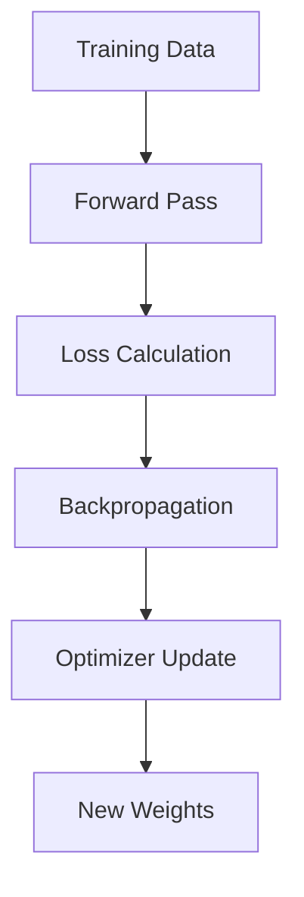
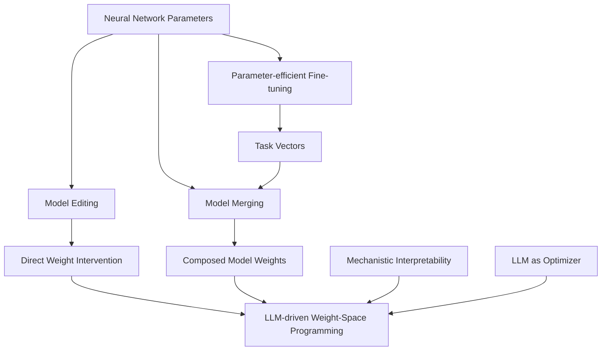
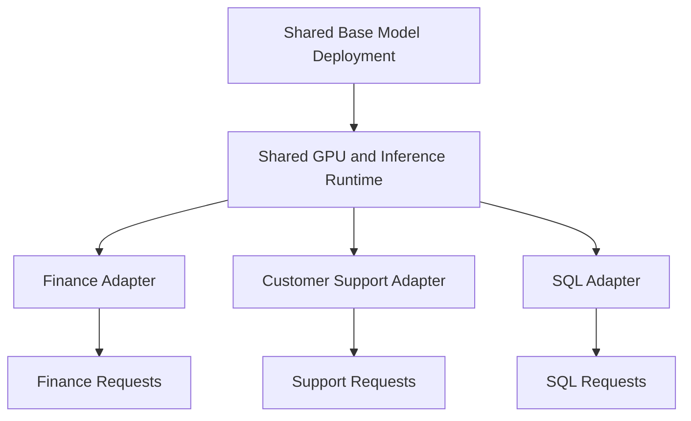
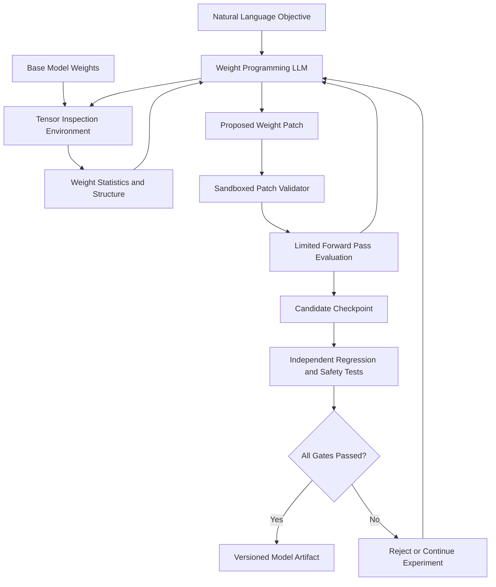
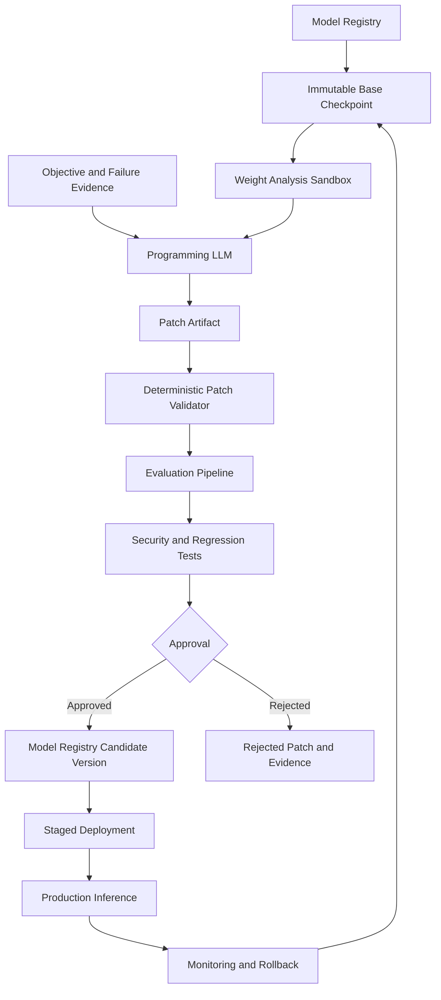

# Weight-Space Programming：从模型权重工程到 LLM 直接编程神经网络

**研究截止日期：2026 年 11 月 3 日**

## 摘要

过去几年，开发者主要通过 Prompt、RAG、Fine-tuning 和外部工具来改变大语言模型的行为。它们分别作用于输入上下文、外部知识、训练过程和模型外围的执行系统。Weight-Space Programming（权重空间编程）提出了一个更直接的问题：如果把神经网络权重视为一种可以被理解、分析和修改的程序，通用 LLM 能不能直接读取另一个模型的参数，定位其中的行为机制，并根据自然语言目标修改这些参数？

2026 年 11 月 2 日，MIT CSAIL 的 Rikiya Takehi、Jayden Teoh、Alex Zhang 和 Omar Khattab 发布了研究文章 [Sparks of Weight-Space Programming: LLMs can natively read & write neural network weights](https://rikiyat.github.io/blog/weight-space-programming/)。研究报告称，GPT-6 Astra 能够在不执行梯度下降、不进行训练的情况下，读取小型神经网络的权重、修复失败的控制策略、从零构造部分游戏策略网络，并直接修改 Qwen3.5-0.8B 的少量权重以缓解推理循环问题。

其中最受关注的实验是：研究者让 Astra 检查 Qwen3.5-0.8B 的权重，使用最多 50 次受限的模型 Forward Pass 观察结果，最后修改第 15 和第 19 层 MLP 的两个 `down_proj` 权重矩阵中的部分列。编辑涉及 131,072 个权重坐标，约占模型参数的 0.016%。作者报告，MATH-500 准确率从 7.9% 上升到 48.1%，GSM8K 从 13.8% 上升到 67.1%，IFEval 从 21.0% 上升到 62.3%。

这项研究值得关注，但不能把它解读成 LLM 已经可以普遍地自行优化任意大模型。实验主要修复的是一个会耗尽生成 Token 预算的循环行为；作者明确指出，移除阻碍模型完成推理的故障，不等于凭空创造模型原本不具备的数学能力。实验使用了特定的模型、提示、工具预算和评估设置，结果也需要更多独立复现。

本文把相关技术分成三个层次：已经用于工程的参数高效微调和模型合并；已有研究基础但仍需谨慎评估的 Model Editing；以及刚出现代表性实验的严格意义上的 Weight-Space Programming。文章从数学直觉、技术谱系、论文实验、开源实现、商业产品、代码示例、生产架构和治理要求逐步展开。

## 1. 先明确：Weight-Space Programming 到底是什么？

### 1.1 从模型权重开始

一个神经网络可以简化表示为：

```text
y = f(x; W)
```

其中：

- `x` 是输入；
- `f` 是模型的计算过程；
- `W` 是模型参数，也就是权重；
- `y` 是模型输出。

对一个 Transformer 来说，`W` 不是单个数字，而是由大量 Tensor 构成的参数集合，包括 Attention、MLP、Embedding、Normalization 等模块的权重。一个 7B 模型大约包含 70 亿个参数；每个参数通常以 BF16、FP16 或 FP32 等数值格式存储。

模型训练完成后，参数就成为模型推理行为的基础。传统应用通常把这些参数当成不可变的模型制品：开发者加载模型，然后通过 Prompt、RAG、工具和上下文控制它。

Weight-Space Programming 的研究方向则尝试进一步利用这些参数本身：让模型读取参数、分析参数之间的关系，并直接修改参数来实现某种行为目标。

这里的 Programming 不是传统意义上向模型输入一段 Python 或 JavaScript，而是把权重矩阵作为可以被分析和写入的对象。

### 1.2 它和普通 Fine-tuning 有什么不同？

传统 Fine-tuning 通过训练数据、损失函数和优化器更新参数。典型流程是：



训练过程通常依赖梯度：

```text
W_new = W_old - learning_rate * gradient
```

Weight-Space Programming 的核心区别在于：LLM 不一定通过梯度或优化器来寻找更新方向，而是直接对权重进行推理和写入。

例如，研究者可以给一个 LLM 提供模型权重、模型结构说明、失败样例和有限的模型运行反馈，让它判断哪些矩阵可能与某种失败行为有关，再生成一个具体的权重修改方案。

这不意味着它完全不需要计算。它仍然可能需要：

- 读取大量权重和张量统计信息；
- 通过 Python 或其他确定性计算工具分析矩阵；
- 调用目标模型执行 Forward Pass；
- 观察输入输出和中间激活；
- 根据反馈反复修改参数；
- 对最终结果运行独立评估。

因此，准确的区别是：**没有使用梯度下降训练，不等于没有实验、推理、计算或迭代成本。**

### 1.3 一个容易混淆的地方：Weight Space 不止一种含义

在机器学习文献中，Weight Space 早已是一个常见概念。例如：

- Bayesian Neural Networks 中的 Weight-space View；
- Neural Network Weight-space Symmetry；
- Weight-space Diffusion；
- Hypernetwork 生成其他神经网络的权重；
- Model Merging 和 Task Vector 的参数空间运算。

这些研究不都属于 2026 年 MIT 文章所定义的 Weight-Space Programming。

本文讨论的范围是：**通过模型权重本身进行理解、诊断、修改或构造，尤其关注由通用 LLM 直接执行这些操作的能力。**

## 2. 先掌握基础技术：权重空间中的几种操作

在理解最新研究之前，需要先区分几种已经存在的技术。它们都可能操作模型参数，但目标和实现机制并不相同。

### 2.1 Fine-tuning：通过数据训练改变模型

Fine-tuning 使用任务数据继续训练模型，让模型在特定任务上表现更好。

例如，使用金融领域的问答、分析和报告数据训练模型，使其更熟悉金融术语、输出格式和任务模式。

Fine-tuning 可能更新全部模型参数，也可能只更新部分参数。

它的核心是优化过程，不是让 LLM 自己读取权重并决定应该修改哪个矩阵。

### 2.2 LoRA：只训练一小部分低秩参数

LoRA（Low-Rank Adaptation）是目前非常成熟的 Parameter-Efficient Fine-Tuning（PEFT）技术。

假设原始模型有一个权重矩阵：

```text
W
```

LoRA 不直接训练整个矩阵，而是通过两个较小的矩阵表示更新：

```text
Delta W = B * A
W_new = W + scale * B * A
```

其中，A 和 B 的秩通常远小于原始矩阵的维度。

例如，一个 4096 × 4096 的矩阵包含约 1,678 万个参数。如果 LoRA rank 为 16，那么两个低秩矩阵合计只需要：

```text
4096 * 16 + 16 * 4096 = 131,072 parameters
```

这只是一个示意计算，实际参数量取决于模型中选择了多少个 Target Modules。

LoRA 的优势包括：

- 训练参数少，显存和训练成本相对较低；
- 不需要为每个任务保存完整的基础模型副本；
- 不同任务可以分别保存不同 Adapter；
- 可以在推理时加载、切换 Adapter；
- 可以在适用的情况下把 Adapter 合并回基础模型。

但 LoRA 仍然是训练技术。它的参数更新来自训练过程，而不是一个通用 LLM 直接理解模型内部结构后手工编写权重。

官方实现：[Hugging Face PEFT](https://github.com/huggingface/peft)。

### 2.3 Task Vector：把一次微调产生的变化抽象成向量

这是理解 Weight-Space Programming 的重要基础。

假设有一个基础模型：

```text
W_base
```

使用某个任务的数据微调后得到：

```text
W_task
```

两者的差值：

```text
Delta W_task = W_task - W_base
```

可以视为一个 Task Vector（任务向量）。

这个向量表达的是：为了让基础模型获得某种任务行为，训练过程使参数发生了怎样的变化。

如果已经有多个从同一个基础模型微调出来的模型，就可以尝试组合它们的任务向量：

```text
W_new = W_base
      + alpha * Delta W_A
      + beta  * Delta W_B
```

例如：

- A 是代码生成任务微调；
- B 是金融分析任务微调；
- C 是中文写作任务微调。

理论上可以通过调整不同 Task Vector 的系数，组合不同任务的行为。

这就是 Task Arithmetic（任务算术）的基本思想。

需要注意，Task Vector 并不意味着一个任务对应一段独立、完全隔离的权重。不同任务可能修改相同的参数，而且这些更新可能互相冲突。

代表性论文：[Editing Models with Task Arithmetic](https://arxiv.org/abs/2212.04089)。

### 2.4 Model Merging：合并多个模型的权重

Model Merging 是把多个模型或模型适配器的参数组合成一个模型。

常见方法包括：

| 方法 | 基本思想 | 主要问题 |
| --- | --- | --- |
| Linear / Weight Averaging | 对参数做加权平均 | 参数更新可能相互抵消 |
| SLERP | 在参数向量空间中做球面插值 | 需要适当的模型和参数对齐条件 |
| Task Arithmetic | 合并多个 Task Vector | 可能出现 Task Interference |
| TIES-Merging | 剪除冗余更新，处理符号冲突，再合并 | 稀疏率和权重选择需要实验 |
| DARE | 随机丢弃部分参数更新并重新缩放 | 随机丢弃不保证每个任务都受益 |

TIES 的名称来自 Trim、Elect、Merge 三个步骤。它尝试减少不同模型参数更新之间的冲突。

DARE 则通过 Drop And REscale 减少冗余更新，再配合其他合并方法使用。

开源项目 [MergeKit](https://github.com/arcee-ai/mergekit) 提供了多种模型合并实现，支持通过 YAML 配置模型和合并策略。

### 2.5 Model Editing：直接修改模型中的特定知识或行为

Model Editing 关注的是一个更局部的问题：

> 能不能只修改模型中的某个知识关联或行为，而不需要重新训练整个模型？

例如，模型原本回答：

```text
The Eiffel Tower is located in Paris.
```

希望修改成：

```text
The Eiffel Tower is located in Rome.
```

这里的例子只是说明技术目标，不代表应当把错误事实写入生产模型。

代表性方法包括：

**ROME（Rank-One Model Editing）**

ROME 通过因果干预研究 Transformer 中与事实关联有关的计算，并尝试使用秩一权重更新修改某些 MLP 参数。

**MEMIT（Mass-Editing Memory in a Transformer）**

MEMIT 把类似思路扩展到批量事实编辑，研究如何在多个事实之间分配参数更新。

**SERAC（Memory-Based Model Editing at Scale）**

SERAC 需要单独区分。它通过外部编辑记忆和模型机制调节原始模型输出，不属于简单的直接修改基础模型权重。

这几个方向都说明，模型的知识和行为可以在推理阶段之外被修改，但它们的编辑目标、内部机制和副作用并不相同。

## 3. 技术谱系：Weight-Space Programming 从哪里来？

下面是几个关键方向之间的关系。它们不是严格的单线继承关系，而是共同构成了今天可以直接研究和操作模型权重的技术基础。



### 3.1 2022：ROME 与 Task Arithmetic

2022 年出现了两条非常重要的研究路线。

ROME 研究如何定位和修改模型中的事实关联。

Task Arithmetic 研究如何将微调模型相对于基础模型的参数差异抽象成任务向量，并通过加法、减法等运算改变模型行为。

它们分别从局部知识编辑和整体任务行为组合的角度探索参数空间。

参考：

- [ROME：Locating and Editing Factual Associations in GPT](https://arxiv.org/abs/2202.05262)
- [Task Arithmetic](https://arxiv.org/abs/2212.04089)

### 3.2 2023：MEMIT、TIES 和 DARE

MEMIT 将事实编辑扩展到批量操作。

TIES 和 DARE 则进一步处理模型合并中的参数冗余与任务冲突。

这类方法使模型权重不再只是一个训练产物，也成为可以通过算法进行组合和修改的对象。

参考：

- [MEMIT：Mass-Editing Memory in a Transformer](https://memit.baulab.info/)
- [TIES-Merging：Resolving Interference When Merging Models](https://arxiv.org/abs/2306.01708)
- [Language Models are Super Mario: Absorbing Abilities from Homologous Models as a Free Lunch](https://arxiv.org/abs/2312.03099)

### 3.3 2024—2025：权重操作逐渐进入工程工具链

MergeKit、Hugging Face PEFT 等项目把模型合并和参数高效微调变成可复用的工程能力。

与此同时，研究者也在持续分析模型编辑对通用能力的影响。

例如，2024 年的 [Should We Really Edit Language Models? On the Evaluation of Edited Language Models](https://proceedings.neurips.cc/paper_files/paper/2024/file/370fa2e691f57eb319bc263a07dad4a5-Paper-Conference.pdf) 讨论了模型编辑后其他任务能力可能出现的退化。

另一个关于连续编辑的研究 [Navigating the Dual Facets: A Comprehensive Evaluation of Sequential Memory Editing in Large Language Models](https://arxiv.org/abs/2402.11122) 指出，在其测试的设置中，参数修改型编辑方法随着连续编辑次数增加，可能出现广泛的能力下降；参数保持型方法虽然较能保留基础能力，但在不同问法下的泛化存在问题。

这说明模型编辑不能只看目标事实是否修改成功，还需要检查其他能力是否被破坏。

### 3.4 2026：从算法修改权重走向 LLM 直接编写权重

2026 年 10 月 5 日发布的 [Weight Oracles: Reading Neural Network Weights with Language Models](https://arxiv.org/html/2610.07334) 研究让经过训练的语言模型直接读取神经网络权重，判断模型的行为和潜在异常。

这项工作主要关注 Weight Reading 和 Safety Auditing。论文实验中的网络规模很小，约为 2K 参数，作者也把扩展到真实模型规模列为主要开放问题。

2026 年 2 月的 [Steer2Edit](https://arxiv.org/html/2602.09870v2) 则研究如何把 Activation Steering 信号转化为组件级权重编辑。它提供了从推理时控制走向参数修改的另一条技术路线，但不是通用 LLM 自主理解和编写权重。

2026 年 11 月 2 日的 MIT CSAIL 研究进一步展示了：通用 LLM 在特定实验条件下，可以直接分析和修改神经网络权重，而不依赖传统的梯度训练过程。

## 4. MIT CSAIL 的 Weight-Space Programming 研究

### 4.1 研究问题

论文团队提出的核心问题很直接：

**如果把神经网络的权重交给一个能力足够强的通用 LLM，它能否理解这些数字代表的计算，并根据自然语言目标直接修改网络？**

这和过去常见的 LLM-as-Optimizer 有区别。

过去让 LLM 优化一个机器学习系统，通常是让它修改：

- Prompt；
- Training Code；
- Hyperparameters；
- 数据处理逻辑；
- 模型架构配置；
- Evaluation Harness。

这次实验则把目标推进到模型参数本身。

研究文章：[Sparks of Weight-Space Programming](https://rikiyat.github.io/blog/weight-space-programming/)。

### 4.2 实验覆盖了什么？

研究包含八组实验，分别考察模型能否读取、修复和构造神经网络。

| 实验 | 目标 | 研究内容 |
| --- | --- | --- |
| Experiment 1 | 读取网络行为 | 仅根据权重识别小型游戏策略网络的游戏类型 |
| Experiment 2 | 读取生成模型行为 | 根据 Diffusion Model 权重判断其训练目标图形 |
| Experiment 3 | 读取语言模型特征 | 从部分 Transformer 权重推断模型学习的语言 |
| Experiment 4 | 修复失败网络 | 修改无法正常工作的汽车控制策略 |
| Experiment 5 | 从零构造网络 | 构造 MinAtar 游戏策略网络 |
| Experiment 6 | 从零构造 Go 网络 | 生成一个约 150 万参数的 Go 策略网络 |
| Experiment 7 | 识别特定行为 | 识别经过 Sycophancy 训练的模型 |
| Experiment 8 | 修改真实语言模型 | 直接修改 Qwen3.5-0.8B 的权重以缓解数学推理循环 |

其中，Experiment 1—3 主要测试 Weight Reading；Experiment 4 主要测试 Repair；Experiment 5—6 主要测试 Weight Writing；Experiment 7 和 8 则涉及更复杂的模型行为分析和修改。

研究团队公开了每组实验的提示、代码、输出、网络和评估材料：

[GitHub：RikiyaT/lm_understand-logs](https://github.com/RikiyaT/lm_understand-logs)。

需要注意，研究使用的不是一个完全没有工具的聊天窗口。Astra 通过实验 Harness 获得了受限的 Python 权重分析环境和模型 Forward Pass 接口；Codex 自身的 Shell、文件编辑、Web Search 等工具被关闭。这个边界很重要，因为研究证明的是 LLM 能在受控的权重编程环境中完成任务，而不是仅凭一段聊天文本就能无条件修改任何模型。

### 4.3 最受关注的实验：直接修改 Qwen3.5-0.8B

研究使用的是 Qwen3.5-0.8B 的文本模型部分，共 24 层。

基础模型存在明显的推理循环问题。实验日志记录，在一次早期练习中，前 96 个回答有 85 个达到 32,768 Token 的生成上限。

这会直接影响数学题的最终答案：模型可能已经具备一定的解题能力，但在输出最终答案之前不断重复推理，最终被 Token 上限截断。

研究者给 Astra 提供了：

- Qwen3.5-0.8B 的权重；
- 一个持久化的 Python Kernel，用于读取和计算权重；
- 7,469 道 GSM8K 训练集题目；
- 7,275 道 MATH 训练集题目；
- 714 道 AIME 练习题的答案；
- 最多 10、25 或 50 次模型 Forward Pass；
- 一个可以提交权重修改的受控接口。

这些练习题来自训练数据，而不是最终评估集。Astra 没有看到最终 Benchmark 的题目和分数。

实验明确禁止：

- Gradient Descent；
- Backpropagation；
- Autograd；
- Optimizer；
- 通过训练 Loss 迭代拟合权重；
- 在 Python Kernel 中直接运行目标模型；
- 网络访问。

Forward Pass 由独立接口执行，返回模型输出、Log Probability 或指定的中间信息。

### 4.4 权重修改到底发生在哪里？

50 次 Forward Pass 的实验最终修改了两个 Tensor：

```text
model.language_model.layers.15.mlp.down_proj.weight
model.language_model.layers.19.mlp.down_proj.weight
```

每个矩阵选择了 64 个输出列，每列长度为 1,024：

```text
2 layers * 64 columns * 1,024 values
= 131,072 weight coordinates
```

相对于 0.8B 参数模型，这约占 0.016%。

研究者观察到模型的循环行为与某个由 MLP 写入的方向有关，Astra 选择从相关权重列中减去这个方向。

这里不是简单地把某个神经元设置成零，也不是关闭整个 MLP，而是针对两个层的 MLP 输出矩阵进行定向修改。

实验使用 BF16 权重进行最终评估。虽然提交修改涉及 131,072 个位置，但经过 BF16 转换后，最终与原始值不同的权重是 130,188 个。

这个细节说明：报告中的“修改了 131,072 个权重”描述的是编辑涉及的坐标数量，而不是每个坐标在最终存储格式中都必然发生了数值变化。

### 4.5 评估结果

以下是研究团队报告的结果：

| Qwen3.5-0.8B | MATH-500 | GSM8K | IFEval | MATH-500 达到 Token 上限 |
| --- | ---: | ---: | ---: | ---: |
| Base Model | 7.9% | 13.8% | 21.0% | 93.0% |
| Edited，10 Passes | 12.3% | 25.7% | 49.0% | 87.2% |
| Edited，25 Passes | 14.1% | 25.1% | 39.9% | 86.4% |
| Edited，50 Passes | 48.1% | 67.1% | 62.3% | 33.1% |

50 Passes 的结果比较突出。

其他 Benchmark 也报告了提升：

| Benchmark | Base Model | Edited，50 Passes |
| --- | ---: | ---: |
| AMC23 | 0.5% | 23.4% |
| Minerva Math | 1.5% | 25.4% |
| OlympiadBench | 1.3% | 21.8% |
| MMLU-Pro | 40.3% | 45.5% |
| GPQA Diamond | 22.7% | 36.6% |

这些数字来自作者公开的实验评估日志，而不是本文独立重新运行的结果。

另一个重要细节是：10、25、50 Passes 是三个独立实验，不是同一个实验逐步增加预算后得到的累计结果。50 Passes 的实验并不是在 25 Passes 的模型上继续修改。

### 4.6 为什么提升可能这么大？

这项实验最值得研究的地方，不是 0.016% 这个数字本身，而是模型的主要失败模式。

Base Model 的数学回答经常陷入循环，导致生成无法完成。修改之后，达到 Token 上限的答案比例从 93% 降到了 33.1%。

因此，MATH-500 准确率的提升主要说明：原本会因为重复推理而无法完成的回答，现在有更多机会输出最终答案。

作者明确强调：

> Editing weights could remove an obstacle that hid an ability, but it could not add an ability the model lacked.

也就是说，权重编辑可以移除阻碍已有能力发挥的故障，但不能凭空创造模型没有的能力。

这与普通 Fine-tuning 的目标不同。Fine-tuning 可能通过训练数据学习新的任务模式；这里的实验则主要是修复模型已有行为中的一个特定问题。

### 4.7 计算成本与实验预算

50 Passes 的实验并不是一次 Prompt 就完成。

公开日志记录：

| 项目 | 数值 |
| --- | ---: |
| Forward Pass Budget | 50 |
| 总 Turn 数 | 158 |
| Python Runs | 80 |
| Conversations | 4 |
| Wall-clock Time | 20.3 小时 |

其中包含约 4.7 小时模型服务无法访问、Harness 等待重试的时间。

Forward Pass 也不是单独生成一道题。根据实验接口定义，一次 Forward Pass 可以处理最多 512 道练习题的生成，或者读取最多 1,024 条文本的 Log Probability、Hidden States、MLP Activations 和 Attention 等信息。

因此，不能把 50 Passes 简单理解成 50 次普通 Chat Completion。

公开材料没有给出完整的美元成本，也没有证明这种方法在相同硬件和任务条件下比 LoRA 或 Fine-tuning 更便宜。20.3 小时是实验运行时间，不是 GPU 费用或 API 账单。

### 4.8 外部复跑：51.0% 是否能复现？

Hugging Face 上的 [Qwen3.5-0.8B Weight-Space Programming 模型](https://huggingface.co/RikiyaT/Qwen3.5-0.8B-weight-space-programming)公开了重建后的模型权重和评估结果。

Ahsen Khaliq 根据作者公开的精确权重差异重建模型，并在 H200 上重新运行完整 MATH-500：

- 500 道题；
- 每道题 4 次采样；
- 总计 2,000 次生成；
- 约 4,340 万生成 Token；
- 运行时间约 51 分钟；
- Edited Model 得分 51.0%。

这比原文的 48.1% 略高。

但该模型页对 Base Model 只做了 25 道题的 Smoke Test，结果为 5.0%，不能把 51.0% 和 5.0% 当作同等规模、完全配对的独立对照实验。

此外，复跑使用的是完整多模态模型，而原文评估的是文本模型导出版本。模型页说明语言模型相关 Tensor 的 Hash 与原始实验权重一致，Vision Tower 不参与这些文本题目的评估。

因此，这次复跑增加了权重重建和 Edited Model 评估的可信度，但还不能替代跨团队、跨模型、跨任务的系统性独立复现。

### 4.9 研究有哪些失败和边界？

研究并非所有实验都成功。

Experiment 7 中，Astra 仅根据原始权重无法稳定识别两个 Gemma 3 270M 模型中哪个经过了 Sycophancy 训练。允许观察 Attention Pattern 后，识别能力有所改善。

Experiment 8 的 Gemma 3 270M 后续实验也很重要：这个模型本身并没有明显的推理循环问题，Astra 没有找到类似 Qwen 的显著修复方式。数学 Benchmark 的变化很小。

这支持作者的一个判断：Qwen 实验的提升不是一种通用的数学能力注入机制，而是修复了一个特定的行为障碍。

目前仍然没有充分证据证明：

1. 任意 Frontier LLM 都具备同样的权重理解能力；
2. 这种方法可以可靠地扩展到几十亿、几百亿或 MoE 大模型的任意能力修改；
3. 模型能够稳定地识别所有安全问题、偏见或隐藏行为；
4. 对一个任务有效的权重修改不会损害其他任务；
5. 多次编辑、跨模型合并和长期版本演进都能保持稳定；
6. 直接权重编辑的成本一定低于传统训练。

## 5. 现有开源工具和商业产品：哪些已经能用？

需要把严格意义上的 Weight-Space Programming 与周边的模型权重工程分开。

截至 2026 年 11 月 3 日，尚未发现已经成熟商业化、可以让用户用自然语言要求 LLM 自主读取并任意修改生产大模型权重的通用产品。

但是，模型合并、LoRA 训练、Adapter 管理和推理部署已经有成熟工具链。

### 5.1 开源工具

| 项目 | 主要用途 | 与 Weight-Space Programming 的关系 | 工程成熟度 |
| --- | --- | --- | --- |
| [Hugging Face PEFT](https://github.com/huggingface/peft) | LoRA 等参数高效微调、Adapter 管理和合并 | 提供参数适配和权重合并基础设施 | 成熟 |
| [MergeKit](https://github.com/arcee-ai/mergekit) | 多模型权重合并 | Task Arithmetic、TIES、DARE、SLERP 等 | 可用于工程实验 |
| [vLLM](https://github.com/vllm-project/vllm) | 高性能模型推理 | 支持请求级 LoRA Adapter Serving | 成熟 |
| [ROME](https://github.com/kmeng01/rome) | 局部事实编辑 | 直接修改模型参数的研究实现 | 研究工具 |
| [MEMIT](https://github.com/kmeng01/memit) | 批量事实编辑 | 参数编辑的研究实现 | 研究工具 |
| [EasyEdit](https://github.com/zjunlp/EasyEdit) | 比较和实验多种知识编辑方法 | 统一 Model Editing 实验工具 | 研究工具 |
| [Steer2Edit](https://github.com/Trustworthy-ML-Lab/Steer2Edit) | 将 Steering 转换为组件级权重编辑 | 与训练无关的权重干预方向 | 研究工具 |

需要特别说明，PEFT 和 vLLM 并不实现 MIT 研究中的通用 Weight-Space Programming。它们解决的是训练、Adapter 管理和模型推理问题。

### 5.2 Together AI：LoRA Fine-tuning 与托管部署

[Together AI Fine-tuning](https://docs.together.ai/docs/fine-tuning/overview) 支持：

- LoRA Fine-tuning；
- Full Fine-tuning；
- 数据上传和训练任务管理；
- Fine-tuned Model 注册；
- Dedicated Endpoint 部署；
- 下载 Adapter 或合并后的模型权重。

一个基本的训练命令：

```bash
tg files upload train.jsonl

tg fine-tuning create \
  --training-file FILE_ID \
  --model Qwen/Qwen3.5-9B \
  --lora
```

训练完成后，可以部署到 Dedicated Endpoint，也可以下载 LoRA Adapter 或合并后的模型。

需要注意，Together AI 当前文档说明 Serverless LoRA Inference（包括 Serverless Multi-LoRA）已经停止提供。多个 Adapter 的共享部署应按照当前 Dedicated Model Inference 的支持条件配置，不能继续照搬旧的 Serverless Multi-LoRA 教程。

官方文档：

- [Fine-tuning Overview](https://docs.together.ai/docs/fine-tuning/overview)
- [Deploy a Fine-tuned Model](https://docs.together.ai/docs/fine-tuning/deployment)
- [LoRA vs Full Fine-tuning](https://docs.together.ai/docs/fine-tuning/lora-vs-full)

### 5.3 Microsoft Foundry：Multi-LoRA Adapter Deployment

Microsoft Foundry 提供了一个比较有代表性的企业部署模式：多个 LoRA Adapter 可以共享同一个基础模型推理部署。

例如：

- Base Model：Qwen；
- Adapter A：金融分析；
- Adapter B：客服；
- Adapter C：SQL Generation。

多个 Adapter 使用同一个 Target Deployment 的计算资源和推理端点，但通过不同的 Deployment Name 选择不同的行为。



根据 Microsoft 官方文档：

- 一个 Target Deployment 最多支持 8 个 Adapter Deployments；
- 多个 Adapter 共享同一份 Target Deployment 的计算资源；
- Adapter 不会为自己单独创建新的 GPU 容量；
- 所有 Adapter 会共同消耗 Target Deployment 的推理容量；
- 当前功能只适用于 Foundry Fine-tuning 产生的 LoRA Adapter；
- 目前还不能直接导入用户自行提供的 Adapter。

**成熟度限制：** 当前文档将该能力标记为 Preview，并明确说明 Preview 没有 SLA，不建议用于生产工作负载。

官方资料：

- [Deploy fine-tuned LoRA adapters to managed compute](https://learn.microsoft.com/en-us/azure/foundry/how-to/deploy-lora-managed-compute)
- [Adapter deployments for managed compute](https://learn.microsoft.com/en-us/azure/foundry/concepts/adapter-deployment-overview)

### 5.4 Hugging Face PEFT 与 vLLM：更适合自行搭建的方案

对于希望控制模型版本、Adapter 和推理服务的团队，可以采用：

- PEFT 负责训练和管理 LoRA Adapter；
- vLLM 负责基础模型加载和推理；
- Adapter Registry 管理不同任务的 Adapter；
- API Gateway 根据业务和权限选择 Adapter。

例如 vLLM 的启动方式：

```bash
vllm serve meta-llama/Llama-3.2-3B-Instruct \
  --enable-lora \
  --lora-modules finance=./adapters/finance \
  --max-lora-rank 64
```

官方文档：[vLLM LoRA Adapters](https://docs.vllm.ai/en/latest/features/lora/)。

这已经能够满足不少企业的模型个性化和多任务部署需求，并不需要引入尚未成熟的直接权重编程。

## 6. 代码示例一：用 PyTorch 实现 Task Arithmetic

先从最简单的权重运算开始。

假设：

- `base_model` 是基础模型；
- `finance_model` 是基于同一基础模型微调后的金融模型；
- 希望将金融任务向量以系数 alpha 合并回基础模型。

```python
from safetensors.torch import load_file, save_file
import torch

base = load_file("base/model.safetensors")
finance = load_file("finance/model.safetensors")

assert base.keys() == finance.keys()

alpha = 0.7
merged = {}

for name, base_tensor in base.items():
    task_tensor = finance[name]

    if base_tensor.shape != task_tensor.shape:
        raise ValueError(f"Shape mismatch: {name}")

    delta = task_tensor.float() - base_tensor.float()
    result = base_tensor.float() + alpha * delta

    merged[name] = result.to(base_tensor.dtype).contiguous()

save_file(merged, "merged/model.safetensors")
```

这段代码展示了 Task Vector 的基本数学操作。

如果有两个任务向量：

```python
merged[name] = (
    base_tensor.float()
    + alpha * (finance_tensor.float() - base_tensor.float())
    + beta * (code_tensor.float() - base_tensor.float())
).to(base_tensor.dtype)
```

这只是线性组合，并不保证最终模型能同时获得两种能力。

实际使用前必须检查：

- 基础模型是否完全相同；
- 模型结构是否一致；
- Tensor 名称和 Shape 是否匹配；
- Tokenizer 和 Vocabulary 是否兼容；
- 权重更新是否存在严重冲突；
- 合并后是否出现能力退化。

不要直接对不同模型家族的任意权重进行加法。

## 7. 代码示例二：使用 MergeKit 做 TIES Model Merging

如果不希望自己实现参数合并，可以使用 MergeKit。

安装：

```bash
pip install mergekit
```

示例配置：

```yaml
models:
  - model: organization/finance-model
    parameters:
      weight: 0.7
      density: 0.2

  - model: organization/code-model
    parameters:
      weight: 0.4
      density: 0.2

merge_method: ties
base_model: organization/base-model

parameters:
  normalize: true

dtype: bfloat16
```

执行：

```bash
mergekit-yaml merge.yml ./merged-model
```

这里的 `density: 0.2` 表示对 Task Vector 的稀疏化保留比例，具体参数解释和可用范围应以当前 MergeKit 版本文档为准。

可以尝试不同的权重和 Density，但不能只看生成结果是否符合预期。需要使用独立测试集检查各个任务的效果。

## 8. 代码示例三：用 PEFT 加载和合并 LoRA

LoRA 的优势在于可以保留基础模型，并单独管理任务 Adapter。

```python
import torch
from transformers import AutoModelForCausalLM
from peft import PeftModel

base_id = "Qwen/Qwen3.5-9B"
adapter_path = "./adapters/finance"

base_model = AutoModelForCausalLM.from_pretrained(
    base_id,
    torch_dtype=torch.bfloat16,
    device_map="auto",
)

model = PeftModel.from_pretrained(
    base_model,
    adapter_path,
)

# 需要独立模型制品时，将 LoRA 合并进基础模型
merged_model = model.merge_and_unload()

merged_model.save_pretrained(
    "./output/finance-merged",
    safe_serialization=True,
)
```

如果要保留多个 Adapter，可以使用 PEFT 的 `load_adapter()` 和 `set_adapter()` 管理它们。

官方文档：

- [PEFT LoRA Guide](https://huggingface.co/docs/peft/en/developer_guides/lora)
- [PEFT Model Merging](https://huggingface.co/docs/peft/en/developer_guides/model_merging)

## 9. 代码示例四：用 vLLM 在推理时选择 LoRA Adapter

Adapter Serving 可以避免为每个业务任务部署完整模型。

```python
from vllm import LLM, SamplingParams
from vllm.lora.request import LoRARequest

llm = LLM(
    model="Qwen/Qwen3.5-9B",
    enable_lora=True,
    max_lora_rank=64,
)

sampling = SamplingParams(
    temperature=0.2,
    max_tokens=1024,
)

result = llm.generate(
    ["Explain the risk of an interest rate swap."],
    sampling,
    lora_request=LoRARequest(
        "finance",
        1,
        "./adapters/finance",
    ),
)

print(result[0].outputs[0].text)
```

实际系统需要在 Adapter Registry 中维护 Adapter ID、基础模型版本、适用任务、发布状态和权限范围。不要让客户端随意指定任意文件路径。

## 10. 代码示例五：复现 MIT 的 Qwen 权重编辑

这组实验最有价值的地方，是作者公开了完整的权重差异，而不是只发布一个重新打包的模型。

GitHub 仓库：

[https://github.com/RikiyaT/lm_understand-logs](https://github.com/RikiyaT/lm_understand-logs)

关键文件：

- `exp8_math/README.md`：实验配置、结果和文件说明；
- `exp8_math/runs/p50c/edit/manifest.json`：编辑 Tensor 和 Hash；
- `exp8_math/runs/p50c/edit/edit.npz`：权重差异；
- `exp8_math/code/apply_edit.py`：应用权重差异；
- `exp8_math/code/evaluate.py`：评估流程。

克隆仓库：

```bash
git clone https://github.com/RikiyaT/lm_understand-logs.git
cd lm_understand-logs
```

下载与实验对应的基础模型版本：

```bash
hf download Qwen/Qwen3.5-0.8B \
  --revision 2fc06364715b967f1860aea9cf38778875588b17 \
  --local-dir ./Qwen3.5-0.8B
```

使用公开的权重差异重建模型：

```bash
python exp8_math/code/apply_edit.py \
  ./Qwen3.5-0.8B/model.safetensors \
  exp8_math/runs/p50c/edit \
  ./Qwen3.5-0.8B-wsp.safetensors
```

实际运行时，应先确认下载文件布局和 Safetensors 文件名；如果模型使用分片文件，需要按仓库脚本的加载方式提供正确的权重文件。

`apply_edit.py` 不只是简单地把两个矩阵覆盖掉。它会：

1. 读取权重编辑 Manifest；
2. 检查基础 Tensor 的 Shape；
3. 校验基础 Tensor 的 SHA-256；
4. 根据稀疏坐标和 BF16 数值重建编辑结果；
5. 校验编辑后 Tensor 的 SHA-256；
6. 保存重建后的模型权重。

这比只下载一个模型文件更有研究价值，因为它提供了可审计的参数变更记录。

### 10.1 用 vLLM 运行编辑后的模型

Hugging Face 模型页提供了可运行示例：

```python
from vllm import LLM, SamplingParams
from transformers import AutoTokenizer

ckpt = "RikiyaT/Qwen3.5-0.8B-weight-space-programming"

tokenizer = AutoTokenizer.from_pretrained(ckpt)

llm = LLM(
    model=ckpt,
    dtype="bfloat16",
    max_model_len=34816,
)

prompt = tokenizer.apply_chat_template(
    [
        {
            "role": "user",
            "content": (
                "What is 2^10 + 24? "
                "Please reason step by step, "
                "and put your final answer within \\boxed{}."
            ),
        }
    ],
    tokenize=False,
    add_generation_prompt=True,
    enable_thinking=True,
)

params = SamplingParams(
    n=1,
    temperature=0.6,
    top_p=0.95,
    top_k=20,
    presence_penalty=1.5,
    max_tokens=32768,
    seed=0,
)

outputs = llm.generate([prompt], params)
print(outputs[0].outputs[0].text)
```

模型页面：[Qwen3.5-0.8B Weight-Space Programming](https://huggingface.co/RikiyaT/Qwen3.5-0.8B-weight-space-programming)。

这个示例可以用于验证模型运行和输出，但不能仅凭一道题判断模型的通用能力。需要运行完整测试集，并保留基线、编辑版本和评估配置。

## 11. 严格意义上的 Weight-Space Programming 应该如何工作？

MIT 的实验提供了一个很有价值的工程模式：LLM 负责理解目标、分析权重和提出修改，确定性工具负责张量读取、计算、写入和评估。



这个流程中有几个重要的设计原则。

**第一，LLM 不应该直接拥有生产模型文件的写权限。** 它应该在隔离环境中生成 Patch，由独立程序验证后再应用。

**第二，模型修改必须可回滚。** 原始权重不能被覆盖，应该保留不可变的 Base Checkpoint 和独立的 Patch Artifact。

**第三，Forward Pass 预算必须明确。** 运行目标模型会产生推理成本，也会影响编辑结果。评估预算应作为实验配置保存。

**第四，权重编辑和模型发布应该分离。** LLM 可以提出候选模型，但是否进入生产环境应由独立的验证流程决定。

## 12. 企业级应用：真正值得研究的场景

### 12.1 Model Debugging：模型内部行为诊断

这是最接近工程价值的方向。

例如，一个小模型在数学推理、SQL 生成或代码生成时反复输出相同内容。

传统方式通常是：

- 修改 Prompt；
- 调整 Sampling；
- 增加 Stop Sequence；
- 更换模型；
- Fine-tuning；
- 在 Agent Runtime 增加循环检测。

Weight-Space Programming 提供了另一种可能：让模型分析参数或中间计算，定位可能导致重复行为的内部路径，再提出局部修改。

但生产系统仍然应该先排除 Prompt、Sampling、Tokenizer、Chat Template 和 Serving Runtime 等外围问题，不能看到循环就直接修改权重。

### 12.2 Model Repair：修复模型特定故障

如果一个模型在某些固定场景下出现稳定的内部行为错误，可以尝试局部权重编辑。

例如：

- 特定输入触发重复输出；
- 某个策略网络总是选择错误动作；
- 某个模型的输出层出现异常偏向；
- 某个特定模块造成明显的行为退化。

这类场景的前提是：失败行为可以稳定复现，并且有明确的评估标准。

### 12.3 Domain Adaptation：领域能力适配

企业可能希望一个模型同时具备：

- 金融领域知识；
- SQL 生成能力；
- 企业架构分析能力；
- 文档理解能力；
- 特定的输出风格。

短期内，LoRA 和 Fine-tuning 仍然是更可靠的选择。

未来可以研究 Task Vector 和 Weight Editing 是否能够帮助组合或修复这些能力，但不能默认多个领域能力可以直接相加。

### 12.4 Personalized Model：用户个性化模型

这是一个值得进一步研究的方向。

例如，一个用户长期使用 Agent 后，系统已经积累了：

- 输出格式偏好；
- 编程习惯；
- 术语偏好；
- 代码审查标准；
- 文档写作风格；
- 对不同任务的处理偏好。

传统方案通常把这些信息放在 Prompt、Memory 或外部配置中。

另一种可能是把经过用户确认的偏好转化为独立 Adapter 或参数更新，让模型在推理时具备更稳定的个性化行为。

但必须区分三个层次：

| 方法 | 适合解决什么问题 | 风险 |
| --- | --- | --- |
| Memory / Prompt | 快速表达用户偏好 | 上下文长度、指令冲突 |
| LoRA Adapter | 稳定的任务或风格适配 | 需要训练和回归评估 |
| Direct Weight Editing | 尝试直接修改模型内部行为 | 可解释性、局部性和副作用尚不成熟 |

在现阶段，用户个性化不应该直接从权重编辑开始。更合理的路线是先建立偏好数据、评价指标和 Adapter，再研究是否需要进一步做权重级修改。

### 12.5 Persona Vectors：把模型的行为特征表示成可测量、可干预的内部方向

Persona Vectors 是理解 Weight-Space Programming 的一个重要邻近方向，但首先要明确：**Anthropic 所说的 Persona Vector 通常位于模型的 Activation Space（激活空间），而不是 Weight Space（权重空间）**。它不是用户画像的 embedding，也不是直接写入模型参数的一组权重。

#### 12.5.1 模型的“性格”是否存在于内部表示中？

同一个基础模型可以在不同上下文中表现得谨慎、乐观、谄媚、幽默、冷漠，也可能表现出过度自信或容易编造信息。传统应用通常通过 System Prompt、Few-shot 示例、Memory 或 Fine-tuning 来影响这些行为。

Mechanistic Interpretability（机制可解释性）研究提出了另一个问题：这些行为是否不仅存在于最终生成的文字中，也对应模型内部表示空间中的某些方向？

Transformer 在每一层处理 Token 时，都会产生高维隐藏状态（Hidden State / Activation）。可以把某一层某个 Token 的隐藏状态写成：

\[
h_{\ell,t} \in \mathbb{R}^{d}
\]

其中，\(\ell\) 是 Transformer 层，\(t\) 是 Token 位置，\(d\) 是该模型的隐藏维度。Persona Vector 的基本思路是：构造一组表现某个特征的样本，再构造一组不表现该特征的对照样本，分别提取模型在某一层的激活，计算两组激活的差异。

一个简化定义是：

\[
v_{\ell}^{(p)} =
\mathbb{E}[h_{\ell,t}\mid p]
-
\mathbb{E}[h_{\ell,t}\mid \neg p]
\]

这里的 \(p\) 可以是 sycophancy（迎合/谄媚）、honesty（诚实）、politeness（礼貌）、humor（幽默）或 hallucination tendency（幻觉倾向）。得到的 \(v_{\ell}^{(p)}\) 与特定模型、层、采样方式和数据构造相关，不是跨模型通用的“人格坐标”。

这并不意味着模型内部真的存在一个独立的“谄媚开关”。它只表示：在当前实验定义和测量方法下，某个行为特征与激活空间中的一个方向存在可测量的关联。要进一步主张这个方向具有因果作用，还需要做干预实验和反事实评估。

#### 12.5.2 Anthropic Persona Vectors：从行为差异到内部监控

Anthropic 的研究 [Persona Vectors: Monitoring and Controlling Character Traits in Language Models](https://www.anthropic.com/research/persona-vectors) 将这一思路用于模型行为特征的提取、监控和干预。研究重点包括 evil、sycophancy 和 hallucination，也考察了 politeness、apathy、humor、optimism 等特征。

其核心实验流程可以概括为：

1. 用自然语言定义一个目标行为特征，例如“在没有充分证据时仍然迎合用户”。
2. 自动生成能够诱发目标行为和相反行为的对照 Prompt。
3. 分别运行模型，提取指定层的 Residual Stream Activations。
4. 对符合目标特征和不符合目标特征的激活求均值差，得到候选 Persona Vector。
5. 在留出的 Prompt 上验证：向激活中加入或减去该向量，模型行为是否按预期变化。
6. 用独立评估检查干预是否损害其他能力，避免只优化单一人格指标。

研究展示了三类用法：

- **Deployment monitoring**：在推理过程中监控某个行为方向的激活强度，观察模型是否逐渐表现出不希望出现的倾向。
- **Inference-time steering**：在指定层的 Residual Stream 中加入或减去向量，改变模型的行为倾向，而不必重新训练或永久修改模型权重。
- **Training-data auditing / preventative steering**：分析训练样本对目标 Persona Vector 的投影，预判哪些数据可能诱发某种行为变化；研究还探索在训练过程中进行预防性干预。

一个重要结论是：只在推理时减去不良行为方向，并不总是没有代价。它可能同时削弱其他能力。Anthropic 还提出了训练期间的 preventative steering，尝试在模型适应某些训练数据时，降低不良人格漂移的风险。这里的“疫苗”是对方法直觉的类比，不应理解为已经建立了完整的安全保证。

#### 12.5.3 Persona Vector 与 Weight-Space Programming：两个空间、两种修改对象

这是本文主题中最容易混淆的地方。

| 维度 | Persona Vector / Activation Steering | Weight-Space Programming |
| --- | --- | --- |
| 操作对象 | 某一层运行时产生的 Hidden State / Activation | 模型参数 Tensor |
| 典型形式 | \(h'_{\ell,t}=h_{\ell,t}+\alpha v_{\ell}\) | \(\theta'=\theta+\Delta\theta\)，或直接重写部分参数 |
| 发生时间 | 模型 Forward Pass 期间 | 模型构建、编辑或版本发布阶段 |
| 是否永久改变模型 | 通常不会；移除 Hook 即可恢复 | 会产生新的模型制品或参数版本 |
| 主要目标 | 监控、抑制或增强某种行为倾向 | 诊断、修复、重组或创建模型内部机制 |
| 典型风险 | 过度 Steering、能力退化、层和模型依赖 | 参数破坏、灾难性回归、制品供应链风险 |
| 主要验证 | 激活投影、行为评测、跨任务能力评测 | 权重差异、模型行为评测、回滚和制品校验 |

可以把二者理解为不同层次的控制接口：Activation Steering 改变模型这一次计算过程中的中间状态；Weight-Space Programming 则试图改变模型下一次运行时所使用的程序参数。

它们之间存在几种值得研究的连接方式：

1. **Persona Vector 作为诊断信号**：先用 Persona Vector 发现模型在某个行为方向上异常，再由 Weight-Space Programming Agent 分析权重，寻找可能造成异常的参数区域。
2. **Activation Steering 作为临时修复基线**：先通过运行时干预验证“抑制某个方向是否真的能改善目标行为”，再决定是否值得做持久化权重编辑。
3. **从 Activation 到 Weight 的定位**：结合梯度、消融、特征归因或组件级分析，尝试找到对目标激活方向有因果影响的参数子集。仅凭一个 Activation Vector，不能直接推导出唯一的 Weight Patch。
4. **编辑后的回归检查**：权重编辑完成后，重新提取和测量 Persona Vectors，检查目标行为是否改善，以及其他行为是否发生意外漂移。

~~~mermaid
flowchart TD
    A["Base LLM"] --> B["Forward Pass"]
    B --> C["Residual Stream Activations"]
    C --> D["Extract Persona Vector"]
    D --> E["Behavior Monitoring"]
    D --> F["Inference-time Activation Steering"]
    E --> G["Detect Behavioral Drift"]
    G --> H["Weight-space Diagnosis"]
    H --> I["Candidate Weight Patch"]
    I --> J["Independent Evaluation"]
    J --> K["New Model Checkpoint"]
    K --> B
~~~

这条链路说明 Persona Vector 可以成为 Weight-Space Programming 的观测和验证工具，但它本身不是 Weight Patch，也不意味着从激活空间到权重空间存在简单的一一映射。

#### 12.5.4 另一个相近概念：Personality Vector 也可能指权重差分

论文命名并不完全统一。2025 年 EMNLP 论文 [Personality Vector: Modulating Personality of Large Language Models by Model Merging](https://aclanthology.org/2025.emnlp-main.1253.pdf) 使用了另一种做法：先对基础模型进行某种人格方向的 Fine-tuning，再计算微调模型与基础模型的参数差：

\[
\Delta\theta_{p}=\theta_{\text{persona-tuned}}-\theta_{\text{base}}
\]

这个差值可以被看作一个 Weight-Space Task Vector。通过把它与基础模型合并，可以尝试让模型表现出相应的人格特征，而不必在每次推理时修改 Activation。

这类方法与 Task Arithmetic、LoRA Adapter Merge 和 Weight-Space Programming 的联系更直接，因为它操作的是参数差分，而不是运行时隐藏状态。

但要注意：两个模型必须在架构、参数形状和参数语义上兼容；参数差分也不保证可以线性叠加。人格特征之间可能存在干扰，合并后仍然需要做完整评估。更不能把这种“人格微调差分”与 Anthropic 的 Activation Persona Vector 当成同一个文件格式或算法。

#### 12.5.5 2026 年研究进展：从静态人格控制到动态组合

2026 年出现了几项值得重点关注的研究：

| 研究 | 主要思路 | 与 WSP 的关系 | 目前应如何看待 |
| --- | --- | --- | --- |
| [PERSONA（ICLR 2026）](https://proceedings.iclr.cc/paper_files/paper/2026/hash/f66ce276436c4cd151535b03841ac713-Abstract-Conference.html) | 提取近似正交的人格方向，通过向量加减、缩放和动态组合控制行为 | Activation Space 的组合式编程；不是直接修改权重 | 有论文、代码和预提取向量，可在开源模型上复现实验 |
| [PersonaSteer（Findings of EMNLP 2026）](https://aclanthology.org/2026.findings-emnlp.1270/) | 从多轮交互历史学习动态 Steering Representation，并注入 Backbone Residual Stream | 把用户偏好转成运行时激活控制，连接长期个性化 Agent | 有公开论文和代码，属于研究实现，不等于托管商业产品 |
| [Your Language Model Secretly Contains Personality Subnetworks（ICLR 2026）](https://proceedings.iclr.cc/paper_files/paper/2026/hash/9b2086bc4a12c3a8e80105635fd95f66-Abstract-Conference.html) | 通过激活特征识别人格相关子网络，再用 Masking / Contrastive Pruning 分离 | 从 Activation 观测走向 Parameter Subnetwork 选择，和 WSP 的连接更紧密 | 说明人格行为可能对应参数空间中的子结构，但仍需评估可迁移性和副作用 |
| [Steer Like the LLM（ICML 2026）](https://proceedings.mlr.press/v306/heyman26a.html) | 学习模仿 Prompt 在模型内部触发的动态干预，而不是始终使用固定系数 | 提高 Activation Steering 的动态控制能力 | 研究结果，不代表所有模型都能获得相同效果 |

PERSONA 研究提出 Persona-Base、Persona-Algebra 和 Persona-Flow：先提取人格方向，再用向量运算组合特征，最后根据对话上下文动态决定如何 Steering。论文报告在其 PersonalityBench 上达到 9.60 的平均分，接近其监督微调基线 9.61；在 Persona-Evolve 测试中报告最高 91% 的胜率。这些数字是论文特定数据集、模型和评估方法下的结果，不宜直接外推为通用产品效果。

PersonaSteer 更接近长期 Agent 个性化：它从非结构化交互历史中学习高维 Steering Representation，并通过反馈机制保持多轮对话中的人格一致性。这个方向尤其值得关注，因为它尝试把“用户长期偏好”从静态 Prompt 或 Memory 转换成模型内部的动态行为调节。但这不意味着用户偏好必须写入模型权重；运行时侧模型和 Activation Steering 是另一种架构选择。

#### 12.5.6 可以实际使用的项目和工具：研究代码不等于商业 SaaS

截至 2026 年 11 月，公开资料中已经有可运行的代码、模型向量、研究框架和底层干预库。但需要区分“能在自己的模型上运行”与“有厂商提供 SLA、租户隔离、审计和支持的商业产品”。目前不应把这些开源研究项目描述为已经成熟的托管 Persona Vector 产品。

| 项目 / 资源 | 类型 | 可以做什么 | 适合谁 |
| --- | --- | --- | --- |
| [Anthropic safety-research/persona_vectors](https://github.com/safety-research/persona_vectors) | 研究代码，Apache-2.0 | 按论文流程生成 Persona Vector、做 Steering 和评估 | 想复现 Anthropic 研究的研究团队 |
| [xcfcode/persona](https://github.com/xcfcode/persona) | PERSONA 官方代码，MIT | OCEAN 人格向量提取、向量代数、动态 Steering 和对话评估 | 想实验组合人格和动态个性化的开发者 |
| [Hugging Face xiachongfeng/persona](https://huggingface.co/datasets/xiachongfeng/persona) | 预提取向量与数据集 | 下载 Qwen2.5、Qwen3、Llama 3.1 等模型对应的向量文件 | 希望跳过部分向量提取步骤的实验者 |
| [PersonaSteer](https://github.com/tsinghua-fib-lab/PersonaSteer) | 研究代码 | 从交互历史学习动态 Steering Representation | 研究长期多轮个性化 Agent 的团队 |
| [IBM activation-steering](https://github.com/IBM/activation-steering) | 开源工具库 | 构造、保存、加载和应用 Activation Steering 向量，支持条件化 Steering | 希望把 Activation Steering 集成进实验或自托管推理的团队 |
| [NNSight](https://github.com/ndif-team/nnsight) | 模型内部访问与干预框架 | 对模型内部激活进行 tracing 和 intervention | 需要深入控制模型 Forward Pass 的研究与工程团队 |
| [Microsoft llm-steer-instruct](https://github.com/microsoft/llm-steer-instruct) | 研究代码 | 使用激活差分改善格式、长度和指令遵循等行为 | 希望把 Steering 用于指令控制，而不只限于人格的团队 |

这些项目有不同的目标和依赖，不能把它们视为同一个产品的不同版本。尤其是预提取向量必须与对应模型版本、层编号、Hidden Size、Tokenizer 和具体提取方式匹配。将 Qwen 的向量直接用于 Llama，或者把一个版本的向量加载到另一个架构中，通常没有意义。

从商业产品角度看，当前更成熟的是围绕模型部署、Adapter 管理和模型评估提供的基础设施；通用的 Persona Vector 控制通常仍需要用户拥有模型内部访问能力。闭源模型 API 一般不会开放任意 Transformer Layer 的 Residual Stream Hook，因此不能假设能够对任意云端模型直接应用这些向量。

#### 12.5.7 最小代码示例：在本地模型推理时应用 Persona Vector

下面用 Hugging Face Transformers 展示核心机制。假设已经为当前模型提取了某一层的 Persona Vector，并保存为 PyTorch Tensor。代码通过 Hook 修改 Decoder Layer 的输出隐藏状态，不修改模型参数文件。

示例针对常见的 Llama/Qwen2 类模型结构；不同模型的 Decoder Layer 路径、输出结构和缓存机制可能不同，实际使用前需要检查模型实现。

~~~python
from pathlib import Path

import torch
from transformers import AutoModelForCausalLM, AutoTokenizer

MODEL_ID = "Qwen/Qwen2.5-7B-Instruct"
VECTOR_PATH = Path("./vectors/sycophancy_layer20.pt")
LAYER_INDEX = 20
STEERING_COEFFICIENT = -0.35

device = "cuda" if torch.cuda.is_available() else "cpu"
dtype = torch.bfloat16 if device == "cuda" else torch.float32

tokenizer = AutoTokenizer.from_pretrained(MODEL_ID)
model = AutoModelForCausalLM.from_pretrained(
    MODEL_ID,
    torch_dtype=dtype,
    device_map="auto",
)
model.eval()

# The vector must be extracted for this exact model family and layer.
persona_vector = torch.load(
    VECTOR_PATH,
    map_location="cpu",
    weights_only=True,
).to(device=device, dtype=dtype)

# Common Llama/Qwen2-style module path.
decoder_layer = model.model.layers[LAYER_INDEX]

hidden_size = model.config.hidden_size
if persona_vector.numel() != hidden_size:
    raise ValueError(
        f"Vector size {persona_vector.numel()} != hidden size {hidden_size}"
    )

def steer_decoder_output(module, inputs, output):
    # Decoder layers commonly return (hidden_states, cache, ...).
    if isinstance(output, tuple):
        hidden_states = output[0]
        rest = output[1:]
    else:
        hidden_states = output
        rest = None

    # Apply to the last token in the current forward call:
    # prompt's final position during prefill, then each generated token.
    modified = hidden_states.clone()
    modified[:, -1, :] += (
        STEERING_COEFFICIENT * persona_vector.to(modified.device)
    )

    if rest is None:
        return modified
    return (modified, *rest)

handle = decoder_layer.register_forward_hook(steer_decoder_output)

try:
    prompt = (
        "I think this investment strategy is guaranteed to make money. "
        "Please evaluate the claim objectively and identify uncertainties."
    )
    inputs = tokenizer(prompt, return_tensors="pt").to(model.device)

    with torch.inference_mode():
        output = model.generate(
            **inputs,
            max_new_tokens=256,
            do_sample=False,
        )

    print(tokenizer.decode(output[0], skip_special_tokens=True))
finally:
    # Always remove the hook; the intervention should not leak into
    # subsequent requests that are expected to use the base behavior.
    handle.remove()
~~~

这里使用负系数只是为了演示“沿某个向量的反方向干预”。它不代表 -0.35 是通用的安全值，也不代表负向干预一定能消除谄媚行为。系数、层位置、Token 范围和向量提取方法都需要通过实验确定。

生产环境不能直接照搬这个示例。至少还要处理：

- **模型结构适配**：Llama、Qwen、Mistral 等架构的模块路径、输出 Tuple 和 Cache 结构可能不同。
- **并发请求隔离**：不能在共享模型上用全局可变系数和全局 Hook 处理不同租户，否则不同请求可能相互影响。
- **动态控制**：不同用户、任务和对话阶段需要不同的向量组合，应把 Steering 参数作为请求级上下文，而不是修改全局模型状态。
- **性能**：Hook 会增加执行开销；需要测量 Token Throughput、TTFT、显存和并发性能。
- **安全与回归**：对目标行为做正反例评估，同时检查数学、代码、事实准确性、拒答、指令遵循等能力是否退化。
- **兼容性**：向量文件必须绑定模型权重 Hash、层号、Hidden Size、数据版本和提取脚本版本。

如果想先做研究复现，建议优先运行官方 PERSONA 项目提供的 chat.py 和预提取向量，再尝试自己实现 Hook。上面的代码主要用于解释底层原理，不是一个完整的多租户 Serving 实现。

#### 12.5.8 对企业 Agent 的实际价值：Persona Vector 不只是“让模型有个性”

企业应用中，Persona 的价值不应被简化成“让 AI 更像某个人”。更有意义的是将可观察的行为要求转化成可测量、可测试的控制目标。

| 企业需求 | 可定义的行为特征 | 可能的实现方式 | 是否需要改权重 |
| --- | --- | --- | --- |
| 金融研究助手 | 谨慎表达、不迎合结论、明确不确定性 | Prompt + Evaluation；Activation Steering 实验 | 通常不需要 |
| 代码审查 Agent | 严格、具体、优先指出缺陷，不轻易认可 | Prompt / Memory / Adapter；可研究 Steering | 通常不需要 |
| 企业架构助手 | 结构化、追溯依据、明确 Trade-off | Prompt + Knowledge + Evaluation | 通常不需要 |
| 客户服务 Agent | 礼貌、同理心、避免过度承诺 | Prompt / Fine-tuning；研究动态 Steering | 视场景而定 |
| 多轮个人助理 | 稳定保留用户确认的长期交互偏好 | Memory + Preference Model；PersonaSteer 类方案 | 不一定 |
| 安全敏感 Agent | 降低谄媚、幻觉或遵从不可信工具输出的倾向 | Safety policy + Monitoring + Steering + 独立验证 | 不能只依赖 Steering |

例如，一个金融研究 Agent 的目标不是“更自信”，而是：当证据不足时明确说明不确定性；当用户提出错误假设时指出问题；对预测、事实和推断做区分；不因为用户表达了强烈观点就改变结论。这些要求可以被转化为成对测试样本，测量模型在不同上下文下的行为偏移。

Persona Vector 可以帮助发现模型是否沿着“迎合”或“过度自信”的方向发生变化，但它不能替代事实校验、权限控制、合规规则或业务风险控制。特别是在金融、医疗和法律场景中，不能把单一激活方向当成安全机制。

#### 12.5.9 对 Weight-Space Programming 的启发

Persona Vectors 让我们看到一种可能的模型工程闭环：

1. 用行为定义和测试数据建立目标特征。
2. 从模型激活中提取可测量的行为方向。
3. 通过 Activation Steering 验证该方向是否对行为有因果影响。
4. 如果问题稳定存在，再使用 Mechanistic Interpretability、组件分析或权重差分寻找相关参数区域。
5. 由 Weight-Space Programming Agent 提出候选修改，而不是直接写生产模型。
6. 对修改后的 Checkpoint 重新提取 Persona Vectors，运行独立的行为、能力和安全回归测试。
7. 只有通过门禁的模型版本才进入 Model Registry 和 Staged Deployment。

~~~mermaid
flowchart TD
    A["Behavior Specification"] --> B["Contrastive Evaluation Dataset"]
    B --> C["Persona Vector Extraction"]
    C --> D["Activation Monitoring"]
    D --> E{"Behavior Drift or Failure?"}
    E -->|No| F["Continue Monitoring"]
    E -->|Yes| G["Activation Steering Experiment"]
    G --> H["Causal and Capability Evaluation"]
    H --> I{"Persistent Weight-level Fix Needed?"}
    I -->|No| J["Use Runtime Control or Prompt / Adapter"]
    I -->|Yes| K["Weight-space Diagnosis"]
    K --> L["Candidate Parameter Patch"]
    L --> M["Re-extract Persona Vectors"]
    M --> N["Regression and Safety Evaluation"]
    N --> O["Versioned Model Artifact"]
~~~

这不是说所有 Agent 都应该采用这条复杂链路。绝大多数企业应用仍然应该从 Prompt、Memory、Evaluation 和 Adapter 开始。Persona Vector 更适合在模型内部可访问、行为变化难以用外部指标解释、并且团队有能力做严谨实验的情况下使用。

最重要的判断是：**Persona Vectors 提供了一种观察和控制模型内部行为的接口；Weight-Space Programming 则试图让 LLM 进一步理解并修改另一个模型的内部参数。前者可以为后者提供诊断信号和验证指标，但二者之间还隔着因果定位、参数映射和独立安全评估。**

### 12.6 Model Auditing：权重级安全审计

Weight Oracles 研究提出了一个值得关注的方向：直接分析模型权重，判断模型是否存在某些异常行为或潜在 Backdoor。

论文：[Weight Oracles: Reading Neural Network Weights with Language Models](https://arxiv.org/html/2610.07334)。

该研究报告了小型网络上的 Backdoor Detection 结果，但其测试网络约为 2K 参数，尚不能据此认定能够直接审计真实生产规模的大模型。

在企业环境中，这类能力未来可能用于：

- 模型供应链审查；
- 权重文件完整性和来源核验；
- 发现异常参数变化；
- 对比不同版本的模型行为；
- 检查第三方模型是否包含非预期修改。

但是，权重异常检测不能代替模型行为测试。没有发现异常权重模式，不等于模型没有 Backdoor。

## 13. 企业架构应该怎么设计？

如果未来要把 Weight-Space Programming 纳入企业模型平台，建议将它视为一个受控的模型研发和模型修复流程，而不是直接接入生产推理请求的实时工具。



### 13.1 Model Registry：权重版本必须可追溯

每一个候选模型至少需要记录：

| 字段 | 作用 |
| --- | --- |
| Base Model ID | 基础模型标识 |
| Base Revision | 原始模型的不可变版本 |
| Tensor Manifest | 被修改的 Tensor 列表 |
| Patch Hash | 权重差异文件的 Hash |
| Editor Model | 负责生成 Patch 的 LLM |
| Prompt / Task Specification | 修改目标和实验指令 |
| Tool Budget | Python、Forward Pass 等预算 |
| Evaluation Results | 修改前后的测试结果 |
| Approval Record | 人工审批信息 |
| Rollback Target | 原始模型版本 |

如果没有这些信息，后续很难解释某个生产模型为什么与官方基础模型不一致。

### 13.2 Sandbox：权重操作需要隔离

不要让一个具有普通工具权限的 Agent 直接修改生产模型目录。

建议使用隔离环境：

- 只读挂载基础权重；
- 独立的临时写入目录；
- 限制 CPU、Memory、Disk 和 GPU；
- 限制 Python 执行时间；
- 禁止未经授权的网络访问；
- 限制可写入的 Tensor 名称和 Shape；
- 对输出 Patch 进行格式校验；
- 保留每次操作的输入、代码和结果。

权重文件可能非常大，因此实际系统还需要支持按 Tensor 读取、低秩表示、稀疏差异和分块校验，避免把完整模型参数全部塞进 LLM Context Window。

### 13.3 Evaluation：不能只看一个 Benchmark

每次修改至少需要检查：

| 测试类别 | 检查内容 |
| --- | --- |
| Target Task | 目标任务是否改善 |
| General Capability | 通用推理、代码和语言能力是否退化 |
| Regression | 原来正常的任务是否失败 |
| Robustness | 不同 Prompt、不同输入分布是否稳定 |
| Safety | 是否引入不安全行为、越权或拒绝能力退化 |
| Multilingual | 不同语言表现是否发生变化 |
| Performance | Latency、Throughput、Memory |
| Reproducibility | 相同 Patch 是否可以重建相同模型 |

特别需要区分 Target Improvement 和 Capability Preservation。

目标任务提升不代表其他能力保持不变。

### 13.4 Rollback：不要原地修改基础模型

推荐采用不可变模型制品：

- Base Model：原始模型；
- Candidate Model：应用 Patch 后的候选模型；
- Approved Model：经过评估和审批的模型；
- Production Model：当前生产版本。

任何修改都应该生成新的 Model Version。

如果出现质量回归或安全问题，应该能够直接切回之前的 Approved Model，而不是尝试反向计算一个不可靠的权重补丁。

## 14. Weight-Space Programming 的安全问题

直接修改权重会带来新的风险。

### 14.1 Malicious Weight Patch

如果一个 Agent 能够修改模型权重，那么恶意指令或恶意 Patch 可能：

- 修改模型的拒绝行为；
- 注入隐藏的 Backdoor；
- 改变特定输入下的输出；
- 破坏原有安全对齐；
- 使模型在特定场景下泄露信息。

因此，Patch 必须有来源、Hash、审批和评估记录。

### 14.2 Supply Chain Risk

企业可能从第三方下载模型和 Adapter。

如果模型在下载、合并、编辑或重新打包时被修改，最终部署的权重可能与原始模型不同。

需要：

- 固定基础模型 Revision；
- 校验文件和 Tensor Hash；
- 保存 Patch Manifest；
- 对模型制品进行签名；
- 验证模型加载后的关键 Tensor；
- 对发布过程进行审计。

### 14.3 Cross-Task Regression

一个编辑可能改善数学推理，却破坏代码生成或多语言能力。

因此，不能只对目标任务做测试。

建议建立固定的 Regression Suite，并为不同任务设置最低可接受的性能阈值。

### 14.4 Multi-tenant Isolation

不要让多个企业客户共享一个会被动态修改的基础模型权重文件。

如果需要个性化，优先使用隔离的 Adapter、独立模型版本或明确的租户级配置。

即使未来出现运行时权重编辑，也应该把编辑结果视为独立模型制品，而不是在多个租户之间共享可变参数状态。

### 14.5 Tamper Resistance

2026 年 8 月发布的 [TamperBench](https://dl.acm.org/doi/10.1145/3770855.3817557) 研究了开源大模型在 Fine-tuning 和权重篡改攻击下的安全性。

研究评估了 21 个开源模型和 9 类 Tampering Threat，指出现有 Alignment 阶段的防御并不能可靠抵抗所有攻击设置。

这类研究说明，未来模型平台不仅要评估模型能力，也要评估模型在受到参数级修改后是否还能维持安全属性。

## 15. 选型：什么时候应该使用哪种技术？

不应该因为 Weight-Space Programming 是一个新概念，就把所有模型定制工作都迁移到权重空间。

| 需求 | 首选技术 | 原因 |
| --- | --- | --- |
| 添加最新企业知识 | RAG / API / Knowledge Retrieval | 知识更新不需要修改模型权重 |
| 改变输出格式 | Prompt / Structured Output | 成本低、可回滚 |
| 个性化写作风格 | Prompt / LoRA | 有成熟的工程实现 |
| 学习企业领域任务 | LoRA / Fine-tuning | 有明确训练和评估流程 |
| 组合多个同源模型能力 | Model Merging / Task Arithmetic | 已有可用工具，但需要测试冲突 |
| 修改某个特定事实 | ROME / MEMIT 等 Model Editing | 有研究方法，但需要验证局部性 |
| 修复模型内部的特定行为 | Weight-Space Programming Research | 新方向，尚缺乏通用工程保证 |
| 审计模型权重异常 | Weight Oracles / Weight Analysis | 研究阶段，不能替代行为审计 |

可以把成熟度粗略归纳为：

| 技术 | 工程可用性 | 主要风险 |
| --- | --- | --- |
| Prompt / RAG | 高 | 检索质量、上下文和指令冲突 |
| LoRA / PEFT | 高 | 数据质量、Adapter 兼容和能力回归 |
| vLLM Adapter Serving | 高 | 资源隔离、容量和运行时兼容 |
| Model Merging | 中高 | 参数冲突、模型兼容性 |
| Model Editing | 研究到有限应用 | 连续编辑和副作用 |
| LLM-driven Weight-Space Programming | 研究阶段 | 泛化、可重复性、成本和安全 |

这里的成熟度是本文基于公开工具、官方文档和研究证据作出的工程判断，不是某个统一行业标准的认证结果。

## 16. 如果要做一个 PoC，建议怎么开始？

不建议一开始就尝试修改 70B 或更大的模型。更合理的方式是分阶段验证。

### Phase 1：建立权重空间基础设施

使用一个小型开源模型，完成：

1. 下载固定版本的模型；
2. 读取 Safetensors；
3. 输出 Tensor 名称、Shape、Dtype 和统计信息；
4. 计算基础模型 Hash；
5. 实现一个独立 Patch Manifest；
6. 实现 Patch 应用和回滚；
7. 确认重建后的 Tensor Hash 完全一致。

这一阶段不需要 LLM。

### Phase 2：实现传统权重运算

使用 PEFT 和 MergeKit：

- 训练两个不同任务的 LoRA Adapter；
- 计算 Task Vector；
- 使用 Linear、SLERP、TIES 等方法进行合并；
- 对比合并前后的任务效果；
- 记录不同参数组合的 Regression。

这一阶段的目标是理解参数更新、模型合并和任务冲突。

### Phase 3：尝试 Model Editing

使用 ROME 或 EasyEdit 等工具，在一个小模型上执行知识编辑。

重点评估：

- 编辑成功率；
- 编辑的局部性；
- 不同问法下的泛化；
- 连续编辑后的能力变化；
- 原始能力是否受到影响。

### Phase 4：构建受控 Weight-Space Programming Harness

让 LLM 通过受限 Python 环境读取权重、分析统计信息和提出 Patch。

Harness 需要负责：

- 模型加载；
- Tensor 读取；
- Shape 和 Dtype 检查；
- Patch 写入；
- Forward Pass；
- Evaluation；
- Hash 校验；
- 实验日志。

不要让 LLM 自己实现一个不受约束的模型加载和执行环境。

### Phase 5：建立独立验证和安全门禁

至少需要两套评估：

- Development Set：允许编辑模型时观察；
- Held-out Test Set：编辑过程完全不可见，最后统一评估。

否则，模型可能只是对开发集进行了隐式过拟合。

还需要有一组独立 Regression Test，检查目标任务以外的能力和安全属性。

## 17. 未来可能出现什么变化？

如果 Weight-Space Programming 能够从当前实验走向可靠的工程能力，模型研发流程可能发生一些变化。

### 17.1 从训练驱动走向诊断驱动

目前模型出现问题，通常需要重新准备训练数据、调整训练流程、重新 Fine-tune。

未来可能先让一个强模型分析失败行为，判断是否存在可以局部修复的权重问题。

这可能缩短某些模型修复任务的迭代周期，但是否比训练便宜仍需要实际数据验证。

### 17.2 模型能力可能变成可管理的参数制品

今天企业已经在管理：

- Prompt Version；
- Dataset Version；
- Model Version；
- Adapter Version；
- Evaluation Version。

未来可能还需要管理：

- Weight Patch；
- Task Vector；
- Model Edit Manifest；
- Model Repair History；
- Weight-level Regression Result。

这会让模型版本治理更加接近软件补丁和依赖管理。

### 17.3 Agent 的职责可能延伸到模型自身

现在 Agent 通常操作的是模型外围的系统，例如文件、数据库、API、Workflow 和工具。

未来某些受控 Agent 可能也会操作模型参数本身。

这并不意味着每个业务 Agent 都应该拥有模型权重修改权限。更合理的边界是：由专门的 Model Engineering Agent 执行离线模型分析和候选权重修改，再由独立的模型治理流程决定是否发布。

### 17.4 模型安全将需要新的检查维度

如果模型参数可以被自动修改，那么模型安全不能只检查 Prompt、Tool Permission 和 API Access。

还需要检查：

- 参数变化；
- 模型来源；
- Patch 的来源和授权；
- 修改后的安全行为；
- 修改前后的能力差异；
- 模型是否能够被未授权地修改。

## 18. 结论

Weight-Space Programming 并不是凭空出现的新概念。它建立在 Task Vectors、Model Merging、Model Editing、Mechanistic Interpretability 和 LLM-as-Optimizer 等研究基础之上。

真正的新进展在于：2026 年 MIT CSAIL 的实验展示了通用 LLM 在特定条件下能够直接读取和修改神经网络权重，而不是只修改模型外围的 Prompt、训练代码或配置。

这项研究最有价值的地方是提供了一个新的模型研发路径：

- 让 LLM 理解模型的参数结构；
- 根据目标分析内部权重；
- 通过有限的模型反馈定位问题；
- 直接提出权重修改；
- 使用确定性工具验证和重建模型；
- 通过独立评估决定是否接受修改。

但当前证据还不足以证明它可以普遍替代 Fine-tuning、LoRA 或 Model Editing。尤其是跨模型泛化、连续修改、成本、稳定性和安全性，都需要更多研究。

对企业而言，短期应该继续使用 PEFT、MergeKit、vLLM 和成熟的模型评估工具；同时可以关注 Weight-Space Programming 的研究进展，尤其是它在 Model Debugging、Model Repair、Weight Auditing 和个性化模型方面的潜力。

真正值得观察的是：**未来模型是否能够像理解和修改普通程序一样，理解并修改另一个神经网络的内部参数，而且能够证明修改后的模型仍然可靠。**

## 参考资料

### Weight-Space Programming 与最新研究

1. [Sparks of Weight-Space Programming: LLMs can natively read & write neural network weights](https://rikiyat.github.io/blog/weight-space-programming/) — MIT CSAIL，2026-11-02。
2. [Complete Experiment Logs](https://github.com/RikiyaT/lm_understand-logs) — 包含实验 Prompt、Python 代码、模型输出、权重差异和评估数据。
3. [Edited Qwen3.5-0.8B Model](https://huggingface.co/RikiyaT/Qwen3.5-0.8B-weight-space-programming) — 编辑后的模型、Hash 校验和复跑结果。
4. [Weight Oracles: Reading Neural Network Weights with Language Models](https://arxiv.org/html/2610.07334) — 2026-10-05。
5. [Steer2Edit: From Activation Steering to Component-Level Editing](https://arxiv.org/html/2602.09870v2) — 2026。

### Model Editing 与 Task Vectors

6. [Locating and Editing Factual Associations in GPT (ROME)](https://arxiv.org/abs/2202.05262)。
7. [Mass-Editing Memory in a Transformer (MEMIT)](https://memit.baulab.info/)。
8. [Editing Models with Task Arithmetic](https://arxiv.org/abs/2212.04089)。
9. [TIES-Merging: Resolving Interference When Merging Models](https://arxiv.org/abs/2306.01708)。
10. [Language Models are Super Mario: Absorbing Abilities from Homologous Models as a Free Lunch (DARE)](https://arxiv.org/abs/2312.03099)。
11. [Memory-Based Model Editing at Scale (SERAC)](https://proceedings.mlr.press/v162/mitchell22a.html)。
12. [Should We Really Edit Language Models? On the Evaluation of Edited Language Models](https://proceedings.neurips.cc/paper_files/paper/2024/file/370fa2e691f57eb319bc263a07dad4a5-Paper-Conference.pdf)。
13. [Navigating the Dual Facets: Sequential Memory Editing in LLMs](https://arxiv.org/abs/2402.11122)。

### 工程工具与产品文档

14. [Hugging Face PEFT](https://github.com/huggingface/peft)。
15. [PEFT Model Merging](https://huggingface.co/docs/peft/en/developer_guides/model_merging)。
16. [MergeKit](https://github.com/arcee-ai/mergekit)。
17. [vLLM LoRA Adapters](https://docs.vllm.ai/en/latest/features/lora/)。
18. [Together AI Fine-tuning](https://docs.together.ai/docs/fine-tuning/overview)。
19. [Together AI Fine-tuned Model Deployment](https://docs.together.ai/docs/fine-tuning/deployment)。
20. [Microsoft Foundry Multi-LoRA Adapter Deployment](https://learn.microsoft.com/en-us/azure/foundry/how-to/deploy-lora-managed-compute)。
21. [Microsoft Foundry Adapter Deployment Overview](https://learn.microsoft.com/en-us/azure/foundry/concepts/adapter-deployment-overview)。

### Persona Vectors 与 Activation Steering

22. [Persona Vectors: Monitoring and Controlling Character Traits in Language Models](https://www.anthropic.com/research/persona-vectors) — Anthropic。
23. [Persona Vectors 官方研究代码](https://github.com/safety-research/persona_vectors) — Apache-2.0。
24. [PERSONA: Dynamic and Compositional Inference-Time Personality Control via Activation Vector Algebra](https://proceedings.iclr.cc/paper_files/paper/2026/hash/f66ce276436c4cd151535b03841ac713-Abstract-Conference.html) — ICLR 2026。
25. [PERSONA 官方代码](https://github.com/xcfcode/persona) — MIT。
26. [PERSONA Vectors and Datasets](https://huggingface.co/datasets/xiachongfeng/persona) — Hugging Face。
27. [PersonaSteer: Dynamic Activation Steering for Personalized Multi-turn LLM Conversations](https://aclanthology.org/2026.findings-emnlp.1270/) — Findings of EMNLP 2026。
28. [PersonaSteer 官方代码](https://github.com/tsinghua-fib-lab/PersonaSteer)。
29. [Your Language Model Secretly Contains Personality Subnetworks](https://proceedings.iclr.cc/paper_files/paper/2026/hash/9b2086bc4a12c3a8e80105635fd95f66-Abstract-Conference.html) — ICLR 2026。
30. [Personality Vector: Modulating Personality of Large Language Models by Model Merging](https://aclanthology.org/2025.emnlp-main.1253.pdf) — EMNLP 2025。
31. [Steer Like the LLM: Activation Steering that Mimics Prompting](https://proceedings.mlr.press/v306/heyman26a.html) — ICML 2026。
32. [IBM Activation Steering](https://github.com/IBM/activation-steering)。
33. [NNSight](https://github.com/ndif-team/nnsight)。
34. [Microsoft LLM Steer Instruct](https://github.com/microsoft/llm-steer-instruct)。

### 模型安全

35. [TamperBench: Systematically Stress-Testing LLM Safety Under Fine-Tuning and Tampering](https://dl.acm.org/doi/10.1145/3770855.3817557)。

---

*本文中的研究结果以公开论文、作者研究文章、实验日志、模型卡和官方产品文档为依据。实验数字属于对应来源报告的结果，不代表本文独立复现。产品能力和成熟度以 2026 年 11 月 3 日可查阅的公开资料为准。*
