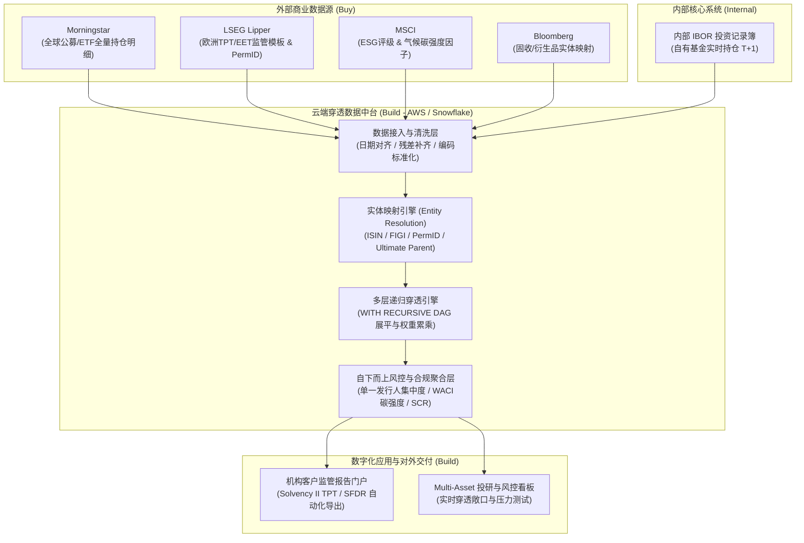

# 金融服务企业向下穿透（Look-through）架构选型、数据模型与工程验证报告

## 1. 市场主流商业产品全景

在金融服务行业，**Look-through（向下穿透）**是指剥离多层金融产品结构（如 FOF、信托、资管计划、SPV 等），逐层追踪并识别最底层真实资产、风险敞口及资金最终流向的机制。商业解决方案主要分为三大类：

| 产品类别 | 核心解决痛点 | 代表商业产品 | 适用机构类型 |
| :--- | :--- | :--- | :--- |
| **投研与风险管理 (PMS/Risk)** | 还原真实持仓、计算底层市场风险与归因 | BlackRock Aladdin、MSCI BarraOne、Bloomberg PORT、恒生 O45 | 公募基金、保险资管、银行理财子 |
| **监管合规报送 (RegTech)** | 满足监管机构多层嵌套限制与报表报送（如 Solvency II、资管新规） | Moody's Analytics、衡泰技术、兆尹科技、中兴新云 | 商业银行、信托公司、集团财务公司 |
| **股权与反洗钱穿透 (KYB/UBO)** | 识别企业最终受益人（UBO）与离岸关联交易 | BvD Orbis、Refinitiv World-Check、邓白氏、企查查企业版 | 银行信贷部、投行、跨境支付机构 |

---

## 2. 跨国大型资管巨头（以 Fidelity International 为例）的 Build vs. Buy 策略

对于管理数千亿美元资产、业务横跨欧亚多司法管辖区（受 FCA、欧盟 UCITS/SFDR/Solvency II、亚太本地法规双重约束）的顶级资管机构，最优架构是 **“核心自建 + 底层外采（Hybrid 混合架构）”**，即：**数据与标准算子靠买，数据底座与业务应用靠建**。

* **为何不纯外采（Pure Buy）：** 内部专有基金实时持仓与多资产配置模型属于核心商业机密，不宜全盘托管于竞争对手 SaaS；且全球多地合规报送与客户数字化门户需要极高的前端定制灵活性。
* **为何不纯自建（Pure Build）：** 无法自行获取全球数万只第三方外部基金（External Funds/ETFs）的底层持仓数据；且全球监管模板（如 TPT/EET）高频迭代，内部维护标准风控因子的总拥有成本（TCO）过高。

### 2.1 分层混合架构方案

| 架构层级 | 策略选择 | 具体落地方案 |
| :--- | :--- | :--- |
| **底层数据层** | **Buy（外采）** | 向 **Morningstar、LSEG Lipper、Bloomberg、MSCI** 采购外部基金底层持仓数据流（Data Feeds）与 ESG 指标。 |
| **计算引擎层** | **Buy + Build（集成）** | 采购商业风控引擎（如 **MSCI BarraOne** / **Moody's**）处理标准风险因子；内部自建衍生品与另类资产的专有拆解算法。 |
| **数据中台层** | **Build（自建）** | 在云端（AWS / Snowflake）自建**企业级 IBOR 与穿透数据中台**，完成内部持仓与外部数据的实体映射（Entity Resolution）、去重与多层递归穿透计算。 |
| **应用服务层** | **Build（自建）** | 自建面向内部基金经理的跨资产风险看板，以及面向外部机构客户（如欧洲险资）的自动化监管报告 API 接口。 |

### 2.2 系统架构与数据流拓扑（Mermaid 架构图）

---

## 3. 外部数据源组合选型与数据模型设计

单一数据源无法覆盖全球大型资管的所有场景，最合理的采购组合为 **“Morningstar + LSEG Lipper + MSCI”** 三者互补：

### 3.1 供应商职能分工与对比

| 数据供应商 | 核心优势领域 | 在混合架构中的定位 |
| :--- | :--- | :--- |
| **Morningstar (晨星)** | 全球公募基金与 ETF 全量持仓明细覆盖极广，亚太与欧美均衡 | **基石持仓底座**：支撑内部 Multi-Asset 投研穿透与财富平台分析 |
| **LSEG Lipper (理柏)** | 欧洲及跨境基金覆盖扎实，深度绑定欧洲监管标准模板（TPT/EET） | **欧洲合规引擎**：支撑 Solvency II 保险偿付能力报送与实体代码映射（PermID） |
| **MSCI** | 全球行业标准的 ESG 评级、碳足迹（WACI）与气候风险因子 | **ESG 穿透增强**：支撑欧盟 SFDR 可持续金融披露与 PAI 指标自下而上汇总 |

### 3.2 核心逻辑数据模型与 Sample Data

在数据中台中，外采数据通过标准证券编码（**ISIN / FIGI / LEI**）进行关联，形成“有向无环图（DAG）持仓关系表 + 底层证券主数据与因子宽表”。

#### 表 A：基金持仓明细表 (`morningstar_fund_holdings`)
记录“母基金 → 子持仓”的层级权重，用于驱动多层递归展平：

| `parent_fund_isin` | `as_of_date` | `holding_isin` | `holding_name` | `asset_type` | `weighting_pct` | `market_value_usd` | `is_unreported_proxy` |
| :--- | :--- | :--- | :--- | :--- | :--- | :--- | :--- |
| `IE00B4L5Y983` | `2026-10-31` | `US0378331005` | Apple Inc | Equity | `5.4200` | `1250400.00` | `FALSE` |
| `IE00B4L5Y983` | `2026-10-31` | `LU0996182563` | Amundi MSCI World | Open-End Fund | `2.1000` | `484470.00` | `FALSE` |

#### 表 B：欧洲监管标准宽表 (`lseg_tpt_lookthrough`)
按欧洲 Solvency II 标准的 **TPT（Tripartite Template）** 交付，包含资产分类码（CIC）与资本要求参数：

| `1_Portfolio_ID` | `6_Valuation_Date` | `14_Instrument_ID` | `17_Instrument_Name` | `12_CIC_Code` | `26_Weight_in_Fund` | `51_Modified_Duration` | `90_SCR_Market_Risk` |
| :--- | :--- | :--- | :--- | :--- | :--- | :--- | :--- |
| `IE00B4L5Y983` | `2026-10-31` | `US0378331005` | APPLE INC | `XL31` | `0.0542` | `0.00` | `0.3900` |
| `IE00B4L5Y983` | `2026-10-31` | `US912828YV68` | US TREASURY N/B | `XL11` | `0.0150` | `6.45` | `0.0000` |

#### 表 C：ESG 与气候因子维度表 (`msci_esg_security_metrics`)
按底层证券（ISIN）或发行人（Issuer）交付，与上述两张表关联后自下而上加权汇总：

| `isin` | `issuer_name` | `msci_issuer_id` | `esg_rating` | `scope_1_2_carbon_intensity` | `sfdr_pai_fossil_fuel_flag` |
| :--- | :--- | :--- | :--- | :--- | :--- |
| `US0378331005` | Apple Inc. | `IID00000000215763` | `BBB` | `14.20` | `FALSE` |
| `US5949181045` | Microsoft Corp. | `IID00000000217492` | `AAA` | `29.50` | `FALSE` |

### 3.3 工程落地关键治理规则
1. **日期错配对齐（As-of Date Alignment）：** 内部 IBOR 为日频（T+1），外部基金持仓多为月频/季频，需建立“最新可用持仓快照对齐”机制并监控滞后天数（Staleness Days）。
2. **残差与未披露持仓归一化（Residual & Proxy Normalization）：** 外部基金披露的底层权重加总不足 100% 时，需生成虚拟现金/未识别资产节点补齐差额，保障组合层面风险与资产配置报表平账。

---

## 4. 开源替代数据集与本地原型验证（DuckDB 实现）

### 4.1 免费公开数据集对照表

| 模拟商业模块 | 推荐开源数据集 | 获取地址 / 标识 | 验证的核心能力 |
| :--- | :--- | :--- | :--- |
| **外部基金持仓明细** | SEC Form N-PORT 清洗版 | Hugging Face: `ZipLime/fund-holdings-nport` | FOF 多层嵌套递归穿透、权重归一化 |
| **底层发行人主数据** | OpenFIGI & GLEIF LEI | `openfigi.com` / `gleif.org` | 跨市场同一主体去重、最终母公司集中度穿透 |
| **底层 ESG 因子** | 合成模拟表 / 开源 ESG 表 | 自定义按 ISIN 关联 | 自下而上加权计算组合碳足迹（WACI） |

### 4.2 DuckDB 多层递归穿透与 ESG 汇总验证代码

完整代码见本压缩包内的 `lookthrough_demo.sql` 与 `run_lookthrough.py`。运行后输出如下穿透平账结果：

| 最终发行人 (Ultimate Parent) | 行业板块 | MSCI ESG 评级 | 穿透后真实权重 (%) | 贡献碳强度 (tCO2e/$M) | 穿透路径数 |
| :--- | :--- | :--- | :--- | :--- | :--- |
| **Apple Inc.** | Information Technology | BBB | `45.0000` | `6.39` | 3 |
| **Microsoft Corporation** | Information Technology | AAA | `34.9200` | `10.30` | 2 |
| **Cash & Equivalents** | Cash | N/A | `10.0000` | `0.00` | 1 |
| **United States Government** | Sovereign | A | `9.0000` | `19.42` | 1 |
| **Unreported Fund Residual** | Unclassified | N/A | `1.0800` | `0.00` | 2 |

*(注：所有底层叶节点穿透权重加总严格等于 **100.0000%**，实现完整的资产负债表级平账。)*
