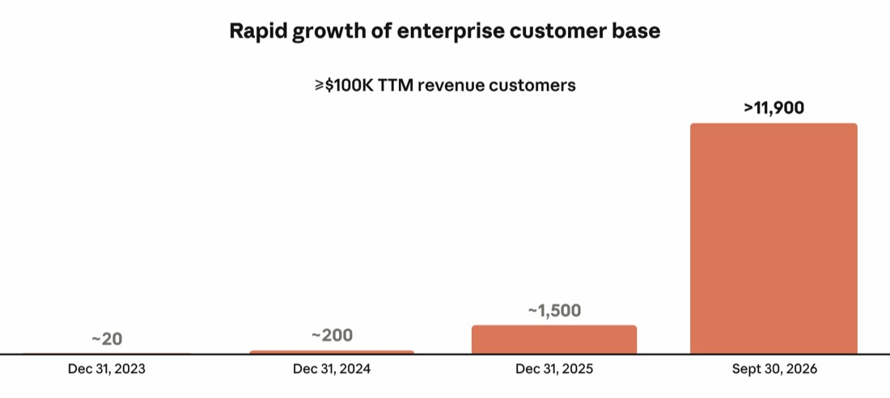
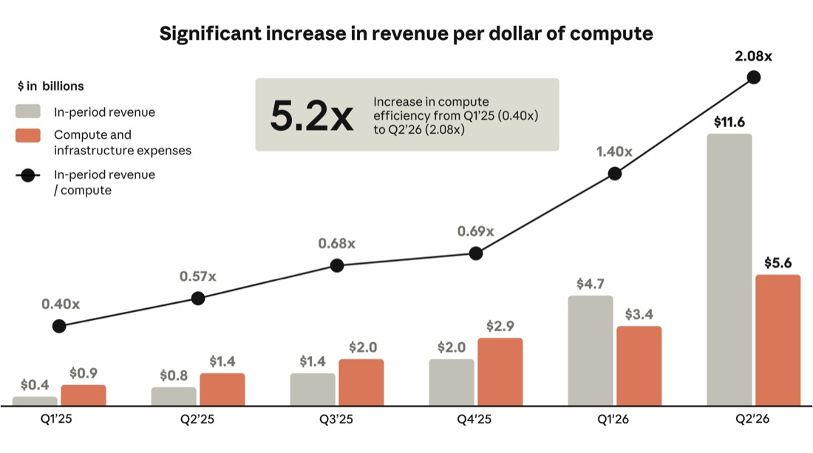
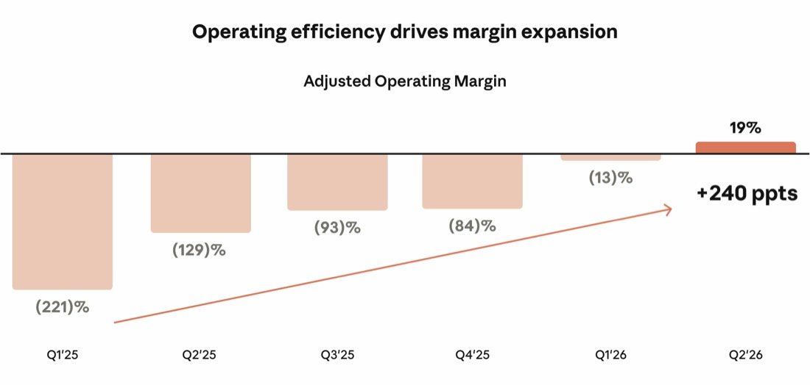

# 管理层对财务状况与经营成果的讨论与分析（一）

*以下对本公司财务状况与经营成果的讨论与分析，应与本招股说明书中题为“合并财务及其他数据摘要”的一节以及本招股说明书其他部分所载的合并财务报表及相关附注一并阅读。本讨论包含涉及风险与不确定性的前瞻性陈述。可能导致或促成此类差异的因素包括下文所指出的因素以及本招股说明书其他部分所讨论的因素，尤其是题为“风险因素”与“关于前瞻性陈述的特别说明”的各节。截至 2023 年、2024 年与 2025 年 12 月 31 日止年度以及该等年度的财务数据，取自本招股说明书末尾所载的本公司经审计合并财务报表。本公司的历史业绩不一定预示任何未来期间可能预期的业绩。*

**概览**

Anthropic 由一支研究人员团队于 2021 年创立，该团队主导了界定 AI 的诸多突破。本公司首先且最重要的是一个研究实验室——本公司的使命是负责任地开发与维护先进 AI，以促进人类的长期利益。这一使命指引着本公司的关注重点——连同本公司的人才与文化、本公司的前沿与安全研究、本公司的算力策略以及本公司的企业战略，它是使本公司脱颖而出的核心优势之一。这些优势使本公司能够持续推动前沿 AI 前进，并塑造其安全、负责任开发的标准。本公司的前沿 AI——Claude——通过本公司的模型、平台与应用程序交付给客户。Claude 经历了史上任何技术中最快的企业采用速度，其体现是收入从 2023 年第一季度商业化推出时的 $0 增长至截至 2026 年 9 月 30 日止三个月的 $（原文留白）。

## 本公司财务模型

本公司的财务模型建立在四项决定本公司业绩轨迹的主要驱动因素之上：

- ***Claude 的采用***。每一代 Claude 模型不断进步的智能与能力，推动 Claude 在全球经济中的扩散。随着新客户采用 Claude、既有客户将其使用扩展至新的工作流，本公司的收入随之增长。
- ***算力效率***。本公司专注于提高每投入一美元算力所产出的智能与所产生的收入，并已实现显著的效率改进。
- ***经营效率***。本公司高密度的人才、高效的市场推广，以及各团队在工作中运用 Claude 的广度，共同推动经营利润率、调整后经营利润率与人均收入的改善。
- ***算力投资***。投资算力对于支撑本公司长期增长至关重要，本公司打算继续在算力上进行大规模投资。

本公司财务模型的各项驱动因素在不同时间线上显现。Claude 的采用及相关收入增长、算力效率与经营效率，均随时间快速提升。算力是提前采购并作出承诺的，相关费用在算力上线并加入本公司可互换算力池时确认，往往以大规模、离散的台阶形式发生。该可互换算力池可以动态支撑全部工作负载，包括研究、模型开发、服务客户以及 Claude 的内部使用。因此，从承诺投资到该投资所对应的全部收入实现之间存在滞后。

这一动态造就了这样一种财务模型：截至 2026 年 9 月 30 日止九个月，本公司的经营利润率与调整后经营利润率同比大幅扩张。随着大量增量算力在未来期间上线，相关费用将先于该算力最终支撑的全部收入而确认，本公司预计经营利润率与调整后经营利润率在这些期间可能收窄。在目前阶段，这一周期是本公司业务的内在特征，将导致经营利润率在不同期间波动，有时波动幅度显著，即使业务的底层经济性持续改善。

此外，本公司大部分算力系以多年承诺形式签约，通常提前 12 至 18 个月在算力可用之前采购。当客户需求或研究需求超出这一长期容量时，本公司会采购短期算力，其单位算力成本通常更高。本公司预计短期内短期算力的使用将会增加，从而压缩本公司的经营利润率与调整后经营利润率。

## Claude 的采用

Claude 模型的每一代版本都旨在以客户最看重的能力推进前沿，包括编程、智能体工作流、计算机使用与复杂推理，这些能力开辟了新的使用类别，并推动新客户与既有客户的需求复合增长。Claude 的智能是其扩散与本公司收入增长的主要驱动因素：由于 Claude 在 AI 前沿处于领先地位，客户迅速采用它，很快看到真实价值，并自发扩大使用。本公司以直接市场推广团队与 Applied AI 团队补充这种由智能驱动的增长，并通过在三大主要云平台——AWS、GCP 与 Azure——上的原生可用性，以及与系统集成商、咨询公司与数据平台的合作，扩展本公司的覆盖范围。

本公司通过一体化方式交付这一智能。Claude 模型家族是基础，各模型类别针对能力—成本—速度曲线上不同位置进行优化。在本公司模型之上，Claude Platform 让开发者可以使用本公司自身所用的基础组件，据此构建自己的 AI 解决方案。本公司还为客户在 Claude Platform 上构建了第一方应用程序，供偏好开箱即用方案的客户使用。本公司相信，这一一体化方式的价值体现在同时使用 Claude Platform 与本公司第一方应用程序的客户数量不断增加。截至 2026 年 9 月 30 日止三个月，在 TTM 口径收入达 10 万美元及以上的客户中，超过 50% 同时使用了 Claude Platform 与本公司至少一项第一方应用程序，高于截至 2025 年 12 月 31 日止三个月的约 30%。

随着更多客户采用 Claude 并扩大使用，本公司产生可观收入的客户基础快速扩大。截至 2026 年 9 月 30 日，本公司拥有 11,900 多家 TTM 口径收入达 10 万美元及以上的客户，高于截至 2025 年 9 月 30 日的 950 多家。此外，随着客户进一步将 Claude 嵌入其最关键的工作流与增长计划，许多客户迅速将部署扩展至更高的收入层级。截至 2026 年 9 月 30 日，本公司拥有 1,900 多家 TTM 口径收入达 100 万美元及以上的客户，以及约 250 家 TTM 口径收入达 1,000 万美元及以上的客户。

这一客户增长势头源于客户在组织中部署 Claude 并实现其价值所带来的显著使用扩张。Claude 为客户创造的价值，推动本公司截至 2026 年 9 月 30 日的净收入留存率达到约 900%。

本公司业务的增长反映了企业将 Claude 直接嵌入其关键业务工作流的程度。尽管出现上述趋势，全球经济中的采用仍处于早期。随着 Claude 的能力持续提升，本公司相信可服务的机会将会扩大，Claude 将继续在更多企业中快速扩散。

## 算力效率

算力是本公司业务中最重要的经营成本，算力效率是决定本公司经营效率与收入的关键因素。本公司以研究驱动的算法改进——训练与推理优化——以及多芯片算力架构相结合，随着收入规模扩大而大幅提升了算力效率。其结果是，本公司能够持续提高每一美元算力投资所能产出的智能，以及业务所能产生的收入。

本公司将算力效率定义为：最大化每投入一美元算力所产出的智能与所产生的收入。三大支柱推动本公司的算力效率：

- 训练效率。本公司研究人员经常实现算力倍增。Claude 本身也越来越多地协助产生每一代模型的研究与工程工作，这是一种本公司称为“闭环”的递归动态，即每一代模型加速下一代模型的开发，并在各代模型之间复合这些收益。
- 推理效率。本公司研究人员在推理方面实现了显著的算力倍增——降低了提供给定水平模型性能所需的算力——同时本公司工程团队在生产环境中利用算力的效率方面实现了显著优化。这使本公司能够随着时间推移从既有算力基础为客户提供更大价值并产生更多收入，这一点至关重要，因为本公司一直处于客户需求超过可用算力的算力受限环境中。
- 多芯片算力路线。本公司通过专有编排层，在四大芯片家族（AWS Trainium、Google TPU、NVIDIA GPU 与 AMD GPU）上原生训练并服务 Claude，该编排层使本公司能够按价格与性能优化工作负载。这种灵活性耗费数年与大量投资才得以建立，本公司相信其难以在规模化层面复制；它扩大了本公司的可用算力，降低了对任何单一供应商的依赖，并使本公司能够持续将工作负载路由至最适合该等负载的硬件。这一基础，加之 Claude 对芯片与模型架构日益增强的理解，使本公司能够以过去所需时间的一小部分接入新的芯片平台。

即使本公司加快了研究与产品推进速度并扩大了 Claude 的内部使用，每美元算力所对应的收入仍显著扩大。例如，截至 2026 年 9 月 30 日止三个月，本公司收入同比增长 1,368%，而同期算力与基础设施费用增长 300%。在服务不断增长的客户需求的同时，本公司还以 Mythos 5、Fable 5 与 Opus 5 等新的领先模型在前沿取得重大研究进展，并推出了包括 Claude Cowork 与 Claude Design 在内的新产品。

## 经营效率

本公司的经营效率源自高密度的人才、高效的市场推广，以及各团队在工作中运用 Claude 的广度。Claude 是贯穿其中的主线，放大了员工的产出。例如，2026 年 9 月，对本公司代码库的贡献中超过 90% 由 Claude 编写。此外，截至 2026 年 9 月 30 日止三个月，每名工程师向本公司代码库贡献代码的日均量，是截至 2024 年 12 月 31 日止年度日均量的 45 倍以上。

从 2025 年 9 月 30 日到 2026 年 9 月 30 日，TTM 收入增长约 1,200%，员工人数增长约 170%，推动 TTM 人均收入从 140 万美元升至 660 万美元以上，这反映了非凡的人才密度以及为使其复合增长而构建的文化。

本公司的市场推广模式也体现了这一点——由智能驱动的增长与广泛的分销合作，使本公司能够迅速扩大客户采用与收入，而不受本公司销售与营销组织扩张速度的限制，从而相较典型的企业技术公司实现了更高的销售效率。

截至 2026 年 9 月 30 日止六个月，本公司收入为 163 亿美元，高于截至 2025 年 9 月 30 日止六个月的 12 亿美元。截至 2026 年 9 月 30 日止六个月，本公司经营亏损为 6.93 亿美元，低于截至 2025 年 9 月 30 日止六个月的 21 亿美元。收入增长、算力效率与经营效率的结果是调整后经营收益显著改善：截至 2026 年 9 月 30 日止六个月为 16 亿美元，而截至 2025 年 9 月 30 日止六个月为调整后经营亏损 18 亿美元。本公司预计经营利润率与调整后经营利润率将随时间波动，尤其是在大量增量算力交付给本公司且本公司承担相关费用的期间。有关调整后经营收益（亏损）与调整后经营利润率的说明及信息，以及这些指标与按 GAAP 计算的最直接可比财务指标的调节，请参见题为“——非 GAAP 财务指标”一节。

## 算力投资

投资算力是长期增长的前提。本公司在研究、模型开发、服务客户以及 Claude 内部使用方面投资算力。本公司的商业进展、研究进展以及未来的机会规模，使本公司有信念继续积极投资算力。其中越来越多的投资用于建设本公司自有算力与基础设施，并在算力供应链上进行垂直整合，以所需规模锁定长期算力，支持前沿模型开发。这些投资表现为资本支出与其他承诺（包括租赁义务），且远在相关算力投入运营并产生收入之前即已发生。因此，本公司预计这一建设将改变本公司业务的现金流特征，并在可预见的未来成为经营与投资活动中净现金的重要用途。更多信息请参见题为“——流动性与资本资源”一节。

此外，随着本公司算力需求大幅增长，本公司正从仅通过固定期限云协议采购算力，转向混合模式，该模式还包括直接租赁芯片并将其托管在以本公司名义运营的专用设施中。本公司将这一新增算力来源称为 Anthropic Direct，它有助于满足本公司不断扩大的算力需求，本公司相信其将带来长期经济优势。Anthropic Direct 使资本使用更为灵活，因为它使本公司能够将对数据中心容量的承诺与对部署其中的算力基础设施的承诺分开。由于数据中心需要更长的交付周期，但在总算力成本中占比较小，这一方式使本公司能够提前锁定数据中心容量，同时将规模更大的加速器投资推迟至本公司具体算力需求更为明确之时。

截至 2026 年 9 月 30 日及此后，本公司已签订采购承诺与租赁协议（包括短期承诺以及尚未起租的租赁），合计承诺支出超过 $（原文留白）。这些承诺中约 $（原文留白）预计在 2030 年 12 月 31 日之前发生，其余绝大部分预计在 2031 年至 2045 年之间发生。其中约 $（原文留白）的承诺将于未来 12 个月内到期。这一承诺支出总额的很大一部分与 Anthropic Direct 相关，本公司预计其在本公司算力投资中的占比将随时间上升。Anthropic Direct 带来的灵活性，使本公司能够以更具成本效益的长期算力替代需求旺盛时期所采购的短期算力，随着本公司专用基础设施上线而完成替代。本公司打算通过所产生的收入以及所筹集的资本为这些投资提供资金。截至 2026 年 9 月 30 日，在未计入本次发行向本公司提供的净收益之前，本公司拥有 $（原文留白）的流动性，包括 $（原文留白）的现金及现金等价物、$（原文留白）的短期投资，以及本公司 A&R 信贷协议（定义见下文）项下 $（原文留白）的可用额度。本公司还获得战略合作伙伴的大力资金支持，包括票据购买协议项下最高 $（原文留白）的可用融资额度，以及最高 $（原文留白）的股权承诺。此外，基于每股 $（原文留白）的假定首次公开发行价格（即本招股说明书封面所载估计发行价格区间的中点），并在扣除本公司应付的估计承销折扣与佣金以及估计发行费用后，本公司估计本次发行向本公司提供的净收益约为 $（原文留白）；若承销商全额行使其向本公司购买额外 A 类普通股的选择权，则约为 $（原文留白）。

本公司如何产生收入

本公司业务的基础是四类 Claude 模型家族——Mythos（包括 Fable）、Opus、Sonnet 与 Haiku——每一类都针对能力—成本—速度曲线上不同位置进行优化。本公司的前沿模型使客户能够为每种用例匹配最合适的模型。客户通常将能力更强的模型用于需要更高模型智能的复杂推理、编程与智能体工作流。客户也经常采用本公司全系列模型，将各项任务路由至在能力—成本—速度曲线上最能满足其需求的模型。客户使用的模型与使用量是客户支出的主要驱动因素。本公司与客户建立直接合同关系，并为客户提供直接从本公司购买或通过云服务提供商（CSP）市场购买的灵活性，许多客户同时使用两种渠道。

按智能付费（pay-for-intelligence）是本公司基于用量的收入模式，也是本公司的主要收入模式，目前占本公司总收入的绝大部分。在该模式下，客户按用量付费，用量以 token 计量，并按所选模型定价。本公司的按智能付费收入主要来自将 Claude 集成到应用程序中的客户，或使用本公司第一方应用程序的客户。

此外，本公司以订阅方式提供部分应用程序，同时服务企业客户与专业消费者。在该模式下，客户在订阅期内按指定用量与能力支付订阅费，该订阅期通常为 12 个月或更短。

根据客户所选择的模型、平台或应用程序，客户适用按智能付费定价、订阅定价或两者兼有。例如，当订阅用户接近或耗尽其所处层级包含的用量容量时，他们可能升级至更高订阅层级或直接购买更多智能，从而形成从订阅到增量按智能付费收入的无缝衔接。

越来越多的企业客户签订不可撤销的年度或多年期合同，承诺最低支出，以换取约定的价格清单。这些合同主要形成基于用量的收入。

基于用量的收入从截至 2024 年 12 月 31 日止年度的 2.88 亿美元（占总收入的 75%）增长至

截至 2025 年 12 月 31 日止年度的 38 亿美元（占总收入的 83%），再增长至截至 2026 年 9 月 30 日止六个月的 131 亿美元（占总收入的 80%）。订阅制收入在相同期间内从 9,800 万美元（占总收入的 25%）增长至 7.89 亿美元（占总收入的 17%），再增长至 32 亿美元（占总收入的 20%）。基于用量的收入增幅更高，反映了 TTM 口径收入达 10 万美元及以上的客户增长。2023 年，本公司 4,100 万美元的收入几乎全部为基于用量的收入，反映了本公司早期的运营状况。本公司预计，在可预见的未来，基于用量的收入将继续占本公司总收入的绝大部分。

本公司近期的增长可能反映了早期阶段的采用动态、AI 市场的初生状态以及快速的初始客户扩张，而这些可能无法长期持续。本公司预计收入增长率将随时间下降，且随着收入基数扩大与市场成熟，可能显著且比本公司预期更快地下降。

## 本公司客户与 Claude 的扩散方式

## 本公司客户

本公司为世界各地几乎所有地区、各种规模、各个行业的企业提供服务。使用 Claude 的组织既包括全球最大的企业，也包括 AI 原生初创公司、研究机构，以及致力于解决世界上一些最重要问题的使命驱动型组织。客户主要通过三种方式从 Claude 中获得价值：员工生产力提升、流程加快，以及产品中嵌入智能。随着企业客户将 Claude 推入日益复杂的工作流，本公司与他们沟通以了解其不断变化的需求，这有助于塑造本公司的产品路线图。这一反馈循环在每次发布中加深客户关系，并使 Claude 对所有客户都更为强大。

软件开发者一直是本公司战略的核心：他们既是基于本公司平台构建的应用程序的设计者，也将自己的工作流与机构知识编码进由 Claude 驱动的智能体。开发者是本公司最早的采用者，往往也是最挑剔的用户：他们迅速将模型应用于意想不到的用例，并暴露出边界情形，从而使每一代 Claude 模型更加精进。Claude Code 现已嵌入各大组织的软件开发工作流，这些关系往往始于认识到自主编程智能体价值的个别工程师，并由此加速了其所在企业的采用。

本公司向企业提供的智能与能力，对专业消费者在个人事务中同样有价值。这些用户作为本公司企业业务漏斗顶端的引擎具有战略价值——他们出于个人工作使用 Claude，随后在其组织内部推广 Claude。

本公司在各类客户用例中看到广泛基础的增长，从软件开发到财务分析、内容创作与复杂知识工作。Claude 具有可扩展性：无论从哪个入口进入，企业很快会发现前沿 AI 适用于其组织内广泛且不断扩展的任务范围。因此，有时起步于单一用例的应用，常常扩展为涵盖编程、法律分析、财务建模、客户运营及其他知识密集型工作的更广泛采用。

## 本公司在 Claude 扩散方面的方式

Claude 扩散的核心驱动因素是其智能——随着 Claude 能力提升，对客户的价值随之扩大，而这种价值又推动更多采用。确保此类智能的可获得性同样关键，本公司通过以下方式实现：通过可组合的平台与应用程序在客户所在之处满足其需求，通过本公司的市场推广团队与 Applied AI 团队直接触达，以及通过合作伙伴关系在规模化层面扩展本公司的覆盖范围。

*由智能驱动的增长。* 本公司的平台与应用程序是 Claude 的智能触达用户的主要机制。当用户开始用 Claude 构建、构思与解决问题时，他们很快将其视为工作中可信赖的伙伴。随着 Claude 成为人们工作方式的一部分，他们亲身感受到前沿 AI 所能实现的一切，而这种个人层面的采用会重塑整个组织的运作方式。这一模式在各个组织中重复出现：专业消费者成为内部倡导者，团队扩大对 Claude 的使用，起步于单一工作流的应用成长为影响整个组织运作方式的事物。这一模式是本公司收入增长的核心。

*直接团队。* 这种自发采用得到本公司直接市场推广团队的补充与强化，他们帮助将 Claude 扩展至拥有复杂工作流与业务流程的组织。当本公司的直接团队接触客户时，Claude 往往已被使用。本公司的市场推广团队利用这一自发势头建立高管支持，并推动全企业范围的采用。

*Applied AI 团队。* 本公司的 Applied AI 团队与精选客户更为深入地融合，构建解决方案，使组织更容易从 Claude 的智能中获益。他们与企业合作，设计并部署针对客户自身需求量身定制的定制解决方案、专门工作流与领域特定实施方案。这项工作推动了单个客户内部的更深采用，并产生有助于塑造本公司平台与产品路线图的用户反馈与信息。*云合作伙伴关系。* Claude 可在三大主要云平台 AWS、GCP 与 Azure 上使用，使企业能够在已经运营的基础设施、安全边界与承诺结构内部署 Claude。这些 CSP 通过其庞大的联合现场团队扩展本公司的覆盖范围，这些团队被授权销售本公司的平台与应用程序，以本公司认为任何单一组织都难以直接复制的规模加速市场采用。本公司与这些 CSP 采取联合市场推广方式，据此本公司与客户建立直接合同关系，同时向各 CSP 支付费用。这一结构使本公司能够与这些 CSP 建立更强的商业一致性，避免渠道冲突，制定定价，并实现算力效率持续提升所带来的财务收益。

*生态合作伙伴关系*。全球主要系统集成商已建立专门的 Claude 团队，其人员经过培训，能够部署本公司的平台与应用程序。与领先数据平台的市场推广联盟将 Claude 嵌入企业已经运营的数据基础设施，促进 Claude 在既有工作流中的采用，并使企业更容易从 Claude 中获得价值。

*Ode with Anthropic。* 本公司近期与领先的私募股权公司合作成立了一家 AI 服务公司，将 Claude 的能力带给各行业的中型企业，在 Claude Platform 上构建解决方案并长期支持客户。Ode with Anthropic 将与本公司的 Applied AI 团队与市场推广团队紧密合作。

这些方式共同形成了一种结构性高效的方式，促进 Claude 在经济中的扩散，截至 2026 年 9 月 30 日止六个月，本公司的销售、营销与合作伙伴费用占收入的 19%。

## 影响本公司业绩的关键因素

## 保持在 AI 前沿

本公司相信，企业会始终选择能力最强且值得信赖的 AI 系统，因此本公司在前沿的地位是本公司成功的重要驱动因素。本公司快速扩大收入的能力部分取决于本公司能否持续交付更智能、能力更强的模型。本公司的经验是，当本公司交付能力显著提升、每美元支出带来更高智能的模型时，客户会在其业务中发现 AI 的新应用，从而加速采用与收入增长。

这一点可从本公司模型家族采用轨迹中看出。本公司最智能的正式可用模型的每一代版本都带来了显著更强的智能与能力。每次发布，本公司都看到大多数客户使用最新版本的模型，强化了前沿模型质量与收入创造之间的直接关系。随着本公司交付能力更强的模型，客户已将使用扩展至新的用例，并相应增加支出。

本公司预计，在前沿交付智能与能力创新的能力，在未来期间仍将是收入增长的关键驱动因素；保持领先地位需要在研究与算力、顶尖技术人才，以及足以支撑本公司增长轨迹的资本获取方面持续投入。

确保充足算力并优化其利用

本公司持续在前沿推进智能的能力，取决于能否为研究、模型开发、服务客户以及 Claude 内部使用获得充足算力。本公司利用异构算力的能力，有助于本公司以足够规模与最优性价比获得算力。若本公司的任何芯片合作伙伴无法交付承诺的算力或出现延迟，或本公司需要采购增量算力，本公司受益于拥有一系列合作伙伴，而非过度依赖任何单一合作伙伴。算力的可用性、时间与成本受制于本公司基本无法控制的因素，包括芯片与存储制造集中于少数供应商与地区、电力与数据中心容量的可用性限制，以及不断演变的出口管制。本公司历来在算力受限的环境中运营，算力需求超过本公司可获得的供给。此外，本公司所依赖的部分 CSP 也是本公司的战略投资者、本公司的客户，并提供与本公司竞争的 AI 模型与服务。这些多层面的关系可能引发利益冲突或竞争动态，从而对本公司获取算力、算力成本或本公司工作负载的优先级产生不利影响。随着本公司算力需求大幅增长，本公司正从仅通过固定期限云协议采购算力，转向混合模式，该模式还包括直接租赁芯片并将其托管在以本公司名义运营的专用设施中。本公司将这一新增算力来源称为 Anthropic Direct，它有助于满足本公司不断扩大的算力需求，并提供直接托管潜在的长期经济优势。Anthropic Direct 使本公司能够更灵活地使用资本，因为它使本公司能够将对数据中心容量的承诺与对部署其中的 AI 加速器的承诺分开。由于数据中心需要更长的交付周期，但在总算力成本中占比较小，这一方式使本公司能够提前锁定数据中心容量，同时将规模更大的加速器投资推迟至本公司具体算力需求更为明确之时。

优化算力利用对本公司满足客户需求同样重要。本公司持续将算力导向其最高价值的用例，在研究推进与模型开发的需要、服务客户的需要以及支持 Claude 内部使用的需要之间取得平衡。本公司依靠算力效率（例如发现算力倍增）来充分利用所采购的算力。本公司有效调度算力并推动算力效率的能力，将是决定本公司创新速度与长期财务业绩的重要因素。

吸引并留住技术人才

推进前沿并最大化算力投资回报，要求本公司吸引、聘用并留住顶尖技术人才。吸引与留住人才始于本公司七位联合创始人，他们全部仍在公司任职。本公司相信，本公司的文化及其与使命的契合使本公司能够聘用并留住所需人才，以安全、负责任的方式持续推进 AI 前沿。本公司预计，持续吸引并留住顶尖技术人才的能力，在未来期间仍将是决定本公司创新速度与财务业绩的关键因素。

本公司持续的资本获取能力

本公司必须在研究、模型开发、服务客户以及 Claude 内部使用方面进行大额算力投资。本公司算力需要大量前期承诺，并随算力可供本公司使用而持续付款。随着业务规模扩大，本公司的算力承诺将继续增长。本公司获得充足算力的能力，直接取决于本公司能否以有利条件获取资本，例如通过股权或债务融资或经营现金流。

为维持资本获取能力，本公司必须持续证明能够以高产出方式投资这些资本。衡量本公司进展的最佳指标是 Claude 的智能与能力，以及客户对 Claude 的采用。本公司将算力投资转化为前沿模型性能、进而提升客户采用的能力，将是决定本公司资本获取能力的关键因素。

本公司维持资本获取能力，部分取决于能否展现出可信的盈利路径。本公司的收入增长、算力效率与经营效率已显著改善经营利润率与调整后经营利润率，但本公司计划继续大举投资，这将对本公司经营成果产生不利影响。本公司的算力承诺规模庞大，且无论收入或利用率如何通常都必须履行；而本公司获取额外资本取决于若干条件，其中许多不在本公司控制范围内，包括市场状况与投资者需求。此外，本公司部分算力与基础设施建设由某些 CSP 与芯片合作伙伴提供或协助提供的资本或信用支持予以融资或支持。本公司能否随时间降低这种依赖，部分取决于本公司能否以自身信用从独立来源获得融资。

本公司在企业中扩散 Claude 的能力

本公司的财务表现取决于 AI、特别是 Claude 在全球经济中被采用的速度与广度。尽管 Claude 的能力已覆盖广泛的企业用例，本公司相信企业采用仍处于早期。本公司相信，本公司把握这一机会并在未来期间推动收入增长的能力将取决于三种动态：*第一，本公司将模型改进转化为可访问的产品与平台能力的能力。*

截至 2026 年 9 月 30 日止九个月，本公司共推出 250 个新模型版本、平台功能与应用程序，包括 Claude Code、Claude Cowork 的新能力以及面向关键行业的垂直解决方案。本公司的增长取决于能否持续保持这一产品创新速度，并减少 Claude 能力与客户工作流之间的摩擦。本公司的增长还取决于新能力触达客户的速度，而这又取决于本公司在开发过程中以及发布前后为评估与缓解每个模型风险所采取的步骤。过去，这些步骤包括推迟新模型的发布并限制其初始可用范围，例如本公司通过 Project Glasswing 首次发布 Mythos，以及随后将 Fable 5 作为带有安全限制的正式可用模型发布；未来，随着本公司对模型能力与行为了解加深，这些步骤可能包括影响本公司是否、如何以及何时开发或发布新模型或新能力的其他措施。本公司依据发布前能力与安全评估的结果，以及本公司关于现有保障措施是否足以缓解已识别风险的判断，决定是否推迟或限制发布；在评估结论不明确时，本公司也可能采取此类步骤。更多信息请参见题为“业务——安全研究是本公司业务的核心——本公司的模型发布方式”一节。这些措施，以及可能被采纳的、规范前沿 AI 开发的任何法律、法规或标准，可能导致新用例出现得更慢，并减缓本公司收入增长所依赖的企业采用与扩展。本公司相信，企业偏好安全且对齐的模型，本公司对安全的持续投入增强了客户信任并支持长期采用。

*第二，本公司扩大并多元化分销渠道的能力。*

本公司迄今增长的很大一部分来自自助服务与自发增长。随着 AI 采用进一步深入企业与更多受监管行业，本公司正在投资直接市场推广、Applied AI 团队，以及与三大主要云平台、系统集成商、咨询公司与数据平台之间的合作。本公司还通过在关键市场增设区域办事处与建立合作伙伴关系，扩大服务国际客户的能力；本公司预计，随着全球 AI 需求加速，国际扩张将成为收入增长的重要驱动因素。这些投资的有效性，以及本公司聘用并留住市场推广人才的能力，将是增长的重要决定因素。

*第三，本公司获取新客户并在既有客户内部扩展的能力。*

TTM 口径收入达 10 万美元及以上的客户数量从截至 2023 年 12 月 31 日的约 20 家，增至截至 2024 年 12 月 31 日的约 200 家，增至截至 2025 年 12 月 31 日的约 1,500 家，并增至截至 2026 年 9 月 30 日的 11,900 多家。来自这些客户的收入总额从约 3,700 万美元增至 2.2 亿美元，增至 35 亿美元，再增至 $（原文留白），分别占截至 2023 年、2024 年与 2025 年 12 月 31 日止年度以及截至 2026 年 9 月 30 日止过去十二个月总收入的 90%、57%、76% 和 %（原文留白）。截至 2026 年 9 月 30 日止过去十二个月总收入的其余 %（原文留白）由约 4,000 万名客户产生，每名客户的 TTM 口径收入均低于 10 万美元。

此外，截至 2026 年 9 月 30 日，本公司拥有 1,900 多家 TTM 口径收入达 100 万美元及以上的客户，以及约 250 家 TTM 口径收入达 1,000 万美元及以上的客户。尽管实现了这一增长，本公司对最大型企业的渗透仍处于早期。截至 2026 年 9 月 30 日，《财富》500 强中超过 50% 的公司以及全球 2000 强中超过 30% 的公司是 TTM 口径收入达 10 万美元及以上的客户。本公司相信，本公司对这些客户的扩展仍处于早期阶段，截至 2026 年 9 月 30 日止三个月，本公司来自这些《财富》500 强客户的收入平均不到其总费用的 0.1%。

本公司将这一指标与本公司的最大《财富》500 强客户进行比较，这些客户在 AI 采用方面走得更远。截至 2026 年 9 月 30 日止三个月，本公司来自前 10 大《财富》500 强客户的收入平均不到其总费用的 1%——这仍只是其整体支出的一小部分，但已是本公司 TTM 口径收入达 10 万美元及以上的《财富》500 强客户平均值的八倍以上。

5 为计算这一指标，本公司仅纳入已公开上市的《财富》500 强客户，并使用其

公开财务报表中所报告的总费用进行计算。

本公司相信，这一差异反映了本公司在最大客户以及处于采用 Claude 较早阶段的客户中深化采用方面拥有可观的增长空间。5

Claude 的采用具有广泛基础。截至 2026 年 9 月 30 日止九个月，没有任何单一客户占本公司收入的 10% 以上。截至 2026 年 9 月 30 日止三个月，本公司约 79% 的收入来自前五大客户以外的客户，高于截至 2026 年 3 月 31 日止三个月的约 64%。与此同时，本公司最大客户继续扩张。截至 2026 年 9 月 30 日止三个月，本公司来自前五大客户各自的收入均创下历史新高。

## 客户使用模式

本公司收入受客户使用模式影响，而客户使用模式又受新模型版本发布的频率与能力以及季节性趋势的影响，这些因素均可能造成本公司各期间业绩的波动。新模型版本持续且重叠的发布节奏，是保持在 AI 开发前沿的内在要求。例如，截至 2026 年 9 月 30 日止六个月发布的模型版本，占本公司截至 2026 年 9 月 30 日止三个月收入的 80% 以上。随着本公司发布一代代 Claude 模型，本公司持续看到收入增长，因为新能力开辟了更多用例，促使新客户采用 Claude、既有客户扩大使用。

本公司的客户使用模式通常还呈现季节性，尤其是在夏季与冬季的假期与休假期间，此时某些工作流放缓，整体客户活动下降。例如，在许多公司于假期安排的代码冻结期间，开发者提交与功能发布通常放缓。与这一模式一致，截至 2026 年 1 月 2 日止两周的客户总支出，较此前截至 2025 年 12 月 19 日止两周下降约 20%。然而，本公司的历史增长率可能掩盖季节性趋势对本公司业绩的影响。这些动态是按智能付费收入模式的内在特征，并可能在未来期间成为本公司财务业绩的重要决定因素。

由于这些季节性模式，本公司的经营成果已经并将继续在各期间之间变化，本公司在任何单一期间的业绩不一定预示未来任何期间的业绩。随着本公司收入增长率随时间下降，本公司预计季节性影响将在本公司各期间业绩中更为明显、影响更大，并使预测本公司经营成果更加困难。

## 本公司对公共利益的承诺

本公司对公共利益的承诺延伸至本公司配置资源的方式。本公司打算将相当一部分资源用于确保前沿 AI 的安全及其收益的广泛分配，本公司称之为公共利益计划。这可能包括向非营利组织、研究机构及其他从事 AI 能产生最大积极影响的问题的第三方提供大额捐赠，以及旨在让欠缺服务的社区、教育工作者与公共机构能够使用 Claude 的项目。

作为这些计划的一部分，本公司向 Anthropic 公益基金——本公司专注于公司宗旨的全资子公司——捐出 846,840,960 股 N 类普通股，占截至 2026 年 6 月 30 日本公司完全稀释股份的 5%（假设亚马逊票据全部转换），本公司称之为首次公益发行。随着本公司所创造的价值增长，本公司希望公共利益也能在其中切实分享增长成果。为此，本公司董事会已批准一项框架，将额外捐股与本公司股价的未来上涨挂钩。本次发行之后，本公司董事会可自行决定向 Anthropic 公益基金（或其他指定对象）发行 N 类普通股，每次本公司股价较前一股价里程碑上涨 50% 时，发行数量最高可达本公司当时已发行股份的额外 2%（加上任何受期权、RSU 与其他可转换证券约束的股份，以及 Anthropic 公益基金持有的任何股份），并以本公司首次公开发行价格为起点。只有在本公司收盘股价于最近连续 120 个交易日中至少 90 个交易日超过适用门槛，且本公司在该次发行前十个交易日的平均收盘股价亦超过该门槛时，才视为达到某一股价里程碑。尽管本公司董事会已批准这一框架，任何未来的捐股均由本公司董事会自行决定。捐入 Anthropic 公益基金的股份（包括首次公益发行）可转让或捐赠给第三方，或以其他方式通过注册公开发行或私募交易出售，以推进本公司的公共利益计划。在本公司董事会批准该实体的具体治理结构之前，将由本公司董事会决定 Anthropic 公益基金的分配与派发；此后，决策权预计将移交给在该结构下运作的 Anthropic 公益基金指定管理人。初始管理人为 Dario Amodei、Daniela Amodei、Jack Clark 与 Neil “Buddy” Shah 博士。首次公益发行与额外捐股框架是本公司打算实现公司宗旨的方式之一，但并非唯一方式。本公司预计将投入额外资源，并在这些股权捐出之外、作为其补充，为实现本公司的公司宗旨作出其他业务与经营决策。

此外，本公司设有捐赠配比计划，员工可将其股权奖励的相当一部分或等额现金收益承诺捐给捐赠人建议基金或其他非营利组织，本公司以 N 类普通股股份进行配比捐赠。正如公司宗旨界定了本公司作为组织如何指引自身工作，本公司的捐赠配比计划反映了员工的一项平行承诺：将该项工作所创造的个人财务价值用于公共福祉。本公司将捐赠配比计划视为公司宗旨的有意义体现，也是界定本公司文化之价值观的反映。此外，本公司每位联合创始人均已承诺将其在 Anthropic 的个人股权中的 80% 用于慈善事业，该项承诺独立于本公司的捐赠配比计划，且不符合该计划的配比条件。

本公司为推进公共利益计划所作的决定，在任何给定期间都可能降低本公司收入、增加本公司费用、降低本公司调整后经营利润率、造成稀释，并降低本公司每股盈利能力，相对本公司原本会报告的业绩而言。本公司的公共利益相关费用目前主要包括本公司捐赠配比计划下的慈善捐赠，历史上并不重大。截至 2025 年 12 月 31 日止年度，与本公司捐赠配比计划相关的费用为 5.41 亿美元，约占本公司总经营费用的 4%。然而，本公司预计未来期间投入公共利益计划的资源的节奏与规模将会增加，并将继续成为影响本公司经营成果的因素。

## 经营成果的构成

***收入***

当客户通过本公司的平台与应用程序（包括 Claude Code、Claude Cowork 以及面向关键行业的垂直解决方案）使用 Claude 时，本公司产生收入。Claude 由本公司专有的 Claude 模型家族驱动，该家族是一组前沿模型，各自具有不同的能力、成本与速度水平。企业客户直接从本公司或通过 CSP 市场获取本公司的智能服务，本公司在这些渠道中与客户保持直接合同关系。

根据客户所选择的模型、平台或应用程序，客户适用按智能付费定价、订阅定价或两者兼有。越来越多的企业客户签订带有最低支出承诺的年度或多年期合同。

收入在客户使用本公司智能服务时按所消耗的 token 数量确认。订阅通常按月或按年预付，并受在较短周期内重置的用量限制约束，因此收入在订阅期内按比例确认，该订阅期通常为 12 个月或更短。

本公司预计收入增长率将随时间下降并在各期间波动。任何期间收入增长可能受客户使用模式、客户采用、本公司模型、平台与应用程序的部署、本公司产品的定价、新模型与产品发布的时机与成效、本公司为安全部署新能力而决定实施的措施、本公司持续满足客户需求的能力，以及影响对本公司模型、平台与应用程序需求的其他因素影响，包括题为“风险因素——本公司处于收入增长的早期阶段，近年经历了快速增长，本公司的历史增长率并不预示未来业绩或本公司维持或预测未来收入增长的能力”一节所述的因素。

此外，本公司收入中已经包含、并预计将继续包含来自本公司事后认定违反使用政策或商业条款使用本公司模型、平台与应用程序的客户的金额。本公司相信这一动态在本行业较为普遍。由于检测、调查与执行需要时间，本公司在相关服务提供时、即在限制或终止其访问之前确认来自此类客户的收入。根据本公司的检测与审查流程，本公司估计截至 2026 年 9 月 30 日止九个月，来自此类客户的收入约占本公司收入的 5% 至 7%。这一估计需要判断，并可能随着本公司检测方法的演进以及识别出此前未检测到的使用而发生变化。本公司预计，随着本公司加强检测与执行工作（尤其是在 2026 年 8 月与 9 月），来自违反使用政策或商业条款使用本公司模型、平台与应用程序的客户的收入占比在未来期间将下降；然而，由此对本公司收入与收入增长造成的任何不利影响的时机与幅度尚不确定。

## 经营费用

*算力与基础设施*

算力与基础设施费用主要包括运营本公司技术基础设施所产生的成本，该基础设施支撑本公司模型的全方位工作负载，包括研究、模型开发、服务客户以及 Claude 内部使用。这些成本主要包括：根据承诺安排与按需安排向 CSP 支付的算力费用（包括存储、网络与连接）及相关支持成本；通过合作伙伴渠道为客户工作负载提供服务所产生的基础设施成本；托管设施成本；与本公司数据中心运营相关的设备租赁与承诺电力成本；以及与本公司的算力运营直接相关的第三方应用基础设施软件成本。自 2026 年起，随着本公司在算力与基础设施租赁项下的义务开始生效，这些费用还包括经营租赁成本、融资租赁资产摊销、可变租赁成本，以及自有服务器、网络设备及相关数据中心资产的折旧与摊销。有关本公司经营费用（包括收入成本）按功能列示的情况，以及各功能类别中算力与基础设施费用所对应工作负载的说明，请参见本招股说明书其他部分所载本公司合并财务报表附注 8。在该功能列示中，几乎全部收入成本均由与客户服务工作负载相关的算力与基础设施费用构成。此外，收入成本还包括某些与人员相关的成本及分摊的管理费用。

客户是否采用并保留本公司的技术，取决于本公司的模型是否处于 AI 能力前沿，而维持这一前沿地位对创造收入至关重要。每次模型发布都代表持续的智能改进，使持续的模型开发成为创造收入的关键因素。本公司运行一个迭代循环：投入模型开发的算力产出能力更强、效率更高的模型；这些效率提升释放出算力，用于服务更多客户工作负载；反过来，规模化服务客户又产生反馈，为研究与模型开发提供输入。在这一循环中，客户服务活动与模型开发互为直接输入、彼此提供信息，因此本公司认为算力与基础设施成本对于本公司在发生该等成本后短期内创造收入的能力至关重要。

本公司预计，随着根据与 CSP 的多年期安排获得更多承诺算力，以及本公司继续投资额外算力，算力与基础设施费用将以绝对美元计增加，并在可预见的未来仍是本公司最大的经营费用。这些费用在算力可供本公司使用时支付并确认，而非在作出承诺时确认；且由于本公司大部分算力系以多年承诺形式签约（通常提前 12 至 18 个月在算力可用之前采购），这些费用在短期内基本固定。本公司将这一承诺算力作为单一共享资源部署于所有工作负载，因此按整体而非按单个工作负载进行规划、发生与评估。因此，算力与基础设施费用占收入的比例，主要取决于本公司收入相对于总承诺算力成本基数的增长情况。此外，作为本公司公共利益计划的一部分，本公司打算将相当一部分资源（可能包括算力）用于确保前沿 AI 的收益可被广泛获取，本公司预计将随时间大幅扩大这些工作。*人员*

人员费用主要包括股权激励费用（包括与股票期权、RSU 及限制性股票奖励（“RSA”）相关的费用）、现金薪酬（包括基本工资与奖金）、员工福利（包括健康与福利待遇）以及雇主工资税。

本公司预计，随着本公司继续扩大员工人数以支持业务增长，人员费用将以绝对美元计增加。本公司还预计将因本次发行而产生额外的股权激励费用，包括某些将在本招股说明书所属注册声明生效时满足业绩条件的 RSU。本公司预计，人员费用占收入的比例可能因股权激励费用的时机与规模以及本公司全组织招聘节奏而波动。

*Bartz 和解*

Bartz 和解由本公司于 2025 年为了结 Bartz 诉讼而记录的费用构成。更多信息请参见本招股说明书其他部分所载本公司合并财务报表附注 13。

*销售、营销与合作伙伴*

销售、营销与合作伙伴费用主要包括向渠道合作伙伴支付的费用，以及营销与广告成本，包括媒体与公共关系支出。

本公司预计，随着本公司继续投入活动以推动模型的持续采用与使用扩展，销售、营销与合作伙伴费用将以绝对美元计增加。本公司预计，销售、营销与合作伙伴费用占收入的比例可能因营销活动的时机与支出、本公司渠道合作伙伴分销安排条款的变化以及提供本公司智能服务的成本而波动。

*其他经营与管理*

其他经营与管理费用主要包括与本公司捐赠配比计划相关的慈善捐赠费用、与数据质量与性能评估服务相关的供应商成本、信息技术与云软件成本、支付处理与平台费用、设施与占用成本、非所得税、专业服务成本、坏账费用，以及与数据中心以外资产相关的折旧与摊销。

本公司预计，随着业务增长以及作为上市公司运营，其他经营与管理费用将以绝对美元计增加，包括与遵守 SEC 规则与法规、纳斯达克全球精选市场上市标准相关的费用，董事与高级管理人员责任保险的额外成本，以及专业服务费用。本公司还预计，其他经营与管理费用占收入的比例将随业务增长而随时间波动，部分原因是本公司将大幅扩大公共利益计划，包括扩大让欠缺服务的社区能够使用 Claude 的项目、增加慈善捐赠配比、向本公司未来可能设立或支持的慈善工具或基金会捐资，以及与本使命一致的其他工作。

## 利息收入

利息收入由本公司现金及现金等价物与短期投资所赚取的利息构成，该等短期投资主要包括债务证券，包括美国国债与机构证券、公司债以及商业票据。

## 可转换票据、衍生负债与 SAFE 的公允价值变动

可转换票据、衍生负债与 SAFE 的公允价值变动，由本公司在每个报告期末按公允价值计量可转换公司债券、衍生负债与 SAFE 负债所产生的收益与损失构成。由于这些工具按市值计量，本公司企业估值的上升会推动该项费用增加。本公司将继续确认可转换票据的公允价值变动，直至其转换为股权、被偿还或以其他方式结清。更多信息请参见本招股说明书其他部分所载本公司合并财务报表附注 4。

## 其他收益（费用）净额

其他收益（费用）净额主要包括战略投资与金融工具的公允价值变动、与 2025 年 12 月收购一家私营公司相关的某些衍生工具的公允价值变动、融资租赁的利息费用，以及外币汇兑损益。有关该收购的更多信息，请参见本招股说明书其他部分所载本公司合并财务报表附注 15。

## 所得税费用

所得税费用主要包括本公司开展业务的某些联邦、州、地方与外国司法辖区的所得税。本公司的实际税率将因估值备抵以及对衍生工具不可扣除的公允价值调整的影响、境外收入与境内收入的相对比例、税收抵免的产生、递延所得税资产与负债估值的变化以及税法的变化而有所不同。

## 经营成果

下表列示本公司所列期间的合并经营报表数据：
