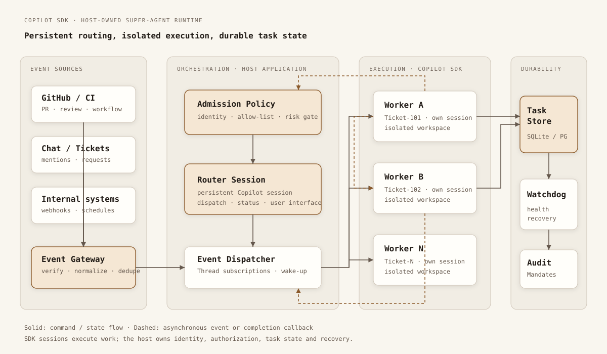

# DeepSeek Super-agent：如何把事件驱动的长期运行 Agent 引入 Copilot SDK

**分析基准：2026-11-17**

DeepSeek Harness 团队在 2026 年 10 月 31 日发布了《Exploring Super-agent Design: Towards a More Autonomous Agent System》，同时开源了一个名为 [dsh-superagent-prototype](https://github.com/deepseek-ai/dsh-superagent-prototype) 的原型。这里的 Super-agent 不是一个更大的模型，也不是简单地给 Agent 增加更多工具或子 Agent。它讨论的是一种长期运行的 Agent 系统：一个持续在线的入口负责理解人和外部系统发来的事件，把被授权的工作交给隔离的 Worker；Worker 在后台执行，后续事件可以直接回到对应任务，不必每次都重新经过入口模型。

这个方向与 Copilot SDK 并不冲突。SDK 已经提供会话、子 Agent、并行任务、持久化、Hooks 和事件流等基础能力，但它没有替应用提供完整的 Super-agent 运行时。真正值得借鉴的是事件与任务的生命周期管理，以及把权限、状态和执行环境放到模型之外。

## 结论先行

如果现有 Copilot SDK Agent 主要处理用户发起的一次性请求，暂时没有必要整体改造成 Super-agent。Router/Worker 会增加持久化、调度、权限、恢复和运维成本，单次任务并不会因为多了一层编排就自然变得更聪明。

如果 Agent 已经需要持续监听 GitHub、CI、聊天消息、工单或内部系统事件，并且同一任务会跨多轮评论、代码修改、测试和审批，那么 Super-agent 有明确价值。它解决的是长时间运行时的上下文污染、事件重复判断、任务隔离、后台执行和人工注意力分配问题。

对 Copilot SDK 的建议是：**保留 SDK 作为模型执行引擎，在应用层增加一个轻量的 Router/Worker 编排层。** 不要把整个概念做成一个巨型主 Agent，也不要把每个 Worker 都实现成同一个会话里的 custom agent。Router、Ticket、Thread、Mandate、事件订阅和 Watchdog 应由宿主应用负责；Copilot SDK 负责具体会话中的推理、工具调用和子任务执行。

## DeepSeek 所说的 Super-agent 是什么

### Router 与 Worker：入口和执行分离

Router 是长期存在的主会话，负责接收人和外部系统的输入、识别任务、分配执行资源，并向用户报告结果。它不应该亲自承担所有具体工作。Worker 则是按任务创建的独立会话，拥有自己的上下文和工作目录，执行完成后把结果交还给 Router。

这和常见的「主 Agent 调用几个子 Agent」有一个重要差别：普通多 Agent 通常围绕一次用户请求展开，任务结束后整个调用链就结束了；DeepSeek 的 Router 是一个持续运行的系统入口，Worker 可以跨越多次事件保持任务连续性。一个 PR 的新评论、CI 结果或审查意见，不必再被当成一条全新的用户请求处理。

图中需要特别区分两种状态：SDK session 是模型执行上下文，Ticket/Thread 是应用自己的业务任务状态。二者可以关联，但不能把 SDK session ID 当成唯一的业务主键。会话可能被重建、迁移或结束，任务的授权、来源事件、订阅关系和审计记录仍然必须存在。

### Trigger、Thread 与 Ticket

DeepSeek 原型把外部输入建模为 Trigger。GitHub 评论、CI 完成、聊天消息等都是事件，携带来源、操作者和原始事件标识。Thread 则表示同一个外部讨论或工作流，例如一个 PR 的评论序列。Ticket 是经过判断并获准执行的工作项，绑定一个 Worker 和明确的执行范围。

这几个对象不能混为一谈：

- Trigger 是发生了什么，应该保留来源和原始事件 ID，便于去重与审计。
- Thread 是这些事件属于哪个持续上下文，负责把后续评论和结果送回正在处理的任务。
- Ticket 是 Agent 被允许做什么，包含目标、范围、资源约束和授权依据。
- Worker 是实际执行任务的会话及其工作环境。

一个 Thread 可以产生多个 Ticket；一个 Ticket 也可能订阅多个相关 Thread。这个关系使任务连续性不再依赖模型记住之前聊过什么。

### 事件路由：先用代码过滤，再让模型判断

Super-agent 不应该把每一条外部消息都交给 LLM。DeepSeek 的设计采用两级判断：

1. **确定性 Gate**：检查来源、身份、是否被明确提及、事件类型、规则和基本权限。明显无关或不可信的事件在这一层结束。
2. **模型评估**：只有通过 Gate 的事件才交给 Router 判断是否需要创建任务、继续现有任务、忽略或停止。

Worker 接手任务后可以订阅相关 Thread。后续评论、CI 结果或审查事件直接投递给订阅者，这就是 pass-through。没有订阅者的事件才重新走 Router 的判断流程。

这不是单纯的性能优化。它减少了 Router 对同一任务上下文的重复读取，也让后续事件进入正确的 Worker，而不是让一个不断膨胀的主会话重新理解全部历史。

### Inline & Spill 与 Chain of Recall

DeepSeek 把上下文窗口视为有限缓存。近期必需的信息放在 Inline 中；较长的历史、文档和低频信息放到外部存储中，只在当前对象中保留摘要、稳定 ID 和检索入口，这部分称为 Spill。

Trigger、Thread、Ticket、Worker 等对象通过稳定 ID 相互引用。需要历史信息时，系统从当前对象沿引用关系逐步取回相关内容，这种机制被称为 Chain of Recall。它更接近由业务对象关系驱动的按需检索，不等同于向量数据库，也不等同于 Anthropic 所说的长期记忆整理。

它的前提是：ID 稳定、引用关系正确、源记录可恢复。引用图如果缺少一致性约束，检索到的上下文可能不完整，甚至把不同任务的历史串在一起。

### Speculative execution 与异步 ReAct

Speculative execution 允许系统在用户明确提出请求之前，依据已授权的规则提前做低成本准备，例如检查日历冲突、复现一个 CI 失败、整理会议背景或预先分析一个 Issue。它的收益是缩短等待时间，代价是可能产生无用计算和不必要的外部访问。

因此，预执行只能覆盖低风险、可丢弃、成本受控的工作。它不能自动获得发布评论、创建 PR、合并代码、修改生产配置或发送外部消息的权限。准备工作可以推测执行，产生副作用的动作仍需独立授权。

异步 ReAct 则把长时间运行的工具调用从同步等待改为事件驱动：启动任务后立即返回，Router 可以继续接收其他事件；任务完成时，再以新的 Trigger 形式唤醒对应会话。取消也应当是显式操作。对 Copilot SDK 来说，这意味着不能只依赖一次 send-and-wait 调用，需要由宿主管理后台任务、完成事件和取消状态。

### Compute、State、Environment 分离

DeepSeek 还提出把计算进程、持久状态和执行环境分开：

- Compute 负责运行 Router、接收事件和调度 Worker。
- State 保存会话映射、Trigger、Thread、Ticket、订阅、授权和执行结果。
- Environment 提供 Worker 所需的仓库、工具链、凭据和隔离工作目录。

这种拆分使 Router 进程重启后仍可恢复任务，也允许不同 Worker 使用不同的执行环境。外部 Watchdog 负责监控进程、识别卡死、重启和协调恢复；不能只让 Agent 自己判断自己是否健康。

## 原型已经实现了什么，哪些仍是设计方向

需要区分 DeepSeek 的设计文章和开源代码。官方 README 明确说明：仓库是研究原型，不是正式产品，不保证生产可用；公开代码经过发布适配，与内部实现并不完全相同，文章讨论的部分设计也尚未进入原型。

公开原型聚焦一个 GitHub 仓库，可选接入飞书。它已经包含 Source、Trigger、Thread、Ticket、Mandate、Worker 等对象，以及 SQLite 状态存储、事件评估、Worker 会话和工作目录、任务面板、重试与恢复逻辑。授权文档提供 `off`、`observe` 和 `auto` 三种模式：显式请求始终可以处理；推断出来的工作在 `off` 下拒绝，在 `observe` 下只记录判断，在 `auto` 下才允许符合规则的任务执行。每个 Ticket 都有不可变 Mandate，记录任务为什么获准、允许做什么、使用哪个策略版本。

原型最值得借鉴的不是某个 Prompt，而是授权边界。它把「模型认为应该做」与「系统允许做」分开。策略版本、来源身份、任务范围和授权依据由程序持久化，策略变化后还需要重新验证正在执行或准备恢复的任务。

设计文章中提到的长期运行 Watchdog、计算与状态完全分离、异步 ReAct 等内容，应视为架构方向，不能因为原型有重试或恢复代码，就认定这些能力已经完整实现。

## 性能数据能说明什么，不能说明什么

DeepSeek 的评估使用合成事件流模拟约 300 条群聊和 GitHub CI 消息，其中约 20 条是正式工作请求；每种设计运行 5 次。代码执行由只消耗时间的模拟工具代替，并没有真正完成代码修改或测试。

| 设计 | p50 完成时间 | p95 完成时间 | 每轮缓存读取 Token |
|---|---:|---:|---:|
| Super-agent | 12.4 分钟 | 15.7 分钟 | 23.2M |
| Super-agent（无 pass-through） | 12.6 分钟 | 15.5 分钟 | 31.8M |
| 单会话 + subagent，中性 Prompt | 20.4 分钟 | 29.5 分钟 | 6.1M |
| 单会话 + subagent，优先委派 Prompt | 13.8 分钟 | 29.0 分钟 | 10.8M |

这些结果主要说明：在高噪声事件流里，持续 Router 和独立 Worker 的组合可以减少任务排队和重复路由带来的延迟。移除 pass-through 后，p50/p95 几乎不变，但 Router 需要多做约 30% 的判断，缓存读取 Token 从 23.2M 增至 31.8M，增加约 37%。因此，pass-through 的主要价值是降低 Router 的重复推理负担，不是让单个任务执行得更快。

这组数据不能作为生产效率提升 1.9 倍的证据。样本规模小，事件和执行过程都是模拟的，模型名称未公开，也没有测量代码正确性、真实工具延迟、故障恢复、经济成本或人工监督时间。它证明的是一种值得进一步验证的调度假设，而不是 Super-agent 已经具备生产成熟度。

## 与 Anthropic 的观点有什么不同

Anthropic 的相关研究覆盖了 Agent 工作流、上下文管理、跨会话记忆和长时间运行的工程 Harness。它们与 DeepSeek 有交集，但讨论的主要问题并不相同。

| 主题 | Anthropic 的重点 | DeepSeek Super-agent 的重点 |
|---|---|---|
| Agent 组织方式 | [Building Effective Agents](https://www.anthropic.com/research/building-effective-agents) 总结 prompt chaining、routing、parallelization、orchestrator-workers、evaluator-optimizer 等工作流模式，强调从简单方案开始 | 将 Router/Worker 固化为长期运行的系统拓扑，Router 持续接收事件，Worker 按 Ticket 独立运行 |
| 上下文管理 | [Effective context engineering](https://www.anthropic.com/engineering/effective-context-engineering-for-ai-agents) 讨论 compaction、结构化笔记、just-in-time retrieval 和 sub-agent 隔离 | Inline & Spill、稳定 ID 和 Chain of Recall，把检索路径与 Trigger/Thread/Ticket 的业务关系绑定 |
| 跨会话记忆 | [The components of agent memory](https://www.anthropic.com/research/components-of-agent-memory) 将 transcript、memory notes、memory representations、injected context 分层，并通过离线 dreaming 修正和整理长期知识 | 当前设计的核心不是长期知识记忆；它更关注运行中的任务状态、事件历史和会话之间的引用。长期记忆仍是待解决问题 |
| 长时间运行 | [Effective harnesses for long-running agents](https://www.anthropic.com/research/effective-harnesses-for-long-running-agents) 用 initializer、进度文件、功能清单、Git commit 和端到端测试，避免跨会话开发丢失进度或过早宣布完成 | 在跨会话任务记录之外，增加并发 Worker、外部事件订阅、任务授权、Router 旁路和持续运行的调度层 |

### 真正的差异

Anthropic 的工作更像是在回答：**一个 Agent 如何在有限上下文和多次会话中持续完成一项复杂工作，并保留有用知识？** 其中记忆研究尤其强调离线整理：完整 transcript 是事实来源，memory notes 保存显著经验，memory representations 形成可复用知识，只有少量高价值内容注入每次会话。Dreaming 用来纠正旧笔记、建立新表示，并决定哪些内容应该上移或降级。

DeepSeek 则在回答另一个问题：**当 Agent 长期在线并不断收到外部事件时，如何持续接收、判断、授权、分配、执行和恢复工作？** Router/Worker、Thread 订阅、Trigger 路由和 Watchdog 是运行时机制，而不是记忆机制。

两者不是互相替代。Anthropic 的上下文管理和记忆设计可以补足 DeepSeek 的长期知识短板；DeepSeek 的事件路由和任务隔离则补充了 Anthropic 工作流模式没有重点展开的常驻服务、跨系统事件和任务订阅问题。对于真正长期运行的系统，通常需要两套能力：一套维护「系统正在做什么」，另一套维护「系统从过去学到了什么」。

## Copilot SDK 能提供哪些基础能力

截至 2026-11-17，Copilot SDK 的官方文档已经覆盖多种与 Super-agent 相关的原语，但需要把 SDK 原生能力与宿主应用的职责分清。

| Copilot SDK 能力 | 可以直接利用的部分 | 仍需应用层实现 |
|---|---|---|
| Custom agents / sub-agents | 专用 Prompt、工具范围、MCP Server、隔离上下文和生命周期事件 | Worker 的长期身份、Ticket 绑定、跨会话订阅和独立恢复 |
| Fleet mode | 将可并行任务分发给多个子 Agent，汇总结果；适合一个父会话内的并行分解 | 外部事件路由、持久 Worker、跨任务协调和资源配额。Fleet 的生成 RPC 接口仍标为实验性，应锁定 SDK 与 CLI 版本 |
| Session persistence | 恢复会话历史、工具结果和部分会话文件，持久化事件可重放 | Trigger/Thread/Ticket/授权记录、数据库迁移、订阅关系、事件去重和状态恢复 |
| Hooks | 会话和工具生命周期钩子；工具调用前可检查、拒绝或调整参数 | 权限决策的唯一权威、不可变 Mandate、审计存储和资源隔离 |
| Streaming events | 接收文本、工具调用、子 Agent 生命周期等实时事件 | 将事件归一化为 Trigger，做幂等处理、关联 Thread，并将完成事件投递回 Router |
| Steering / queueing | 在当前轮次注入指导，或按 FIFO 排队后续消息 | 判断事件是中断、补充上下文、新任务还是取消指令 |
| Cloud sessions | 在 GitHub 托管环境运行任务并获取远程会话信息 | Ticket 与云会话关联、环境权限、凭据管理、外部状态恢复和 Watchdog |
| Remote sessions | 同步本地会话历史到 GitHub Web/Mobile 侧查看 | 这不是远程执行或常驻 Worker，不能替代云端调度服务 |

官方文档：[Custom agents](https://docs.github.com/en/copilot/how-tos/copilot-sdk/features/custom-agents)、[Fleet mode](https://docs.github.com/en/copilot/how-tos/copilot-sdk/features/fleet-mode)、[Session persistence](https://docs.github.com/en/copilot/how-tos/copilot-sdk/features/session-persistence)、[Hooks](https://docs.github.com/en/copilot/how-tos/copilot-sdk/features/hooks)、[Streaming events](https://docs.github.com/en/copilot/how-tos/copilot-sdk/features/streaming-events)、[Steering and queueing](https://docs.github.com/en/copilot/how-tos/copilot-sdk/use-copilot-sdk/steering-and-queueing)、[Cloud sessions](https://docs.github.com/en/copilot/how-tos/copilot-sdk/features/cloud-sessions)、[Remote sessions](https://docs.github.com/en/copilot/how-tos/copilot-sdk/features/remote-sessions)。

最容易出现的误解是把 Custom Agent 或 Fleet 等同于 DeepSeek Worker。Custom Agent 是 SDK Runtime 在某个父会话中按需委派的专用子 Agent；Fleet 是一次任务中的并行编排。DeepSeek Worker 则是由应用层 Ticket 驱动、拥有持久任务身份和独立工作环境的执行单元。它可以由一个持久化 Copilot session 实现，也可以在每次唤醒时恢复同一个 session；关键是 Ticket 和 Worker 生命周期由应用管理，而不是依赖父会话仍然存活。

## 建议的 Copilot SDK 架构

建议在现有 Agent 之上增加一层轻量 Orchestrator，不需要重写现有 Agent Prompt 或工具系统。核心组件如下：

1. **Event Gateway**：接入 GitHub、CI、工单、聊天等来源，验证 webhook 签名，保留原始事件和来源身份。
2. **Admission Policy**：先用代码做 allow-list、身份、事件类型、提及关系和速率限制，再决定是否需要 Router 的模型判断。
3. **Router Session**：一个持久化 Copilot session，负责理解已通过 Gate 的事件、判断是否创建/更新 Ticket，并向用户提供统一入口。
4. **Task Store**：使用 SQLite 或 PostgreSQL 保存 Trigger、Thread、Ticket、Mandate、Worker、订阅和状态转换。不要把业务状态只放在 Prompt 或 Copilot session transcript 里。
5. **Worker Manager**：按 Ticket 创建或恢复独立 Copilot session；设置专用工具集、工作目录、MCP Server 和资源限制。不同 Ticket 默认隔离。
6. **Event Dispatcher**：将订阅 Thread 的后续事件直接送到对应 Worker；未订阅事件再交给 Router。
7. **Watchdog**：独立于 Router 和 Worker，负责心跳、超时、重试、取消、孤儿会话回收和重启后的状态协调。
8. **Audit & Operations UI**：只突出需要人处理的事项，同时能追溯事件来源、策略版本、授权理由、执行日志和失败原因。

这里有一个关键边界：**Copilot session 持久化不等于业务状态持久化。** SDK 能恢复会话上下文，但不能替代应用自己的事件账本、任务状态机和权限记录。系统应允许 Worker session 丢失后，根据 Ticket 和任务产物重建执行，而不是因为某个 session ID 不存在就丢失整个任务。

### 一个 Ticket 的生命周期

建议的任务状态可以保持简单：

`candidate → admitted → assigned → running → waiting → completed / failed / cancelled`

其中 `waiting` 不是失败。它表示任务正在等待 CI、PR review、外部系统或用户补充信息。Worker 释放执行资源，但保留 Ticket 和 Thread 订阅。新事件到达后，再恢复对应 Worker。每次状态变化都写入 Task Store，并记录触发该变化的事件和策略版本。

### 不要把授权交给 Prompt

建议将授权分成三个层次：

- **Observe**：允许 Router 判断和记录，但不创建有副作用的任务。
- **Auto**：仅对明确规则覆盖、低风险、可逆的工作自动执行。
- **Explicit approval**：发布评论、创建 PR、合并、修改生产数据、访问敏感凭据等动作需要单独授权。

Mandate 应在 Worker 启动前由宿主应用创建并持久化，至少包含来源身份、任务目标、允许的仓库/目录、工具范围、可用预算、有效期、策略版本和允许的副作用。工具调用前由 Hook 或工具服务端再次验证 Mandate。不能只在 system prompt 中写一句「不要越权」。

## 价值、代价与适用条件

| 维度 | 价值 | 代价或风险 |
|---|---|---|
| 上下文隔离 | 不同任务互不污染，长任务不会持续挤占 Router 上下文 | 需要管理更多 session、摘要和引用关系 |
| 事件驱动 | 后续评论、CI、审批能回到原任务，减少重复理解 | 事件去重、乱序、重放和订阅一致性更复杂 |
| 并行执行 | 独立任务可以同时推进 | 资源竞争、冲突修改、成本和失败面增加 |
| 长期运行 | 任务可以等待外部事件，跨进程重启恢复 | 必须建设持久状态、Watchdog、清理和运维机制 |
| 授权治理 | 把模型判断与系统权限分离，可审计 | 需要维护规则、身份映射、Mandate 和审批链 |
| 主动工作 | 可提前准备低风险任务，减少人工等待 | 容易产生无效成本，错误推断会扩大影响范围 |

适合引入的信号是：Agent 有多个持续事件来源；一个任务跨越多轮交互；主会话经常被大量无关事件污染；需要同时处理多个独立任务；任务需要等待 CI 或人工审查后继续；任务授权和执行结果需要审计。

如果只是一个用户请求、几次工具调用、一次性完成的 Agent，保留现有 Copilot session + custom agent/Fleet 即可。额外引入 Router、数据库和 Watchdog 只会增加故障面。

## 渐进式落地方案

不建议一次性建设完整 Super-agent。可以按以下顺序演进：

**第一阶段：任务外置。** 保留现有 Copilot Agent，把任务状态、来源事件、执行结果和状态变更写入 Task Store。引入稳定的 Ticket ID 和幂等事件 ID。暂时仍由用户触发，不做主动推断。

**第二阶段：Worker 隔离。** 每个 Ticket 使用独立 Copilot session 和工作目录；完成后释放运行资源，但保留任务记录。使用 session persistence 恢复上下文，使用 Hooks 记录和限制工具调用。

**第三阶段：事件订阅。** 接入一个真实事件源，例如 GitHub PR/CI。Worker 订阅对应 Thread，后续事件直接唤醒它。先实现去重、乱序处理、重试和取消，再考虑多来源。

**第四阶段：Router 与授权。** 将事件 Gate、Router session、Mandate 和 Observe/Auto 策略引入。先运行 Observe，统计误判率、噪声比例和潜在副作用，再开放有限的 Auto 规则。

**第五阶段：Watchdog 与多 Worker 调度。** 增加心跳、超时、恢复、资源配额和孤儿任务清理。只有当真实任务显示出并发需求时，再使用 Fleet 或多个独立 Worker 并行执行。

每个阶段都应有可验证的指标：事件去重率、误触发率、Router 每个 Ticket 的模型调用数、Worker 恢复成功率、任务等待时间、任务完成率、每个完成任务的 Token/费用、人工介入次数，以及未经授权副作用的数量（目标必须为零）。不能只用任务完成时间评价系统，否则会忽略安全和人工监督成本。

## 最终建议

DeepSeek Super-agent 值得吸收，但不值得照搬成一个完整框架。它最有价值的部分是把 Agent 从「一个会话中的推理循环」扩展为「一个持续运行、由事件驱动、具备授权和恢复能力的应用服务」。

对 Copilot SDK 来说，SDK 负责执行能力，宿主应用负责运行时治理。优先引入 Task Store、Ticket、Worker session 隔离和事件关联；等事件量、跨会话任务和运维需求真实出现后，再增加 Router 常驻、Thread pass-through、Watchdog 和有限的 speculative execution。

Anthropic 的上下文工程与记忆体系应作为另一条互补能力建设：DeepSeek 负责任务和事件的连续性，Anthropic 的分层记忆负责经验和知识的连续性。不要把二者都塞进一个越来越长的主会话，也不要把任务数据库误当成 Agent 的长期知识库。

## 参考资料

- DeepSeek Harness, [Exploring Super-agent Design: Towards a More Autonomous Agent System](https://x.com/DeepSeekHarness/article/2116857257245987236), 2026-10-31。
- DeepSeek, [dsh-superagent-prototype](https://github.com/deepseek-ai/dsh-superagent-prototype)：[README](https://github.com/deepseek-ai/dsh-superagent-prototype/blob/main/README.md)、[Domain model](https://github.com/deepseek-ai/dsh-superagent-prototype/blob/main/docs/001-domain.md)、[Authorization](https://github.com/deepseek-ai/dsh-superagent-prototype/blob/main/docs/002-authorization.md)、[Execution](https://github.com/deepseek-ai/dsh-superagent-prototype/blob/main/docs/003-execution.md)、[Architecture](https://github.com/deepseek-ai/dsh-superagent-prototype/blob/main/docs/007-architecture.md)。
- Anthropic, [Building effective AI agents](https://www.anthropic.com/research/building-effective-agents)。
- Anthropic, [Effective context engineering for AI agents](https://www.anthropic.com/engineering/effective-context-engineering-for-ai-agents)。
- Anthropic, [The components of agent memory](https://www.anthropic.com/research/components-of-agent-memory), 2026-11-06。
- Anthropic, [Effective harnesses for long-running agents](https://www.anthropic.com/research/effective-harnesses-for-long-running-agents)。
- GitHub, [Copilot SDK documentation](https://docs.github.com/en/copilot/how-tos/copilot-sdk/)：Custom agents、Fleet mode、Session persistence、Hooks、Streaming events、Steering/queueing、Cloud sessions、Remote sessions。
