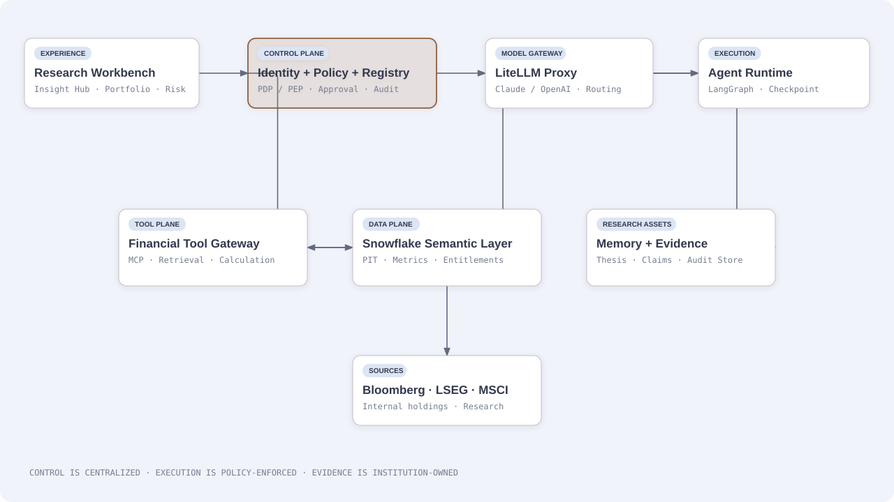
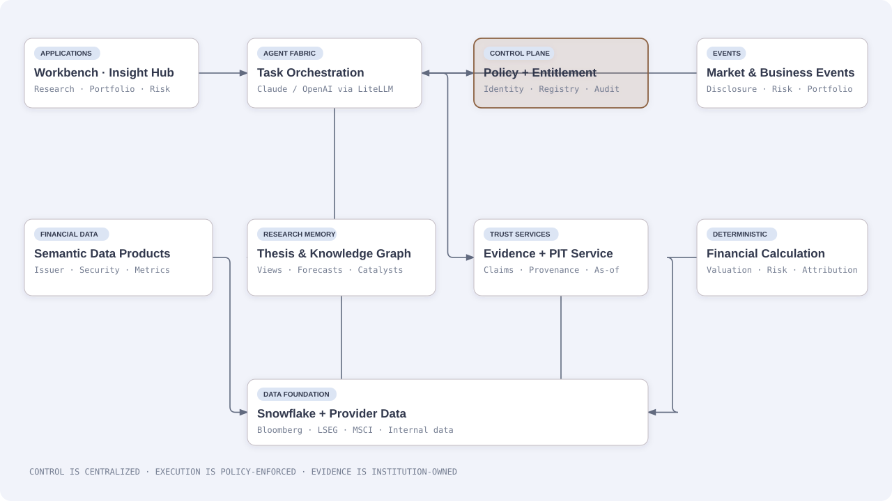

# 金融研究与 Insight 平台：金融机构应该自建什么，应该采购什么？

**文档类型：** 行业产品分析与平台建设白皮书  
**研究基准日：** 2026-11-11  
**适用对象：** 银行、资产管理公司、券商、财富管理机构、保险资管及其他需要开展金融研究、投资分析和风险洞察的机构  
**主要视角：** 以机构内部 Research Workbench 与 Insight 产品为目标，兼顾投研、组合管理、风险和企业战略研究  
**证据说明：** 厂商产品能力以官方页面为主；监管部分以监管机构原文为主；学术部分包含 2026 年 arXiv 预印本，不能视为同行评审结论或生产环境验证

---

## 核心判断

Claude 和 OpenAI 都已经跨过了“通用大模型加一个金融 Prompt”的阶段。Anthropic 发布了面向金融服务的工作流模板、金融数据连接器和 Managed Agent 运行方式；OpenAI 在 2026 年 9 月推出 ChatGPT for Financial Services，将内置金融数据、GPT-6 Astra、金融分析和 Office 模板放进同一产品。与此同时，Bloomberg、FactSet、AlphaSense、S&P Global 等专业厂商也在将数据、分析与 AI 工作流结合。

因此，一家金融机构今天从零建设平台，不能把“财报摘要、公司问答、估值模型初稿、同行比较、研究报告生成”当成自己的长期竞争壁垒。这些能力正在成为模型厂商和金融数据供应商的标准产品。

真正值得机构长期持有的，是自己的研究记忆、分析方法、业务语义、投资假设、组合上下文、客户与风险约束、历史判断及其结果，以及能够在任意时点复现的证据和计算链。平台的产出也不应只是一次性的问答，而应是持续更新、经过验证、能关联业务影响并进入工作流程的 Insight。

建议把产品定位成一个机构级 Research Intelligence Platform，面向用户提供两个入口：供分析师主动探索的 Research Workbench，以及面向投资经理、风险人员和管理层持续推送的 Insight Hub。两者共享同一套可信数据、研究记忆、授权、计算、证据和治理底座。

### 先区分：哪些应该复用，哪些必须自己建设

| 能力领域 | 可直接采用的产品 / Building Block | 金融机构必须掌握的 Differentiator | 建设策略 |
| --- | --- | --- | --- |
| 基础模型与推理 | Claude、OpenAI；通过 LiteLLM 做模型别名、路由、Fallback、预算和供应商切换 | 机构任务上的模型选择策略、数据处理边界、模型变更回归集、风险分级 | 不训练通用基础模型；保留模型可替换性，把预算投入任务评测和路由策略 |
| 金融工作流模板 | Anthropic Financial Services / Financial Advisors Skills、OpenAI 金融工作环境、LangGraph 工作流 | 本机构的研究方法、审批规则、投资授权、岗位职责、例外处理和工作流状态 | 复用模板与 Skill 作为起点；业务规则、权限检查和关键状态迁入受控服务 |
| 金融数据与研究内容 | Bloomberg、LSEG、MSCI、FactSet、S&P、Morningstar、PitchBook、Daloopa、AlphaSense 等 | 数据许可与用途约束、跨供应商实体映射、历史版本、Point-in-Time、来源优先级 | 采购专业数据，不复制供应商内容产品；自建统一数据契约、Entitlement 和时间语义 |
| 企业数据平台与语义 | Snowflake、Semantic Views、Catalog、dbt、SQL / Python 计算服务 | 企业 Metric / Entity / Period Contract、指标口径、关系基数、计算规则和跨仓库语义 | 复用 Snowflake 执行与治理能力；业务语义定义放在仓库无关的 Git / Registry |
| Agent Runtime 与工具接入 | LangGraph、MCP、Skills、容器化 Runtime、现有 SaaS Connector | Capability Registry、工具信任分级、工具权限、版本审批、网络出口、运行隔离 | 采用成熟运行时和协议；自建注册、策略执行、发布治理，不自研 Agent 框架 |
| 身份、授权与合规控制 | 企业 IdP、IAM、KMS、DLP、SIEM、工作流审批产品 | 用户 / 账户 / 组合 / 客户 / 数据许可的组合授权；Purpose Limitation；PDP / PEP；可证明的控制执行 | 集成企业安全产品；自建金融业务授权决策与执行适配层，不能让 Prompt 或 Skill 充当安全边界 |
| 研究记忆与知识资产 | 搜索引擎、向量数据库、图数据库、文档管理和数据目录 | Thesis Ledger、研究观点、假设变化、反证、研究结果、责任人和历史回放 | 这是核心 Differentiator，应由机构拥有数据模型、生命周期和反馈闭环 |
| 证据、计算与验证 | LangSmith 等 Trace / Evaluation、文档解析、OCR、SQL / Python | Claim-to-Evidence、计算可复现、Point-in-Time 回放、冲突处理、审计证据链 | 复用可观测和计算组件；建立机构级验证契约、黄金测试集与审计记录 |
| Insight 分发与业务闭环 | CRM、Portfolio / Risk 系统、通知平台、BI 产品 | 结合持仓、客户关系、风险预算、研究 Thesis 的重要性排序；确认、处置与结果反馈 | 不重复造 CRM / OMS / 风险系统；自建洞察编排、业务影响关联和闭环状态 |
| Trade Lifecycle 协同 | OMS / EMS、RMS、Broker、Custodian、Clearing、TCA | 只读交易上下文、交易前分析、非执行性 Order Proposal、执行可视化、对账和交易后复盘 | 不自建 OMS / EMS，不让 Agent 下单；自建 Order Proposal、交易事件关联、只读权限边界和研究反馈闭环 |

这里的分界不是“买还是自建”的二选一。原则是：**采购通用能力，复用成熟 Building Block；自己拥有金融业务语义、授权规则、研究记忆、证据链和业务结果闭环。** 这些资产决定平台是否真正理解本机构，而不是仅仅把 Claude 或 GPT 接到企业数据上。


## 1. 市场已经走到哪里

### 1.1 Claude：从金融 Skill 扩展到金融工作流产品

Anthropic 的金融服务方案已经包含专门的 Financial Analysis 能力、数据连接器和面向金融工作的 Agent 模板。其公开的金融服务生态连接 Box、Daloopa、FactSet、Morningstar、Palantir、PitchBook、S&P Global、Snowflake 等数据或企业平台，覆盖公司基本面、估值、研究、私募市场及企业内部数据。官方描述强调分析结果能够链接回来源材料，便于复核。参见 [Claude for Financial Services](https://www.anthropic.com/news/claude-for-financial-services)。

2026 年发布的十个金融 Agent 模板更接近实际岗位工作：Pitch Builder、Meeting Preparer、Earnings Reviewer、Model Builder、Market Researcher、Valuation Reviewer、General Ledger Reconciler、Month-end Closer、Statement Auditor 和 KYC Screener。每个模板将 Skill、数据 Connector 与专项 Subagent 组合起来；同一工作流可以作为 Claude Cowork / Claude Code 插件使用，也可以参考 Managed Agents cookbook 在 Claude Platform 上运行。Managed Agent 的公开介绍还包含长时任务、单工具权限、托管凭证库和 Agent 审计日志等能力。用户仍然需要审阅、修改和批准面向客户、正式文件或业务动作的结果。参见 [Agents for Financial Services](https://www.anthropic.com/news/finance-agents)。

Anthropic 的公开仓库 [anthropics/financial-services](https://github.com/anthropics/financial-services) 把这些资产组织为可复用的插件和 Skill。金融分析插件覆盖 Comps、DCF、LBO、三表模型和 Excel 检查；其他垂直插件覆盖投行、股票研究和私募股权工作。仓库也明确鼓励机构替换数据连接器、加入公司自身上下文、调整模型和流程标准。

**对金融机构的含义：** Claude 的金融 Skill 已经能显著压缩通用工作流从零搭建的时间。机构可以把它作为分析师个人效率工具、标准流程模板和原型起点。但公开 Skill 本身并不包含本机构完整的历史投研判断、内部研究方法、数据许可边界、投资组合上下文和业务审批责任。它是可复用的工作流资产，不等于机构自己的 Research Intelligence Core。

### 1.1.1 Claude for Financial Advisors：财富管理工作流的可复用参考实现

除了通用的 Financial Services 插件仓库，Anthropic 还有一个更贴近财富管理顾问场景的独立仓库：[anthropics/claude-for-financial-advisors](https://github.com/anthropics/claude-for-financial-advisors)。它是 Claude Cowork 插件，提供可直接运行的 Skills，并通过第三方 Connector 读取机构已经使用的系统。它覆盖客户会前准备、会后 CRM 记录、合规材料预检、潜在客户信息整理、投资组合再平衡审阅、另类投资简报、遗产与税务材料整理等工作流。

这个仓库值得分析的不是“又多了几组 Prompt”，而是它展示了一个相对完整的顾问工作模式：

- **Workflow / Skill 层：** 把岗位任务拆成明确的输入、步骤、输出和交付模板，例如 Pre-meeting、Post-meeting、Compliance、Portfolio Rebalance Review。
- **Connector 层：** 不把客户和组合数据复制进 Skill，而是在运行时从 Addepar、Black Diamond、Schwab、Tamarac、Orion、Wealthbox、MSCI、iCapital 等已连接系统读取；未连接时才回退到用户粘贴或上传。
- **专业计算与领域工具：** 尽量调用托管组合、财务规划、税务转型和另类投资平台已有能力，而不是让模型凭文本重新实现所有计算。
- **人机责任边界：** 模型整理、比较、识别问题并起草材料；顾问负责判断和建议。写回 CRM 或其他外部系统前需要明确批准。
- **安全设计提醒：** 仓库说明部分限制由只读工具白名单、子 Agent 工具隔离等结构性方式实现；但有些审批和禁止写操作仍依赖模型遵循 Skill 指令。它明确提醒第三方邮件、客户材料和 CRM 内容是不可信输入。

**对企业架构的启示：** 这类 Skill 和 Connector 是可以复用的前端工作流 Building Block，但不能直接作为金融机构的 Control Plane。仓库自己也标明是 Reference Implementation、未主动维护或监控，并且不持有客户数据。企业采用时应 fork / adapt 并纳入自己的版本、评测和发布流程；更重要的是，把关键授权、审批、只读约束、写操作门禁和审计事件放到 Runtime / Policy Service 中强制执行，而不是仅依赖 Skill 文本。对于财富管理机构，它是顾问工作台的高价值原型；对于银行、资管、券商和保险资管，还需要扩展到研究、交易、风险、组合、法人实体和跨业务条线的权限及数据语义。

它与 [anthropics/financial-services](https://github.com/anthropics/financial-services) 应并列理解：后者更偏金融服务通用岗位和专业分析插件；前者更聚焦财富顾问的客户与组合服务流程。两者都能缩短工作流原型开发时间，但都没有替代机构自己的身份授权、数据许可、业务语义、研究记忆、控制执行和监管责任。


### 1.1.2 Claude Personal Finance：值得借鉴的是“账户聚合 + 连续追问 + 可调整视图”，不是个人理财建议

Anthropic 于 2026 年 11 月 5 日发布 [Introducing Personal Finance in Claude](https://claude.com/resources/articles/introducing-personal-finance-in-claude)。它面向个人用户，但产品设计中有几项对机构 Research / Portfolio 平台很有价值。需要注意：这项功能处于美国市场 Beta，官方帮助文档说明目前不适用于 Claude Team / Enterprise；它不是现成的企业团队解决方案，也不应直接将个人账户连接模式搬进机构环境。

它的核心体验是：用户主动选择并连接银行账户，Claude 通过 Plaid 只读获取被授权的数据，再以自然语言回答问题。用户可以跨账户查看余额、支出、现金流、订阅和待付账单；从“这个月钱花到哪里了”继续追问“比上个月多吗”“发薪日前还有哪些付款”“有什么异常”。系统可以发现重复扣款、异常费用和持续上升的账单，并把数字组织成可编辑的 Dashboard、图表或日历。用户可以随时解除连接。官方明确声明它不能转移、管理或投资用户资金，也不以提供投资建议为目标。

**对机构平台值得借鉴的设计：**

- **从账户和业务对象出发，而不是从聊天窗口出发。** 用户首先看到一个持续存在的 Finance Hub，再围绕账户、现金流、组合或目标提问。机构产品也应有 Portfolio / Issuer / Desk / Strategy 等工作对象主页，聊天是操作这些对象的入口，不是唯一入口。
- **跨来源聚合后再解释。** 价值不只是连接多个系统，而是将它们的数据统一成可理解的余额、敞口、现金流、费用、持仓和事件视图。机构侧要进一步处理实体映射、币种、估值时点、重复记录、来源优先级和数据新鲜度。
- **支持连续追问和异常发现。** 从一个汇总数字继续钻取到构成项、历史比较、异常原因和下一步观察项。每个汇总值都应能展开到原始交易、持仓记录、市场数据或计算输入，不能只展示模型解释。
- **让用户配置长期视图。** 可调整的 Widget / Dashboard 比一次性生成的答案更适合持续工作。机构可以保存团队批准的 Portfolio Monitor、Research Watchlist、Liquidity Calendar、Risk Dashboard，并区分个人布局和团队标准视图。
- **把只读权限做成产品能力。** 账户由用户通过第三方授权流程连接，平台不收集银行密码；访问范围限定为用户明确选择的数据，且可以撤销。机构应采用企业 IdP、供应商 entitlement、数据用途许可和最小权限，而不是让 Agent 持有用户凭证或通用数据库账号。
- **数字必须可核对，数据状态必须透明。** Anthropic 明确提醒余额可能有延迟、重复连接可能重复计数，重要数字应回到银行核实。机构平台应为每个指标显示 as-of 时间、来源、刷新状态、口径、计算路径和质量标记；无法确认的数据要显示为缺失或待核验，而不是由模型补齐。
- **金融教育与决策建议要分开。** 解释 APR 等概念与建议用户买卖证券不是同一种风险。机构平台也要区分事实解释、研究分析、投资建议、交易意图和受监管业务决定，并根据业务角色与司法辖区配置审批及披露要求。

**不要照搬的部分：** 个人账户连接是单用户授权模型；Team / Enterprise 不可用这一点本身就说明它不能解决团队共享数据、组织权限、职责分离和监管记录问题。个人用户可以自行配置 Dashboard，但机构需要由数据 Owner、业务 Owner 和控制职能共同定义正式指标和标准视图。个人 Finance 的账户与交易数据范围也有限：帮助中心说明，投资账户目前只读取余额和信用额度，不读取持仓、交易、利率或条款。因此不能把它描述为完整的投资组合分析或交易生命周期能力。

**落到本平台的产品形态：** 借鉴其 Hub-first、账户聚合、自然语言连续追问、异常解释、可调整 Dashboard 和只读连接模式；把底层升级为机构级 Portfolio / Account / Position / CashFlow / Transaction / Event 数据产品，并将每个展示数字关联到来源、as-of、计算和权限上下文。个人用户体验可以作为入口参考，真正的差异化是团队共享的可信投资视图和持续研究记忆。


### 1.2 OpenAI：金融服务已经成为独立产品形态

OpenAI 于 2026 年 9 月 10 日发布 [ChatGPT for Financial Services](https://openai.com/index/introducing-chatgpt-financial-services/)。它不是单纯把通用 ChatGPT 加上金融系统提示词，而是一个面向金融机构的 ChatGPT Work 体验，整合金融数据、GPT-6 Astra 推理、金融研究、财务模型和机构定制材料。

产品内置或合作引入的数据包括 Daloopa、PitchBook、LSEG News、Crunchbase 和 Fiscal.ai，覆盖财报、财务报表、公司基本面、私募公司与融资信息等。OpenAI 表示这些数据由其基础设施索引和托管，以支持检索、时延和细粒度引用；对于机构已有的 S&P Capital IQ、LSEG、MSCI、Dow Jones Factiva、Moody's 等订阅，也在推进共享登录和 entitlement 集成。它还公布了超过 50 个连接器的生态，包含 Datasite、Box、Preqin、FactSet、Intapp 等。

产品将金融研究和产出物放在同一个工作环境：研究人员可以检查财务数字对应的来源表格和注释，比较不同期间的指标，生成图表，并使用管理员发布的 Excel、Word、PowerPoint 模板形成公司分析、估值模型和 Pitchbook。安全能力建立在 ChatGPT Enterprise 的 SAML SSO、SCIM、RBAC、传输和静态加密、工作区保留配置等基础上；官方还说明企业数据默认不用于训练模型，支持的工作区日志可通过 Compliance Platform 导出。产品目前面向符合条件的金融机构提供，不能假设所有企业账户都自动拥有相同数据与功能。

**对金融机构的含义：** OpenAI 已经把“模型 + 金融数据 + 引用 + 财务工作流 + Office 交付物”整合成产品。若自建项目的目标只是提供一个更好用的金融 ChatGPT，投入产出比会快速恶化。可以考虑把 ChatGPT for Financial Services 作为现成的分析师工作环境或试点工具，但仍需独立评估数据托管位置、现有订阅识别方式、许可范围、保留策略、工作区隔离和内部系统可集成程度。

### 1.3 专业金融研究产品：竞争壁垒来自数据、分析和工作流的组合

| 产品 | 公开产品定位与能力 | 对自建平台的启示 |
| --- | --- | --- |
| [Bloomberg AI / Terminal](https://professional.bloomberg.com/products/bloomberg-terminal/ai/) | 将 AI 放在 Bloomberg 自有市场数据、新闻、分析和 Terminal 工作流之上；Bloomberg Intelligence 提供公司、行业、政府、信用、诉讼和宏观研究。 | 其优势不只是聊天能力，而是金融数据覆盖、标准化、长期积累的专业内容以及已有用户工作流。不要试图复制一个完整 Bloomberg Terminal。 |
| [FactSet Intelligence](https://www.factset.com/ai) | 把 Connected Data、Advanced Analytics 和 Intelligent Workflows 作为统一 AI 栈；公开介绍 Agent-ready knowledge bases、投资组合分析、财富管理工作流以及通过 MCP 对外开放 Fundamentals、Estimates、Ownership、M&A、Pricing 等数据 API。 | 数据、分析和工作流必须一起设计。对外部模型开放结构化数据 API 是可采用的集成模式，而不是把所有数据复制到自有模型上下文。 |
| [AlphaSense](https://www.alpha-sense.com/solutions/generative-ai-industry-company-research/) | 以大量专业内容、公司和行业研究为基础，提供 Generative Search、Deep Research、片段级引用、跨文档综合，以及按公司和研究问题构建的 Generative Grid；可配置并定期运行工作流 Agent。 | 跨文档比较和持续研究任务，比单份文件摘要更接近真实研究工作的价值。内部研究内容也应成为一等内容源。 |
| [S&P Capital IQ Pro](https://www.spglobal.com/market-intelligence/en/solutions/products/sp-capital-iq-pro) | 以公司、财务、交易、市场数据和专业分析为基础，扩展 ChatIQ 及 Excel 辅助能力。 | 标准化基本面和数据定义是金融 AI 的底层资产，不能寄希望于 LLM 自行对齐不同公司的指标口径。 |
| [LSEG](https://www.lseg.com/) / Reuters 数据生态 | 提供市场数据、新闻、研究和分析内容，并与模型平台合作开放内容访问。 | 需要将内容许可、用户订阅 entitlement 和数据使用目的纳入接入架构，而不是仅实现一个通用连接器。 |

这些是各厂商公开材料所描述的能力，不是独立生产成熟度评估。产品页面能证明厂商公开支持某种能力，但不能单独证明不同机构部署后的准确率、可用性、总拥有成本或规模化效果。实际选型仍需要拿机构自己的任务、合同、数据和用户进行验证。

### 1.4 市场能力的分界线

现在可以把市场分成三层：

- **基础模型和通用工作助手：** Claude、OpenAI 等提供通用推理、文档处理、工具调用、工作流模板、Office 交互和模型升级能力。
- **金融内容和分析产品：** Bloomberg、FactSet、S&P、LSEG、AlphaSense、Morningstar、PitchBook、Daloopa 等提供专业数据、分析、内容或特定研究流程。
- **金融机构的内部研究与洞察产品：** 需要组织内部的数据、业务语义、研究历史、权限关系、投资方法、风险偏好、工作流程和决策结果。

前两层的供应商能力越来越强，第三层仍然需要金融机构自己定义。自建平台不需要取代每家供应商，而应把它们变成可替换的数据与模型能力，并在机构独有的上下文之上形成更完整的产品。

## 2. 自建平台的差异化应该是什么

### 2.1 保存机构自己的研究记忆，而不只是文档

内部研究库不能只是一个允许向量检索的 PDF 仓库。对机构而言，更有价值的是把研究材料转化为持续维护的研究对象：分析师对某家公司或发行人的观点、历史假设、关键驱动因素、估值方法、风险项、催化剂、观察指标、同业选择理由、管理层承诺、历史预测和后续实际结果。

例如，分析师在一次财报后更新了收入增长、毛利率和资本支出假设。系统应知道这不是一篇新文件而已，而是原有投资 Thesis 的一次变化：哪些假设发生变化，哪些原判断被支持或推翻，哪些模型输入需要更新，哪些投资组合受到影响，哪些后续事件值得观察。下一次财报发布时，系统要从之前的判断继续，而不是把所有材料重新总结一遍。

这需要一套可版本化的 Research Memory / Thesis Ledger。它可以从最小的关系模型开始，逐渐扩展为实体关系图；不应一开始就为了“Graph”而建设一个庞大的知识图谱项目。重点是让研究事实、分析师观点、待验证假设和未来可能性在数据层面有明确区别，并且能够追踪其创建人、来源、有效时间和变更历史。


### 2.7 从个人助手升级为团队平台：组织上下文、协作状态和责任边界必须成为一等对象

面向团队的平台不能简单理解为“给每个员工开一个 Agent 账号，再把聊天记录共享”。个人助手优化的是单人的上下文和效率；团队平台还必须解决共同工作对象、数据可见范围、观点归属、职责分离、审批、交接和集体记忆。团队层和个人层应并存，但不能混为一套权限或记忆。

**1. 建立清晰的组织与业务上下文模型。** 至少需要区分 Legal Entity、Business Unit、Desk / Team、Role、User、Portfolio / Account、Client、Strategy、Research Coverage 和 Project。用户属于多个团队、临时项目或覆盖组并不罕见，授权不能只依赖单一部门字段。每次 Agent Run 都要绑定发起人、代表的业务身份、工作团队、任务目的、目标组合或客户、数据用途和适用的信息隔离规则。

**2. 个人工作区、团队工作区和机构正式记录分层。**
- 个人层：个人偏好、草稿、私有笔记、临时分析和个人 Dashboard。默认不自动变成团队正式观点。
- 团队层：共享 Watchlist、研究计划、团队指标视图、协作任务、已批准的研究观点、会议结论和交接事项。需要明确 Owner、可见范围、状态和版本。
- 机构层：正式研究发布、投资授权、政策、风险限额、审批决定、交易记录和监管留存。由权威业务系统或受控 Registry 管理，不能以聊天记录作为唯一事实来源。

**3. 将研究观点做成有归属的协作对象。** 同一发行人可能存在多个分析师观点，甚至同一团队内部也有分歧。系统不应把它们压成一个“团队共识”。Thesis / Claim 至少要有作者、责任分析师、团队、状态（Draft / Under Review / Approved / Superseded / Rejected）、适用组合或策略、证据、有效时间、版本、反对意见和批准记录。团队汇总可以展示共识、分歧和未解决问题，但必须保留观点来源，不能让 LLM 自行裁决谁代表团队。

**4. 权限要按对象、动作和数据用途组合计算。** RBAC 适合表达岗位角色，ABAC / ReBAC 适合表达团队关系、覆盖范围、组合授权、客户关系、项目成员和信息隔离。一个用户可以读某个组合，却未必能看到其客户身份；可以读研究资料，却没有权利导出供应商内容；可以生成订单建议，却没有交易权限。授权要在 Retrieval / Tool Gateway / Domain API 执行，并在输出和分发时重新检查，不能只在登录时做一次检查。

**5. 支持职责分离，而不是只设置一个“Approve”按钮。** 研究作者、研究复核人、组合经理、交易员、合规人员、风险人员和系统管理员的权限应有明确差异。高风险流程要支持 Maker-Checker、双人复核、阈值审批、紧急暂停和职责冲突检查。发起任务的 Agent 不能替代审批人；同一个人是否可同时发起和批准，应由机构政策决定并由服务端执行。

**6. 让团队记忆可维护、可纠错、可追溯。** 团队共享记忆不是把所有聊天历史放进向量库。应该把研究结论、投资假设、风险判断、已知限制、决策记录、例外处理和后续结果结构化保存，并记录来源、作者、状态、有效期和访问范围。个人聊天可作为待提炼的候选来源，但必须经过作者确认或团队工作流批准后，才进入团队正式记忆。过期观点应被标记为 Superseded，而不是静默覆盖。

**7. 把协作与交接设计进任务状态。** Agent 长任务可能跨越多个班次、人员和团队。任务需要有 Owner、Assignee、Watcher、Due Date、SLA、阻塞原因、下一步、交接摘要和恢复点。人员离职、休假、团队调整或项目结束时，任务和正式记录要能转交；个人会话不能成为唯一的业务连续性载体。

**8. 团队 Dashboard 与个人 Dashboard 分开治理。** 个人可以调整布局和筛选；团队标准视图应有发布者、版本、指标定义、访问策略和变更记录。允许个人自定义呈现，不意味着允许改变正式指标的定义。团队层应支持按 Desk / Portfolio / Strategy / Region 汇总，同时遵循数据许可和信息隔离。

**9. 设计协作事件，而不只是聊天共享。** 重要事件应成为可订阅的业务事件：Thesis Changed、Evidence Refuted、Portfolio Exposure Breach、Research Review Requested、Order Proposal Ready、Trade Reconciliation Exception。事件需要去重、分派、升级、关闭和反馈；通知不是工作流本身，必须关联权威对象和处理状态。

**10. 防止跨团队上下文污染。** 子 Agent、共享缓存、向量索引、摘要、模型上下文和生成文件都可能造成信息泄漏。每个数据对象应携带 security labels / entitlement context；跨团队任务要重新做授权判断；共享摘要必须检查来源数据的最高敏感级别和可分发范围。Agent 不能因为“已经读过”某份材料，就把内容复制到另一个团队的回答中。

建议平台至少提供以下团队级能力：Team / Desk Workspace、Shared Research Objects、Team Memory Registry、Role & Entitlement Service、Review / Approval Inbox、Task Handoff、Event & Notification Service、Team Dashboard Registry。个人偏好和团队正式规则应分开存储；团队正式记忆、研究状态和审批记录应进入机构控制的持久化存储。


### 2.2 建立时间点正确的金融事实

金融分析的一个根本问题是：在某个决策时点，研究人员究竟能知道什么？

一份年报可能在财务年度结束后数月才披露；后来发布的重述、补充文件、公司更名、行业分类变更或证券代码调整，都可能改变当前数据视图。回测或历史研究若直接读取今天的最新数据，就可能把未来信息带回过去。模型的预训练知识也可能泄漏已经发生的历史结果。

平台需要同时管理来源时间和业务时间，包括：

| 时间和版本字段 | 代表什么 | 为什么重要 |
| --- | --- | --- |
| Published / Released At | 来源公开或正式发布的时间 | 确定该信息何时能够被市场和分析师获得 |
| Observed / Ingested At | 平台实际接收到该数据的时间 | 判断系统当时是否已经拥有这条信息 |
| Effective / Valid Time | 数据在业务上生效的时间区间 | 处理评级、实体关系、指标定义或政策的历史变化 |
| Version / Supersedes | 原始文件或数据记录的版本及其替代关系 | 保留更正、重述和历史复盘能力 |
| As-of Time | 本次研究允许使用的信息截止时间 | 阻止模型、检索和计算读取未来数据 |

“最新值”与“在 2025 年 3 月 31 日当时可见的值”必须是两种不同查询。不能仅靠在 Prompt 中写“不要使用未来信息”来保证 Point-in-Time Correctness。数据服务和检索层应真正按时间过滤，测试集也应冻结当时可见的来源版本。

2026 年的 [Investor's Last Exam 预印本](https://arxiv.org/abs/2610.38342) 将这一问题放进了专业股票研究评测：其基准使用了 343 万份文档版本，并将任务评分关联到来源、计算和假设。论文报告，整体研究能力得分较高的系统，在 Forecast & Model 子项仍存在明显差距。这提醒我们，能够总结已经发生的事情，与在当时信息约束下形成可靠预测，是不同的能力。

### 2.3 把金融语义和计算放在平台，而不是交给模型临场猜测

平台需要建立自己的 Issuer / Legal Entity / Security / Instrument / Fund / Portfolio / Benchmark / Industry / Event 等实体关联，并维护证券标识、发行主体、上市地、币种、财务年度、报告期间、资产类别和同业集合。

金融指标也需要统一口径。Revenue、ARR、Net Interest Margin、Net Debt、Adjusted EBITDA、Free Cash Flow 等指标不应只有一个字符串名称。它们应绑定公式或定义、来源、币种、报告期间、GAAP / Non-GAAP 基础、合并范围、调整项、可比性状态及更新时间。不同供应商提供的同名指标不一定具有相同定义；即使同一公司也可能在不同报告中更改呈现方式。

LLM 适合帮助解释定义、发现潜在口径冲突和提出需要核查的项目，不应成为财务数字的权威计算器。比率、DCF、WACC、现金流折现、债务桥、收益率、FX 换算和组合敞口，应由确定性的 SQL / Python / 领域计算服务执行。模型可以选择分析方法、解释计算结果、提出情景，但必须使用经过验证的输入和公式版本。

这也意味着语义层不应与某个数据仓库绑定。可以在 Snowflake、PostgreSQL、数据目录或应用领域服务中实现不同部分，但对上层提供稳定的 Metric / Entity / Period 查询合同。仓库可以更换，业务语义不能跟着消失。

### 2.4 研究证据需要达到“主张级”，而不是“文档级”

一个报告末尾有十条参考链接，不代表其每个重要结论都有支持。一个数字出现在正确的文件中，也不代表其报告期间、币种、单位和计算口径正确。金融研究系统需要把输出拆成可以复核的 Claim，并将每条重要 Claim 绑定到实际证据和计算过程。

例如：

- 原始事实：某季度收入为某金额，来源是哪个版本的 10-Q、哪张表、哪一行。
- 标准化事实：系统将原始披露映射到哪个标准指标，使用什么币种和合并口径。
- 派生计算：同比增长率由哪两个值计算，使用哪个公式和舍入规则。
- 分析判断：收入增长放缓是否挑战原投资 Thesis，依赖哪些经营假设。
- 预测或建议：未来收入区间及其情景、概率、风险和假设是什么。

这些状态不能混成一个“AI 结论”。至少应支持 Verified、Partially Verified、Unverified、Conflicted、Not Applicable 等验证状态；对于缺少证据的结论，系统应允许明确返回“无法核实”，而不是强行补齐。

2026 年 11 月 3 日发布的 [LLM-Generated Investment Research Memos Need Validation 预印本](https://arxiv.org/abs/2611.04375) 给出了值得重视的实验结果：研究者生成 1,440 份投研备忘录，拆出 77,272 条金融陈述，并对照官方披露进行验证。各 Agent 的单条陈述被直接反驳比例约为 1.17%–1.77%，但约 36.94%–41.11% 的整份备忘录至少含有一条被反驳的陈述。错误类型包括时间、单位、上下文和概念。作者还强调，缺少证据和被证据直接反驳是不同状态。

这项研究是预印本，实验的公司、期间、Agent 和来源范围有限，不能直接代表所有机构的生产错误率。但其方法论很有参考价值：评估一份研究交付物时，不能只看平均 Claim Accuracy，还要看整份报告中是否至少存在一条关键错误、错误严重程度和人工复核成本。

### 2.5 让 Insight 连接到业务上下文和结果

同一个行业事件，对不同业务团队的意义可能完全不同。某公司公布资本开支上升，对股票研究人员可能意味着增长机会或 FCF 压力；对信用分析人员可能意味着杠杆和偿债能力变化；对组合经理则需要结合持仓规模、风险预算和投资 Thesis 判断优先级。

平台必须知道用户能看到哪些组合、账户、客户和研究内容，以及每项信息可以用于什么用途。Insight 的排序也应基于重要性，而不是简单按发布时间、热度或相似度排序。一个小的业务变化，如果挑战了核心投资假设，可能比市场上当天讨论很多的新闻更重要。

Insight 还要记录后续处理：谁查看了、是否确认、是否形成研究更新、是否触发风险审查、是否被忽略、后续实际结果如何。这样机构才会积累自己的反馈闭环，而不是只积累更多 AI 生成文本。

## 3. 产品形态：Research Workbench 与 Insight Hub

### 3.1 Research Workbench：研究人员主动探索和形成结论

Research Workbench 是研究人员的主工作台，适合支持公司、行业、宏观、信用、私募市场和组合研究。它应围绕研究对象和问题组织上下文，而不是把每次对话当作孤立会话。

一个典型的公司研究页面，应让分析师看到公司概况、结构化财务指标、重要披露、行业和同业关系、内部研究文档、历史 Thesis、分析师模型与当前关注事项。自然语言问题可以作为入口，但检索结果需要区分结构化数据、公开文件、授权的第三方内容和内部研究材料。

对“为什么本季度毛利率下降”这类问题，平台应先确定所指期间和指标口径，再找到相关披露、分部表格、管理层解释、同业变化和内部模型假设。模型负责将证据组织成分析，并指出支持和反对当前解释的事实。涉及具体金额、增长率或估值的部分，调用确定性计算服务。

Workbench 的主要输出是研究笔记、财报更新、行业比较、情景分析、估值模型输入和投资委员会材料草稿。文档生成应继承机构模板和规范，但不应以“自动生成 Word/PPT”作为平台唯一的完成标志。

### 3.2 Insight Hub：把重要变化送到应该处理的人面前

Insight Hub 面向组合经理、风险团队、研究主管、客户团队和管理层。用户不应每天重新问“今天有什么新闻”，而应看到与自己负责的组合、行业、发行人、风险约束和研究判断相关的变化。

一条有用的 Insight 至少要回答：发生了什么变化；与此前的基准相比哪里不同；为什么重要；它支持还是挑战哪条历史假设；有哪些相反证据；对哪些组合或业务范围可能产生影响；还有哪些信息未知；接下来由谁复核或采取行动。

这类 Insight 应作为持久化业务对象保存，不能只存在聊天记录中。一个简化的对象结构如下：

~~~json
{
  "insight_id": "INS-2026-000123",
  "subject": {
    "issuer_id": "ISSUER-001",
    "security_id": "SECURITY-001",
    "portfolio_ids": ["PORT-001"]
  },
  "as_of": "2026-11-11T16:00:00Z",
  "trigger": {
    "type": "earnings",
    "source_id": "DOC-2026-Q3-001"
  },
  "change": {
    "metric": "gross_margin",
    "value_before": "42.1%",
    "value_after": "39.8%",
    "basis": "reported quarterly, consolidated"
  },
  "thesis_delta": {
    "stance": "challenges",
    "explanation": "毛利率下降幅度超过原模型假设"
  },
  "evidence": [
    {
      "claim_id": "CLM-001",
      "source_version": "DOC-2026-Q3-001-v1",
      "page_or_cell": "p.18/table-6"
    }
  ],
  "counter_evidence": [],
  "assumptions": [],
  "status": "needs_review",
  "owner": "RESEARCH-TEAM-A"
}
~~~

示例中的值只是说明对象结构，不代表任何真实证券或组合。生产设计还需要增加来源时间、许可标签、实体映射版本、计算 ID、模型与 Prompt 版本、人工修订历史、审批决定、分发范围和审计事件。

Insight Hub 的差异化最终体现在三件事上：能够持续追踪重要变化；能够解释变化与机构自身研究和敞口的关系；能够推动合适的人在合适的工作流程中完成复核和后续处理。

### 3.3 不同金融机构应选择不同的首批产品场景

| 机构类型 | 优先研究对象 | 高价值 Insight | 建议的第一批场景 |
| --- | --- | --- | --- |
| 资产管理 / 公募 / 对冲基金 | 发行人、股票、债券、行业、组合与投资 Thesis | 财报变化、盈利预期偏差、投资假设失效、组合集中度与事件风险 | 覆盖公司财报分析与 Thesis 更新 |
| 券商 / 投资银行 | 公司、行业、交易、融资、客户与交易流程 | 交易事件、估值差异、客户机会、行业变化、尽调缺口 | 行业研究、客户会议准备、尽调材料分析 |
| 财富管理 | 客户、家庭资产、产品、组合与投资目标 | 组合偏离、客户风险暴露、产品或市场变化与客户目标的关系 | 顾问会前准备和投资组合解释 |
| 银行 / 信用机构 | 借款人、集团实体、授信、抵押品、行业和现金流 | 财务恶化、契约风险、评级迁移信号、负面事件与集中度 | 商业客户财报监控和信用审查材料准备 |
| 保险资管 | 发行人、债券、久期、负债匹配、偿付能力与风险限额 | 信用事件、利率和利差变化、资产负债匹配偏差 | 固收发行人监控与组合风险说明 |

同一套平台底座可以复用，但首个产品不能试图覆盖所有业务线。不同机构的核心数据、决策责任、许可范围和风险等级差异很大。应先选择一个高频、可验证、业务责任清楚的研究工作流，再扩展到更多资产类别和产品线。

## 4. 参考架构：把可信研究能力做成机构资产

### 4.1 数据与内容接入

数据接入层需要支持公开披露、监管文件、市场数据、宏观统计、第三方研究、财务基本面、新闻、内部投研文档、会议材料、组合数据和机构业务系统。每个来源都应登记授权主体、数据许可、用户范围、允许的处理方式、保留规则、更新时间、来源质量和访问接口。

数据接入不应一开始就复制所有供应商数据到企业自己的数据湖或向量库。对有严格许可限制的数据，优先通过供应商 API、MCP 或授权检索接口按需访问，并保留来源引用。确实需要缓存、索引或向量化时，应先确认合同是否允许这些处理以及缓存、派生内容和导出的边界。

对可留存内容，保存原始文档或允许的原始快照、版本、元数据和解析结果。解析后的段落和表格必须能指回原始文件的位置。扫描 PDF、复杂表格、图片和图表需要适当的文档理解与多模态处理，但抽取结果不能自动被视为权威财务事实。

### 4.2 可信数据基础层

核心数据层至少需要以下几个相互关联的能力：

- **实体与标识主数据：** 发行人、法律实体、证券、债券、基金、组合、客户、行业、基准以及它们的历史关系。
- **金融指标与期间语义：** 指标定义、公式、报告期间、财务年度、币种、单位、合并范围、会计口径、调整项及数据来源。
- **时间和版本管理：** 公布时间、接收时间、生效时间、来源版本、重述和替代关系，以及可复现的 As-of 查询。
- **研究与观点存储：** 研究笔记、投资 Thesis、模型假设、情景、风险、催化剂、历史预测、分析师修改与复核结果。
- **访问与许可元数据：** 数据源授权、用户 / Desk / 业务单元 entitlement、信息隔离策略和允许的下游用途。

这些内容可以由关系数据库、数据仓库、文档索引、搜索服务和图数据库共同实现。不要因为研究中存在实体关系就将所有内容强行放进图数据库；先保证主键、关系、版本、查询合同和变更历史可靠，再按多跳研究场景引入图能力。

### 4.3 多路检索，而不是单一向量 RAG

金融研究并非所有问题都需要向量检索。对明确的财务数字和期间，直接查询标准化指标或供应商 API 更可靠；对精确术语、条款编号、证券代码和披露用语，需要词法检索；对语义相似的研究主题，可以使用向量检索；对于跨公司、跨期间和实体关系问题，则可能需要知识图谱或显式关系查询。

建议建立统一的 Retrieval Broker，按问题类型和所需证据路由到不同检索方式。先做高召回的候选检索，再通过规则或重排提升相关性；但不能假定越多 Agent、越多重排阶段就越准确。每个检索阶段都需要被独立评测，并检查是否因为过滤过严漏掉关键反面证据。

[FinRAG-QA 预印本](https://arxiv.org/abs/2609.03654) 评估了跨银行年度报告和 Pillar 3 报告的金融问答，数据集包含 24 家银行的 209 份报告和 999 个问题。论文报告，针对文档语境增强的 chunk 与金融领域检索模型能提高检索质量；但在初始候选检索已经较强的设置下，Cross-Encoder 重排并不总能带来提升，甚至可能降低效果。该论文的模型实验主要使用 2024–2025 年可用模型，不能作为当前模型的直接性能结论。它更适合支持一个架构判断：检索链路要通过消融实验决定每个步骤是否有价值，而不是堆叠组件。

### 4.4 研究计算与证据服务

独立的 Financial Calculation Service 承担可重复计算，包括财务比率、增长率、估值、现金流、收益率、情景模型、FX 转换和组合敞口。输入数据、公式、参数和输出需要版本化。模型只能通过类型明确的工具调用这些服务，不能直接生成一串看似合理的数值然后被下游当作结果使用。

Claim & Evidence Service 负责维护每个重要主张与原始证据之间的关联。每条证据应带有来源 ID、版本、页码 / 表格 / 单元格 / 文本范围、来源许可、检索时间和授权上下文。派生数字还要关联计算 ID、输入值和公式版本。

对于每份研究交付物，系统应能显示哪些陈述已经核实，哪些仅部分支持，哪些来源冲突，哪些属于分析师判断，哪些是模型假设或预测。模型生成的置信度分数不能代替证据验证，也不能自动决定一份报告是否可对外发布。

### 4.5 Agent 与工作流运行层

Agent 运行层负责把检索、计算、分析和输出组织成可恢复的工作流。任务状态、步骤输入输出、模型选择、工具调用、人工审批和失败重试都需要被明确管理。

较稳定的金融流程应采用显式状态图：确定性节点负责校验输入、权限、期间、计算、状态转换和审计记录；LLM 节点负责理解问题、解释材料、形成假设、比较论据和草拟文本。只有在任务确实存在开放式探索、动态计划或多角色独立分析需求时，才让 Agent 自主规划更多步骤。

人工复核应是流程状态的一部分，而非最后页面上一个随意添加的按钮。被暂停的任务要能够保存状态、等待审批、恢复执行，并确保重复提交不会产生多次业务效果。对组合写入、客户沟通、正式研究发布、信用审批或交易指令等有影响的动作，LLM 不能直接绕过领域服务和权限检查。

### 4.6 应用层与系统集成

Workbench 和 Insight Hub 共享底层能力，但面向的工作方式不同。Workbench 以主动查询、研究对象、分析过程和文档产出为中心；Insight Hub 以事件、优先级、责任人、状态和处理结果为中心。

应用需要与现有研究管理、Portfolio Management、OMS / EMS、RMS、Allocation、Custodian、CRM、文档管理、邮件、数据仓库和办公工具集成。交易相关集成默认只读；Order Proposal 通过人工交接进入 OMS / EMS，由授权交易员在原系统内核对和执行。其他权威业务系统的写回也必须通过受控 API 和业务工作流执行，保留原始输入、审批、幂等键和执行回执。研究平台可以提供建议和草稿，但不能因为某个 Agent 生成了一个动作，就认为权威系统应接受它。

## 5. 什么应该自建，什么应该采购

### 5.1 自建的核心资产

| 能力 | 建议 | 原因 |
| --- | --- | --- |
| 内部研究记忆、Thesis Ledger、观点和假设历史 | 自建 | 这是机构知识和投资过程的独特积累，不应只存在于某家模型供应商的会话里。 |
| 实体主数据、金融指标语义和业务术语 | 自建或统一治理 | 必须符合机构自己的资产、组合、指标和报告口径，并能跨数据仓库和模型使用。 |
| Point-in-Time Evidence Store 和 Claim Ledger | 自建 | 需要保存历史可见性、来源版本、证据位置、计算链及研究输出版本。 |
| 数据授权、Entitlement、Information Barrier 和 Policy | 自建为权威边界 | 这些决定谁可以看到什么、数据能用于什么，以及结果能否被分发或执行，不能依赖 Prompt 或模型自觉遵守。 |
| 金融计算、估值方法和业务分析函数 | 自建 / 受控领域库 | 关键财务计算必须可重复、可测试、可回放。可复用成熟数值库，不必自己实现底层数学。 |
| Insight 生成规则、重要性排序和研究反馈闭环 | 自建 | 价值来自机构的组合上下文、风险偏好、研究假设和后续结果。 |
| 企业评测集、模型路由与发布门禁 | 自建治理 | 要按真实业务问题验证模型、检索和工作流，而不是只看厂商通用 Benchmark。 |
| 关键业务状态和审计记录 | 自建权威记录 | 研究审批、发布、客户沟通和业务动作需要机构自身能控制的留痕与回放。 |

### 5.2 应该采购或直接采用的能力

| 能力 | 建议采用的来源 | 自建边界 |
| --- | --- | --- |
| Frontier LLM | Claude、OpenAI，必要时其他合规供应商 | 维护统一模型接口、路由、评测、降级和合同约束，不训练一个通用大模型来重复供应商工作。 |
| 金融市场与专业内容 | Bloomberg、FactSet、S&P、LSEG、Morningstar、PitchBook、Daloopa、AlphaSense 等现有许可 | 做好数据目录、Entitlement、语义映射和按需调用；不复制无权存储或再分发的内容。 |
| 通用文档解析、搜索和存储 | 成熟 OCR / 文档解析、全文检索、向量数据库、关系数据库和对象存储 | 为金融表格、复杂披露和证据定位补充领域适配及评测。 |
| Agent 工作流框架 | LangGraph，自行部署和运营 | 不采用 Bedrock AgentCore 或其他供应商 Agent Runtime；工作流定义、业务状态、权限与审批契约由机构掌握。 |
| Trace 与评测平台 | LangSmith、OpenTelemetry 生态及企业监控工具 | 观测工具可以被替换；合规要求的权威记录和关键事件副本不能只存在第三方 SaaS。 |
| Office 与产出物生成 | Claude / ChatGPT Office 能力、机构模板和办公套件 API | 机构模板、发布权限、数据范围和最终文件的责任归属由内部治理。 |
| 身份与密钥管理 | 企业 IAM、Secrets Manager、KMS 等 | 身份、角色、工作负载和数据访问的权威判断由企业控制。 |

一个重要边界是：供应商提供金融数据并不代表平台获得了无限使用权。检索、索引、Embedding、缓存、摘要、派生数据、模型上下文、导出和分发，可能属于不同授权范围。接入评估必须把这些权利逐项问清楚。

## 6. Claude、OpenAI 和 LangChain 应该怎样分工

### 6.1 Claude：快速获得专业工作流和分析师体验

Claude 的金融插件适合用于验证业务流程、提升个人效率，以及把成熟的研究模板快速带入团队。可以先挑选 Earnings Reviewer、Market Researcher、Model Builder 或 Valuation Reviewer 等与业务匹配的模板，再替换为机构自己的数据连接器、模型方法和报告模板。

如果机构希望将任务嵌入内部系统，需要区分 Cowork / Claude Code 插件与 API / Managed Agent 方式的运行边界。桌面插件适合与分析师现有 Excel、PowerPoint 等工作方式协同；服务端长任务、批量流程和统一运营则需要经过正式的 Agent Runtime、权限和审计设计。两种方式不是同一个部署形态。

建议把 Claude 用作模型能力和研究工作流的一种实现，不要让 Claude Skill 文件变成平台的唯一业务定义。Skill 可以携带任务说明、步骤和输出标准，但金融指标口径、数据许可、工作流状态、权限策略和审计事件必须由内部服务定义。

### 6.2 OpenAI：利用现成金融产品，也保留 API 嵌入路径

ChatGPT for Financial Services 可以作为研究团队的现成工作环境进行评估，尤其适合需要快速获得金融数据、引用、分析和 Office 文档产出能力的团队。它的设计合作伙伴包括 Morgan Stanley 和 Evercore，说明产品从投行和股票研究工作流切入；OpenAI 也明确表示后续会继续扩展其他金融服务类别。

对平台团队而言，OpenAI API 更适合将模型推理、工具调用和结构化结果嵌入机构自己的 Workbench 或 Insight Hub。此时仍要通过内部服务提供授权后的上下文和工具，避免用户绕开企业数据边界直接查询不该访问的内容。

ChatGPT Financial Services 内建数据的索引和托管安排，可能与企业已有供应商合同、地区要求、许可限制和内部保留制度产生不同影响。采购前应确认具体数据源、用户 entitlement 识别方式、内容使用权、数据所在位置、日志保留、信息隔离、删除和退出机制。不能仅凭“Enterprise”或“金融服务”产品名称推断所有机构控制要求都已满足。

### 6.3 LangChain / LangGraph：用于自有工作流运行时，而不是金融数据产品

[LangGraph](https://docs.langchain.com/oss/python/langgraph/overview) 是用于构建长时间、有状态 Agent 工作流的低层运行时，提供图状态、持久化、流式执行和 Human-in-the-loop 能力。其 [Interrupts](https://docs.langchain.com/oss/python/langgraph/interrupts) 可以暂停执行、持久化状态，等待人工输入后再继续运行。LangChain 官方将 LangGraph 定位为 Agent 编排运行时，将 [LangSmith](https://docs.langchain.com/langsmith/observability) 定位为跨框架的 Trace、评测、Prompt 和部署平台。

适合使用 LangGraph 的情况是：机构需要拥有工作流代码和状态控制，希望在一个流程中组合确定性计算、企业内部工具、Claude / OpenAI 模型、人工审批和异常恢复，并且有团队愿意承担运行时的维护、升级和故障处理。

不应把 LangGraph 当作金融领域语义、数据授权或合规状态系统，也不应因为使用了 LangSmith 就认为拥有完整的监管审计记录。生产平台需要把关键流程事件、输入输出、数据版本、模型版本、工具结果、权限判定和审批动作写入机构控制的权威存储。LangSmith 可以用作可观测和评测工具，但必须明确其数据处理合同、部署方式和日志保留边界。


### 6.4 参考落地架构：Snowflake + LiteLLM + LangGraph + LangSmith

如果机构已经把 Bloomberg、LSEG、MSCI 等外部金融数据以及内部持仓、风险和研究数据集中在 Snowflake，建议采用 **Snowflake-centric Data Plane + 自建 Agent Plane + 独立 AI Control Plane**。模型侧以 Claude 或 OpenAI 当前最强、且经过机构评测与合同批准的模型为主，通过 LiteLLM Proxy 统一路由和治理；不把模型厂商的 Agent 产品当作企业运行时。Agent 的执行、状态、工具调用和审批由机构自己的服务负责。

#### 6.4.1 架构边界与组件职责

| 架构层 | 建议组件 | 主要职责 | 归属 |
| --- | --- | --- | --- |
| 用户体验 | Research Workbench、Insight Hub、Portfolio / Risk views | 研究问答、研究交付物、持续洞察、组合关联 | 机构自建 |
| Trade Integration | OMS / EMS、RMS、Allocation、Custodian、TCA APIs / Events（只读） | Order Proposal 交接、订单与成交状态可视化、交易后分析；正式订单仍在 OMS / EMS | 机构自建只读适配与关联层；交易系统保持权威 |
| 应用接入 | Web BFF、API Gateway、企业 SSO | 用户身份、会话、请求入口、速率限制 | 机构自建 / 企业标准服务 |
| Policy & Entitlement | Identity Context、Policy Decision Service、Data Entitlement Service | 用户、Desk、Portfolio、客户、数据供应商许可、Information Barrier 判定 | 机构自建权威服务 |
| Agent Orchestration | LangGraph | 研究任务状态图、节点编排、并行任务、重试、检查点、人工复核和恢复 | 机构自建并部署 |
| Model Access | LiteLLM Proxy + Claude API / OpenAI API | 统一模型别名、路由、超时、重试、Fallback、预算、速率限制、密钥隔离和调用日志 | 机构运营的模型访问网关；模型由供应商提供 |
| Tool Gateway | Financial Tool API / MCP Server（可选协议） | 提供经过授权的金融查询、文档检索和计算工具；执行输入校验、权限检查和输出裁剪 | 机构自建 |
| Data & Semantic Plane | Snowflake | 供应商数据、内部金融数据、标准化数据产品、Semantic Views、历史快照 | 企业金融数据底座 |
| Retrieval | Snowflake SQL / Semantic Views、Cortex Search（经安全验证后）、全文检索 | 结构化查询与文档证据检索分流 | 以 Snowflake 为主，必要时补充检索服务 |
| Observability & Evaluation | LangSmith + OpenTelemetry | Agent trace、节点耗时、Prompt / 模型评测、回归和运行质量分析 | LangSmith 为观测工具；机构保留权威记录 |
| Durable State & Audit | PostgreSQL / Aurora、S3 Object Lock 或等效归档 | 任务状态、审批、研究对象、证据快照、审计事件和正式交付物 | 机构自建 / 自主管理 |

建议的部署拓扑：

```text
Research Workbench / Insight Hub
              |
        BFF + Enterprise SSO
              |
   Identity / Entitlement / Policy
              |
       Research API / Job API
              |
       LangGraph Application
       (institution-operated)
          /       |       \
         /        |        \
 Financial Tools  LiteLLM   LangSmith
  / MCP Gateway   Runtime   Traces / Evals
       |
  Policy Enforcement
       |
 Snowflake Query / Semantic / Search APIs
       |
 Bloomberg | LSEG | MSCI | Internal Data

 LangGraph State -> PostgreSQL / Checkpoint Store
 Evidence / Research Artifacts -> S3 + Snowflake metadata
 Authoritative Audit Events -> Institution-controlled Audit Store
```

LangGraph 可以运行在机构现有的 Kubernetes / EKS 或 ECS 服务环境中。它是应用运行时，不是一个额外的供应商 Agent 平台。对长时间研究任务，使用 LangGraph Checkpointer 持久化状态；将任务状态、人工审批和业务结果写入 PostgreSQL 等权威业务存储。不要把 LangSmith Trace 当作唯一的 Checkpoint 或审计记录。

Amazon LiteLLM 是模型访问网关，不是完整的 AI Control Plane。应用只调用内部 LiteLLM Proxy 的稳定模型别名，不直接持有 Claude / OpenAI API Key，也不把供应商模型 ID 写进业务工作流。平台团队维护模型别名映射、模型版本、Fallback、速率和预算策略。复杂研究任务路由到经评测批准的 Claude 或 OpenAI 高端模型；升级必须经过金融任务回归评测和灰度。参考 [LiteLLM Router](https://docs.litellm.ai/docs/routing) 和 [LiteLLM Key / Team Router Settings](https://docs.litellm.ai/docs/proxy/keys_teams_router_settings)。

明确排除：**不使用 Bedrock AgentCore。** 不让模型供应商接管企业 Agent 生命周期、工具网关、身份、会话记忆或工作流。Claude / OpenAI 是可替换的模型供应商；LiteLLM 负责模型接入和路由，企业 Control Plane 负责策略治理，企业 Agent Runtime 负责执行。

#### 6.4.2 Snowflake 数据分层

Snowflake 内部建议至少划分以下逻辑层。实际可映射到独立 Database / Schema / Data Product，避免把所有内容堆在一个宽表或一个 Schema 中。

| 层 | 典型对象 | 设计要求 |
| --- | --- | --- |
| PROVIDER_RAW / SHARED | Bloomberg、LSEG、MSCI 原始共享对象或供应商落地数据 | 尽量保留来源结构、Provider ID、许可标识、接入方式和来源版本；共享数据不因进入 Snowflake 就自动获得复制、Embedding 或再分发权 |
| CANONICAL | Issuer、Legal Entity、Security、Instrument、Fund、Portfolio、Benchmark、Industry、Event | 建立机构自己的统一实体 ID 和跨供应商 ID 映射，保留历史关系和生效时间 |
| CURATED_FINANCIAL | Fundamentals、Market Data、Estimates、Ownership、Index Constituents、ESG、Risk、Holdings | 统一期间、币种、单位、会计口径和数据质量规则；保存来源与时间元数据 |
| SEMANTIC | 公司基本面、市场情报、组合分析、风险和研究语义视图 | 按业务领域拆分 Semantic Views，定义 Metrics、Dimensions、Relationships、Filters 和验证查询 |
| RESEARCH | Documents、Research Notes、Claims、Thesis、Catalysts、Forecasts、Research Runs | 研究对象版本化，明确区分来源事实、分析师判断、模型推断和待验证假设 |
| AUDIT_METADATA | 数据产品目录、许可元数据、查询记录索引、证据引用、模型运行关联 ID | 存放元数据和关联键；正式审计事件及不可变归档由机构控制 |

外部数据接入优先使用供应商许可允许的 Snowflake Secure Data Sharing / Marketplace 方式；如果数据已由内部管道落地，则保留原始记录和接收批次。对共享对象不要为了方便 Agent 而默认全量复制。Secure Data Sharing 的技术可用性与 Bloomberg / LSEG / MSCI 合同授予的使用权是两个问题，必须逐项核对存储、查询、衍生、Embedding、模型上下文、缓存、导出、展示和用户分发权利。

#### 6.4.3 Semantic Views 与金融领域语义

建议按业务域建立多个小而清晰的 Semantic Views，而不是一个 Enterprise Mega View：

- `SV_COMPANY_FUNDAMENTALS`：Revenue、EBITDA、FCF、Margin、Growth、Debt、ROIC，显式定义财年、季度、币种、GAAP / Non-GAAP 和重述规则。
- `SV_MARKET_INTELLIGENCE`：Price、Return、Volume、Yield、Spread、Volatility、FX，明确市场时区、交易日历和价格类型。
- `SV_PORTFOLIO_ANALYTICS`：Holdings、Exposure、Performance、Attribution、Concentration，明确组合授权和估值时点。
- `SV_RISK_ANALYTICS`：Factor Exposure、VaR、Stress Scenario、Liquidity、Issuer Concentration，保留模型版本和风险计算日期。
- `SV_RESEARCH_INTELLIGENCE`：Coverage、Thesis、Catalyst、Forecast、Historical View，区分分析师观点与模型生成的候选观点。

Semantic View 的定义、YAML / DDL、验证问题和部署脚本纳入 Git 版本管理，采用 CI/CD 发布。Snowflake 文档将 Semantic Views 定位为数据库内的业务语义对象，支持 Metrics、实体关系和权限控制；新建设计优先采用 Semantic Views，而不是沿用旧式 Semantic Model YAML 作为唯一运行时定义。参考 [Semantic Views Overview](https://docs.snowflake.com/en/user-guide/views-semantic/overview)、[YAML Specification](https://docs.snowflake.com/en/user-guide/views-semantic/semantic-view-yaml-spec) 和 [Best Practices](https://docs.snowflake.com/en/user-guide/views-semantic/best-practices)。

关键原则是：Semantic View 是 Snowflake 内的执行和查询语义；机构仍需维护独立于 Snowflake 的领域定义、指标目录和 API 契约。不要让 LangGraph 业务代码依赖 Semantic View 的内部 YAML 结构或特定 SQL 生成细节。

#### 6.4.4 数据访问与 Entitlement：最重要的安全设计

不要让 Agent 获得 Snowflake 高权限通用账号，也不要把用户权限简化成一个固定的服务角色。推荐采用两层控制：

1. **应用层 Policy Enforcement：** 根据企业 SSO 身份解析用户、Desk、Portfolio、Legal Entity、客户范围、数据订阅和用途限制，生成服务端签名的授权上下文。
2. **数据层 Enforcement：** 通过 Snowflake Role、Database Role、Secure View、Row Access Policy、Masking Policy、受控查询服务和必要的独立数据产品，实施真正的数据访问约束。

Financial Tool Gateway 只暴露有业务语义的工具，例如 `get_fundamentals`、`get_market_data`、`get_portfolio_exposure`、`search_filings` 和 `search_internal_research`。每次调用都要验证当前用户、研究任务、数据来源许可、Portfolio / Desk 范围、As-of 时间和允许的输出用途。模型只能选择工具和提供业务参数，不能决定授权范围、覆盖过滤条件或任意指定 Snowflake Role。

**特别注意 Snowflake 的 Owner's Rights 语义。** Semantic Views 和 Cortex Search 等对象的访问模型需要逐个核实，不能简单推断“用户有底层表权限”或“用户没有底层表权限”就能决定服务返回结果。Snowflake 文档明确说明，Semantic View 的 SELECT 权限可独立于底层对象权限授予；Cortex Search Service 也以 Owner's Rights 执行，获得 Service 使用权限的角色可能查询到服务所有者所索引的数据。因此：
- 不允许把跨 Entitlement 的内容放入一个宽权限 Cortex Search Service，再依赖调用者的底层表权限自动过滤。
- 可按数据许可 / Desk / 信息隔离边界拆分 Search Service，或使用经过验证的服务端授权过滤机制；过滤条件必须来自可信身份与策略服务，不能由模型生成。
- 对高敏感持仓、客户、研究隔离内容，优先使用显式授权的结构化查询 API 或独立索引边界。
- 建立跨角色、跨 Desk、跨 Portfolio 的负向测试，证明越权内容不会进入模型上下文、日志、缓存或生成文件。

参考 Snowflake [Semantic View Privileges](https://docs.snowflake.com/en/user-guide/security-access-control-privileges)、[Cortex Search Query Access Control](https://docs.snowflake.com/en/user-guide/snowflake-cortex/cortex-search/query-cortex-search-service) 和 [Row Access Policies](https://docs.snowflake.com/en/user-guide/security-row-intro)。

#### 6.4.5 金融工具层：不要让 LLM 直接写任意 SQL

Financial Tool Gateway 是 Agent 与 Snowflake 之间唯一的业务访问入口。它可以内部使用参数化 SQL、Semantic Views、受控存储过程或 Snowflake SQL API，但对 Agent 暴露稳定的领域 API：

| Tool API | 数据 / 计算职责 | 重要约束 |
| --- | --- | --- |
| `resolve_entity` | 统一 Issuer、Security、Fund 标识 | 返回匹配置信度和冲突，不允许模糊匹配直接触发业务动作 |
| `get_fundamentals` | 财务指标、期间比较、历史重述 | 必须要求报告期间、币种和 As-of 参数 |
| `get_market_data` | Bloomberg / LSEG 市场数据 | 校验订阅、市场时区、延迟级别和数据用途 |
| `get_index_and_esg_data` | MSCI 指数、行业和 ESG 数据 | 校验数据许可、版本和分发范围 |
| `search_filings_and_news` | 披露、新闻和研究文件检索 | 返回原文位置、来源版本、时间戳和授权标签 |
| `get_portfolio_exposure` | 持仓、敞口和组合风险 | 强制 Portfolio entitlement；禁止模型自行扩大组合范围 |
| `run_financial_calculation` | DCF、WACC、FCF、收益率、风险和情景计算 | 使用版本化公式和确定性代码，返回输入、公式版本和结果 |
| `search_research_memory` | 内部研究、Thesis、Forecast 和历史判断 | 依据作者、团队、Desk、实体和有效时间执行权限过滤 |
| `write_research_draft` | 保存研究草稿和候选 Thesis Delta | 只写入草稿区；正式发布或变更权威研究状态需审批 |

可以支持受控的 Text-to-SQL，但不应将其作为默认主路径。若确有 ad hoc 分析需求，应限定到只读的分析 Schema、只读角色、SQL AST 校验、表 / 列 allowlist、查询成本上限、超时、行数限制和结果脱敏，并将生成 SQL 与执行结果记录下来。面向生产研究流程，优先使用参数化领域工具和经过验证的 Semantic Views。

#### 6.4.6 LangGraph 研究工作流

首个版本采用一个主 Research Graph，以确定性节点为主，少数 LLM 节点负责需要语言理解和综合判断的任务。典型工作流：

1. `Intake`：解析研究问题、目标对象、业务用途和期望交付物。
2. `ResolveEntity`：解析实体、证券、报告期间和 As-of 时间。
3. `Authorize`：Policy Service 判定用户可访问的数据、组合和内容用途。
4. `PlanResearch`：LLM 提出检索计划；服务端校验计划只包含允许的工具和参数。
5. `Retrieve`：并行调用 Fundamental、Market / News、MSCI、Portfolio、Internal Research 工具。
6. `NormalizeAndCalculate`：对齐币种、期间、单位和会计口径；调用确定性计算服务。
7. `Analyze`：经 LiteLLM 路由的 Claude / OpenAI 模型基于证据包分析变化、支持和反对论据及 Thesis 影响。
8. `VerifyClaims`：逐条核对关键 Claim、数值、来源位置、计算输入和反面证据。
9. `HumanReview`：按风险等级暂停图执行，等待分析师或授权人员修改、批准或拒绝。
10. `PersistArtifacts`：保存 Research Artifact、Claim Ledger、Thesis Delta、来源版本和审计关联 ID。
11. `PublishInsight`：通过独立策略检查后，向被授权用户发布或推送 Insight。

不是每个步骤都需要 LLM。实体解析、权限判定、数据查询、计算、版本比较、审批和状态迁移应尽量确定性实现。LLM 不得生成授权决定，不得绕过验证节点，也不能自行将草稿升级为正式研究观点。

#### 6.4.7 LangSmith、业务状态和审计记录分开

LangSmith 用于观察 LangGraph 的节点执行、模型调用、工具调用、延迟、Token、错误和评测结果；它不承担权威业务状态，也不应成为监管审计唯一存储。

| 数据类型 | 权威位置 | LangSmith 是否保存 |
| --- | --- | --- |
| Agent Trace、模型请求和响应元数据、节点耗时 | LangSmith 可作为观测副本；按敏感度决定是否记录完整内容 | 是，遵循数据最小化与保留策略 |
| LangGraph Checkpoint | 机构控制的持久化 Checkpointer / 数据库 | 不作为唯一位置 |
| Research Run 状态、审批、任务结果 | PostgreSQL / Aurora | 只记录必要关联 ID |
| 原始证据、来源版本、文档位置 | Snowflake 元数据 + 机构控制的对象归档 | 避免把完整许可内容无差别复制到 Trace |
| Claim Ledger、Thesis 版本、正式研究结果 | Research 数据产品和权威业务存储 | 可记录 Trace / Run ID 关联 |
| 监管审计事件、访问授权、人工审批、发布动作 | 机构控制的 Audit Store，配置保留、访问控制和防篡改能力 | 不以 LangSmith 替代 |

LangSmith 的 Trace 需要脱敏，避免将未授权的 Bloomberg / LSEG / MSCI 原文、客户信息、组合持仓和内部研究材料不加区分地发送到第三方 SaaS。应评估 LangSmith 部署形态、数据处理条款、区域、保留和删除策略；必要时使用 OpenTelemetry 将运行指标和 Trace 元数据汇入企业可控的观测平台。

#### 6.4.8 推荐的端到端研究流程

例如分析师要求“分析某公司最新财报，并判断是否改变当前投资 Thesis”：

- Workbench 将请求提交给 Research API，服务端解析用户身份、研究对象和 As-of 时间。
- Policy Service 先决定该用户可读取哪些供应商数据、内部研究和组合信息。
- LangGraph 调用 Entity、Fundamentals、News / Filings、MSCI、Portfolio 和 Research Memory 工具；工具只返回授权后的最小必要数据及其来源元数据。
- 确定性计算服务计算增长率、Margin、FCF、估值输入变化和组合敞口。
- 经 LiteLLM 路由的 Claude / OpenAI 模型基于统一 Evidence Pack 生成分析，必须区分来源事实、计算结果、分析判断和待验证假设。
- VerifyClaims 节点核验关键数字和结论，识别相互冲突的数据与反面证据。
- 按业务风险进入 Human Review；分析师确认后，系统保存研究版本、Claim、Thesis Delta 和证据关联。
- Insight Hub 根据用户权限、Portfolio / Watchlist 关联和重要性策略生成洞察；发布动作由独立策略服务控制。

这条链路中，Claude / OpenAI 经 LiteLLM 提供可替换的模型推理；LangGraph 是机构自己运营的工作流；Snowflake 是金融事实和语义底座；LangSmith 是可替换的观测与评测工具。任何一个模型供应商升级、降级或退出，都不应该导致研究记忆、金融数据定义、授权逻辑和研究状态丢失。

#### 6.4.9 分阶段落地顺序

| 顺序 | 交付 | 不建议提前做的事 |
| --- | --- | --- |
| 1 | 盘点 Bloomberg / LSEG / MSCI 数据对象、接入方式、许可、用户 entitlement；确认 Snowflake 现有数据模型 | 不先做大规模向量化或跨供应商数据复制 |
| 2 | 建立 Entity Master、As-of / Source Version 元数据和 2–3 个核心 Semantic Views | 不试图一次性统一所有金融指标 |
| 3 | 建立 Financial Tool Gateway、Policy Enforcement 和最小权限 Snowflake 访问 | 不让 Agent 直连高权限 Snowflake 账号 |
| 4 | 用 LangGraph + LiteLLM（Claude / OpenAI）完成一个财报研究闭环，LangSmith 接入 Trace / Eval | 不引入 AgentCore，不先建设多 Agent Mesh |
| 5 | 加入 Claim Ledger、Research Memory、Thesis Delta 和人工复核 | 不把生成报告直接当正式研究记录 |
| 6 | 接入组合关联和 Insight Hub，逐步扩大资产类别与团队 | 不在没有 Precision / Recall 基线时大规模推送自动告警 |

**推荐首个技术切片：** 选一个行业、一个研究团队和一组授权发行人，使用 Snowflake 中已有的 Bloomberg / LSEG / MSCI 数据及内部研究材料；先交付“财报分析 → 证据核验 → Thesis Delta 草稿 → 分析师批准”的完整闭环。该切片能够同时验证数据口径、PIT、权限、模型质量、工作流恢复和 LangSmith 观测，比先搭一个通用聊天机器人更能暴露真实架构问题。


### 6.5 面向 Claude / OpenAI 最强模型的三种企业架构

当机构把 Claude 或 OpenAI 的高端模型作为主要推理引擎，架构重点不是“怎样部署一个 Agent”，而是怎样在模型持续升级、供应商可能切换、金融业务不断扩展的情况下保持企业控制权。三种方案共享相同安全底线，区别在于组织边界、领域自治和长期资产沉淀方式。

共同原则：所有服务端模型调用经过企业运营的 LiteLLM Proxy；应用只使用内部模型别名，不直接连接供应商 API，不在浏览器、Skill、MCP 配置或 Agent Prompt 中保存供应商密钥。最强模型用于复杂研究、跨文档推理和关键论证；抽取、分类、格式转换等任务使用成本更低的模型。模型别名是企业内部服务合同，具体模型 ID、版本、区域、Fallback 和参数由平台配置控制。升级先跑金融任务评测，再灰度，最后全量。LiteLLM 解决模型接入、路由、预算和供应商抽象，不承担用户授权、金融数据 entitlement、Agent 生命周期、业务审批或监管审计的最终责任。

#### 6.5.1 方案 A：Centralized AI Platform（集中式企业 AI 平台）

适合大型银行、保险集团、资产管理集团，或希望统一建设企业 AI 基础设施的机构。平台团队统一运营模型网关、Agent Runtime、工具目录、策略服务、审计和数据访问入口；业务团队通过注册的 Agent、Skill 和 Workflow 使用平台能力。

优点是治理一致、成本集中、模型切换简单、审计和运营标准统一。代价是平台团队容易成为瓶颈；必须提供领域自助注册、测试、评测和发布机制，不能让所有工作流修改都排队等待中央团队。

<figure><a href="diagrams/financial-ai-architecture-centralized.html"></a><figcaption>图：集中式企业 AI 平台。点击打开可缩放的完整 HTML 架构图。</figcaption></figure>

#### 6.5.2 方案 B：Federated Domain AI（联邦式领域 AI）

适合已经有成熟投研、组合管理、风险、财富管理、合规等领域技术团队的金融集团。中央平台提供统一 Control Plane、模型网关、身份和数据契约；各领域运行自己的 Agent Runtime、工作流、Skill、领域工具和评测集。

优点是领域团队拥有业务语义和工作流所有权，能够独立迭代。代价是需要严格的注册协议、策略执行点、工具合同和审计事件格式，否则每个领域都会自建模型代理、权限、日志和 MCP 服务，形成新的影子 IT。

<figure><a href="diagrams/financial-ai-architecture-federated.html"></a><figcaption>图：联邦式领域 AI。点击打开可缩放的完整 HTML 架构图。</figcaption></figure>

#### 6.5.3 方案 C：Research Intelligence Fabric（研究智能能力网络）

适合把研究能力作为长期机构资产，而不只是一个 Agent 平台的金融机构。它将模型和 Agent 视为可替换的计算层，把差异化沉淀在金融数据产品、实体与指标语义、Point-in-Time、Research Memory、Claim & Evidence、确定性计算和业务反馈中。Workbench、Insight Hub、Portfolio、Risk 等应用通过同一组领域能力组合服务。

优点是长期竞争壁垒最强；即使从 Claude 切换 OpenAI，研究记忆、证据链、计算规则和业务语义仍然连续。代价是需要逐步建设领域数据产品、时间语义和证据服务，不能只部署模型网关就宣称拥有 Fabric。

<figure><a href="diagrams/financial-ai-architecture-fabric.html"></a><figcaption>图：Research Intelligence Fabric。点击打开可缩放的完整 HTML 架构图。</figcaption></figure>

#### 6.5.4 选择与演进

| 维度 | 集中式平台 | 联邦式领域 AI | Research Intelligence Fabric |
| --- | --- | --- | --- |
| 组织方式 | 中央平台运营一套运行时 | 中央治理、领域自治运行 | 共享领域能力网络，应用自由组合 |
| Agent Runtime | 集中托管 | 各领域可独立选择 | 可集中或联邦，统一运行合同 |
| 模型访问 | 统一 LiteLLM | 共享 LiteLLM，可按领域策略路由 | 统一模型接口、多供应商 |
| 语义与记忆 | 中央数据 / 研究服务 | 领域语义自治，共享实体标准 | 统一金融语义、PIT、Memory、Evidence |
| 主要难点 | 中央团队瓶颈 | 策略一致性和影子平台 | 领域资产质量、版本兼容和跨域授权 |

不必一次性三选一。建议先以集中式平台建立 LiteLLM、身份、Policy、Tool Gateway、审计和 Agent Runtime；领域成熟后演进为联邦执行；实体、指标、研究记忆、证据和计算服务成熟后形成 Fabric。最终可以是“联邦式执行 + 集中式控制 + Fabric 式领域资产”。

### 6.6 Control Plane：企业应该自己建设什么

Control Plane 不是管理后台，也不是 LiteLLM、LangSmith 或 MCP Registry 中任意一个产品。它是企业对 AI 能力进行注册、授权、发布、运行约束、监控、撤销和追责的权威控制面。Control Plane 管理规则和期望状态；Data Plane 在每次请求、工具调用、查询和业务写入时执行规则。

<figure><a href="diagrams/financial-ai-control-plane.html"></a><figcaption>图：Control Plane 管理策略，Data Plane 逐跳执行策略。</figcaption></figure>

#### 6.6.1 核心组件

| 组件 | 管理职责 |
| --- | --- |
| Identity & Context | SSO 身份、组织、Desk、Portfolio、Legal Entity、区域、设备和会话上下文 |
| Policy Administration | 策略定义、版本、审批、发布、回滚、例外到期 |
| Policy Decision Service（PDP） | 基于主体、资源、动作、用途、数据许可和风险等级作出 Allow / Deny / Mask / Filter / Require Approval 决策 |
| Policy Enforcement Points（PEP） | 在 API Gateway、Agent Runtime、Tool Gateway、SQL Gateway、结果输出和 Write-back 处执行决策 |
| Capability Registry | Agent、Workflow、Skill、MCP Server、Tool、Model Alias、Semantic Data Product 的注册、Owner、版本、风险级别和状态 |
| Model Gateway | LiteLLM 配置、模型别名、供应商凭证、路由、Fallback、预算、速率和使用统计 |
| Release & Runtime Governance | Agent 代码 / 镜像、Prompt / Skill、工具 Schema、依赖、环境、发布通道、回滚和 Kill Switch |
| Evaluation & Observability | 离线评测、红队测试、线上质量、延迟、Token 成本、异常率、漂移和告警 |
| Audit & Evidence | 策略判定、模型调用关联、工具输入输出摘要、数据版本、审批、结果和业务回执 |

建议采用独立管理 API 和策略服务；注册信息可先由 PostgreSQL 保存，策略以 Git 管理，经 CI 校验后发布。策略引擎可评估 OPA 或 Cedar；金融业务 entitlement 由机构自己的授权服务提供权威数据。

#### 6.6.2 PDP / PEP：逐跳执行授权

统一授权上下文至少包括 Subject（已认证用户或服务身份、组织、Desk、角色）、Resource（Agent、Tool、MCP、Semantic View、Portfolio、Issuer、Document）、Action（read、search、calculate、export、write、approve）、Purpose（投研、组合监控、客户服务、风险审查等）、Data Entitlements（供应商许可、订阅范围、地域、再分发和派生内容限制）、Context（As-of 时间、信息隔离墙、风险级别、任务 ID）和 Decision（Allow、Deny、Mask、Filter、Require Approval，带 Policy ID / Version、理由码和有效期）。

典型链路：用户请求进入 API PEP → PDP 判断能否启动 Agent → Agent Runtime 在每次 Tool Call 前经过 Tool PEP → Tool Gateway 按用户和任务上下文请求 PDP → SQL / Semantic Query PEP 执行数据过滤 → 输出 PEP 检查敏感字段、许可和导出范围 → 高风险写入进入独立审批和业务系统 PEP。

授权必须在每一个边界重新执行，而不是只在登录时执行一次。用户可以访问某个研究 Agent，不代表该 Agent 自动有权读取所有组合；Agent 可以查询某个 Semantic View，也不代表可以导出供应商原始数据或用于对外报告。

#### 6.6.3 LiteLLM 在 Control Plane 中的位置

LiteLLM 是 Model Gateway 的实现选项，不是完整 Control Plane。内部模型别名可包括：

| 模型别名 | 典型用途 | 路由原则 |
| --- | --- | --- |
| reasoning-premium | 复杂投研、跨文件分析、重要假设推理 | Claude / OpenAI 高端模型，以质量评测为首要标准 |
| long-context-premium | 大型年报、研究材料和长上下文综合 | 按上下文能力、数据处理条件和成本选择 |
| fast-extract | 文档字段抽取、分类、轻量转换 | 低时延、低成本模型 |
| structured-output | JSON、工具参数和标准化结果 | 结构化输出能力和 Schema 通过率优先 |
| embedding-finance | 金融文档向量化 | 单独评测模型、维度、语言和许可条件 |

模型路由可按任务类型、数据分类、区域、延迟、质量门槛、预算和供应商健康度选择。Fallback 不能无条件降级：若任务要求最高质量、特定数据处理条件或特定能力，备用模型不满足约束时应失败关闭，而不是静默切换到不合格模型。

LiteLLM 的 Virtual Keys / Teams、预算、速率限制、Router、Fallback 和日志能力可作为实现基础；用户身份、业务用途、数据 entitlement、Information Barrier、审批、模型风险等级和最终审计由外围 Control Plane 决定。密钥保存在 Vault / AWS Secrets Manager 等秘密管理服务，按供应商和环境隔离，定期轮换；上游密钥不得返回客户端。

#### 6.6.4 Agent、Skill、MCP 和 Tool 的注册与发布

每个可运行能力都应有机器可读的注册描述：唯一 ID、业务 Owner、技术 Owner、用途、风险等级、输入输出 Schema、所需权限、允许调用的模型别名、允许使用的数据产品、工具清单、网络出口范围、运行环境、版本、评测结果、审批人、发布日期和退役时间。

注册状态采用 Draft → Validated → Approved → Published → Deprecated / Revoked。生产环境只允许运行 Published 版本。MCP 是协议，不是信任边界；必须校验 Server 身份、Tool Schema、调用主体、授权上下文、出站网络、返回数据分类和工具版本。未注册工具不能因为模型发现一个 URL 就自动调用。

高风险 Tool（组合写入、客户沟通、研究发布、交易指令、账户或权限变更）需要独立风险分类、审批和幂等执行。审批通过后，业务动作仍由权威领域 API 执行，Agent 不持有生产数据库写权限。

#### 6.6.5 Control Plane 与 Data Plane 边界

| Control Plane：管理和决策 | Data Plane：实际执行 |
| --- | --- |
| 注册 Agent / Skill / MCP / Tool / Model | 运行 Agent、加载批准版本、执行工具调用 |
| 管理身份映射、策略、风险等级和审批规则 | 每次请求和工具调用执行 PEP |
| 发布模型别名、路由策略和预算 | LiteLLM 转发模型请求并记录调用元数据 |
| 注册 Semantic Data Product 和授权合同 | 查询服务执行 SQL、行列过滤和数据裁剪 |
| 发布评测门槛、版本和回滚策略 | Runtime 执行工作流、Checkpoint、重试和人工暂停 |
| 定义审计事件 Schema 和保留策略 | 产生事件并写入权威 Audit Store |

两者通过版本化 API、策略包、注册清单和事件 Schema 交互。Control Plane 不应成为所有推理请求的同步中心：策略判定可在区域内 PDP 执行，注册配置可分发到 Runtime；紧急撤销通过短 TTL 缓存、版本失效和 Kill Switch 传播。无法取得必要策略状态的高风险操作必须 Fail Closed。

### 6.7 Snowflake Semantic Views：不要把 Semantic Layer 当作 SQL 生成配置

Snowflake Semantic Views 是重要的执行层能力，但不是企业完整的金融本体、主数据管理系统，也不是所有业务授权规则的唯一载体。建议采用 **Enterprise Semantic Contract + Snowflake Semantic Views**：企业维护跨仓库的实体、指标、期间和授权定义；Snowflake Semantic Views 将其中适合分析查询的部分映射为 Snowflake 内可执行的逻辑模型。

#### 6.7.1 先定义金融语义，再写 Semantic View

每个 Metric 至少需要业务名称、定义、公式、事实粒度、聚合方式、币种、单位、期间类型、会计口径、来源优先级、适用资产类别、时间有效性、允许维度、空值规则、重述处理和 Owner。

Revenue 不能只是 SUM(revenue)。需要明确这是季度值还是 YTD、财年还是自然年、Reported 还是 Restated、GAAP 还是 Adjusted、报告币种还是标准化币种、合并口径是否一致、是否允许跨分部相加。Metric Contract 应由领域数据 Owner 与 Finance / Research SME 共同负责；Semantic View 是该契约的部署产物，而不是唯一的定义源。

#### 6.7.2 按业务问题拆分，避免 Mega View

建议从以下领域开始：SV_COMPANY_FUNDAMENTALS（收入、利润、现金流、负债、资本回报、财务期间和披露版本）；SV_MARKET_DATA（价格、收益率、成交量、FX、交易日历、估值时点和价格类型）；SV_ESTIMATES（分析师预测、共识、预测机构、发布日期、修订时间和有效期间）；SV_OWNERSHIP（机构持仓、所有权比例、披露时点和供应商口径）；SV_PORTFOLIO_EXPOSURE（组合、持仓、风险因子、基准、估值时点和组合授权）；SV_RISK_ANALYTICS（VaR、Stress、流动性、集中度、模型版本和计算日期）；SV_RESEARCH_CONTEXT（Coverage、Thesis、Catalyst、Forecast、历史观点和研究状态）。

不要把财务事实、市场行情、预测、组合持仓和研究观点塞进一个巨大 Semantic View。领域拆分有助于控制 Join 范围、Metric 粒度、授权范围和版本变更影响。

#### 6.7.3 金融语义最容易出错的地方

1. **Grain / Join Cardinality：** 明确每张逻辑表的粒度。事实表之间不要直接多对多 Join；需要桥接表、有效关系和明确聚合路径。测试重复计数、Fan-out 和指标膨胀。
2. **时间语义：** 同时保留 Period Start / End、Published At、Observed At、Effective Time、Revision Time 和 As-of Time。历史研究必须能查询当时可见的数据，不能使用今天的最新修订值。
3. **金融期间：** 区分 FY、FQ、CY、TTM、YTD、LTM、Fiscal Calendar、Trading Calendar 和自然日。
4. **单位与币种：** 明确报告币种 / 标准币种、百分比 / Basis Points、金额单位和 FX Rate Date。换算由确定性服务执行。
5. **Reported / Adjusted：** 区分 GAAP、IFRS、Non-GAAP、Adjusted、Company-defined 和 Vendor-normalized 指标，保留调整项与来源。
6. **Reported / Estimate：** 实际披露、公司指引、分析师预测、供应商共识必须是不同数据类别。
7. **Null / Missing / Not Applicable：** 缺失值、零、不可适用、供应商未覆盖和被权限过滤是不同状态。不能把 NULL 自动变成 0。
8. **实体映射：** Issuer、Legal Entity、Security、Share Class、ADR、债券和基金不能混为一谈；历史关系需要带有效期。
9. **指标聚合：** 比率不能简单对明细行求和或平均；应根据分子、分母和目标粒度重新计算。
10. **供应商差异：** Bloomberg、LSEG、MSCI 对同一指标的定义、覆盖范围、更新时间和许可可能不同。保留 Provider Metric 与 Canonical Metric 的映射和冲突，不要静默覆盖。

#### 6.7.4 Owner's Rights 与数据授权：最容易留下的安全缺口

Snowflake Semantic View 使用 Owner's Rights 语义：对 Semantic View 拥有 SELECT 权限的角色可以查询该对象，而不必单独拥有底层表的 SELECT 权限。底层表上的 Row Access Policy 和 Masking Policy 可以向 Semantic View 查询传播，但必须在真实角色和真实查询路径上验证。**不能把“没有底层表权限”误认为“无法通过 Semantic View 读取数据”。**

建议将 Semantic View 放在受控 Schema，采用最小权限 Owner Role；消费者只获得经过审批的 View SELECT 权限。对底层敏感表设置 Row Access Policy / Masking Policy，并验证其在 Semantic View 查询路径中实际生效。不同 Desk、Portfolio、客户或区域范围需要可验证的底层策略、隔离数据产品或受控查询服务，不能只靠不同 Prompt 或 View 描述实现隔离。

用户身份和数据 entitlement 必须传到查询服务，防止 Agent 通过共享高权限服务账号扩大数据范围。分开管理 Semantic View 的 OWNERSHIP、SELECT、REFERENCES、MONITOR 权限；生产 Runtime 不应拥有修改 Semantic View 定义的权限。Cortex Analyst / Search 等服务也要逐一核查执行身份、对象权限、Owner's Rights、日志和数据保留行为，不能把不同 Snowflake 产品的授权模式混为一谈。

#### 6.7.5 Verified Queries、评测和 CI/CD

每个领域维护 Gold Questions、预期 SQL / 结果和业务解释，覆盖常见问题、边界期间、复杂 Join、空值、币种、重述、权限差异和历史 As-of 查询。发布流水线至少包括：静态检查（对象引用、定义和描述）；SQL 验证（语法、Join、聚合和结果）；语义回归（生成 SQL、结果正确性和解释一致性）；安全回归（不同角色、Desk、Portfolio 和许可的行列可见范围）；兼容性检查（字段、指标、关系、权限变化对下游影响）；发布控制（Dev → Test → Prod，记录 Commit、DDL 版本、发布人、评测结果和回滚版本）。

Verified Queries 能提高相似问题的 SQL 生成质量，但不能替代好的数据模型、准确描述和金融领域验证。先把 Grain、Metric、Relationship 和权限建正确，再用 Gold Queries 优化覆盖率和准确率。

#### 6.7.6 不要把 Snowflake 语义对象变成平台锁定点

企业应把 Metric Contract、Entity Contract、时间定义、数据产品接口和授权语义保存在仓库无关的目录或 Git 中。Snowflake Semantic View、dbt Model、内部 SQL API 或其他分析引擎只是这些契约的执行映射。Agent 不应直接读取 Semantic View YAML 并把内部结构当作永久 API；应通过 Financial Data API / Semantic Query Service 请求稳定的业务查询合同。

**官方文档：** [Semantic Views Overview](https://docs.snowflake.com/en/user-guide/views-semantic/overview)、[Modeling Best Practices](https://docs.snowflake.com/en/user-guide/views-semantic/best-practices-modeling)、[Developing and Deploying Best Practices](https://docs.snowflake.com/en/user-guide/views-semantic/best-practices-dev)、[Access Control Privileges](https://docs.snowflake.com/en/user-guide/security-access-control-privileges)。


### 6.8 不要先建一个多 Agent 大系统

研究任务经常被设计成 Researcher、Analyst、Risk Agent、Reviewer、Writer 等多个 Agent 相互对话。角色划分容易理解，但多 Agent 不一定能提高结果质量；如果各 Agent 共享同一批错误证据，或在串行过滤中提前丢掉关键材料，增加角色只会放大错误传播、延迟和成本。

[PRISM 金融检索预印本](https://arxiv.org/abs/2511.14130) 对金融文档检索配置的实验显示，复杂多 Agent 排序链存在过度过滤和级联错误的风险，较简单的配置在其测试中能够达到相当甚至更好的表现。其对照设计也存在配置不完全对称等限制，因此不能据此断言单 Agent 在所有任务中都更好；它足以说明“多 Agent 必然更强”没有证据支持。

建议先实现可观察的状态图和明确的节点合同。遇到确实需要不同知识或独立观点的任务，再增加专项 Agent，并用相同数据、同一评测集和相同预算进行消融比较。

## 7. 安全、治理与监管边界

### 7.1 先判断业务用途，再决定控制强度

金融研究平台可能只做内部资料搜索，也可能进一步生成投资建议、信用意见、客户材料或交易指令。不同用途的影响和风险并不相同。将 AI 用于内部信息检索，不意味着后续将输出转给客户、用于投资决策或自动执行时仍然属于同一风险等级。

美国 FINRA 在 [2026 Annual Regulatory Oversight Report 的 GenAI 专章](https://www.finra.org/rules-guidance/guidance/reports/2026-finra-annual-regulatory-oversight-report/gen-ai) 明确指出，技术中立的 FINRA 规则和证券法律在采用 GenAI 时仍然适用，并提到监督、通信、记录保存和公平交易等义务。FINRA 观察到的主要使用场景包括摘要和信息提取，也建议机构建立监督和治理流程，开展准确性、隐私、安全和偏见测试，并持续监控模型、Prompt、输出和版本。

美国银行监管机构在 2026 年 4 月 17 日发布了修订后的模型风险管理指导，见 [Federal Reserve SR 26-2](https://www.federalreserve.gov/supervisionreg/srletters/SR2602.htm) 和 [OCC Bulletin 2026-13](https://www.occ.gov/news-issuances/bulletins/2026/bulletin-2026-13.html)。新指导取代了 2011 年 SR 11-7 等旧指导，强调结合机构规模、复杂度、模型风险和实际使用方式实行风险导向的模型风险管理。不能继续把 SR 11-7 当作当前唯一有效的指导文本，也不能推断所有 LLM 检索问答都自动等同于传统意义上的量化模型；应按实际用途和决策影响进行适用性判断。

新加坡 MAS 在 2026 年 10 月 7 日发布 [金融机构 AI 风险管理指引](https://www.mas.gov.sg/regulation/guidelines/guidelines-on-artificial-intelligence-risk-management-for-financial-institutions)，适用于金融机构使用的各种 AI 技术，并允许机构根据风险规模和业务复杂度配置治理方式。英国 FCA 也发布了 [AI in financial services: good practice and areas for improvement](https://www.fca.org.uk/publications/good-poor-practice/ai-financial-services)，强调既有监管规则仍适用于机构使用 AI 的活动。以上文件在司法辖区、法律性质和适用对象上不同，跨国机构不能用一套通用“AI 合规检查表”替代本地法律和监管分析。

### 7.2 权限边界不能只靠 Prompt、Skill 或 MCP

检索和工具访问前必须执行真实的用户身份、业务角色、数据来源许可和信息隔离检查。RAG 不能把用户没有权利访问的文件带进模型上下文；Agent 不能通过换一种工具、调用另一个 MCP 或让子 Agent 查询而绕开权限。

建议将授权放在内部 Retrieval / Tool Gateway 及领域服务中执行，并在数据返回时保留访问决策和授权上下文。工具清单中的某个 MCP Server 可以被注册、审核和限权，但 MCP 只是连接和调用协议，不是自动成立的安全边界。

对投行、研究、资产管理、财富和客户团队，应按业务需要设计 Information Barrier。材料从内部检索进入模型上下文后，生成结果的可见范围和可分发范围仍需受控，不能因为模型已经看过材料，就将其视为可以对所有员工或客户开放。

### 7.3 记录一次研究运行所需的证据

一份可审计的研究结果，应能够还原本次任务的用户身份与角色、任务目的、As-of 时间、检索数据版本、数据授权判定、原文证据位置、结构化查询和计算输入输出、Prompt 与模型版本、工具调用、生成结果、人工修改、审核人、审批决定和后续分发范围。

普通 Trace 是排障和质量分析的起点，不等于完整审计证据。日志可能缺字段、被采样、过期或允许修改；如果需要把某些事件作为业务记录，应将其写入机构管理的持久化、访问受控、具备保留与防篡改策略的存储。平台应明确哪些属于观测数据，哪些属于法定或内部正式记录。

### 7.4 高风险动作必须脱离 LLM 自主控制

平台可以自动发现事件、准备材料、生成研究草稿和提出工作建议。是否允许直接发布客户研究、发送投资建议、执行组合交易、调整信用额度或完成审批，应由具体业务规则、授权、独立验证和人工决策共同决定。模型输出不能作为权限依据，模型的“自信”也不能替代风险审批。


## 8. Trade Lifecycle：覆盖完整交易生命周期，但 Agent 不进入真实交易执行通道

交易生命周期是 Research Intelligence Platform 向 Portfolio / Investment Operations 延伸时最重要、也最容易越界的领域。平台可以在交易前后提供大量智能支持，但必须明确：**Agent 不拥有交易权限，不直接向 Broker、Exchange、ATS、OMS 或 EMS 提交、修改、撤销订单，也不持有可用于交易的凭证。** Agent 的交付物是分析、建议、校验结果和待人工处理的 Order Proposal；交易员或其他经授权人员必须在既有 OMS / EMS 中核对并亲自执行。即使未来接入订单 API，也只能由独立、受控的业务系统在其自身授权和审批流程下执行，不能把 Agent Tool 设计成下单工具。

这里需要区分机构类型：资产管理公司的投资经理 / 交易员、券商的客户订单处理人员、财富管理顾问和自营交易 Desk，职责与监管要求并不相同。以下以买方资产管理机构为主线，券商和财富业务应按自身牌照、客户关系、交易场所和适用法规调整。SEC Rule 15c3-5 直接适用于具有证券市场接入的相关 Broker-Dealer，并要求市场接入控制覆盖预设信用 / 资本阈值、错误订单、受限证券、授权访问和交易后报告；它不是所有资产管理公司一概适用的通用规则，但它清楚说明了为什么市场接入和订单控制必须由承担相应义务的受监管实体掌握，而不能交给一个通用 Agent。参见 [SEC Rule 15c3-5](https://www.sec.gov/rules-regulations/2011/06/risk-management-controls-brokers-or-dealers-market-access) 及 [SEC FAQ](https://www.sec.gov/rules-regulations/staff-guidance/trading-markets-frequently-asked-questions/divisionsmarketregfaq-0)。

### 8.1 生命周期总览与系统责任

| 阶段 | 业务活动 | Agent 可以做什么 | 权威系统 / 责任人 | Agent 禁止边界 |
| --- | --- | --- | --- | --- |
| 0. Mandate & Constraints | 投资授权、策略、基准、风险预算、限制条件 | 解释授权、整理限制、提示冲突和到期规则 | Investment Policy / PMS / Compliance；投资负责人 | 不得创建或变更投资授权、风险限额 |
| 1. Idea Generation | 研究发现、事件监控、投资 Thesis | 发现机会、整理证据、比较观点、生成候选 Idea | Research Platform / Research Owner | 不得将 Idea 自动变成可执行订单 |
| 2. Pre-trade Analysis | 价格、流动性、估值、市场冲击、组合影响 | 只读分析、情景计算、流动性和风险提示 | Market Data / Risk / Portfolio Analytics | 不得把估算值当作实时可成交报价 |
| 3. Portfolio Construction | 仓位规模、资金来源、组合权重、对冲 | 生成目标权重和建议数量，展示约束与敏感性 | PMS / Portfolio Manager | 不得修改权威持仓或自动决定仓位 |
| 4. Compliance & Risk Checks | Restricted List、制裁、集中度、适当性、限额、预交易检查 | 预检、解释命中项、整理例外申请材料 | Compliance / OMS / RMS / Rule Engine | LLM 结果不能作为正式 Clearance；不得绕过拒绝 |
| 5. Order Proposal & Handoff | 将投资意图整理为订单草稿 | 生成非执行性的 Order Proposal / Ticket Draft，标注来源和假设 | OMS / EMS；Portfolio Manager / Trader | 不提供 Submit / Replace / Cancel 工具；不持有交易凭证 |
| 6. Human Execution | 交易员核对、选择场所、执行策略、正式下单 | 可在旁路只读展示研究依据和风险信息 | 经授权 Trader；OMS / EMS / Broker | 不代替交易员点击确认，不调用交易 API |
| 7. Execution Monitoring | 订单状态、部分成交、剩余数量、市场变化 | 只读订阅 OMS / EMS 回报，解释异常、提示人工关注 | OMS / EMS / Market Surveillance | 不得自动追价、改价、撤单或重发 |
| 8. Allocation & Confirmation | 成交分配、平均价格、佣金、交易确认 | 比较执行回报与订单意图，发现分配差异 | OMS / Allocation / Broker / Middle Office | 不得自行分配账户或更改成交记录 |
| 9. Clearing & Settlement | 清算、交收、现金和证券头寸变化 | 跟踪状态、识别失败和资金 / 证券差异 | Custodian / Clearing / Settlement System | 不移动资金或证券，不修改结算指令 |
| 10. Post-trade Review | TCA、滑点、市场冲击、执行质量、组合变化 | 计算与解释交易成本、归因、异常和偏差 | TCA / PMS / Risk / Research | 不自行确认会计或正式绩效口径 |
| 11. Research Feedback & Audit | Thesis 结果、决策复盘、监管与审计证据 | 将执行结果反馈到研究记忆，形成复盘草稿 | Research Memory / Compliance / Records | 不覆盖原始订单、审批、成交或正式账簿记录 |

### 8.2 交易前：从投资 Thesis 到可审阅的 Order Proposal

交易前不应由 Agent 直接从一句自然语言跳到订单。应先形成可追溯的投资意图，并将研究、组合、风险和交易约束连接起来。

- **Mandate / Investment Policy：** 读取投资目标、允许资产、基准、投资期限、流动性要求、风险预算、客户限制、税务或 ESG 约束及其生效版本。平台只能解释和校验，不能自行修改 Mandate。
- **Idea / Thesis：** 将研究观点关联到发行人、证券、策略、观察指标、催化剂、反面证据和失效条件。明确区分“研究观点成立”“组合应该持有”和“现在应该交易”三个判断。
- **Pre-trade Analytics：** 通过确定性服务计算当前持仓、目标权重、组合集中度、行业 / 因子敞口、现金、流动性、历史波动、预期交易成本、市场冲击和情景敏感性。数据必须标记市场时点、价格类型、延迟状态和来源。
- **Portfolio Construction：** Agent 可以给出建议目标权重、建议数量或区间，并解释其对风险预算、现金、跟踪误差、集中度和流动性的影响。数量计算必须来自受控计算服务；LLM 不能凭自然语言心算并直接输出权威数量。
- **Pre-trade Compliance：** 对 Restricted / Watch List、制裁名单、内部黑名单、客户限制、集中度、发行人和行业限额、适当性、市场接入权限等进行机器规则检查。LLM 可以解释命中原因，但 Clearance 必须由正式规则服务和授权人员产生。
- **Order Proposal：** 形成不可直接执行的草稿对象，建议包含：Portfolio / Account、Security Identifier、Side、目标数量或金额、Order Type 建议、Limit Price / Price Guardrail、Time-in-Force 建议、执行窗口、策略理由、研究 Thesis ID、市场数据 As-of、计算版本、合规预检结果、未解决问题、生成 Agent Run ID 和责任人。草稿要有显著的 DRAFT — NOT AN ORDER 状态，并设置有效期；市场价格、现金、持仓或限制发生变化时自动失效并要求重新检查。

Order Proposal 的意义是把研究意图转成交易员可以核对的结构化交接，而不是把订单输入界面自动化。交易员应在 OMS / EMS 中重新确认账户、证券、方向、数量、价格、订单类型、有效期和路由等字段，并由 OMS / EMS 再次执行权威的预交易检查。

### 8.3 订单执行：明确的 Agent 禁区

订单执行是本平台与 OMS / EMS 的硬边界。Agent 可以读取订单状态和成交回报，但不能操作交易生命周期中的写动作。

**禁止 Agent 暴露的工具：**
- Submit Order、Place Order、New Order；
- Replace Order、Modify Order、Cancel Order；
- Route Order、Select Venue、Change Algo；
- 任何可通过间接调用触发上述行为的通用 HTTP、浏览器自动化、MCP 或脚本执行能力；
- 任何可读取、签发或复用交易凭证、交易会话 Token、FIX Session 凭证的能力。

不能只在 Skill 或 System Prompt 里写“不要下单”。应在 Capability Registry 和 Tool Gateway 中根本不注册交易写工具；网络出口策略阻止 Agent Runtime 访问 OMS / EMS 写接口、Broker API、交易场所和 FIX Gateway；交易凭证不得注入 Agent 环境；即使某个通用连接器同时具有读写能力，也必须在服务端拆分成只读接口。工具权限应按工作负载和任务最小化，而不是只按用户角色控制。

**人类执行仍然不是无控制的手工操作。** Trader 在 OMS / EMS 内操作时，系统仍需执行身份认证、交易权限、账户授权、预交易限额、价格和数量合理性、Restricted List、重复订单检测、市场状态检查及审计记录。Agent 的预检只是辅助，不能替代 OMS / EMS 的实时权威控制。对于适用 Rule 15c3-5 的 Broker-Dealer，相关市场接入控制应由承担法定义务的 Broker-Dealer 直接控制，并持续验证其有效性。

### 8.4 执行中与执行后：只读跟踪、异常分流和正式账务分离

订单进入 OMS / EMS 后，平台可通过只读事件订阅接收 New / Accepted / Rejected / Partially Filled / Filled / Cancelled / Expired 等状态，以及 Execution Report、成交数量、均价、时间戳、费用和场所信息。Agent 可解释未成交原因、部分成交影响、市场变化和与原始 Thesis 的偏离，并向交易员发出待处理事项。但它不能自动改价、追单、撤单、重发或改变执行算法。

成交后还要区分几个经常被混为一谈的环节：

- **Allocation：** 将成交分配到具体账户或组合。分配规则、合规约束和最终结果由 OMS / Allocation System 负责；Agent 只能做差异检查和说明。
- **Confirmation / Affirmation：** 将交易双方的成交条款进行匹配确认。Agent 可以对比内部执行回报、Broker Confirmation 和第三方记录，生成 break 列表，但不能确认或修改正式记录。
- **Clearing & Settlement：** 清算、交收、现金和证券移动由 Broker、Clearing、Custodian 和 Settlement 系统处理。Agent 可以跟踪状态、预测可能失败的项目、识别 SSI / 账户 / 数量差异，并创建运营团队的异常工单；不能发出资金或证券转移指令。
- **Position / Cash Reconciliation：** 将 OMS 成交、Custodian 持仓、现金账和总账进行核对。Agent 可以分类差异、定位来源和建议调查步骤；权威余额和账务调整仍由相应系统与人员确认。
- **Post-trade Analytics：** 通过确定性 TCA / Portfolio Analytics 服务计算 Implementation Shortfall、Arrival Price、VWAP、Spread、Market Impact、Opportunity Cost、佣金和执行偏差。Agent 负责解释结果、比较交易策略和形成复盘，不负责创造正式绩效数字。

交易生命周期的每个状态都应以 OMS / EMS、Broker、Custodian、Clearing 或正式账簿的回执为准。Agent 生成的“已提交”“已成交”“已结算”文字不能改变系统状态。事件丢失、重复、乱序或延迟时，平台要按交易 ID / Order ID / Execution ID 幂等处理，并通过权威系统定期对账恢复状态。

### 8.5 必须补齐的交易领域数据模型

平台至少需要能够关联以下对象，但不应取代 OMS / EMS 的订单主数据：

| 对象 | 关键内容 | 权威来源 |
| --- | --- | --- |
| Investment Mandate | 投资目标、基准、资产范围、限制、授权版本 | IPS / Mandate Registry |
| Portfolio / Account | 组合、账户、策略、法律实体、托管关系 | PMS / Custodian / Account Master |
| Security / Instrument | 标识符、资产类别、交易场所、币种、公司行动关系 | Security Master / Market Data |
| Position / Cash | 持仓、可用现金、待交收、冻结数量、估值时间 | PMS / Custodian / Accounting |
| Risk & Compliance Constraint | 限额、受限证券、集中度、客户和策略限制 | RMS / Compliance / Policy Service |
| Investment Thesis / Idea | 研究观点、目标价、催化剂、失效条件、证据 | Research Memory |
| Order Proposal | 非执行性交易建议、计算依据、有效期、状态和责任人 | Research Platform（仅草稿） |
| Order / Execution | 正式订单、路由、成交、撤改单历史 | OMS / EMS / Broker |
| Allocation / Confirmation | 成交分配、匹配状态、差异 | Allocation / Confirmation System |
| Settlement / Ledger | 交收状态、现金证券账、会计记录 | Custodian / Clearing / Accounting |
| TCA / Post-trade Review | 执行成本、偏差、市场冲击和复盘 | TCA / PMS / Analytics |

建议 Research Platform 只保存 Order Proposal 及权威交易系统对象的引用、只读快照和事件索引。正式 Order、Execution、Allocation、Settlement 和 Ledger 的权威记录留在原系统，避免形成第二套 OMS。

### 8.6 交易场景的治理、审计和故障设计

每次交易相关 Agent Run 应保存发起用户、代表的 Desk / Portfolio、任务目的、授权上下文、数据 As-of、Mandate 版本、Research Thesis 版本、市场数据来源、计算输入输出、预检结果、Order Proposal 版本、人工交接人、OMS / EMS 引用 ID、执行状态事件、后续复核和异常处置。需要将研究建议与正式订单、成交和账务记录分开保存，并保留两者之间的可追踪关联。

关键控制至少包括：
- **Stale Data Guard：** 价格、持仓、现金、限制和授权超出有效时间时，Order Proposal 自动过期。
- **Pre-trade Recheck：** 交易员在 OMS / EMS 内提交前重新执行权威检查；研究平台的旧检查结果不能被当作通行证。
- **Segregation of Duties：** Idea Owner、Portfolio Manager、Trader、Compliance 和 Operations 的权限及审批关系清晰，避免 Agent 代替任何角色。
- **No-write Network Boundary：** Agent 运行环境没有通往交易写接口的网络路径和凭证；只读行情与订单状态接口单独部署。
- **Kill Switch & Incident Handling：** 一旦发现异常数据、越权调用或错误建议，能够停止 Agent 任务、禁用相关能力、保全证据并通知业务 Owner；这不是交易系统的全局 Kill Switch，后者由交易系统和风险控制团队管理。
- **Reconciliation：** 定期将 Order Proposal、OMS 订单、Execution、Allocation、Custodian 和 Ledger 事件对齐；不一致进入人工异常队列。
- **Model / Prompt Change Control：** 对涉及数量、风险解释、限制识别和交易建议的变更运行回归测试；不能因模型升级自动扩大交易权限。

### 8.7 分阶段建设建议

| 阶段 | 建设内容 | 明确不做 |
| --- | --- | --- |
| 1. Read-only Trade Intelligence | 只读读取 Mandate、持仓、现金、风险、市场数据和历史成交；提供组合影响与交易前分析 | 不生成可导入订单的文件，不接 OMS 写接口 |
| 2. Order Proposal | 生成带来源、计算、有效期和责任人的非执行性草稿；提供人工交接 | 不提供下单、改单、撤单工具；OMS 内由人重新核对录入 |
| 3. Execution Visibility | 只读订阅订单状态、成交回报、拒单和部分成交；提供异常提醒 | 不自动追价、路由、改价、撤单或重发 |
| 4. Post-trade & Reconciliation | TCA、Allocation / Confirmation / Settlement 状态跟踪、差异分析和复盘 | 不确认成交、不移动资金证券、不改账 |
| 5. Research Feedback Loop | 将执行结果和后续表现反馈到 Thesis Ledger，改进研究与组合判断 | 不自动调整投资授权、持仓或交易指令 |

**最终边界：** 让 Agent 理解交易上下文、准备更好的决策材料、发现风险和解释结果；让 OMS / EMS、RMS、Compliance、Broker、Custodian 和有权人员继续承担订单、风险、执行、清算和账务的权威职责。平台覆盖完整 Trade Lifecycle，不等于 Agent 执行完整 Trade Lifecycle。


## 9. 建设路线图：先形成一个可用的研究闭环，再扩展平台

建议按 12–18 个月分阶段推进。时间是规划窗口，不是供应商交付承诺；实际周期取决于数据许可、内部研究数据质量、遗留系统接口和业务团队投入。

| 阶段 | 目标 | 关键交付 | 放行条件 |
| --- | --- | --- | --- |
| 0：发现与基线（0–6 周） | 确定业务价值、数据边界和可验证任务 | 选定一个业务团队与覆盖范围；整理数据源、许可和用户 entitlement；访谈研究人员；建立 50–100 个真实任务的评测集；记录现有耗时和错误类型 | 明确业务 Owner、数据 Owner、风险 Owner；用例许可与权限可行；评测任务能够复现 |
| 1：Research Workbench MVP（6–12 周） | 完成从问题到证据支持的研究 | 接入一组公开披露和已授权金融数据；支持结构化查询、全文 / 词法 / 向量检索；提供来源定位、As-of 时间和确定性计算；输出研究草稿 | 关键事实能回到原始证据；指标期间、币种、单位和会计口径经过测试；未授权数据无法进入检索结果 |
| 2：Research Memory（3–6 个月） | 让系统理解机构此前研究和分析假设 | 公司 / 发行人研究主页；Thesis Ledger；分析师笔记和假设版本；财报更新流程；模型变更建议和审阅记录 | 能回答“与上次研究相比变化了什么”；历史判断与最新观点不覆盖丢失；人工修订可回放 |
| 3：Insight Hub（6–9 个月） | 把研究变化推送给相关角色 | Watchlist / Portfolio 关联；事件识别；重要性和 Thesis Delta；Insight 对象；责任人、状态、反馈和审计 | 告警误报率、漏报率和优先级获得业务认可；每条重要 Insight 有证据和处理路径；角色隔离有效 |
| 4：跨业务扩展（9–18 个月） | 扩展资产类别、团队和端到端工作流 | 信用、私募、财富或投行工作流；组合风险分析；自动生成机构模板材料；更多数据源和领域 Agent；受控业务系统写回 | 每个新增场景重新完成风险分类、许可核验和评测；关键动作经领域授权和审批；运行成本和服务质量满足业务要求 |

### 8.1 首个试点应该选什么

对于资产管理或研究机构，建议从一个固定覆盖范围内的上市公司财报分析与 Thesis 更新开始。这个流程高频、材料有较明确的来源、结构化财务数据和文本披露同时存在，也能看到研究结论是否随时间变化。它适合检验文件解析、检索、指标口径、来源定位、历史假设和分析师复核的完整链路。

建议先选 1–2 个行业、30–100 家发行人作为受控范围。数字是试点规划的建议起点，不代表行业标准或成熟度要求；应依据团队覆盖情况和数据授权调整。先让分析师使用研究助手，结果只用于内部研究，不自动向客户发布、不直接进入交易执行，也不承担信用审批等高影响决策。若机构主要业务是商业银行、财富或保险，则应把试点换成该机构中同等高频、可验证、责任边界明确的研究场景。

### 8.2 每个阶段应该怎样衡量

不要用 Prompt 数、Token 数或 Agent 数量衡量产品价值。平台的指标应同时覆盖正确性、研究效率、用户行为、业务影响和运营成本。

**证据与数据质量：** 关键事实的来源覆盖率、来源定位准确率、引用与主张的一致性、数据期间 / 单位 / 币种 / 会计口径错误率、冲突发现率、未知状态处理率，以及历史 As-of 回放正确性。

**研究质量：** Claim 级 Verified / Partially Verified / Unverified / Refuted 分布；整份备忘录至少存在一条重大反驳的比例；关键结论的反面证据覆盖；估值输入和公式校验；分析师对 Thesis 变化的采纳、修改或拒绝情况。

**工作效率：** 从研究问题到可复核草稿的时间、分析师实际修改时长、重复研究时间、每份研究材料的成本，以及因证据不足而返工的次数。

**Insight 质量：** Precision、Recall、误报 / 漏报、重要事件到达用户的延迟、用户确认率、进入后续工作流的比例、不同角色的相关性，以及 Insight 是否改善了既有研究过程。告警量大不等于洞察价值高。

**平台运营：** 单次研究成本、检索与模型延迟、失败恢复率、模型 / Prompt / 数据源变更后的回归结果、权限拒绝与异常访问、第三方数据调用成本及许可问题。

所有业务目标应在试点开始时依据当前基线和风险偏好设定。对于高影响研究材料，关键事实有明确来源并可复核应作为设计门槛；但不应在没有基线、没有标注数据的情况下，随意承诺一个看似精确的准确率或节省时间比例。

## 10. 评测体系：模型、检索和工作流必须一起评估

### 9.1 不要只比较模型排行榜

[AgenticFinBench](https://arxiv.org/abs/2611.04813) 是 2026 年 11 月发布的金融 Agent 预印本，覆盖 230 个真实请求任务、8 个类别、两种语言和四个复杂度等级，并比较 18 种模型与 Agent Harness 配置。论文报告，仅评估任务完成度而不审计事实，可能高估系统表现；在其测试中，Harness 对证据落地差异的影响高于模型差异（28.6% 对 8.8%），而复杂任务的质量分也低于直接检索任务。

这项结果并不意味着 Harness 在所有情况下都比模型重要，任务集合也不是生产流量的随机样本。它支持一个更实用的评估原则：应比较完整的模型、Prompt、工具、检索、状态管理和验证组合，而不应只比较 Claude 与 GPT 的单次问答。

### 9.2 企业自己的金融评测集应覆盖这些任务

| 任务族 | 代表性问题 | 必须验证的内容 |
| --- | --- | --- |
| 基础事实查询 | 某公司最近一季收入和负债是多少？ | 来源、版本、报告期间、单位、币种、合并范围 |
| 数值与公式分析 | 毛利率、净负债、FCF 和同比增长如何变化？ | 输入值、公式、舍入、口径一致性 |
| 跨文件研究 | 管理层说法与财报脚注、投资者演示是否一致？ | 跨文档引用、冲突发现、来源可信度 |
| 跨期比较 | 相比过去 3 年，该公司的利润率是否改善？ | 历史版本、财年对齐、重述和结构变化 |
| 同业分析 | 公司 A 与 B 的资本回报率和杠杆谁更好？ | 同期、同口径、同单位、可比性限制 |
| 事件因果分析 | 某次监管变化可能通过什么路径影响利润？ | 事实与假设区分、因果链证据、反面解释 |
| 投资 Thesis 更新 | 新披露是否挑战上一次投资假设？ | 历史研究关联、假设变更和证据完整性 |
| 组合影响 | 某个事件影响哪些组合与风险敞口？ | 用户和组合 entitlement、敞口计算、信息隔离 |
| 研究报告验证 | 一份投研备忘录中哪些陈述缺证、冲突或被反驳？ | Claim 级和 Memo 级质量、错误严重度 |
| Point-in-Time 回放 | 在历史日期当时可获得哪些资料？ | 来源时间、数据版本、模型预训练记忆污染风险 |

### 9.3 模型选型需要按任务建立 Pareto Frontier

同一个模型未必在表格理解、长文综合、精确引用、复杂数值任务和成本方面都占优。建议对 Claude、OpenAI 及候选模型使用相同的题目、相同的证据包、相同的工具和相同的输出契约，分别测量：

- 正确性：事实、数值、口径、计算和分析结论是否成立。
- 证据：引用是否能支持主张，是否遗漏关键反面证据。
- 稳定性：重复执行、模型升级和 Prompt 变更后的结果变化。
- 运行成本：Token、数据调用、重试、人工复核和计算资源。
- 时效：查询、研究、审批和生成材料所需的端到端时间。
- 安全：越权读取、Prompt Injection、跨团队泄漏、恶意文档和错误工具调用。

每个模型都要有实际任务分布下的能力配置，而不是一个笼统的“最强模型”标签。模型版本升级时，应运行企业基准集回归测试；当某家供应商的质量或成本不再满足要求时，应能调整路由而不重写业务逻辑。

## 11. 主要架构决策和不建议做的事

**不要建设一个通用 Bloomberg 替代品。** 市场数据覆盖、新闻分发、标准化指标和专业内容是长期积累的产品能力，自建平台更应该利用已有供应商，把差异化放在机构自己的研究上下文和业务流程。

**不要把金融 Skill 当作平台本身。** Skill 是模型可执行的任务说明和工作规范。业务语义、数据许可、访问控制、权威状态和审计不能只靠一组 Markdown 文件。

**不要将 LLM 作为权威财务计算器。** 金融计算需要输入、公式、期间和单位的确定性校验。模型负责选取和解释计算过程，不负责凭自然语言生成权威数字。

**不要把 RAG 等同于正确。** 检索到相关段落只是开始；还要验证是否来自正确期间和版本、是否能支持完整主张、是否存在反面证据，以及结构化数值是否与来源一致。

**不要在第一阶段引入大量多 Agent。** 应先用单一或少数模型调用、确定性工作流和独立校验建立基线。多 Agent 只有在对照评测证明质量增益大于错误传播、运行成本和维护复杂度时才值得引入。

**不要将 Trace 视为审计系统。** 可观测平台适合开发、调试和质量评估；业务责任、版本化记录和审计事件必须由机构自己确定权威存储和保留规则。

**不要用“人类在环”作为抽象口号。** 每个复核节点要定义触发条件、审批角色、允许修改范围、拒绝后的状态、恢复方式和最终责任人。否则审批按钮并不能提供有效控制。

## 12. 推荐的目标状态

目标产品不是让分析师把所有问题都交给某一个模型，而是让机构拥有一个统一、可信、可替换的金融研究能力层。

分析师可以通过 Workbench 研究任何被授权的公司、行业或资产；系统能够组合公开披露、专业金融数据和内部研究记忆，明确区分事实、计算、判断和假设。研究结论可以更新到 Thesis Ledger，历史版本仍可回放。市场事件、公司披露和组合变化会触发 Insight Hub，按角色、敞口和研究重要性推送给需要处理的人。洞察在被确认、修改、拒绝或转入工作流后，留下可验证的过程和结果。

Claude 和 OpenAI 提供模型能力、部分金融工作流、数据连接和办公产品；金融数据供应商提供专业内容和分析接口；LangGraph 等框架可以承担自有工作流运行时。企业持续掌握的则是实体与指标语义、内部研究记忆、时间点证据、计算规则、数据授权、研究与审批状态、洞察分发和反馈数据。

如果这些内部资产没有形成，平台只是把供应商的聊天能力包一层 UI；如果这些资产建立起来，模型供应商可以持续替换，研究流程也不会随某一家模型的升级、降价或产品改版而失去连续性。

---

## 参考资料

### 本次架构增强补充的工程文档

30. LiteLLM, [Router / Load Balancing](https://docs.litellm.ai/docs/routing)。
31. LiteLLM, [Router Settings for Keys and Teams](https://docs.litellm.ai/docs/proxy/keys_teams_router_settings)。
32. Snowflake, [Semantic Views Modeling Best Practices](https://docs.snowflake.com/en/user-guide/views-semantic/best-practices-modeling)。
33. Snowflake, [Semantic Views Developing and Deploying Best Practices](https://docs.snowflake.com/en/user-guide/views-semantic/best-practices-dev)。
34. Snowflake, [Access Control Privileges](https://docs.snowflake.com/en/user-guide/security-access-control-privileges)。
35. Anthropic, [API and Data Retention](https://platform.claude.com/docs/en/manage-claude/api-and-data-retention)。
36. Anthropic, [Claude for Financial Advisors](https://github.com/anthropics/claude-for-financial-advisors)（Cowork Skills、第三方 Connectors、顾问审批与安全边界；仓库标注为非主动维护的参考实现）。
37. Anthropic, [Introducing Personal Finance in Claude](https://claude.com/resources/articles/introducing-personal-finance-in-claude), 2026-11-05。
38. Anthropic Help Center, [Use Personal Finance in Claude](https://support.claude.com/en/articles/18185620-use-personal-finance-in-claude)（账户数据范围、只读限制、Team / Enterprise 可用性及产品限制）。
39. SEC, [Rule 15c3-5: Risk Management Controls for Brokers or Dealers With Market Access](https://www.sec.gov/rules-regulations/2011/06/risk-management-controls-brokers-or-dealers-market-access)。
40. SEC, [Responses to FAQs Concerning Risk Management Controls for Brokers or Dealers With Market Access](https://www.sec.gov/rules-regulations/staff-guidance/trading-markets-frequently-asked-questions/divisionsmarketregfaq-0)。

### 官方产品与工程文档

1. Anthropic, [Claude for Financial Services](https://www.anthropic.com/news/claude-for-financial-services)。
2. Anthropic, [Agents for Financial Services](https://www.anthropic.com/news/finance-agents)。
3. Anthropic, [Financial Services Plugins and Skills](https://github.com/anthropics/financial-services)。
4. OpenAI, [Introducing ChatGPT for Financial Services](https://openai.com/index/introducing-chatgpt-financial-services/), 2026-09-10。
5. Bloomberg, [Bloomberg AI](https://professional.bloomberg.com/products/bloomberg-terminal/ai/)。
6. FactSet, [FactSet Intelligence / AI Solutions](https://www.factset.com/ai)。
7. AlphaSense, [Generative AI for Industry and Company Research](https://www.alpha-sense.com/solutions/generative-ai-industry-company-research/)。
8. S&P Global, [Capital IQ Pro](https://www.spglobal.com/market-intelligence/en/solutions/products/sp-capital-iq-pro)。
9. Snowflake, [Semantic Views Overview](https://docs.snowflake.com/en/user-guide/views-semantic/overview)。
10. Snowflake, [Semantic Views YAML Specification](https://docs.snowflake.com/en/user-guide/views-semantic/semantic-view-yaml-spec)。
11. Snowflake, [Semantic Views Best Practices](https://docs.snowflake.com/en/user-guide/views-semantic/best-practices)。
12. Snowflake, [Cortex Search Query Access Control](https://docs.snowflake.com/en/user-guide/snowflake-cortex/cortex-search/query-cortex-search-service)。
13. Snowflake, [Row Access Policies](https://docs.snowflake.com/en/user-guide/security-row-intro)。
16. LangChain, [LangGraph Overview](https://docs.langchain.com/oss/python/langgraph/overview)。
17. LangChain, [LangGraph Interrupts](https://docs.langchain.com/oss/python/langgraph/interrupts)。
18. LangChain, [LangSmith Observability](https://docs.langchain.com/langsmith/observability)。

### 监管与指导材料

19. FINRA, [2026 Annual Regulatory Oversight Report: GenAI](https://www.finra.org/rules-guidance/guidance/reports/2026-finra-annual-regulatory-oversight-report/gen-ai)。
20. Federal Reserve, [SR 26-2: Revised Guidance on Model Risk Management](https://www.federalreserve.gov/supervisionreg/srletters/SR2602.htm), 2026-04-17。
21. OCC, [Bulletin 2026-13: Model Risk Management—Revised Guidance](https://www.occ.gov/news-issuances/bulletins/2026/bulletin-2026-13.html), 2026-04-17。
22. MAS, [Guidelines on Artificial Intelligence Risk Management for Financial Institutions](https://www.mas.gov.sg/regulation/guidelines/guidelines-on-artificial-intelligence-risk-management-for-financial-institutions), 2026-10-07。
23. FCA, [AI in financial services: good practice and areas for improvement](https://www.fca.org.uk/publications/good-poor-practice/ai-financial-services)。

### 最新研究（预印本，研究结论应结合论文范围解读）

24. [AgenticFinBench: Benchmarking Financial Agents on Diverse Tasks from Real-World Requests](https://arxiv.org/abs/2611.04813), 2026-11。
25. [LLM-Generated Investment Research Memos Need Validation](https://arxiv.org/abs/2611.04375), 2026-11-03。
26. [Investor's Last Exam: Can AI Agents Do Equity Investment Without Seeing the Future?](https://arxiv.org/abs/2610.38342), 2026-10。
27. [Enhancing Financial Question Answering: A Novel Benchmark Dataset of Banks' Financial Statements](https://arxiv.org/abs/2609.03654), 2026-09。
28. [PRISM: Prompt-Refined In-Context System Modelling for Financial Retrieval](https://arxiv.org/abs/2511.14130)。
29. [FinReflectKG / MultiHop: Financial QA Benchmark for Reasoning with Knowledge Graph Evidence](https://arxiv.org/abs/2510.02906)。

**研究限制：** 厂商网页主要用于确认公开产品能力和供应商自述，不用于证明跨机构的实际效果；厂商发布的 Benchmark 使用不同任务集和评分方法，不能直接横向排名。以上 2026 年最新学术资料多数为预印本，样本范围、评测者、数据来源和实验模型均有限，适合作为架构设计和企业评测集的参考，不应直接作为生产性能承诺。
