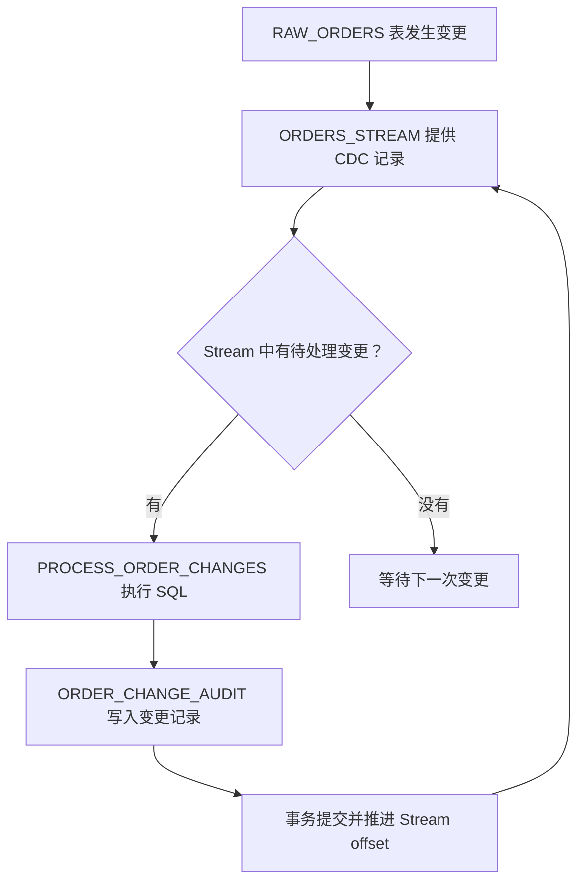
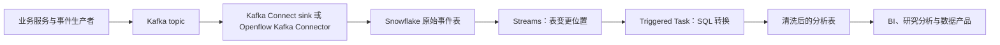
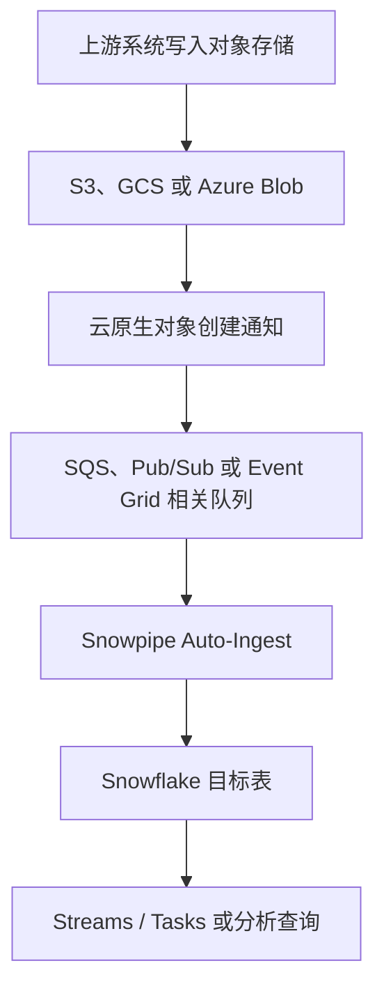
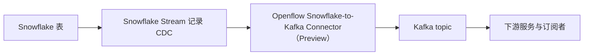
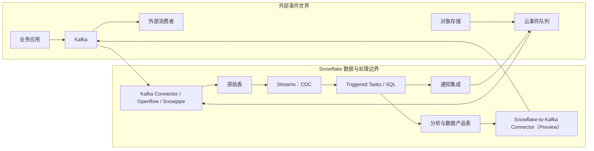
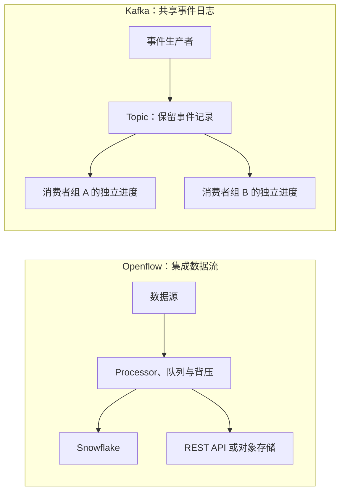
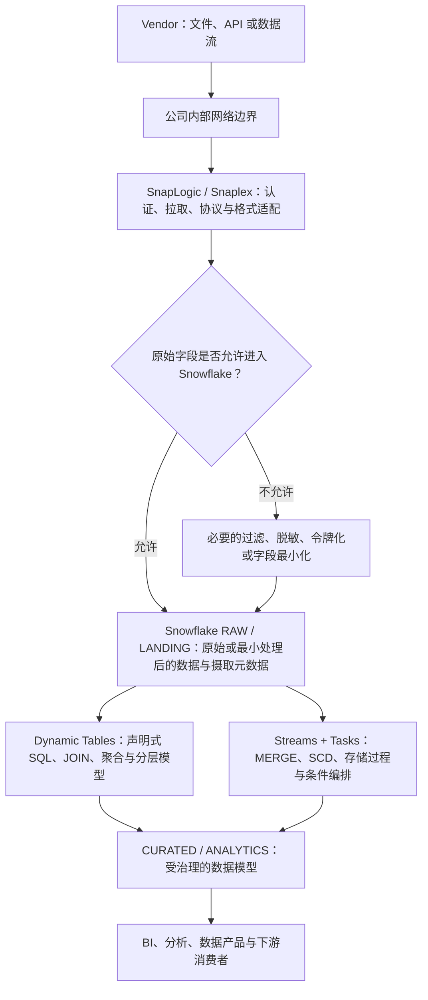
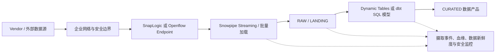

# Snowflake 与 Event-Driven Architecture：它有消息驱动能力，但不是 Kafka

> 核查日期：2026-10-27  
> 读者背景：了解 Kafka 的 topic、producer、consumer 和消费组，但刚开始接触 Snowflake。  
> 研究范围：Snowflake 原生的数据变更检测与任务触发、Kafka/云存储接入、向外部系统发送通知，以及数据变更向 Kafka 发布的能力。产品状态以本次核查时的 Snowflake 官方文档为准。

## 结论先行

Snowflake **具备事件驱动的数据处理能力，也能与外部消息系统集成**。同时还要把 Openflow 单独纳入分析：它是基于 Apache NiFi 的数据流集成平台，能够接入来源、缓冲数据、转换和路由，再把数据交付到目标系统；这让它可以在部分场景中承担原本由 Kafka 周边集成管道完成的职责。但 Openflow 的持久化工作队列不等于 Kafka 的共享事件日志。理解它们的关系，需要区分以下几类职责：

1. **事件进入 Snowflake。** Kafka 可以通过 Snowflake Connector for Kafka 或 Snowflake Openflow Kafka Connector 把 topic 中的数据写入 Snowflake；对象存储中的新文件也可以通过云厂商事件通知触发 Snowpipe 自动加载。
2. **Snowflake 内部因数据变化而处理。** Streams 让 SQL 查询表的变更数据（CDC），Triggered Tasks 可以在 Stream 检测到变更时触发 SQL 或存储过程，不需要定时轮询。
3. **Snowflake 把变化传播到外部。** Snowflake 可以向指定的云消息队列或受支持的 webhook 发送通知。将 Snowflake 表的 CDC 记录持续发布到 Kafka 的 Openflow Connector 也已出现，但截至核查日，该方向的 Snowflake-to-Kafka connector 仍标为 Preview。

因此，比较准确的定位是：**Kafka 负责通用事件分发与消费，Snowflake 负责事件数据的持久化、分析、CDC 和数据处理，并通过连接器或通知能力参与事件驱动流程。** 在某些数据管道中，Snowflake 自己也能充当触发处理和产生下游信号的节点；这不等于它可以替换 Kafka 的消息代理职责。

## 1. 先把 Kafka 术语映射到 Snowflake

Snowflake 是云数据平台，核心数据模型是表、查询、事务和数据管道。Kafka 是分布式事件流平台，核心抽象是按分区追加的日志、消费者偏移量和消费者组。两者都能处理持续到来的数据，但抽象层并不相同。

| Kafka 里的概念 | Snowflake 中最接近的能力 | 关键区别 |
| --- | --- | --- |
| Topic 中的事件记录 | 表中的行，或者写入表的原始事件 payload | Snowflake 表不是 Kafka topic；表记录的是数据状态，未必保留每一个中间业务事件 |
| Consumer offset | Stream 保存的源对象变更位置（offset） | Stream 是访问表变更数据的书签，不是独立存放消息的日志 |
| Consumer 处理新消息 | Triggered Task 消费 Stream 并运行 SQL | 触发条件是 Stream 中存在数据变更；任务启动和执行受 Snowflake 的任务运行机制约束 |
| Kafka Connect sink | Snowflake Connector for Kafka、Openflow Kafka Connector | 主要解决 Kafka 到 Snowflake 的摄取，不意味着 Snowflake 具备 Kafka broker 能力 |
| Kafka producer 向多个消费者发布消息 | Snowflake 通知集成、CDC 连接器、应用中间层 | 各种出口的协议、可用状态、投递语义和限制不同，不能统一视为通用发布 API |
| Kafka replay / consumer-group 隔离 | Stream offset、源表历史、独立消费设计 | Stream 可能因源对象的保留期而变为 stale；需要按消费者设计 Stream 和恢复机制 |

最容易误解的是 **Stream**。它的名字像一个消息流，但 Snowflake 官方把它定义为跟踪源表变更位置的对象。另一个容易混淆的名字是 **Openflow**：它不是 Snowflake 表内的 CDC 功能，而是一个构建和运行数据流的集成平台；它与 Kafka 可以互补，也可以在固定的集成流水线中替代 Kafka 的部分传输、过滤、转换和路由用途。查询 Stream 时，Snowflake 根据该位置和源对象的变更跟踪元数据返回 CDC 记录；Stream 本身不保存一份独立的消息副本。[Snowflake: Introduction to Streams](https://docs.snowflake.com/en/user-guide/streams-intro)

这会带来一个关键语义差异：标准 Stream 提供的是两个事务性时间点之间的行级差异，而不是保证逐条保留所有中间动作的业务事件日志。例如，一行在 Stream 的 offset 前进之前先插入又删除，标准 Stream 的净变化可能不返回这行；一次 UPDATE 通常表现为 DELETE 与 INSERT 两条带元数据的记录。若业务需要每一个“订单已支付”“交易已确认”事件都被永久、按顺序记录，不能只把一张当前状态表的 Stream 当成 Kafka topic。

## 2. Snowflake 原生的事件驱动处理：Streams + Triggered Tasks

### 2.1 Streams 提供 CDC，而不是消息代理

可以把 Stream 理解为某个表的变更读取位置。它读取源表的变更跟踪数据，并额外提供变更元数据，例如：

- `METADATA$ACTION`：记录对应的 INSERT 或 DELETE 操作。
- `METADATA$ISUPDATE`：指示该记录是否属于 UPDATE 操作；更新可能以 DELETE/INSERT 配对呈现。
- `METADATA$ROW_ID`：用于跟踪源对象中的行身份。

Stream 的位置会在使用它的 DML 事务成功提交后推进；如果事务回滚，位置不会以同样的方式推进。这意味着 Stream 消费可以与目标表写入放在一个 SQL 事务内处理。另一方面，未在源对象数据保留期内及时消费的 Stream 可能变为 stale，届时不能再读取缺失的历史变更，需要重建 Stream，并按业务策略补数或对账。[官方文档：Streams](https://docs.snowflake.com/en/user-guide/streams-intro)

### 2.2 Triggered Tasks 可以根据数据变化启动

Snowflake Task 不仅支持时间计划，也支持基于 Stream 变更的触发。通过 `WHEN SYSTEM$STREAM_HAS_DATA(...)` 声明触发条件，可以在新变更可处理时执行 SQL 或调用存储过程。对于数据到达时间不可预测的场景，这避免了持续高频轮询源表。[官方文档：Triggered Tasks](https://docs.snowflake.com/en/user-guide/tasks-triggered)

下面的例子把订单表的变更写入审计表。假设 `RAW_ORDERS`、`ORDER_CHANGE_AUDIT` 和计算资源已创建，且审计表字段与 SELECT 列匹配。

```sql
CREATE OR REPLACE STREAM ORDERS_STREAM
  ON TABLE RAW_ORDERS;

CREATE OR REPLACE TASK PROCESS_ORDER_CHANGES
  WAREHOUSE = TRANSFORM_WH
  WHEN SYSTEM$STREAM_HAS_DATA('ORDERS_STREAM')
AS
  INSERT INTO ORDER_CHANGE_AUDIT (
    ORDER_ID,
    STATUS,
    CHANGE_ACTION,
    IS_UPDATE,
    RECORDED_AT
  )
  SELECT
    ORDER_ID,
    STATUS,
    METADATA$ACTION,
    METADATA$ISUPDATE,
    CURRENT_TIMESTAMP()
  FROM ORDERS_STREAM;

ALTER TASK PROCESS_ORDER_CHANGES RESUME;
```

这里的处理链路是：



这段 SQL 是为了说明工作机制，不是完整的生产级订单事件设计。UPDATE 可能出现 DELETE/INSERT 配对；如果业务希望输出语义化的 `OrderUpdated` 而不是行级 CDC，需要在处理层定义合并、去重和事件建模规则。若需求是“所有订单状态变化都必须作为独立业务事件保存”，更稳妥的做法通常是在业务系统中写入具备稳定 `event_id` 的 append-only 事件记录或 transactional outbox，再把它送到 Kafka / Snowflake，而不是试图从当前状态表恢复所有历史语义。

### 2.3 触发式不等于毫秒级实时

截至 2026-10-27，Snowflake 的 Triggered Tasks 文档说明：默认触发的最小间隔为 30 秒，可用 `USER_TASK_MINIMUM_TRIGGER_INTERVAL_IN_SECONDS` 调低至 10 秒；同一个 Task 不会并发运行多个实例。Task 只有在被触发时才使用其执行所需的计算资源，但这仍然是数据平台的任务调度与 SQL 执行模型，不应当被理解为 Kafka consumer 持续拉取消息后的同步回调。

还需要处理以下运维问题：

- **未及时消费。** 监控 Stream 的 `STALE_AFTER` 等相关信息；任务停摆时，告警必须早于源数据保留窗口耗尽。
- **任务异常。** 监控 Task History、失败原因、运行时长和积压量。恢复后应明确是重跑、补数还是重建 Stream，并对目标数据做校验。
- **幂等。** 用稳定业务键、事件 ID 或 `MERGE` 语义使重试安全；不要假定一个下游业务副作用因用了 Stream 就自动获得端到端 exactly-once。
- **多个消费者。** 不要让多个独立消费者无意中争用同一个消费位置。分别设计读取位置、目标表和故障恢复责任。

如果目标只是把新数据转成清洗后的分析表，也应评估 Dynamic Tables 等声明式转换机制；不需要为了“事件驱动”一词就把每一个转换都设计成带副作用的 Task。

## 3. 外部事件如何进入 Snowflake

Snowflake 不是只能接收批量文件。当前官方产品路径至少包括以下几类。

### 3.1 Kafka topic 到 Snowflake

这是 Kafka 用户最容易理解的集成方式。

**Snowflake Connector for Kafka v4** 是在 Kafka Connect 集群中运行的 sink connector，读取一个或多个 Kafka topic，并将数据写入 Snowflake 表。官方文档说明，该版本基于 Snowpipe Streaming High Performance 架构，并宣称在特定配置下可达到每表最高 10 GB/s 摄取吞吐以及 5–10 秒端到端摄取到查询延迟，同时提供 exactly-once 与有序投递语义。这些数字和投递语义属于供应商能力说明，实际容量、延迟与业务端到端语义仍应以目标环境压测和故障测试为准。[Snowflake Connector for Kafka](https://docs.snowflake.com/en/user-guide/kafka-connector/index)

Snowflake 也提供 **Openflow Connector for Kafka**，官方文档当前标注为 Generally Available。它从 Kafka topic 读取实时事件，并通过 Snowpipe Streaming High Performance 写入 Snowflake 表，也支持面向 Snowflake-managed Iceberg 表的相关摄取场景。[Openflow Connector for Kafka](https://docs.snowflake.com/en/user-guide/data-integration/openflow/connectors/kafka/about)

两者都解决“Kafka 的数据如何进入 Snowflake”。Openflow 本身的范围比这个预置 Kafka connector 更广：它基于 Apache NiFi，允许把多种数据源、处理器和目标端组合为可运行的数据流，因此可用于更一般的集成和数据路由，而不仅是 Kafka 到 Snowflake 的一条连接。它们不会把 Snowflake 变成 Kafka broker，也不表示应用可以直接向 Snowflake topic 发送消息并获得 Kafka 的分区、消费组和 replay 语义。



这种模式下，Kafka 继续承担运营系统的事件分发；Snowflake 是事件的分析落地点与下游数据处理平台。若多个在线服务必须在数十毫秒内收到同一业务事件，应继续由 Kafka 或其他消息基础设施承担分发，不要让它们通过轮询 Snowflake 表来充当消费者。

### 3.2 对象存储的文件事件触发 Snowpipe

如果上游把数据文件写入 S3、Google Cloud Storage 或 Azure Blob Storage，Snowpipe Auto-Ingest 可以利用云存储的事件通知触发自动加载。Snowflake 文档说明，事件通知包含新文件路径，不是文件数据本身；Snowflake 再从已授权的 stage 读取文件并加载到目标表。官方描述的典型加载时间是文件到达后一分钟以内。[Snowpipe Auto-Ingest](https://docs.snowflake.com/en/user-guide/data-load-snowpipe-auto)

相关云事件链路包括：

| 云平台 | 文件事件通知链路（以官方文档列出的配置为准） | Snowflake 的作用 |
| --- | --- | --- |
| AWS | S3 ObjectCreated 事件，可经 SQS；某些方案使用 SNS / EventBridge 组合 | 根据通知发现新文件并自动加载 |
| Google Cloud | Cloud Storage 对象事件经 Pub/Sub topic 和 subscription | 消费文件到达通知并读取文件 |
| Azure | Blob 创建事件经 Event Grid，并使用相应队列配置 | 根据通知加载新增文件 |

这也是事件驱动，但事件主体是“某个对象可供加载”，而不是 Kafka 的业务消息。适合文件交付、数据湖和批流混合场景；如果生产者逐条发送应用事件，需要比较 Snowpipe Streaming / Kafka connector，而不是把每条事件先落成一个小文件，除非其成本和延迟经过验证。



### 3.3 外部系统通过通知集成与 Snowflake 协作

Snowflake 的通知集成不只用于接收事件。通过 `SYSTEM$SEND_SNOWFLAKE_NOTIFICATION`，Snowflake 可以向云服务提供的队列发送消息，包括 Amazon SNS、Google Cloud Pub/Sub 和 Azure Event Grid，也可以发送邮件或向受支持的 webhook 目标发送通知。[SYSTEM$SEND_SNOWFLAKE_NOTIFICATION](https://docs.snowflake.com/en/sql-reference/stored-procedures/system_send_snowflake_notification)

当前 webhook 文档列出的目标包括 Slack、Microsoft Teams、PagerDuty、Jira 和 ServiceNow，并明确说明 Snowflake 不会通过这项 webhook 通知功能向列表以外的系统直接发送 webhook。[Webhook Notifications](https://docs.snowflake.com/en/user-guide/notifications/webhook-notifications)

这项能力适合数据质量异常、任务失败、规则命中、指标越界或某个处理阶段完成后的通知与信号传递。它与通用消息代理仍有差异：云队列的具体投递与消费语义由对应服务决定；webhook 目标范围有限；如果需要高吞吐、多个独立消费者、严格的事件 schema 治理或复杂 replay，应先评估外部消息系统，而不是把通知函数当成 Kafka producer 的通用替代品。

Snowflake 外部函数（External Functions）则属于另一种机制：SQL 调用 Snowflake 之外的 HTTPS 服务，并在查询计算过程中取得函数返回值。它适合请求—响应型的外部计算或 API 集成，不应简单当成可靠的异步事件发布通道。[Introduction to External Functions](https://docs.snowflake.com/en/sql-reference/external-functions-introduction)

## 4. Snowflake 里的变化能否再发回 Kafka？

可以，但要严格核对实现方式和可用状态。

截至 2026-10-27，Snowflake 官方 **Openflow Connector for Snowflake to Kafka** 文档标注为 **Preview Feature**。该 connector 读取 Snowflake Stream 的 CDC 记录，并将变更消息发送到 Kafka topic，可用于把 Snowflake 表的变化传播给其他服务或构建下游事件驱动链路。[Openflow Connector for Snowflake to Kafka](https://docs.snowflake.com/en/user-guide/data-integration/openflow/connectors/snowflake-to-kafka/about)

官方页面同时列出当前限制：

- 一个 connector 只能从一个 Snowflake Stream 捕获 CDC。
- 发送的消息不带 schema。
- 不支持 schema evolution。

因此，不能只看到“Snowflake to Kafka”连接器存在，就把它视为已经具备所有生产级 CDC 发布特征。对于依赖稳定 schema、向后兼容、事件合同和大量 topic 的系统，这些限制会直接影响落地设计；Preview 状态也意味着需要核实目标区域的可用性、支持条款、升级策略和生产风险。



不要把这条路径与常见的 Kafka-to-Snowflake sink connector 混淆：前者把 Snowflake 的表变更发布到 Kafka；后者把 Kafka topic 中的事件摄取到 Snowflake。两者方向相反，成熟度和限制也可能不同。

如果“Snowflake 产出的结果必须立刻驱动支付、交易或其他高风险动作”，架构上不应只依赖一个仍处于 Preview 的 connector。可选方案包括：由产生业务决策的服务通过受控的 outbox / publisher 发布事件，或者把 Snowflake 的分析结果以有明确延迟、补发、幂等和监控策略的数据产品形式交付。选型需要针对实际 SLA 评估，并非所有系统都应该从 Snowflake 往 Kafka 回写。

## 5. 一个完整的 Snowflake 与 EDA 组合视图

下图把两种方向放在一起，区分了数据摄取、Snowflake 内部处理和外部事件传播。它是逻辑架构示意，并不是 Snowflake 对某种单一部署方式的强制要求。



在实际架构中，通常会为 Snowflake 内部数据处理和外部业务副作用设定不同的可靠性边界。Snowflake 适合把事件数据转化为有治理的分析数据；Kafka 适合在运营系统之间持续分发事件。若需要由 Snowflake 向外产生信号，通知集成适合有限的通知型需求；需要向 Kafka 发布高质量 CDC 时，则需认真对待 Openflow connector 的 Preview 状态和 schema 限制。

## 6. 与 Kafka 的能力边界对比

| 维度 | Kafka | Snowflake Streams + Tasks | Snowflake 与外部集成 |
| --- | --- | --- | --- |
| 核心抽象 | 持久化、分区化的事件日志 | 表的变更位置、CDC 记录和 SQL 任务 | connector、云队列、文件通知或 webhook |
| 主要用途 | 实时事件分发、流处理、多个消费者解耦 | 数据摄取后的增量转换、分析数据处理 | 系统集成、自动加载、通知和 CDC 传播 |
| 事件语义 | Producer 明确发布的消息 | 从表状态变化推导的行级变化，或被摄取的原始事件行 | 取决于对应 connector 或通知目标 |
| 消费隔离 | Topic、分区和 consumer group | Stream offset 与任务/消费者的设计 | 由队列服务、连接器和目标系统决定 |
| Replay / 恢复 | 受保留策略、offset 和 Kafka 运维能力约束 | 受 Stream offset、源表历史和保留期约束；stale 后需重建并补数/对账 | 由各自队列或 connector 的投递、日志和恢复机制决定 |
| 触发后的执行 | 消费者持续读取或由流处理引擎执行 | Task 调度并运行 SQL / 存储过程 | Snowpipe、通知函数或连接器的各自执行模型 |
| 对在线服务的低延迟分发 | 是其典型用途 | 不宜仅靠轮询 Snowflake 表替代 | 依 connector、队列和目标系统而定 |
| Schema 治理 | 可配合 Schema Registry 和 topic 合同 | 表 schema、SQL 转换、摄取校验 | Snowflake-to-Kafka Preview connector 当前文档不支持 schema evolution |
| 运维与成本关注点 | Broker、分区、复制、消费者积压等 | SQL 执行、Warehouse/Serverless 计算、存储历史、Task 失败、Stream staleness | connector 部署、权限、队列策略、投递失败和跨系统监控 |

不要把表里的对比理解成“谁更强”。它们关注的是不同的系统职责。若业务已有 Kafka 平台，通常没必要为了让 Snowflake “变成事件平台”而迁移掉 Kafka；重点应放在如何避免事件重复定义、如何把 Kafka 中的事件数据可靠地送入 Snowflake，以及是否确实需要从 Snowflake 向外发布变化。

## 7. Openflow / Apache NiFi 能替代 Kafka 的哪些职责？

Snowflake 官方将 Openflow 定义为基于 Apache NiFi 的托管集成服务，支持把多种来源的数据送往不同目标，并提供结构化与非结构化数据、批处理与流式摄取等能力。官方文档将它定位为数据集成平台，而不只是 Kafka 与 Snowflake 之间的连接器。[Openflow overview](https://docs.snowflake.com/en/user-guide/data-integration/openflow/about)

NiFi 的核心抽象是 **FlowFile + Processor + Connection Queue**：FlowFile 带有 payload 与属性；Processor 负责接收、处理或发送数据；Connection Queue 在处理步骤之间缓冲数据。NiFi 以 FlowFile Repository、Content Repository 和 Provenance Repository 持久化在途记录、内容和处理历史；队列还能通过背压限制积压。它因此具备比“简单 connector”更丰富的集成中间层能力。[Apache NiFi In Depth](https://nifi.apache.org/nifi-docs/nifi-in-depth.html)

| Kafka 常见职责 | Openflow / NiFi 能力 | 取舍与边界 |
| --- | --- | --- |
| 从来源接收消息或数据 | 通过 Processor 接入数据库、文件、HTTP、Kafka、云服务等来源 | 具体协议与 Processor 能力取决于版本、可用组件和部署配置 |
| 过滤、转换、路由 | 通过 Processor 和连接关系组合处理逻辑 | 适合由平台团队定义的显式数据流；复杂流程的版本管理与维护仍需治理 |
| 缓冲与流量控制 | Connection Queue、队列阈值和背压 | 能避免下游变慢时无限制吞入数据，但要容量规划磁盘、内存与积压恢复时间 |
| 多目标分发 | 同一 FlowFile 可按条件路由或分支到多个目标 | 适合已知目标端的流程内扇出；不是自动提供任意团队独立订阅的 Topic 合约 |
| 在途数据持久化和失败恢复 | FlowFile / Content Repository、重试路径、错误路由、DLQ 流程 | 取决于存储、队列、处理器和重试配置；成功交付后，数据通常会退出在途队列，不等于无限期保留事件日志 |
| 数据流可追踪性 | Provenance 记录 FlowFile 经历的处理步骤 | 保留时间和内容归档由配置控制，不能直接当作 Kafka topic 的长期重放策略 |
| 多消费者独立进度与历史重放 | 可显式构建多条流程，但没有与 Kafka Topic、Partition、Consumer Group 和各自 offset 完全等价的共享日志模型 | 如果新消费者需要独立从历史 offset 重读，Kafka 更直接、更符合该抽象 |

这意味着，**Openflow 可以替代 Kafka 的一部分职责，但是否能拿掉 Kafka，要看它目前承担的是“集成流水线”还是“共享事件日志”**。如果上游数据经过一个平台统一过滤与转换，再交付到几个明确目标，消费者不需要独立控制 offset，也没有长时间保留和任意重放需求，那么 Openflow 可以成为主要的数据流中介，减少单独部署 Kafka 的理由。若多个业务域要独立订阅同一批事件、各自推进消费进度、在故障后重播历史，Kafka 的事件日志模型更合适。[Apache Kafka Quickstart](https://kafka.apache.org/quickstart/)



### 哪些场景值得先评估 Openflow-only？

- 数据从数据库、SaaS、文件或 HTTP 来源进入 Snowflake 或少数固定目标，主要需求是抽取、清洗、映射和交付。
- 同一数据流需要做字段过滤、格式变换、错误路由、有限的多目标分发与背压控制。
- 目标端和流程由一个数据平台团队管理，不要求每个下游团队都独立选择消费起点或重播事件。
- 引入 Kafka 主要是为了传输和缓冲，而不是依赖 Kafka 的跨团队事件契约、长期保留与独立消费模型。

### 哪些情况不宜把 Openflow 视作 Kafka 的完整替代品？

- 多个独立业务应用需要订阅同一业务事件，并具有不同的消费进度、部署节奏和故障恢复周期。
- 事件必须在明确的保留期限内留存，允许新消费者从历史位置开始重放，或者需要审计性地重复处理历史事件。
- 业务把分区键、分区内顺序、消费者组、offset、topic 权限和事件 Schema 生命周期作为平台契约。
- 系统需要以高吞吐共享事件总线连接多个领域，而不希望每个新消费方都改动一条由中心团队管理的数据流。

Openflow 也可以连接到 Kafka，并支持 Kafka 数据摄取；Snowflake 的 Openflow Kafka connector 文档当前标注为 Generally Available。反方向的 Openflow Snowflake-to-Kafka connector 则仍标注为 Preview，且当前文档列出单个 connector 只能读取一个 Stream、发送消息不带 Schema、不支持 Schema evolution 的限制。因此，“Openflow 能接 Kafka”与“Openflow 本身可以代替 Kafka”是两个不同命题。[Openflow Kafka connector](https://docs.snowflake.com/en/user-guide/data-integration/openflow/connectors/kafka/about) [Snowflake-to-Kafka connector](https://docs.snowflake.com/en/user-guide/data-integration/openflow/connectors/snowflake-to-kafka/about)

### 替代前应做的验证

不要只用成功路径的吞吐测试决定是否移除 Kafka。至少应验证：运行时重启与节点故障后，在途数据是否完整恢复；下游持续变慢时，背压是否生效、队列何时达到容量边界；重试是否会造成重复写入，目标端能否幂等；错误记录是否进入可运营的 DLQ；数据流成功交付后是否仍需要历史重放；增加一个新消费方时，需要独立订阅还是修改既有 Flow；以及目标吞吐、端到端延迟、积压排空时间、磁盘容量和整体运维成本。Openflow-only 只有在这些需求都得到满足时才是简化架构，而不只是把 Kafka 运维成本换成另一套运行时风险。

## 8. 推荐的架构模式

### 模式 A：在线业务事件由 Kafka 分发，Snowflake 做分析

这是已采用 Kafka 的团队最直接的模式。业务服务发布带有稳定 `event_id`、事件类型、业务对象 ID、发生时间和 schema 版本的消息；Kafka 负责订阅者解耦和事件分发；Snowflake connector 将事件写入原始表；Snowflake Streams / Tasks 或 Dynamic Tables 承担增量数据处理，产出报表、风险分析、研究特征和受治理的数据产品。

优点是在线业务路径不会依赖分析仓库的任务触发延迟；缺点是必须治理 Kafka 与 Snowflake 两端的数据合同、时间语义、重复数据和数据延迟。建议在原始层保留事件 ID 与摄取时间，监控 Kafka 消费 lag、Snowflake 摄取延迟、数据质量失败率以及原始层到分析层的处理延迟。

### 模式 B：文件交付驱动数据管道

当上游按文件交付数据时，云对象创建通知驱动 Snowpipe 加载，之后由 Streams / Tasks 进行增量处理。它减少了无谓轮询和人为调度，但要处理重复对象通知、同一路径覆盖、文件不完整、权限错误、schema 变化以及队列或 pipe 暂停超过保留窗口的问题。这里的“事件”只负责发现文件，内容仍从对象存储读取。

### 模式 C：Snowflake 的规则结果驱动通知

例如监控表中的风险指标或数据质量阈值，当检测到异常后由 Task 调用存储过程发送邮件、webhook 或云队列消息。消息应包含规则 ID、被检测对象、结果时间、关联运行 ID 和查询详情地址，而不是直接把大批业务数据塞进通知里。

此模式适合告警和工作流信号。若接收方会执行有副作用的操作，仍需有接收端去重、身份验证、授权校验、失败重试与人工处理路径；通知发送成功也不代表业务动作已成功完成。

### 模式 D：Snowflake 的表变更驱动外部消费者

当其他系统真的需要订阅 Snowflake 数据变化时，可以考虑 CDC 发布，但要先确认 connector 可用状态和限制。目前 Openflow Snowflake-to-Kafka 仍为 Preview，且不支持 schema evolution。若这是关键生产链路，应先做小规模验证和故障演练，并准备可审计的重放 / 对账方案；不要把“官方文档列出 connector”直接等同于“该 connector 已满足生产级事件合同和恢复要求”。

## 9. 落地时需要验证的可靠性、治理和成本问题

**事件定义。** 表的行级 CDC 不自动等于业务事件。对于订单、交易、持仓、基金会计或参考数据，应该分清“业务事实事件”（例如成交确认）与“当前数据状态发生变化”。如果需要严格保留业务事件顺序、业务因果和审计语义，应由业务边界生成正式事件，而不是事后从当前状态表猜测。

**重复与幂等。** 在每一层明确唯一键、事件 ID 和重放策略。摄取 connector 的投递语义不能推导出从业务系统到最终副作用的全链路 exactly-once。涉及外部通知或写操作时，接收端应幂等，并对已处理事件留存可查询的结果。

**失败恢复。** 为 Stream 消费建立 stale 预警，记录最近成功时间、处理到哪个业务时间或事件 ID，以及补数后如何去重。对于 Snowpipe，要监控文件通知、pipe load history 和失败文件；对于 Kafka connector，要同时监控 Kafka lag、连接器任务状态和 Snowflake 的数据到达延迟；对于通知路径，要有失败日志、告警和人工补发流程。

**Schema 与数据质量。** 在原始层保留源事件和必要的 metadata；在清洗层定义类型检查、字段缺失策略、事件版本兼容性和坏记录隔离。Snowflake-to-Kafka Preview connector 的当前限制尤其意味着，不能假设目标 Kafka topic 的 schema 会随着 Snowflake 表结构变更自动演进。

**权限和信任边界。** connector 应使用专用身份和最小权限；Snowflake 的 Stream、源表、Task、Warehouse、notification integration 和外部队列分别设置访问控制。消息只包含接收方实际需要的字段，敏感信息尽量以受控引用而不是原文传播。Webhook URL / key 等秘密应通过受控 secret / integration 配置管理，不应写入 SQL 明文或日志。

**成本。** “事件驱动”减少空轮询，并不意味着处理免费。要评估 Snowpipe 或 Snowpipe Streaming 的摄取费用、Warehouse / Serverless Task 的计算、Stream 相关历史保留带来的存储成本、connector 的运行资源和外部队列成本。用真实峰值吞吐、批量大小、触发频率和失败重试场景测算，而不是只比较一个 nominal latency 数字。

## 10. 选型建议

| 需求 | 建议起点 | 不应忽略的条件 |
| --- | --- | --- |
| 多个在线服务订阅高频业务事件 | Kafka 或既有企业消息平台 | 分区键、顺序、保留、消费组、重放、DLQ 和事件合同 |
| Kafka 数据供分析、BI 或模型训练使用 | Snowflake Connector for Kafka v4 或 Openflow Kafka Connector | 结合版本、部署模式和实际负载做延迟与恢复测试 |
| 新文件到达后自动入仓 | Snowpipe Auto-Ingest | 云通知配置、文件完整性、重复通知、pipe 状态和历史窗口 |
| Snowflake 表变化后执行 SQL 转换 | Streams + Triggered Tasks，或评估 Dynamic Tables | Task 触发间隔、单任务串行、Stream staleness、幂等和监控 |
| 数据质量或风险规则命中后发送告警 | Notification Integration / `SYSTEM$SEND_SNOWFLAKE_NOTIFICATION` | webhook 目标限制、接收端去重、秘密管理和失败补发 |
| Snowflake CDC 需要发布给 Kafka 消费者 | 评估 Openflow Snowflake-to-Kafka connector | 当前为 Preview；一个 connector 对应一个 Stream；无 schema；不支持 schema evolution |
| 每一个业务事件都必须留存、可审计、可重放 | 业务 outbox / append-only event log + Kafka，再落入 Snowflake | 不要只依赖当前状态表的标准 Stream 重建业务事件历史 |

## 11. 最终判断

Snowflake 确实有内建事件驱动机制：Streams 负责发现表的 CDC，Triggered Tasks 可以因变更而启动；Snowpipe 可以由对象存储事件通知触发；通知集成可以向外部队列或受支持的 webhook 发送消息；而 Openflow 也开始提供 Snowflake CDC 到 Kafka 的反向路径。

不过，不能把这些能力统称为一个 Kafka 替代品。Streams / Tasks / Snowpipe 负责 Snowflake 内部的 CDC、任务触发与数据加载；Openflow / NiFi 可以承担跨系统抽取、过滤、转换、缓冲、背压和固定路由等集成职责；Kafka 则提供持久化的共享事件日志、Topic、分区、独立消费者组和消费位点。若需求主要是将数据从来源可靠地搬运、转换到 Snowflake 或几个固定目标，Openflow 可能让 Kafka 不再必要；若需要多个业务消费者独立订阅、按自己的进度重播保留期内的事件，则不应只凭 Openflow 的持久化队列就移除 Kafka。

真正的架构决策不应停留在“是否支持事件驱动”这个二元问题。应根据事件的来源、语义、消费方、延迟目标、重放要求和动作风险，决定哪一层拥有事件的权威记录、哪一层拥有分发职责，以及失败后由谁负责补偿和对账。

## 附录 A：Vendor 数据经过 SnapLogic 后进入 Snowflake，转换放在哪一层？

### 场景与结论

本附录分析一条具体的数据交付链路：Vendor 提供文件、API 或消息，数据先进入公司内部网络，再由 SnapLogic / Snaplex 接入与转换，最后写入 Snowflake。问题不是 Snowflake 是否能做相同转换——多数常见的数据整形都能做——而是**转换应该发生在数据集成边界，还是在数据仓库内部**。

通常更合理的方向是 **SnapLogic 负责接入与边界处理，Snowflake 负责主要的仓库内业务转换**，而不是在 SnapLogic 中完成所有转换后只把最终结果写入 Snowflake。前提是组织允许原始或经过最小必要处理的数据进入 Snowflake，并且转换主要属于 SQL 擅长的集合式数据处理。若有数据不能以原始形态离开公司安全边界，则必须先在内部对其进行脱敏、令牌化、过滤或最小化；不能为了采用 ELT 而越过数据政策。

这是一项有条件的架构建议，不是要求把 SnapLogic 的所有转换逻辑迁移出去。SnapLogic 的 Transform Snap Pack 本来就支持格式转换、字段映射、过滤、聚合、条件处理和加解密；其 Snowflake Snap Pack 也支持 Bulk Load、Upsert、执行 SQL 和 Snowpipe Streaming。因此两端都具备转换能力，关键在于按职责划分转换的所有权，而非按产品功能重复实现。[SnapLogic Transform Snap Pack](https://docs.snaplogic.com/snaps/snaps-core/sp-transform/sp-transform-about.html) [SnapLogic Snowflake Snap Pack](https://docs.snaplogic.com/snaps/snaps-data/sp-snowflake/sp-snowflake-about.html)

### 推荐架构：先可靠落地，再在 Snowflake 内部完成业务转换



图中的 Dynamic Tables 与 Streams + Tasks 是按逻辑选用的替代路径，并不意味着同一份转换必须在两套机制里重复实现。Snowflake 的决策指南建议：以 SELECT 定义、包含 JOIN / 聚合 / 多阶段分层的声明式 SQL 管道，优先考虑 Dynamic Tables；需要存储过程、MERGE、显式调度、条件逻辑或自定义重试时，考虑 Streams + Tasks。[Snowflake Dynamic Tables decision guide](https://docs.snowflake.com/en/user-guide/dynamic-tables/decision-guide) [Streams and Tasks](https://docs.snowflake.com/en/user-guide/data-pipelines-intro)

### 应当把哪些转换留在 SnapLogic？

SnapLogic 更适合处理必须在进入 Snowflake 之前完成、或者本质上属于跨系统集成的逻辑：

| 转换 / 处理类型 | 建议放置位置 | 原因 |
| --- | --- | --- |
| 调用 Vendor API、分页、认证、速率限制、文件下载、协议适配 | SnapLogic | 属于来源系统接入，不是仓库数据建模 |
| CSV / XML / JSON 等格式解析、压缩处理、Vendor 字段到统一接入结构的基本映射 | SnapLogic，或保留原始载荷后在 Snowflake 解析 | 取决于解析复杂度、下游是否还需要原始字段，以及 Vendor schema 变化频率 |
| 法规或内部安全政策要求在数据出内网前完成的脱敏、令牌化、字段剔除 | 公司内部网络中的 SnapLogic / 受控服务 | 这是信任边界要求，不能单纯为了数据工程便利而后移到仓库 |
| 对 Vendor 格式进行最低限度的合法性检查、拒绝无法解析的消息、记录原始文件 / 请求标识 | SnapLogic | 保护摄取链路，确保坏数据有可追踪的错误路径；应保留隔离和重放手段 |
| 调用多个外部系统、编排 API 副作用、跨系统补偿 | SnapLogic 或专门的集成 / 工作流平台 | Snowflake 不是通用的 API 集成运行时 |
| 数据加载到目标表所需的轻量字段重排、类型转换或列裁剪 | COPY 转换或加载连接器 | Snowflake 的 COPY 支持一部分加载时转换，可避免为了简单投影额外维护一层 ETL；复杂逻辑仍应放在后续 SQL 模型中。[COPY transformation](https://docs.snowflake.com/en/user-guide/data-load-transform) |

不建议把大量 JOIN、跨 Vendor 数据合并、时间窗口聚合、历史版本建模和分析维度计算全部写成逐条 SnapLogic Mapping。它们通常在 Snowflake 中以集合式 SQL 执行更自然，也更容易与目标数据模型、访问控制、数据质量测试及下游查询一起管理。SnapLogic 当然可以实现其中某些处理，但“可以实现”不等于把它放在这层最容易维护。

### 应当优先在 Snowflake 内部完成哪些转换？

| 转换 / 处理类型 | 推荐实现 | 主要理由 |
| --- | --- | --- |
| 多张源表的 JOIN、去重、聚合、窗口计算、维度与事实表构建 | Dynamic Tables 或版本化 SQL / dbt 模型 | 数据已在同一查询引擎内，集合式计算避免先把数据逐条搬到集成运行时再写回 |
| Bronze / Silver / Gold 或 Raw / Standardized / Curated 分层 | Dynamic Tables；也可用现有 dbt 项目编排 | 模型边界清楚，便于复用 SQL、观察依赖并重新计算派生数据 |
| Vendor 字段映射为企业统一业务定义、跨源对账、数据质量检查 | Snowflake SQL 模型和测试 | 业务规则与实际被分析的数据放在同一平台，减少 SnapLogic 与 Snowflake 中重复维护规则 |
| 增量数据合并、MERGE、SCD Type 2、需要程序化控制的处理 | Streams + Tasks、SQL 或存储过程 | 对有状态更新、分支逻辑和显式调度的工作流提供控制 |
| 对已加载数据进行补算、重算、修复历史映射 | Snowflake 内保留的 RAW 数据 + 可重复执行的转换模型 | 业务规则变化时不必要求 Vendor 重新发送，也不必回到 SnapLogic 的旧 pipeline 重新造数 |

Snowflake 官方文档明确支持加载后再通过 Dynamic Tables 或 Streams + Tasks 进行转换；Dynamic Tables 以目标查询定义结果并管理刷新，Streams + Tasks 更适合程序化和显式编排的场景。[Overview of data loading](https://docs.snowflake.com/en/user-guide/data-load-overview) [Dynamic Tables decision guide](https://docs.snowflake.com/en/user-guide/dynamic-tables/decision-guide) 若团队采用 dbt 管理 SQL 模型、测试和依赖，也可以继续使用现有工程化工作流；不需要为了“原生”而强制把所有模型改成某一种 Snowflake 对象。[dbt Projects on Snowflake best practices](https://docs.snowflake.com/en/user-guide/data-engineering/dbt-projects-on-snowflake-best-practices)

### Vendor 数据先入仓，是否意味着所有 RAW 数据都可以直接放入 Snowflake？

不是。这个问题首先是数据安全与网络架构决策，其次才是 ETL / ELT 的技术取舍。

Snowflake 是由云平台承载的服务，不能像传统数据库一样安装在公司的本地机房或私有云中。因此“先进入公司内部网络”不代表后续写入 Snowflake 仍然留在公司内部网络。若组织要求连接经私有网络链路，可评估 Snowflake 的 inbound private connectivity；当前官方文档将该能力标记为 Business Critical（或更高版本）要求，具体配置还取决于云平台、区域和账户配置。[Private connectivity for inbound network traffic](https://docs.snowflake.com/en/user-guide/private-connectivity-inbound) 私有网络连接保护传输路径，但不自动替代数据分类、字段最小化、访问控制、保留期限或加密策略。

推荐先与 Security / Data Governance 确认以下问题：

1. Vendor 原始载荷中是否有禁止进入云数仓的字段？如果有，应在内网边界完成脱敏、令牌化或剔除，并保留可审计的处理记录。
2. 是否允许在受限 RAW schema 中短期保存原始数据？如果允许，应采用独立角色、最小授权、保留与删除策略，避免全体分析用户默认能够读取原始敏感字段。
3. 是否需要原始文件或记录用于调查、差异对账和重放？如果需要，应明确保存的权威副本、保留期限、文件 / 请求 ID、源端版本以及清理责任。
4. Snowflake 连接采用什么网络路径？确认账户是否支持和已配置私有连接、Snaplex 所在网络能否到达目标端、身份验证与网络策略是否匹配；不能把“启用了 TLS”当作“使用了私有网络”。

### 继续用 SnapLogic 转换，还是改成 Snowflake ELT？

最终应按转换的性质、数据政策和成本作决策，而不是比较两边谁的功能列表更长。

| 判断维度 | 更倾向 SnapLogic 转换 | 更倾向 Snowflake 内部转换 |
| --- | --- | --- |
| 转换目的 | 为接入协议和 Vendor 格式做适配、跨系统调用、出内网前脱敏 | 分析业务逻辑、跨表合并、维度模型、聚合与历史建模 |
| 转换依赖 | 依赖外部 API、逐项调用、跨系统顺序或副作用 | 主要依赖已进入 Snowflake 的数据 |
| 数据量与计算 | 低复杂度、流式逐条处理，或加载前必须过滤大量无用数据 | 大批量集合式 JOIN / 聚合，或需要反复重算与补数 |
| 原始数据留存 | 由于政策原因不能把原始载荷写入 Snowflake；需先脱敏 | 政策允许受控 RAW 层，且需要审计、对账、重新处理 |
| 业务规则治理 | 规则是接入特定 Vendor 的适配规则 | 规则定义企业统一业务语义，供多个数据产品复用 |
| 可运维性 | 有成熟 SnapLogic 技能、监控、错误 pipeline 和发布治理，且逻辑规模适合该平台 | SQL 是团队主要数据工程语言，需版本化模型、数据测试、刷新依赖与血缘 |

建议以一两个 Vendor feed 做小规模重构对照，而不是一开始迁移所有 pipelines。选择存在跨表 JOIN / 聚合的代表性样本，比较现有 SnapLogic ETL 与“SnapLogic 最小预处理 + Snowflake RAW + Native ELT”两种路径，统一测量端到端延迟、数据完整性、失败恢复、补数难度、变更交付时间、计算费用、SnapLogic 执行资源和日常支持成本。另行测试坏记录、重复交付、迟到数据、Vendor schema 演进以及 SQL 规则改变后的历史重算。

如果采用新模式，必须定义唯一的转换所有权：SnapLogic 不要继续保留一份“方便起见”的完整业务转换，而 Snowflake 又重做一份相同逻辑。上游保留接入与安全边界处理，Snowflake 模型拥有仓库业务转换；双方通过清晰的输入合同、运行 ID、源记录 ID、摄取时间、错误隔离和可重放路径衔接。

**综合建议：** 对“Vendor 数据进入内网，经 SnapLogic 转换后写入 Snowflake”这条链路，先检查 SnapLogic 的转换是否主要是在做接入适配，还是已经承担了大量仓库业务建模。如果是后者，并且组织允许原始 / 最小处理后的数据进入 Snowflake，那么把主要 JOIN、聚合、规范化、历史建模和分析逻辑迁到 Snowflake，通常更自然，也更容易复算和复用；但不要迁移必须在内网完成的安全处理、外部 API 编排或无法由仓库 SQL 合理表达的集成逻辑。

## 附录 B：截至 2026 年 10 月 27 日，值得关注的 Snowflake 新特性

本附录不是 Snowflake 全部新功能的罗列，而是从官方 release notes 中挑选与前文三个架构问题最相关的能力：Openflow 能否成为集成入口、Vendor 数据进入 Snowflake 后如何更自然地做 ELT，以及流式数据管道如何监控、治理和恢复。状态以 **2026-10-27** 为截止日期；GA、Preview、Public Preview 和 Private Preview 不应混为一谈，实际可用区域、版本与部署方式仍需逐项核实。

### B.1 优先评估：直接影响现有数据管道的特性

| 优先级 | 特性与发布日期 | 截至截止日的状态 | 为什么值得关注 | 对当前架构的建议 |
| --- | --- | --- | --- | --- |
| P1 | **Openflow Endpoints**，2026-10-16 | GA，适用于 Snowflake deployments 与 BYOC；部署有最低版本要求 | 可为兼容的 HTTP Listen processor 暴露稳定 HTTPS URL，外部客户端不必因为 runtime 或 processor 内部变化而改地址，并可用 Snowflake service user 的 PAT 做认证 | 若 Vendor 支持 webhook / HTTP push，可评估由 Vendor 将通知或事件送到 Openflow flow，再由 Openflow 验证、路由和落地；不能将稳定 URL 等同于完整 API 网关或 Kafka topic |
| P1 | **Snowpipe Streaming event table monitoring**，2026-09-24 | 已发布 | 可以通过事件表查询行数、服务端延迟、行 / channel 错误与 channel 活动，并据此构建 SQL 监控和告警 | 若采用 Snowpipe Streaming 或 Kafka / Openflow 实时摄取，建立端到端摄取 SLO，而不只监控 connector 进程存活；同时保留源端 lag / 队列指标 |
| P1 | **Dynamic Tables ADAPTIVE refresh**，2026-07-30；故障切换后继续增量刷新，2026-09-30 | 两项均 GA | ADAPTIVE 默认尝试增量刷新；当系统判断增量刷新成本显著高于全量刷新时会重新初始化。支持的 Dynamic Tables 在 failover group 提升备用端后也能继续增量刷新 | 对 Raw → Standardized → Curated 中主要由 SQL 定义的 JOIN、聚合和分层转换优先试点；仍要核对依赖图、刷新目标、可增量化条件和实际计算成本 |
| P1 | **dbt Projects on Snowflake 更新**，2026-10-20 | 功能已发布；具体能力按文档和配置适用 | 包括 dbt State 以复用或跳过不必重建的模型、source freshness 状态、跨项目依赖可视化、从 Query History 重跑失败模型 | 如果团队已有 dbt，不必为了“原生 Snowflake”而把模型改写为 Dynamic Tables；可以先将 dbt 的增量执行、数据新鲜度和故障恢复纳入 Snowflake 运行治理 |
| P1 | **Openflow runtime / connector 持续更新**，截至 2026-10-22 有新版本 | 随 runtime / extension 版本发布 | 近期修复了嵌套 JSON 数组 schema inference 与记录写入问题；PostgreSQL CDC 在写入或提交批次失败时不再推进 WAL 位置，有利于避免因提前推进位置而漏掉变更 | 若考虑用 Openflow 减少 SnapLogic 或 Kafka 周边集成组件，除了评估功能覆盖，还应对照版本历史、升级策略和 CDC 失败恢复行为做验证 |
| P1 | **数据血缘扩展**，2026-10-06 | 已发布；部分关系只对发布后创建或重新创建的对象记录 | 增加 storage integration → stage、stage → external table，以及某些 Cortex Search 内容表与服务的关系 | 为 Vendor → stage / external table → RAW / Dynamic Table → 数据产品建立可查询的依赖视图；不要假设旧对象自动补齐所有新血缘关系 |
| P1 | **敏感数据访问与数据导出监控**，2026-10-20 至 2026-10-26 | Sensitive Data Entitlement / Access reports 为 GA；Trust Center Data Security scanner package 于 2026-10-26 GA | 可检查哪些用户、角色和权限能访问敏感表，哪些用户在时间窗口内访问过敏感数据；安全扫描器可检测向内外部 stage 卸载数据的异常行为 | 对 Vendor 原始层、脱敏层和分析层设置不同权限；核查敏感数据访问路径，并对异常 unload 建立调查和响应流程。Sensitive Data reports 要求 Enterprise Edition 或更高版本 |
| P2 | **Snowflake-provided tags**，2026-10-20 | GA | 提供统一的 sensitivity、environment、project、cost center、certification status 等通用标签，避免各账户自行重复造词汇表 | 将 Vendor、数据域、环境、敏感级别、数据责任人和认证状态纳入一致的标签体系，可与既有 Horizon Catalog / 治理策略配合使用 |

官方资料：[Openflow Endpoints](https://docs.snowflake.com/en/release-notes/2026/other/2026-10-16-openflow-endpoints-ga)、[Snowpipe Streaming monitoring](https://docs.snowflake.com/en/release-notes/2026/other/2026-09-24-snowpipe-streaming-monitoring)、[Dynamic Tables ADAPTIVE refresh](https://docs.snowflake.com/en/release-notes/2026/other/2026-07-30-dynamic-tables-adaptive-refresh-mode-ga)、[Dynamic Tables after failover](https://docs.snowflake.com/en/release-notes/2026/other/2026-09-30-dynamic-tables-incremental-refresh-after-failover)、[dbt Projects updates](https://docs.snowflake.com/en/release-notes/2026/other/2026-10-20-dbt-projects-on-snowflake-updates)、[Openflow version history](https://docs.snowflake.com/en/user-guide/data-integration/openflow/version-history)、[data lineage update](https://docs.snowflake.com/en/release-notes/2026/other/2026-10-06-lineage-integrations-monitors-search)、[Sensitive Data reports](https://docs.snowflake.com/en/release-notes/2026/other/2026-10-20-sensitive-data-entitlement-access-reports-ga)、[Data Security scanner package](https://docs.snowflake.com/en/release-notes/2026/other/2026-10-26-trust-center-data-security-scanner-package-ga)、[Snowflake-provided tags](https://docs.snowflake.com/en/release-notes/2026/other/2026-10-20-snowflake-provided-tags-ga)。

### B.2 对 Vendor → SnapLogic → Snowflake 流程最有用的组合

与其一次性引入所有新能力，更实际的是组合三个层次：

1. **入口与接入：Openflow Endpoints / SnapLogic。** 如果 Vendor 能调用 webhook，可比较“Vendor → SnapLogic endpoint”和“Vendor → Openflow endpoint”两条路径。Openflow Endpoints 提供稳定的 HTTPS 入口，但具体 flow 仍要处理身份认证、payload 校验、限流、重复交付、错误响应和重试。SnapLogic 若已有成熟运行保障，没必要仅因为 Openflow 新能力 GA 就立即重写。
2. **可靠摄取：Openflow / Snowpipe Streaming + 事件监控。** 对持续到达的记录监控服务端延迟、行错误、channel 错误与活跃状态。对文件交付则继续评估 Snowpipe Auto-Ingest；两者解决的不是同一种数据输入形态。
3. **仓库内转换：Dynamic Tables 或 dbt。** SQL 模型较声明式、主要是 JOIN / 聚合 / 分层时，测试 Dynamic Tables 的 ADAPTIVE refresh；已有 dbt 资产时，先利用 dbt State、source freshness、模型失败重跑和依赖图增强治理。两者不要求二选一，但应有明确的模型所有权，避免同一业务规则在 SnapLogic、dbt 和 Dynamic Tables 中重复实现。



图中是可选能力的逻辑组合，不表示每个系统都必须由同一工具实现。Openflow endpoint 也不是 Snowflake 内建 SQL 触发器：它是外部 HTTP 请求的接入点，必须与后续的 flow、持久化、错误处理和交付目标一起设计。

### B.3 有条件值得关注：取决于业务目标

| 特性 | 官方状态 / 日期 | 适用条件 | 不应误解为 |
| --- | --- | --- | --- |
| **Online Feature Store** | GA，2026-10-20；AWS / Azure 商业区域可用，不支持 Google Cloud | 希望用 Snowflake 数据构建低延迟在线特征，为实时欺诈检测、推荐、个性化或在线推理提供特征；支持 batch、stream 与实时 feature views，并有 online service 监控 | 不是通用消息代理或 OLTP 数据库的完整替代品；上线前要测在线读延迟、写入更新、成本与目标区域支持 |
| **Declarative Feature Store** | GA，2026-10-21 | 希望把 entities、data sources、feature views / groups 等资源以可版本控制的 YAML / Python spec 管理，并使用 `snow feature` CLI plan-and-apply | 只有在实际建设 Feature Store / ML 特征管理时才需要，不是一般 ELT 的前置依赖 |
| **Semantic Studio** | GA，2026-09-30 | 需要用 Git-backed YAML 管理 Semantic Views，以稳定的业务定义支持分析或语义层消费 | 不能替代数据建模、业务术语治理和数据质量验证 |
| **Zero-copy Workday Data Cloud integration** | GA，2026-10-07 | Vendor 源确实是 Workday Data Cloud，且目标场景满足该集成的支持范围时，可避免复制数据或另建 ETL pipeline | 不是适用于任意 Vendor API 的通用 zero-copy 集成 |
| **Snowpipe Streaming 写入分区化 Snowflake-managed Iceberg 表** | GA，2026-09-24；支持 Iceberg v2 / v3 的 Snowflake-managed tables，当前公告不包括 Streaming Classic 和 externally managed Iceberg tables | 数据产品希望以开放 Iceberg 表承接持续摄取，并需要按分区组织表数据 | 不意味着任何 Iceberg 表、任意 writer 或所有外部 catalog 都自动获得同样能力 |
| **Parquet Direct** | Preview，2026-10-16 | 有大量已在对象存储中的 Parquet 文件，希望登记为只读 Iceberg 表并原位查询，减少复制或重写 | 仍是 Preview；也不是适合所有需要写入、更新或流式 CDC 的场景 |

资料：[Online Feature Store GA](https://docs.snowflake.com/en/release-notes/2026/other/2026-10-20-online-feature-store-ga)、[Declarative Feature Store GA](https://docs.snowflake.com/en/release-notes/2026/other/2026-10-21-declarative-feature-store-ga)、[Semantic Studio GA](https://docs.snowflake.com/en/release-notes/2026/other/2026-09-30-semantic-studio-ga)、[Workday Data Cloud integration](https://docs.snowflake.com/en/release-notes/2026/other/2026-10-07-zero-copy-workday-data-cloud)、[Snowpipe Streaming for partitioned Iceberg](https://docs.snowflake.com/en/release-notes/2026/other/2026-09-24-snowpipe-streaming-partitioned-iceberg-ga)、[Parquet Direct](https://docs.snowflake.com/en/release-notes/2026/other/2026-10-16-parquet-direct-preview)。

### B.4 哪些 Preview 值得观察，但不应立即作为关键生产依赖？

- **IPADDRESS 数据类型（Preview，2026 年 10 月）**：当 Vendor 数据包括 IPv4 / IPv6、网段匹配或基于 IP 的分组和关联时有用；适合安全、网络和欺诈数据，不是一般数据集成的关键依赖。见 [Preview features](https://docs.snowflake.com/en/release-notes/preview-features)。
- **Cortex AI Function Evaluation / Optimization（Public Preview，2026-09-21）**：如果计划在 Snowflake SQL 转换中使用 AI 函数，需要对输出质量和调用成本做可重复评估，可跟踪这些能力；不应把概率性 AI 输出当成确定性字段转换或强制数据质量规则的替代品。见 [Feature releases 2026](https://docs.snowflake.com/en/release-notes/feature-releases-2026)。
- **Responses API for Cortex REST API（Preview，2026-10-23）**：对需要以 OpenAI-compatible Responses API 接入 Snowflake Cortex 模型的应用集成有意义；与 Vendor 数据入仓、Dynamic Tables 和 Openflow 选型没有直接关系，应放在 AI 应用接口选型中独立评估。见 [All release notes](https://docs.snowflake.com/en/release-notes/all-release-notes)。

Preview 的存在证明产品已公开宣布该能力，不自动证明它适合所有区域、账户、 SLA 或关键生产链路。应核实当前 Preview 条件、部署范围、数据处理边界、API 兼容性和退出方案；若关键路径依赖仍在 Preview 的功能，应写入架构风险记录并建立替代路径。

### B.5 建议的评估顺序

按当前讨论的架构背景，我会把后续评估分为三个短周期，而不是做一场“Snowflake 所有功能”的全面 POC。

| 顺序 | 验证主题 | 最小验证内容 | 决策输出 |
| --- | --- | --- | --- |
| 1 | Openflow endpoint 与 SnapLogic 入口对比 | 用一个 Vendor webhook / HTTP feed 测量认证、响应行为、重复投递、持久化、错误队列和网络策略 | 保留 SnapLogic、改用 Openflow，或按协议分工 |
| 2 | Snowflake ELT 与增量刷新 | 选择一个包含 JOIN / 聚合的 Vendor feed，对比现有 SnapLogic ETL、Dynamic Tables ADAPTIVE 与现有 dbt 的延迟、计算成本和补数流程 | 选定转换所有权和模型执行方式 |
| 3 | 摄取可观察性、血缘和数据安全 | 配置 Snowpipe Streaming event table monitoring，检查对象血缘，试用敏感数据 entitlement / access reports 与 Trust Center scanner | 形成能覆盖 source、ingestion、transformation、consumer 的监控与审计指标 |

**综合判断：** 截至 2026-10-27，最值得优先试点的是 Openflow Endpoints、Snowpipe Streaming 监控、Dynamic Tables 的 ADAPTIVE / failover 增量刷新，以及 dbt Projects 的状态与新鲜度能力。它们直接影响前文讨论的入口、转换和运营可靠性。数据治理方面，10 月 20 日到 26 日的敏感数据访问报表、统一 tags 和 Data Security scanner 也值得纳入平台基线。Online Feature Store、Declarative Feature Store、Semantic Studio 与 Iceberg / Parquet 能力应按实际数据产品目标评估，而不是因为它们较新就全部引入。

## 参考资料

以下包含 Snowflake、SnapLogic、Apache NiFi 和 Apache Kafka 项目的官方文档。本文核查了页面当前标注的功能状态和限制；厂商能力说明可以证明文档所述能力，不等于独立验证了生产成熟度或目标环境下的性能。

1. [Introduction to Streams](https://docs.snowflake.com/en/user-guide/streams-intro) — Stream offset、CDC、更新记录语义、staleness 与源对象历史。
2. [Triggered Tasks](https://docs.snowflake.com/en/user-guide/tasks-triggered) — 数据变更触发、触发间隔、串行执行与配置。
3. [Introduction to Streams and Tasks](https://docs.snowflake.com/en/en/user-guide/data-pipelines-intro) — 连续数据管道的总体介绍。
4. [Snowflake Connector for Kafka](https://docs.snowflake.com/en/user-guide/kafka-connector/index) — Kafka-to-Snowflake sink connector v4、性能声明与摄取架构。
5. [Openflow Connector for Kafka](https://docs.snowflake.com/en/user-guide/data-integration/openflow/connectors/kafka/about) — 从 Kafka 摄取数据，官方页面标记为 Generally Available。
6. [Automate Snowpipe with Cloud Event Notifications](https://docs.snowflake.com/en/user-guide/data-load-snowpipe-auto) — S3、GCS、Azure 的自动入仓通知流程。
7. [SYSTEM$SEND_SNOWFLAKE_NOTIFICATION](https://docs.snowflake.com/en/sql-reference/stored-procedures/system_send_snowflake_notification) — 向邮件、webhook 或云消息队列发送通知。
8. [Sending Webhook Notifications](https://docs.snowflake.com/en/user-guide/notifications/webhook-notifications) — 当前受支持的 webhook 目标及限制。
9. [Openflow Connector for Snowflake to Kafka](https://docs.snowflake.com/en/user-guide/data-integration/openflow/connectors/snowflake-to-kafka/about) — Snowflake Stream CDC 到 Kafka；截至核查日为 Preview，并列出 schema 和连接器数量限制。
10. [Introduction to External Functions](https://docs.snowflake.com/en/sql-reference/external-functions-introduction) — Snowflake 中 SQL 调用外部 HTTPS 服务的请求—响应模型。
11. [About Openflow](https://docs.snowflake.com/en/user-guide/data-integration/openflow/about) — Openflow 基于 Apache NiFi 的集成平台、部署方式和职责定位。
12. [Apache NiFi In Depth](https://nifi.apache.org/nifi-docs/nifi-in-depth.html) — FlowFile、FlowFile / Content / Provenance Repository，以及数据流的持久化机制。
13. [Apache Kafka Quickstart](https://kafka.apache.org/quickstart/) — Kafka topic、持久化事件和多个消费者重读事件的基本模型。
14. [Openflow version history](https://docs.snowflake.com/en/user-guide/data-integration/openflow/version-history) — 用于核对 Openflow runtime 与 connector 的当前版本变更；文档截至 2026-10-27 已列出 2026-10-22 更新。
15. [Snowflake Dynamic Tables decision guide](https://docs.snowflake.com/en/user-guide/dynamic-tables/decision-guide) — 声明式 SQL 管道与 Streams / Tasks 的选型。
16. [Overview of data loading](https://docs.snowflake.com/en/user-guide/data-load-overview) — COPY、Snowpipe、Snowpipe Streaming 及加载后的转换选项。
17. [Transform data during a load](https://docs.snowflake.com/en/user-guide/data-load-transform) — COPY INTO 中支持的加载时基础转换。
18. [SnapLogic Transform Snap Pack](https://docs.snaplogic.com/snaps/snaps-core/sp-transform/sp-transform-about.html) — 格式转换、映射、过滤、聚合和条件逻辑。
19. [SnapLogic Snowflake Snap Pack](https://docs.snaplogic.com/snaps/snaps-data/sp-snowflake/sp-snowflake-about.html) — Bulk Load、Upsert、SQL 执行与 Snowpipe Streaming。
20. [SnapLogic error handling](https://docs.snaplogic.com/design-integrations/error-handling.html) — Snap 级错误处理与 Error Pipeline。
21. [Private connectivity for inbound network traffic](https://docs.snowflake.com/en/user-guide/private-connectivity-inbound) — Snowflake 服务的入站私有连接及版本要求。
22. [dbt Projects on Snowflake best practices](https://docs.snowflake.com/en/user-guide/data-engineering/dbt-projects-on-snowflake-best-practices) — 在 Snowflake 中管理 SQL 模型与运行时的建议。
23. [Oct 16, 2026: Openflow Endpoints GA](https://docs.snowflake.com/en/release-notes/2026/other/2026-10-16-openflow-endpoints-ga) — 稳定 HTTPS URL 路由到 Openflow HTTP Listen processors。
24. [Sep 24, 2026: Snowpipe Streaming event table monitoring](https://docs.snowflake.com/en/release-notes/2026/other/2026-09-24-snowpipe-streaming-monitoring) — 用事件表检查摄取延迟、行错误和 channel 状态。
25. [Jul 30, 2026: Dynamic Tables ADAPTIVE refresh GA](https://docs.snowflake.com/en/release-notes/2026/other/2026-07-30-dynamic-tables-adaptive-refresh-mode-ga) — 根据变更规模选择增量刷新或重新初始化。
26. [Sep 30, 2026: Dynamic Tables after failover GA](https://docs.snowflake.com/en/release-notes/2026/other/2026-09-30-dynamic-tables-incremental-refresh-after-failover) — 满足条件的 Dynamic Tables 可在故障切换后继续增量刷新。
27. [Oct 20, 2026: dbt Projects on Snowflake updates](https://docs.snowflake.com/en/release-notes/2026/other/2026-10-20-dbt-projects-on-snowflake-updates) — dbt State、source freshness、跨项目依赖和失败模型重跑。
28. [Sep 24, 2026: Dynamic table incremental refresh with VALUES](https://docs.snowflake.com/en/release-notes/2026/other/2026-09-24-values-dynamic-table-incremental-refresh) — VALUES 子句用于 Dynamic Table 增量刷新。
29. [Sep 23, 2026: Non-deterministic aggregate functions with incremental refresh](https://docs.snowflake.com/en/release-notes/2026/other/2026-09-23-non-deterministic-aggregate-incremental-refresh) — 扩大支持增量刷新的聚合表达式范围。
30. [Oct 6, 2026: Data lineage expansion](https://docs.snowflake.com/en/release-notes/2026/other/2026-10-06-lineage-integrations-monitors-search) — 为更多存储集成、stage、external table 与服务增加血缘关系。
31. [Oct 20, 2026: Sensitive Data Entitlement and Access reports GA](https://docs.snowflake.com/en/release-notes/2026/other/2026-10-20-sensitive-data-entitlement-access-reports-ga) — 敏感数据的权限覆盖和访问历史报告。
32. [Oct 26, 2026: Trust Center Data Security scanner package GA](https://docs.snowflake.com/en/release-notes/2026/other/2026-10-26-trust-center-data-security-scanner-package-ga) — 检测向内部 / 外部 stage 异常卸载数据。
33. [Oct 20, 2026: Snowflake-provided tags GA](https://docs.snowflake.com/en/release-notes/2026/other/2026-10-20-snowflake-provided-tags-ga) — 统一敏感度、环境、项目和成本中心等标签。
34. [Oct 20, 2026: Online Feature Store GA](https://docs.snowflake.com/en/release-notes/2026/other/2026-10-20-online-feature-store-ga) — 支持低延迟在线特征获取和实时 ML 推理。
35. [Oct 21, 2026: Declarative Feature Store GA](https://docs.snowflake.com/en/release-notes/2026/other/2026-10-21-declarative-feature-store-ga) — 以版本控制的 YAML / Python spec 部署 Feature Store 资源。
36. [Sep 30, 2026: Semantic Studio GA](https://docs.snowflake.com/en/release-notes/2026/other/2026-09-30-semantic-studio-ga) — 以 YAML 与 Git 管理 Semantic Views。
37. [Oct 7, 2026: Zero-copy Workday Data Cloud integration GA](https://docs.snowflake.com/en/release-notes/2026/other/2026-10-07-zero-copy-workday-data-cloud) — 对支持的 Workday 数据提供无复制访问。
38. [Sep 24, 2026: Snowpipe Streaming for partitioned Iceberg tables GA](https://docs.snowflake.com/en/release-notes/2026/other/2026-09-24-snowpipe-streaming-partitioned-iceberg-ga) — 持续摄取到 Snowflake-managed partitioned Iceberg 表。
39. [Oct 16, 2026: Parquet Direct Preview](https://docs.snowflake.com/en/release-notes/2026/other/2026-10-16-parquet-direct-preview) — 从已有 Parquet 文件创建只读 Iceberg 表的 Preview 能力。
40. [Snowflake server and feature release notes](https://docs.snowflake.com/en/release-notes/new-features) — 本文按 2026-10-27 截止日期核查的最新发布索引。
41. [Preview features](https://docs.snowflake.com/en/release-notes/preview-features) — 当前 Preview 特性、适用条件和可用范围。
