# Transformer 在金融交易序列建模中的应用综述

**从 Ramp 的实时卡交易欺诈检测，到交易基础模型、AML、信用风险与生产化实践**  
研究基准日：2026 年 10 月 24 日  
面向读者：金融服务业 Solution Architect、Risk / Fraud / AML、数据平台与机器学习工程团队

---

## 摘要

本文研究的不是把交易记录序列化成普通文本，再交给通用大语言模型“读一遍”，而是把每笔交易、账户行为和数字交互视为带时间戳、事件类型和多个字段的序列。模型先通过**自监督学习**（不需要人工逐条标注答案，而是从事件本身设计练习题）学习行为规律，再通过**监督学习**（用已确认的欺诈、违约等标签训练）解决具体业务任务，最后把行为表示、逐字段异常分数或下一事件预测结果接入金融决策系统。这里的行为表示也叫 **embedding**：它是模型把一段历史压缩成的一串数字，供下游模型使用。XGBoost / LightGBM 是一种常见的下游分类器，但不是必选项；逻辑回归、小型 MLP、风险评分模型、规则引擎或多模型决策服务都可以消费序列模型产物。

Ramp 在 2026 年 10 月公开的案例是目前最直接的生产实践之一：小型 Transformer 从持卡人的历史交易中学习“正常行为”，输出 embedding（把历史压缩成一串数字的向量表示）、各字段 surprisal（当前字段在历史上下文中有多意外）分数和字段替换分数，再交给既有 XGBoost 对每笔授权评分。Ramp 报告，在相同拦截预算下，新方案较旧模型多捕获 32% 的欺诈金额；但这一总增益不能全部归因于 Transformer。其消融结果显示，金额加权损失本身贡献了大部分金额收益；Transformer 相对于采用相同损失的 XGBoost（一种常用于结构化表格数据的树模型），将 Average Precision（衡量模型把少数正例排到前面的综合指标）提高了 12%。上线早期曾因推理耗时翻倍而回滚，随后通过去除无效 padding、避开 Python 垃圾回收开销和直接构建小型输入，将模型栈中相关步骤的中位延迟从 145 ms 降至 65 ms，后续达到 54 ms，说明模型价值必须与线上工程共同评估。[1]

截至本报告日期，证据已不止 Ramp 一例。2026 年 IEEE Conference on Artificial Intelligence 收录的 FraudTransformer 使用 HSBC Payment Fraud Group 的数千万笔交易及辅助事件，针对不规则事件间隔显式设计时间编码；PRAGMA、TREASURE、TransactionGPT 等工作则把研究范围扩展到跨任务交易表示、数十亿级支付交易和交易异常识别。与此同时，一项 2026 年的 Temporal Contrastive Transformer 预印本展示了相反方向的结果：序列 embedding 单独有预测力，但加到强特征工程基线后没有提升。这是很重要的工程结论：**Transformer 学到“有信息”的表示，不等于它能在现有模型和特征之上带来增量价值。** [3][5][8][9][11]

建议的金融服务落地方式通常不是替换现有风控系统，而是建立一个小型、可复现、低延迟的序列表示层，以严格的 point-in-time 数据构造和时间外验证证明增量价值，再将其作为现有模型的补充。需要优先解决的往往不是模型规模，而是标签延迟、交易事件时间与入库时间的区别、历史特征的训练/在线一致性、长尾商户编码、阈值与损失的业务含义、模型解释、漂移监控和回滚能力。

## 阅读本文前：先认识几个深度学习术语

如果你熟悉编程，但刚开始接触深度学习，可以先记住下面这些概念。本文后续会用到它们；它们不是需要先学完一门数学课才能理解的东西。

| 术语 | 用普通话解释 | 在交易序列项目里的例子 |
|---|---|---|
| **神经网络（neural network）** | 一组可训练的数学计算。训练时反复调整内部数字，让预测越来越接近目标 | 输入交易历史，输出风险分数 |
| **参数（parameter）** | 模型在训练中学到的数字。参数量是模型大小的一种粗略指标，不等于准确率 | 1M 参数约为 100 万个可学习数字 |
| **Embedding（向量表示）** | 把商户、账户或一段历史转换成一串数字，让模型能计算它们之间的关系 | “常在本地消费的客户”和“频繁跨国消费的客户”可能形成不同的历史表示 |
| **Encoder（编码器）** | 读取输入并把它转换成有用表示的模型部分；它不一定直接生成文字 | 读最近 100 笔交易，输出一条账户历史向量 |
| **Attention（注意力机制）** | 让模型在处理当前事件时，学习历史中的哪些事件更值得参考 | 当前大额交易可能需要关注最近的密码重置和新设备登录 |
| **Loss（损失函数）** | 衡量模型当前预测错得有多严重；训练就是不断调整参数来降低这个数 | 漏掉 1,000 美元欺诈是否应比漏掉 5 美元欺诈受到更大惩罚 |
| **Epoch（训练轮次）** | 模型把训练样本完整看过一遍，称为一轮；轮数多不一定更好 | 训练 5 轮后验证集变差，可能已经过拟合 |
| **Batch（批次）** | 一次送进模型一起计算的一小组样本 | 每次处理 256 个账户的历史，而不是一次处理全部数据 |
| **过拟合（overfitting）** | 模型记住了训练数据的细节，却无法在未来新数据上保持效果 | 随机切分成绩很好，按月份测试时却明显下降 |
| **时间外测试（out-of-time test）** | 用较晚时间的数据检验模型，模拟真实上线后面对未来交易的情况 | 用 1–6 月训练、7 月调参、8–9 月做最终测试 |
| **Precision / Recall** | Precision 看模型报警里有多少真问题；Recall 看所有真问题中抓住了多少 | 调查团队每天只能查 1,000 笔时，重点看前 1,000 笔里有多少欺诈，以及漏掉多少 |
| **PR-AUC / Average Precision** | 综合衡量模型把少数正例排到前面的能力；欺诈很少时，通常比单看准确率更有参考价值 | 10 万笔交易只有 100 笔欺诈，全部判正常也有 99.9% 准确率，但没有任何风控价值 |
| **校准（calibration）** | 模型给出的风险概率是否和现实发生比例相符 | 被预测为 10% 风险的 1,000 笔交易，长期看是否约有 100 笔发生目标事件 |
| **消融实验（ablation）** | 每次去掉一个组件，检查它到底有没有贡献 | 对比“原有 GBDT”“GBDT + Transformer embedding”“再加 surprisal”，而不是只比较两个完全不同的系统 |
| **数据漂移（drift）** | 线上数据或欺诈手法变了，模型面对的情况和训练时不同 | 新支付方式上线，或攻击者开始使用新的设备农场 |

**先记住一个关键点：参数多不等于模型好。** 对交易风控而言，数据时间是否正确、标签是否成熟、测试方式是否公平、线上是否来得及返回结果，通常比把模型从 5M 参数加到 50M 更重要。

---

## 关键结论

1. **值得验证的默认模式是“历史序列编码器 + 现有决策模型”，而不是一开始就以 Transformer 全面替换树模型。** Transformer 对行为顺序、事件间隔、字段之间的条件关系有潜在优势；树模型仍擅长利用稳定的结构化特征、业务规则和延迟到达的监督标签。
2. **自监督学习是低标签金融场景的重要价值来源。** 下一事件预测、掩码字段重建、历史重建、字段替换检测和对比学习，都可以从海量未标注交易中学习用户/账户行为表示。下游 fraud label 仍然用于校准与分类，不应与“正常行为”混为一谈。
3. **把不规则时间间隔建模好，通常比单纯拉长序列更重要。** 一分钟内连续的小额尝试、隔数天的规律付款、账单周期内行为，与仅知道事件顺序是不同的问题。事件位置、绝对时间、相邻时间差和周期性时间特征应分别设计和消融。
4. **不要用总体 ROC-AUC（随机抽一笔正例和一笔负例，检查模型是否把正例排得更靠前）作为唯一上线标准。** 应在固定拦截/调查预算下比较 Recall、Precision@K、Average Precision / PR-AUC、欺诈金额覆盖率、误拒付成本、校准质量以及关键客群和欺诈类型的表现。
5. **延迟标签是生产风控中非常容易被低估的风险。** Stripe 在 2026 年公开了欺诈争议报告逐渐到达的时间分布：支付后第 14 天约报告 41%，第 30 天约 66%，第 60 天约 86%。最新交易集中的“非欺诈”里可能包含尚未报告的欺诈；若把未知标签强行当负例，模型和离线评估都可能被误导。[2]
6. **实时系统必须先定义降级和时延预算。** 在线特征读取、序列构造、模型推理、决策引擎和授权网络共用时延预算；外部 LLM 调用通常不适合放在同步授权路径中。异常或超时应降级到已验证的旧模型/规则，而不是让支付链路等待。
7. **金融基础模型正在出现，但应把证据分层。** 学术论文、预印本、公司声明、离线实验、线上 A/B 与长期运营效果不是同一种证据。本文在每个案例中标明公开证据类型，不把厂商自报指标当成可迁移的行业基准。

## 目录

- 阅读本文前：深度学习术语速查

1. 问题定义：交易序列 Transformer 究竟在学什么
2. Ramp 案例解剖：模型、训练目标、收益归因与延迟优化
3. 技术模式图谱：从 next-event 到交易基础模型
4. 研究与论文地图
5. 非 LLM 深度学习模型与业界实践
6. 生产实践：真实案例与证据边界
7. 金融服务用例与架构适配
8. 生产参考架构
9. 从零开始做交易序列模型：模型选择、数据准备、训练、测试与在线学习
10. 专用序列模型、通用 LLM 与 Jev 如何协同
11. 评估方案：从离线排名到业务收益
12. 上线、可观测性、解释与模型风险管理
13. 常见失败模式与决策清单
14. 实施路线图与验收标准
- 最终建议
15. 趋势分析与研究判断：2027 年及以后，非 LLM 深度学习还有必要吗？
16. 参考文献与开源资源

- 附录 A：核心架构的 Mermaid 图源（可编辑）
- 附录 B：用开源金融数据从零训练交易序列模型
- 附录 C：用公开市场数据构建投资研究与多资产分析 PoC
- 附录 D：使用 Transformer 做多资产投资研究
- 附录 E：使用 Gradient Boosting Tree 做多资产投资研究
- 附录 F：使用 Transformer 进行波动率预测与市场状态识别
---

## 1. 问题定义：交易序列 Transformer 究竟在学什么

### 1.1 一个交易不是一个孤立的表格行

传统监督式风控通常把当前交易映射为一行特征：金额、商户类别、国家、设备、IP、账户年龄，以及 5 分钟 / 1 小时 / 1 天 / 30 天窗口内的交易次数和金额。GBDT 或逻辑回归再根据这些特征输出风险分数。这个方法有效、成熟，也容易落地；但固定窗口聚合会丢失一部分顺序和条件关系。例如：

- “午餐 → 网约车 → 午餐 → 软件订阅 → 电子产品大额消费”与“连续尝试小额授权 → 换商户 → 立刻大额交易”，即使计数相似，行为含义也可能不同。
- 两位客户都第一次在某商户消费，但一个是稳定旅行者，另一个过去只在本地购买小额日常商品，风险含义不应相同。
- 连续 3 笔交易都发生在 2 分钟内，与 3 笔交易分散在 3 周内，事件计数相同但时间结构不同。
- 支付交易前的登录、设备绑定、收款人新增、密码重置、收款账户变更等事件，可能比交易本身更早暴露风险。

交易序列模型把截至决策时点已经发生且系统已经知道的事件作为历史上下文，学习行为如何随时间演化。令实体（持卡人、账户、企业或设备）在时点 $`t`$ 的可见历史为：

```math
H_{u,t} = \{e_i : \mathrm{event\_time}_i < t,\ \mathrm{observed\_time}_i \leq t\}
```
这里刻意同时约束了事件发生时间与系统观测时间：事件在现实中发生，不代表授权服务在该时刻已经收到它。训练时若只按业务发生时间取历史、不约束入库/传播时间，就可能得到线上不可复现的“未来信息”。

当前待评分交易写作 $`x_t`$。序列编码器可以输出上下文表示 $`z_t=f_\theta(H_{u,t})`$，再以一个或多个任务头产生：

- **行为 embedding**：把历史压缩成稠密向量，供下游分类、排序或风险决策使用。
- **逐字段 surprisal（意外程度）**：例如商户、金额、国家、支付方式在当前上下文下的负对数似然，衡量每个字段与历史模式的偏离程度。
- **替换/一致性分数**：判断当前事件中某些字段是否像是从其他交易拼接而来。
- **下一事件/下一字段预测**：预测下一个商户类别、金额区间、支付通道或事件类型。
- **监督式风险分数**：直接利用有标签的欺诈、违约或异常案例训练分类头。

### 1.2 三种经常被混淆的“Transformer 用法”

| 类型 | 输入和目标 | 典型用途 | 注意事项 |
|---|---|---|---|
| 单行表格 Transformer | 只读当前交易一行，建模同一行的字段交互 | 一般结构化风险预测 | 不等于序列建模；未必优于 GBDT |
| 交易/行为序列 Transformer | 每个事件有多个字段和时间，编码账户历史 | 行为异常、欺诈、信用风险、下一事件预测 | 事件顺序、时间间隔、实体边界与 point-in-time 正确性是核心 |
| 通用 LLM 读取 JSON/文本 | 将每笔交易序列化为文本，再用通用语言模型推理 | 调查辅助、案例归纳、非同步分析 | token 浪费、schema 噪声、时延与成本高；通常不宜放在授权热路径 |

TabTransformer 是第一类代表；TabFormer、FraudTransformer、Ramp 的方案以及交易基础模型属于不同程度的第二类。第三类可用于 AML 案件总结或分析员 copilot，但不要因为它“也是 Transformer”就认为它与结构化行为序列编码器具有相同的输入效率、目标函数和服务约束。[4][16]

### 1.3 为什么自监督目标和欺诈分类目标要分开

大多数交易没有已确认的欺诈标签，标签往往要经过客户争议、卡组织调查或人工案件结论才能成熟。自监督预训练可以利用未标注行为学习“哪些事件通常在什么上下文中出现”；有标签的监督模型再学习“哪些偏离与欺诈损失相关”。二者回答不同问题：

- “不常见”不等于“欺诈”。新工作、旅行、促销季、业务扩张都可能造成行为变化。
- “常见”不等于“安全”。攻击者可能先通过低金额测试，或者模仿正常行为。
- “模型认为意外”也不等于“可以直接拒绝”。它应是证据之一，与已知欺诈标签、设备/网络关联、业务规则、金额和风险偏好共同决定动作。

Ramp 的实践很有代表性：Transformer 不独立作最终拒绝决策，而是给既有 XGBoost 提供嵌入和异常分数；最后仍由监督式风险模型综合原有特征与新增特征。[1]

---

## 2. Ramp 案例解剖：模型、目标、收益归因与延迟优化

### 2.1 在线评分路径

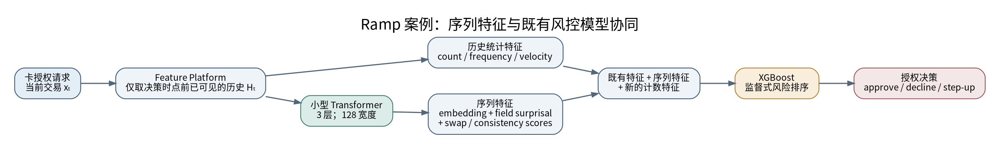

Ramp 在 2026 年 10 月 7 日公开的工程文章称，其新模型会在每次 Ramp 卡授权时读取持卡人在同一企业范围内、跨该持卡人的多张卡的近期交易。特征平台提供历史数据；同一份特征定义既用于 Snowflake 的离线训练回填，也用于流式在线视图，尽量保证训练和服务读取的是同一种历史定义。文章明确说明：历史事件只有在交易发生且已到达系统后，才能被当前授权使用。[1]

### 2.2 事件字段与高基数商户编码

每个历史事件包括商户、商户类别、国家、金额、支付方式/卡呈现方式、授权是否成功，以及到当前时点的时间间隔。金额不是单独的一行统计；它与商户、支付方式、时间等字段一起形成事件上下文。模型对“相同金额在不同人的历史里意味着什么”进行条件建模。

商户 ID 是一个高基数字段，也是参数和服务开销的主要来源。Ramp 的做法不是给所有商户无限扩张独立 embedding，而是采用分层映射：

- 最常见的 20,000 个商户有独立 token。
- 约 210 万个出现次数至少达到阈值的长尾商户，按商户类别哈希到共享槽位。
- 极少见或未见过的商户，退回到商户类别级 token，使新商户仍然可以利用类别语义。
- 文中总计约 47,000 个商户相关 token；商户 embedding 和下一商户预测层占模型权重的大多数。

这种方式牺牲了部分商户级精细度，换取词表上限、较小的模型和对新商户的鲁棒性。它尤其适合商户持续新增、线上不能频繁因词表变化而重新训练的场景。[1]

### 2.3 三个自监督任务

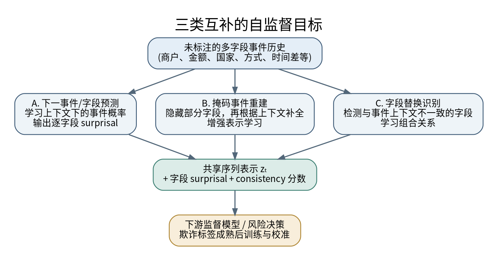

**任务 A：下一事件字段预测。** 使用截至事件 $`e_t`$ 之前的历史来预测下一笔交易的不同字段，例如商户类别、金额区间、国家和支付方式。每个字段都能得到预测概率，负对数似然就形成字段级 surprisal：

```math
s_{t,j} = -\log P\left(x_{t,j} \mid H_{u,t}\right)
```
商户惊奇分数高，代表该商户在此历史下不太常见；金额分数高，代表金额不符合这一行为上下文。这些分数比一个笼统的“异常分”更容易进入下游风控模型和调查证据。

**任务 B：掩码事件重建。** 随机隐藏历史里部分事件或字段，再让模型根据可见上下文补全。这个目标与 BERT 的 masked language modeling 思路类似，利用同一序列里的更多训练位置来学习上下文表示。但用于在线预测当前事件时，必须保证输入中的任何字段都不是由待预测结果或未来事件泄露得到的。

**任务 C：字段替换识别。** 把一笔真实交易的部分字段替换成另一笔交易的字段，例如将原商户、金额、国家或卡呈现方式中的一项换成别的样本，再让模型判断哪些片段不属于同一事件/上下文。它训练模型识别“单个字段各自看起来都合理，但组合起来与行为历史不一致”的情况。这个想法与 BERT 的一致性训练有相似之处，但应针对结构化交易属性设计负例。

Ramp 的 Transformer 使用三层 attention、128 维宽度；两年交易数据的一次训练 pass 在 4 张 L40S GPU 上用时不到 1.5 小时。这里的重点并不是“大模型”，而是足够小、足够快、能够频繁重训并产生有价值的行为特征。[1]

### 2.4 两阶段训练，以及收益的正确归因

第一阶段使用大量未标注交易做自监督预训练，产出 embedding、字段 surprisal 和字段替换分数。第二阶段冻结 Transformer，对所有交易计算这些特征，再连同既有风控特征、近期计数统计训练 XGBoost。文章指出欺诈标签通常晚几周才到达；新模型第二阶段没有通过抽掉大部分正常交易来降低样本量，而是使用金额加权的训练损失，让大额欺诈的捕获更有业务权重。[1]

| Ramp 公布的对比结果 | 结果 | 正确解读 |
|---|---:|---|
| 新模型 vs 旧 XGBoost，在相同拦截预算下捕获欺诈金额 | +32% | 是完整方案的总收益，不是 Transformer 单独带来的收益 |
| 金额加权 XGBoost vs 旧模型 | 欺诈金额 +29% | 说明主要金额增益来自损失函数和目标权重的变化 |
| 加入 Transformer 特征 vs 同损失的 XGBoost | Average Precision +12% | 更接近 Transformer 的增量排序收益 |
| 加入 Transformer 特征 vs 旧模型 | Average Precision +14% | 同时包含表示学习和其它调整的综合影响 |
| 在半数拦截预算下，与金额加权 XGBoost 比较 | 先前已批准的欺诈多捕获 24% | 指向对旧模型漏掉的欺诈模式有补充价值 |
| 对每张卡的第一笔欺诈，在半数预算下 vs 金额加权模型 | 欺诈金额多捕获 9% | 重点是第一笔欺诈之前没有“先前欺诈”可利用，行为偏离仍有价值 |

Ramp 还报告，加入 Transformer 后整体捕获的欺诈笔数较旧模型多 6%，金额多 32%；新增金额收益中约 80% 来自过去线上已批准的欺诈。模型对小额欺诈并非在所有预算下都天然更好；其金额加权方案更偏重大额欺诈，Transformer 则在一些低额交易上补回部分损失。真实决策应根据业务损失函数设定拦截预算，而不是只看单个 headline 数字。[1]

文章中的 SHAP 分析也提醒了一个常见误区：Transformer 的各类输入在总体分数中合计约占 15%（embedding 8%、surprisal 5%、swap 2%），但这不代表只产生 15% 的增量收益。SHAP 是对某模型某组预测的解释，不是“把该特征删除后的因果贡献”；增量价值应该由配对的消融实验和同一预算下的线上验证确认。[1]

### 2.5 生产化教训：模型快不快，必须测真实调用路径

Ramp 首次上线时发现调用时间约为旧模型的两倍，太多授权请求在截止时间前拿不到分数，因此立即回滚。profile 显示 attention 层并不是主要瓶颈；请求被补齐到 batch size 32，导致模型在 padding 上计算大量商户预测，同时包含两百万条商户映射的 Python 对象还触发了额外垃圾回收开销。团队取消无效 padding、调整映射对象的生命周期，并用 NumPy 直接构建小请求。最终，文章披露的相关模型调用步骤中位延迟从 145 ms 下降到 65 ms，p99 从 180 ms 降到 105 ms；后续分别达到 54 ms / 84 ms。对 80,149 笔线上授权做并行比对，新版本分数逐位一致，未改变任何既有决策阈值。[1]

这段工程经历值得转化为通用原则：

- 先对完整路径做 profiling，别预设 attention 就是主要瓶颈。
- 对短序列、小模型、单笔在线评分，批处理 padding、Python 对象、特征序列化和内存分配常常比理论 FLOPs 更重要。
- 模型优化应有 score parity 或有容忍阈值的数值一致性测试；仅“指标没变”不足以保证业务阈值附近的决策不会翻转。
- 真实授权链路的 p95/p99、超时率、fallback 率和整体 approval rate，比独立 GPU benchmark 更重要。

---

## 3. 技术模式图谱：从 next-event 到交易基础模型

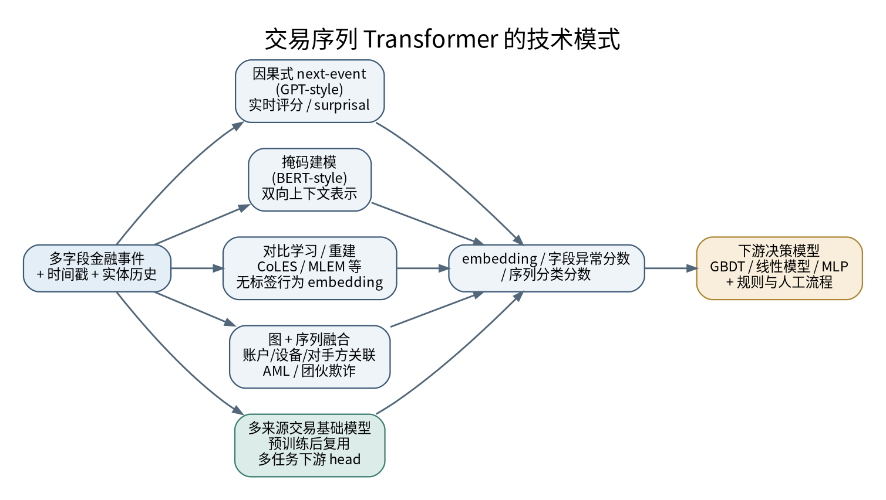

### 3.1 模式 A：因果式 next-event 预测（GPT-style）

模型只看当前事件之前的历史，预测下一笔交易字段或下一个事件类型。它非常自然地对应实时决策：评分时输入过去，评估当前事件出现的概率。对每个字段输出概率之后，可以得到商户、金额、国家、渠道等多维 surprisal。时间编码可以基于绝对时间、相对时间差或周期特征，而不能简单假设每两个事件间隔相同。

FraudTransformer 以 GPT 风格架构为基础，显式加入绝对或相对时间编码及学习得到的位置编码。其在 HSBC Payment Fraud Group 的数据上使用大约最近 500 个数字旅程/交易事件；作者报告，在时间外留出测试集上表现优于 Logistic Regression、XGBoost 和 LightGBM 等基线，并且移除时间或位置编码会损害效果。该研究已发表于 IEEE Conference on Artificial Intelligence 2026；完整特征因商业敏感性没有全部披露，测试集也经过抽样以隐藏原始欺诈率，因此其相对模型排名较有参考价值，公开数字不应直接外推到其他机构的真实损失率。[3]

### 3.2 模式 B：掩码建模（BERT-style）

对序列中的若干事件或字段做 mask，使用前后上下文重建被隐藏值。优点是一个序列能提供大量训练位置，而且可以捕捉事件前后关系；风险是训练时若无严格 mask / target 隔离，模型可能从未来信息中“作弊”。线上当前交易打分一般只能看到当前时点以前的数据，因此要分别定义训练目标与推理目标，不能直接拿双向模型在不受控的随机切分上评估未来交易。

PRAGMA 使用自监督 masked modelling 预训练多来源银行事件序列，覆盖支付、账户资金、应用内导航与沟通等事件；论文报告预训练数据包含 2,600 万用户记录、111 个国家的 240 亿事件（论文同时报告总计 2070 亿 tokens）。模型族覆盖约 10M 到 1B 参数，并用于信用评分、外部欺诈、复发交易、产品推荐和生命周期价值等下游任务。它展示了“共享序列表示 + 轻量任务适配”的方向，但仍需用具体任务的时间外验证、校准与成本评估判断是否适合某个机构。[9]

### 3.3 模式 C：历史重建 + 下一事件预测

Foundation Purchasing Model（NPPR）将 next-event prediction 与 past reconstruction 组合，用于学习交易上下文 embedding。论文在公开数据集上评估多种下游任务，并将大规模预训练扩展到来自 180 家发卡机构的 51 亿笔交易；作者报告，在不同国家的 hold-out 发卡机构上迁移时，高精确率约束下的欺诈金额捕获率获得提升，5:1 假阳性比阈值下最高报告约 140% 的相对提升。这个数字是特定基线、数据集和工作点下的作者实验结果，不是任何银行部署后都能获得的保证。[5]

### 3.4 模式 D：对比学习与生成式目标结合

对比学习通过构造同一实体/同一行为序列的不同视图，拉近应相似的 embedding，推远不相似的序列；生成式学习则要求模型重建或预测实际事件。CoLES 是离散事件序列自监督表示学习的代表之一；MLEM 进一步研究生成式与对比式目标的组合，报告二者都没有在所有任务中单独占优，而组合模型在多个指标上更好。[6][12]

2026 年的 Temporal Contrastive Transformer（TCT）进一步说明“表示学习成功”与“线上增益成功”之间的差别：论文报告单独使用序列 embedding 的 AUC 为 0.8644；把它与领域工程特征组合后，强基线从 AUC 0.9245 变成 0.9205，没有测得提升。论文自身将其定位为尚未达到生产就绪阶段的研究。这个结果建议所有项目把“表征质量”与“增量指标”分开验收。[11]

### 3.5 模式 E：字段替换检测和多头异常信号

单个字段的边际概率不能完全表达字段之间的兼容性。例如某国家本身不罕见、某金额本身也不罕见，但二者与持卡人的历史、支付方式和商户组合起来可能不合理。字段替换任务可通过合成负例训练模型识别这种组合不一致。产物可包括逐字段 surprisal、swap score、完整 embedding 等特征。

这类特征的优点是可以接入现有 GBDT，不必让最终决策模型完全依赖神经网络；缺点是负例设计会决定模型学到的边界，简单随机替换可能引入过于容易、与真实欺诈不同的负例。应加入真实的近邻难例、跨字段关联检查和负例消融，避免 swap head 只学到数据生成器的痕迹。

### 3.6 模式 F：时序 + 图关系融合

序列模型主要回答“这个实体的行为顺序是否符合历史”；图模型主要回答“该实体与谁发生联系、这些关联是否形成可疑网络”。AML、洗钱团伙、设备农场、商户/收款人串联和 mule accounts 常同时需要两种视角。近期工作探索将交易序列 Transformer 与图注意力网络融合，但大量结果仍来自研究基准或合成数据。不要仅因某个图 Transformer 报告很高的 AUROC 就推断其在银行 AML 上可直接部署；真实标签、图构建时间、实体解析质量和跨机构隐私通常更难解决。[23]

### 3.7 模式 G：多来源金融行为基础模型

2026 年的研究开始把银行卡交易、转账、账户资金、App clickstream、客服沟通等事件统一放入一条时间序列，预训练一个通用表示，再向不同业务提供轻量下游模型。其价值在于减少每个产品重复定义特征的工作，也可能从非交易行为中获得前置信号。KDD 2026 的一篇金融多模态事件序列论文报告，该系统在一家东欧大型银行部署，在线 A/B 测试中面向客户沟通/产品推荐的总 NPV 平均提升约 1%；这是一种跨来源行为表示的生产证据，但它不是直接的卡欺诈检测实验。[10]

同一方向也出现 PRAGMA、TREASURE、TransactionGPT 等不同架构：有的以掩码建模为主，有的使用自回归生成，有的针对高基数字段和支付网络信号设计专门输入层。它们不应被笼统归为一个“Transformer 算法”；应按训练目标、事件 schema、实体范围、可复用程度和在线推理约束来比较。[8][9][24]

---

## 4. 研究与论文地图（截至 2026-10-24）

下表不是按照论文宣称的单一 SOTA 排名，而是按对金融机构设计决策的可迁移价值归类。论文结果的可比性受数据、分割方式、标签成熟度、欺诈率、阈值/预算、下游基线强弱和是否公开真实线上实验影响。

| 研究 / 年份 | 方法与任务 | 证据与应用价值 | 关键限制 |
|---|---|---|---|
| **Tabular Transformers for Modeling Multivariate Time Series / TabFormer**，ICASSP 2021，arXiv:2011.01843 [4] | BERT 风格表示学习与 GPT 风格生成，面向多字段表格时间序列；包含信用卡交易的合成数据 | 早期证明可将交易记录作为“字段化 token 序列”，并共享表示用于欺诈任务和合成数据 | 合成卡数据与真实线上欺诈仍有差距；不是已证明的生产部署 |
| **User Behavior Pre-training for Online Fraud Detection**，KDD 2022 [13] | 用大规模用户行为预训练帮助在线欺诈识别 | 将 NLP 的预训练范式迁移到电商/在线行为序列，处理有标签样本不足问题 | 电商点击/行为序列和银行授权数据 schema 不同，需要重新定义任务与时间切分 |
| **CoLES: Contrastive Learning for Event Sequences with Self-Supervision**，SIGMOD 2022 [12] | 对比式事件序列表示学习 | 为银行、行为分析等任务提供不依赖明确欺诈标签的可复用 embedding 方法 | 对比样本的正负构造与序列增强可能改变业务语义；要验证下游增量收益 |
| **Sequence as Genes (SAGE)**，KDD 2023 [14] | 为电商交易欺诈设计用户行为预训练 | 关注行为序列的专门预训练，而不是直接套用通用文本训练流程 | 业务平台、用户行为采集、欺诈标签与银行卡授权链路有差异 |
| **Towards a Foundation Purchasing Model / NPPR**，ICAIF 2023 / arXiv:2401.01641 [5] | 自回归 next-event + past reconstruction，训练金融交易 embedding | 5.1B 交易、180 家发卡机构；报告对 hold-out 发行方的跨域迁移和高精确率工作点收益 | 数据和对比实验由论文团队控制；“最高 140%”是特定工作点的相对结果，不宜当作普适预期 |
| **MLEM**，arXiv:2401.15935，2024 [6] | 将生成式学习与对比学习视为互补目标 | 提醒不要先验认定单一自监督目标总是更优 | 研究阶段；需要按任务和数据分布重复验证 |
| **Your Spending Needs Attention / nuFormer**，arXiv:2507.23267，2025 [7] | Transformer 自监督学习结构化交易与用户行为表示，面向行为理解/推荐 | Nubank 作者团队报告大型推荐问题获得收益，强调只改善表示而不添加新数据 | 重点不是直接报告卡欺诈生产增益；不能将推荐指标直接转译成 fraud 指标 |
| **TREASURE**，arXiv:2511.19693；KDD 2026 [8] | 专为高容量交易数据设计的通用 Transformer 交易表示模型；捕获消费者行为与支付网络信号 | 作者报告异常行为检测较其生产系统提升 111%，并提升推荐模型；强调高基数字段输入效率 | 结果来自作者的行业级数据与实验，比较口径未必与其他公司相同；应仔细看任务定义和生产对照基线 |
| **FraudTransformer: Time-Aware GPT for Transaction Fraud Detection**，arXiv:2509.23712；IEEE CAI 2026 [3] | GPT-style 编码器 + 绝对/相对时间编码 + learned position；HSBC Payment Fraud Group 数千万交易与辅助事件 | 以金融数字旅程/交易的真实工业数据测试，报告优于 LR / XGBoost / LightGBM 及去除时间组件的消融模型 | 由于商业敏感性，字段披露有限；测试集经过抽样，不能直接外推真实欺诈率/阈值 |
| **PRAGMA: Revolut Foundation Model**，arXiv:2604.08649，2026 [9] | 多来源银行事件序列的 masked modelling；固定 embedding、线性探测、LoRA 适配等 | 论文报告 24B 事件、26M 用户记录、跨任务下游评估，以及不同规模的共享模型 | 截至基准日，arXiv 论文是公开可见的研究证据，不等于独立验证所有部署收益；必须按具体产品任务检验 |
| **A Foundation Model for Multimodal Event Sequences in Financial Applications**，KDD 2026 [10] | 交易、点击流和沟通等异质事件早期融合，next-event 预训练；冻结表示后结合现有特征 | 论文报告某东欧大型银行线上 A/B，选定业务总 NPV 平均 +1%，上线为所选产品的默认评分模型 | 实例重点是客户沟通/产品推荐，不是卡欺诈；业务指标、客群和损失函数不同 |
| **Temporal Contrastive Transformer for Financial Crime Detection**，arXiv:2605.21490，2026 [11] | 自监督对比式行为表示 + GBDT 下游 | 给出重要负例：embedding 本身有信号，但加到强工程特征后没提高基线 | 预印本且作者称未生产就绪；有价值之处在于增量评估，而不是作为通用性能标杆 |
| **TransactionGPT: Toward Foundational Transaction Modeling**，KDD 2026 [24] | 支付网络规模的交易基础模型和 3D-Transformer，支持异常检测及未来交易生成 | 论文摘要称基于十亿级真实交易，异常检测较生产模型有明显提升 | 具体提升幅度和指标须以论文任务表为准；支付网络数据与单家银行场景不可直接等同 |
| **BERT4Rec**，2019 [15] | 双向 Transformer + Cloze / masked item prediction | 可借鉴双向上下文表示和掩码目标 | 原本是推荐任务，不是风控；必须避免未来信息进入实时评分 |
| **TabTransformer**，2020 [16] | 同一行分类字段的上下文化 embedding | 可作为“表格字段交互 Transformer”的参考 | 不是按时间排列的历史事件序列模型，不能替代序列建模文献 |

### 4.1 读论文时应该看哪些数字

优先提取：时间外切分方式、训练集和测试集的标签成熟时间、欺诈率是否公开/是否被抽样、实体是否在训练与测试间重叠、评价是在同一拦截预算还是同一阈值、误报成本是否被计入、模型时延是否包含历史检索与预处理、是否存在真实在线 A/B，以及模型与强基线的差异是不是只改变了 Transformer。

其次才是模型层数、hidden size 和 GPU 数量。不同论文若用不同的公开数据、不同分割、不同 class balancing 和不同阈值报告 AUC，即使数字都在 0.98，也未必能直接比较。

### 4.2 研究趋势

- **从单一交易行转向实体级事件历史。** 商户、国家和金额不再仅作为当前交易属性，还要结合此前事件顺序与相邻事件间隔。
- **从监督学习转向自监督预训练 + 小型下游头。** 在交易数据丰富但欺诈标签滞后的场景中，先学行为表示可能更有经济性。
- **从单一交易数据转向多来源行为事件。** 登录、设备、转账、应用操作与客服事件可以提供交易前的风险上下文。
- **从“Transformer 赢过 XGBoost”转向“Transformer 特征是否提供增量”。** Ramp 和 TCT 的发现都说明必须做消融，而不是只对比一个弱基线。
- **从更大模型转向任务匹配的编码和长尾治理。** 数值金额、类别字段、商户/设备 ID、时间差的编码方式影响效率和泛化；通用 tokenizer 直接处理 JSON 往往不经济。
- **从单独时序走向时序与图的互补。** 账户历史解释个人习惯；账户/设备/收款人网络解释团伙关系。两者融合有价值，但数据工程、实体解析和解释成本会增加。

---

## 5. 非 LLM 深度学习模型与业界实践

本节区分可确认的线上实践、公司公开的产品能力、学术/工业研究原型。支付网络和银行会披露“AI/深度学习驱动风险决策”，但通常不会披露完整网络结构；不能仅凭“AI”“生成式 AI”或“实时神经网络”就断言其使用 Transformer。

### 5.1 业界实践地图：证据等级与可迁移技术点

| 机构 / 工作 | 公开证据支持的结论 | 模型/方法线索 | 证据等级与边界 | 对架构设计的启示 |
|---|---|---|---|---|
| [Ramp：Putting a Transformer Inside Every Card Authorization](https://builders.ramp.com/post/sequence-aware-card-fraud) | 每笔授权读取持卡人历史交易；小型 Transformer 生成 embedding、字段 surprisal 和 swap 分数，交给既有 XGBoost | 自监督序列编码器 + GBDT | **直接生产工程案例**；效果数字是 Ramp 自报 | 把序列编码器作为 feature service，而非重写整个决策系统 |
| [Stripe：Scaling Radar](https://stripe.dev/blog/scaling-radar-fighting-fraud-with-agent-assisted-machine-learning) | 公开讨论大规模欺诈模型训练、标签延迟、样本扩展与线上实验 | 生产 ML 流程及跨网络信号；未证明所有模型都是 Transformer | **直接工程案例**；不要将所有增益归因于特定网络 | 数据成熟度、样本选择和线上反馈可能比换模型更影响收益 |
| [Mastercard Decision Intelligence](https://www.mastercard.com/content/mccom/us/en/news-and-trends/press/2024/february/mastercard-supercharges-consumer-protection-with-gen-ai.html) | 网络级实时交易风险评分；官方披露产品能力和延迟/效果主张 | AI 风险评分，具体架构公开信息有限 | **官方产品声明**；GenAI 营销不等于通用 LLM 逐笔生成授权判断 | 网络级上下文和特征覆盖范围可能比模型架构更重要 |
| [Visa Protect / AI fraud detection](https://corporate.visa.com/en/solutions/visa-protect/insights/ai-fraud-detection.html) | 以网络数据、行为、速度和实时风险信号支持欺诈预防 | AI/ML 风险系统；页面不足以确认具体 Transformer | **官方产品能力说明** | 共享网络信号、实时特征和策略系统都是方案的一部分 |
| [IBM TabFormer](https://github.com/IBM/TabFormer) | 提供交易序列 Transformer 研究代码和合成交易数据 | GPT-style 自回归、BERT-style 掩码预训练 | **公开研究实现，不是生产部署证明** | 可复现模型目标、字段编码与序列准备 |
| [FraudTransformer](https://arxiv.org/abs/2509.23712) | 在 HSBC Payment Fraud Group 工业数据上评估时间感知 Transformer | 因果 Transformer + 时间/位置编码 | **工业数据论文**；特征和数据无法完全公开复现 | 显式表示不规则时间间隔，做时间外测试 |
| [PRAGMA: Revolut Foundation Model](https://arxiv.org/abs/2604.08649) | 研究跨金融任务的交易基础表示 | 交易事件预训练 / 多任务迁移 | **论文/预印本证据**；论文公开不等于所有生产流程均采用同一模型 | 共享表示有价值，但要逐任务验证迁移收益与负迁移 |
| [TREASURE](https://arxiv.org/abs/2511.19693) | 探索高容量交易序列基础模型 | 大规模交易序列 Transformer | **研究证据** | 规模和收益依赖论文设置，中小机构不一定需要同等规模 |
| [TransactionGPT](https://doi.org/10.1145/3770855.3818496) | 研究基础交易建模与多任务应用 | 交易表示学习 / 生成式序列建模 | **学术论文**；不是通用聊天 LLM 的证据 | “生成式”可以是结构化事件 next-event 目标，不等于自然语言 LLM |
| [CoLES](https://doi.org/10.1145/3514221.3526129) | 通过对比学习从离散事件序列学习表示 | 自监督对比学习，不要求 Transformer | **同行评审研究** | 将 GRU、Transformer、对比学习作为可比较选项 |
| [User Behavior Pre-training for Online Fraud Detection](https://doi.org/10.1145/3534678.3539126) | 用户行为预训练用于在线欺诈检测 | 行为序列预训练与下游欺诈任务 | **KDD 研究** | 先用无标签行为预训练，再用成熟标签训练下游模型 |
| [Sequence As Genes](https://kdd.org/kdd2023/wp-content/uploads/2023/08/toc.html) | 研究电商欺诈中的用户行为序列建模 | 行为序列与欺诈检测 | **KDD 论文**；具体生产部署信息需另行核实 | 交易前的行为事件可与交易事件统一为有类型的时间序列 |
| [PyTorch-Lifestream](https://github.com/dllllb/pytorch-lifestream) | 面向离散事件序列表示学习的开源工具 | 多种事件序列编码与 embedding | **开源实现**，不是金融机构部署证明 | 比较不同编码器、训练目标和数据管线 |

### 5.2 非 LLM 深度学习模型家族的适用边界

| 模型家族 | 强项 | 主要短板 | 优先考虑的金融场景 |
|---|---|---|---|
| MLP / Wide & Deep | 低延迟，适合固定长度统计和 embedding 拼接 | 不直接建模事件顺序 | 交易表格、账户画像与序列 embedding 融合 |
| GRU / LSTM | 对短/中等序列较经济；状态式更新可减少重复计算 | 长序列并行性较差 | 登录/支付行为、账户流水、实时状态较小的场景 |
| Temporal CNN / TCN | 并行推理、固定感受野、吞吐较好 | 感受野需设计；不规则时间需额外编码 | 高吞吐固定窗口序列、设备遥测、节奏异常 |
| Transformer Encoder / causal Transformer | 建模字段交互和长距离依赖；可自监督预训练 | padding、注意力开销、高基数词表与延迟标签处理复杂 | 交易序列、数字旅程、跨事件上下文 |
| TabTransformer / FT-Transformer | 对单行结构化字段交互建模 | 单行模型不等于历史序列；树模型常是强基线 | 当前交易字段多、类别特征复杂的监督任务 |
| Autoencoder / VAE | 无标签/弱标签异常检测 | 重建误差不一定与欺诈损失相关 | 新型异常发现、设备/账户行为偏离 |
| Deep SVDD / one-class | 可用正常行为为主学习边界 | 多模态正常分布难建模，阈值易漂移 | 欺诈标签稀缺的异常候选生成 |
| 自监督对比学习（CoLES 等） | 无需每条交易有标签，学习行为表示 | 正负样本不当会引入假负例或身份捷径 | 多任务账户画像、标签稀缺、跨时间迁移 |
| GNN / temporal GNN | 捕捉账户、设备、受益人、商户间关系与资金路径 | 图构建、实体解析、邻居延迟、解释复杂 | AML、团伙欺诈、mule account、设备/受益人网络 |
| Survival / temporal point process | 自然建模事件时间、风险到达率与不规则间隔 | 需明确删失、观察窗口和校准 | 违约/流失风险、告警到达、交易突发 |
| 强化学习 / bandit | 可优化审核资源、step-up 策略或干预选择 | 反馈有偏，探索风险和策略评估困难 | 调查队列排序、客服干预；不宜直接探索拒付动作 |

**架构判断：** 如果历史只有十几笔、字段较少、每毫秒都重要，GRU、TCN 或“窗口统计 + GBDT”可能比 Transformer 更合适。如果实体有长历史、多字段条件依赖且有大量无标签事件，Transformer 更值得验证。对于 AML，图关系与序列时间信息常互补，不应简化成 Transformer 与 GBDT 二选一。

### 5.3 可替换的序列编码器架构

~~~mermaid
flowchart LR
    E[交易 / 登录 / 设备 / 账户事件] --> N[事件规范化与 PIT 特征层]
    N --> S1[GRU / LSTM 状态编码器]
    N --> S2[TCN / Temporal CNN]
    N --> S3[Transformer Encoder]
    N --> S4[Temporal GNN / 图编码器]
    S1 --> F[融合层：embedding + 异常分数 + 窗口统计]
    S2 --> F
    S3 --> F
    S4 --> F
    F --> C[GBDT / MLP / 线性风险模型]
    C --> P[规则与业务成本决策]
    P --> O[授权 / step-up / 调查队列]
    O --> L[成熟标签、延迟与漂移监控]
~~~

这张图表达的是可替换的编码器层，而不是要求同时部署所有模型。实操时应逐个增加组件，并通过配对消融测量每一项的边际收益和服务成本。

### 5.4 案例证据分层规则

1. **生产线上实测**：说明服务路径、流量/时间范围、对照组、工作点、延迟与回滚策略。Ramp 是公开案例，但收益仍是公司自报。
2. **官方产品说明**：可确认产品存在和宣称能力，不一定披露模型结构、独立评估或可迁移效果。Visa、Mastercard 页面属于此类。
3. **工业数据论文**：实验可能严谨，但数据受限，特征、样本分布和部署 SLA 未必可复现。FraudTransformer 属于此类。
4. **公开数据集研究**：可复现方法比较，但合成数据、匿名字段、采样方式和标签机制可能与真实支付网络不同。
5. **预印本 / benchmark / 厂商基准**：用于形成候选方案，需检查同行评审、独立复现、强基线与时间外测试。

不要用一篇论文的 AP 或 ROC-AUC 排名直接决定生产模型。应在自己的 point-in-time replay、成熟标签和线上 shadow/canary 中验证。

---

## 6. 生产实践：真实案例与证据边界

### 6.1 生产案例矩阵

| 公司 / 系统 | 公开信息确认了什么 | 与序列 Transformer 的关系 | 应如何理解证据 |
|---|---|---|---|
| **Ramp（2026）** [1] | 明确称小型 Transformer 已用于每次卡授权；输出 embedding、surprisal 与 swap scores 给 XGBoost | 直接、最清晰的序列 Transformer 生产案例 | 公司工程文章给出消融、延迟和线上同分测试，适合学习实施细节；收益是公司自报结果 |
| **Stripe Radar / Shield（2026）** [2] | 跨商户网络的实体表示、毫秒级评分；扩大训练样本后研究延迟欺诈标签；通过自动化实验工作流改善 recall | 公开文章重点是跨实体特征、训练采样与标签成熟，并未声称其新方案就是 Transformer | 作为生产 ML、标签延迟、样本选择与实验体系的案例；+8% recall 是其特定配置和实验的公司报告结果，不应归功于 Transformer |
| **Mastercard Decision Intelligence Pro（2024）** [19] | 公司称分析账户、交易、商户、设备之间的关系，低于 50 ms 增强原 DI 评分；初始建模平均欺诈识别率 +20%，部分情形高达 300% | 官方资料没有充分说明其内部架构是 Transformer，不能把它称为 Transformer 部署 | 证明网络级关系信号与低时延辅助评分的行业方向；收益指标属于 Mastercard 官方披露 |
| **Visa Protect** [20] | 官方资料描述实时风险评分、用户行为分析、速度规则、位置和设备信号 | 公开材料没有给出足以确认具体 Transformer 架构的细节 | 可作为行为分析与规则/ML 多层组合实践，不代表特定模型结构 |
| **HSBC / FraudTransformer 研究（2025-2026）** [3] | 论文使用 HSBC Payment Fraud Group 的大型真实工业数据和数字旅程，包含银行研究人员与高校作者 | 明确的时间感知 GPT-style 序列架构 | 证明真实工业数据可以用于系统化研究；公开论文不等于证明同一模型已在全量授权热路径运行 |
| **Revolut / PRAGMA（2026）** [9] | 公开论文描述多来源事件序列基础模型及跨任务评估 | 面向交易、账户、App 和沟通数据的通用行为表示 | 是重要的研究和架构信号；具体任务效果需回看下游验证、标签定义与生产范围 |
| **支付网络 / TREASURE 与 TransactionGPT（2025-2026）** [8][24] | 论文介绍高容量交易 Transformer，含异常检测和生成式任务，报告与生产系统比较 | 交易基础模型化，输入/高基数字段处理专门优化 | 论文能说明该方向正在产业化探索，但不同论文的指标口径和真实部署披露程度不同 |
| **一家东欧大型银行的多模态事件序列模型（KDD 2026）** [10] | 论文报告在客户沟通/产品推荐业务开展在线 A/B，平均 NPV +1%，成功后切换相关产品的评分管道 | 自监督 Transformer 统一交易与数字交互事件，向多个任务复用 | 是线上实验的公开案例，但业务是客户互动/推荐，不应误写成欺诈防控指标 |
| **Nubank / nuFormer（2025）** [7] | 研究描述在大规模推荐任务上以表示学习获得改进 | 结构化金融行为序列与下游推荐 | 提供客户行为表示可复用的经验，但公开论文的主要结果不是实时卡欺诈 |

### 6.2 对这些案例的综合判断

目前公开证据足以支持“金融交易序列 Transformer 值得在合适的业务上做严谨试验”，但尚不足以支持“各类金融风控都应该换成 Transformer”。公开最明确的在线交易授权实例之一是 Ramp；HSBC FraudTransformer 提供大型真实工业数据上的研究验证；PRAGMA、TREASURE、TransactionGPT 代表通用交易表示的扩展。与此同时，Stripe、Mastercard 和 Visa 的公开实践说明，网络实体上下文、规则、标签体系、训练采样、特征平台和时延预算仍然是风控系统的重要组成部分；并非所有高价值的 AI 风控技术都必须是 Transformer。

更重要的是，**上线效果来自建模、标签、损失函数、特征平台和决策流程共同作用**。在 Ramp 案例中，金额加权损失带来的金额捕获提升大于 Transformer 的独立增量；Stripe 2026 的实验又显示，不成熟标签与样本抽样能把离线结果方向都改变。架构决策应优先保证这些机制可验证、可回放、可归因。[1][2]

---

## 7. 金融服务用例与架构适配

| 用例 | 建议的序列范围 | Transformer 可能提供的信号 | 主要难点 / 不宜全自动的部分 |
|---|---|---|---|
| **卡授权欺诈** | 同一持卡人/账户的近期授权历史，可跨该实体的多张卡 | 新商户、新国家、异常金额、速度突变、支付方式变化、首笔欺诈前的异常行为 | 数十毫秒服务预算；被拒交易也改变后续历史；争议标签延迟；误拒付成本 |
| **账户接管（ATO）** | 登录、设备、密码重置、MFA、收款人/卡片绑定、交易事件 | 账号行为与设备/操作顺序突然变化，风险操作链路 | 身份、设备与 IP 信号具有隐私/公平性风险；登录和转账事件需要统一时间线 |
| **即时转账/诈骗（APP scam）** | 登录、收款人创建、首次转账、金额变化、受益人网络、此前客服互动 | “新设备 → 新受益人 → 大额外转”的行为模式；和历史转账方式不一致 | 付款可能由客户本人授权但受诈骗诱导；仅靠欺诈分类器不够，需补充受益人风险、受骗情境和摩擦策略 |
| **AML / 可疑交易监控** | 客户账户及交易的日/周/月序列，并连接对手方、受益人、控制人网络 | 频率、金额、对手方和交易链路变化；分层转移/快速过账行为 | 洗钱常是网络现象，序列应与图分析结合；标签稀缺且案件结论有偏差；告警需要可解释、可调查 |
| **信用风险/逾期预警** | 账单、还款、入账/出账、利用率、现金流事件序列 | 工资入账变化、最低还款、循环余额、还款周期变化等趋势 | 与欺诈不同，时间单位通常是天/月，需长期稳定性、公平性、校准及原因码 |
| **企业卡/费用管理** | 企业账户中员工/卡片、商户类别、审批和报销事件 | 企业与员工的业务模式偏离、采购习惯突变、政策异常 | 企业季节性、岗位变更和新项目常会引起合法分布漂移；组织内跨实体授权边界需清晰 |
| **客服/产品推荐/客户经营** | 交易 + App 交互 + 通知/客服 + 产品使用事件 | 行为上下文、需求阶段、流失/重复交易概率、沟通时机 | 应单独定义业务效用和实验指标；不要将推荐模型的 uplift 当成风控性能 |
| **交易异常与网络风险** | 账户、卡、设备、商户、收款人构成的异构时序图 | 单实体行为序列和跨实体关联信号互补 | 图构建延迟、实体解析、循环路径、跨机构隐私与可解释性成本高 |

### 7.1 AML 特别说明

AML 不只是“找出异常交易”。案件可能涉及多个账户、多家机构、受益人关系和较长时间尺度。单账户序列适合发现一个实体何时偏离自身模式；交易图适合发现多个实体如何协同行动；规则适合覆盖法定阈值、制裁筛查或明确政策。实用架构是多层证据融合，而不是用单个异常分数代替调查和报告义务。FATF 关于 AML/CFT 新技术的报告也同时强调自动化与效率潜力，以及 legacy 系统迁移、解释能力和成本等实施障碍。[22]

### 7.2 信用风险与授权欺诈不能共用一套时间假设

卡授权可能要求在几十毫秒内利用最近几十笔事件；信用风险通常可以利用数月或数年的事件，以账单周期、工资入账周期和长期状态变化作为重要时间语义。它们可以共享底层事件表示或预训练编码器，但不能简单复用同一窗口长度、同一时序编码、同一训练损失和同一决策阈值。

---

## 8. 生产参考架构

### 8.1 在线评分数据流

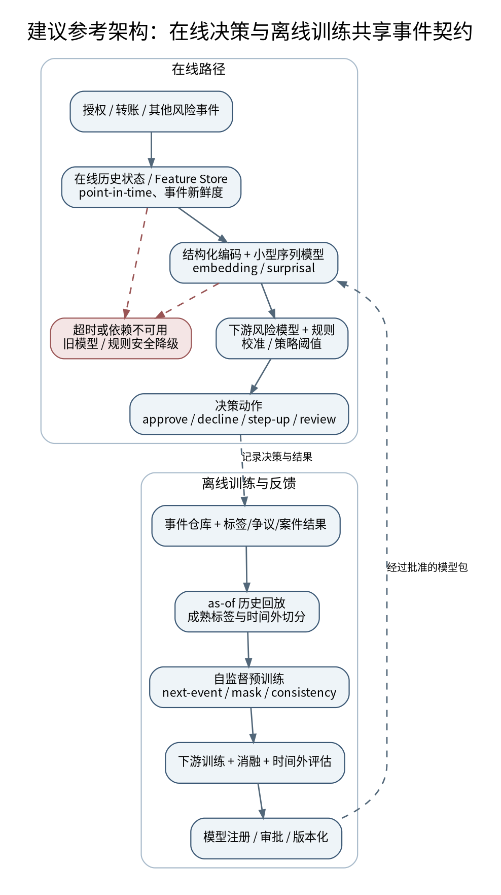

建议把序列模型定位成一个有版本管理的特征生成器/风险评分组件。事件总线、历史状态和在线特征服务需要支持按决策时点重建历史；推理端必须清楚当前交易字段与历史输入字段的边界。序列模型通常只负责输出可以解释和回放的特征，最终动作由现有决策服务结合规则、分数阈值、客户摩擦策略及服务状态作出。

### 8.2 离线训练与生产反馈闭环

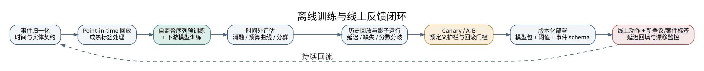

参考流程包括：事件归一化、point-in-time 回放、标签成熟处理、序列构造、自监督预训练、下游分类器/评分头、时间外评估、离线回放、shadow、canary、线上对照实验和生产监控。必须保存可重现训练集的快照/版本、事件 schema 版本、tokenizer 版本、模型 hash、下游模型版本和决策阈值版本。

### 8.3 服务部署选项

- **同进程模型包**：事件编码、Transformer、分数提取和下游分类器一起加载。优点是避免多次网络调用和版本错配，适合紧时延路径；缺点是模型包更新、资源隔离和故障诊断需要规范化。
- **独立序列评分服务**：历史服务调用序列服务，再将 embedding/分数返回决策引擎。优点是复用和独立伸缩；缺点是增加 RPC、超时和版本兼容风险，适合有足够时延预算或异步评分场景。
- **离线/近实时特征服务**：对信用风险、AML 调查、客户经营可先生成用户级序列表示，放入特征库，再由下游任务读取。实时性要求低时能降低重复推理成本；需要定义表示的新鲜度及重算策略。

对于卡授权，优先选择能保证端到端预算、原子版本和故障降级的部署形态，而不是为“微服务标准化”强行拆分模型。

---

## 9. 从零开始做交易序列模型：模型选择、数据准备、训练、测试与在线学习

本节以“预测某笔交易是否欺诈”为例，给出可以直接落地的实验顺序。信用风险、AML 和客户行为预测可以沿用大部分方法，但要重新定义预测时点、标签和业务损失。

### 9.1 先选问题，再选模型

不要先决定“我要用 Transformer”，再寻找适合它的问题。先把业务问题写成一张小表：

| 要回答的问题 | 示例 | 对模型选择的影响 |
|---|---|---|
| 什么时候做决定？ | 授权时必须在 50 ms 内完成；或每天夜间分析一次 | 同步热路径优先小模型；批量任务可以试更复杂的模型 |
| 能看到哪些历史？ | 当前交易之前的 50 笔交易、最近 30 天登录事件 | 事件少且规律简单时，统计特征/GRU 可能足够；历史较长且字段交互复杂时再试 Transformer |
| 有多少已确认标签？ | 只有几千笔确认欺诈，但有数亿笔未标注交易 | 先试强监督基线；如果未标注历史很多，可评估自监督预训练是否增加价值 |
| 欺诈标签多久到？ | 交易后 30–60 天才比较完整 | 训练和测试要按标签成熟时间过滤，不能把“尚未报告”直接当正常 |
| 业务怎么使用分数？ | 每天人工调查前 2,000 笔，或授权时拒绝超过某风险阈值的交易 | 选择与审核预算、误拒成本和损失金额对应的指标 |
| 能否拿到真实历史状态？ | 可以重建每个授权时点已到达的事件；或只有事后汇总表 | 如果无法重建当时可见的数据，先修数据，而不是先换模型 |

推荐的第一轮对比是：**业务规则 + 窗口统计 → LightGBM/XGBoost → GRU → 小型因果 Transformer → Transformer 特征 + 原有 GBDT**。如果树模型已经非常强，序列模型必须证明它能补上树模型没捕捉到的行为模式，而不是只在一份弱基线上赢。

### 9.2 先建立可靠的数据契约

每种事件至少需要明确：

| 字段 | 设计建议 | 原因 |
|---|---|---|
| `entity_id` | 定义模型的历史边界，例如 card、customer、account、business；敏感标识使用不可逆或受控映射 | 选择错误会混合不同实体的行为，或丢掉可用上下文 |
| `event_time` | 业务发生时间，统一时区；明确精度与乱序处理 | 还原真实先后和事件间隔 |
| `observed_at` / `ingested_at` | 服务/平台首次可见时间或数据入库时间 | 保证在线决策只使用当时已可见事件 |
| `event_type` | 授权、撤销、结算、拒绝、转账、登录、设备变化等统一分类 | 让多来源行为共享有类型的时间线 |
| `amount` / currency | 保存原始金额/币种，并提供已知时点可计算的标准化金额；明确 FX 使用时间 | 防止未来汇率泄漏和金额尺度问题 |
| `merchant / counterparty / device` | 做规范化、类别化与长尾策略；避免直接用可变显示名作为稳定 ID | 控制高基数、漂移和隐私风险 |
| `channel / country / payment_method / status` | 维护字典版本，未知值有专门 `UNK` / 类别回退 | 防止新类目导致训练服务不一致 |
| `label` + `label_observed_at` | 单独存储欺诈确认、争议、退款、案件结论及其观测时间 | 区分未知与已确认正常，支持标签成熟分析 |
| `decision_context` | 当前待评分交易、当时服务可见输入、候选动作、模型版本、阈值及执行结果 | 回放、审计和 shadow 对比的基础 |

同一个用户可能跨设备、卡片或账户活动；过宽的 entity scope 会带来隐私、跨业务隔离和数据污染风险，过窄又会丢掉真实行为。应该用明确的业务规则确定主序列，再将相关实体的统计量或图特征作为独立输入。Ramp 的做法是企业范围内按持卡人聚合其多张卡的历史，不是把所有同公司的交易任意混在一起。[1]

### 9.3 选择模型输入表示

建议每个事件使用结构化字段 embedding，而不是直接把 JSON 文本切成 BPE tokens。通用文本模型的 tokenization 会把字段名、冒号、标点和重复结构也变成 token；结构化交易的类别分布和数字语义与自然语言不同。

- **离散字段**：商户类别、国家、支付方式、授权结果、事件类型、通道、币种、设备/对手方类别等使用 embedding 或有层次结构的编码。
- **高基数字段**：对商户、设备、收款人、账户或交易对手方，比较 top-K 独立 token、类别内 hashing、层级编码、稳定映射和 unknown fallback；必须监控 hash 碰撞与长尾泛化。
- **金额和数值**：原值通常呈重尾分布，可使用 `log1p`、分位数/对数 bucket 或标准化值；同时加入相对该实体历史均值/分位数的差异特征。不能只在训练集 fit normalization 后把未来统计量泄漏给过去样本。
- **时间**：输入相邻事件时间差（例如按分钟、小时、天分桶并做 log scaling）、周期性时间（小时、星期、账单周期）和相对/绝对时间编码；时间单位须按用例选择。FraudTransformer 的消融结果支持认真测试相对时间与位置编码组合，而非只按第 1、2、3 条事件编号。[3]
- **缺失和延迟**：区分“字段真实缺失”“来源未上报”“事件还未传播到服务”和“适用但未知”。单个 `null` 隐藏了不同业务含义。
- **历史窗口**：以最近 N 笔、时间窗口和重要事件三种方式比较。最近 N 笔方便控制计算量；时间窗口保持自然时间跨度；关键事件保留长期风险信号。不要无条件把全历史塞进模型，先证明长序列的边际收益。

### 9.4 参数量怎么选：从能跑、能比较的小模型开始

参数量是模型可学习数字的数量，例如 1M 表示约 100 万个参数。它影响内存、训练时间和推理成本，但不直接告诉你模型是否适合数据。金融交易序列模型还有一个常被忽略的部分：商户、设备、账户等高基数字段的 embedding 表，可能比 Transformer 的注意力层本身占更多参数。

下面的范围是**实验起点，不是行业标准，也不是 Ramp 等公司的复刻配置**：

| 实验级别 | 可先尝试的规模 | 适合的情况 | 何时升级 |
|---|---:|---|---|
| 规则 / LightGBM / 小型 MLP | 不适用或约 10K–500K 个神经网络参数 | 样本量有限、结构化特征强、希望先建立基线 | 时间外测试显示固定窗口特征漏掉了明显的顺序信息 |
| 小型 GRU / TCN | 约 100K–2M 参数 | 每个实体几十到几百个事件，重视延迟和工程简单 | 序列更长，或需要跨较远事件的字段关系 |
| 小型 Transformer | 约 1M–10M 参数 | 有大量未标注事件，想学习更丰富的上下文表示 | 在多次时间切分中稳定提升，且延迟仍满足预算 |
| 中型序列模型 | 约 10M–50M 参数 | 多来源事件、多任务复用、数据量充足且已有小模型证据 | 小模型出现可重复的容量瓶颈，而非数据泄漏或特征缺失 |
| 数亿到十亿参数级基础模型 | 通常不应作为第一个实验 | 多业务共享表示、数十亿级事件、成熟 GPU/数据平台和训练团队 | 先证明中小模型有明确增量，再做成本收益评估 |

不要按“数据有一千万笔，所以模型就要一千万参数”来定规模。训练数据行数、独立实体数、字段种类、序列长度、标签数量和任务难度是不同维度。对高基数字段，优先控制词表大小：常见商户独立编码，长尾商户按类别共享或哈希，未知商户回退到类别级表示。否则参数可能都花在记住商户 ID 上，遇到新商户就失效。

实操上，每次只改一个关键因素：先固定序列长度和字段，比较 2M 与 5M；再固定参数量，比较历史长度 50、100、200；最后再比较时间编码、训练目标和 embedding 策略。若更大的模型只改善训练集而没有改善验证集，或收益小到抵不过 p99 延迟和维护成本，就不要升级。

### 9.5 参考训练目标

对于每个实体样本，构造事件序列 $`E=(e_1,\ldots,e_L)`$，每个事件由多个字段组成。可从下面的多任务目标开始：

```math
\mathcal{L} = \lambda_{\mathrm{next}}\mathcal{L}_{\mathrm{next}} + \lambda_{\mathrm{mask}}\mathcal{L}_{\mathrm{mask}} + \lambda_{\mathrm{swap}}\mathcal{L}_{\mathrm{swap}} + \lambda_{\mathrm{sup}}\mathcal{L}_{\mathrm{sup}}
```
其中：

- $`\mathcal L_{next}`$：预测下一事件或下一事件的各个字段；通常使用对类别字段的交叉熵、对金额 bucket 的分类损失，或针对连续值的适当似然/分布损失。
- $`\mathcal L_{mask}`$：隐藏序列中的事件/字段并重建；只用于学习上下文，使用时必须严格定义 mask 与时间方向。
- $`\mathcal L_{swap}`$：区分真实字段组合与构造的替换负例；需要随机负例、难负例和真实异常案例共同验证。
- $`\mathcal L_{sup}`$：下游欺诈/风险标签；若标签未成熟，未知不应自动当作负例。该项可以在冻结 embedding 后由单独模型训练，而不是一定与预训练同步。

推荐先实现一个训练简单、推理稳定的因果 Transformer encoder。把更复杂的对比学习、图融合或多模态输入作为独立实验，不要一开始同时改变数据、模型、损失和下游分类器。

### 9.6 训练与特征生成伪代码

下面是训练流程示意，不是可直接生产运行的完整实现。真实实现还需要数据加载、padding/mask、混合精度、分布式训练、数值稳定处理、指标和 checkpoint 管理。

```python
# Offline self-supervised pretraining (conceptual pseudocode)
for batch in sequence_loader:
    fields = embed_categorical_and_numeric_fields(batch.events)
    time_features = encode_time_gaps(batch.event_time, batch.observed_at)
    x = fields + time_features + position_embedding(batch.position)

    # Online scoring requires causal visibility for next-event scores.
    h = transformer_encoder(x, attention_mask=batch.causal_mask)

    next_loss = predict_next_event_fields(h, batch.next_event_targets)
    masked_loss = reconstruct_masked_fields(
        h, batch.masked_targets, batch.mask_positions
    )
    swap_loss = detect_inconsistent_field_combinations(
        h, batch.swap_labels
    )

    loss = w_next * next_loss + w_mask * masked_loss + w_swap * swap_loss
    loss.backward()
    optimizer.step()
    optimizer.zero_grad(set_to_none=True)

# Freeze encoder; compute point-in-time sequence features for every scored event.
# Keep the existing supervised risk model and evaluate incremental lift.
features = concat(
    existing_tabular_features,
    velocity_and_count_features,
    sequence_embedding,
    field_surprisal_scores,
    swap_consistency_scores,
)
risk_model.fit(features, matured_fraud_labels, sample_weight=business_weights)
```

建议的第一个可交付模型：较浅的 Transformer（例如 2-4 层、64-128 维表示作为起点，而非硬性标准）+ 有界事件窗口 + 结构化字段编码 + 下一字段预测；特征产物接入现有 GBDT。然后逐个加 masked reconstruction、swap score 或多来源事件，确保每个复杂度都能通过消融证明增量价值。Ramp 采用三层、128 宽度是一个可供估算的工程参考，不是应复制的默认答案。[1]

### 9.7 下游模型不一定是 XGBoost

| 下游方式 | 适用情况 | 优点 | 风险/代价 |
|---|---|---|---|
| XGBoost / LightGBM / CatBoost | 既有特征工程成熟，标签相对稀少，需要稳定且好审计的基线 | 非线性与特征交互强；已有训练与部署体系常可复用 | 表示需要离线/在线生成；应做模型解释与校准 |
| Logistic Regression / GAM | 解释、稳定、成本和变更控制优先 | 容易比较特征的增量方向，便于审计和校准 | 对复杂非线性和交互表达有限 |
| 小型 MLP | 想端到端学习 embedding 与表格特征交互 | 推理链可融合，灵活 | 对样本规模、正则化、校准和训练稳定性要求高 |
| 任务专用 Transformer 分类头 | 标签多、序列目标与业务目标高度一致，时延可控 | 可直接针对风险任务优化 | 可能过拟合标签选择/延迟机制；解释和阈值验证成本较高 |
| 共享基础模型 + 多任务 heads | 多条业务线共享相似实体事件流，存在统一数据平台 | 复用预训练成本，减少每任务重复建模 | 任务冲突、版本耦合、数据权限边界与回归范围更复杂 |
| 图 + 序列 + GBDT/MLP 混合 | AML、团伙欺诈、多实体关联明显 | 结合个人行为与网络关系 | 实体解析、图更新、延迟、训练采样和解释成本显著上升 |

XGBoost 只是一个稳健的第一版落点。倘若 embedding 与现有特征是强非线性交互，MLP 或联合微调可能更好；倘若必须容易解释，可先用线性模型验证 embedding 是否包含独立信号。应让验证结果决定架构，而不是让 Transformer 预先决定下游模型。

### 9.8 训练集、验证集、测试集怎么准备

金融交易序列不宜把所有交易随机打乱后再按 80/10/10 切分。这样很容易让同一账户相邻时间的交易同时出现在训练和测试中，模型间接“见过未来”，离线成绩会虚高。

一个可执行的切分例子：

~~~mermaid
flowchart LR
    A["1–4 月：训练数据<br/>标签已成熟"] --> B["5 月：验证集<br/>选模型和超参数"]
    B --> C["6–7 月：最终测试集<br/>训练和调参时不可查看"]
    C --> D["上线前：影子评分<br/>只记录，不影响交易"]
    D --> E["灰度上线<br/>达到门槛后扩大流量"]
~~~

准备数据时，至少处理以下事项：

1. **明确预测时点。** 对每笔交易建立 decision_time。只允许使用当时已经发生、并且系统已经收到的历史事件。若事件在 10:00 发生、10:03 才进入特征平台，那么 10:01 的交易不能使用它。
2. **标签与特征分开。** 欺诈争议、拒付结果、调查结论可以作为训练标签，但只能在标签实际成熟后用于训练。它们不能作为交易发生时的输入特征。
3. **按时间切分。** 训练集在前，验证集在后，最终测试集再往后。对具有强周期性或标签延迟的任务，可留出额外的 embargo（隔离时间），避免窗口重叠和标签泄漏。
4. **对比两种实体切分。** 同一账户出现在训练和测试中，适合评估“现有客户未来的下一笔交易”；按账户隔离则更能测试新客户泛化。两者回答不同问题，最好都报告。
5. **不要把未成熟标签当负例。** 一笔交易 7 天内没有收到拒付，不代表它最终是正常交易。可以只使用已成熟样本，或采用显式的延迟标签/删失处理；具体策略要写入实验记录。
6. **只在训练集拟合预处理。** 类别词表、数值归一化参数、缺失值填补规则和特征选择都应由训练数据确定，再应用于验证和测试，避免从未来数据偷看分布。
7. **保存可复现信息。** 记录数据快照、SQL/代码版本、时间范围、标签成熟规则、随机种子、模型配置和依赖版本。训练数据应能追溯到每个样本在当时可见的事件。

如果测试集有 10 万笔交易、其中只有 100 笔欺诈，模型即使把全部交易都判成正常，也能获得 99.9% 的准确率。因此必须看正例排名、固定预算下的捕获率和实际成本，而不是只看 accuracy。

### 9.9 怎么测：从离线指标到业务效果

建议把评估分成四层，逐层通过，不要把一张 AUC 表当作上线批准：

| 层次 | 要回答的问题 | 最低限度的检查 |
|---|---|---|
| 数据正确性 | 模型是不是只看到了当时已知的信息？ | 时间泄漏检查、标签成熟检查、线上线下特征一致性 |
| 模型效果 | 新模型有没有把欺诈排得更靠前？ | Average Precision / PR-AUC、ROC-AUC、Recall@K、金额捕获率、分群表现 |
| 业务可用性 | 相同审核人力或拒绝预算下，是否更有价值？ | 固定审核量/拦截率比较、误拒成本、客户影响、概率校准 |
| 生产性能 | 能否在真实请求量下及时返回？ | p50/p95/p99、超时、吞吐、内存、CPU/GPU 使用、fallback 率 |

一个简单的排序例子：每天只能调查 1,000 笔交易。模型 A 在前 1,000 笔里找出 120 笔确认欺诈；模型 B 找出 145 笔。在调查量相同、标签定义一致且经过统计检验的前提下，B 更有价值。PR-AUC 能总结多种阈值下的排序质量，但最后仍要检查业务真正使用的那个预算点。

模型对比应在**同一时间外测试集、同一标签成熟规则、同一特征可见性和同一业务预算**下进行。建议至少跑 3 个随机种子（随机初始化会影响神经网络结果），报告均值和波动；如果数据量允许，使用按周或按月的多个时间切片，确认提升不是只发生在某个特殊月份。对稀有欺诈事件，可以用 bootstrap（从测试样本反复抽样）估计置信区间，但抽样时要考虑同一账户/同一欺诈团伙带来的相关性。

### 9.10 能不能在线学习、实时训练？

可以做在线学习，但必须区分三个意思：

- **实时推理**：每笔新交易到来时，立即用当前模型评分。这是最常见、也最先应该实现的能力。
- **在线特征更新**：交易一发生，就更新账户最近交易次数、金额统计、序列缓存等状态，让下一笔交易看到最新历史。这通常比实时改模型参数更容易、风险更低。
- **在线训练/参数更新**：新标签到达后，持续更新模型权重。这最复杂，不能简单地把每笔新交易立刻当训练样本。

对欺诈检测来说，标签可能几周后才到。把尚未确认的交易马上当作正常样本训练，会把潜在欺诈灌进“正常行为”。此外，模型每次更新后分数分布可能改变，阈值、校准、审批率和公平性也可能随之变化。**建议先实现实时特征更新和定期重训，不要一开始就做每笔交易触发的神经网络在线更新。**

可考虑的方案：

| 方案 | 怎么做 | 优点 | 风险与适用条件 |
|---|---|---|---|
| 实时特征更新 + 定期重训（推荐起点） | 每笔交易更新状态；每天/每周或标签成熟后批量训练 | 容易复现、可回滚，训练数据可审计 | 模型不会在新标签到达瞬间更新，但适合大多数风控系统 |
| 增量更新逻辑回归 / 小型线性模型 | 标签成熟后对新样本做小步更新，保留旧样本回放 | 成本低，适合快速适应缓慢漂移 | 仍需校准、回滚和防止灾难性遗忘 |
| 增量树模型 | 使用支持增量学习的模型或周期性追加训练；具体能力取决于库 | 对结构化特征友好 | 不能假定普通 LightGBM/XGBoost 训练器都支持无缝在线更新 |
| 深度模型小批次持续训练 | 收集已成熟的新标签，与历史样本混合训练；先 shadow，再灰度 | 能适应新行为模式 | 训练不稳定、标签偏差、遗忘旧模式、GPU/服务版本协调更复杂 |
| 每笔交易立即更新 Transformer | 对每次交易反向传播并立刻发布新参数 | 理论上更新最快 | 通常不推荐：标签延迟、反馈循环、不可复现、推理版本抖动和回滚难度都很高 |

一个较稳妥的持续学习流程是：

~~~mermaid
flowchart LR
    A["新交易到达"] --> B["更新在线历史状态"]
    B --> C["固定版本模型评分"]
    C --> D["记录特征快照、分数和模型版本"]
    D --> E["后续争议/调查结果成熟"]
    E --> F["质量检查与标签去重"]
    F --> G["新旧样本混合训练"]
    G --> H["时间外回归测试与校准"]
    H --> I["影子运行 / Champion-Challenger"]
    I --> J{"指标、延迟和风险门槛通过？"}
    J -->|是| K["灰度发布新版本"]
    J -->|否| L["保留旧模型并分析原因"]
~~~

上线前应保留一个固定的回归集，监控旧欺诈类型是否退化；持续训练不能只追求新近样本上的提升。每个模型版本都要有独立 ID、训练数据快照、阈值和可一键回滚的旧版本。对于金融决策，模型自动更新和自动生效应该是两个分开的步骤。

### 9.11 一份可以照着执行的首轮实验清单

1. 选一个范围清晰的任务，例如“交易发生时，对当前交易排序以供人工调查”，先不要同时做信用评分、AML 和推荐。
2. 准备一个能重建当时历史的时间切片；对标签未成熟的交易保留 unknown 状态。
3. 训练规则/窗口统计基线和 LightGBM/XGBoost，保存同一时间外测试集的分数。
4. 加一个 100K–2M 参数的 GRU 或 1M–5M 参数的 causal Transformer；先做下一事件字段预测，或直接训练监督式序列分类头。
5. 对比两种下游用法：序列模型直接输出风险分数；序列模型输出 embedding/异常分数，再交给原有 GBDT。
6. 做消融：去掉时间差、去掉 embedding、去掉 surprisal、缩短历史长度、减少参数量。
7. 检查固定审核预算下的收益、不同账户/商户/国家分群、标签成熟后的稳定性，以及 p95/p99 延迟。
8. 只有当小模型在多个时间切片上稳定增益时，再考虑多任务预训练、更大的模型、图神经网络或持续学习。

### 9.12 可用于复现实验的公开数据集：先看能否支持“真实序列”

公开的欺诈数据集往往为了隐私去掉了实体 ID、原始商户和设备字段；“有时间戳、有欺诈标签”并不意味着“可以训练 Ramp 式持卡人行为序列模型”。选择数据时先核验四个条件：是否存在稳定实体键、是否有可排序的事件时间、是否有事件级标签、是否有足够的上下文字段。若前两项缺失，只能评估表格分类或总体时间漂移，不能声称验证了个体历史建模。

| 数据集 | 规模与主要字段 | 推荐用途 | 序列建模适用性 | 主要陷阱 / 限制 |
|---|---|---|---|---|
| **IBM TabFormer synthetic card transactions** ([GitHub](https://github.com/IBM/TabFormer)) | 约 2,400 万笔合成信用卡交易、12 个字段；含用户/交易结构，支持 BERT / GPT 变体 | 最贴近交易事件字段化、tokenizer、next-event / masked pretraining 的公开起点 | **高**，适合按用户分组构造历史并比较监督分类 | 合成分布不等于真实银行欺诈；仓库依赖年代较早（原始环境为 Python 3.7、PyTorch 1.6、Transformers 3.2），需容器化或升级依赖；数据使用 Git LFS / 外部下载 |
| **PaySim — Synthetic Financial Datasets for Fraud Detection** ([Kaggle](https://www.kaggle.com/datasets/ealaxi/paysim1)) | 约 636 万笔；`step`（小时级）、`type`、`amount`、`nameOrig` / `nameDest`、余额及 `isFraud` | 移动支付、转账行为序列、账户 velocity 特征、发送方/收款方关系和实时告警原型 | **高**，尤其适合 source account 历史；destination 侧也可建模但需定义方向 | 完全/主要基于模拟机制；`isFlaggedFraud` 是现有规则标记，不应不加分析地作为输入；余额变更字段可能直接编码交易结果，评分时要确保是授权时已知字段，禁止把事后余额当作未来交易特征 |
| **BankSim** ([Kaggle 数据集](https://www.kaggle.com/datasets/ntnu-testimon/banksim1)) | 约 59.5 万笔合成银行支付；`step`、`customer`、`merchant`、`category`、`amount`、`fraud` | 轻量用户—商户—类别序列实验，快速验证窗口特征和模型 pipeline | **高/中**，适合 per-customer sequence，事件字段较少 | 仿真规则可能使某些特征异常容易预测；规模适合快速迭代，不宜把结果直接外推到真实支付 |
| **IEEE-CIS Fraud Detection** ([Kaggle competition](https://www.kaggle.com/competitions/ieee-fraud-detection/data)) | 约 59 万训练交易；`TransactionDT`、`card1`–`card6`、产品、地址、邮箱域、设备/身份匿名字段，目标 `isFraud` | 强表格基线、时间外验证、特征工程，以及“代理实体键构建”实验 | **中/有条件**：部分 card 字段可组合成代理分组键，但不等同于真实 customer/card ID | 原始资料把身份字段匿名化；缺失 identity 信息普遍存在；不得把 proxy key 假装成真实个人历史；比赛榜单/常见 notebook 的随机切分可能高估泛化 |
| **ULB / Worldline Credit Card Fraud Detection** ([Kaggle](https://www.kaggle.com/datasets/mlg-ulb/creditcardfraud)) | 284,807 笔，两天内 492 笔欺诈（约 0.172%）；`Time`、`Amount` 和 V1–V28 PCA 变量 | 不平衡分类、PR-AUC、校准和指标 sanity check | **低**，不适合忠实复现 Ramp 式用户历史 Transformer | 不提供原始客户/卡片/商户字段，不能把相邻数据行当成同一个持卡人的行为序列；最多把时间当作总体时间维度，或在非常有限的实验中研究临近交易依赖 |
| **Fraud Detection Handbook 的模拟器与 Notebook** ([项目与手册](https://fraud-detection-handbook.github.io/fraud-detection-handbook/)) | 可控生成的模拟交易流，配套数据生成、特征、模型评估和时间相关的 Notebook | 可复现基线、时间外评估、PR/Top-K 指标、类不平衡、解释与验证方法 | **中/高**，看所采用的生成配置是否保留稳定实体和先后关系 | 模拟行为只是实际复杂性的近似；优点是透明和可复现，不是生产真实性 |
| **Elliptic Bitcoin / Elliptic++** ([原始代码与数据说明](https://github.com/git-disl/EllipticPlusPlus)) | Elliptic++ 交易子图约 203,769 个交易节点、234,355 条资金流边、49 个时间步；包含已标记 illicit / licit 与大量 unknown | 加密资产 AML、交易图、时序图模型与图/序列混合 | **高（图时序），低（卡片消费序列）** | 不等价于法币卡授权；部分标签未知，时间步不是精细交易时间；必须尊重时间切分及节点/邻居特征的可见性 |
| **IBM AMLSim** ([GitHub](https://github.com/IBM/AMLSim)) | 可配置生成账户、交易、已知洗钱模式和告警的多智能体模拟器；可输出交易与关系图 | AML 规则、图算法、可控的犯罪网络情景、告警工作流 | **高（图/账户时间序列）**，但数据需自行按场景生成 | 这是模拟器，不是一个固定真实数据集；应报告情景参数和模式生成机制，防止模型只是识别模拟器构造的标签捷径 |
| **2026 Kaggle Transaction Fraud Detection（可选）** ([Kaggle](https://www.kaggle.com/competitions/transaction-fraud-detection/data)) | 项目说明包含 2024-01 至 2025-06 的约 140 万训练记录和 2025 年下半年的约 47 万测试记录 | 适合试验较长时间跨度和有时间外测试文件的流程 | **待核验**：下载后先检查是否有稳定实体键、真实事件时间和字段含义 | 页面提示可能需要邀请；标题写有 simulated transactions；在投入实验前确认访问权限、许可、字段字典、生成方式和标签定义 |

数据源与规模说明见 IBM TabFormer 仓库、Kaggle 数据说明、AMLSim 仓库、Elliptic++ 数据说明及公开欺诈实操手册。[26][27][28][29][30][31][34][38]

#### 推荐的数据集使用顺序

1. **先用 BankSim 或一个小规模的 Fraud Detection Handbook 生成配置调通整个 pipeline。** 这一步关注 point-in-time join、实体历史构造、数据切分和评估代码，而不是追逐 SOTA。
2. **再用 PaySim 验证账户转账序列。** 它有明确的 source/destination account key 和小时级时间，可以比较 `velocity features → GRU/LSTM → causal Transformer → sequence embedding + GBDT`。
3. **以 IBM TabFormer 做真正的交易字段预训练复现。** 其 2,400 万记录更适合学习结构化交易 tokenization、next-event / masked objectives 与 embedding 增量评估；但要预留环境升级和数据下载时间。
4. **用 IEEE-CIS 作为表格强基线与时间切分压力测试。** 如果构造 card 字段代理键，要把它称为 proxy entity，并做不同代理键口径的敏感性分析。
5. **用 Elliptic++ / AMLSim 开一条独立 AML 分支。** 这类任务需要图和实体关系；不要将卡欺诈上学到的实体历史方案不加改造地移植过去。

### 9.13 Kaggle、Colab 与开源 Notebook：哪些值得实际参考

截至 2026-10-24，没有找到一个由 Ramp 官方发布、可直接复制运行的完整 Notebook。推荐采用“用成熟 Notebook 验证评估和基线，再接序列编码器”的方式。**Kaggle Notebook 更适合数据探索/GBDT 基线；IBM TabFormer 更适合研究代码；NVIDIA Transaction Foundation Model 是较完整的预训练—抽取 embedding—下游分类器示例，但官方部署要求远高于免费 Colab。**

| 资源 | 类型 | 建议重点看什么 | 运行注意事项 |
|---|---|---|---|
| **NVIDIA Transaction Foundation Model** ([GitHub repo](https://github.com/NVIDIA-AI-Blueprints/transaction-foundation-model), [技术文章](https://developer.nvidia.com/blog/build-your-own-transaction-foundation-model-for-financial-intelligence/)) | 五个端到端 Notebook：`01_dataset_baseline`、`02_seq_preproc_tokenization`、`03_foundation_model_training`、`04_inference_embedding_extraction`、`05_xgboost_fraud_detection` | 最接近“数据 → 自定义金融 tokenization → Transformer 预训练 → embedding → XGBoost 消融”的参考实现 | 官方 README 要求 NeMo 容器、Ubuntu 22.04+、32GB RAM、A100 80GB 或 H100；训练演示 Notebook 只运行短 demo，04/05 还要 Git LFS 中的预训练 checkpoint。**不要预期在免费 Colab 无修改完整跑通。** |
| **IBM TabFormer** ([GitHub](https://github.com/IBM/TabFormer), [论文 arXiv](https://arxiv.org/abs/2011.01843)) | Python 训练代码与合成数据，不是主打交互 Notebook 的项目 | BERT-style masked learning / GPT-style next-event、字段级表示、对用户 ID 选择历史 | 老依赖可能与当前 Colab/Python 环境不兼容。适合读代码、固定环境复现和迁移方法，不建议直接在基础环境内覆盖全套依赖 |
| **Fraud Detection Handbook** ([在线手册](https://fraud-detection-handbook.github.io/fraud-detection-handbook/), [GitHub](https://github.com/Fraud-Detection-Handbook/fraud-detection-handbook)) | 可通过 Google Colab 或 Binder 运行的教程 Notebook | 时间切分、模拟器、无阈值/固定阈值/Top-K 指标、类别不平衡和可解释性 | 不是 Transformer 专项；它是建立公平基线与评估方法的参考。模型比较前，应先确认当前 notebook 与数据生成配置版本 |
| **Kaggle: Fraud Detection Analytics — PaySim** ([Notebook](https://www.kaggle.com/code/muhammadammar11/fraud-detection-analytics-paysim), [数据](https://www.kaggle.com/datasets/ealaxi/paysim1)) | 公开 Kaggle Notebook | 先跑通 PaySim 数据加载、EDA 和经典模型训练，随后把 per-account sequence encoder 作为独立扩展 | 当前 Notebook 可作为参考，不代表 Transformer 已被实现；要自行加序列样本生成、时间外测试和 AP / Recall@budget |
| **Kaggle: IEEE-CIS Feature Engineering + LightGBM** ([Notebook](https://www.kaggle.com/code/davidcairuz/feature-engineering-lightgbm)) | 经典高基数表格基线 | 理解字段缺失、匿名类别编码、衍生特征与 GBDT 的竞争力 | 历史比赛分数不是时间外生产验证；将随机 CV、排行榜分数或匿名 ID 当作实体行为证据要谨慎 |
| **Kaggle: IEEE Fraud — Features + XGBoost** ([Notebook](https://www.kaggle.com/code/danofer/ieee-fraud-features-xgboost-0-934-lb)) | 经典特征工程参考 | 窗口与时间相关特征如何提高树模型；作为序列 embedding 的对照组 | 需要重新审查切分、标签泄漏和当前可用数据；榜单上的分数不能用于与其他数据集的论文结果直接比较 |
| **Kaggle: Fraud Detection on PaySim** ([Notebook](https://www.kaggle.com/code/kartik2112/fraud-detection-on-paysim-dataset)) | 较早的 EDA / 传统模型 Notebook | 快速熟悉数据字段和账户交易分布 | 其公开日志曾出现 Notebook metadata validation warning，适合作为字段分析参考，不建议直接把它当作干净的可复现环境基线 |
| **Elliptic++ dataset tutorials** ([GitHub](https://github.com/git-disl/EllipticPlusPlus)) | 图数据教程 Notebook | 时间分片、交易图可视化、图分类与 AML 案例分析 | 主要是图任务，复用时必须确保节点特征与邻居聚合特征只利用当前时点可见的关系 |

NVIDIA 的公开实现报告，在其自选配置的 IBM TabFormer 实验上，将原始表格特征与 foundation-model embedding 结合后，Average Precision 相对于强 XGBoost 基线有约 41.76% 的相对提升；技术文章还报告 AP 从约 0.1238 的基线出发。**这是 NVIDIA 示例自己的数据处理、模型、样本策略和时间切分下的结果，不应与 Ramp 的线上 12% AP 增益混为一谈。** [32]

#### 在 Google Colab 上运行的务实方案

Colab 是托管式 Notebook 服务，GPU/TPU 供应、运行时寿命和用量上限会动态变化，免费环境没有硬件供给保证。[33] 所以先用一个小数据样本验证代码、数据格式和训练流程，再逐步扩大规模。这样能尽早发现数据读取、显存或代码问题，不必一开始就花时间下载大数据集、等待长时间训练：

- **CPU / 免费 GPU 适合的第一轮：** BankSim；PaySim 先抽样或使用 GPU/CPU 的批量特征管道；Fraud Detection Handbook 的指定章节；自建 2 层、hidden size 64 的 toy Transformer。先跑基线和 2-3 个消融。
- **需要更多 RAM/GPU 的一轮：** PaySim 全量序列化、IEEE-CIS 大表特征工程、TabFormer 大规模预训练。优先使用 Kaggle 提供的数据环境或自己控制的云 GPU；运行前估算 dataframe、tokenized sequences 和模型中间张量的峰值内存。
- **需要专业 GPU 的一轮：** NVIDIA 官方 foundation model pipeline。按官方容器与 A100/H100 规格运行，或先单独运行其 baseline / tokenization Notebook，把完整预训练当成单独资源申请。Colab 的“能选到 GPU”并不意味着满足显存和 RAM 要求。

从 GitHub 把 Notebook 导入 Colab 时，建议通过 Colab 的 GitHub 打开器选择具体仓库的 `.ipynb`，不要为一个并非 Notebook 的 `.py` 仓库制造假链接。需要下载 Kaggle 数据时，将 Kaggle token 存在 Colab Secrets / Kaggle API secret 中，不要把 `kaggle.json` 提交到仓库，也不要将真实客户数据上传到个人 Colab。对模型和数据许可、Kaggle competition rules、三方依赖许可逐一核验。

#### Kaggle Notebook 搜索入口


这些搜索页可按最近更新时间、点赞数和数据版本筛选；Notebook 的数据依赖与许可证需要单独核实。

- [PaySim fraud detection notebooks](https://www.kaggle.com/code?searchQuery=PaySim%20fraud%20detection)
- [PaySim LSTM / sequence modeling notebooks](https://www.kaggle.com/code?searchQuery=PaySim%20LSTM)
- [PaySim Transformer notebooks](https://www.kaggle.com/code?searchQuery=PaySim%20Transformer)
- [IEEE-CIS LightGBM / XGBoost notebooks](https://www.kaggle.com/code?searchQuery=IEEE-CIS%20LightGBM)
- [IEEE-CIS Transformer notebooks](https://www.kaggle.com/code?searchQuery=IEEE-CIS%20Transformer)
- [Credit card fraud anomaly detection notebooks](https://www.kaggle.com/code?searchQuery=credit%20card%20fraud%20anomaly%20detection)
- [BankSim fraud notebooks](https://www.kaggle.com/code?searchQuery=BankSim%20fraud)
- [Elliptic AML graph notebooks](https://www.kaggle.com/code?searchQuery=Elliptic%20AML%20graph)

优先选择公开代码、固定随机种子、时间外切分、数据来源清楚、明确报告 AP/PR-AUC 与工作点、没有隐藏外部数据依赖的实现。只做随机 train/test split、只报告 accuracy、或用测试集做特征选择的 Notebook，只适合学习 API，不应作为评估模板。

### 9.14 可复现的实验矩阵与执行顺序

至少同时建立以下实验组，并使用**完全相同的时间切分、成熟标签集、评估集、固定预算与阈值选择规则**。否则结果变化无法归因。

| 实验 | 模型 | 验证问题 |
|---|---|---|
| E0 | 规则 / 窗口 velocity 特征 | 当前生产或问题定义的最低基线是什么？ |
| E1 | CatBoost / LightGBM / XGBoost | 强表格模型本身能达到什么水平？类别特征处理要公平 |
| E2 | GRU / LSTM | 序列信息是否有价值，Transformer 是否必要？ |
| E3 | 小型 causal Transformer + supervised head | 有标签端到端训练是否能学到时序模式？ |
| E4 | 自监督 Transformer embedding + E1 的 GBDT | 是否能用未标注历史学到可迁移的表示？ |
| E5 | E4 + 字段 surprisal | 异常概率是否比 dense embedding 更有互补性？ |
| E6 | E5 + masked / swap objective | 多目标训练是否有额外增益？ |
| E7 | E6 + 图特征 / 图 embedding（仅 AML 或关联型欺诈） | 个体时间序列之外的关系图是否带来增量？ |

推荐首先在 BankSim/PaySim 跑 E0–E5，再用 TabFormer 或自有数据扩大规模；不要从 E6、E7 开始。每次只更改一个主要变量，保存数据版本、schema、tokenizer、随机种子、训练配置、模型 hash、预测结果与评估工作点。若 E4 不能稳定超过 E1，就先改进数据和标签、尝试 GRU/统计特征、检查 embedding 与原特征的冗余，而不是把模型扩大数十倍。

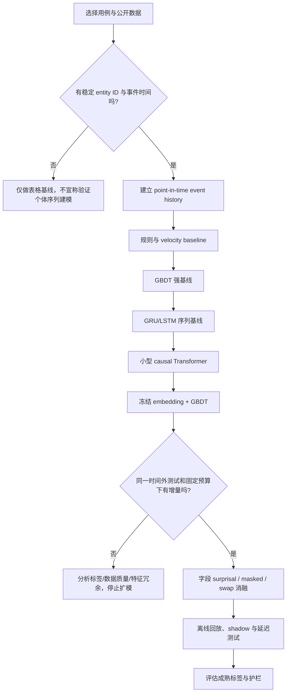

---

## 10. 专用序列模型、通用 LLM 与 Jev 如何协同

这里的 LLM 指以自然语言为主要接口、通过文本 token 进行通用生成或推理的模型；它不等于所有 Transformer。Causal Transformer 可以直接训练在结构化事件 token 上，但如果它不以自然语言为目标、不依赖通用文本 tokenizer，也不执行自由文本生成，那么它更准确地属于**专用序列模型/交易基础模型**。问题不是 Transformer 不适合风控，而是通用聊天 LLM 的接口、目标和运行成本通常与授权评分不匹配。

### 10.1 场景要求与模型特性的错位

| 维度 | 通用 LLM 的常见问题 | 专用结构化序列模型的优势 | 实务结论 |
|---|---|---|---|
| 输入表示 | 将金额、商户 ID、MCC、国家、时间差序列化成文本引入 token 冗余；数字切分不一定对应数值语义 | 字段有明确 embedding、数值变换和时间编码 | 直接建模 schema，不要把交易 JSON 当聊天提示词 |
| 输出目标 | 生成 token 或自然语言解释，不天然等于校准后的欺诈概率 | next-event 概率、字段 surprisal、监督分类头可直接优化 | 使用与业务损失相符的训练目标与校准 |
| 延迟和吞吐 | 生成式解码、网络调用和共享推理服务增加尾延迟 | 小型 encoder/scorer 可固定计算路径并量化 | 实时授权优先使用本地/同区域专用模型；LLM 放异步路径 |
| 成本 | 历史越长，token 成本和计算量越大 | 字段共享 embedding、限制历史长度、缓存状态 | 用每百万次评分的总成本和峰值吞吐测算 |
| 确定性 | 采样、服务端变化使输出不稳定；temperature=0 也不保证整条链路严格可复现 | 固定模型、特征快照和数值输出更易版本化回放 | 记录输入版本、模型哈希与输出 |
| 数值与 schema 精度 | 可能误读字段、单位、币种、负数、时区或稀有代码 | 显式类型、单位、缺失值与范围校验 | 金额保留精确数值语义，不靠提示词保证 schema |
| 类别长尾 | 文本 token 与商户/设备 ID 的业务等价关系不一致 | 频次阈值、哈希桶、层级类别与 OOV 策略可控 | 明确处理新商户、新设备与词表漂移 |
| 标签与目标 | 通用预训练目标不会自动优化欺诈金额、误拒成本或调查预算 | 直接使用成熟标签、成本权重和工作点 | 通用能力不能替代业务目标函数 |
| 解释与审计 | 自然语言理由可能与真正驱动分数的特征不一致 | 记录 surprisal、特征贡献、规则命中和模型版本 | LLM 可把已有证据转成摘要，不应伪造模型理由 |
| 隐私与治理 | 将交易或个人信息发送给外部 API 引入数据驻留、留存和访问控制风险 | 可在受控环境托管专用模型 | 先做数据分类、隐私评估、供应商审查与日志脱敏 |
| 故障模式 | API 超时、配额、网络故障和供应商变更进入交易链路 | 内部模型服务可有 SLA 和旧模型 fallback | 不要让外部 LLM 成为唯一授权依赖 |
| 漂移与更新 | 通用模型升级节奏和训练语料不可由机构完全控制 | 按标签成熟周期和验证结果发布 | 风控更新需治理门禁、回滚与版本追溯 |

### 10.2 成本与时延的粗略估算

若每天有 $`N`$ 次授权，每次发送 $`T_{in}`$ 个输入 token、平均输出 $`T_{out}`$ 个 token，供应商按每百万 token 计价，则直接调用成本可估为：

```math
C_{\mathrm{day}} = \frac{N}{10^6}\left(T_{\mathrm{in}}P_{\mathrm{in}} + T_{\mathrm{out}}P_{\mathrm{out}}\right)
```
其中 $`P_{in}`$ 和 $`P_{out}`$ 是每百万输入/输出 token 的价格。该估算还未计入高可用部署、网络、重试、监控、数据治理与故障回退成本。平均 token 成本也不等于授权时延：必须分别测量 p50/p95/p99、超时率、重试率和尾部并发。

专用序列模型也有 CPU/GPU、特征读取、embedding 查表和在线状态存储成本；优势是输入与计算路径更短、目标更直接，能够把历史编码、推理和降级策略控制在机构的 SLA 内。

### 10.3 LLM 在金融风控中适合承担的任务

- **AML 调查副驾驶**：汇总交易图、时间线、规则命中、已验证外部信息与案件记录，生成带来源引用的调查摘要；不替代法定判断或未经授权自动提交 SAR/STR。
- **告警解释与案件归纳**：把结构化模型证据转成分析员可读说明；每条结论应链接到真实特征、交易、规则或数据源。
- **规则/查询开发辅助**：生成候选 SQL、特征定义和回测脚本，必须经代码审查、沙箱和回归测试。
- **离线特征研究**：从获准使用的文本中抽取商户描述、案件叙述或外部新闻信号，并评估时效、来源质量与许可。
- **模型开发工作流**：生成实验配置、错误分析和漂移报告，但不能绕过模型风险审批。
- **非同步客户支持**：在政策允许范围内解释已做出的决定，不应重新计算或编造原始风险分数。

### 10.4 混合架构：专用模型作决定，LLM 解释证据

~~~mermaid
flowchart TB
    subgraph Online["同步交易路径：严格 SLA"]
        E[授权事件] --> H[PIT 历史 / 在线特征]
        H --> S[专用序列模型：GRU / TCN / Transformer]
        S --> R[GBDT / 风险模型 / 规则]
        R --> D[授权决策]
        D --> A[批准 / 拒绝 / step-up]
    end
    subgraph Async["异步分析路径：非阻塞"]
        D --> X[最小化后的决策证据包]
        X --> L[LLM 案件摘要 / 解释草稿]
        L --> V[证据校验、引用与人工审核]
        V --> C[分析员工作台 / 审计记录]
    end
~~~

LLM 摘要只能引用已存在的风险分数、特征贡献、规则命中和交易事实；应区分“模型分数显示”“规则命中”和“分析员推断”。语言流畅程度不能证明解释正确。

### 10.5 什么时候可以考虑 LLM 参与评分

只有在以下条件全部经过验证后，才考虑将 LLM 作为辅助评分信号，而非默认同步依赖：

1. 有明确合法且可控的数据处理边界；敏感字段已最小化，供应商条款、数据驻留和留存策略通过审查。
2. 用相同时间切分、成熟标签和业务预算证明 LLM 信号在强 GBDT / 专用序列模型之上有稳定增量。
3. 线上压测证明 p99、峰值吞吐、故障率和成本符合授权 SLA，并有独立 fallback。
4. 输出受约束为可校验 schema；无效、拒答、超时和版本变化都有明确处理。
5. 可重放每次决策，并满足模型风险治理、审计、公平性和监管要求。

即使满足这些条件，也优先考虑离线/异步生成的低频信号，或蒸馏到小型专用模型，而不是每笔授权都调用通用生成 API。

### 10.6 专用序列模型、通用 LLM 与 Jev 的分工

这三类东西都可能用于判断，但它们学的对象、输入方式和返回结果不同，不能因为都叫 AI 就放在同一个比较表里简单排高低。

| 方案 | 主要学什么 / 怎么工作 | 适合的金融任务 | 不应默认拿来做什么 |
|---|---|---|---|
| **专用交易序列模型**（GRU、TCN、Transformer encoder 等） | 直接在结构化事件、时间间隔和账户历史上训练；输出 embedding、字段概率或风险分数 | 实时授权评分、账户行为异常、下一事件预测 | 不负责解释长篇调查材料，也不会自动理解所有自然语言 |
| **通用 LLM** | 主要从文本中学习语言与推理模式；通常通过生成文字完成任务 | 案件摘要、调查材料归纳、规则草拟、分析员问答、辅助生成特征定义 | 通常不适合作为高吞吐、低尾延迟的逐笔授权唯一依赖 |
| **Jev / System One** | TypeSafe AI 将其定位为快速结构化判断模型：给定 state 和明确问题，返回预定义选项、等级分数或真假概率，而不是写一段回答 | 对文本或混合上下文做固定类别判断、路由、规则匹配辅助、调查队列分类；值得用真实数据验证 | 不能假设它比专用数值序列模型更懂交易规律，也不能因为返回概率就直接把它当作已校准的欺诈概率 |

### 10.7 Jev 和通用 LLM 的区别

Jev 于 2026 年 9 月由 TypeSafe AI 作为首个 System One 模型发布。它的 API 围绕“给出状态和问题，返回程序能直接使用的类型化判断”设计，而不是让模型生成一段文字，再由程序从文字里解析结果。官方介绍的核心回答类型包括：从候选项中选择（Choice）、按评分标准打分（Score），以及估计某个陈述为真的概率（Noul）。多个独立判断可以放在一次请求中执行。[官方介绍](https://typesafe.ai/blog/introducing-system-one-models-and-jev)；[Jev 说明](https://www.typesafeai.org/jev)。

这让 Jev 更像一个专门给软件调用的判断组件，而不是聊天助手。不过，**输出格式可靠不代表判断永远正确，置信度也不等于业务上的欺诈概率**。它只能在提供的上下文和问题定义下作判断；如果输入缺少真实交易历史，模型不会凭空获得银行内部数据。

2026 年公开的独立基准研究对 Jev 在多种分类、路由和评分任务上的表现进行了评估，同时也指出不同任务的效果不一样；另一项研究发现，选项顺序和无关数字可能影响部分判断概率。[基准评估论文](https://arxiv.org/abs/2609.37647)、[偏差与稳定性研究](https://arxiv.org/abs/2610.19619)。因此，对金融使用场景仍要测试概率校准、选项措辞变化、语言差异、群体差异和分布漂移，而不是直接把厂商演示当作生产保证。

### 10.8 Jev 和交易序列 Transformer 的区别

两者的关键区别不是“谁更先进”，而是是否直接针对交易事件历史训练：

- 交易序列 Transformer 可以在数十亿笔结构化事件上学习账户的时间规律、金额变化、商户条件概率和事件间隔。它可以为每个字段输出可重复计算的异常信号，并通过历史交易训练成特定风险任务的模型。
- Jev 的优势是对给定上下文执行快速、明确的判断，适合“这份调查备注属于哪类案件？”或“这条警报是否满足某个描述性标准？”之类的问题。它不等同于已经用你们交易历史训练过的序列编码器。
- Jev 返回的某个选择概率，不能直接解释成“这笔交易欺诈的概率”。只有在相应数据集上评估、校准并验证后，才可以作为业务分数使用。
- 若输入主要是结构化数字、类别 ID 和长交易历史，先测试专用序列模型；若输入主要是文本材料和清晰定义的判断问题，可以把 Jev 纳入候选；若两者都有，可以分层组合。

### 10.9 一个可落地的混合方案

~~~mermaid
flowchart LR
    A["交易事件流"] --> B["实时历史状态 / PIT 特征"]
    B --> C["专用序列模型"]
    C --> D["GBDT / 规则 / 风险策略"]
    D --> E["授权或调查队列"]
    E --> F["结构化证据与案件文本"]
    F --> G["Jev：固定类别判断 / 队列路由"]
    F --> H["通用 LLM：调查摘要 / 自然语言解释草稿"]
    G --> I["规则校验与人工复核"]
    H --> I
    I --> J["调查结果与成熟标签"]
    J --> K["评估、校准和定期重训"]
    K --> C
~~~

这张图是推荐的职责划分，不是要求每个系统同时部署三种模型。第一阶段只需专用序列模型和现有风控决策；如果调查流程中确实存在大量文本分类、路由或案件摘要，再单独评估 Jev 或 LLM。不要把额外模型加入授权链路，只因为它们可用。

### 10.10 怎么公平比较 Jev、LLM 和专用模型

1. **使用同一批历史案例。** 固定时间范围、标签成熟期、输入字段和排除规则；禁止把未来才知道的信息塞给任何模型。
2. **先定义模型要回答的问题。** Jev 的候选项、LLM 的输出 schema、专用模型的正负标签应映射到同一业务目标。
3. **比较业务工作点。** 同样调查量下的欺诈捕获率、误报率和金额捕获率；同时测 p95/p99、每千笔成本和失败率。
4. **测试稳定性。** 变更选项顺序、同义措辞、无关数字、缺失字段和新商户，检查判断是否大幅变化。
5. **分别评估概率。** 若模型输出概率，检查 reliability diagram、Brier score 或分桶后的实际发生率；不要直接将“confidence”当作已校准的业务风险概率。
6. **保留明确的降级方案。** 外部服务超时、限流或模型版本变化时，走已验证的旧模型/规则，而不是阻塞交易或自动拒绝正常客户。

最终的选型原则很简单：交易历史的规律由专用序列模型学习；自然语言材料由 LLM 处理；需要快速输出固定格式判断时，可评估 Jev。三者可以协作，但每一项都必须通过自己的数据、指标和生产约束验证。

---

## 11. 评估方案：从离线排名到业务收益

### 11.1 评价指标应对应决策约束

| 指标 | 作用 | 注意点 |
|---|---|---|
| PR-AUC / Average Precision | 极不平衡数据下衡量排序质量 | 受正例率影响，跨数据集比较时要披露欺诈率/抽样口径 |
| Recall@fixed flag budget | 在固定拦截/人工调查容量下能抓到多少欺诈 | 对支付授权最贴近实际运营；预算应按笔数、金额或预期损失定义 |
| Precision@K / Card Precision@K | 评估固定容量下最优先的前 K 个风险事件 | 适合调查队列，但 K 和工作流程应反映真实人员容量 |
| 欺诈金额捕获率 / expected loss saved | 评估业务损失，而不只看交易笔数 | 需要明确授权、拒付、追回率、欺诈类型和成本口径 |
| 误拒绝率 / legitimate approval rate | 量化客户摩擦和收入损失 | 风控提高 recall 可能同时提升误拒，必须联动评估 |
| Calibration / Brier / log loss | 分数能否转成可靠概率/期望损失 | 训练抽样、金额加权和分布变化都会破坏原始校准 |
| Segment / cohort metrics | 看新客户、新商户、国家、渠道、客群、欺诈类型的差异 | 总体改善可能掩盖某个客群的大幅退化 |
| p95 / p99 latency、timeout、fallback | 验证是否满足线上服务契约 | 必须包含历史获取、tokenization、推理和下游决策，而非只测模型 kernel |

不应把 Accuracy 作为稀有欺诈任务的核心 KPI；一个几乎全部预测为正常的模型也可能获得很高的 Accuracy。ROC-AUC 也有价值，但未必能反映极低误报预算下的决策排序。可复现的欺诈实操手册把阈值指标、无阈值指标、Top-K 指标、类不平衡和时间外验证分开讨论，值得作为实验模板。[21]

### 11.2 必须包含时间外验证和标签成熟策略

至少建立 rolling-origin / prequential 的时间切分：用过去一段数据训练，预测下一段数据；再向前滚动多个窗口。每个窗口都要按“当时能看到什么”构造特征，按“标签到何时成熟”定义标签。对最近尚未经过足够争议期的事件，不宜简单当成负例。

Stripe 公开的支付争议时间分布展示了为什么这很重要：约 14 天收到 41% 的欺诈报告、30 天约 66%、60 天约 86%；因此使用近 1-2 周数据并将已知欺诈以外所有交易视作正常，可能引入大量假阴性标签。具体成熟周期应该基于本机构产品、卡组织规则、当地争议流程和不同欺诈类型的实际分布计算，而不是机械套用这组数字。[2]

建议维护至少三种数据视图：

1. **成熟标签训练集**：只纳入已经过足够观察期且标签稳定的样本。
2. **近期未成熟监控集**：用于数据漂移、延迟反馈和运营趋势监控，但不把临时“未报欺诈”误作真负例。
3. **延迟标签回溯集**：随着新争议/调查结果到达，回填先前事件，重新评估模型在真实成熟标签下的表现。

### 11.3 做能回答因果归因问题的消融

最小实验矩阵建议如下：

| 实验 | 模型 | 要回答的问题 |
|---|---|---|
| E0 | 旧生产模型 | 基准是什么 |
| E1 | 复现后的 GBDT / 线性基线 | 实验环境是否复现生产基线 |
| E2 | 基线 + 新的窗口统计特征 | 简单低成本的行为统计已能解释多少收益 |
| E3 | 基线 + Transformer embedding | 纯表示是否有增量价值 |
| E4 | 基线 + 字段 surprisal | 字段级异常信号是否更直接、更有效 |
| E5 | 基线 + swap / consistency 分数 | 字段组合不一致信号是否增益 |
| E6 | 基线 + 所有序列特征 | 多种输出是否互补或重复 |
| E7 | E6 + 金额/成本加权目标 | 排序提升来自模型输入还是业务损失函数 |
| E8 | 最佳方案在固定告警/拒绝预算的 replay 或 shadow | 是否真的改善业务可用工作点 |

每一轮只改变一个因素，固定数据快照、样本策略和评估脚本。对相同事件做配对比较，用 bootstrap 或其它合适方法给出置信区间；如果某个预算点的收益不稳定，不要只报最佳点。

### 11.4 验证“第一个欺诈事件”和分段表现

对卡片/账户历史中的第一笔欺诈、欺诈连续发生的后续交易、同一事件序列中的小额测试与高金额转出，分别报告指标。过去已有欺诈的卡片往往更容易被历史特征命中；如果模型的总体改善只来自攻击已开始后的后续交易，实际预防能力可能被高估。Ramp 特别披露了第一笔欺诈的结果，是值得复用的分层方法。[1]

---

## 12. 上线、可观测性、解释与模型风险管理

### 12.1 上线阶段

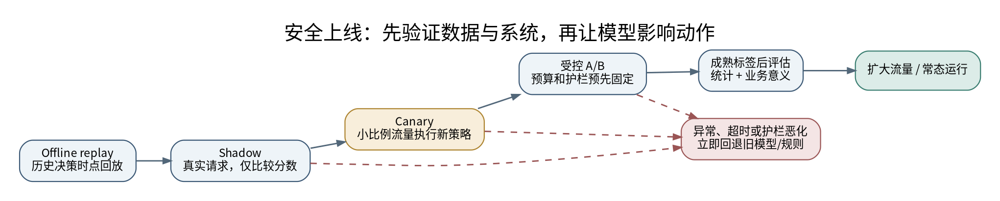

- **Offline replay**：用历史时点回放在线状态，测试业务工作点和数据缺失边界。
- **Shadow**：新模型读取真实请求但不影响动作，比较分数、特征可用率、分布和延迟；需要等待标签成熟后比较真实风险效果。
- **Canary**：小比例流量执行新策略，设置明确停机门槛，例如 p99 超标、超时率上升、误拒指标变差、分数分布异常或某类客群明显退化。
- **A/B / 受控实验**：按可随机化的单位（客户/卡/账户等）设对照，避免同一实体同时接受互相污染的策略；预先定义主指标与护栏指标。
- **Rollback**：保留旧模型、特征 schema 和阈值的一键恢复路径；降级规则必须与新模型故障解耦。

### 12.2 线上观测要覆盖四层

1. **数据层**：历史长度、事件新鲜度、字段缺失率、未知商户比例、时间差分布、迟到/重复/乱序事件率。
2. **表示层**：embedding norm/分布、逐字段 surprisal 分布、swap score 分布、序列长度、未知 token 命中率，以及按客群/国家/商户类别的漂移。
3. **模型层**：分数分布、校准、shadow score divergence、阈值附近的决策翻转率、预测置信度与不同标签成熟窗口的离线效果。
4. **业务与系统层**：授权通过率、误拒率、欺诈笔数和金额、拒付损失、人工调查积压、p50/p95/p99、超时、fallback、依赖服务可用性和单次评分成本。

必须按“旧模型 → 新模型”分别记录命中的特征、模型版本、训练数据版本、阈值、历史事件快照/事件 ID 和动作执行结果。这样在争议或客户投诉后，才能重建当时模型真正可见的证据。

### 12.3 解释：把异常分数变成可审计理由

- **字段级 surprisal**：例如“此金额在该实体近期交易上下文下极少见”“国家字段与历史差异显著”“支付呈现方式突然变化”。应显示原始值、历史范围和模型版本，而不是只显示神经网络内部数值。
- **下游 SHAP / 特征贡献**：适用于 XGBoost 或其他可解释层，展示本次分数与基线/参考分布的差异。不能将 SHAP 解释当成因果证明，也要注意重采样、不平衡数据会扭曲解释背景分布。[25]
- **事件链/证据回放**：对 ATO、转账诈骗和 AML，展示按时间排序的关键事件和关联实体，能让分析员确认上下文是否完整。
- **规则和 hard control**：制裁、授权策略、法定阈值、已知高危实体名单等不能仅依赖表示学习中的软分数；模型应增强而非隐式绕过硬性控制。
- **原因码治理**：风险模型的低层特征并不一定自然映射到对客户可披露的理由；原因码需要业务/合规评审，避免输出含糊、误导或泄露反欺诈策略的信息。

### 12.4 模型风险管理与监管关注

截至 2026 年 10 月，美国联储 SR 26-2 发布新的 Model Risk Management 指导，并明确对其监管范围内资产超过 300 亿美元的银行组织尤其相关；该指引取代了 SR 11-7，并与早期 BSA/AML 模型风险文件的更新有关。具体适用范围应由机构合规团队确认，本文不构成法律意见。[17]

英国 FCA 在 2026 年 10 月发布 AI 良好与较差实践，强调治理责任、持续监控、漂移管理、可审计记录、运营韧性和部署后的监督。其案例强调不能只监控技术指标而忽略客户与业务结果；治理不应只是上线前一次性审批。[18]

这些要求转化为工程交付物，应包括：模型卡/用途边界、训练数据与标签说明、方法与假设、适用和不适用场景、独立验证结果、时间外/分群评估、解释有效性、漂移阈值、降级与回滚方案、权限控制、模型/数据版本审计，以及生产后周期复核。对高影响决策，应按业务风险安排人工复核与申诉/纠错流程。

### 12.5 隐私与安全

- 不把 PAN、账户号、姓名、设备标识或敏感客户内容直接当作模型日志字段；使用受控的内部标识、tokenization 或适当的 HMAC/hash，并管理密钥和重识别权限。
- 明确 tenant / business / legal entity 的序列边界，防止跨客户或跨机构信息被非预期地共享。
- 对高基数 embedding 和预训练语料制定保留期限、访问控制与删除策略；即使输入是 ID，模型记忆和向量仍可能包含行为信息。
- 对来自交易备注、客服文本或商户名称的非可信自由文本，不能把它们当成可信指令；如果进入 LLM 调查辅助流程，应防止 prompt injection 和未经验证的证据生成。
- 图关系和序列表示可能从表面匿名数据中暴露关联；需进行可识别风险评估和访问审计。

---

## 13. 常见失败模式与决策清单

### 13.1 常见失败模式

**只对比一个弱基线。** Transformer 在较弱的 LR 或不充分调优的树模型上赢，不代表它对成熟的 GBDT、可靠的窗口聚合、成本加权目标或现有网络特征有增量。要复现强基线并做配对消融。

**把未知标签当成正常。** 最新交易没有收到欺诈报告，不等于正常。训练和评估必须区分成熟正例、成熟负例、标签未成熟、已拒绝而无法观察后续损失等不同状态。[2]

**随机切分导致时间泄漏。** 同一实体未来事件可能进入训练集，而过去事件在测试集；归一化参数、统计特征、图邻接和标签回填也可能泄漏。要以决策时点回放历史，并对实体泛化设置单独压力测试。

**把异常性当风险。** 新商户/国家/金额本来就可能是合法变化。需要监督式风险模型、业务规则和必要的 step-up 认证将异常转换为动作，不应让自监督异常分数直接拒绝所有陌生交易。

**高基数 embedding 无边界。** 给所有商户/设备分配独立 token 会扩大模型内存、稀疏度和训练/部署版本耦合。需要 top-K + 长尾 hashing/fallback，并监控未知值和碰撞率。

**推理基准和生产请求不一致。** padding、对象分配、线上历史长度、特征序列化、RPC 和超时策略可能吞掉理论性能；必须在真实请求分布和完整链路中 profile。[1]

**解释做了但没验证解释质量。** 仅画 SHAP 图不代表解释可靠；要评估 explanation stability、faithfulness、对分析员判断的帮助，以及重采样与类不平衡对解释的影响。[25]

**把通用 LLM 放进热路径。** 支付授权对 p99 和可预测性敏感；让远程生成模型进行自然语言推理通常增加成本和不稳定性。更合适的结构是结构化序列 encoder 做实时评分，LLM 用于异步调查辅助、摘要、规则开发和实验分析。

**没有旧模型回退。** 新模型依赖服务变慢或模型文件/特征服务异常时，不能让所有交易超时。降级路径必须预先演练，并记录采用了哪种模型/规则。

### 13.2 什么时候不值得上 Transformer

- 交易量小、实体历史太短或行为序列没有额外信息；
- 强窗口特征和 GBDT 已能满足风险和成本目标，且序列特征没有显著增量；
- 标签质量、事件时间、历史回放能力和线上特征一致性还不可靠；
- 实时 SLA 没有给历史检索、模型推理和降级留出足够预算；
- 业务需要极强的原因码/规则确定性，而团队暂无足够能力维护复杂模型；
- 目标本质是网络团伙/关系识别，纯序列表示明显缺少图拓扑信号；
- 公开数据上的优势依赖不现实的随机切分、过采样或合成欺诈假设。

在这些情形下，改善事件 schema、标签成熟策略、窗口特征、GBDT、规则治理和在线特征平台通常是更优先的投资。

---

## 14. 实施路线图与验收标准

建议按验证价值的先后推进，阶段目标是形成可审计的决策，不是追求大模型规模。

| 阶段 | 工作内容 | 应产出的交付物 | 通过标准 |
|---|---|---|---|
| 0. 数据与业务定义 | 确定风险目标、entity scope、事件 schema、标签成熟周期、拦截/调查预算与成本函数 | 事件字典、标签定义、数据质量报告、现状基线 | 可按某历史时点重建当时已知的历史与标签状态 |
| 1. 强基线 | 复现生产模型；实现近期计数、速度和规则特征；建立时间外验证 | 可复现基线、离线回放器、预算曲线 | 对生产基线差异可解释；无随机拆分泄漏 |
| 2. 最小序列模型 | 使用有界近期历史、字段 embedding、时间差编码、next-event 目标 | 序列 encoder、输出 embedding、每字段 surprisal、模型卡 | 训练可重现，未知值与缺失值有明确定义，推理 p99 可测 |
| 3. 增量评估 | 对比 `baseline`、`+count`、`+embedding`、`+surprisal`、`+swap`、组合与成本加权目标 | 消融报告、分群指标、置信区间、资源估算 | 在预定义工作点看到稳定增量，或明确得出不值得部署的结论 |
| 4. 影子运行 | 对真实请求生成新分数但不改变动作；检查延迟、缺失、漂移和分数分歧 | shadow dashboard、超时/fallback 观测、回滚演练 | 整条线上路径满足 SLA；异常时可安全回退 |
| 5. 灰度与线上验证 | 小流量 canary / 受控 A/B，成熟标签回溯后再判结果 | 实验报告、决策记录、原因码评审 | 预定义业务主指标改善，护栏指标不恶化，差异有统计与业务意义 |
| 6. 生产运营 | 版本/阈值管理、周期重训、标签回填、模型和数据漂移复核 | Runbook、告警策略、审计日志、回退包 | 能在模型退化、服务故障、攻击模式变化时识别并恢复 |

### 14.1 上线验收门槛示例

具体阈值由现有生产 SLA 和风险偏好决定，但至少明确以下门槛，不要只用“离线 AUC 提升 X%”作为上线标准：

- 预先选定的业务主指标（例如固定拒绝预算下的欺诈金额捕获率）达到统计和业务意义上的改善。
- 合法客户授权率、误拒率、关键客群指标及客户摩擦成本不超过护栏。
- 全链路 p95/p99 与 timeout 满足授权 SLA；在特征缺失、模型不可用和历史服务超时下能快速降级。
- 训练与在线特征一致性经过 point-in-time 回放验证；对近实时未成熟标签有明确监控策略。
- 新版本的模型、schema、tokenizer、阈值、特征代码及训练数据快照均可追溯；可回滚到上一版本。
- 解释信息不会直接暴露规则策略、敏感客户信息或未经验证的因果结论。

### 14.2 可操作的首个实验方案

最实用的第一轮不是复刻完整基础模型，而是做一个有限范围的增量实验：

1. 选择一个高质量产品线/风险类型，例如卡授权欺诈或即时转账风险；定义实体历史范围及一组固定业务预算。
2. 构建截至授权时刻的最近 64-256 笔事件历史（仅作为第一轮搜索范围，不是通用最佳值），按事件类型、商户类别、国家、金额 bucket、支付方式、批准/拒绝结果、时间差等字段编码。
3. 训练一个浅层因果 Transformer 做 next-event 字段预测；产出 embedding 和字段 surprisal。第一版先不加图模型、不加文本 LLM、不做多模态大一统。
4. 把这些产物作为特征加入复现后的 GBDT。用完全相同的训练样本、时间切分、标签成熟策略和工作点做配对消融。
5. 若收益可归因且延迟达标，再试 masked reconstruction / swap score / additional event streams，并分别记录边际价值。
6. 先 shadow，再 canary；待标签成熟后评估业务收益。若强基线没有稳定增量，即停止增加模型复杂度，将工程资源转向数据、标签、计数特征或网络关系。

这个路线在架构上保留了既有模型的可控性，验证成本也低于端到端替换。它同样兼容下游模型不是 XGBoost 的情况。

---

## 最终建议

对于已有金融风控平台，最合理的第一步通常不是引入一个大型生成式模型，而是把 Transformer 当作一个学习行为历史的组件。先验证数据是否能按决策时点准确回放，再用小型的结构化事件序列编码器输出 embedding 和字段级异常分数；让现有分类器、规则、成本函数和决策流程继续发挥作用。只有当序列特征在成熟标签、真实预算、时间外测试和线上 shadow 中呈现可归因、稳定且可运营的增量时，才扩大目标函数、上下文范围或基础模型规模。

从 Ramp、Stripe 和 2025-2026 年论文里最值得带走的，并不是某一层数或某个 benchmark，而是一套方法：用自监督利用未标注行为，用 point-in-time 数据防止时间穿越，用强基线和消融证明增量，用成熟标签评价真实风险，用 p99 与回退设计保护交易链路，并在上线后持续监测分数、数据与业务结果。金融服务中的 Transformer 最终必须成为可解释、可追溯、能快速降级的生产决策组件，而不是只在离线指标表里表现更好的模型。

---

## 15. 趋势分析与研究判断：2027 年及以后，非 LLM 深度学习还有必要吗？

### 15.1 先说结论：没有过时，但研究重点正在改变

**结论是：值得继续学习，也值得作为计算机或人工智能方向做论文；但不值得把“再造一个 Transformer”本身当成研究目标。**

这里的“非 LLM 深度学习”不是指落后的模型，而是指主要针对特定数据结构和任务训练的神经网络，例如 GRU/LSTM、TCN、交易序列 Transformer、图神经网络、自动编码器、自监督表示学习模型，以及把这些模型与 GBDT、规则或优化算法组合的系统。它们可能使用 Transformer 结构，但不一定以自然语言为输入，也不需要生成文字，因此并不等同于通用聊天 LLM。

截至 2026 年 10 月，公开研究并没有显示这类方法已经退出舞台。2026 年发表的 [FraudTransformer](https://eprints.gla.ac.uk/378679/) 将时间间隔和事件顺序显式加入交易序列模型，并在工业银行数据上进行评估；[2026 年关于表格表示学习的 TPAMI 综述](https://doi.org/10.1109/TPAMI.2026.3657217) 仍将专用、可迁移和通用表格模型作为活跃研究方向；同年的 [树模型与表格深度学习综述](https://doi.org/10.1145/3807777) 也把预训练、自监督、混合架构和泛化能力列为持续发展的方向。[3][39][40]

但要注意另一面：**深度学习并不会在每一种数据上都胜过传统机器学习。** 对数据量不大、主要由单行数值和类别字段组成的表格分类任务，LightGBM、XGBoost 等梯度提升树模型依然是很强的基线。神经网络的优势通常更容易出现在有大量未标注数据、复杂事件历史、多来源数据、实体关系，或需要向多个任务迁移表示的场景。2027 年及以后的合理判断不是“深度学习一定赢”，而是“针对数据结构设计的学习方法仍有价值，但必须证明其相对强基线的增量”。

### 15.2 未来几年更可能研究什么？

下表是基于截至 2026 年公开研究的趋势判断，不是对未来论文数量或产业采用率的保证。

| 方向 | 为什么还有问题值得研究 | 2027 年以后值得追问的问题 | 研究难度与注意点 |
|---|---|---|---|
| **领域序列基础模型** | 交易、登录、设备和账户流水有时间顺序、实体边界与异构字段，跟自然语言不同 | 一个预训练模型能否在不同业务、实体或机构之间迁移？需要多少本地数据才能适配？ | 中到高。不能只扩大参数量；要设计跨时间、跨实体和跨数据域的独立测试 |
| **自监督与少标签学习** | 大量事件没有成熟欺诈标签，而已确认欺诈较少且到达晚 | 下一事件预测、掩码重建、对比学习或它们的组合，哪种能真正提升下游风险识别？ | 中到高。必须把表示质量与最终业务增量分开评估 |
| **不规则时间与事件语义** | 交易之间的间隔可能从几秒到几个月；同一事件类型在不同时间上下文里含义不同 | 如何编码时间间隔、周期性、缺失事件和延迟到达，而不让模型利用未来信息？ | 中。适合做清晰的模块消融和错误分析 |
| **序列 + 图关系** | 个体序列说明“这个账户平时怎么做”，关系图说明“它和哪些账户、设备、商户或收款人相连” | 哪些 AML 或团伙欺诈场景确实需要图模型？动态图信息何时带来增益、何时只增加成本？ | 高。图构建、实体解析和时间泄漏往往比模型代码更难 |
| **持续学习与漂移适应** | 欺诈手法、商户结构和客户行为会变，模型上线后的分布与训练数据不同 | 新标签不断成熟时，怎样适应新模式而不忘记旧模式、不污染正常行为画像？ | 高。要研究标签延迟、反馈循环、回滚和版本可复现性 |
| **小模型、低延迟与资源效率** | 金融授权有严格的响应时间、吞吐和可用性要求 | 能否用更少参数、更短历史、更少特征读取取得相同效果？何时 GRU/TCN 比 Transformer 更划算？ | 中。必须测量完整请求链路，而不是只测 GPU 推理时间 |
| **校准、可靠性与可审计性** | 高风险业务不只关心排序，还需要知道概率是否可信、分数为什么变化、何时该拒绝自动决策 | 如何估计不确定性、发现未知模式、在漂移时触发人工复核或安全降级？ | 中到高。需要真实决策成本与分群测试，而不仅是一个 AUC |
| **隐私保护的跨域学习** | 单家机构可能缺少覆盖全面的标签，但交易数据不能随意集中 | 联邦学习、隐私保护表示学习或跨机构迁移能否在不暴露原始数据的情况下提升泛化？ | 高。隐私机制、通信成本、参与方差异和实际效用都需要评估 |

时间序列预测领域也在讨论基础模型、迁移、可信评估和分布漂移等问题；可参考 2026 年 10 月发布的 [IEEE TKDE 时间序列预测综述](https://doi.org/10.1109/TKDE.2026.3736707)。这不意味着应该把所有金融交易都改造成“大一统基础模型”。它更说明，研究问题正在从单纯比较网络结构，转向表示是否能迁移、在数据变化时是否稳健，以及部署成本是否合理。[41]

### 15.3 LLM 越来越强，为什么专用模型不会自动失去价值？

LLM 的发展会改变研究方式，但不会自动消除不同数据类型之间的差异。可以用一个简单类比理解：一个很会阅读报告的人，不一定能在每次刷卡请求的几十毫秒内，准确地根据数百个数值字段和过去几个月的事件历史计算风险；反过来，一个擅长交易序列评分的模型，也不一定能读懂调查员的长篇案件记录并总结证据。

两类模型的侧重点不同：

- **专用深度学习模型**直接针对结构化事件、数字、类别和实体关系训练，输出固定的 embedding、概率或风险分数。它可以被约束在可测量的计算路径内，并以同样的输入重复推理。
- **通用 LLM**擅长语言理解、信息归纳和面向人的交互。它可用于生成训练数据草稿、归纳研究论文、帮助分析错误案例、整理调查记录或协助开发特征代码；但用于实际交易判断时仍需验证数值准确性、概率校准、响应延迟和输入成本。
- **混合方案**往往更值得研究：专用模型负责稳定的数值/事件评分，LLM 负责非同步的文本处理、错误分析和人工调查辅助。LLM 也可以帮助研究者分析模型失败案例，但不能替代严格的测试集和统计验证。

还有一个容易误解的点：**“用了 Transformer”并不等于“这是 LLM”。** Transformer 是一种网络结构；模型是否属于语言模型，取决于训练数据、训练目标和实际用途。只在商户 ID、交易金额、事件类型和时间差上训练的因果序列编码器，可以使用注意力机制，但并不是一个让它写自然语言答案的通用 LLM。

### 15.4 作为论文方向，什么题目有价值？

对计算机专业或人工智能方向的论文，答案是肯定的。前提是研究贡献不能只是“我把某篇论文的 Transformer 结构搬到另一个数据集上”。一个合格研究通常要清楚说明：现有方法解决不了什么问题；你提出的假设是什么；如何设置能公平验证假设的实验；结果对哪些情况有效、对哪些情况无效。

| 论文方向 | 可采用的研究问题 | 一个可执行的实验设计 | 怎样才算有贡献 |
|---|---|---|---|
| **实验/基准型：交易序列表示是否真的有增量？** | 在实体历史、时间切分和强 GBDT 基线都正确的情况下，序列 embedding 对哪些欺诈类型有帮助？ | 用 PaySim、BankSim 或 TabFormer，比较窗口统计、GBDT、GRU、Transformer 和 embedding + GBDT；加入多个时间切片与消融 | 给出可信的适用边界和失败分析，而不是只报一个更高的 AUC。适合作为本科毕业设计或课程研究的起点 |
| **方法型：标签延迟感知的自监督预训练** | 欺诈标签晚到时，如何训练模型利用未标注事件，又避免把未确认欺诈当成正常？ | 设计标签成熟掩码、延迟采样或带时间约束的预训练/微调流程；与普通 next-event 和监督式方法比较 | 需要清楚的算法新意、严格的时间外实验、多个基线和消融。适合硕士研究，深入后也可向博士课题发展 |
| **时间建模型：不规则事件时间编码** | 绝对时间、相邻事件间隔和周期特征分别贡献什么？怎样应对事件延迟到达？ | 固定参数量和历史长度，对比多种时间编码，测试不同延迟、缺失与行为频率分群 | 不只证明某编码“平均更好”，还要解释何种时间模式下有效及为何有效 |
| **关系建模型：时序与图信息的互补性** | AML 中关系网络是否在时间序列之外增加可用信息？ | 在 AMLSim 或 Elliptic++ 上构造时间可见图，比较序列模型、图模型与融合模型；严格限制邻居信息的时间可见性 | 需要针对泄漏、实体识别误差和图变化进行压力测试；仅把 GNN 接到 Transformer 后面不算充分创新 |
| **持续学习：新欺诈出现后如何安全更新** | 新标签不断成熟时，怎样适应新模式而不破坏旧模式和阈值校准？ | 按月模拟漂移与标签延迟；比较固定模型、定期重训、增量学习，测试旧类别回归和恢复策略 | 贡献包括更新算法、可靠评估协议或可复现系统；不能只用随机切分比较最终准确率 |
| **系统型：在固定时延预算下做风险评分** | 通过短历史缓存、序列截断、量化或蒸馏，能否降低 p99，同时保留业务收益？ | 同时测完整请求链路、吞吐、内存、错误率和固定审核预算下的捕获率 | 有可重复的效率—效果曲线和生产约束分析，适合偏系统的计算机研究 |

对于本科论文，选择一个有边界的实验问题并把实验做扎实，通常比提出一个复杂的新架构更可行。硕士论文应有明确的方法或实证贡献，不能只堆模型。博士研究则通常需要更清晰的原创方法、理论或系统贡献，并在多个数据环境中论证其泛化性。以上是研究设计建议，不是对某所学校具体毕业要求的判断。

### 15.5 哪些题目容易“看起来做了 AI”，实际研究价值不高？

以下做法风险很高：

- 在一个公开数据集上随机切分训练集和测试集，只比较一两个 Transformer 与 XGBoost。
- 只报告 accuracy 或 ROC-AUC，完全忽略欺诈比例、标签成熟期、固定拦截预算、金额损失和模型校准。
- 直接把相邻数据行当成同一账户的历史，实际上数据没有稳定实体 ID。
- 用合成数据得到高分，却把结果写成真实银行生产效果。
- 不做消融、不固定参数预算，也不公开切分方式；最终无法判断提升来自时间编码、更多参数、不同样本或数据泄漏。
- 为了让深度学习“赢”，故意使用未充分调优的树模型作为基线。
- 只把最新的模型名称拼进题目，却没有提出可验证的新问题。

这类工作即使代码写得很多，也很难说明其学术贡献。反过来，一个发现“在严格时间外切分和成熟标签下，序列模型对大部分交易没有额外帮助，只对某些长历史/高频行为子群有效”的研究，也可能很有价值——前提是设计严谨、结论可复现，并能解释差异来源。

### 15.6 推荐的选题路径

如果目标是从编程能力出发、逐渐进入深度学习研究，建议按照下面的顺序推进：

~~~mermaid
flowchart LR
    A["复现可信的 GBDT 基线"] --> B["建立正确的时间外测试与标签成熟规则"]
    B --> C["实现 GRU / 小型 Transformer"]
    C --> D["用消融实验验证序列信息是否有增量"]
    D --> E{"存在稳定、可解释的差距吗？"}
    E -->|否| F["研究失效原因、数据质量与适用边界"]
    E -->|是| G["聚焦一个具体问题：时间、标签延迟、图或漂移"]
    F --> H["形成可信的基准/实证型论文"]
    G --> I["提出方法并设计多场景验证"]
    I --> J["补充统计检验、复现材料与限制分析"]
    H --> J
~~~

**本文对 2027 年及以后研究价值的判断是：领域没有过时，但“仅换模型结构”的空间会越来越有限。** 更有价值的工作，是解释什么数据条件需要专用深度学习、它在强传统基线之上何时能产生增量、如何适应时间变化，以及如何在低延迟、标签延迟、隐私和审计约束下可靠运行。对于人工智能论文方向，这不仅成立，而且比单纯追逐更大的模型更容易形成明确、可验证的研究问题。

## 16. 参考文献与开源资源

以下按主题列出主要来源。公司工程博客和监管文件用于理解生产约束；会议论文和预印本用于了解建模方法。论文摘要中的性能数字按作者报告引用，不能视为跨机构可复现的统一基准。访问日期均按 2026-10-24 的研究基准日处理。

### 核心业界案例

**[1] Ramp Builders.** *Putting a Transformer Inside Every Card Authorization.* 2026-10-07. 直接生产案例，披露交易字段、三种自监督任务、模型规模、消融、SHAP 观察和延迟优化。  
https://builders.ramp.com/post/sequence-aware-card-fraud

**[2] Stripe Engineering.** *Scaling Radar: Fighting fraud with agent-assisted machine learning.* 2026-10-19. 覆盖 Shield 的跨网络表示、训练样本扩展、争议标签逐渐成熟和实验自动化；文中提到约 800M → 11B 交易、未成熟标签造成的问题，以及特定实验 recall 提升超过 8%。  
https://stripe.dev/blog/scaling-radar-fighting-fraud-with-agent-assisted-machine-learning

**[19] Mastercard.** *Mastercard supercharges consumer protection with gen AI.* 2024-02-01. Decision Intelligence Pro 的官方产品说明，报告低于 50 ms 增强评分及官方初始建模效果；没有足够信息证明内部架构为 Transformer。  
https://www.mastercard.com/content/mccom/us/en/news-and-trends/press/2024/february/mastercard-supercharges-consumer-protection-with-gen-ai.html

**[20] Visa.** *AI solutions for fraud prevention and detection.* 访问日期 2026-10-24。官方概述实时风险评分、行为分析、速度规则和地理位置/IP 分析。  
https://corporate.visa.com/en/solutions/visa-protect/insights/ai-fraud-detection.html

### 交易序列模型与交易基础模型

**[3] Aminian, G. et al.** *FraudTransformer: Time-Aware GPT for Transaction Fraud Detection.* arXiv:2509.23712, 2025；发表于 IEEE Conference on Artificial Intelligence 2026。  
https://arxiv.org/abs/2509.23712  
https://doi.org/10.1109/CAI68641.2026.11536152

**[4] Padhi, I. et al.** *Tabular Transformers for Modeling Multivariate Time Series.* arXiv:2011.01843 / ICASSP 2021.  
https://arxiv.org/abs/2011.01843  
代码和数据：https://github.com/IBM/TabFormer

**[5] Skalski, P. et al.** *Towards a Foundation Purchasing Model: Pretrained Generative Autoregression on Transaction Sequences.* arXiv:2401.01641 / ACM ICAIF 2023。  
https://arxiv.org/abs/2401.01641  
https://doi.org/10.1145/3604237.3626850

**[6] Moskvoretskii, V. et al.** *MLEM: Generative and Contrastive Learning as Distinct Modalities for Event Sequences.* arXiv:2401.15935, 2024。  
https://arxiv.org/abs/2401.15935

**[7] Braithwaite, D. T. et al.** *Your Spending Needs Attention: Modeling Financial Habits with Transformers.* arXiv:2507.23267, 2025。  
https://arxiv.org/abs/2507.23267

**[8] Yeh, C.-C. M. et al.** *TREASURE: A Transformer-Based Foundation Model for High-Volume Transaction Understanding.* arXiv:2511.19693, 2025；公开资料显示该研究进入 KDD 2026 相关出版信息。  
https://arxiv.org/abs/2511.19693

**[9] Ostroukhov, M. et al.** *PRAGMA: Revolut Foundation Model.* arXiv:2604.08649, 2026。  
https://arxiv.org/abs/2604.08649

**[10] Rusakov, N. et al.** *A Foundation Model for Multimodal Event Sequences in Financial Applications.* DOI:10.1145/3770855.3818311, KDD 2026。  
https://arxiv.org/abs/2607.09955  
https://doi.org/10.1145/3770855.3818311

**[11] Butvinik, D. et al.** *Temporal Contrastive Transformer for Financial Crime Detection: Self-Supervised Sequence Embeddings via Predictive Contrastive Coding.* arXiv:2605.21490, 2026。  
https://arxiv.org/abs/2605.21490

**[12] Babaev, D. et al.** *CoLES: Contrastive Learning for Event Sequences with Self-Supervision.* SIGMOD 2022.  
https://doi.org/10.1145/3514221.3526129

**[13] Liu, C. et al.** *User Behavior Pre-training for Online Fraud Detection.* KDD 2022, pp. 3357-3365.  
https://doi.org/10.1145/3534678.3539126

**[14] Wang, Z. et al.** *Sequence As Genes: An User Behavior Modeling Framework for Fraud Transaction Detection in E-commerce.* KDD 2023.  
https://kdd.org/kdd2023/wp-content/uploads/2023/08/toc.html

**[15] Sun, F. et al.** *BERT4Rec: Sequential Recommendation with Bidirectional Encoder Representations from Transformer.* arXiv:1904.06690, 2019。  
https://arxiv.org/abs/1904.06690

**[16] Huang, X. et al.** *TabTransformer: Tabular Data Modeling Using Contextual Embeddings.* arXiv:2012.06678, 2020。  
https://arxiv.org/abs/2012.06678

**[24] Dou, Y. et al.** *TransactionGPT: Toward Foundational Transaction Modeling.* KDD 2026.  
https://doi.org/10.1145/3770855.3818496

### 生产数据、验证与模型治理

**[17] Board of Governors of the Federal Reserve System.** *SR 26-2: Revised Guidance on Model Risk Management.* 2026-04-17.  
https://www.federalreserve.gov/supervisionreg/srletters/SR2602.htm

**[18] Financial Conduct Authority.** *AI in financial services: good practice and areas for improvement.* 2026-10-19，更新于 2026-10-20。  
https://www.fca.org.uk/publications/good-poor-practice/ai-financial-services

**[21] Fraud Detection Handbook.** *Reproducible Machine Learning for Credit Card Fraud Detection.* 含数据模拟、时间切分、阈值/无阈值/Top-K 指标、不平衡学习和序列模型比较。  
https://fraud-detection-handbook.github.io/fraud-detection-handbook/

**[22] Financial Action Task Force (FATF).** *Opportunities and Challenges of New Technologies for AML/CFT.* 2021。  
https://www.fatf-gafi.org/content/dam/fatf-gafi/guidance/Opportunities-Challenges-of-New-Technologies-for-AML-CFT.pdf

**[23] Deprez, B. et al.** *Advances in Continual Graph Learning for Anti-Money Laundering Systems: A Comprehensive Review.* arXiv:2503.24259, 2025。  
https://arxiv.org/abs/2503.24259

**[25] Zafar, U. & Wu, F.** *Methodological challenges in explainable AI for fraud detection: a systematic literature review.* Artificial Intelligence Review, 2026。  
https://link.springer.com/article/10.1007/s10462-026-11516-7

### 公共数据集与可运行 Notebook

**[26] IBM.** *TabFormer source code and synthetic transaction data.* 包含约 2,400 万笔、12 字段合成交易，以及 BERT-style / GPT-style 训练入口。\
https://github.com/IBM/TabFormer

**[27] Lopez-Rojas et al. / Kaggle.** *Synthetic Financial Datasets For Fraud Detection (PaySim).* 包含 source/destination 账户、小时级 step 和仿真欺诈标签。\
https://www.kaggle.com/datasets/ealaxi/paysim1

**[28] Kaggle / ULB Machine Learning Group.** *Credit Card Fraud Detection.* 284,807 笔匿名化信用卡交易，492 个正例，字段为 PCA 变量、时间与金额；不提供原始账户/持卡人标识。\
https://www.kaggle.com/datasets/mlg-ulb/creditcardfraud

**[29] IEEE Computational Intelligence Society.** *IEEE-CIS Fraud Detection dataset.* 交易和 identity 两组匿名数据；`TransactionDT` 是相对时间，不是实际日期时间。\
https://www.kaggle.com/competitions/ieee-fraud-detection/data

**[30] IBM.** *AMLSim: Anti-Money Laundering Simulator.* 可生成交易图、账户、已知洗钱情景和告警结果。\
https://github.com/IBM/AMLSim

**[31] Weber et al. / DI SL.** *Elliptic / Elliptic++ transaction graphs.* 适用于加密资产 AML 图与时间分片任务。\
https://github.com/git-disl/EllipticPlusPlus

**[32] NVIDIA.** *Build Your Own Transaction Foundation Model for Financial Intelligence.* 2026-06-16。含端到端架构、TabFormer 时间切分、AP 基线与 embedding + XGBoost 示例；具体 GPU 与内存要求参照该 repo README。\
https://developer.nvidia.com/blog/build-your-own-transaction-foundation-model-for-financial-intelligence/\
https://github.com/NVIDIA-AI-Blueprints/transaction-foundation-model

**[33] Google.** *Google Colab FAQ.* 免费资源、GPU/TPU 访问和 VM 时长取决于动态用量限制，资源供应不保证。\
https://research.google.com/colaboratory/faq.html

**[34] Fraud Detection Handbook.** 可复现的欺诈建模教程，Notebook 可通过 Colab 或 Binder 运行。\
https://fraud-detection-handbook.github.io/fraud-detection-handbook/\
https://github.com/Fraud-Detection-Handbook/fraud-detection-handbook

**[35] Kaggle Notebook.** *Fraud Detection Analytics — PaySim.* 用于参考数据加载、EDA 与传统基线，不是 Transformer 已实现的证据。\
https://www.kaggle.com/code/muhammadammar11/fraud-detection-analytics-paysim

**[36] Kaggle Notebook.** *Feature Engineering & LightGBM (IEEE-CIS).* 用于了解强 GBDT 基线与特征工程；不应直接将排行榜得分当作生产验证。\
https://www.kaggle.com/code/davidcairuz/feature-engineering-lightgbm

**[37] Kaggle Notebook.** *IEEE Fraud — Features + XGBoost.* 用于参考时间相关特征与传统分类器。\
https://www.kaggle.com/code/danofer/ieee-fraud-features-xgboost-0-934-lb

**[38] Kaggle dataset.** *BankSim synthetic bank payments.* 约 59 万笔合成支付，可用于短周期的 customer–merchant 序列实验。\
https://www.kaggle.com/datasets/ntnu-testimon/banksim1


**附加实现资源：PyTorch-Lifestream.** *Learning Embeddings on Discrete Event Sequences.* IJCAI 2025 Demo Track；提供多模态离散事件序列学习开源库。  
https://www.ijcai.org/proceedings/2025/1272

### 补充的官方文档与治理资源

- [GitHub Docs — Writing mathematical expressions](https://docs.github.com/en/get-started/writing-on-github/working-with-advanced-formatting/writing-mathematical-expressions)
- [NVIDIA Transaction Foundation Model 技术博客](https://developer.nvidia.com/blog/build-your-own-transaction-foundation-model-for-financial-intelligence/)；[GitHub Blueprint](https://github.com/NVIDIA-AI-Blueprints/transaction-foundation-model)
- [PyTorch-Lifestream — IJCAI 2025 paper](https://www.ijcai.org/proceedings/2025/1272)；[GitHub](https://github.com/dllllb/pytorch-lifestream)

### 趋势分析与研究方向补充

**[39] Jiang, J.-P. et al.** *Representation Learning for Tabular Data: A Comprehensive Survey.* IEEE Transactions on Pattern Analysis and Machine Intelligence, 2026. 覆盖专用、可迁移和通用表格表示学习模型。  
https://doi.org/10.1109/TPAMI.2026.3657217

**[40] Javed, S. A. et al.** *A Survey on Tabular Data: From Tree-based Methods to Tabular Deep Learning.* ACM Computing Surveys, 2026. 讨论树模型与表格深度学习的适用边界、预训练、自监督与混合模型。  
https://doi.org/10.1145/3807777

**[41] IEEE TKDE.** *A Comprehensive Survey of Time Series Forecasting: Concepts, Challenges, and Future Directions.* Early Access, 2026-10-09. 总结时间序列学习、分布变化、迁移学习、可信评估和基础模型相关研究。  
https://doi.org/10.1109/TKDE.2026.3736707


---

## 附录 A：核心架构的 Mermaid 图源（可编辑）

下面的图源可复制到 Mermaid Live Editor 或内部支持 Mermaid 的文档平台继续修改。正文使用嵌入式渲染图，便于 Word/PDF 阅读；此处保留源文本，便于架构评审时版本化。

### A.1 Ramp 风格的两阶段架构

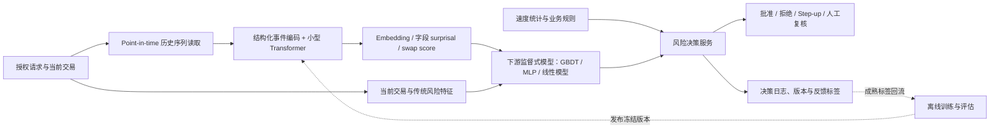

### A.2 在线评分架构

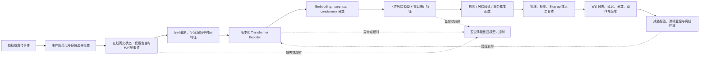

### A.3 训练与反馈生命周期


### A.4 灰度与回滚控制

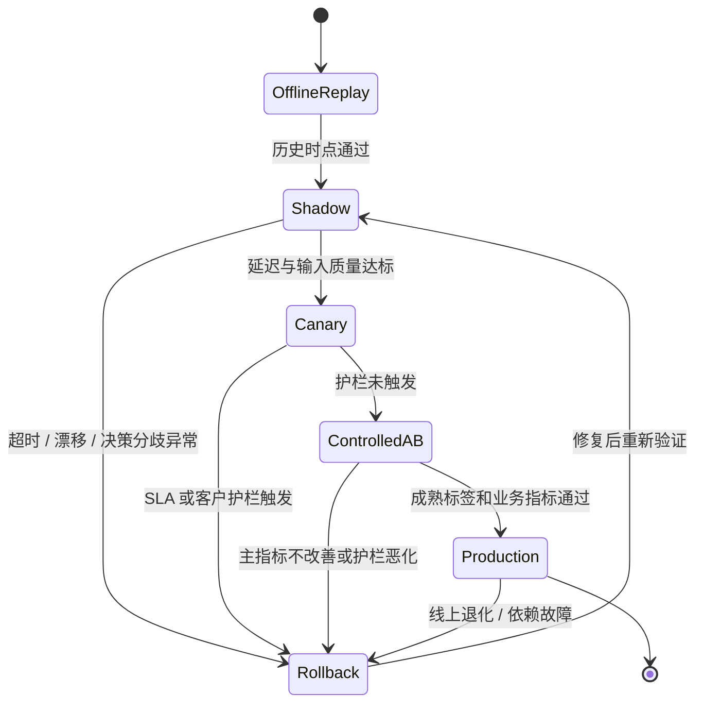


### A.5 在线卡授权评分时序图（核心实时路径）

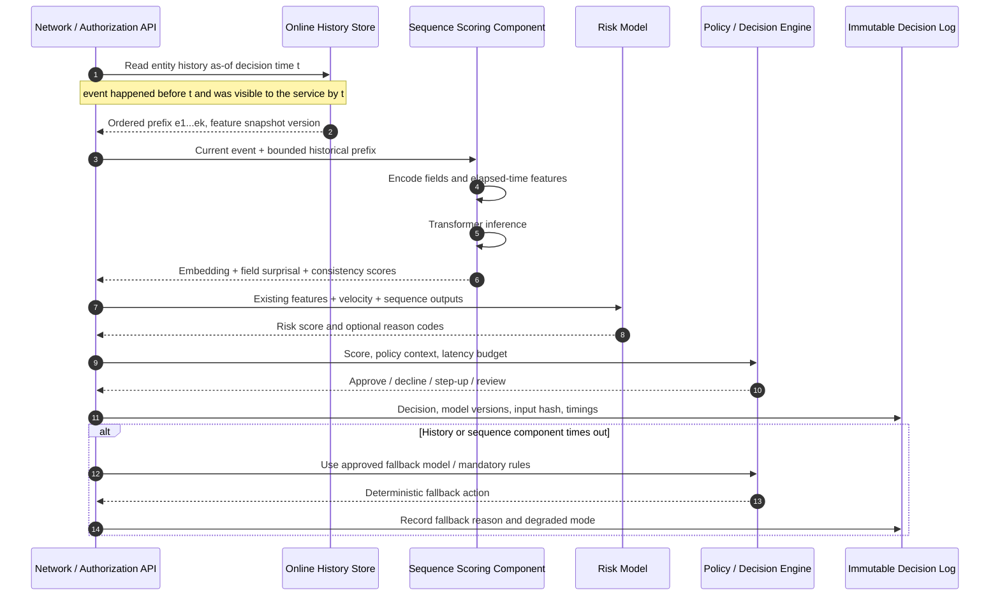

时序图应成为实现契约：历史服务不能返回在决策之后才到达的交易；超时策略必须在上线前定义；fallback 不能无记录地把缺失 embedding 填成零后继续当作正常评分。

### A.6 Point-in-time 历史构建与标签成熟流程

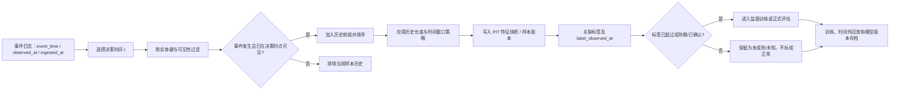

### A.7 模型增量价值的公平比较流程

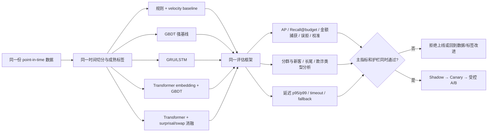

### A.8 公开数据集选择决策树

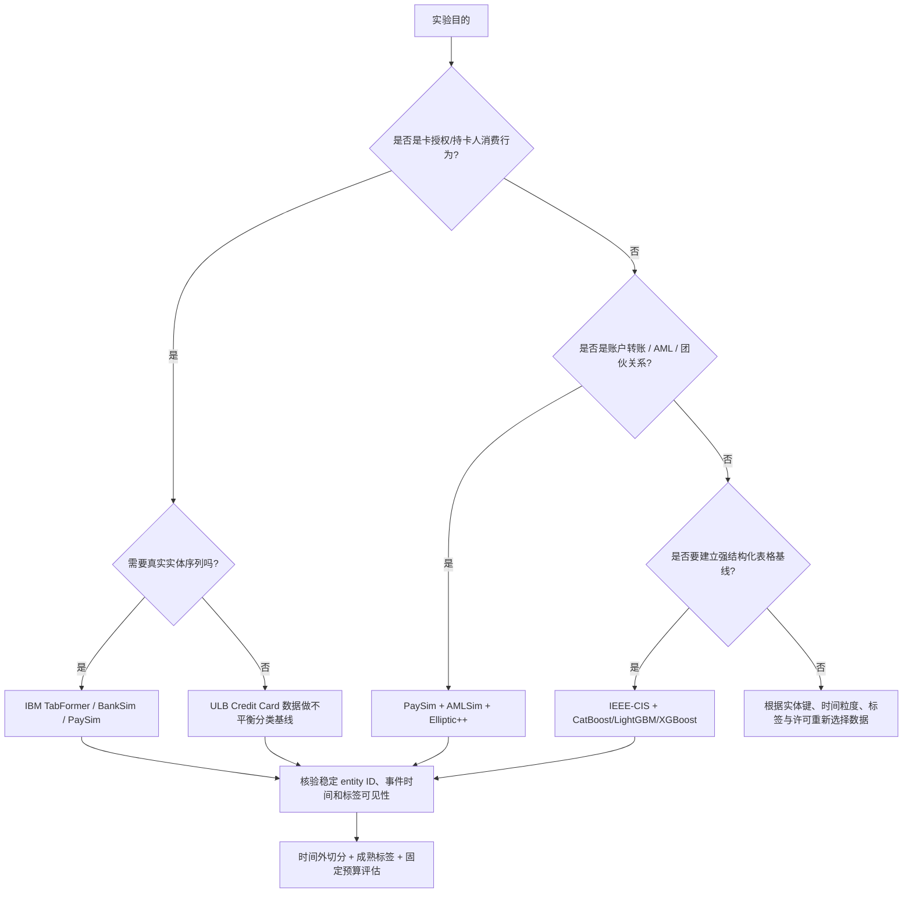

### A.9 序列与图关系融合：典型 AML 结构

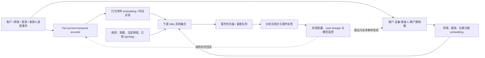

---

## 附录 B：用开源金融数据从零训练交易序列模型

本附录配套代码放在 [hands_on/](./hands_on/) 目录，带你从公开数据下载、环境准备、基线模型、序列模型训练到最终评估，完成一个小型交易欺诈排序实验。

### B.1 数据集与研究目标

使用 [PaySim：Synthetic Financial Datasets For Fraud Detection](https://www.kaggle.com/datasets/ealaxi/paysim1)。它是模拟移动支付数据，包含时间步、交易类型、转出/转入账户、金额、余额及模拟欺诈标签。我们按转出账户整理历史事件，预测当前交易是否欺诈。

**边界必须明确：PaySim 是模拟数据，不是真实银行交易。** 这个练习用于学习序列建模和实验设计，不能把公开模拟数据上的成绩当作真实金融机构的生产效果。

### B.2 代码目录

| 文件 | 用途 |
|---|---|
| [README.md](./hands_on/README.md) | 数据下载、安装、训练、指标和云端运行说明 |
| [train.py](./hands_on/train.py) | 时间切分、特征处理、逻辑回归基线、GRU 训练及评估 |
| [requirements.txt](./hands_on/requirements.txt) | Python 依赖 |
| [colab_quickstart.ipynb](./hands_on/colab_quickstart.ipynb) | Colab 快速开始 Notebook |
| [.gitignore](./hands_on/.gitignore) | 忽略本地数据、模型和虚拟环境 |

数据文件不放进 Git 仓库。下载前请阅读 Kaggle 数据集页面的使用条款；不要提交数据文件或 Kaggle API 凭证。

### B.3 MacBook 能否训练？

可以。MacBook Air M5 16 GB 足以运行本附录的小型 GRU，不需要训练大型 Transformer 或通用 LLM。建议先用 CPU 跑通流程，再试 PyTorch 的 Apple Silicon MPS 后端。真正需要关注的是数据加载、序列张量的内存占用和迭代时间，而不是一开始就租 GPU。

下载数据并放入 hands_on/data/raw/ 后，在仓库根目录执行：

```bash
cd temp/transformer_sequence_financial_services_survey_2026-10-24/hands_on
python3 -m venv .venv
source .venv/bin/activate
pip install -r requirements.txt
python train.py --data data/raw/PS_20174392719_1491204439457_log.csv --model baseline
python train.py --data data/raw/PS_20174392719_1491204439457_log.csv --model gru --epochs 1
```

先用 1 个 epoch 验证环境，再提高到 3–10 个 epoch。训练结果和模型产物写入 outputs/，该目录不会提交到 Git。

### B.4 为什么先跑基线？

逻辑回归是简单的传统机器学习基线，用于检查数据读取、标签、切分和指标流程。GRU（门控循环单元）是循环神经网络，会按顺序读取事件并更新内部状态，适合尝试学习账户近期行为模式。

序列模型不保证一定胜过基线。当前脚本的逻辑回归只使用每笔交易的当前特征，并不是最强表格模型。正式研究应增加 LightGBM、XGBoost 或 CatBoost，并比较当前交易特征、人工历史统计和序列模型，才能判断序列建模是否提供了额外价值。

### B.5 时间切分与指标

脚本按时间顺序切分训练、验证和测试集，而不是随机拆分。标准化参数只从训练集拟合；isFraud 是标签，不作为输入，模拟规则字段 isFlaggedFraud 也不使用。为了保持入门示例简单，序列历史在各自时间切分内部构造。更贴近生产的回测还应在验证/测试期只延续截止时间之前及当前时刻已观测到的历史，并处理标签确认延迟。

输出包括 PR-AUC、ROC-AUC，以及固定审核预算下的 Recall/Precision。比如 Recall@1% review budget 表示：如果团队只能审核风险最高的 1% 交易，这些交易覆盖了全部已标记欺诈中的多少比例。欺诈极少时，准确率可能很高却没有实际价值，因此不应单独使用准确率作为结论。

### B.6 什么时候切换 Colab 或 Kaggle？

| 环境 | 适用场景 | 注意事项 |
|---|---|---|
| MacBook | 数据检查、基线、小型 GRU、错误分析 | 首选，先跑通流程 |
| [Google Colab](https://colab.research.google.com/) | 需要 GPU、更多参数组合或多个随机种子 | 上传 CSV 和 train.py，可选 GPU 运行时；会话可能重置，需另存结果 |
| [Kaggle Notebooks](https://www.kaggle.com/code) | 数据已在 Kaggle、希望直接挂载 | Notebook 中添加 PaySim 数据集，遵守平台配额和运行限制 |

本项目无需一开始就用 GPU。只有当模型扩大、历史窗口变长或多组实验拖慢迭代时，才值得切换云端。Notebook 操作步骤见 [Colab quickstart](./hands_on/colab_quickstart.ipynb)。

### B.7 如何扩展成研究项目？

建议逐步加入强表格基线、比较历史窗口长度 5/10/20/50、对比 GRU/TCN/小型 Transformer，并记录 PR-AUC、推理延迟和模型参数量。通过消融实验回答性能增益究竟来自序列信息、交易字段还是时间信息。随后再研究标签延迟、时间漂移和在线学习。在线学习应先做离线按时间评估，并具备模型版本、标签成熟时间、污染检测和回滚策略。

**验收标准不是跑出一个漂亮分数，而是实验可重复、没有明显未来信息泄漏，并且能解释序列模型相对简单基线究竟增加了什么价值。**


# 附录 C：用公开市场数据构建投资研究与多资产分析 PoC

附录 B 以 PaySim 说明交易欺诈分类；本附录改为投资研究与分析业务。我们将构建一条小型研究流水线：下载公开 ETF 日线行情、构造历史收益与风险特征、比较动量 / Ridge / GRU、做严格的时间外预测评估，并把预测排名转成一个简化的多资产研究组合，观察换手和交易成本对结果的影响。

这不是投资建议，也不声称序列模型能持续获得超额收益。目标是让读者能在 MacBook 上复现研究方法，理解数据时点、基线、时间外测试与回测边界。

## C.1 业务问题与公开数据

研究问题：**截至每个交易日收盘时，过去 60 个交易日的收益、趋势、波动与跨资产信息，能否帮助预测各 ETF 未来 5 个交易日的收益排序？这种排序是否比简单动量基线更有用？**

示例使用 Yahoo Finance 的公开历史行情，通过开源 Python 包 [yfinance](https://ranaroussi.github.io/yfinance/) 下载数据。它是非官方接口，文档将其定位为研究与教育用途；应遵守数据源条款，不要将其当作机构级数据授权或 SLA。[yfinance 文档](https://ranaroussi.github.io/yfinance/) <Cite refs={["turn756202search2","turn756202search3"]}/>

默认资产为 SPY（美国大盘股票代理）、QQQ（纳斯达克 100 股票代理）、IWM（美国小盘股代理）、EFA（发达市场股票代理）、TLT（长期美国国债代理）、GLD（黄金代理）和 SHY（短期美国国债代理）。这是一个固定的教学资产集合，不代表历史上当时可投资的完整证券宇宙；本例不处理个股退市、生存者偏差、点时基本面数据或完整公司行为。

## C.2 运行代码

完整代码放在本文相关目录下的 [investment_research](./hands_on/investment_research/)：

- [README：逐步操作与研究解释](./hands_on/investment_research/README.md)
- [research.py：数据下载、特征、基线、GRU、评估与示例回测](./hands_on/investment_research/research.py)
- [requirements.txt：依赖清单](./hands_on/investment_research/requirements.txt)

在 MacBook 上运行：

```bash
cd temp/transformer_sequence_financial_services_survey_2026-10-24/hands_on/investment_research
python3 -m venv .venv
source .venv/bin/activate
python -m pip install --upgrade pip
pip install -r requirements.txt
python research.py --start 2012-01-01 --end 2026-01-01 --epochs 10
```

`--end` 是排他日期。第一次运行需要访问行情源。这个小型 GRU 用 CPU 即可运行；Colab 或 Kaggle 可用于复现实验环境或扩展模型，并不是提高研究质量的必要条件。

## C.3 代码如何映射到投资研究工作

| 步骤 | 代码做什么 | 对应研究工作 |
|---|---|---|
| 1. 获取行情 | 下载多只 ETF 的调整后日线价格 | 市场数据接入与质量检查 |
| 2. 构造特征 | 日收益、5/20 日收益、20 日波动、60 日趋势、跨资产收益统计 | 技术特征与市场状态描述 |
| 3. 定义目标 | 预测时点收盘价到未来第 5 个交易日收盘价的收益 | 明确预测期限与投资假设 |
| 4. 时间切分 | 按日期划分训练、验证、测试；标准化器只拟合训练数据 | 防止随机切分造成未来信息泄漏 |
| 5. 比较模型 | 零收益、20 日动量、Ridge 线性回归和 GRU | 复杂模型必须证明相对简单基线的增量价值 |
| 6. 评估预测 | MAE、方向命中率、每日横截面 Spearman 排名相关 | 分析误差、方向与资产排序能力 |
| 7. 构造研究组合 | 根据预测排序选取排名靠前的资产，计入简化换手成本 | 从信号到组合表现的初步研究 |
| 8. 保存产物 | 保存指标、逐资产预测、净值序列和摘要 JSON | 研究可追溯与结果复核 |

特征在 (t) 日收盘后构造，目标是从 (t) 到 (t+5) 的未来收益。训练与验证边界会留出标签隔离区；标准化器只使用训练窗口拟合。预测排名与回测收益应分开解释：预测误差小不必然意味着可交易收益高，预测排名有效也不保证扣除成本后仍然有效。

## C.4 如何解读输出

运行后检查 `outputs/forecast_metrics.csv`、`outputs/test_predictions.csv`、`outputs/backtest_*.csv` 和 `outputs/summary.json`。

- **MAE / RMSE**：预测收益与实际收益的平均误差。应与零预测和动量基线比较。
- **Direction accuracy**：预测收益与实际收益的正负方向一致比例；当正负收益分布偏斜时，不宜单独使用。
- **Daily rank IC**：每天对多个资产的预测排序与实际未来收益排序计算 Spearman 相关，再对日期汇总。资产数量较少时，该统计很不稳定。
- **年化收益、波动率、Sharpe、最大回撤、换手率**：描述简化策略在样本内外的历史表现，不是未来收益保证。

示例策略每个决策日按预测排名选两个 ETF，并用下一交易日收益近似持有收益，按单边换手成本参数扣费。它是便于理解的教学回测，不是精确的成交模拟。它没有完整模拟 bid-ask spread、市场冲击、滑点、税费、执行延迟、交易限制、资金容量、现金管理或真实调仓时点。正式研究必须增加成本敏感性分析，并明确基准、风险约束与交易规则。

## C.5 这个 PoC 离机构级投资研究还有多远？

本例只是一个可复现起点。用于真实研究流程前，至少还需要：

1. 保存并版本化行情快照、交易日历、证券主数据和公司行为；记录数据时间戳及修订情况。
2. 使用当时真实可获得的数据。财报、宏观指标和分析师预期应按发布时间而非其对应的报告期对齐；必要时采用 point-in-time 数据库。
3. 建立 walk-forward 多窗口验证、多个市场子时期、参数敏感性和模型消融，避免只报告表现最好的一段历史。
4. 加入更强基线，如 LightGBM、因子模型、风险模型和简单的动量 / 均值回归策略；比较预测增益与组合增益是否一致。
5. 组合构建时加入波动率目标、集中度限制、资产类别约束、回撤约束和现金基准，并做交易成本与市场容量分析。
6. 将数据质量、因子暴露、预测、回测、风险归因和研究结论保存为可追溯的 research run，由分析师复核；模型输出不能直接等同于交易指令。

**验收原则：** 不是看 GRU 是否跑出最高回报，而是检查时间切分是否正确、是否胜过简单基线、结果是否跨时期稳定、成本后是否仍有意义，以及研究人员能否重现并解释结果。历史回测不构成未来盈利证据。


# 附录 D：使用 Transformer 做多资产投资研究

附录 C 的研究问题和数据保持不变，本附录将 GRU 序列编码器替换为 Transformer Encoder，帮助读者在**同一份公开市场数据、同一组特征、同一预测期限和同一时间外测试集**上比较两种序列模型。不要因为 Transformer 更复杂就预设它会更好；本实验的目标是验证增量价值。

## D.1 代码位置

- [Transformer 版本 README 与逐步操作](./hands_on/investment_research/README.md#8-transformer-版本与-gru-使用同一份数据和评估流程)
- [transformer_research.py：完整代码](./hands_on/investment_research/transformer_research.py)
- [research.py：GRU 对照版本](./hands_on/investment_research/research.py)

数据来自 Yahoo Finance 的公开行情接口，依赖 `yfinance`。其官方文档说明该包是非官方开源接口，面向研究和教育用途，使用者仍须遵守数据源条款。<Cite refs={["turn547179search7","turn547179search0"]}/>

## D.2 在 MacBook 上运行

进入项目目录并启用前面创建的 Python 虚拟环境，然后执行：

```bash
python transformer_research.py \
  --start 2012-01-01 \
  --end 2026-01-01 \
  --epochs 10 \
  --batch-size 256 \
  --output-dir outputs/transformer
```

建议先用 `--epochs 1` 验证数据下载、PyTorch 环境和完整流程。MacBook Air M5 16 GB 可运行这个小型模型，默认自动选择 CPU 或可用的 Apple Silicon MPS；不必先配置云端 GPU。

## D.3 Transformer 在这里做什么？

每个样本包含最近 60 个交易日，每个交易日 8 个数值特征。代码先用线性层把每个时间点映射到 32 维，再加入可学习的位置嵌入，让模型区分较早与较晚的观测。随后使用 2 层 Transformer Encoder，每层 4 个 attention heads，最后取窗口末端的隐藏表示，预测未来 5 个交易日的收益。

这里采用 encoder-only 结构，而不是让通用 LLM 读行情文本，也不是用 decoder 逐日生成未来价格。目标是学习历史窗口的表示并输出一个数值预测。实现使用 PyTorch 的 `TransformerEncoderLayer`，输入形状为 batch × sequence × feature，相关参数见 [官方文档](https://docs.pytorch.org/docs/stable/generated/torch.nn.TransformerEncoderLayer.html)。<Cite refs={["turn547179search3"]}/>

## D.4 如何公平比较？

GRU 和 Transformer 应使用相同日期范围、ETF 集合、特征、窗口长度、预测目标、数据切分、随机种子和交易成本假设。输出应分目录保存，例如：

```bash
python research.py --output-dir outputs/gru --epochs 10
python transformer_research.py --output-dir outputs/transformer --epochs 10
```

重点检查 Transformer 是否在测试集上改善 MAE / RMSE、每日横截面 rank IC、扣除成本后的组合表现、最大回撤和换手率。预测误差改善不必然转化为组合收益改善；模型复杂度增加也会带来更多训练成本与过拟合风险。

当前实现仍是教学型单次时间切分。严肃研究应进一步进行 walk-forward 多窗口验证、多个随机种子、子时期分析、参数敏感性与更强基线比较。若 Transformer 没有稳定胜过 Ridge、动量或 GRU，应如实保留较简单模型。

**研究结论不能由某一次回测的最高收益决定。** 应关注跨时期稳定性、交易成本后的表现、风险暴露、可复现性，以及相对简单基线是否有可解释的增量价值。


# 附录 E：使用 Gradient Boosting Tree 做多资产投资研究

GRU 与 Transformer 都通过神经网络学习历史序列，但对于这个教学用例——7 只 ETF、日频数据、8 个手工特征、预测未来 5 日收益——还应该加入一个强表格模型作为比较。这里选择 scikit-learn 的 `HistGradientBoostingRegressor`，它属于梯度提升树（GBDT）家族，可以学习非线性特征关系和交互，不需要 GPU，也不需要把输入组织成 60 天序列。它是值得先跑的基线，不代表它必然优于深度学习模型。近期公开金融基准也强调，应在相同数据和评估协议下直接比较方法，而不能假定某一模型家族总是更好。[OFR 金融时间序列预测基准](https://www.financialresearch.gov/working-papers/2026/08/25/time-series-forecasting-methods-financial-markets/)；[scikit-learn 模型文档](https://scikit-learn.org/stable/modules/generated/sklearn.ensemble.HistGradientBoostingRegressor.html)。

## E.1 代码与运行

- [tree_research.py：GBDT 训练、预测、指标与示例回测](./hands_on/investment_research/tree_research.py)
- [README：逐步说明](./hands_on/investment_research/README.md#9-gradient-boosting-tree-版本先尝试强表格模型)
- [research.py：GRU 对照](./hands_on/investment_research/research.py)
- [transformer_research.py：Transformer 对照](./hands_on/investment_research/transformer_research.py)

在项目目录中启用已有虚拟环境后运行：

```bash
python tree_research.py --start 2012-01-01 --end 2026-01-01 --cost-bps 5 --output-dir outputs/tree
```

本脚本使用 `requirements.txt` 中已有的 scikit-learn，不需要额外安装 LightGBM 或 XGBoost。输出包含 `forecast_metrics.csv`、`test_predictions.csv`、策略回测 CSV 与 `summary.json`。本次修改没有实际运行行情下载或模型训练，首次执行时需确认网络和环境。

## E.2 逐步理解模型

1. **特征输入：** 使用当前决策日可见的 8 个结构化特征，包括 1/5/20 日收益、20 日波动率、60 日趋势、市场收益和跨资产统计。
2. **训练：** `HistGradientBoostingRegressor` 逐步增加决策树，拟合特征与未来 5 日收益之间的非线性关系。树模型不要求输入标准化，缺失值由训练流水线中的中位数填补器处理。
3. **时间切分：** 训练、验证和测试按日期顺序分割，未来 5 日标签跨越边界时留出隔离区。测试数据只用于最终报告，不应反复用于调参。
4. **比较：** 同时报告零收益、20 日动量和 GBDT 的 MAE、RMSE、方向命中率与每日横截面 rank IC。
5. **组合示例：** 按预测排名选出两个 ETF，并扣除简单的单边换手成本，观察信号是否可能转化为组合收益。该回测没有模拟真实成交、价差、冲击成本、税费和市场容量。

## E.3 为什么值得加在 GRU / Transformer 前面？

树模型能高效利用手工构造的表格特征，通常比序列神经网络更容易训练。它不直接读取完整 60 日序列，所以不是对 GRU / Transformer 的完全等价替换；当前实验比较的是几种完整建模方案。若 GBDT 已达到相近效果，就需要进一步说明序列模型是否真的从顺序信息中获得增量价值。

建议先比较动量、Ridge 与 GBDT，再评估 GRU 和 Transformer。三者应使用相同日期范围、资产集合、预测目标、测试区间和成本假设。由于 GRU / Transformer 使用 60 日窗口而 GBDT 使用决策日特征，若要更严格比较模型家族，应给 GBDT 增加明确的滞后特征，并做 walk-forward 多窗口评估。

**研究边界：** 本例使用固定 ETF 样本与公开行情数据，只有一次时间切分。它适合学习如何建立可比较的研究流程，不构成投资建议，也不证明任何模型可持续盈利。建议查看 [scikit-learn 时间序列滞后特征示例](https://scikit-learn.org/stable/auto_examples/applications/plot_time_series_lagged_features.html) 了解按时间验证的重要性。


# 附录 F：使用 Transformer 进行波动率预测与市场状态识别

收益预测不是投资研究中唯一有价值的预测任务。本项目新增两个与现有 ETF 收益预测不同的业务用例：其一是预测未来短期实现波动率，为组合风险监控提供输入；其二是识别未来市场状态，为战术资产配置研究提供状态概率。Temporal Fusion Transformer 的原始研究也将波动率作为时间序列预测任务之一，并强调多时间尺度信息与可解释性设计；不过这里实现的是小型 Encoder-only Transformer 教学模型，不是完整 TFT。[原始论文](https://doi.org/10.1016/j.ijforecast.2021.03.012)。

## F.1 用例一：未来 5 日波动率预测

代码：[volatility_transformer.py](./hands_on/investment_research/volatility_transformer.py)；操作指南：[README 第 10 节](./hands_on/investment_research/README.md#10-用例一transformer-预测未来波动率投资组合风险管理)。

运行命令：

```bash
python volatility_transformer.py --start 2012-01-01 --end 2026-01-01 --epochs 12 --output-dir outputs/volatility
```

模型读取每只 ETF 过去 60 个交易日的收益、趋势、短中期波动率及跨资产状态特征，预测未来 5 日收益的年化实现波动率。评价采用 MAE、RMSE，并与训练期中位数波动率基线比较。结果可供风险预算、风险限额和压力监控研究使用，但不是收益方向预测，也不是交易信号。由于输入是日线数据，这里的目标是未来日收益波动率的近似，而非高频逐笔数据计算的 realized volatility。

## F.2 用例二：未来市场状态分类

代码：[regime_transformer.py](./hands_on/investment_research/regime_transformer.py)；操作指南：[README 第 11 节](./hands_on/investment_research/README.md#11-用例二transformer-识别市场状态战术资产配置研究)。

运行命令：

```bash
python regime_transformer.py --start 2012-01-01 --end 2026-01-01 --epochs 12 --output-dir outputs/regime
```

模型根据 SPY 的收益、趋势和波动率，以及 TLT、GLD、QQQ 等跨资产信息，分类未来 20 个交易日的状态：未来收益不高于 -3% 为 bear/risk-off，不低于 +3% 为 bull/risk-on，其余为 sideways。这些是用于演示的固定标签规则，并不是对市场状态的客观定义。评价报告 balanced accuracy、各类别 precision/recall/F1 与混淆矩阵；尤其需要观察风险规避类别的 recall 和概率校准，不能只看总体准确率。

## F.3 运行前后的关键检查

两个脚本都使用按时间顺序的训练、验证和测试切分，只在训练样本拟合标准化器，并在标签跨越边界的位置留出隔离区。市场状态任务的未来 20 日标签存在更明显的重叠问题，因此正式研究应使用 purged walk-forward 验证，测试阈值敏感性并检查不同市场阶段的稳定性。还应比较 EWMA / GARCH 波动率基线与简单的趋势/动量状态基线。

三个投资研究任务的验收指标不应混用：收益预测看预测误差和横截面排序；波动率预测看误差、风险覆盖与压力期表现；市场状态分类看各类召回率、概率校准和下游风险政策表现。**任何一个模型的离线分数都不能单独证明组合收益改善。**

本次新增的是代码和逐步说明，没有实际下载行情或运行训练。首次运行需联网访问行情源；结果仅用于教育和研究，不构成投资建议。


# 附录 G：金融机构基本面与财经新闻的两种 Transformer 研究用例

前面的收益、波动率和市场状态示例使用公开 ETF 行情。本附录刻意换用两套不同的数据，避免将同一行情表反复包装成不同用例：一套是 SEC EDGAR Company Facts 的金融机构 XBRL 财报数据，另一套是 Financial PhraseBank 的人工标注财经新闻句子。SEC 提供免 API key 的结构化公司披露接口，但自动访问需遵守其 fair-access 要求并设置合适的 User-Agent。[SEC EDGAR API 文档](https://www.sec.gov/search-filings/edgar-application-programming-interfaces)。

## G.1 金融机构季度基本面序列分类

代码：[bank_fundamentals_transformer.py](./hands_on/investment_research/bank_fundamentals_transformer.py)；手把手说明：[README 第 13 节](./hands_on/investment_research/README.md#13-用例三金融机构季度基本面序列研究sec-xbrl--transformer)。

```bash
pip install requests pandas numpy scikit-learn torch
python bank_fundamentals_transformer.py --user-agent "Your Name your.email@example.com" --window 8 --epochs 30 --output-dir outputs/bank_fundamentals
```

该原型下载 JPM、BAC、GS、MS、WFC、C 的 SEC Company Facts，构造季度财务特征序列，以 Transformer Encoder 预测下一报告期净利润是否高于当前报告期。它探索的是基本面变化，不是价格方向预测。SEC XBRL tag 在不同金融机构之间可能存在定义差异，且重述数据可能造成历史时点偏差；在用于严肃投资研究前，必须验证标签映射、报告期转换、filing-date 可见性和 point-in-time 版本，并与简单统计模型和树模型比较。

## G.2 财经新闻情绪分类

代码：[financial_news_transformer.py](./hands_on/investment_research/financial_news_transformer.py)；手把手说明：[README 第 14 节](./hands_on/investment_research/README.md#14-用例四金融新闻情绪与事件研究financial-phrasebank--finbert)。

```bash
pip install datasets transformers torch pandas scikit-learn
python financial_news_transformer.py --dataset financial_phrasebank --config sentences_50agree --split train --batch-size 16 --output-dir outputs/financial_news_sentiment
```

该原型从 Hugging Face 加载 Financial PhraseBank，并使用预训练的 FinBERT 将财经句子分类为负面、中性或正面，输出概率和情绪分数。它与 XBRL 数值序列是不同的数据模态和建模任务。由于 PhraseBank 不提供可靠的公司标识符和事件时间戳，它只验证文本情绪识别，不直接证明新闻情绪能够产生超额收益。要进行事件研究，必须使用有发布时间和公司 ID 的新闻数据，并采用无前视偏差的事件窗口和时间外验证。

## G.3 研究边界

这两份代码是教学原型，尚未实际下载数据或运行训练。SEC 基本面原型尤其需要对 XBRL 概念映射、季度值提取、重述和样本时间切分进行人工核验，不能把输出指标当成经过验证的研究结果。FinBERT 的分类分数也不能直接等同于可交易信号。投资研究应先建立简单基线，再评估 Transformer 是否带来可重复的增量价值。


# 附录 H：五类金融投资数据域的 Transformer 实战

本附录按 Price/Pricing、Holdings、Reference Data、Fund Accounting、Trade 五类金融数据域分别选择数据来源、业务问题和模型任务。它刻意避免把同一份 ETF 行情数据反复用于不同名目的预测任务。对应代码和逐步操作均在 [投资研究实战 README](./hands_on/investment_research/README.md#五类金融数据域的-transformer-实战) 中。

## H.1 Price / Pricing：国债收益率曲线变化预测

代码：[pricing_curve_transformer.py](./hands_on/investment_research/pricing_curve_transformer.py)。

数据来自 FRED 的 DGS3MO、DGS2、DGS5、DGS10、DGS30 等国债收益率序列；FRED 提供程序化访问接口和 CSV 下载能力。[FRED API 文档](https://fred.stlouisfed.org/docs/api/fred/overview.html)。

```bash
python pricing_curve_transformer.py --start 2000-01-01 --end 2026-01-01 --window 60 --epochs 20 --output-dir outputs/pricing_curve
```

模型使用过去 60 个观测点的收益率水平、变化和期限利差，预测未来 5 个观测日的 10 年期收益率变化。这个任务适用于研究定价环境与利率风险，不等于预测某只债券的价格、公允价值或 OAS。需要进一步比较零变化、线性模型、AR/VAR 与 Transformer，并做不同利率周期的时间外验证。

## H.2 Holdings：基金持仓权重变化

代码：[holdings_transformer.py](./hands_on/investment_research/holdings_transformer.py)。

SEC Form N-PORT 数据集公开注册基金持仓申报，按季度发布结构化数据，覆盖报告中的基金及其持仓；数据集官方说明同时提示提取数据可能存在错误，不能替代原始 filing。[SEC Form N-PORT 数据集](https://www.sec.gov/data-research/sec-markets-data/form-n-port-data-sets)。

脚本需要先把原始 N-PORT 表转换为统一 CSV，包含 `fund_id`、`report_date`、`security_id`、`market_value`、`net_assets`。运行：

```bash
python holdings_transformer.py --csv nport_holdings_normalized.csv --window 4 --epochs 30 --output-dir outputs/holdings
```

它预测下一报告期的持仓权重变化。公开持仓存在披露延迟和修订，正式回测必须以披露可见日期为准，并处理新增/清仓证券、现金与持仓权重约束。

## H.3 Reference Data：证券主数据质量检测

代码：[reference_data_transformer.py](./hands_on/investment_research/reference_data_transformer.py)。

[OpenFIGI API](https://www.openfigi.com/api/documentation)能够将第三方证券标识映射到 FIGI 和证券描述字段。脚本获取真实元数据，再生成字段被人工破坏的合成样本，训练 Transformer 区分正常记录与这些特定错误。

```bash
python reference_data_transformer.py --tickers AAPL,MSFT,JPM,SPY,TLT,GLD,NVDA,XOM,KO,IBM,AMZN,META,BAC,GS,QQQ,IWM --epochs 30 --output-dir outputs/reference_data
```

这是一个可控的错误注入实验，不是实际生产数据质量表现的测量。对于明确的标识符映射，规则和 API 查询通常更合适；模型应当作为复杂描述、多字段冲突和历史变更的辅助检测工具。

## H.4 Fund Accounting：基金会计对账异常检测

代码：[fund_accounting_transformer.py](./hands_on/investment_research/fund_accounting_transformer.py)。

真实基金会计账簿、NAV break、应计费用和管理员调账记录通常不公开，因此本实验明确使用合成数据，不声称存在可公开下载的生产 ledger 数据集。

```bash
python fund_accounting_transformer.py --days 6000 --window 10 --epochs 20 --output-dir outputs/fund_accounting
```

脚本生成现金差异、持仓估值差异、应计差异、NAV 变化、未匹配交易和陈旧价格等特征，并注入异常事件。模型判断连续估值日是否出现异常。合成标签使评估结果只能用于验证程序流程；生产应用应使用已确认的 break tickets、人工复核结果和双账簿差异建立标签，并按事件隔离训练/测试集。

## H.5 Trade：订单簿短期价格方向

代码：[trade_orderbook_transformer.py](./hands_on/investment_research/trade_orderbook_transformer.py)。

[LOBSTER](https://vdc.univie.ac.at/data-access/lobster)提供从 NASDAQ TotalView-ITCH 重建的订单簿事件数据，包括高精度时间戳、订单提交、撤销和成交事件；访问需遵守其注册和许可条件。FINRA TRACE 也提供固定收益成交数据，但学术级明细数据有相应访问条件。[FINRA Academic TRACE 数据说明](https://www.finra.org/sites/default/files/TRACE_Academic_Data_sheet.pdf)。

将合法取得的订单簿文件标准化为包含 timestamp、最优买卖价和挂单量的 CSV 后运行：

```bash
python trade_orderbook_transformer.py --csv lobster_book.csv --window 100 --horizon 10 --epochs 20 --output-dir outputs/trade_orderbook
```

模型预测未来 10 个事件后中间价上涨、下跌或持平。方向预测不能代替交易回放：真实 PnL 还取决于排队位置、成交概率、延迟、费用、价差、冲击成本和库存风险。

## H.6 统一的研究验收标准

五个任务不应共享一个笼统的“模型准确率”。Pricing 看基点误差和利率周期稳定性；Holdings 看权重变化误差、增减持方向和组合换手；Reference Data 看已确认异常的召回率与人工审查负担；Fund Accounting 看异常召回、金额重要性与每日误报量；Trade 看各类别表现、概率校准以及在含真实成交约束的模拟器中的结果。

本附录的新增代码与文档已提交，但本次没有下载完整数据、执行训练或验证实际指标。任何模型效果都需要在明确的数据许可、点时数据、无泄漏切分、强基线和可复现的时间外实验中单独验证。
