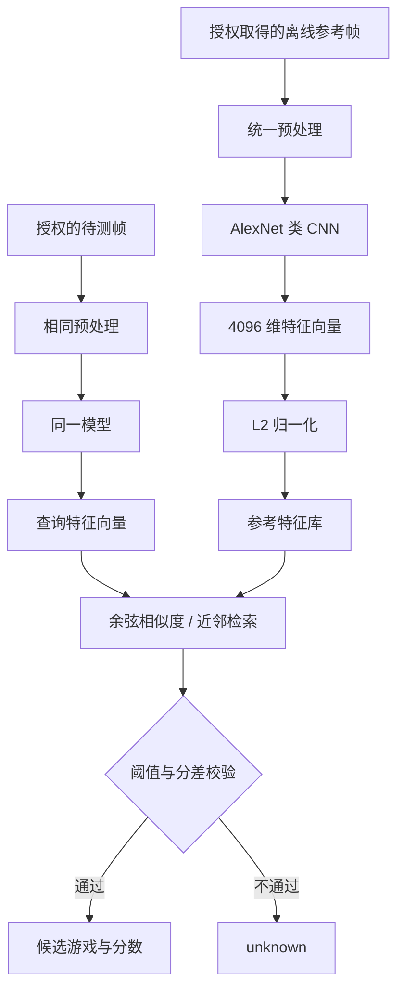

# 研究分析报告：电视端 AlexNet 类游戏画面识别模型

**日期：** 2026-10-26  
**用途：** 技术可行性与离线研究原型  
**结论边界：** 本报告研究的是一种可行的端侧视觉识别设计，不声称复原三星产品代码，也不验证帖子中的所有事实主张。

## 1. 执行摘要

如果设备上确实存在名为 `alex.tflite` 的模型，并且它会定期对游戏画面进行分析，那么使用 AlexNet 类卷积网络在本地提取视觉特征是技术上合理的。`.tflite` 是部署格式，不足以判断训练时是否使用 TensorFlow。Google 目前将 TensorFlow Lite 的后续端侧部署体系称为 LiteRT，并提供 `litert-torch`，可将 PyTorch 模型转换为 `.tflite` 格式；该转换器仍需按具体模型和目标后端验证兼容性。

我会将研究原型拆成三部分：

1. CNN 将一帧画面变成固定长度的特征向量（embedding）。
2. 向量检索模块将新画面特征与本地参考帧库比较，产生候选游戏和相似度分数。
3. LiteRT 运行时承载转换后的模型；INT8 量化放在基线正确性验证之后，不能先量化再假定精度不受影响。

这比直接做一个固定类别的 Softmax 分类器更接近“特征与数据库进行近邻比较”的描述，也方便增删参考帧。但若要可靠识别游戏，需要游戏画面数据、成对或三元组训练、独立验证集、阈值校准和端侧性能测量。ImageNet 预训练 AlexNet 只能作为起点，不能直接视为游戏识别模型。

## 2. 为什么不是直接在设备上运行 PyTorch？

训练框架与端侧运行时是不同的设计选择。PyTorch 的主要优势是模型实验、自动微分、损失函数探索、训练循环和可观测性。设备端部署更重视运行库尺寸、算子覆盖、内存、功耗、启动时间、硬件委托和目标操作系统集成。

| 层 | 推荐选项 | 理由 |
|---|---|---|
| 模型研究与训练 | PyTorch | 方便修改 AlexNet、做度量学习、画特征分布和比较损失函数 |
| 端侧执行 | 目标平台已经支持的轻量运行时 | 减少部署依赖；最终必须以实际固件与 SDK 为准 |
| 目标格式 | 例如 LiteRT / `.tflite` | 如果产品栈已集成此格式，可以直接使用对应运行时和优化工具 |
| 量化 | INT8，基于代表性样本校准 | 降低权重体积与计算成本，但可能改变特征分布和检索排序 |

PyTorch 也有面向端侧的 ExecuTorch；所以正确结论不是“PyTorch 不能在设备上运行”，而是应选择产品实际支持、性能和兼容性经过测量的运行时。现有 `.tflite` 文件也不代表原始模型只能用 TensorFlow 编写。

## 3. 要识别的究竟是什么？

我会先把问题定义为：给定一帧经过明确授权取得的图像，估计它与哪个参考游戏画面集合最相似；无法可靠判断时返回 `unknown`，不要强迫模型猜一个游戏。

不能将以下三个问题混为一谈：

- **图像采集：** 系统在什么条件下获得图像，是否有明确同意，用户能否关闭。
- **图像识别：** 模型如何处理图像、生成特征并检索参考库。
- **结果处理：** 分数、游戏名称、画面或其他遥测是否保存、关联设备/账号或上传。

本原型只处理研究者显式提供的离线图像；不包含电视屏幕采集、后台轮询、用户追踪或网络上传代码。

## 4. 推荐架构



### 4.1 为什么用特征向量 + 近邻检索？

固定类别分类器学习的是训练时定义好的类别；每新增游戏或改变类别体系，通常需要重新训练分类头。近邻检索则将参考帧转为向量并保存；新帧只需经过同一模型，再计算余弦相似度，即可查询最接近的参考样本。该设计与“对特征向量数据库进行 nearest-neighbor 比较”的描述相符，但并不能证明帖子中的实际实现就是这种架构。

### 4.2 AlexNet 的作用

AlexNet 包括卷积层、池化层和全连接层。用于检索时，可以去掉最后的 ImageNet 分类层，将倒数第二个全连接层的激活作为特征向量。示例实现将图像映射到 4096 维向量，然后做 L2 归一化；归一化向量之间的点积就是余弦相似度。

AlexNet 并不是我的首选生产模型：其全连接层参数量很大。若目标只是建立新的游戏画面识别能力，我会同时比较 MobileNet 类轻量 CNN 与小型自监督视觉编码器；但如果研究目标是验证“AlexNet 类模型可以在电视端运行”，则复现 AlexNet 风格模型更有针对性。

## 5. 输入尺寸、采样与计算量

帖子提到以约 960×540 的画面做周期性分析，但这不表示模型张量输入一定是 960×540。常见的实现会先捕获或解码一张较大画面，再缩放、裁剪或填充到较小的模型输入，例如 224×224。实际输入尺寸和预处理方式必须从模型元数据或推理代码确认。

对于 16:9 游戏画面，直接中心裁剪成正方形会丢掉左右两侧内容，而直接拉伸会改变画面比例。原型采取保持纵横比、再以灰色背景填充到 224×224 的处理方式。正式研究需要对比 letterbox、缩放和内容感知裁剪，并确保参考帧和查询帧完全采用相同流程。

每几秒跑一次低分辨率 CNN，从纯计算可行性看没有根本障碍，但实际耗时与功耗取决于 CPU、GPU/NPU、推理后端、线程、内存带宽、模型量化和系统负载。应记录端到端 P50/P95 延迟、推理期间 CPU 占用、内存峰值、温度/功耗，以及是否干扰电视播放或游戏体验。不能仅凭模型结构计算一个可信的设备实测延迟。

## 6. 训练方法：从能运行到真的识别得准

报告附带的代码是一个**离线特征检索基线**：载入 ImageNet 预训练 AlexNet，截取倒数第二层特征，构建参考图库，然后比较待测帧和参考帧。这能验证数据流和相似度计算，但不能证明该特征已学会区分不同游戏，尤其是有相似 UI、共同引擎或相同色彩风格的情况。

若进一步训练，我会采用度量学习（metric learning）：

- 正样本对：同一游戏的不同场景、时间、分辨率或 HUD 状态。
- 负样本对：不同游戏，特别是视觉上容易混淆的游戏。
- 训练目标：让同游戏特征的距离更近、异游戏特征的距离更远。可从 supervised contrastive loss 或 triplet loss 开始。
- 采样策略：不要把相邻视频帧随机分散到训练集和测试集；它们几乎相同，会造成严重的数据泄漏。按游戏会话、录制序列、设备/分辨率或日期切分数据。
- 开放集判断：参考库没有相应游戏时必须允许 `unknown`，不能用最大相似度无条件作决定。

若需要识别精确游戏与具体场景，应分别定义目标：识别游戏标题、识别游戏内状态、识别广告/菜单画面、识别 HDMI 来源，是不同任务，不能只用一个未定义的“识别准确率”概括。

## 7. 匹配逻辑与阈值

对于归一化的参考向量 `e_i` 和查询向量 `q`，余弦相似度为：

`similarity(i) = e_i · q`

最简单的做法是取相似度最高的参考帧，并用该帧的游戏标签作为候选。更稳妥的实现会聚合每个游戏的多个近邻，再对排名、最高分、前两名分差和近期多帧结果做判断。

**相似度不是概率。** 不应将 0.8 之类的分数直接解释为“80% 确信”。阈值应在独立验证集上选择，并根据误报与漏报的代价决定。至少要报告：Top-1/Top-5 命中率、每类精确率与召回率、未知游戏误接受率、不同分辨率/压缩/叠加层下的表现，以及经过时间投票后的准确率与延迟。

若连续多帧采样，可以用最近 3–5 帧的候选进行平滑，但不能把时间投票当成隐私授权的替代品，也不能以模型置信度为由跳过同意检查。

## 8. INT8 量化流程

推荐顺序如下：

1. 先在 PyTorch 中保存浮点模型和一组固定测试图像，建立参考输出。
2. 转换成 LiteRT `.tflite` 浮点模型，逐样本检查输出形状和数值差异。
3. 准备具有代表性的校准图像，覆盖不同游戏、场景、明暗、HUD、分辨率和叠加画面。
4. 量化成 INT8 并在目标运行时执行同一测试集。
5. 不只比较单个向量的数值误差，还要比较最近邻排序、Top-k 命中率、错误接受率和未知样本表现。
6. 只有当任务指标退化在预设容忍度内、且设备性能收益实测成立时，才接受量化版本。

对检索模型来说，即使 INT8 后每个向量看上去与浮点向量接近，近似分数很接近的两个候选也可能交换排名。因此必须把检索指标作为量化验收门槛。

附带的 `export-litert` 命令仅尝试导出浮点 `.tflite`，没有假装已完成 INT8 量化。实际 INT8 量化命令和后端选择取决于使用的 LiteRT 工具版本与目标设备支持情况。

## 9. 实验设计与验收门槛

| 实验 | 目的 | 必须保存的证据 |
|---|---|---|
| 输入/预处理对照 | 确定 224×224、letterbox 与裁剪的影响 | 原始帧、预处理后帧、实际张量 shape |
| 浮点模型基线 | 建立准确率和性能参照 | 权重 hash、数据集版本、模型输出、Top-k 指标 |
| 近邻库扩张 | 评估每个游戏增加参考样本是否改善效果 | 每类样本量、分数分布、索引构建与查询延迟 |
| 未知游戏测试 | 检查模型是否会对库外游戏乱猜 | 未知类误接受率、拒绝率、阈值选择规则 |
| INT8 对照 | 测量量化带来的真实收益与损失 | 浮点/INT8 同样本输出、召回变化、文件大小、P50/P95 延迟 |
| 设备运行时 | 证明不是只在开发机上可运行 | 目标型号、固件、后端、内存、温度/功耗和日志 |
| 授权路径测试 | 验证禁用识别后是否不再采集/推理 | 启用/禁用对照、系统日志与网络抓包；不只检查上传环节 |

若评估产品端的隐私行为，还应独立检查数据采集、推理、结果保存和上传的每一条路径。静态发现模型文件并不能证明模型正在运行；看到本地推理也不能证明结果已上传；没有观察到网络流量也不能单独证明不存在本地处理。

## 10. 如何运行附带原型

依赖：Python、PyTorch、torchvision、NumPy、Pillow。首次运行会加载 torchvision 的预训练 AlexNet 权重。

```bash
python -m venv .venv
source .venv/bin/activate
pip install torch torchvision numpy pillow
```

将经授权收集的参考图像按以下目录整理：

```text
gallery/
  game_a/
    frame_001.jpg
    frame_002.jpg
  game_b/
```

构建图库并检索单张离线图片：

```bash
python alexnet_game_embedding.py build-gallery ./gallery ./gallery.npz
python alexnet_game_embedding.py match ./research_query.png ./gallery.npz --top-k 5
```

检索脚本默认只报告候选，不自动宣布识别成功。验证集校准后，可通过 `--min-score` 与 `--min-margin` 显式传入阈值。分数依赖数据、模型权重和参考图库，不能将这里的默认行为当作通用识别策略。

浮点 LiteRT 导出示例：

```bash
pip install litert-torch ai-edge-litert
python alexnet_game_embedding.py export-litert ./alexnet_game_embedding.tflite
```

LiteRT Torch 转换器目前是需要针对具体模型验证的转换路径。导出成功还不等于目标电视可加载，也不等于已经 INT8 量化。还需在真实目标运行时加载模型，并对照 PyTorch 输出。

## 11. 风险与限制

1. **预训练特征的域差异。** ImageNet 主要是自然图像；游戏画面的 HUD、文字、菜单和合成图形可能不符合其训练分布。
2. **画面级相似不等于标题识别。** 同一游戏不同场景可能差异很大；不同游戏也可能共享相似界面。
3. **图库偏差。** 每类参考样本数与场景覆盖不均，会影响最近邻结果。
4. **量化排序变化。** INT8 可能改变近似候选之间的排名。
5. **平台不确定性。** 未知目标芯片、固件和加速后端前，不能给出有根据的 P95 延迟、功耗或模型可运行保证。
6. **隐私与同意。** 模型识别能力和数据处理是否合法/符合用户预期是两个问题。授权逻辑应控制采集和推理的整个执行路径，而不能只在最终上传时检查。
7. **证据边界。** `alex.tflite` 文件名、模型结构、运行时推理、网络传输、账号关联是不同层次的证据，必须分别验证。

## 12. 最终建议

对研究复现，我会先用本文附带的 PyTorch AlexNet 特征提取基线建立完整可测的数据流；再用真实且获授权的游戏帧训练度量学习模型，建立含 `unknown` 的检索规则；随后将浮点模型转换到目标端侧运行时，完成浮点对照与 INT8 量化实验。最后才评估周期采样、CPU/硬件加速与持续运行的开销。

如果研究目标不是复现 AlexNet，而是构建新的低成本游戏识别能力，我会加一个 MobileNet 类模型作为更轻的对照组。最终取舍以相同数据集上的识别指标、设备延迟、功耗、模型大小和误报率为准，不根据框架名称或理论参数量作结论。

## 参考资料

- Google AI Edge, LiteRT / TensorFlow Lite successor: https://github.com/google-ai-edge/LiteRT
- Google AI Edge, LiteRT Torch (PyTorch → `.tflite`): https://github.com/google-ai-edge/litert-torch
- PyTorch ExecuTorch: https://docs.pytorch.org/executorch/
- PyTorch ExecuTorch overview: https://pytorch.org/projects/executorch/
