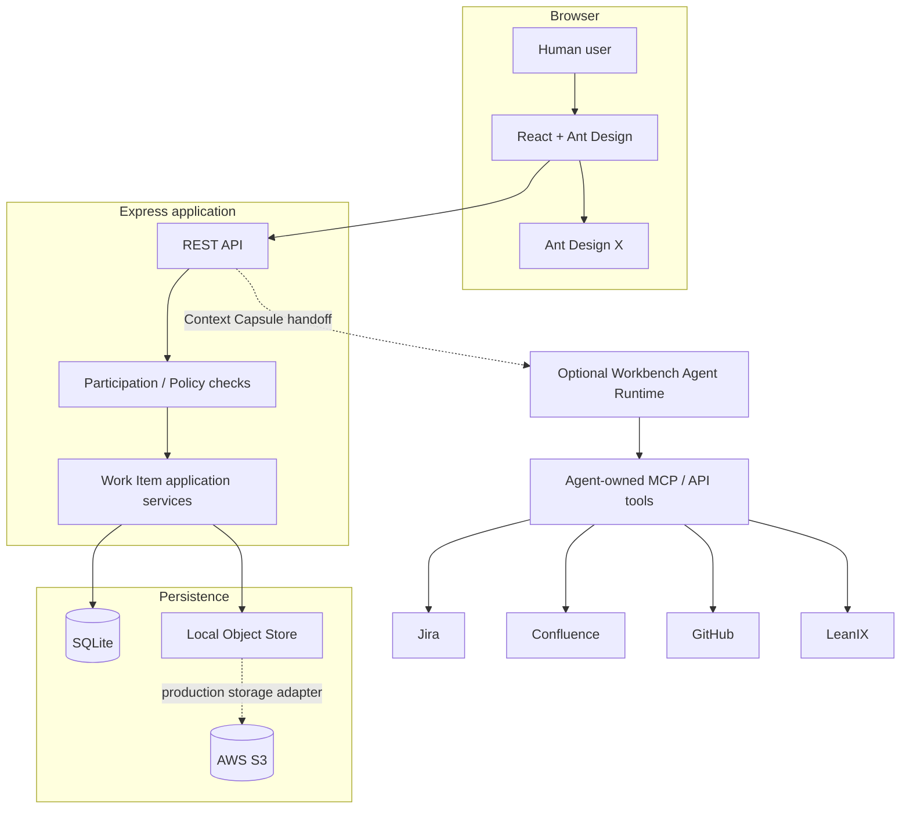
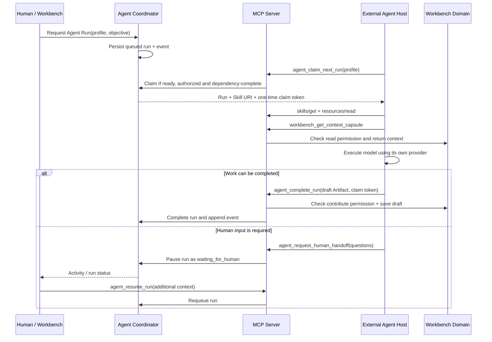
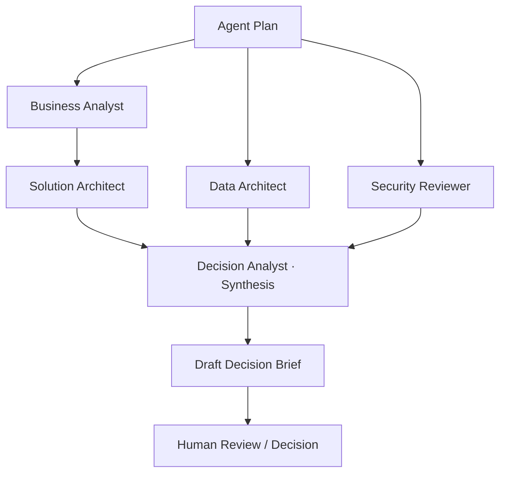
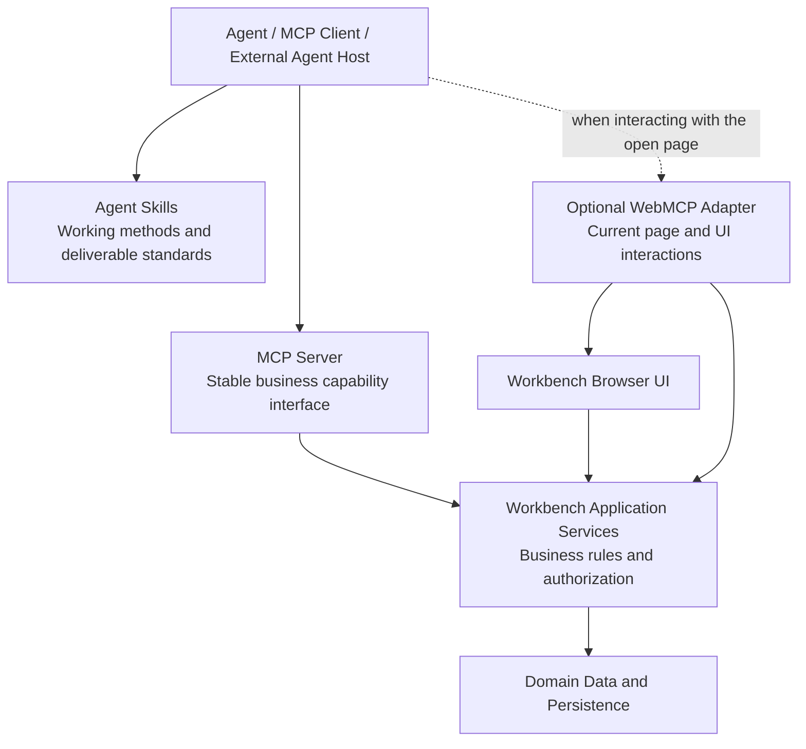

# Architecture

## Runtime topology

The tool is a standalone application below `tools/`. It is not part of the Astro site's runtime or build.

## Application boundaries

- Browser components render projections and submit commands. They never access SQLite or S3 directly.
- Express routes are the HTTP adapter. The server resolves the demo Human principal, checks Participation permissions, validates references and writes activity records.
- Work Item owns the durable business context. A Task is executable work; an Artifact is a versioned deliverable; a Review is an independent opinion tied to an Artifact version; a Decision is a formal action by a principal with explicit `decide` permission.
- Technical Debt is a separate Work Item with its own owner and lifecycle, linked to its origin Work Item and optional Decision.
- `ObjectStore` hides local vs S3 upload mechanics. The database stores attachment metadata, object key and storage URI. Storage URI is not a security token.
- No Jira, Confluence, GitHub or LeanIX Connector exists in the Workbench backend. The application stores only external resource references and their Work Item relationships. There is no source-system polling, synchronization, content cache or source credential storage.
- The external Agent Host owns its MCP/API tool clients and uses stored references to retrieve context on demand. It does not bypass Participation or Decision authorization. The same applies when a user hands a Context Capsule to another Agent Client.

## SQLite and PostgreSQL migration

SQLite is the local prototype database. The current server uses Node's synchronous `node:sqlite` API through `server/db.ts`. This keeps local setup small, but it is not yet a PostgreSQL-neutral persistence layer.

Before enabling PostgreSQL, introduce an asynchronous Repository / Unit of Work port, move SQL out of Express route handlers, add schema migrations, and implement SQLite and PostgreSQL adapters against the same application services. PostgreSQL access is not currently implemented.

## Object storage

The default LocalObjectStore writes files under `LOCAL_OBJECT_DIR`. Set `STORAGE_DRIVER=s3`, `S3_BUCKET` and `AWS_REGION` to use S3. Production should use IAM Roles / Workload Identity. Do not expose bucket objects publicly; implement authorized download or short-lived presigned URL issuance through the application service.

## Security assumptions and non-goals

The `x-demo-user-id` header is a local prototype identity selector, not authentication. Do not expose the service remotely in that mode. Remote MCP uses the OAuth Resource Server boundary when `MCP_AUTH_ENABLED=true`: Microsoft Entra ID authenticates users / clients and issues tokens; the Workbench validates the v2 token and enforces its own resource and Participation authorization. The server never treats an arbitrary Entra token as sufficient merely because Microsoft signed it. REST API demo identity remains a separate prototype concern. Other production requirements include CSRF/CORS policy for browser clients, attachment content scanning, rate limits, durable audit retention and backups.

## External system access boundary

The Workbench persists reference metadata only: provider, resource type, external ID/key, URL, relationship semantics and (for a Confluence Page) Template key/name. A reference is not evidence that the remote resource was successfully retrieved or remains current.

A future Agent may resolve these references through MCP or API tools configured for that Agent Runtime. Tool credentials and source authorization belong to the Agent/tool connection, not to this Express application. The Agent should capture the source identifier, retrieval timestamp and relevant excerpt/citation in its analysis Artifact. Failure to read a reference must be visible as missing context, not silently replaced with invented facts.

## Skills over MCP

The Express application mounts a separate, read-only MCP endpoint at `/mcp`. It uses the official TypeScript SDK v2 `createMcpHandler`, the Express adapter's Host/Origin checks, and the SDK Skills Extension loader. The versioned `skills/` directory is the source of truth; the loader validates Agent Skills frontmatter and publishes `skills/list`, `skills/get`, file reads and the optional directory-read capability with content digests.

The server factory is stateless per MCP HTTP request and attaches the same validated catalog to each server instance. The application loads the catalog once during startup, so a deployed version serves a consistent catalog. A failed or invalid catalog prevents startup.

The MCP boundary exposes repository-managed Skills and a bounded set of Workbench business tools. A Skill does not grant permissions and reading a Skill is not activation. The Host is responsible for verifying, approving and loading it. Business tools re-check Participation at call time; formal Review and Decision authorization remains in the Workbench application services and Workflow Engine.

For a remote deployment, prefer Entra OAuth Resource Server mode. Publish RFC 9728 Protected Resource Metadata, validate Entra v2 signatures and claims (`iss`, `aud`, `exp`, `tid`, `azp`, `scp` / `roles`), and map delegated identities by the tenant/object-ID pair. App-only Agent clients use an allowlisted client ID and a non-admin service Person. In both cases, each business Tool re-checks Work Item Participation. The static bearer + fixed service identity remains only as an explicit prototype compatibility mode.

## Business MCP Tools and Agent Coordinator

The same MCP endpoint publishes the Skill catalog and business tools. Each tool handler resolves the current MCP caller and re-checks the Work Item's Participation permissions; the Host cannot gain rights by loading a Skill. The tools support Work Item search/read, Context Capsule retrieval, workflow projection, Task creation/update, draft Artifact creation, Agent-prepared Request Package suggestions and discussion. A Package suggestion requires the Run's live claim token and remains pending until the Requestor adopts it.

The Coordinator owns persistent Agent Run records and append-only execution events. It does not perform LLM inference. A pull-based Agent Host polls with `agent_claim_next_run`, claims only Runs visible to its service identity and executes the model call externally, using the Skill URI and MCP business tools. This keeps the Workbench independent of Copilot SDK, CodeBuddy SDK or any model vendor.

The MCP business surface does not include official Review submission, formal Decision creation, risk acceptance or Request closure. Those remain separate Human-authorized operations handled by the existing application APIs and Workflow Engine.

Remote MCP is protected by Entra OAuth Resource Server middleware when enabled. Delegated tokens retain the Human identity; app-only Agent tokens map to the configured non-admin service Person. The legacy static bearer adapter remains only for prototype compatibility when Entra mode is disabled.

## Multi-role Agent Plan and Host execution

The Coordinator persists the DAG and evaluates readiness before claiming a node. Only completed prerequisites unlock downstream Runs. Independent nodes may be claimed by different Host workers at the same time. A final Decision Analyst node is generated automatically and waits for all specialist nodes; it receives their Draft Artifact content through a scoped aggregation tool.

The reference Host is a separate process started with npm run agent-host. It polls each configured Agent Profile, verifies the assigned Skill, reads Workbench context, and calls the deployment's AgentExecutor plugin. The plugin makes the model/provider call and returns either a draft result or a Human hand-off. Workbench records the outcome and enforces permissions.

The Host can be replicated horizontally. Competing workers may poll the same role queue; the server's conditional claim prevents the same queued Run from being claimed twice. This prototype does not yet implement expiring leases or automatic recovery for a Host that crashes after claiming a Run; operators must inspect and recover stale running records before production use.

## Agent capability architecture: Skills, MCP and WebMCP

### Decision

Architecture Workbench adopts **Skills + MCP as its primary Agent integration architecture**. WebMCP is an optional browser interaction adapter and must not replace or become a prerequisite for the MCP business interface.

The three mechanisms have distinct responsibilities:

| Mechanism | Responsibility | Workbench use |
| --- | --- | --- |
| Agent Skills | Describe how an Agent should perform a task | Architecture assessment, solution design, architecture review, ADR authoring, technical-debt assessment and governance workflows |
| MCP | Expose capabilities that an Agent can discover and invoke | Work Item and Context Capsule access, Task and Artifact operations, discussion, Agent Run coordination, authentication and authorization |
| WebMCP | Expose capabilities of the currently open web page to an Agent | Optional page state, navigation, filters, and UI form interactions |

The shorthand is:

- **Skills = How to work**
- **MCP = What the Agent can do**
- **WebMCP = How the Agent interacts with the current UI**

### Why Skills + MCP remain primary

Workbench is a business workflow and architecture-governance application, not merely a browser automation surface. Its core Agent workflows must remain usable by independent MCP clients and external Agent Hosts, including background and scheduled execution that may have no browser session.

Core workflows such as architecture review must work without an open Workbench page:

1. Resolve the Work Item and the caller's authorized context.
2. Retrieve the relevant Context Capsule and referenced materials.
3. Follow the appropriate review Skill and its required evidence and output structure.
4. Prepare findings and draft Artifacts.
5. Submit permitted draft or discussion operations through MCP.
6. Leave formal Review Outcomes, Decisions, risk acceptance and Work Item closure to the authorized human workflow.

Making these operations depend on WebMCP would couple business capability availability to a particular browser tab, page lifecycle and browser implementation. It would also make background execution, external Agent Hosts and non-browser MCP clients unnecessarily difficult.

### Responsibility and trust boundaries

**Skills**

- Skills are version-controlled working methods, not executable authorization policies.
- A Skill may explain which MCP Tools to use, the expected sequence, evidence requirements and deliverable format.
- A Skill cannot grant access, widen the caller's permissions or override server-side workflow rules.
- Skills should remain portable across compatible Agent Hosts and must not assume a particular browser UI.

**MCP and Workbench application services**

- MCP is the stable, client-independent interface for Workbench business capabilities.
- MCP handlers call the same Workbench Application Services used by other application adapters; business rules must not be reimplemented in a transport handler.
- The server authenticates the caller and checks Work Item Participation and workflow permissions at operation time.
- Loading a Skill, discovering a Tool, selecting a Work Item in the UI or invoking a WebMCP function never grants business authorization.
- Formal Review Outcomes, Decisions, risk acceptance and closure remain protected human-authorized operations. Agent-created content remains a draft until adopted or submitted through the authorized workflow.

**WebMCP**

- WebMCP may expose only browser-specific presentation capabilities, such as reading the current view state, navigating to a Work Item or ADR, changing visible filters, opening a panel, or populating an editable draft form.
- WebMCP is an optional UI adapter. Core business workflows must continue to work when WebMCP is unavailable, unsupported or the browser is closed.
- WebMCP handlers must call the same backend Application Services or existing authorized APIs. They must not write directly to persistence or create a parallel business-rule implementation.
- Browser state is presentation state, not an authorization boundary. The selected Work Item, active tab, visible filter or authenticated browser session must not be treated as proof that the Agent may read or modify a resource.
- Any write initiated from the page must still be authenticated and authorized by the backend. Sensitive or formal business actions retain their existing human approval and workflow constraints.
- Do not expose credentials, unrestricted data access, internal policy decisions or privileged server operations as browser tools.

### Target architecture

Both MCP and WebMCP are adapters. Neither owns business rules or persistence. Skills guide the Agent but do not participate in authorization.

### Implementation sequence

1. Keep the existing Skills catalog and MCP Skills Extension as the distribution mechanism for role instructions.
2. Keep business Tools, Agent Run coordination and authorization on the MCP and Application Service path.
3. Ensure new Agent workflows can run headlessly through MCP without requiring a Workbench browser session.
4. Keep Application Services independent of MCP and browser-specific transport details so additional adapters can reuse them.
5. Defer WebMCP implementation until supported browser and Agent Client capabilities provide a concrete user benefit.
6. If introduced, begin with read-only page context and low-risk navigation/filter interactions. Add draft-form assistance only when it can reuse existing backend authorization and validation.
7. Do not mirror all MCP business Tools into WebMCP. Expose only UI-specific operations that cannot be expressed meaningfully as client-independent business capabilities.

### Consequences

- Agent workflows remain portable across MCP-compatible clients and can run in background environments.
- Business authorization and workflow invariants have one authoritative server-side implementation.
- Browser integration can improve usability without becoming a dependency of Agent execution.
- The project avoids maintaining duplicate tool catalogs, business logic, authorization rules and state synchronization between MCP and WebMCP.
- WebMCP remains a future enhancement, not a current implementation requirement.

This decision complements ADR-0006 (Skills publication over MCP), ADR-0007 (business MCP Tools and Coordinator), ADR-0008 (provider-neutral Agent Host) and ADR-0013 (Entra OAuth Resource Server authentication).

