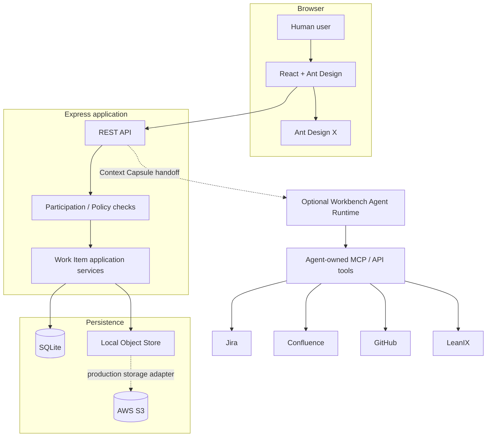

# Architecture

## Runtime topology

The tool is a standalone application below `tools/`. It is not part of the Astro site's runtime or build.

## Application boundaries

- Browser components render projections and submit commands. They never access SQLite or S3 directly.
- Express routes are the HTTP adapter. The server resolves the demo Human principal, checks Participation permissions, validates references and writes activity records.
- Work Item owns the durable business context. A Task is executable work; an Artifact is a versioned deliverable; a Review is an independent opinion tied to an Artifact version; a Decision is a formal action by a principal with explicit `decide` permission.
- Technical Debt is a separate Work Item with its own owner and lifecycle, linked to its origin Work Item and optional Decision.
- `ObjectStore` hides local vs S3 upload mechanics. The database stores attachment metadata, object key and storage URI. Storage URI is not a security token.
- No Jira, Confluence, GitHub or LeanIX Connector exists in the Workbench backend. The application stores only external resource references and their Work Item relationships. There is no source-system polling, synchronization, content cache or source credential storage.
- If a native Agent is added later, it owns its MCP/API tool clients and uses the stored references to retrieve context on demand. The Agent Runtime is separate from business services and does not bypass Participation or Decision authorization. The same applies when a user hands a Context Capsule to an external Agent Client.

## SQLite and PostgreSQL migration

SQLite is the local prototype database. The current server uses Node's synchronous `node:sqlite` API through `server/db.ts`. This keeps local setup small, but it is not yet a PostgreSQL-neutral persistence layer.

Before enabling PostgreSQL, introduce an asynchronous Repository / Unit of Work port, move SQL out of Express route handlers, add schema migrations, and implement SQLite and PostgreSQL adapters against the same application services. PostgreSQL access is not currently implemented.

## Object storage

The default LocalObjectStore writes files under `LOCAL_OBJECT_DIR`. Set `STORAGE_DRIVER=s3`, `S3_BUCKET` and `AWS_REGION` to use S3. Production should use IAM Roles / Workload Identity. Do not expose bucket objects publicly; implement authorized download or short-lived presigned URL issuance through the application service.

## Security assumptions and non-goals

The `x-demo-user-id` header is a local prototype identity selector, not authentication. Do not expose this service to untrusted networks. A production deployment needs OIDC login, OAuth Delegation Grant for external Agents, tenant/resource authorization, CSRF/CORS policy, request validation, attachment content scanning, rate limits, durable audit retention and backups.

## External system access boundary

The Workbench persists reference metadata only: provider, resource type, external ID/key, URL, relationship semantics and (for a Confluence Page) Template key/name. A reference is not evidence that the remote resource was successfully retrieved or remains current.

A future Agent may resolve these references through MCP or API tools configured for that Agent Runtime. Tool credentials and source authorization belong to the Agent/tool connection, not to this Express application. The Agent should capture the source identifier, retrieval timestamp and relevant excerpt/citation in its analysis Artifact. Failure to read a reference must be visible as missing context, not silently replaced with invented facts.
