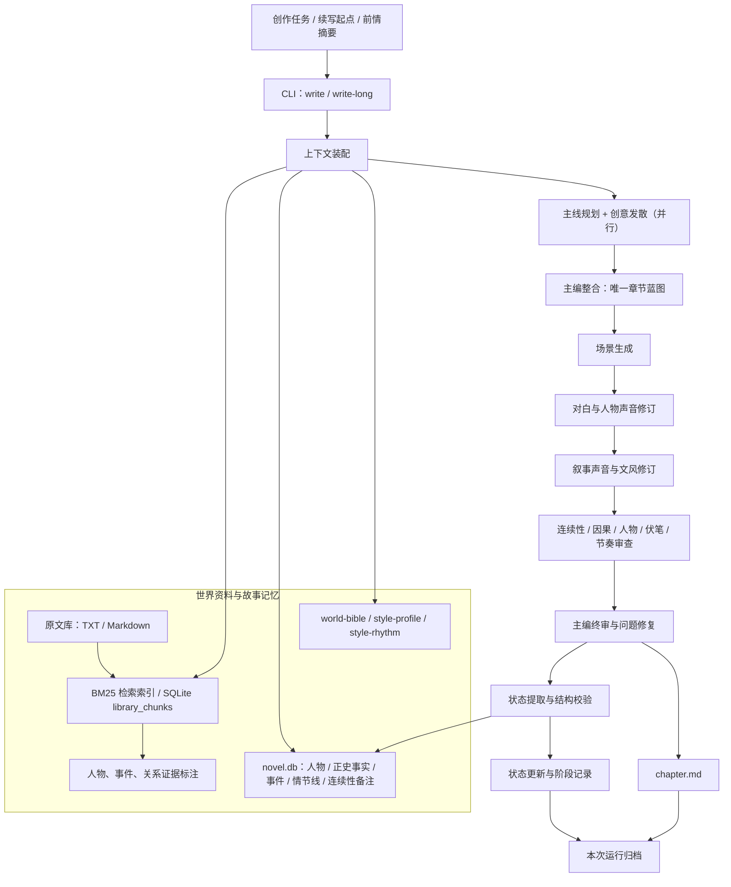
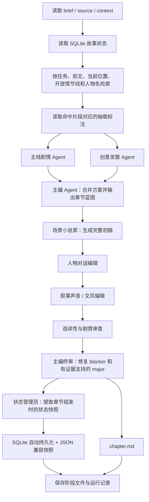
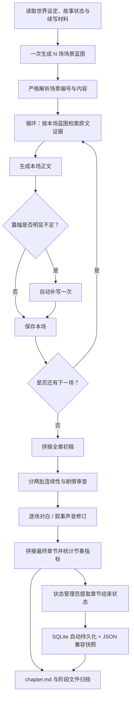
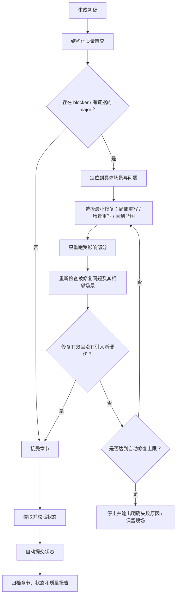

# Novel Generation：续写架构与自动化流程

> 本文描述 `tools/novel-generation` 当前代码的真实执行路径，并给出以“全自动续写、无人为编辑”为默认目标的目标架构。  
> 代码核对范围：`src/cli.ts`、`src/workflow.ts`、`src/long-chapter.ts`、`src/generate.ts`、`src/story-state.ts`、`src/database.ts`、`src/library.ts`、`src/analysis.ts`、`scripts/compare-models.mjs`。

## 1. 设计目标与运行原则

续写从输入创作任务开始，到章节正文、人物/事件/情节线状态持久化结束，默认由系统自动完成。人工不参与常规提纲选择、正文编辑、对白修改、风格修订、连续性确认或状态确认。

1. **自动推进**：规划、生成、审查、必要修复、状态更新按依赖顺序自动运行，不等待人工点击。
2. **事实优先**：原著证据、当前故事状态、人物已知信息、时间地点、能力边界和伏笔状态是硬约束；创意方案不是事实。
3. **人物不是标签**：人物画像是行为倾向和历史形成的判断模型，不是固定动作模板。人物变化必须能从处境、选择、压力和代价中解释。
4. **质量审查服务于正文**：审查只指出可定位、可解释的问题；只修复有证据支持的实质问题，不为分数或指标机械改写。
5. **自动修复有边界**：优先局部修复；修复后重新检查受影响的问题。达到修复上限仍有 blocker 时，停止本次运行并明确失败，不把有严重问题的章节当作成功成稿。
6. **状态随章节提交**：章节定稿后自动提取并持久化人物、事件、事实、情节线和连续性备注，下一章直接读取新状态。
7. **实验隔离**：模型盲测、回归实验等不应改变正式故事状态，显式使用 `--no-apply-state`。
8. **阶段产物可追溯**：保留输入、检索证据、蓝图、正文版本、审查结果、修复记录和状态快照，便于故障定位；日志与阶段文件不是额外人工审批步骤。

## 2. 系统架构

### 核心模块职责

| 模块 | 当前实现 | 职责 |
|---|---|---|
| CLI 与运行编排 | `src/cli.ts` | 读取任务参数，装配世界资料、故事状态和检索上下文，选择普通章节或长章节流程 |
| Agent 调用层 | `src/generate.ts`、`src/agent-runtime.ts` | 模型选择、超时、中断、失败回退、工具泄漏检测、阶段推理档案 |
| 原文资料库 | `src/library.ts` | TXT/Markdown 导入、分块、BM25 风格检索、来源哈希与位置 |
| 证据抽取 | `src/analysis.ts`、`src/entity-registry.ts` | 抽取人物/事件/关系候选，校验原文证据，维护显式别名与共指 |
| 世界设定 | `worlds/<world>/world-bible.md` 等 | 保存世界规则、人物和时间线的可读参考；不能把人物推断升级成正史 |
| 章节状态 | `src/story-state.ts`、`src/database.ts` | SQLite 权威存储；JSON 为兼容快照；状态按人物/事件/情节线 ID 合并 |
| 普通章节流水线 | `src/workflow.ts` | 主线与创意并行、主编规划、正文、对白、文风、连续性审查、终审、状态提取 |
| 万字章节流水线 | `src/long-chapter.ts` | 场景蓝图、逐场检索与生成、场间上下文交接、分批审查、逐场修订、状态提取 |
| 质量回归 | `src/regression.ts`、`scripts/compare-models.mjs` | 节奏量化、候选盲评和模型对照；不属于每次正式续写的人工审批步骤 |

## 3. 普通章节：当前执行流程

入口：`npm run dev -- write ...`

当前普通章节会自动完成一次终审修订，但**没有独立的终审后复查步骤**，也没有通用的多轮局部修复循环。状态结构解析失败会报错，不应继续下一章。

主要阶段文件：

| 文件 | 内容 |
|---|---|
| `00-retrieval.md` | 检索证据和命中标注 |
| `01-main-plot.md` / `02-creative-options.md` | 并行提出的主线方案与创意备选 |
| `03-chapter-plan.md` | 主编选定的章节蓝图 |
| `04-scene-draft.md` | 初稿 |
| `05-dialogue-edited.md` | 对白修订 |
| `06-voice-edited.md` | 叙事声音修订 |
| `07-continuity-review.md` | 连续性与剧情问题清单 |
| `chapter.md` | 主编终审后的章节 |
| `08-state-update.json` | 合并后的下一章状态 |

## 4. 万字章节：当前执行流程

入口：`npm run dev -- write-long ...`

万字流程比普通章节多了逐场检索和上一场结尾上下文传递，适合控制单次输出长度。它目前**没有全章终审后复查**：两批审查发生在逐场修订之前，修订后的场景没有重新做一次跨场连续性核验。节奏指标目前主要记录，不应被当作文学质量的替代指标。

主要阶段文件：`01-scene-blueprint.md`、`00-scene-XX-retrieval.md`、`02-scene-XX.md`、`03-draft.md`、`04-continuity-review.md`、`05-polish-XX.md`、`chapter.md`、`06-rhythm-metrics.json`、`07-state-update.json`。

## 5. 全自动目标闭环

下面是目标架构，不代表当前代码已经全部实现：

自动修复必须遵循以下边界：

- 事实、人物知识、人物动机、时空、因果、能力代价和伏笔生命周期属于实质检查项。
- “我更喜欢另一种写法”、句长指标偏离、个人审美偏好不能单独触发重写。
- 角色变化不应因为人物画像中的某个 trait 就被禁止；检查的是变化是否有经历、动机、选择和代价支撑。
- 修复时优先改动最小范围，不把局部问题扩大成整章重写。
- 修复轮数必须有限，并记录每轮输入、问题、改动和复查结果，避免模型无限润色。
- 若状态提取或保存失败，本次任务必须以失败结束；不能将正文成功误报为完整流水线成功。

## 6. 当前代码与目标设计的一致性审计

<badge color="warning">部分一致，尚未达到完整自动闭环</badge>

| 能力 | 当前代码情况 | 判断 |
|---|---|---|
| 自动读取世界设定和故事状态 | CLI 自动读取 world-bible、style-profile、SQLite 状态 | 一致 |
| 自动检索相关原文 | 普通章节按 brief/前文/位置/情节线/人物检索；长章节逐场检索 | 一致，但目前是 BM25 风格词项检索，不是语义检索 |
| 原文证据与抽取标注 | 有分块证据审查、实体注册表和命中标注 | 部分一致；全量分析仍需先运行 `analyze`，写作时不会自动对未分析全文做全量抽取 |
| 主线与创意并行 | `workflow.ts` 使用 `Promise.all` 并行执行 | 一致 |
| 主编选择唯一蓝图 | 普通章节与长章节都有规划阶段 | 一致 |
| 人物性格、关系和弧光 | 状态有 profile 与动态状态字段，提示词强调变化需有证据 | 部分一致；缺少独立、持续的角色弧光/关系演化跟踪与自动纠偏 |
| 对白与叙事声音 | 普通章节分两个修订阶段；长章节逐场修订 | 一致，但人物声音主要依赖当前状态文本和 prompt |
| 连续性审查 | 普通章节审查整章；长章节分两批审查 | 部分一致；长章节跨批次/跨场的全局核验不足 |
| 终审与问题修复 | 普通章节主编终审会修 blocker 和有证据的 major；长章节没有对应全章终审 | 部分一致 |
| 修复后复查 | 正式写作流程没有独立复查闭环；字数不足只补写一次 | 不一致 |
| 自动更新故事状态 | 已改为默认自动提交 SQLite 和兼容 JSON 快照；实验可用 `--no-apply-state` 隔离 | 一致（本次修改） |
| 状态失败处理 | 普通章节失败会抛错；长章节现已改为失败而不是吞掉异常 | 一致（本次修改） |
| 运行中断恢复 | 阶段文件落盘，但没有持久化 Agent session 或自动从中断点续跑 | 不一致 |
| 自动连续产出多章 | 当前 CLI 一次运行生成一章；没有章节队列/自动下一章调度器 | 不一致，当前“自动”指单次章节内部无人值守 |
| 质量评估 | 有节奏指标与模型对照实验；没有每次正式写作的统一质量报告和复查门槛 | 部分一致 |
| 风格量化约束 | 原先将语料统计写成提示词硬约束，容易诱发为命中数字而改写；本次已调整为场景化参考，不再作为固定配额 | 已修正 |

### 本次已修正的代码行为

1. `write` / `write-long` 默认自动应用状态，不再要求 `--apply-state`。
2. 新增反向开关 `--no-apply-state`，只供模型对照等隔离实验使用。
3. `scripts/compare-models.mjs` 显式传入 `--no-apply-state`，保证每个候选读取相同的初始状态。
4. `write-long` 状态提取或持久化失败时不再只打印错误并返回成功，而是抛出异常。

### 仍需后续实现的关键差距

**P0：全章复查与有限自动修复。** 两条正式写作路径都应在最终修订后再做一次针对 blocker/major 的复查；万字章节尤其需要跨场复核。复查失败时只重写受影响场景，设置明确的最大修复轮数。

**P0：长章节的最终状态提交必须与最终正文一致。** 状态提取应使用最终复查通过的正文；任何修复发生在状态提取之前。

**P1：人物与情节线的演化追踪。** 目前 profile 字段存在，但缺少可追溯的“人物弧光阶段 / 关键选择 / 关系变化 / 反转证据”记录。应复用现有 characters、story_events、plot_threads，不急于引入新的图数据库或复杂 Agent。

**P1：章节运行恢复。** 用阶段文件和运行 manifest 记录完成状态、输入摘要、模型、输出文件与失败阶段；重跑时从最近一个完整阶段恢复，而不是重新生成整章。不要把 SDK session 持久化作为前置条件。

**P2：章节级自动质量报告。** 将硬事实问题、连续性问题、人物可信度、场景推进、创意意外性、语言自然度和阅读节奏分开记录。指标只作诊断信号，不设置“必须命中原著统计数字才算通过”的机械门槛。

## 7. 当前边界与运行方式

- `ingest`、`analyze` 是资料准备命令，不是每次写作自动触发的阶段。导入原文后可按批次执行分析；写作只消费当前已存在的索引和标注。
- `write` 生成普通章节；`write-long` 生成多场景长章节；`generate` 是单次生成，不经过完整多 Agent 流水线。
- 默认状态自动提交。模型对照脚本使用 `--no-apply-state`，避免候选之间相互影响。
- `story-state.json` 是兼容快照，SQLite 是当前故事状态的权威读取来源。
- 当前检索采用本地 BM25 风格词项排序；没有向量数据库，也没有语义检索服务。
- 当前各阶段通过独立模型调用和文本文件交接，不共享持久化 Agent session。
- `analyze-world` 是独立的资料分析工作流，不是正式章节写作中的强制人工审批环节。

## 8. 关键架构结论

当前项目已经具备“资料检索 → 多 Agent 规划 → 场景生成 → 修订 → 连续性审查 → 终审 → 状态更新”的基本链路，但尚不能称为完整的全自动写作闭环。最重要的下一步不是增加更多 Agent，而是补齐**终审后复查、有限自动修复、跨场连续性核验、人物/情节演化跟踪和中断恢复**。这些能力应建立在现有 `workflow.ts`、`long-chapter.ts`、SQLite 和阶段文件机制上，避免另起一套复杂架构。
