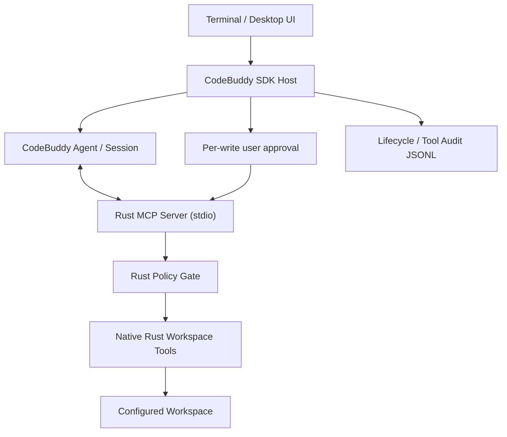

# Rust Agent

Rust Agent 将 CodeBuddy Agent SDK 与本机 Rust 工具执行层组合起来。CodeBuddy 负责模型交互、Agent Loop、上下文、多轮会话和子 Agent 编排；Rust 负责 Workspace 文件工具、最终 Policy Gate 和写操作执行。两者通过 MCP stdio 通信。

## Architecture



CodeBuddy SDK 默认不加载用户或项目配置；Host 显式使用空的 `settingSources`。只有通过 `--setting-source` 明确指定后才加载 CodeBuddy 配置。工具白名单只开放 Rust MCP 工具，避免 CodeBuddy 自带文件或命令工具绕过 Rust 工具边界。

## Requirements

- Rust toolchain matching the workspace `rust-toolchain.toml` (or a compatible stable toolchain).
- Node.js 18.20 or later.
- CodeBuddy CLI installed and authenticated, or another supported SDK authentication configuration.
- npm.

## Build and run

```bash
cd tools/rust-agent
cargo build --release --bin rust-agent-mcp

cd codebuddy-host
npm install
npm start -- --workspace /absolute/path/to/workspace
```

## Session and model controls

```bash
npm start -- --workspace /path/to/workspace --model <model-id> --fallback-model <model-id> --effort high --thinking adaptive
npm start -- --workspace /path/to/workspace --session-id <session-id>
npm start -- --workspace /path/to/workspace --continue
npm start -- --workspace /path/to/workspace --session-id <session-id> --fork
```

The host persists the latest SDK session ID in `.rust-agent/session.json` inside the workspace and resumes it on the next launch. Use `/new` to start a new conversation, `/session` to display the active ID, `/model <id>` to change the model for subsequent turns, and `/mode <default|plan|acceptEdits>` to change the SDK permission mode. The Rust write approval remains mandatory in every mode.

The host records lifecycle, permission, tool, session, and turn-usage metadata in `.rust-agent/audit.jsonl`. Audit records intentionally omit file contents and prompt text. Set `--audit-file` to choose another location. Use `--no-persist` to disable SDK transcript persistence.

## SDK features exposed by the host

| CodeBuddy capability | Host integration |
|---|---|
| Multi-turn and session recovery | Automatic latest-session pointer, `--session-id`, `--continue`, `--fork`, `/new` |
| Model routing | `--model`, `--fallback-model`, `/model` |
| Reasoning controls | `--effort`, `--thinking` |
| Permission control | `--permission-mode`, per-tool `canUseTool`, Rust policy gate |
| Lifecycle hooks | Session, prompt, tool, task, compaction, and permission events |
| Usage and result events | Turn result metadata written to audit JSONL |
| Custom Agents | Explicit `--agents-file`; Agent tools are restricted to Rust MCP tools |
| MCP integration | Rust stdio server with the four Workspace tools |
| Configuration isolation | No settings loaded unless explicitly selected |

Example custom Agent file:

```json
{
  "reviewer": {
    "description": "Review code changes",
    "prompt": "Review for correctness, security, and maintainability. Do not modify files.",
    "tools": [
      "mcp__rust_workspace__read_file",
      "mcp__rust_workspace__list_dir",
      "mcp__rust_workspace__search_files"
    ]
  }
}
```

Pass it explicitly with `--agents-file ./agents.json`. Custom Agent definitions cannot expand the host's Rust tool allow-list.

## Tools and policy

| Tool | Rust policy | Host behavior |
|---|---|---|
| `read_file` | Allow | Allow |
| `list_dir` | Allow | Allow |
| `search_files` | Allow | Allow |
| `write_file` | Require approval | Prompt for every call, then inject a host-held approval token |
| Unknown tool | Deny | Deny |

No Shell, process execution, arbitrary network tool, or workspace-external file tool is exposed. File operations remain subject to application-level path checks; this is not an OS sandbox and does not eliminate filesystem TOCTOU risks.

## Standalone Rust CLI

The original OpenAI-compatible Rust CLI remains available:

```bash
export OPENAI_API_KEY="<key>"
cargo run -- --model <model-id> --workspace /path/to/workspace
```

The CodeBuddy path uses CodeBuddy's Agent Loop. The standalone Rust path uses the repository's own OpenAI-compatible Agent Loop.

## Current limitations

- The host uses CodeBuddy's `query()` API. It supports resumable sessions, but does not yet expose the V2 Session continuous-stream API required for reliable background-task completion events across turns.
- SDK Hooks currently write structured audit metadata; they do not execute arbitrary user-provided hook scripts.
- Custom Agents are supplied as an explicit JSON file. No project or global Agent configuration is loaded implicitly.
- MCP transport is stdio and currently implements the initialize, ping, tools/list, and tools/call methods.
- Approval is interactive terminal approval. A GUI host will need an approval UI and a stronger host-to-tool approval channel.
- Audit records omit prompt and file content by design. A future audit backend may add configurable redaction and retention.
- Isolated Worker processes, OS sandboxing, and cancellation propagation into an already-running filesystem operation are not implemented.
- CodeBuddy SDK MCP integration is documented as Preview; pin and validate the SDK/CLI pair in the deployment environment.
