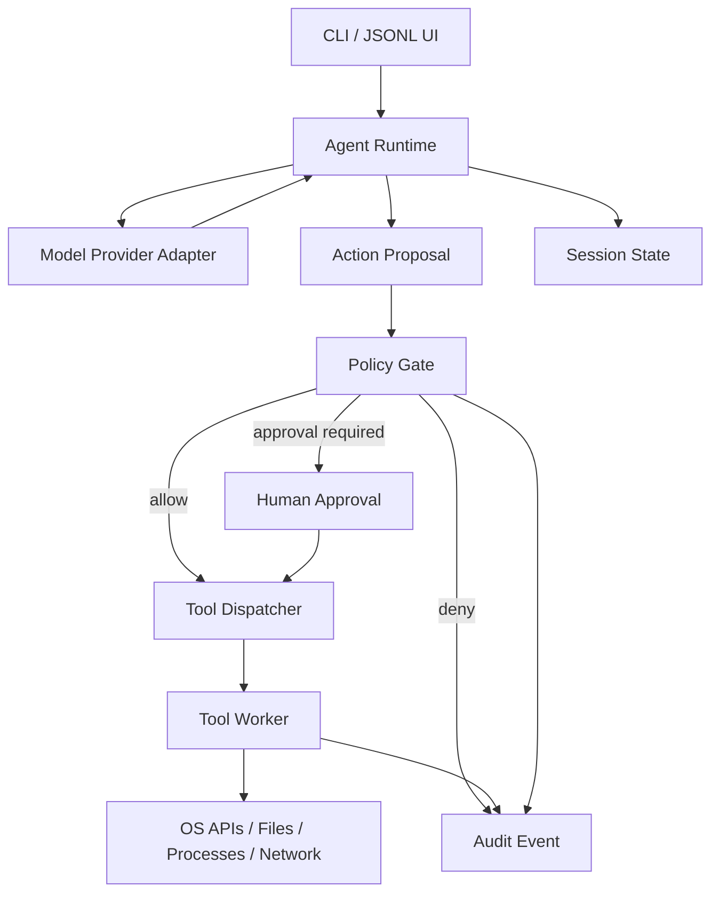

# Rust Agent

本目录实现一个本机优先（local-first）的 Rust Agent。目标不是再造一个庞大的 Agent Framework，而是建立一个可审计、可扩展、能逐步接入模型与本机工具的 Agent Runtime。当前代码是可运行的最小骨架：Native Rust CLI、OpenAI-compatible Chat Completions Provider、确定性 Tool Policy，以及限定 Workspace 的文件工具。

## 当前实现状态

已创建 Cargo 工程，使用已批准的 8 个基础 crate。当前支持普通非流式 Chat Completions 请求，以及 `read_file`、`list_dir`、`write_file` 三个 Workspace 文件工具。写入操作必须由用户在终端明确输入 `yes` 批准；未知工具默认拒绝；当前没有 Shell、进程执行、任意网络工具或 Workspace 外文件访问接口。

当前版本是最小可运行骨架，不是完整安全沙箱：Worker 与 Agent 同进程、同用户运行；文件路径检查仍属于应用层防护，不能抵御同权限恶意进程或利用 TOCTOU 竞态的本机攻击者；审计目前通过 tracing 输出诊断事件，尚未实现独立、持久化、防篡改的 Audit Store。模型响应采用非流式请求，工具调用由应用层 JSON 协议驱动，不使用 Provider 原生 Tool Calling。

## 1. 目标与边界

第一阶段交付一个可独立运行的 Native Agent Client：

- Rust 实现 Agent Runtime、工具调度、会话状态和本机执行入口。
- 模型调用通过 Provider Adapter，模型只产生结构化 Action Proposal，不直接执行系统调用。
- 工具执行经过统一的 Tool Dispatcher；每个工具声明输入 Schema、所需 Capability 和副作用等级。
- 文件、Shell、进程和网络工具先走明确的本机执行接口；后续可将高风险执行迁移到独立 Worker 或 OS Sandbox。
- 本地 UI 暂不绑定具体 GUI 框架，首阶段提供 CLI / JSON Lines 接口，方便之后接入 Tauri、Electron 或现有 TS UI。
- 默认单用户、单机、单 Agent Session；暂不引入多租户、分布式调度和复杂多 Agent 协作。

不把 Rust 本身当作安全边界。Rust 的价值是减少内存安全错误、让状态和接口更明确、便于构建独立 Native Binary。真正的隔离仍由 OS 权限、独立进程身份、Sandbox 和执行路径上的强制授权提供。

## 2. 推荐架构



核心原则：模型输出只是提案，不是授权；Policy Gate 在真实副作用发生前检查；Worker 不接受模型直接传入的任意权限；审批结果绑定具体 Action Digest，不能批准一个抽象意图后再替换参数。

### 模块边界

| 模块 | 职责 | 首阶段策略 |
|---|---|---|
| `agent-runtime` | Turn 生命周期、模型交互、状态机 | 核心自有代码 |
| `provider` | 模型请求、流式响应、错误归一化 | 先定义 Trait，再接一个 Provider |
| `action` | Action Proposal、参数、Digest、结果 | 强类型数据结构 |
| `policy` | Capability、风险分类、Allow/Deny/Approval | 默认拒绝未知操作 |
| `tools` | 文件只读、受限写入、命令执行等 | 逐个工具加入，不暴露万能 Shell |
| `worker` | 执行隔离、超时、取消、资源限制 | 首阶段同进程接口；高风险操作预留独立进程边界 |
| `session` | 对话、任务和工具调用状态 | 先内存态，持久化单独决策 |
| `audit` | Action、授权、审批、执行结果事件 | 结构化事件；不把普通 Debug Log 当审计 |
| `cli` | 本地命令行与 JSONL 交互 | 首阶段唯一 UI |

### 一次工具调用的执行流程

1. Runtime 将用户任务和工具描述交给 Model Provider。
2. Provider 返回文本或结构化 Action Proposal。
3. Runtime 验证 Action Schema、工具是否存在、参数是否完整。
4. Policy Gate 根据主体、工具、参数、工作目录、Capability 和风险等级做判定。
5. 需要人工确认时，生成不可变的 Action Digest；审批确认的内容必须与最终执行内容一致。
6. Dispatcher 将已授权的最小参数交给 Worker。
7. Worker 在限定权限下执行，并返回明确的成功、失败、取消或结果未知状态。
8. Audit 记录授权决策与真实执行结果；Runtime 再让模型解释结果，但模型不能覆盖 Worker 的事实状态。

## 3. 安全模型

### 风险等级不是模型自行判断

风险分类由确定性规则和资源范围决定。模型可以提供意图标签作为辅助信息，但不能决定是否放行。

| 等级 | 示例 | 默认处理 |
|---|---|---|
| Low | 读取已授权 Workspace 内文件、列目录 | 自动允许 |
| Medium | 修改 Workspace 文件、执行明确的项目测试命令 | 限定范围或要求确认 |
| High | 任意 Shell、访问 Workspace 外文件、安装软件、访问凭证、网络写操作 | 默认拒绝；仅通过显式策略和人工审批开放 |
| Critical | 修改 Agent 自身二进制、策略、密钥、启动项、安全组件，或关闭审计 | 拒绝；不提供普通 Tool API |

风险等级只是策略输入，不是安全证明。文件路径必须在打开文件后验证真实路径和符号链接；命令执行不能只靠字符串 Allowlist；审批必须绑定实际执行参数；取消请求不能假定外部副作用已撤销。

### 本机信任边界

首阶段不把 Agent 与 Worker 描述成已经隔离的安全边界。若二者同进程、同用户运行，Agent 失陷后仍可能绕过应用层检查。架构预留独立 Worker / Broker 接口，后续可通过 OS 进程身份和 Sandbox 实现强制隔离。WASM 采用 Native Host + WASM Artifact 的路线：Agent 主体仍是 Native Rust；部分工具未来可以编译为 WASM 模块作为可移植交付物，但当前不负责加载或执行这些模块。

高风险工具最终应由权限更低、策略受保护的执行主体运行。Agent 不持有可任意使用的长期凭证；需要凭证的操作由 Broker 代为执行，只暴露窄化后的动作能力。

### 明确不承诺

- Rust 不能防止同权限恶意进程、管理员或物理访问者篡改本机程序。
- 签名只能验证来源和完整性，不能证明程序没有逻辑漏洞。
- 模型 Reviewer、Prompt Guard、Tool Hook 都不是 OS 强制边界。
- WASM 不能替代 OS Sandbox；Host Function 授权过宽时仍会泄露宿主能力。
- 同进程 Policy Gate 不能防止已控制该进程的 Agent 代码绕过。
- 本地审计文件不天然具备防篡改能力。

## 4. Rust 工程基线

截至 2026-11-21，Rust 最新 Stable 为 **1.100.0**（2026-11-12 发布）。工程建议固定 Stable Toolchain，不使用 Nightly 语言特性；采用 Rust 2024 Edition。CI 和本机开发统一通过 rustup 管理工具链。

参考：[Rust 1.100.0 Release](https://blog.rust-lang.org/2026/11/12/Rust-1.100.0/)、[Rust Forge Release Versions](https://forge.rust-lang.org/).

初始质量门禁建议：

- `cargo fmt --check`
- `cargo clippy --all-targets --all-features -- -D warnings`
- `cargo test`
- `cargo audit`（依赖确定后启用）
- `cargo deny check`（依赖许可证、来源和重复版本策略确定后启用）
- Release 构建开启溢出检查；对外发布再增加平台签名和可复现构建检查。

不使用 nightly-only API，不为了追求“最新 Rust”而引入不稳定特性。

## 5. 第三方 crate：待确认，不自动引入

当前仓库尚未添加任何 Rust crate。Agent 要完成真实模型调用、JSON 解析和异步工具执行，实际实现通常需要少量成熟依赖。建议先确认以下集合，再创建 Cargo 工程：

| 用途 | 建议 crate | 是否首阶段需要 | 说明 |
|---|---|---:|---|
| 异步 Runtime | `tokio` | 是 | Provider Streaming、并发 Tool、超时与取消 |
| HTTP Client | `reqwest` | 是 | 模型 API；启用 rustls，避免引入 OpenSSL 系统依赖 |
| JSON / 序列化 | `serde`、`serde_json` | 是 | Provider 消息、Action Schema、配置和事件 |
| CLI | `clap` | 是 | 命令行参数和子命令 |
| 错误处理 | `thiserror` | 是 | 核心模块定义稳定错误类型；顶层可先用标准错误 |
| 日志与 Trace | `tracing`、`tracing-subscriber` | 是 | 结构化诊断；审计事件仍独立建模 |
| 取消传播 | `tokio-util` | 建议 | CancellationToken；也可首版自行实现简单取消接口 |
| 标识符 | `uuid` | 建议 | Task、Session、Action 和 Tool Call ID |
| Secret 内存处理 | `secrecy`、`zeroize` | 后续 | 减少意外暴露；不能阻止进程内存读取 |
| OS 权限与 Sandbox | 平台相关 crate / 系统 API | 后续单独确认 | macOS Seatbelt、Linux Landlock/seccomp、Windows AppContainer/Job Objects，不能用一个跨平台 crate 假装能力一致 |
| WASM 编译 | Rust 官方 target / `rustc` | 后续按需 | 工具模块可编译为 `.wasm` 作为交付格式；不代表 Native Agent 能直接执行它 |
| WASM 执行 | 暂不选 Runtime | 当前不需要 | 明确不引入 Wasmtime、Wasmer 或其他 WASM Runtime；需要执行时再单独评估宿主环境和隔离边界 |
| 本地持久化 | 暂不选 | 后续 | 先明确 SQLite、JSONL 或宿主数据库需求，再决定是否引入 crate |

**需要用户确认的最小依赖集合：** `tokio`、`reqwest`、`serde`、`serde_json`、`clap`、`thiserror`、`tracing`、`tracing-subscriber`。在得到确认之前，不添加这些依赖、不运行 Cargo 初始化来生成依赖锁文件，也不选用额外 Agent Framework。

不建议首版依赖完整 Agent Framework。Runtime 的核心状态机、Action Proposal、Policy Gate 和 Tool Dispatcher 应由本项目掌握，避免框架的 Tool 生命周期和权限模型成为安全边界。后续如果需要 MCP，再单独比较官方 Rust SDK 与轻量 JSON-RPC 实现，并在确认后引入。

## 6. 首阶段实现范围

首阶段以一个可运行的本地 Agent 为目标，但把安全边界说清楚：

1. CLI / JSONL 输入输出。
2. 一个 Provider Adapter，支持流式模型响应。
3. Tool Registry 和结构化 Action Proposal。
4. Policy Gate：默认拒绝未知 Tool，Low/Medium/High 的规则显式配置。
5. 首批只提供 Workspace 只读、受限文件写入和明确命令执行接口；不提供无约束的万能 Shell。
6. 每次调用记录 Action、Policy Decision、Approval 和 Worker Result。
7. Tool 超时、取消、错误和执行结果未知分别建模。
8. 单元测试覆盖路径穿越、符号链接、参数篡改、审批重放、取消竞态和超时后的副作用状态。

**当前尚未实现：** GUI、MCP Server、插件市场、多 Agent、远端执行集群、Shell/进程工具、流式模型响应、独立 Worker 进程、持久化审计、WASM 模块加载与执行、WASM Sandbox、跨平台 OS Sandbox 全覆盖、自动修改自身代码或安全策略。这里不排斥未来把独立 Tool Worker 编译成 `.wasm`；只是当前不提供 WASM Runtime。

## 7. 建议目录结构

```text
tools/rust-agent/
  README.md
  Cargo.toml                 # 用户确认依赖后创建
  rust-toolchain.toml        # 固定 stable / 1.100.0
  src/
    main.rs
    app.rs
    runtime/
      mod.rs
      state.rs
      turn.rs
    provider/
      mod.rs
      traits.rs
    action/
      mod.rs
      proposal.rs
      digest.rs
    policy/
      mod.rs
      decision.rs
      capability.rs
    tools/
      mod.rs
      registry.rs
    worker/
      mod.rs
    session/
      mod.rs
    audit/
      mod.rs
  tests/
    policy_enforcement.rs
    action_approval.rs
    worker_lifecycle.rs
```

这是目标结构，不代表上述源码文件已经创建。

## 8. 已确认的实施决策

- 已批准首阶段使用 8 个基础 crate：`tokio`、`reqwest`、`serde`、`serde_json`、`clap`、`thiserror`、`tracing`、`tracing-subscriber`。未经再次确认，不增加其他 crate。
- Agent Runtime、Policy Gate、Dispatcher 和首批 Worker 使用 Native Rust 实现。
- WASM 采用“Native Host + WASM Artifact”：未来可把适合独立运行的 Tool Worker 编译为 `.wasm`，用于跨平台分发或交给外部、已存在的 WASM 宿主执行。
- 当前不引入 Wasmtime、Wasmer 或任何其他 WASM Runtime，不实现 WASM 动态加载、WASM 模块执行或 WASM Sandbox。仅保留 Worker 接口边界，避免未来接入时改动 Agent Runtime。
- `.wasm` 文件本身不是可执行程序；没有 Runtime / Host 就不能在本机直接运行。编译成 WASM 也不会自动获得安全隔离，实际能力仍由执行宿主提供的 Host Interface 和权限控制决定。

因此，当前 Native Rust Cargo 工程和基础模块已经创建。WASM 仍只是后续可选的构建产物，不进入当前执行链路。

## 9. 本地构建与运行

要求安装 Rust 1.100.0（rustup 会根据 `rust-toolchain.toml` 选择工具链）。在 `tools/rust-agent` 目录执行：

```bash
cargo fmt --check
cargo clippy --all-targets --all-features -- -D warnings
cargo test

export OPENAI_API_KEY="..."
cargo run -- --model "<your-model-id>" --workspace .
```

可通过 `--base-url` 指定兼容 OpenAI Chat Completions 的 API Base URL，通过 `--api-key-env` 指定密钥环境变量名。不要把 API Key 写入命令行参数、配置文件或仓库。当前代码尚未在远端执行构建验证；首次本地构建应检查依赖解析、编译和测试结果。
