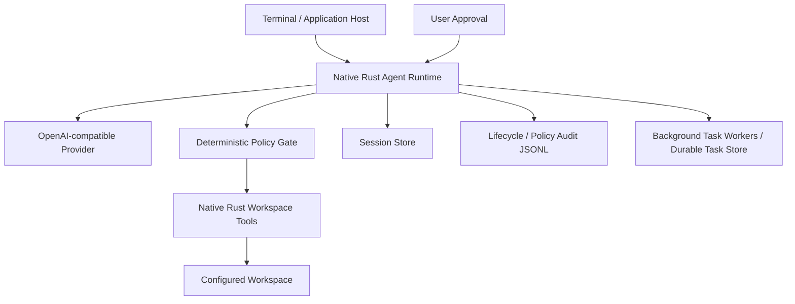

# Rust Agent

Rust Agent 是独立的 Rust Agent Runtime。CodeBuddy SDK 仅作为功能参考和可选互操作 Host，不是运行依赖。默认运行路径不需要 Node.js、npm、CodeBuddy CLI 或 `@tencent-ai/agent-sdk`。

## Architecture



The Rust runtime owns the Agent loop, conversation history, session lifecycle, context window, policy decisions, tool execution, and audit events. The OpenAI-compatible provider supports SSE streaming; runtime hooks receive structured `model.output.delta` events while the runtime buffers the complete action payload before parsing or executing it. No CodeBuddy SDK or MCP client is required for the standalone runtime. The separate MCP server remains available when another Agent host needs to consume the Rust tools.

## Requirements

- Rust toolchain matching the workspace `rust-toolchain.toml` (or a compatible stable toolchain).
- An OpenAI-compatible API endpoint and API key.

## Build and run

```bash
cd tools/rust-agent
export OPENAI_API_KEY="<key>"
cargo run --release -- --model <model-id> --workspace /path/to/workspace --fallback-model <fallback-model>
```

No npm install or CodeBuddy login is required.

## Sessions and context

Sessions are stored as JSON files under `.rust-agent/sessions/` in the configured workspace. The `latest` pointer supports `--continue`; use `--session-id` to resume a specific session. Use `/new`, `/session`, `/resume <id>`, and `/fork` in the interactive CLI. `/models` queries the provider's OpenAI-compatible GET /models endpoint. `/mode plan` blocks writes; `/mode default` restores per-write approval. `/context` displays the retained message count and `/compact` applies the configured sliding-window limit. When the model returns an ask_user action, the CLI presents structured choices or a free-text question and sends the answer back into the current turn.

```bash
cargo run -- --model <model-id> --workspace /path/to/workspace --continue
cargo run -- --model <model-id> --workspace /path/to/workspace --session-id <session-id>
```

A fork copies the current conversation into a new session and records its parent session ID. Session writes use a temporary file followed by rename to avoid leaving a partially written JSON document. Session IDs are validated before they are used as file names.

Embedding hosts can create a `CancellationHandle`, pass it to `run_turn_with_cancellation`, and call `cancel()` from a UI cancel action. The CLI maps Ctrl-C to the same mechanism while a turn is running. Cancellation aborts in-flight model requests, including delegated subagent requests, persists a synthetic cancelled-turn marker for conversation continuity, and emits `turn.cancelled`. It does not roll back a local tool operation that has already completed. Synchronous local tools and blocking approval/question prompts are not preemptible; the cancellation request is checked immediately after a prompt returns and before a pending write approval can execute. The CLI keeps one process-lifetime Ctrl-C listener, so Ctrl-C cancels an active turn and exits when the CLI is idle.

The runtime bounds the conversation history to the most recent 80 non-system messages by default. It removes complete older turns rather than cutting through the middle of a tool exchange. This is a sliding context window, not semantic summarization. The model can delegate a bounded investigation or review through `delegate_task`; the delegated Agent has its own short-lived context and can only read, list, and search workspace files. Its result is returned to the parent conversation.

Longer independent investigations can use `start_background_task`. A task gets its own message history and is stored under `.rust-agent/tasks/<task-id>.json`, separately from its parent session. The task ID is returned immediately, so the foreground Agent turn can continue. Task status and intermediate messages are persisted after each completed tool step. On process startup, queued or previously running tasks are requeued from their last persisted checkpoint; a task persisted in `cancelling` is finalized as `cancelled` instead. The task's selected model is captured when it starts.

Use these CLI commands to manage tasks:

```text
/tasks                 List background tasks
/task <id>             Show task status, progress, and result
/wait <id>             Wait for completion (Ctrl-C stops waiting, not the task)
/cancel-task <id>      Request task cancellation
/deliver-task <id>     Add a completed result to its original parent session
```

A result can only be delivered to the parent session that created the task. Delivery is idempotent. Cancellation first persists a `cancelling` state before signalling the worker; a process restart completes that cancellation instead of requeueing the task. Background tasks are limited to eight active tasks and twelve model steps per task. They can only read, list, and search workspace files; they cannot write files, ask questions, start nested tasks, or use arbitrary network or process tools.

## Runtime controls

| Capability | Native implementation |
|---|---|
| Agent loop | Rust runtime with a bounded tool-call loop |
| Subagents | In-process delegated Agent with a six-step limit and read-only tool allow-list |
| Background tasks | Durable, independently scheduled read-only tasks with status, wait, cancel, restart recovery, and parent-session result delivery |
| Session lifecycle | Create, resume, continue latest, fork |
| Context management | Configurable sliding message window with whole-turn pruning |
| Permission control | Deterministic Rust Policy Gate, default/plan modes, and per-write approval |
| User interaction | Structured ask-user questions with single/multiple choice or free text |
| Model discovery | OpenAI-compatible /models endpoint |
| Runtime controls | Interactive model/mode switching, context inspection, manual window compaction, and host-triggered turn cancellation |
| Lifecycle hooks | Native `RuntimeHook` callbacks plus JSONL audit events; hooks can deny a tool call but cannot grant permissions |
| Workspace tools | Rust read, list, search, and write operations |
| MCP | Standalone Rust stdio server with tools, resources, and prompts |

Options:

- `--max-tool-calls N`: maximum tool calls per turn (1–64).
- `--max-history-messages N`: retained non-system messages (4–2000).
- `--session-dir PATH`: override session storage.
- `--audit-file PATH`: override the JSONL audit file.

Audit events intentionally omit prompt text and file contents. Audit failures are logged but do not fail an otherwise successful Agent turn.

## Tools and policy

| Tool | Rust policy | Behavior |
|---|---|---|
| `read_file` | Allow | Read a UTF-8 file inside the workspace |
| `list_dir` | Allow | List a workspace directory |
| `search_files` | Allow | Search workspace files natively |
| `write_file` | Require approval | Ask for approval on every write |
| Unknown tool | Deny | Reject |

No Shell, process execution, arbitrary network tool, or workspace-external file tool is exposed. File operations remain subject to application-level path checks; this is not an OS sandbox and does not eliminate filesystem TOCTOU risks.

## Optional CodeBuddy adapter

`codebuddy-host/` is retained as an optional compatibility example for users who explicitly want CodeBuddy to own model orchestration. It is not used by the native Rust CLI and is not part of the default dependency or build path. The native runtime is the preferred path when minimizing external runtime dependencies.

## Current limitations

- Streaming requires the provider to implement OpenAI-compatible Chat Completions SSE. The primary Agent loop emits `model.output.delta` RuntimeHook events and buffers the complete response before parsing it. Delta events contain fragments of the structured action payload, not display-ready assistant text; hosts must wait for the completed turn before rendering final content or acting on a tool call. Delegated subagent requests still use the buffered completion path. If a primary model fails after emitting partial output, fallback is not attempted to avoid mixing two model responses.
- Host-triggered cancellation and CLI Ctrl-C abort in-flight provider requests and record a cancelled-turn marker. Cancellation cannot undo a local tool operation that has already completed, and synchronous local tools plus blocking CLI approval/question prompts are not preemptible.
- Background task file tools are synchronous and cannot be interrupted mid-operation. Cancelling such a task takes effect after the current local tool call returns. Background task recovery is automatic when the runtime is constructed inside an active Tokio runtime; hosts constructing it elsewhere must call `resume_background_tasks()` from their async runtime.
- Model discovery requires the provider to expose the OpenAI-compatible GET /models endpoint.
- Permission modes intentionally omit automatic edit approval: default always asks before writes, while plan blocks writes.
- Context management uses a sliding window; semantic summarization is not implemented yet.
- Runtime hooks are synchronous callbacks. Long-running hook work should be delegated by the embedding host rather than blocking the Agent loop.
- Delegated subagents still run sequentially in the parent turn and are not independently resumable. Background tasks are separate, read-only workers; after a process crash, the last persisted checkpoint is resumed. A model request that was in flight at the time of the crash can be repeated, so task execution is at-least-once across crashes rather than exactly-once. Concurrent writers to the same workspace task directory are not coordinated across separate Rust Agent processes.
- Fallback routing is deliberately limited to transient transport, rate-limit, and server failures. Authentication, invalid-request, and malformed-response failures are not retried.
- Terminal approval is synchronous. A desktop host will need an approval channel, but must retain the Rust policy check.
- Session storage is local JSON and is not designed for concurrent writers to the same session.
- The standalone MCP server supports tools, resources, and prompts over stdio.
