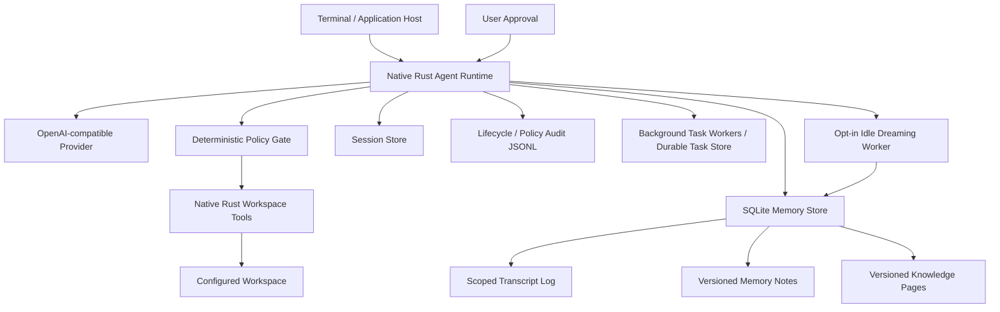

# Rust Agent

Rust Agent 是独立的 Rust Agent Runtime。CodeBuddy SDK 仅作为功能参考和可选互操作 Host，不是运行依赖。默认运行路径不需要 Node.js、npm、CodeBuddy CLI 或 `@tencent-ai/agent-sdk`。

## Architecture



The Rust runtime owns the Agent loop, conversation history, session lifecycle, context window, policy decisions, tool execution, and audit events. The OpenAI-compatible provider supports SSE streaming; runtime hooks receive structured `model.output.delta` events while the runtime buffers the complete action payload before parsing or executing it. No CodeBuddy SDK or MCP client is required for the standalone runtime. The separate MCP server remains available when another Agent host needs to consume the Rust tools.

## Requirements

- Rust toolchain matching the workspace `rust-toolchain.toml` (or a compatible stable toolchain).
- An OpenAI-compatible API endpoint and API key.

## Build and run

```bash
cd tools/rust-agent
export OPENAI_API_KEY="<key>"
cargo run --release -- --model <model-id> --workspace /path/to/workspace --fallback-model <fallback-model>
```

No npm install or CodeBuddy login is required.

## Sessions and context

Sessions are stored as JSON files under `.rust-agent/sessions/` in the configured workspace. The `latest` pointer supports `--continue`; use `--session-id` to resume a specific session. Use `/new`, `/session`, `/resume <id>`, and `/fork` in the interactive CLI. `/models` queries the provider's OpenAI-compatible GET /models endpoint. `/mode plan` blocks writes; `/mode default` restores per-write approval. `/context` displays the retained message count and `/compact` applies the configured sliding-window limit. The complete request budget includes the system prompt, current request, history, agent catalog, tool output and attachment metadata; oversized input is truncated on a Unicode boundary and older history is removed first. A conservative local tokenizer estimate is used, not a model-specific tokenizer. The same input/output budget is applied to the foreground Agent, delegated subagents and background tasks. When the model returns an ask_user action, the CLI presents structured choices or a free-text question and sends the answer back into the current turn. Embedding Hosts can supply `RuntimeOptions.user_question_handler` with a `UserQuestionHandler` implementation to render questions in a desktop or web UI; only the CLI fallback reads stdin, on a blocking worker thread.

```bash
cargo run -- --model <model-id> --workspace /path/to/workspace --continue
cargo run -- --model <model-id> --workspace /path/to/workspace --session-id <session-id>
```

A fork copies the current conversation into a new session and records its parent session ID. Every session is bound to its optional project ID; resuming the same session under a different project is rejected. Older session files without a project ID remain usable only when no project scope is configured. Session writes use a temporary file followed by rename to avoid leaving a partially written JSON document. Each session has a monotonically increasing revision; a file lock and revision check reject stale writes from another Runtime instead of silently overwriting newer conversation state. Session files are limited to 16 MiB, and state directories/files reject symbolic-link paths.

Embedding hosts can create a `CancellationHandle`, pass it to `run_turn_with_cancellation`, and call `cancel()` from a UI cancel action. The CLI maps Ctrl-C to the same mechanism while a turn is running. Cancellation aborts in-flight model requests, including delegated subagent requests, persists a synthetic cancelled-turn marker for conversation continuity, and emits `turn.cancelled`. It does not roll back a local tool operation that has already completed. Synchronous local tools and blocking approval/question prompts are not preemptible; the cancellation request is checked immediately after a prompt returns and before a pending write approval can execute. The CLI keeps one process-lifetime Ctrl-C listener, so Ctrl-C cancels an active turn and exits when the CLI is idle.

The runtime bounds the active conversation history to the most recent 80 non-system messages by default. It removes complete older turns rather than cutting through the middle of a tool exchange. This is a sliding context window, not semantic summarization. The model can delegate a bounded investigation or review through `delegate_task`; the delegated Agent has its own short-lived context and can only read, list, and search workspace files. Its result is returned to the parent conversation.

Longer independent investigations can use `start_background_task`. A task gets its own message history and is stored under `.rust-agent/tasks/<task-id>.json`, separately from its parent session. The task ID is returned immediately, so the foreground Agent turn can continue. Task status and intermediate messages are persisted after each completed tool step. Each worker must claim a task lease in the workspace SQLite database before execution, so two Runtime instances cannot run the same task or exceed the shared eight-worker limit. Every checkpoint and final result is fenced by the current lease owner inside an SQLite immediate transaction; an expired worker cannot write after another process takes over. The worker renews its 120-second lease every 30 seconds and releases it on completion. A queued task can be claimed immediately; a previously running task is resumed only after its lease expires, so a Host should call `resume_background_tasks()` again after the lease window when recovery is still required. A task persisted in `cancelling` is finalized as `cancelled` after a worker can safely claim it. The task's selected model is captured when it starts.

Use these CLI commands to manage tasks:

```text
/tasks                 List background tasks
/task <id>             Show task status, progress, and result
/wait <id>             Wait for completion (Ctrl-C stops waiting, not the task)
/cancel-task <id>      Request task cancellation
/deliver-task <id>     Add a completed result to its original parent session
/forget-memory <id>       Forget a memory and its dependent notes/pages and exclusive transcript sources
/prune-transcripts <days> Prune unreferenced transcript rows older than N days
/prune-tasks <days>       Remove old completed, failed, and cancelled task records
```

A result can only be delivered to the parent session that created the task. Delivery uses the durable `delivered_at_ms` marker, so context compaction cannot cause the same result to be inserted again. Cancellation first persists a `cancelling` state before signalling the worker; the active worker observes it after the in-flight provider request and exits. Cross-process cancellation is cooperative, not an instantaneous interruption. Background tasks are limited to eight active tasks and twelve model steps per task; a selected profile can lower that step budget. The task store is limited to 5,000 records with a 16 MiB limit per record. A single cross-process store lock serializes quota checks, updates and pruning; it does not create a permanent lock file for every task. `/prune-tasks` explicitly removes old terminal task records. They can only read, list, and search workspace files; they cannot write files, ask questions, start nested tasks, or use arbitrary network or process tools.


## Storage limits and evidence lifecycle

Workspace reads and writes have fixed ceilings. `read_file` reads at most 1 MiB; `read_attachment` exposes at most 256 KiB of UTF-8 text. Directory listings stop at 2,000 entries. `search_files` visits at most 10,000 files, scans at most 1 MiB from an individual file and 64 MiB across the search, returns at most 1,000 matches, and caps output at 256 KiB. `write_file` accepts at most 1 MiB and writes to a same-directory temporary file before atomically replacing the target, avoiding writes through an existing symlink or hard link. Attachment storage is limited to 20 MiB per file, 1,000 files and 200 MiB total; these aggregate quotas are protected by a cross-process lock.

Memory evidence is checked at consolidation and again at retrieval. A derived note or knowledge page becomes unavailable when its source memory is disputed, stale, expired, deleted, or has an invalid source chain. Global memories cannot use project-scoped transcripts as evidence. Knowledge-page revisions store the evidence used for create/update/delete operations, and page lookup/search excludes pages whose evidence is no longer valid.

`/forget-memory` cascades through dependent memory notes, knowledge pages, and their revision snapshots. It removes transcript rows only when no remaining memory/page/revision references them, then redacts matching source text from persisted session messages, including prompts that were composed with a memory prefix or attachment metadata. A small content-fingerprint tombstone (no transcript text) prevents an old Session snapshot from backfilling that content again. The active session is reloaded after its revision-checked redaction. `/prune-transcripts` is a separate, explicit retention operation: it deletes only expired-by-age transcript rows that are not referenced by any current or revisioned evidence and always preserves the newest 1,000 rows. Startup does not automatically forget or prune user content. The tombstones retain only a stable content fingerprint and session ID so a deleted message is not re-imported from an older session snapshot.

Usage and audit JSONL logs rotate at 16 MiB and 32 MiB respectively, retaining three backups. Trace JSONL rotates at 32 MiB with three backups. Appends and rotation are serialized across Runtime instances. Dreaming records a durable workspace activity epoch; a user turn that starts before Dreaming commits invalidates that run inside the same SQLite transaction.

## Custom Agents

Custom Agent profiles are JSON files stored under .rust-agent/agents/. Each profile defines a role-specific system prompt, an optional model override, an explicit read-only tool allow-list, and a bounded step budget. The primary Agent receives the available profile IDs in its request context and can select one through the optional agent argument on delegate_task or start_background_task.

Example .rust-agent/agents/security-reviewer.json:

```json
{
  "id": "security-reviewer",
  "name": "Security reviewer",
  "description": "Reviews local code for authorization, trust-boundary, and secret-handling issues.",
  "model": null,
  "system_prompt": "You are a senior application security reviewer. Prioritize exploitable issues, trace each finding to the relevant code, explain impact, and distinguish confirmed defects from hypotheses.",
  "allowed_tools": ["read_file", "list_dir", "search_files"],
  "max_steps": 9
}
```

The profile ID must match the file name. The model is inherited from the current runtime when it is null. The allowed tool set can contain any subset of read_file, list_dir, and search_files, including an empty set for a reasoning-only Agent; write tools are deliberately excluded from delegated and background Agents. max_steps is between 1 and 12. Profile files and directories are created with restrictive Unix permissions.

A profile can be saved or removed through the host API using save_agent_profile, get_agent_profile, list_agent_profiles, and delete_agent_profile. The CLI provides /agents to list profiles and /agent <id> to inspect one. A task snapshots its profile and selected model when it starts, so editing or deleting the source profile does not change already-running or recoverable tasks. The snapshot is persisted with the task record.

The built-in defaults remain available when no profile ID is supplied: foreground delegated tasks use a six-step read-only profile, while background tasks use a twelve-step read-only profile. Custom profiles may select fewer tools and fewer steps, and can override the model, but cannot expand the tool boundary beyond the read-only workspace tools.

## Runtime controls

| Capability | Native implementation |
|---|---|
| Agent loop | Rust runtime with a bounded tool-call loop |
| Subagents | In-process delegated Agent with a six-step limit and read-only tool allow-list |
| Background tasks | Durable, independently scheduled read-only tasks with status, wait, cancel, restart recovery, and parent-session result delivery |
| Custom Agents | JSON profiles with independent prompts, optional model overrides, read-only tool allow-lists, and bounded step budgets |
| Session lifecycle | Create, resume, continue latest, fork |
| Context management | Configurable sliding message window with whole-turn pruning and a small retrieved-memory context |
| Permission control | Deterministic Rust Policy Gate, default/plan modes, and per-write approval |
| User interaction | Structured ask-user questions with single/multiple choice or free text |
| Model discovery | OpenAI-compatible /models endpoint |
| Runtime controls | Interactive model/mode switching, context inspection, manual window compaction, and host-triggered turn cancellation |
| Memory lifecycle | SQLite transcript log, evidence-backed notes, linked knowledge pages, scoped retrieval, and model-assisted dreaming consolidation |
| Lifecycle hooks | Native `RuntimeHook` callbacks plus JSONL audit events; hooks can deny a tool call but cannot grant permissions |
| Workspace tools | Rust read, list, search, and atomic write operations with explicit per-file and aggregate limits |
| Background state | Cross-process store lock, SQLite lease fencing, terminal-state immutability, and explicit task retention |
| Storage lifecycle | Bounded task/attachment stores, rotating logs, evidence-aware transcript pruning, and cascading memory forgetting |
| MCP | Standalone Rust stdio server with tools, resources, and prompts |

Options:

- `--max-tool-calls N`: maximum tool calls per turn (1–64).
- `--max-history-messages N`: retained non-system messages (4–2000).
- `--auto-dreaming`: enable idle-time memory consolidation (disabled by default).
- `--project-id ID`: associate this CLI session with a project memory scope.
- `--session-dir PATH`: override session storage.
- `--audit-file PATH`: override the JSONL audit file.

Audit events intentionally omit prompt text and file contents. Audit failures are logged but do not fail an otherwise successful Agent turn.

## Tools and policy

`read_file` rejects files larger than 1 MiB. `list_dir` returns at most 2,000 entries and 256 KiB of output. `search_files` examines at most 10,000 candidate paths, skips files larger than 1 MiB, reads no more than 64 MiB in total per request, caps individual matching lines at 4 KiB, and returns at most 256 KiB. These limits bound application memory and data returned to the model; they do not replace OS-level CPU, disk or filesystem isolation.

| Tool | Rust policy | Behavior |
|---|---|---|
| `read_file` | Allow | Read a UTF-8 file inside the workspace |
| `read_attachment` | Allow | Read a UTF-8 text attachment supplied by the Host |
| `list_dir` | Allow | List a workspace directory |
| `search_files` | Allow | Search workspace files natively |
| `write_file` | Require approval | Ask for approval on every write |
| Unknown tool | Deny | Reject |

No Shell, process execution, arbitrary network tool, or workspace-external file tool is exposed. File operations remain subject to application-level path checks; this is not an OS sandbox and does not eliminate filesystem TOCTOU risks.

## Host API and attachments

The Rust library is the embedding API; it does not start an HTTP server. A desktop or service Host owns its upload transport and calls AgentRuntime::attach_bytes(filename, content_type, bytes) before run_turn or run_turn_with_cancellation. The Runtime enforces a 20 MiB per-file limit, stores bytes under .rust-agent/attachments/ using generated IDs (never client filenames as storage paths), and writes metadata separately. The Runtime automatically adds attachment metadata to the next user message; the Agent uses read_attachment with the returned ID to inspect UTF-8 text. Arbitrary binary files can be stored but are not decoded. No HTTP server, multipart parser, OCR, PDF, or Office parser is bundled.

The embedding surface exposes RuntimeHook for lifecycle events and additional tool denials, CancellationHandle for cancellation, the optional asynchronous ApprovalHandler callback, and the optional asynchronous UserQuestionHandler callback. A desktop Host can await its approval or question UI without blocking the Tokio runtime; the Rust Policy Gate still makes the final allow/deny decision. The CLI uses blocking terminal prompts on dedicated blocking threads.

## Optional CodeBuddy adapter

`codebuddy-host/` is retained as an optional compatibility example for users who explicitly want CodeBuddy to own model orchestration. It is not used by the native Rust CLI and is not part of the default dependency or build path. The native runtime is the preferred path when minimizing external runtime dependencies.

## Usage tracking

The runtime appends model-call and tool-call events to `.rust-agent/usage.jsonl` with private file permissions. Model usage includes the effective model after fallback, provider-reported prompt/completion/total tokens when available, and end-to-end completion latency. Streaming requests ask for a final usage frame; if a provider rejects the optional `stream_options` extension, the runtime retries once without it to preserve compatibility. Providers that omit usage are recorded with unknown token counts; token counts are never estimated from text length. The response count includes successful model responses, not failed or interrupted attempts.

Background tasks persist cumulative request, token, duration, and tool-call totals in each task record, including across restart recovery. The `/usage` command shows totals across the workspace usage log and stored background tasks; `/task <id>` shows the selected task's usage. Failed or cancelled requests that do not return a usage payload cannot be assigned reliable token counts.


## Context, memory and tracing

Context management, persistent memory, lifecycle hooks and tracing are built into the single `AgentRuntime`. There is no second runtime or facade to construct.

`RuntimeOptions` configures the context budget and optional project scope. Every turn retrieves applicable memories, adds them as untrusted reference material, reports the estimated context budget, and then follows the same Agent loop and sliding history window.

Memory is stored in the embedded SQLite database `.rust-agent/memory.sqlite3` using WAL mode and private file permissions. SQLite is compiled into the executable; no database service or system SQLite installation is required. Existing SQLite Memory records are migrated in place.

The design follows a four-layer memory model:

1. **Transcripts** are the append-only source log of user messages, model actions and tool results. Session JSON remains the active conversation snapshot; the transcript table preserves messages across context compaction and provides evidence for later review.
2. **Memory notes** capture durable preferences, decisions, reusable procedures and lessons. Each note carries scope, confidence, importance, status, access statistics and references to the transcript or prior notes that support it. Status is `proposed`, `consolidated`, `disputed` or `stale`. Only consolidated notes are eligible for automatic retrieval.
3. **Knowledge pages** are compact, linked Markdown representations for topics that span multiple notes or sessions. Each page has a short retrieval summary, full content, links and evidence references. The optional global `index` page acts as a small dashboard; it is not a copy of the knowledge base.
4. **Injected context** consists of a small index, relevant consolidated notes and relevant page summaries. Full pages and transcript evidence are loaded only when the Agent asks to inspect them. All injected material is explicitly marked as untrusted reference data.

During a turn, the Agent can call `memory_note` to save a proposed observation, `memory_search` to find notes/pages/transcript evidence, and `memory_read` to open a note, page or transcript. Proposed notes are deliberately excluded from future context until reviewed. The Host can explicitly accept a note with `AgentRuntime::set_memory_status(id, MemoryStatus::Consolidated)`; explicit Host `remember` calls create consolidated notes.

**Dreaming** is an offline consolidation worker within the same `AgentRuntime`, not a second runtime. Manual execution is available through `AgentRuntime::dream_memories().await` and CLI `/dream`; `/dream-status` reports backlog, cursor, current lease, retry schedule and recent runs. Automatic execution is opt-in through `DreamingOptions::auto_enabled` or CLI `--auto-dreaming`; the worker waits for an idle window after activity, then processes bounded transcript batches. It continues across batches while the backlog remains above the configured threshold. A new user turn invalidates an in-flight batch before commit; the run is marked `interrupted` and remains eligible for later consolidation.

Dreaming run state is durable in SQLite: each run records its trigger, cursor range, model usage, outcome and error. A database lease prevents two processes from consolidating the same workspace concurrently. If a process exits while holding the lease, another worker can reclaim the run after lease expiry. Failed runs store a retry time and are retried with bounded backoff. Model requests have a timeout. No auto-Dreaming call is made by default, because transcripts are sent to the configured model provider when consolidation runs.

The Rust layer validates evidence existence and scope, verifies page links stay within their scope, and commits the complete note/page update and transcript cursor in one SQLite transaction. Notes and pages retain revision snapshots; hosts can inspect history and restore a prior version. Dreaming can retire obsolete pages only after all incoming links are removed, and it records a restorable deletion revision. Explicit memory forget removes the selected note and its revision snapshots. Transcript rows used only by that note are deleted, and their exact source messages are redacted from matching persisted Session files and the current in-memory conversation. A transcript shared by another live or revisioned memory/page is retained. `/prune-transcripts <days>` removes only old, unreferenced transcript rows, preserves the newest 1,000 rows, and deletes at most 1,000 rows per invocation. Retention is explicit; it does not run silently at startup. Duplicate notes are merged while retaining recent evidence references. The compact global `index` page is the preloaded map; relevant consolidated notes and page summaries are selected for each request, while full pages and transcripts are loaded on demand.

Transcript entries record `session_id`, `project_id` and `task_id`. Search and read operations are scoped to the active session/project/task, and Dreaming cannot use evidence from another project to create a project-specific memory. Global notes require user-authored transcript evidence; project, session and task memories must match their corresponding source scope.

Embedding Hosts can use `MemoryStore::open(path)` or `AgentRuntime::memory_store()`. The store exposes transcript search, note CRUD/review, note and page revision history, restore operations, page retrieval/search, Dreaming status/run history, access counts and expiry cleanup. Retrieval uses local lexical ranking with Latin tokenization and CJK character n-grams for Chinese/Japanese text. No embedding model, vector database, ORM or external database service is required.

The built-in `RuntimeHook` covers before-turn, before-tool, runtime events and after-turn callbacks. Hooks can observe or deny operations, but cannot grant permissions or bypass the deterministic Rust Policy Gate.

Trace records are written to `.rust-agent/traces.jsonl` and include timestamp, trace ID, sequence, session ID, event, tool and sanitized metadata. A process-unique trace identity and OS file lock serialize appends across Runtime processes sharing the same trace file. Trace files rotate at 32 MiB with three backups; Usage rotates at 16 MiB and Audit at 32 MiB, each with three backups. Prompt bodies, model response bodies, file contents and tool arguments are excluded. Audit and Usage remain separate views over their respective event types.

Example:

```rust
use rust_agent::{
    context::ContextManager,
    memory::{MemoryInput, MemoryKind, MemoryScope},
    runtime::{AgentRuntime, RuntimeOptions},
};

let mut options = RuntimeOptions::default();
options.context_manager = ContextManager::new(16_000, 2_000, 2_000);
options.project_id = Some("my-project".into());

let mut runtime = AgentRuntime::new(provider, workspace, options)?;
runtime.remember(MemoryInput {
    kind: MemoryKind::LongTerm,
    scope: MemoryScope::Global,
    scope_id: None,
    content: "Prefer minimal runtime dependencies".into(),
    source: "explicit host input".into(),
    confidence: 95,
    expires_at_ms: None,
})?;

let answer = runtime.run_turn("Review the repository").await?;
```

## Current limitations

- Streaming requires the provider to implement OpenAI-compatible Chat Completions SSE. The primary Agent loop emits `model.output.delta` RuntimeHook events and buffers the complete response before parsing it. Delta events contain fragments of the structured action payload, not display-ready assistant text; hosts must wait for the completed turn before rendering final content or acting on a tool call. Delegated subagent requests still use the buffered completion path. If a primary model fails after emitting partial output, fallback is not attempted to avoid mixing two model responses.
- Host-triggered cancellation and CLI Ctrl-C abort in-flight provider requests and record a cancelled-turn marker. Cancellation cannot undo a local tool operation that has already completed, and synchronous local tools plus blocking CLI approval/question prompts are not preemptible.
- Background task file tools are synchronous and cannot be interrupted mid-operation. Cancelling such a task takes effect after the current local tool call returns. Background task lease recovery requires an active Tokio runtime; after a crashed worker's lease expires, the Host may call `resume_background_tasks()` again to claim and restart its last persisted checkpoint.
- Model discovery requires the provider to expose the OpenAI-compatible GET /models endpoint.
- Permission modes intentionally omit automatic edit approval: default always asks before writes, while plan blocks writes.
- Memory retrieval uses local lexical matching and CJK n-grams; dense embedding retrieval is not implemented.
- Dreaming validates evidence identity and scope, but semantic evidence support is still model-judged rather than independently graded.
- Automatic Dreaming is opt-in and requires an active Tokio runtime. The CLI enables it with `--auto-dreaming`; embedding Hosts configure `DreamingOptions`.
- Context management uses a sliding window; semantic summarization is not implemented yet.
- Runtime hooks are synchronous callbacks. Long-running hook work should be delegated by the embedding host rather than blocking the Agent loop.
- Delegated subagents still run sequentially in the parent turn and are not independently resumable. Background tasks are separate, read-only workers coordinated by SQLite leases across Runtime processes. After a worker crash, its checkpoint becomes eligible for restart after the 120-second lease expires; a model request that was in flight at the time of the crash can be repeated, so task execution is at-least-once rather than exactly-once. The lease protects task ownership and the global concurrency limit, but task JSON updates are not a general multi-writer transactional store.
- Custom Agent profiles currently expose only read-only workspace tools. They cannot add write approval workflows, network access, process execution, nested delegation, or background task creation. Profile configuration is local JSON rather than a separate profile-management UI.
- Fallback routing is deliberately limited to transient transport, rate-limit, and server failures. Authentication, invalid-request, and malformed-response failures are not retried.
- Terminal approval is synchronous. A desktop host will need an approval channel, but must retain the Rust policy check.
- Session storage is local JSON and is not designed for concurrent writers to the same session. Attachments and historical session/task records do not yet have a global workspace quota or automatic retention policy; only audit, usage and trace logs rotate automatically.
- The standalone MCP server supports tools, resources, and prompts over stdio.
