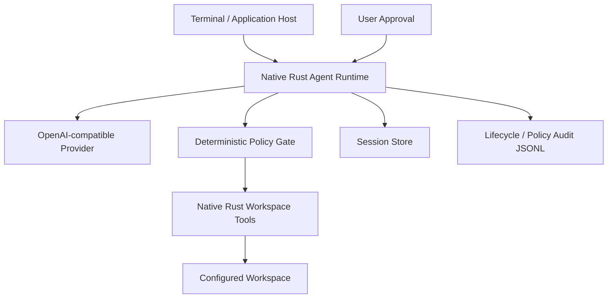

# Rust Agent

Rust Agent 是独立的 Rust Agent Runtime。CodeBuddy SDK 仅作为功能参考和可选互操作 Host，不是运行依赖。默认运行路径不需要 Node.js、npm、CodeBuddy CLI 或 `@tencent-ai/agent-sdk`。

## Architecture



The Rust runtime owns the Agent loop, conversation history, session lifecycle, context window, policy decisions, tool execution, and audit events. No CodeBuddy SDK or MCP client is required for the standalone runtime. The separate MCP server remains available when another Agent host needs to consume the Rust tools.

## Requirements

- Rust toolchain matching the workspace `rust-toolchain.toml` (or a compatible stable toolchain).
- An OpenAI-compatible API endpoint and API key.

## Build and run

```bash
cd tools/rust-agent
export OPENAI_API_KEY="<key>"
cargo run --release -- --model <model-id> --workspace /path/to/workspace
```

No npm install or CodeBuddy login is required.

## Sessions and context

Sessions are stored as JSON files under `.rust-agent/sessions/` in the configured workspace. The `latest` pointer supports `--continue`; use `--session-id` to resume a specific session. Use `/new`, `/session`, `/resume <id>`, and `/fork` in the interactive CLI.

```bash
cargo run -- --model <model-id> --workspace /path/to/workspace --continue
cargo run -- --model <model-id> --workspace /path/to/workspace --session-id <session-id>
```

A fork copies the current conversation into a new session and records its parent session ID. Session writes use a temporary file followed by rename to avoid leaving a partially written JSON document. Session IDs are validated before they are used as file names.

The runtime bounds the conversation history to the most recent 80 non-system messages by default. This is a sliding context window, not semantic summarization. It avoids unbounded prompt growth but does not yet provide CodeBuddy-style model-generated compaction summaries.

## Runtime controls

| Capability | Native implementation |
|---|---|
| Agent loop | Rust runtime with a bounded tool-call loop |
| Session lifecycle | Create, resume, continue latest, fork |
| Context management | Configurable sliding message window |
| Permission control | Deterministic Rust Policy Gate and per-write approval |
| Lifecycle hooks | Native audit events for prompts, turns, tools, policy decisions, sessions, and context windowing |
| Workspace tools | Rust read, list, search, and write operations |
| MCP | Standalone Rust stdio server with tools, resources, and prompts |

Options:

- `--max-tool-calls N`: maximum tool calls per turn (1–64).
- `--max-history-messages N`: retained non-system messages (4–2000).
- `--session-dir PATH`: override session storage.
- `--audit-file PATH`: override the JSONL audit file.

Audit events intentionally omit prompt text and file contents. Audit failures are logged but do not fail an otherwise successful Agent turn.

## Tools and policy

| Tool | Rust policy | Behavior |
|---|---|---|
| `read_file` | Allow | Read a UTF-8 file inside the workspace |
| `list_dir` | Allow | List a workspace directory |
| `search_files` | Allow | Search workspace files natively |
| `write_file` | Require approval | Ask for approval on every write |
| Unknown tool | Deny | Reject |

No Shell, process execution, arbitrary network tool, or workspace-external file tool is exposed. File operations remain subject to application-level path checks; this is not an OS sandbox and does not eliminate filesystem TOCTOU risks.

## Optional CodeBuddy adapter

`codebuddy-host/` is retained as an optional compatibility example for users who explicitly want CodeBuddy to own model orchestration. It is not used by the native Rust CLI and is not part of the default dependency or build path. The native runtime is the preferred path when minimizing external runtime dependencies.

## Current limitations

- The provider currently uses non-streaming OpenAI-compatible Chat Completions.
- Context management uses a sliding window; semantic summarization is not implemented yet.
- Native lifecycle hooks currently write audit events. A public callback/plugin interface is not implemented.
- Subagent orchestration, background task management, and task handoff are not implemented in the native runtime.
- Model fallback routing and per-turn model switching are not implemented yet.
- Terminal approval is synchronous. A desktop host will need an approval channel, but must retain the Rust policy check.
- Session storage is local JSON and is not designed for concurrent writers to the same session.
- The standalone MCP server supports tools, resources, and prompts over stdio.
